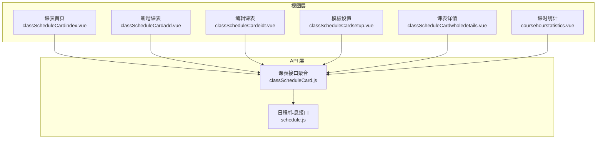
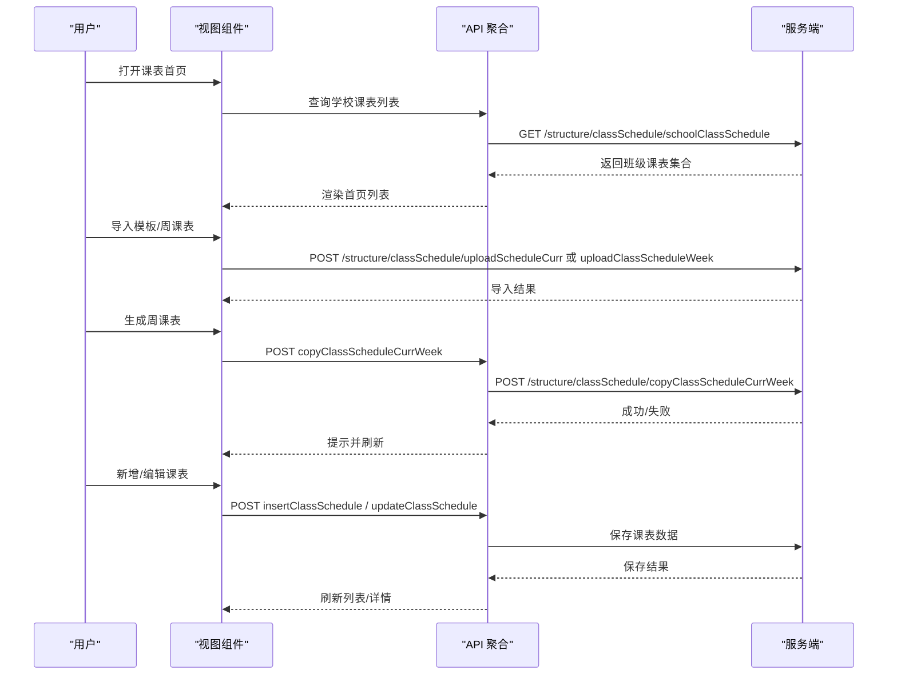
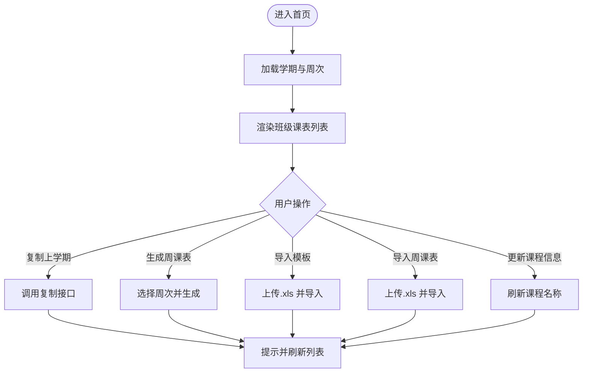
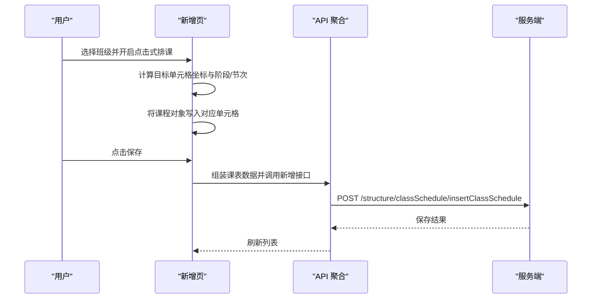
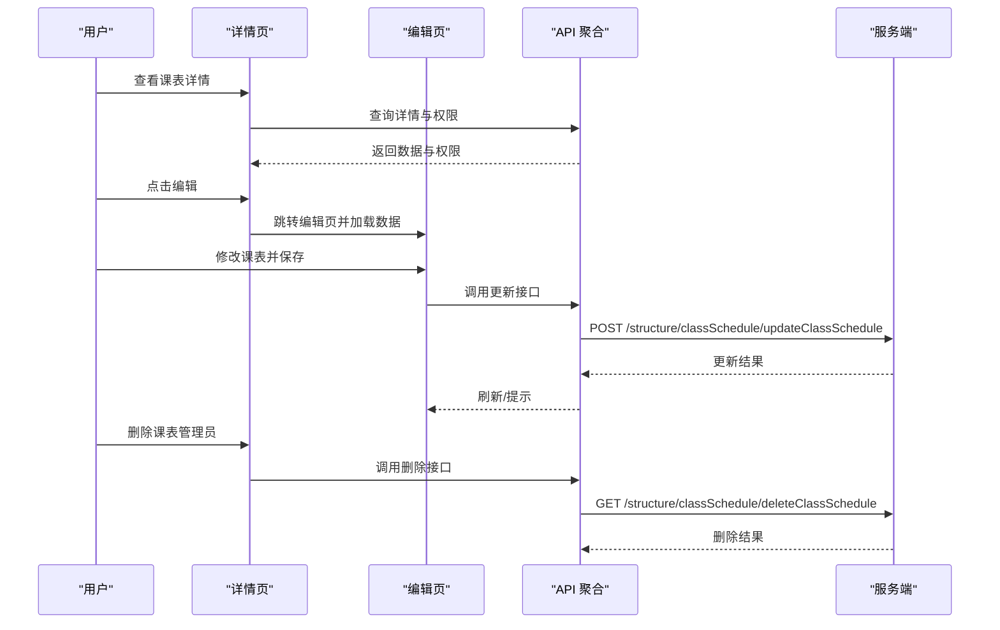
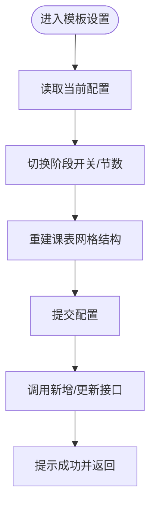
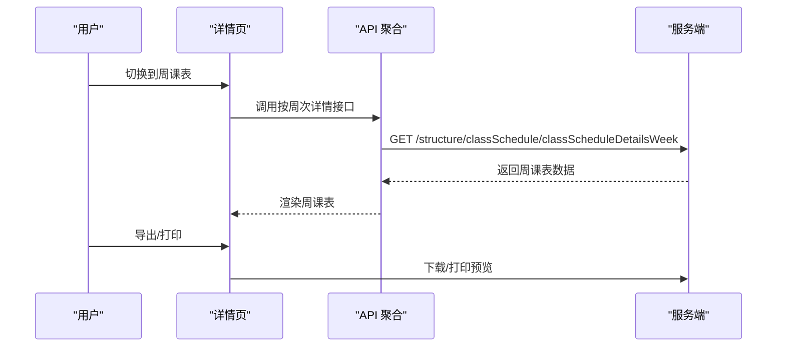
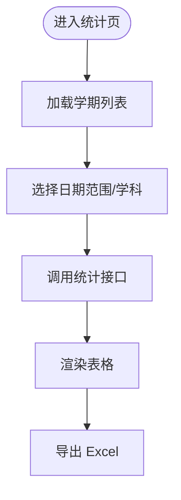
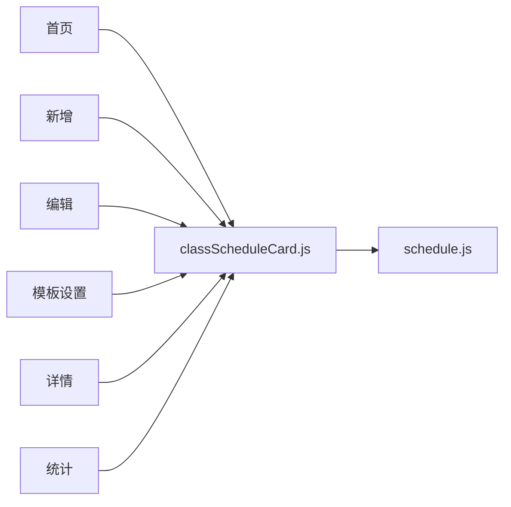

# 传统课表管理

<cite>
**本文引用的文件**
- [classScheduleCard.js](file://src/api/classScheduleCard.js)
- [classScheduleCardindex.vue](file://src/views/classScheduleCard/classScheduleCardindex.vue)
- [classScheduleCardadd.vue](file://src/views/classScheduleCard/classScheduleCardadd.vue)
- [classScheduleCardeidt.vue](file://src/views/classScheduleCard/classScheduleCardeidt.vue)
- [classScheduleCardsetup.vue](file://src/views/classScheduleCard/classScheduleCardsetup.vue)
- [classScheduleCardwholedetails.vue](file://src/views/classScheduleCard/classScheduleCardwholedetails.vue)
- [coursehourstatistics.vue](file://src/views/classScheduleCard/coursehourstatistics.vue)
- [schedule.js](file://src/api/schedule.js)
</cite>

## 目录
1. [简介](#简介)
2. [项目结构](#项目结构)
3. [核心组件](#核心组件)
4. [架构总览](#架构总览)
5. [详细组件分析](#详细组件分析)
6. [依赖关系分析](#依赖关系分析)
7. [性能考量](#性能考量)
8. [故障排查指南](#故障排查指南)
9. [结论](#结论)
10. [附录](#附录)

## 简介
本技术文档围绕传统课表管理功能进行系统化梳理，覆盖课表创建、编辑、查询、统计、导入导出、批量操作与报表统计等完整链路。重点阐述课表模板设置、课程时间配置、教室分配与教师安排的业务逻辑，以及冲突检测与手动排课规则的设计思路，并给出权限控制、数据验证与异常处理的实施方案。

## 项目结构
传统课表管理相关模块主要分布在以下位置：
- API 层：统一通过 classScheduleCard.js 聚合课表相关接口，包括设置、查询、导入导出、统计等。
- 视图层：以 classScheduleCard 为核心目录，包含首页列表、新增/编辑、模板设置、详情展示、周课表展示与课时统计等页面。
- 配置层：与作息时间、学期时间等基础数据交互，确保节次、单双周、周次等配置正确生效。

图表来源
- [classScheduleCardindex.vue](file://src/views/classScheduleCard/classScheduleCardindex.vue)
- [classScheduleCardadd.vue](file://src/views/classScheduleCard/classScheduleCardadd.vue)
- [classScheduleCardeidt.vue](file://src/views/classScheduleCard/classScheduleCardeidt.vue)
- [classScheduleCardsetup.vue](file://src/views/classScheduleCard/classScheduleCardsetup.vue)
- [classScheduleCardwholedetails.vue](file://src/views/classScheduleCard/classScheduleCardwholedetails.vue)
- [coursehourstatistics.vue](file://src/views/classScheduleCard/coursehourstatistics.vue)
- [classScheduleCard.js](file://src/api/classScheduleCard.js)
- [schedule.js](file://src/api/schedule.js)

章节来源
- [classScheduleCardindex.vue](file://src/views/classScheduleCard/classScheduleCardindex.vue)
- [classScheduleCardadd.vue](file://src/views/classScheduleCard/classScheduleCardadd.vue)
- [classScheduleCardeidt.vue](file://src/views/classScheduleCard/classScheduleCardeidt.vue)
- [classScheduleCardsetup.vue](file://src/views/classScheduleCard/classScheduleCardsetup.vue)
- [classScheduleCardwholedetails.vue](file://src/views/classScheduleCard/classScheduleCardwholedetails.vue)
- [coursehourstatistics.vue](file://src/views/classScheduleCard/coursehourstatistics.vue)
- [classScheduleCard.js](file://src/api/classScheduleCard.js)
- [schedule.js](file://src/api/schedule.js)

## 核心组件
- 课表首页与批量操作：支持复制上学期课表、生成周课表、导入模板/周课表、更新课程信息、下载模板等。
- 新增/编辑课表：提供拖拽式与点击式两种排课方式，支持单双周显示与切换。
- 模板设置：配置每阶段节次数量与单双周开关，影响课表布局与生成策略。
- 详情与导出：支持按排课表/周课表切换查看，支持打印与导出。
- 统计报表：按学期、日期范围、学科筛选统计教师课时与相关事件次数。

章节来源
- [classScheduleCardindex.vue](file://src/views/classScheduleCard/classScheduleCardindex.vue)
- [classScheduleCardadd.vue](file://src/views/classScheduleCard/classScheduleCardadd.vue)
- [classScheduleCardeidt.vue](file://src/views/classScheduleCard/classScheduleCardeidt.vue)
- [classScheduleCardsetup.vue](file://src/views/classScheduleCard/classScheduleCardsetup.vue)
- [classScheduleCardwholedetails.vue](file://src/views/classScheduleCard/classScheduleCardwholedetails.vue)
- [coursehourstatistics.vue](file://src/views/classScheduleCard/coursehourstatistics.vue)

## 架构总览
前端通过 API 层统一调用后端接口，完成课表的创建、编辑、查询与统计；模板设置与作息时间配置由独立接口支撑；导入导出与批量操作通过上传与下载链接实现。

图表来源
- [classScheduleCardindex.vue](file://src/views/classScheduleCard/classScheduleCardindex.vue)
- [classScheduleCardadd.vue](file://src/views/classScheduleCard/classScheduleCardadd.vue)
- [classScheduleCardeidt.vue](file://src/views/classScheduleCard/classScheduleCardeidt.vue)
- [classScheduleCard.js](file://src/api/classScheduleCard.js)

## 详细组件分析

### 1) 课表首页与批量操作
- 功能点
  - 复制上学期课表：一键复制历史课表至当前学期。
  - 生成周课表：选择周次，基于模板生成周课表。
  - 导入模板/周课表：支持 .xls 文件上传，分别导入模板与周课表。
  - 更新课程信息：同步系统内课程名称至课表。
  - 下载模板：提供模板文件下载链接。
- 关键交互
  - 通过学期列表与周次列表联动，动态生成周次勾选项。
  - 导入前校验文件类型，导入后刷新列表。
- 权限控制
  - 顶部按钮区根据权限动态显示“全部课程表”入口。

图表来源
- [classScheduleCardindex.vue](file://src/views/classScheduleCard/classScheduleCardindex.vue)
- [classScheduleCard.js](file://src/api/classScheduleCard.js)

章节来源
- [classScheduleCardindex.vue](file://src/views/classScheduleCard/classScheduleCardindex.vue)
- [classScheduleCard.js](file://src/api/classScheduleCard.js)

### 2) 新增课表（拖拽与点击式排课）
- 数据结构
  - 以“阶段×节次×星期×单双周”四维数组组织课表单元格，支持早自习、上午、午自习、下午、晚自习五个阶段。
  - 支持单双周显示，双周区域与单周区域并列展示。
- 排课方式
  - 拖拽式：从右侧课程列表拖拽到目标单元格。
  - 点击式：开启“横向/纵向添加”，自动填充连续空白单元格。
- 冲突检测与手动规则
  - 同一单元格同一节次仅允许一个课程占用。
  - 单双周模式下，同节次在单周与双周分别独立存储。
  - 点击式按阶段与节次顺序依次填充，避免跨阶段错位。
- 保存流程
  - 将二维数组拍平为一维列表，构造请求参数，调用新增接口保存。

图表来源
- [classScheduleCardadd.vue](file://src/views/classScheduleCard/classScheduleCardadd.vue)
- [classScheduleCard.js](file://src/api/classScheduleCard.js)

章节来源
- [classScheduleCardadd.vue](file://src/views/classScheduleCard/classScheduleCardadd.vue)
- [classScheduleCard.js](file://src/api/classScheduleCard.js)

### 3) 编辑课表（修改与删除）
- 功能点
  - 在详情页切换至编辑模式，支持删除单元格内课程项。
  - 修改后调用更新接口保存。
  - 支持删除整张课表（需管理员或相应权限）。
- 权限控制
  - 通过 isManager 接口判断是否为班级负责人，决定是否显示编辑/删除按钮。

图表来源
- [classScheduleCardwholedetails.vue](file://src/views/classScheduleCard/classScheduleCardwholedetails.vue)
- [classScheduleCardeidt.vue](file://src/views/classScheduleCard/classScheduleCardeidt.vue)
- [classScheduleCard.js](file://src/api/classScheduleCard.js)

章节来源
- [classScheduleCardwholedetails.vue](file://src/views/classScheduleCard/classScheduleCardwholedetails.vue)
- [classScheduleCardeidt.vue](file://src/views/classScheduleCard/classScheduleCardeidt.vue)
- [classScheduleCard.js](file://src/api/classScheduleCard.js)

### 4) 模板设置（课程时间配置）
- 功能点
  - 配置每个阶段的节次数量（早/上午/午/下午/晚）。
  - 开启/关闭单双周显示。
  - 设置变更会直接影响课表布局与生成策略。
- 交互逻辑
  - 切换阶段开关与节数时，动态重建二维表格结构。
  - 提交后调用新增/更新接口持久化配置。

图表来源
- [classScheduleCardsetup.vue](file://src/views/classScheduleCard/classScheduleCardsetup.vue)
- [classScheduleCard.js](file://src/api/classScheduleCard.js)

章节来源
- [classScheduleCardsetup.vue](file://src/views/classScheduleCard/classScheduleCardsetup.vue)
- [classScheduleCard.js](file://src/api/classScheduleCard.js)

### 5) 详情与导出（排课表/周课表）
- 功能点
  - 排课表：按阶段/节次/星期展示整张课表。
  - 周课表：按周次与日期范围展示每日课程。
  - 支持打印与导出 Excel。
- 技术要点
  - 周课表通过 classScheduleDetailsWeek 接口按周次拉取数据。
  - 导出使用带 token 的下载链接，确保鉴权。

图表来源
- [classScheduleCardwholedetails.vue](file://src/views/classScheduleCard/classScheduleCardwholedetails.vue)
- [classScheduleCard.js](file://src/api/classScheduleCard.js)

章节来源
- [classScheduleCardwholedetails.vue](file://src/views/classScheduleCard/classScheduleCardwholedetails.vue)
- [classScheduleCard.js](file://src/api/classScheduleCard.js)

### 6) 课时统计（报表统计）
- 功能点
  - 选择学期、日期范围、学科，筛选教师课时统计。
  - 支持按教师姓名前端搜索过滤。
  - 支持导出 Excel。
- 数据来源
  - 通过 getClassScheduleTeacherStaticListWeek 接口获取统计数据。

图表来源
- [coursehourstatistics.vue](file://src/views/classScheduleCard/coursehourstatistics.vue)
- [classScheduleCard.js](file://src/api/classScheduleCard.js)

章节来源
- [coursehourstatistics.vue](file://src/views/classScheduleCard/coursehourstatistics.vue)
- [classScheduleCard.js](file://src/api/classScheduleCard.js)

## 依赖关系分析
- 组件耦合
  - 视图组件通过 classScheduleCard.js 聚合调用，降低对具体接口路径的耦合。
  - 模板设置与作息时间配置相互独立，但共同决定课表布局。
- 外部依赖
  - 上传/下载依赖全局 BasePath 与 token 参数。
  - 统计页依赖学期时间与学科列表接口。

图表来源
- [classScheduleCardindex.vue](file://src/views/classScheduleCard/classScheduleCardindex.vue)
- [classScheduleCardadd.vue](file://src/views/classScheduleCard/classScheduleCardadd.vue)
- [classScheduleCardeidt.vue](file://src/views/classScheduleCard/classScheduleCardeidt.vue)
- [classScheduleCardsetup.vue](file://src/views/classScheduleCard/classScheduleCardsetup.vue)
- [classScheduleCardwholedetails.vue](file://src/views/classScheduleCard/classScheduleCardwholedetails.vue)
- [coursehourstatistics.vue](file://src/views/classScheduleCard/coursehourstatistics.vue)
- [classScheduleCard.js](file://src/api/classScheduleCard.js)
- [schedule.js](file://src/api/schedule.js)

章节来源
- [classScheduleCard.js](file://src/api/classScheduleCard.js)
- [schedule.js](file://src/api/schedule.js)

## 性能考量
- 列表渲染优化
  - 使用虚拟滚动或分页可减少 DOM 节点数量，提升大列表渲染性能。
- 请求合并
  - 批量操作（如复制上学期课表、生成周课表）建议后端支持批量接口，前端减少多次往返。
- 导入导出
  - 大文件上传建议采用分片或断点续传，结合进度反馈提升用户体验。
- 统计查询
  - 日期范围过大时建议服务端分页或异步任务导出，避免长时间阻塞。

## 故障排查指南
- 导入失败
  - 检查文件后缀是否为 .xls；确认上传地址与 token 参数正确。
  - 参考导入回调中的 result 字段与 msg 提示。
- 保存失败
  - 确认已选择班级与学期；检查必填字段是否为空。
  - 查看接口返回码与消息，定位具体错误原因。
- 权限不足
  - 班主任/管理员权限不足时，编辑/删除按钮不显示或操作失败。
  - 通过 isManager 接口确认当前用户是否具备相应权限。
- 统计无数据
  - 检查学期/日期范围/学科筛选条件是否合理；确认服务端统计接口可用。

章节来源
- [classScheduleCardindex.vue](file://src/views/classScheduleCard/classScheduleCardindex.vue)
- [classScheduleCardadd.vue](file://src/views/classScheduleCard/classScheduleCardadd.vue)
- [classScheduleCardeidt.vue](file://src/views/classScheduleCard/classScheduleCardeidt.vue)
- [classScheduleCardwholedetails.vue](file://src/views/classScheduleCard/classScheduleCardwholedetails.vue)
- [coursehourstatistics.vue](file://src/views/classScheduleCard/coursehourstatistics.vue)

## 结论
传统课表管理通过清晰的视图分层与统一的 API 聚合，实现了从模板设置、课程时间配置到导入导出与统计报表的完整闭环。新增/编辑页提供灵活的拖拽与点击式排课体验，配合权限控制与批量操作，满足日常教学管理需求。后续可在性能与稳定性方面进一步优化，以应对更大规模的数据与并发场景。

## 附录
- 操作流程速览
  - 创建：模板设置 → 新增课表 → 拖拽/点击排课 → 保存
  - 编辑：详情 → 编辑 → 修改/删除 → 保存
  - 查询：首页/详情 → 切换周课表/排课表 → 导出/打印
  - 统计：选择学期/日期/学科 → 导出 Excel
- 关键接口参考
  - 新增/更新课表：insertClassSchedule、updateClassSchedule
  - 模板设置：classScheduleSet、insertOrUpdateClassScheduleSet
  - 导入导出：uploadScheduleCurr、uploadClassScheduleWeek、exportClassSchedule
  - 统计：getClassScheduleTeacherStaticListWeek

章节来源
- [classScheduleCard.js](file://src/api/classScheduleCard.js)
- [schedule.js](file://src/api/schedule.js)