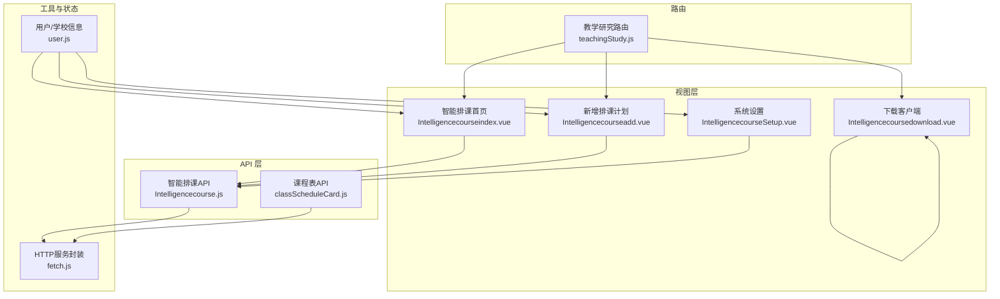
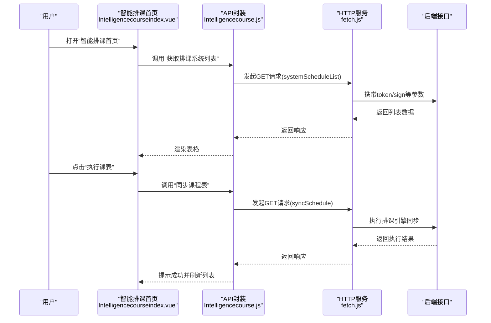
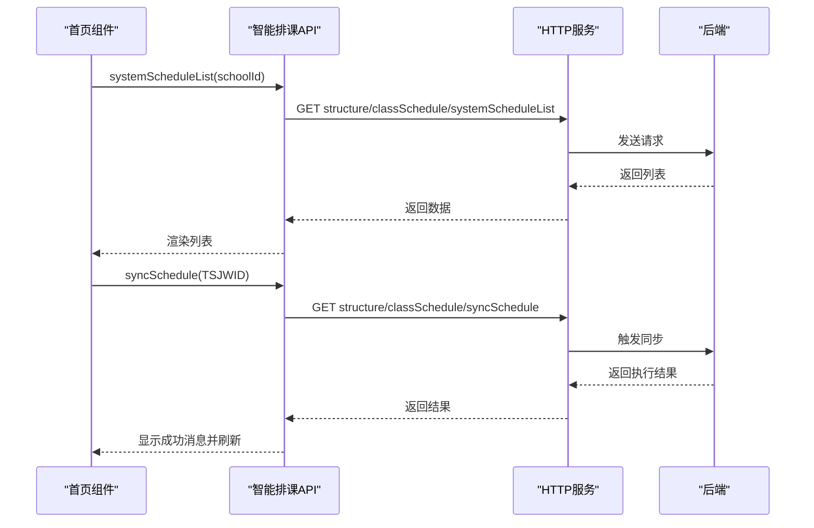
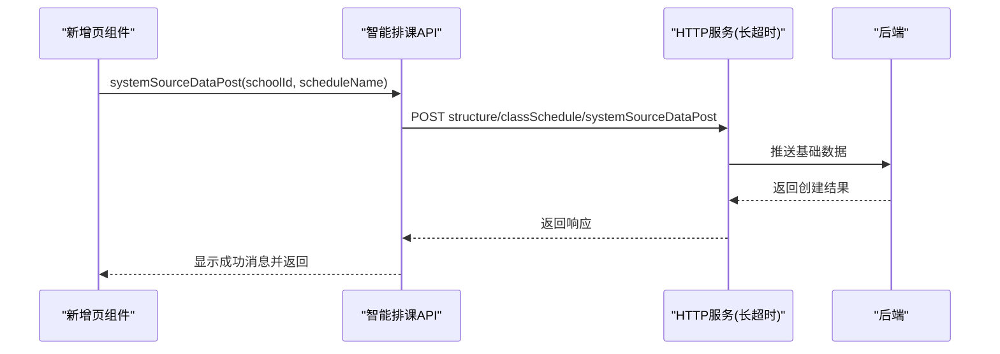
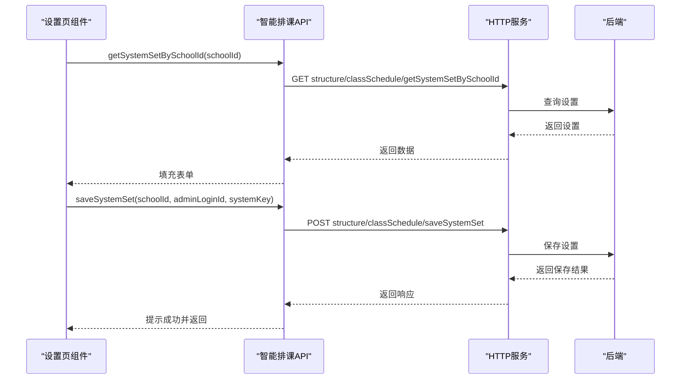
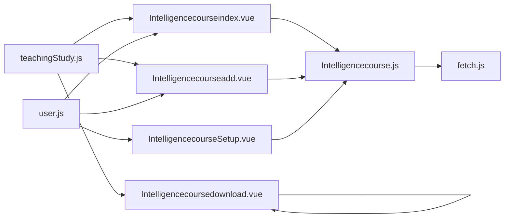

# 智能排课系统

<cite>
**本文引用的文件**
- [src/api/Intelligencecourse.js](file://src/api/Intelligencecourse.js)
- [src/views/Intelligencecourse/Intelligencecourseindex.vue](file://src/views/Intelligencecourse/Intelligencecourseindex.vue)
- [src/views/Intelligencecourse/Intelligencecourseadd.vue](file://src/views/Intelligencecourse/Intelligencecourseadd.vue)
- [src/views/Intelligencecourse/IntelligencecourseSetup.vue](file://src/views/Intelligencecourse/IntelligencecourseSetup.vue)
- [src/views/Intelligencecourse/Intelligencecoursedownload.vue](file://src/views/Intelligencecourse/Intelligencecoursedownload.vue)
- [src/router/modules/teachingStudy.js](file://src/router/modules/teachingStudy.js)
- [src/utils/fetch.js](file://src/utils/fetch.js)
- [src/store/modules/user.js](file://src/store/modules/user.js)
- [src/api/classScheduleCard.js](file://src/api/classScheduleCard.js)
- [src/views/classScheduleCard/classScheduleCardindex.vue](file://src/views/classScheduleCard/classScheduleCardindex.vue)
</cite>

## 目录
1. [简介](#简介)
2. [项目结构](#项目结构)
3. [核心组件](#核心组件)
4. [架构总览](#架构总览)
5. [详细组件分析](#详细组件分析)
6. [依赖关系分析](#依赖关系分析)
7. [性能考虑](#性能考虑)
8. [故障排除指南](#故障排除指南)
9. [结论](#结论)
10. [附录](#附录)

## 简介
本技术文档面向“智能排课系统”，聚焦于前端交互层与后端接口的协作模式，系统通过统一的HTTP服务封装与路由配置，实现以下能力：
- 配置智能排课系统接入参数（账号、授权Key）
- 创建排课计划并推送基础数据至排课系统
- 同步执行已创建的排课计划
- 删除课表
- 下载排课客户端并提供常见问题指引

与传统课表相比，智能排课系统强调“外部排课引擎+前端调度”的分工：前端负责业务入口、参数配置与执行控制，具体排课算法由独立的排课客户端完成。

## 项目结构
围绕智能排课功能，前端采用模块化组织，主要涉及：
- API 层：封装与排课系统交互的HTTP接口
- 视图层：提供配置、新增、列表与下载客户端的页面
- 路由层：定义页面访问路径与权限标识
- 工具层：统一的HTTP服务与拦截器
- 状态层：用户与学校信息存储

图表来源
- [src/views/Intelligencecourse/Intelligencecourseindex.vue:1-132](file://src/views/Intelligencecourse/Intelligencecourseindex.vue#L1-L132)
- [src/views/Intelligencecourse/Intelligencecourseadd.vue:1-86](file://src/views/Intelligencecourse/Intelligencecourseadd.vue#L1-L86)
- [src/views/Intelligencecourse/IntelligencecourseSetup.vue:1-96](file://src/views/Intelligencecourse/IntelligencecourseSetup.vue#L1-L96)
- [src/views/Intelligencecourse/Intelligencecoursedownload.vue:1-84](file://src/views/Intelligencecourse/Intelligencecoursedownload.vue#L1-L84)
- [src/api/Intelligencecourse.js:1-70](file://src/api/Intelligencecourse.js#L1-L70)
- [src/api/classScheduleCard.js:1-320](file://src/api/classScheduleCard.js#L1-L320)
- [src/router/modules/teachingStudy.js:139-149](file://src/router/modules/teachingStudy.js#L139-L149)
- [src/utils/fetch.js:1-240](file://src/utils/fetch.js#L1-L240)
- [src/store/modules/user.js:1-447](file://src/store/modules/user.js#L1-L447)

章节来源
- [src/router/modules/teachingStudy.js:139-149](file://src/router/modules/teachingStudy.js#L139-L149)
- [src/api/Intelligencecourse.js:1-70](file://src/api/Intelligencecourse.js#L1-L70)
- [src/utils/fetch.js:1-240](file://src/utils/fetch.js#L1-L240)
- [src/store/modules/user.js:1-447](file://src/store/modules/user.js#L1-L447)

## 核心组件
- 智能排课首页：展示排课计划列表，支持执行与删除；触发“下载客户端”导航
- 新增排课计划：输入计划名称，提交后向排课系统推送基础数据
- 系统设置：配置排课系统账号与授权Key，保存至后端
- 下载客户端：提供客户端与.NET Framework下载链接及常见问题解答
- API 封装：统一HTTP请求、参数序列化、签名与鉴权、超时控制
- 路由配置：将上述页面映射到可访问路径，并绑定权限标识

章节来源
- [src/views/Intelligencecourse/Intelligencecourseindex.vue:1-132](file://src/views/Intelligencecourse/Intelligencecourseindex.vue#L1-L132)
- [src/views/Intelligencecourse/Intelligencecourseadd.vue:1-86](file://src/views/Intelligencecourse/Intelligencecourseadd.vue#L1-L86)
- [src/views/Intelligencecourse/IntelligencecourseSetup.vue:1-96](file://src/views/Intelligencecourse/IntelligencecourseSetup.vue#L1-L96)
- [src/views/Intelligencecourse/Intelligencecoursedownload.vue:1-84](file://src/views/Intelligencecourse/Intelligencecoursedownload.vue#L1-L84)
- [src/api/Intelligencecourse.js:1-70](file://src/api/Intelligencecourse.js#L1-L70)
- [src/utils/fetch.js:1-240](file://src/utils/fetch.js#L1-L240)

## 架构总览
前端通过统一的HTTP服务封装，向后端接口发起请求，接口地址均以“structure/classSchedule/...”为前缀。系统设置与排课计划的创建/执行/删除均通过该封装层完成。路由模块将页面与权限路径关联，确保访问控制。

图表来源
- [src/views/Intelligencecourse/Intelligencecourseindex.vue:63-97](file://src/views/Intelligencecourse/Intelligencecourseindex.vue#L63-L97)
- [src/api/Intelligencecourse.js:8-26](file://src/api/Intelligencecourse.js#L8-L26)
- [src/utils/fetch.js:13-171](file://src/utils/fetch.js#L13-L171)

章节来源
- [src/views/Intelligencecourse/Intelligencecourseindex.vue:63-97](file://src/views/Intelligencecourse/Intelligencecourseindex.vue#L63-L97)
- [src/api/Intelligencecourse.js:8-26](file://src/api/Intelligencecourse.js#L8-L26)
- [src/utils/fetch.js:13-171](file://src/utils/fetch.js#L13-L171)

## 详细组件分析

### 组件A：智能排课首页（列表、执行、删除）
职责
- 加载并展示排课计划列表
- 支持执行课表（触发排课引擎同步）
- 支持删除课表
- 提供“下载客户端”入口

关键流程
- 初始化时调用“获取排课系统列表”
- 用户点击“执行课表”时调用“同步课程表”
- 用户点击“删除课表”时调用“删除排课系统课表”

图表来源
- [src/views/Intelligencecourse/Intelligencecourseindex.vue:63-97](file://src/views/Intelligencecourse/Intelligencecourseindex.vue#L63-L97)
- [src/api/Intelligencecourse.js:8-26](file://src/api/Intelligencecourse.js#L8-L26)
- [src/utils/fetch.js:13-171](file://src/utils/fetch.js#L13-L171)

章节来源
- [src/views/Intelligencecourse/Intelligencecourseindex.vue:1-132](file://src/views/Intelligencecourse/Intelligencecourseindex.vue#L1-L132)
- [src/api/Intelligencecourse.js:8-26](file://src/api/Intelligencecourse.js#L8-L26)

### 组件B：新增排课计划（创建并推送基础数据）
职责
- 输入排课计划名称
- 调用“创建课表并推送基础数据”接口
- 提示执行结果并返回

关键流程
- 表单校验通过后，调用“systemSourceDataPost”
- 使用长超时HTTP服务进行网络请求
- 成功后提示并返回上一页

图表来源
- [src/views/Intelligencecourse/Intelligencecourseadd.vue:42-69](file://src/views/Intelligencecourse/Intelligencecourseadd.vue#L42-L69)
- [src/api/Intelligencecourse.js:28-36](file://src/api/Intelligencecourse.js#L28-L36)
- [src/utils/fetch.js:3-5](file://src/utils/fetch.js#L3-L5)

章节来源
- [src/views/Intelligencecourse/Intelligencecourseadd.vue:1-86](file://src/views/Intelligencecourse/Intelligencecourseadd.vue#L1-L86)
- [src/api/Intelligencecourse.js:28-36](file://src/api/Intelligencecourse.js#L28-L36)

### 组件C：系统设置（保存账号与Key）
职责
- 展示并编辑排课系统账号与授权Key
- 保存设置到后端

关键流程
- 页面加载时调用“获取排课系统设置”
- 保存时调用“保存排课系统设置”

图表来源
- [src/views/Intelligencecourse/IntelligencecourseSetup.vue:39-79](file://src/views/Intelligencecourse/IntelligencecourseSetup.vue#L39-L79)
- [src/api/Intelligencecourse.js:39-59](file://src/api/Intelligencecourse.js#L39-L59)
- [src/utils/fetch.js:13-171](file://src/utils/fetch.js#L13-L171)

章节来源
- [src/views/Intelligencecourse/IntelligencecourseSetup.vue:1-96](file://src/views/Intelligencecourse/IntelligencecourseSetup.vue#L1-L96)
- [src/api/Intelligencecourse.js:39-59](file://src/api/Intelligencecourse.js#L39-L59)

### 组件D：下载客户端与常见问题
职责
- 提供排课客户端下载链接
- 提供.NET Framework下载链接
- 提供常见问题与解决方案

章节来源
- [src/views/Intelligencecourse/Intelligencecoursedownload.vue:1-84](file://src/views/Intelligencecourse/Intelligencecoursedownload.vue#L1-L84)

### 组件E：HTTP服务封装与拦截器
职责
- 统一请求头、参数序列化、token与sign注入
- 统一响应处理与错误提示
- 提供不同baseURL与超时配置的服务实例

关键点
- 自动注入token与sign
- 对特定接口支持JSON传输
- 统一错误码处理与登出逻辑

章节来源
- [src/utils/fetch.js:1-240](file://src/utils/fetch.js#L1-L240)

### 组件F：课程表相关API与页面（对比参考）
职责
- 提供课程表查询、复制、刷新、导入导出等能力
- 作为传统课表功能的对比参考，体现智能排课与传统课表的差异

章节来源
- [src/api/classScheduleCard.js:1-320](file://src/api/classScheduleCard.js#L1-L320)
- [src/views/classScheduleCard/classScheduleCardindex.vue:1-353](file://src/views/classScheduleCard/classScheduleCardindex.vue#L1-L353)

## 依赖关系分析
- 视图组件依赖API封装与路由配置
- API封装依赖HTTP服务与全局环境变量
- 路由模块将页面与权限路径关联
- 状态模块提供学校信息与用户上下文

图表来源
- [src/views/Intelligencecourse/Intelligencecourseindex.vue:1-132](file://src/views/Intelligencecourse/Intelligencecourseindex.vue#L1-L132)
- [src/views/Intelligencecourse/Intelligencecourseadd.vue:1-86](file://src/views/Intelligencecourse/Intelligencecourseadd.vue#L1-L86)
- [src/views/Intelligencecourse/IntelligencecourseSetup.vue:1-96](file://src/views/Intelligencecourse/IntelligencecourseSetup.vue#L1-L96)
- [src/views/Intelligencecourse/Intelligencecoursedownload.vue:1-84](file://src/views/Intelligencecourse/Intelligencecoursedownload.vue#L1-L84)
- [src/api/Intelligencecourse.js:1-70](file://src/api/Intelligencecourse.js#L1-L70)
- [src/router/modules/teachingStudy.js:139-149](file://src/router/modules/teachingStudy.js#L139-L149)
- [src/utils/fetch.js:1-240](file://src/utils/fetch.js#L1-L240)
- [src/store/modules/user.js:1-447](file://src/store/modules/user.js#L1-L447)

章节来源
- [src/router/modules/teachingStudy.js:139-149](file://src/router/modules/teachingStudy.js#L139-L149)
- [src/api/Intelligencecourse.js:1-70](file://src/api/Intelligencecourse.js#L1-L70)
- [src/utils/fetch.js:1-240](file://src/utils/fetch.js#L1-L240)
- [src/store/modules/user.js:1-447](file://src/store/modules/user.js#L1-L447)

## 性能考虑
- 请求超时
  - 智能排课相关接口默认使用较长超时的HTTP服务实例，适合长时间任务（如同步执行）
  - 其他接口使用默认超时，兼顾响应速度
- 参数序列化
  - 统一使用URLSearchParams，减少不必要的JSON转换
- 错误处理
  - 统一拦截器处理错误码与提示，避免重复逻辑
- 并发控制
  - 页面内避免同时发起多个耗时请求，必要时使用loading状态与确认对话框

章节来源
- [src/api/Intelligencecourse.js:3-5](file://src/api/Intelligencecourse.js#L3-L5)
- [src/utils/fetch.js:13-171](file://src/utils/fetch.js#L13-L171)

## 故障排除指南
- 无法连接服务器
  - 检查网络与防火墙设置，确保允许客户端联网
  - 确认学校IT管理人员已正确配置网络策略
- 缺少.NET Framework
  - 按照下载页面提供的链接安装.NET Framework
- 执行课表失败
  - 确认已正确配置系统设置（账号与Key）
  - 检查排课计划是否已成功创建并推送基础数据
  - 查看后端日志与前端错误提示，结合统一拦截器中的错误码定位问题
- 页面无数据或加载缓慢
  - 检查token与sign是否正确注入
  - 确认请求URL与参数是否符合接口规范

章节来源
- [src/views/Intelligencecourse/Intelligencecoursedownload.vue:14-21](file://src/views/Intelligencecourse/Intelligencecoursedownload.vue#L14-L21)
- [src/api/Intelligencecourse.js:39-59](file://src/api/Intelligencecourse.js#L39-L59)
- [src/utils/fetch.js:104-169](file://src/utils/fetch.js#L104-L169)

## 结论
智能排课系统通过清晰的前后端分工与统一的HTTP服务封装，实现了从配置、创建、执行到删除的完整闭环。前端页面简洁直观，配合路由与权限控制，确保了良好的用户体验。对于排课算法与冲突避免等内部逻辑，系统通过外部排课客户端实现，前端仅负责调度与结果呈现。建议在后续迭代中进一步完善参数校验、错误重试与日志追踪，提升稳定性与可观测性。

## 附录

### 接口一览（与智能排课相关）
- 获取排课系统列表：GET structure/classSchedule/systemScheduleList
- 同步课程表：GET structure/classSchedule/syncSchedule
- 创建课表并推送基础数据：POST structure/classSchedule/systemSourceDataPost
- 获取排课系统设置：GET structure/classSchedule/getSystemSetBySchoolId
- 保存排课系统设置：POST structure/classSchedule/saveSystemSet
- 删除排课系统课表：GET structure/classSchedule/deleteSchedule

章节来源
- [src/api/Intelligencecourse.js:8-69](file://src/api/Intelligencecourse.js#L8-L69)