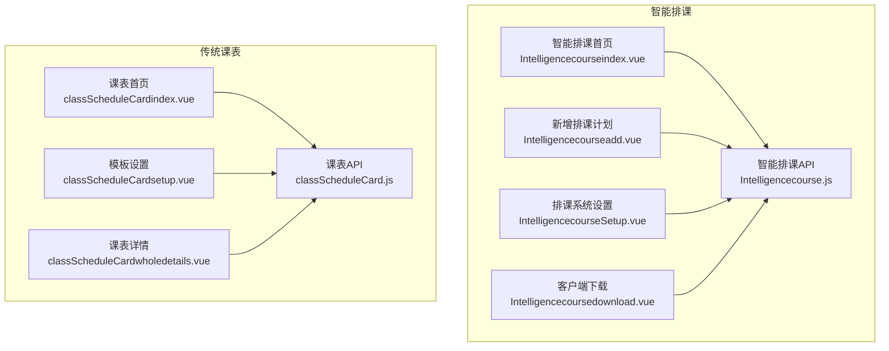
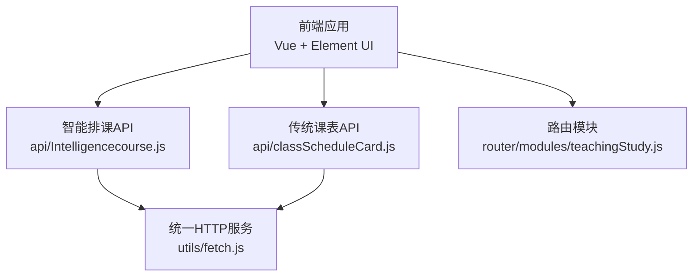
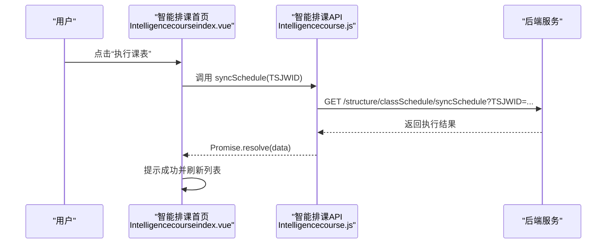
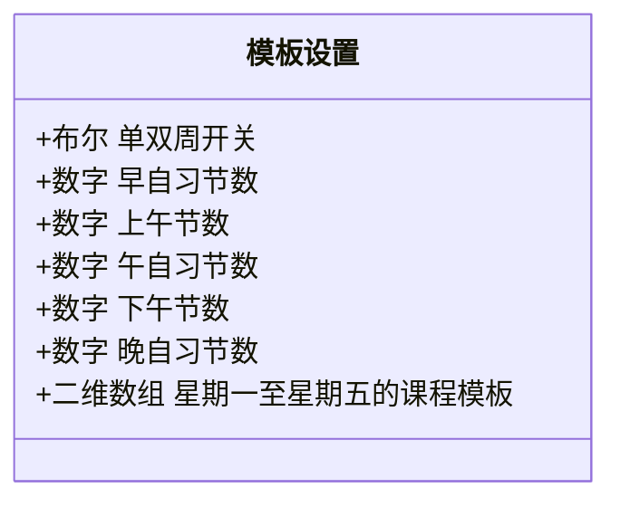
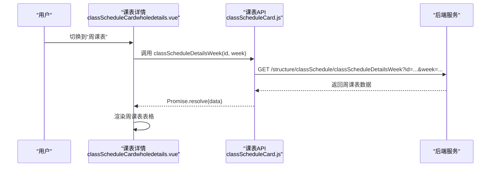
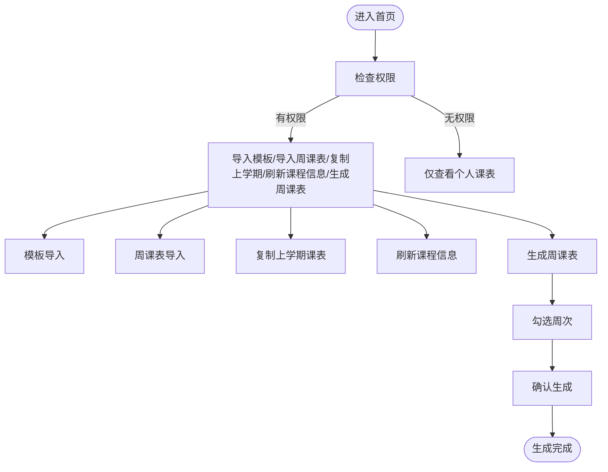
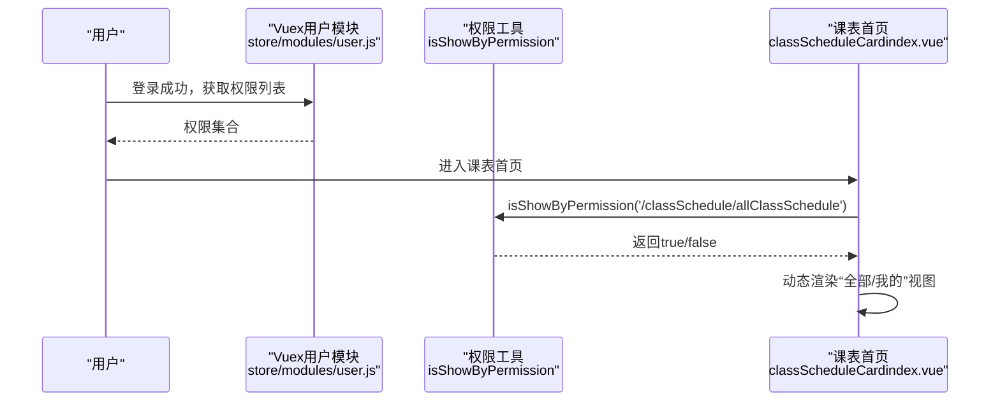
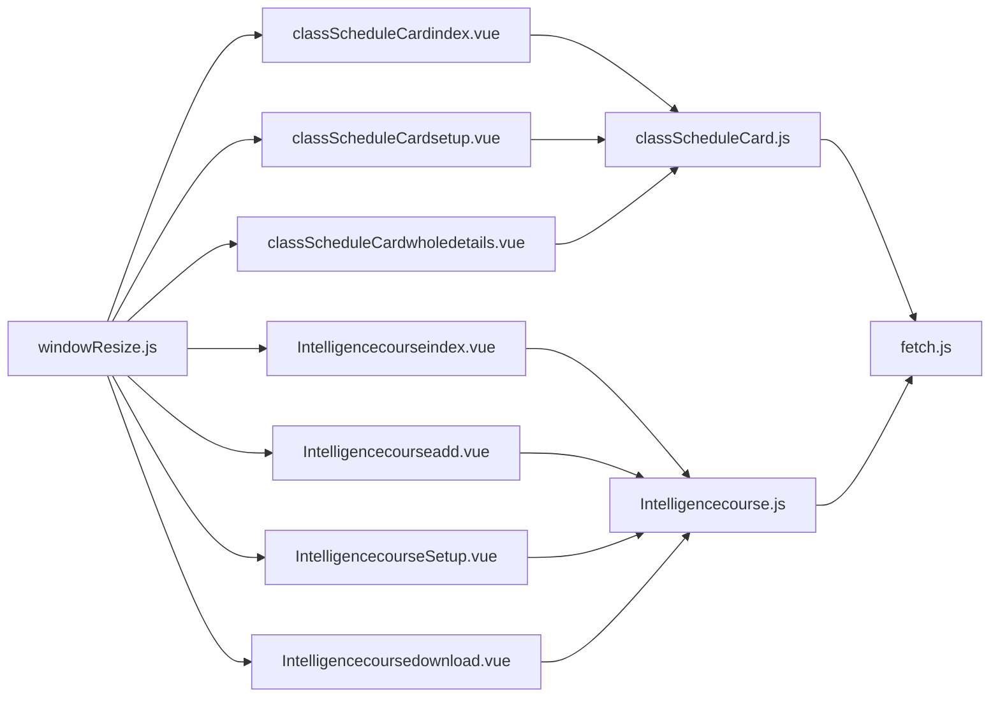

# 课程安排管理

<cite>
**本文引用的文件**
- [src/views/Intelligencecourse/Intelligencecourseindex.vue](file://src/views/Intelligencecourse/Intelligencecourseindex.vue)
- [src/views/Intelligencecourse/Intelligencecourseadd.vue](file://src/views/Intelligencecourse/Intelligencecourseadd.vue)
- [src/views/Intelligencecourse/IntelligencecourseSetup.vue](file://src/views/Intelligencecourse/IntelligencecourseSetup.vue)
- [src/views/Intelligencecourse/Intelligencecoursedownload.vue](file://src/views/Intelligencecourse/Intelligencecoursedownload.vue)
- [src/api/Intelligencecourse.js](file://src/api/Intelligencecourse.js)
- [src/router/modules/teachingStudy.js](file://src/router/modules/teachingStudy.js)
- [src/views/classScheduleCard/classScheduleCardindex.vue](file://src/views/classScheduleCard/classScheduleCardindex.vue)
- [src/views/classScheduleCard/classScheduleCardsetup.vue](file://src/views/classScheduleCard/classScheduleCardsetup.vue)
- [src/views/classScheduleCard/classScheduleCardwholedetails.vue](file://src/views/classScheduleCard/classScheduleCardwholedetails.vue)
- [src/api/classScheduleCard.js](file://src/api/classScheduleCard.js)
- [src/mixins/windowResize.js](file://src/mixins/windowResize.js)
- [src/utils/fetch.js](file://src/utils/fetch.js)
- [src/store/modules/user.js](file://src/store/modules/user.js)
- [src/utils/validate.js](file://src/utils/validate.js)
- [src/api/systemSet/permission.js](file://src/api/systemSet/permission.js)
</cite>

## 目录
1. [引言](#引言)
2. [项目结构](#项目结构)
3. [核心组件](#核心组件)
4. [架构总览](#架构总览)
5. [详细组件分析](#详细组件分析)
6. [依赖关系分析](#依赖关系分析)
7. [性能考量](#性能考量)
8. [故障排查指南](#故障排查指南)
9. [结论](#结论)
10. [附录](#附录)

## 引言
本技术文档围绕“课程安排管理”功能展开，系统性阐述传统课表管理与智能排课两大模式的设计与实现。内容涵盖课程表的创建、编辑、查询、统计、导入导出、批量操作与报表统计；详述课程时间设置、教室分配、教师安排等核心业务逻辑；解释课程表数据结构、冲突检测与自动排课规则；并给出权限控制、数据验证与异常处理的技术细节。

## 项目结构
课程安排管理由两大部分构成：
- 智能排课模块：基于外部排课客户端的云端服务，前端负责计划创建、设置、执行与删除。
- 传统课表模块：基于本地配置的课程节次与单双周设置，支持模板导入、周课表生成、教师/班级课表查看与导出。

图表来源
- [src/views/Intelligencecourse/Intelligencecourseindex.vue:1-132](file://src/views/Intelligencecourse/Intelligencecourseindex.vue#L1-L132)
- [src/views/Intelligencecourse/Intelligencecourseadd.vue:1-86](file://src/views/Intelligencecourse/Intelligencecourseadd.vue#L1-L86)
- [src/views/Intelligencecourse/IntelligencecourseSetup.vue:1-96](file://src/views/Intelligencecourse/IntelligencecourseSetup.vue#L1-L96)
- [src/views/Intelligencecourse/Intelligencecoursedownload.vue:1-84](file://src/views/Intelligencecourse/Intelligencecoursedownload.vue#L1-L84)
- [src/api/Intelligencecourse.js:1-70](file://src/api/Intelligencecourse.js#L1-L70)
- [src/views/classScheduleCard/classScheduleCardindex.vue:1-353](file://src/views/classScheduleCard/classScheduleCardindex.vue#L1-L353)
- [src/views/classScheduleCard/classScheduleCardsetup.vue:1-454](file://src/views/classScheduleCard/classScheduleCardsetup.vue#L1-L454)
- [src/views/classScheduleCard/classScheduleCardwholedetails.vue:1-413](file://src/views/classScheduleCard/classScheduleCardwholedetails.vue#L1-L413)
- [src/api/classScheduleCard.js:1-320](file://src/api/classScheduleCard.js#L1-L320)

章节来源
- [src/router/modules/teachingStudy.js:117-146](file://src/router/modules/teachingStudy.js#L117-L146)

## 核心组件
- 智能排课首页：展示排课计划列表，支持执行与删除。
- 新增排课计划：创建排课计划并推送基础数据至排课系统。
- 排课系统设置：配置排课软件账号与授权Key。
- 客户端下载：提供排课客户端与.NET Framework下载链接及常见问题。
- 传统课表首页：展示班级课表，支持模板导入、周课表生成、复制上学期课表、刷新课程信息。
- 模板设置：配置每日节次数量、单双周开关与各时间段课程模板。
- 课表详情：支持按排课表/周课表切换、编辑、导出、打印。

章节来源
- [src/views/Intelligencecourse/Intelligencecourseindex.vue:1-132](file://src/views/Intelligencecourse/Intelligencecourseindex.vue#L1-L132)
- [src/views/Intelligencecourse/Intelligencecourseadd.vue:1-86](file://src/views/Intelligencecourse/Intelligencecourseadd.vue#L1-L86)
- [src/views/Intelligencecourse/IntelligencecourseSetup.vue:1-96](file://src/views/Intelligencecourse/IntelligencecourseSetup.vue#L1-L96)
- [src/views/Intelligencecourse/Intelligencecoursedownload.vue:1-84](file://src/views/Intelligencecourse/Intelligencecoursedownload.vue#L1-L84)
- [src/views/classScheduleCard/classScheduleCardindex.vue:1-353](file://src/views/classScheduleCard/classScheduleCardindex.vue#L1-L353)
- [src/views/classScheduleCard/classScheduleCardsetup.vue:1-454](file://src/views/classScheduleCard/classScheduleCardsetup.vue#L1-L454)
- [src/views/classScheduleCard/classScheduleCardwholedetails.vue:1-413](file://src/views/classScheduleCard/classScheduleCardwholedetails.vue#L1-L413)

## 架构总览
前端采用Vue + Element UI，通过统一的HTTP服务层进行后端交互。请求拦截器统一注入token与签名参数，响应拦截器集中处理错误码与消息提示。路由模块将“智能排课”与“传统课表”两类功能纳入教学研究模块。

图表来源
- [src/utils/fetch.js:1-240](file://src/utils/fetch.js#L1-L240)
- [src/api/Intelligencecourse.js:1-70](file://src/api/Intelligencecourse.js#L1-L70)
- [src/api/classScheduleCard.js:1-320](file://src/api/classScheduleCard.js#L1-L320)
- [src/router/modules/teachingStudy.js:117-146](file://src/router/modules/teachingStudy.js#L117-L146)

## 详细组件分析

### 智能排课模块

#### 组件职责与交互
- 智能排课首页：拉取排课计划列表，支持执行课表与删除课表。
- 新增排课计划：提交学校ID与计划名称，触发基础数据推送。
- 排课系统设置：读取并保存排课软件账号与Key。
- 客户端下载：提供下载链接与常见问题说明。

图表来源
- [src/views/Intelligencecourse/Intelligencecourseindex.vue:74-96](file://src/views/Intelligencecourse/Intelligencecourseindex.vue#L74-L96)
- [src/api/Intelligencecourse.js:18-26](file://src/api/Intelligencecourse.js#L18-L26)

章节来源
- [src/views/Intelligencecourse/Intelligencecourseindex.vue:1-132](file://src/views/Intelligencecourse/Intelligencecourseindex.vue#L1-L132)
- [src/views/Intelligencecourse/Intelligencecourseadd.vue:1-86](file://src/views/Intelligencecourse/Intelligencecourseadd.vue#L1-L86)
- [src/views/Intelligencecourse/IntelligencecourseSetup.vue:1-96](file://src/views/Intelligencecourse/IntelligencecourseSetup.vue#L1-L96)
- [src/views/Intelligencecourse/Intelligencecoursedownload.vue:1-84](file://src/views/Intelligencecourse/Intelligencecoursedownload.vue#L1-L84)
- [src/api/Intelligencecourse.js:1-70](file://src/api/Intelligencecourse.js#L1-L70)

### 传统课表模块

#### 数据模型与模板设置
- 模板设置包含“早自习/上午/午自习/下午/晚自习”的节次数量与单双周开关。
- 每个时间段按周一至周五维护课程模板列表，支持动态增删。

图表来源
- [src/views/classScheduleCard/classScheduleCardsetup.vue:224-371](file://src/views/classScheduleCard/classScheduleCardsetup.vue#L224-L371)

章节来源
- [src/views/classScheduleCard/classScheduleCardsetup.vue:1-454](file://src/views/classScheduleCard/classScheduleCardsetup.vue#L1-L454)

#### 课表详情与周课表
- 支持切换“排课表/周课表”，周课表按当前学期周次动态加载。
- 导出与打印功能通过后端接口生成文件流。

图表来源
- [src/views/classScheduleCard/classScheduleCardwholedetails.vue:291-298](file://src/views/classScheduleCard/classScheduleCardwholedetails.vue#L291-L298)
- [src/api/classScheduleCard.js:44-53](file://src/api/classScheduleCard.js#L44-L53)

章节来源
- [src/views/classScheduleCard/classScheduleCardwholedetails.vue:1-413](file://src/views/classScheduleCard/classScheduleCardwholedetails.vue#L1-L413)
- [src/api/classScheduleCard.js:1-320](file://src/api/classScheduleCard.js#L1-L320)

#### 首页与批量操作
- 首页支持模板导入、周课表导入、复制上学期课表、刷新课程信息。
- 周课表生成对话框支持多周选择与一键生成。

图表来源
- [src/views/classScheduleCard/classScheduleCardindex.vue:141-188](file://src/views/classScheduleCard/classScheduleCardindex.vue#L141-L188)
- [src/views/classScheduleCard/classScheduleCardindex.vue:229-274](file://src/views/classScheduleCard/classScheduleCardindex.vue#L229-L274)

章节来源
- [src/views/classScheduleCard/classScheduleCardindex.vue:1-353](file://src/views/classScheduleCard/classScheduleCardindex.vue#L1-L353)

### 权限控制与数据验证

#### 权限控制
- 用户登录后从后端获取权限列表，存储于Vuex中，页面通过工具函数判断是否显示特定按钮或跳转到详情页。
- “全部课程表”与“我的课程表”视图根据权限动态切换。

图表来源
- [src/store/modules/user.js:87-96](file://src/store/modules/user.js#L87-L96)
- [src/views/classScheduleCard/classScheduleCardindex.vue:276-289](file://src/views/classScheduleCard/classScheduleCardindex.vue#L276-L289)

章节来源
- [src/store/modules/user.js:1-447](file://src/store/modules/user.js#L1-L447)
- [src/views/classScheduleCard/classScheduleCardindex.vue:1-353](file://src/views/classScheduleCard/classScheduleCardindex.vue#L1-L353)

#### 数据验证
- 表单校验使用Element UI的表单规则，结合通用正则工具进行手机号、身份证等字段校验。
- 智能排课设置页对必填项进行非空校验。

章节来源
- [src/utils/validate.js:1-72](file://src/utils/validate.js#L1-L72)
- [src/views/Intelligencecourse/IntelligencecourseSetup.vue:10-16](file://src/views/Intelligencecourse/IntelligencecourseSetup.vue#L10-L16)

## 依赖关系分析

图表来源
- [src/views/classScheduleCard/classScheduleCardindex.vue:65-126](file://src/views/classScheduleCard/classScheduleCardindex.vue#L65-L126)
- [src/views/classScheduleCard/classScheduleCardsetup.vue:220-250](file://src/views/classScheduleCard/classScheduleCardsetup.vue#L220-L250)
- [src/views/classScheduleCard/classScheduleCardwholedetails.vue:231-257](file://src/views/classScheduleCard/classScheduleCardwholedetails.vue#L231-L257)
- [src/views/Intelligencecourse/Intelligencecourseindex.vue:33-44](file://src/views/Intelligencecourse/Intelligencecourseindex.vue#L33-L44)
- [src/views/Intelligencecourse/Intelligencecourseadd.vue:24-34](file://src/views/Intelligencecourse/Intelligencecourseadd.vue#L24-L34)
- [src/views/Intelligencecourse/IntelligencecourseSetup.vue:25-37](file://src/views/Intelligencecourse/IntelligencecourseSetup.vue#L25-L37)
- [src/views/Intelligencecourse/Intelligencecoursedownload.vue:27-36](file://src/views/Intelligencecourse/Intelligencecoursedownload.vue#L27-L36)
- [src/api/classScheduleCard.js:1-320](file://src/api/classScheduleCard.js#L1-L320)
- [src/api/Intelligencecourse.js:1-70](file://src/api/Intelligencecourse.js#L1-L70)
- [src/utils/fetch.js:1-240](file://src/utils/fetch.js#L1-L240)
- [src/mixins/windowResize.js:1-63](file://src/mixins/windowResize.js#L1-L63)

章节来源
- [src/api/classScheduleCard.js:1-320](file://src/api/classScheduleCard.js#L1-L320)
- [src/api/Intelligencecourse.js:1-70](file://src/api/Intelligencecourse.js#L1-L70)
- [src/utils/fetch.js:1-240](file://src/utils/fetch.js#L1-L240)
- [src/mixins/windowResize.js:1-63](file://src/mixins/windowResize.js#L1-L63)

## 性能考量
- 请求超时与长耗时接口：智能排课相关接口使用较长超时配置，避免客户端等待中断。
- 列表懒加载与分页：首页采用滚动容器与高度计算，减少DOM压力。
- 大数据量导出：导出接口以文件流形式返回，避免前端内存溢出。

章节来源
- [src/api/Intelligencecourse.js:3-5](file://src/api/Intelligencecourse.js#L3-L5)
- [src/views/classScheduleCard/classScheduleCardindex.vue:311-353](file://src/views/classScheduleCard/classScheduleCardindex.vue#L311-L353)
- [src/views/classScheduleCard/classScheduleCardwholedetails.vue:259-259](file://src/views/classScheduleCard/classScheduleCardwholedetails.vue#L259-L259)

## 故障排查指南
- 登录失效与重定向：统一响应拦截器对特定错误码进行登出与跳转处理。
- 网络异常与提示：请求失败统一弹窗提示，便于定位问题。
- 权限不足：页面根据权限动态隐藏不可见元素，避免无效交互。

章节来源
- [src/utils/fetch.js:104-169](file://src/utils/fetch.js#L104-L169)
- [src/store/modules/user.js:120-173](file://src/store/modules/user.js#L120-L173)

## 结论
本系统通过“智能排课”与“传统课表”两条路径满足不同场景下的课程安排需求。前端以组件化与API抽象为核心，配合统一的HTTP服务与权限体系，实现了稳定的课程表创建、编辑、查询、统计与导出能力。建议后续在冲突检测与自动排课规则上引入更细粒度的约束与可视化反馈，以提升用户体验与排课效率。

## 附录

### 使用场景与操作流程

- 传统课表管理
  - 场景：学校已有固定作息时间与单双周制度。
  - 流程：模板设置 → 导入模板/周课表 → 生成周课表 → 查看/导出/打印 → 复制上学期/刷新课程信息。

- 智能排课
  - 场景：需要借助专业排课软件进行复杂规则与冲突检测。
  - 流程：系统设置 → 新增排课计划 → 下载客户端 → 在客户端完成排课 → 执行课表 → 删除课表。

章节来源
- [src/views/classScheduleCard/classScheduleCardindex.vue:1-353](file://src/views/classScheduleCard/classScheduleCardindex.vue#L1-L353)
- [src/views/Intelligencecourse/Intelligencecourseindex.vue:1-132](file://src/views/Intelligencecourse/Intelligencecourseindex.vue#L1-L132)