# 阅读平台管理

<cite>
**本文引用的文件**
- [src/api/readingplatform.js](file://src/api/readingplatform.js)
- [src/views/readingplatform/readingplatformindex.vue](file://src/views/readingplatform/readingplatformindex.vue)
- [src/views/readingplatform/readingplatformbookmanagementindex.vue](file://src/views/readingplatform/readingplatformbookmanagementindex.vue)
- [src/views/readingplatform/readingplatformadministrationindex.vue](file://src/views/readingplatform/readingplatformadministrationindex.vue)
- [src/views/readingplatform/readingplatformgradeindex.vue](file://src/views/readingplatform/readingplatformgradeindex.vue)
- [src/views/readingplatform/readingplatformmapindex.vue](file://src/views/readingplatform/readingplatformmapindex.vue)
- [src/views/readingplatform/readingplatformbasicsettings.vue](file://src/views/readingplatform/readingplatformbasicsettings.vue)
- [src/views/readingplatform/readingplatformstateimg.vue](file://src/views/readingplatform/readingplatformstateimg.vue)
- [src/views/readingplatform/readingplatformsetup.vue](file://src/views/readingplatform/readingplatformsetup.vue)
- [src/router/normal/teachingStudy.js](file://src/router/normal/teachingStudy.js)
- [src/api/systemSet/permission.js](file://src/api/systemSet/permission.js)
- [src/api/readBookBeiyou.js](file://src/api/readBookBeiyou.js)
</cite>

## 目录
1. [简介](#简介)
2. [项目结构](#项目结构)
3. [核心组件](#核心组件)
4. [架构总览](#架构总览)
5. [详细组件分析](#详细组件分析)
6. [依赖关系分析](#依赖关系分析)
7. [性能考量](#性能考量)
8. [故障排查指南](#故障排查指南)
9. [结论](#结论)
10. [附录](#附录)

## 简介
本技术文档围绕“阅读平台管理”模块，系统梳理平台的建设、管理与运营机制，覆盖阅读资源分类管理、借阅统计与效果评估、阅读活动组织与参与统计、数据分析与个性化推荐、学习路径设计、配置管理、权限控制与统计分析等能力。文档以代码为依据，结合前端页面与API接口，提供可视化架构图与流程图，帮助开发者与运营人员快速理解与使用。

## 项目结构
阅读平台管理功能主要由以下层次构成：
- 路由层：定义阅读平台各功能入口与跳转路径
- 视图层：对应各管理页面（首页入口、书籍管理、管理员管理、积分等级、地图管理、基础设置、任务状态封面、平台设置）
- API层：封装与后端交互的接口方法（平台设置、书籍管理、管理员、地图、任务、统计等）
- 权限层：提供用户权限查询接口，支撑权限控制

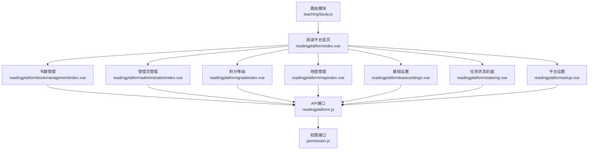

图表来源
- [src/router/normal/teachingStudy.js:511-579](file://src/router/normal/teachingStudy.js#L511-L579)
- [src/views/readingplatform/readingplatformindex.vue:1-86](file://src/views/readingplatform/readingplatformindex.vue#L1-L86)
- [src/api/readingplatform.js:1-411](file://src/api/readingplatform.js#L1-L411)
- [src/api/systemSet/permission.js:1-40](file://src/api/systemSet/permission.js#L1-L40)

章节来源
- [src/router/normal/teachingStudy.js:511-579](file://src/router/normal/teachingStudy.js#L511-L579)
- [src/views/readingplatform/readingplatformindex.vue:32-58](file://src/views/readingplatform/readingplatformindex.vue#L32-L58)

## 核心组件
- 平台设置与开关控制：用于开启/关闭阅读圈、地图、推荐、借还书等功能，并持久化到系统配置
- 书籍管理：支持按类型筛选、搜索、初始化平台书籍、批量添加与删除
- 管理员管理：支持分页查询、多选删除、编辑与新增班级管理员
- 积分等级：维护等级与徽章映射，支持图片预览与删除
- 地图管理：维护地图列表，支持新增、编辑、删除与地图内书籍配置
- 基础设置：维护平台基础积分规则（如加精积分、扣分策略等）
- 任务状态封面：维护任务不同状态的封面图
- 统计与效果评估：通过独立的阅读统计API进行数据采集与报表生成

章节来源
- [src/views/readingplatform/readingplatformsetup.vue:34-88](file://src/views/readingplatform/readingplatformsetup.vue#L34-L88)
- [src/views/readingplatform/readingplatformbookmanagementindex.vue:163-365](file://src/views/readingplatform/readingplatformbookmanagementindex.vue#L163-L365)
- [src/views/readingplatform/readingplatformadministrationindex.vue:67-172](file://src/views/readingplatform/readingplatformadministrationindex.vue#L67-L172)
- [src/views/readingplatform/readingplatformgradeindex.vue:52-115](file://src/views/readingplatform/readingplatformgradeindex.vue#L52-L115)
- [src/views/readingplatform/readingplatformmapindex.vue:22-110](file://src/views/readingplatform/readingplatformmapindex.vue#L22-L110)
- [src/views/readingplatform/readingplatformbasicsettings.vue:31-93](file://src/views/readingplatform/readingplatformbasicsettings.vue#L31-L93)
- [src/views/readingplatform/readingplatformstateimg.vue:40-123](file://src/views/readingplatform/readingplatformstateimg.vue#L40-L123)
- [src/api/readingplatform.js:1-411](file://src/api/readingplatform.js#L1-L411)

## 架构总览
阅读平台采用“路由驱动 + 页面组件 + API封装”的前端架构。页面组件负责UI与交互，API封装统一处理请求参数与响应格式，权限接口用于控制访问范围。

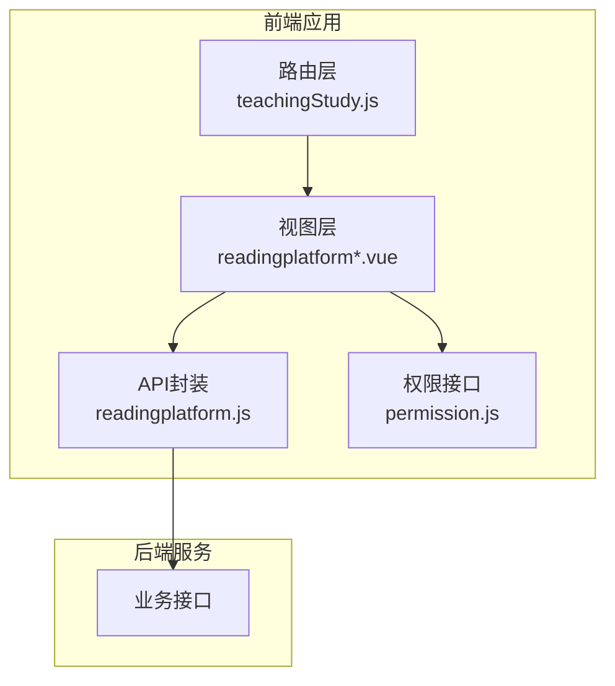

图表来源
- [src/router/normal/teachingStudy.js:511-579](file://src/router/normal/teachingStudy.js#L511-L579)
- [src/views/readingplatform/readingplatformindex.vue:1-86](file://src/views/readingplatform/readingplatformindex.vue#L1-L86)
- [src/api/readingplatform.js:1-411](file://src/api/readingplatform.js#L1-L411)
- [src/api/systemSet/permission.js:1-40](file://src/api/systemSet/permission.js#L1-L40)

## 详细组件分析

### 平台设置与开关控制
- 功能要点
  - 开关项包括：书库与任务库（默认启用）、积分管理（默认启用）、阅读圈、地图、推荐、借还书
  - 提供获取与保存系统设置的方法
- 数据流
  - 页面加载时调用获取接口，渲染复选框状态
  - 保存时将布尔值转换为数值（1/0），提交至后端

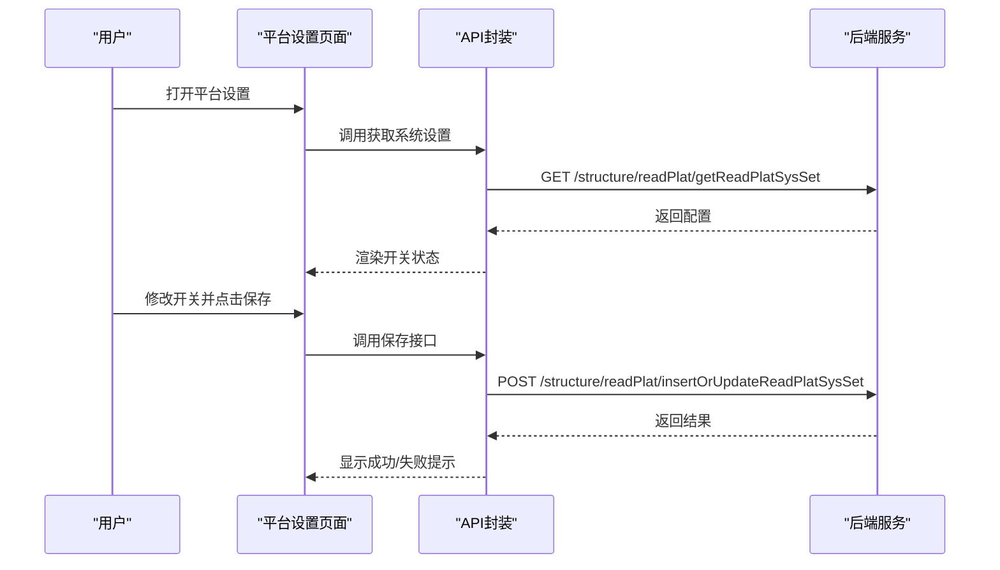

图表来源
- [src/views/readingplatform/readingplatformsetup.vue:52-86](file://src/views/readingplatform/readingplatformsetup.vue#L52-L86)
- [src/api/readingplatform.js:4-24](file://src/api/readingplatform.js#L4-L24)

章节来源
- [src/views/readingplatform/readingplatformsetup.vue:34-88](file://src/views/readingplatform/readingplatformsetup.vue#L34-L88)
- [src/api/readingplatform.js:4-24](file://src/api/readingplatform.js#L4-L24)

### 书籍管理
- 功能要点
  - 支持按书籍类型筛选、按名称搜索
  - 支持初始化平台书籍、批量添加书籍、删除书籍
  - 书籍列表按年级/层级分组展示，支持二维码下载入口
- 数据流
  - 加载时获取平台书籍地图、平台书籍列表、学校词典（书籍类型）
  - 添加书籍时弹窗选择未在平台中的书籍，提交批量新增
  - 删除书籍时二次确认并刷新列表

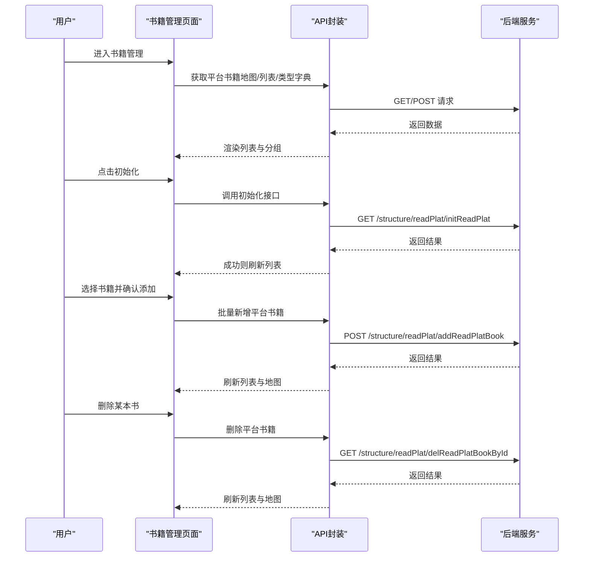

图表来源
- [src/views/readingplatform/readingplatformbookmanagementindex.vue:213-365](file://src/views/readingplatform/readingplatformbookmanagementindex.vue#L213-L365)
- [src/api/readingplatform.js:284-356](file://src/api/readingplatform.js#L284-L356)

章节来源
- [src/views/readingplatform/readingplatformbookmanagementindex.vue:163-365](file://src/views/readingplatform/readingplatformbookmanagementindex.vue#L163-L365)
- [src/api/readingplatform.js:284-356](file://src/api/readingplatform.js#L284-L356)

### 管理员管理
- 功能要点
  - 分页查询班级管理员，支持多选删除、单个删除、编辑与新增
  - 支持按姓名搜索
- 数据流
  - 列表加载时携带分页参数与搜索关键词
  - 删除时构造ID字符串传递给后端

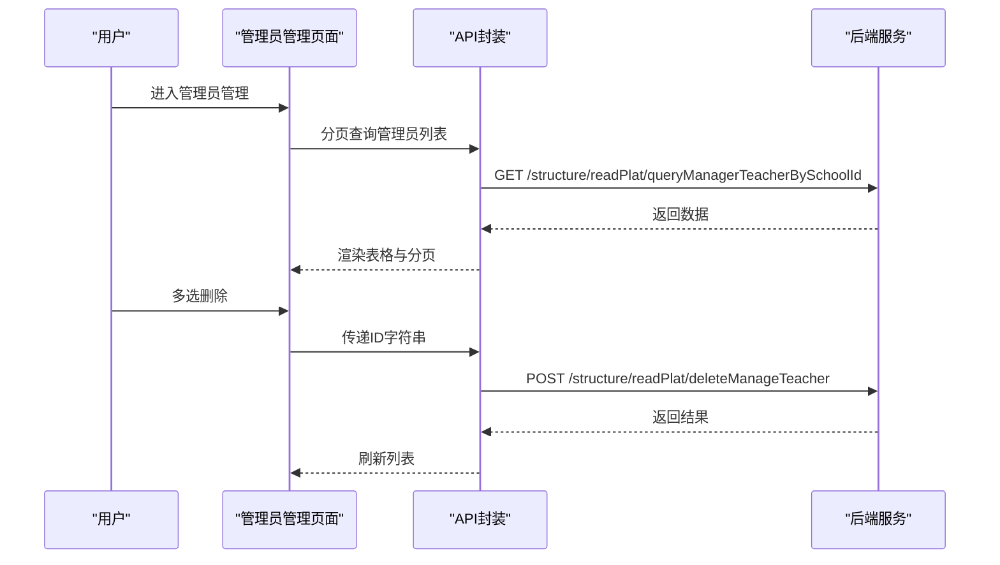

图表来源
- [src/views/readingplatform/readingplatformadministrationindex.vue:156-170](file://src/views/readingplatform/readingplatformadministrationindex.vue#L156-L170)
- [src/api/readingplatform.js:66-86](file://src/api/readingplatform.js#L66-L86)

章节来源
- [src/views/readingplatform/readingplatformadministrationindex.vue:67-172](file://src/views/readingplatform/readingplatformadministrationindex.vue#L67-L172)
- [src/api/readingplatform.js:66-86](file://src/api/readingplatform.js#L66-L86)

### 积分等级设置
- 功能要点
  - 展示等级、积分阈值、徽章名称与图片
  - 支持删除徽章，图片支持预览
- 数据流
  - 加载平台基础设置，渲染徽章列表
  - 删除徽章后刷新列表

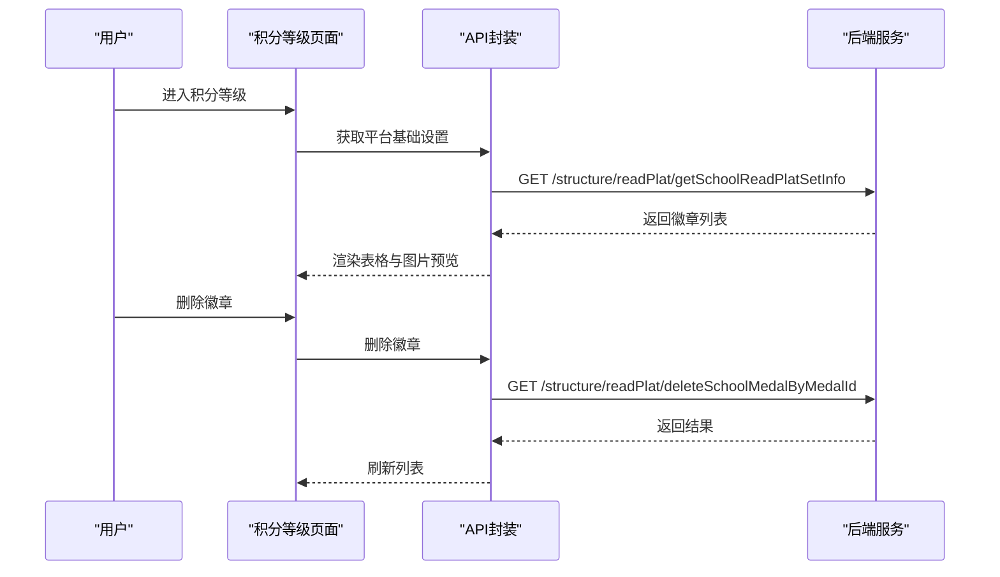

图表来源
- [src/views/readingplatform/readingplatformgradeindex.vue:103-114](file://src/views/readingplatform/readingplatformgradeindex.vue#L103-L114)
- [src/api/readingplatform.js:44-64](file://src/api/readingplatform.js#L44-L64)
- [src/api/readingplatform.js:115-124](file://src/api/readingplatform.js#L115-L124)

章节来源
- [src/views/readingplatform/readingplatformgradeindex.vue:52-115](file://src/views/readingplatform/readingplatformgradeindex.vue#L52-L115)
- [src/api/readingplatform.js:44-64](file://src/api/readingplatform.js#L44-L64)
- [src/api/readingplatform.js:115-124](file://src/api/readingplatform.js#L115-L124)

### 地图管理
- 功能要点
  - 展示地图缩略图与名称，支持新增、编辑、删除
  - 支持地图内书籍配置（新增/编辑/删除）
- 数据流
  - 加载地图列表，支持删除后刷新
  - 地图详情页支持对地图内书籍进行配置

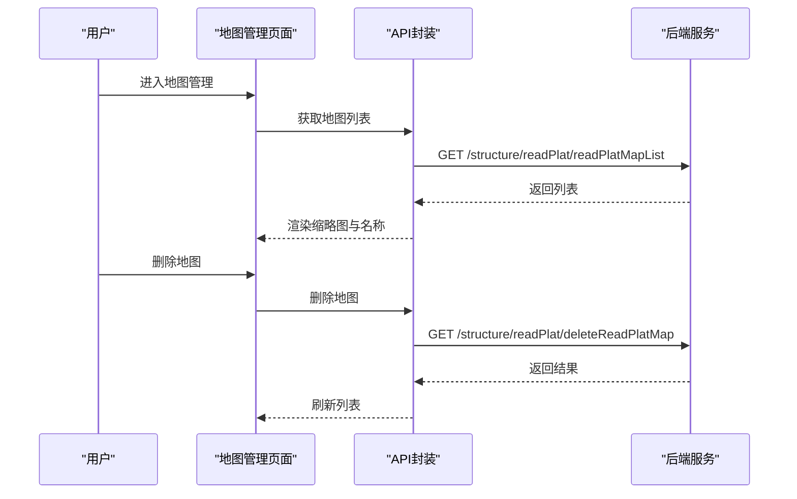

图表来源
- [src/views/readingplatform/readingplatformmapindex.vue:36-66](file://src/views/readingplatform/readingplatformmapindex.vue#L36-L66)
- [src/api/readingplatform.js:170-222](file://src/api/readingplatform.js#L170-L222)

章节来源
- [src/views/readingplatform/readingplatformmapindex.vue:22-110](file://src/views/readingplatform/readingplatformmapindex.vue#L22-L110)
- [src/api/readingplatform.js:170-222](file://src/api/readingplatform.js#L170-L222)

### 基础设置（积分规则）
- 功能要点
  - 维护“加精一次获得积分”、“被删帖子扣除积分”等规则
  - 支持勾选“额外扣除积分”并填写扣除分值
- 数据流
  - 加载平台基础设置，渲染表单
  - 保存时进行必填校验并提交

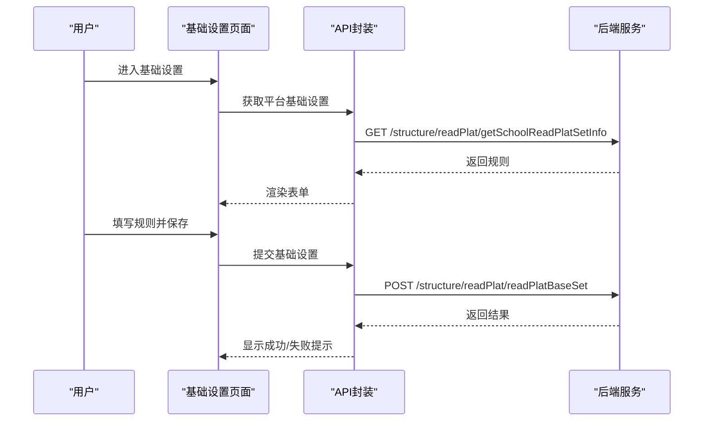

图表来源
- [src/views/readingplatform/readingplatformbasicsettings.vue:46-90](file://src/views/readingplatform/readingplatformbasicsettings.vue#L46-L90)
- [src/api/readingplatform.js:44-64](file://src/api/readingplatform.js#L44-L64)
- [src/api/readingplatform.js:52-63](file://src/api/readingplatform.js#L52-L63)

章节来源
- [src/views/readingplatform/readingplatformbasicsettings.vue:31-93](file://src/views/readingplatform/readingplatformbasicsettings.vue#L31-L93)
- [src/api/readingplatform.js:44-64](file://src/api/readingplatform.js#L44-L64)
- [src/api/readingplatform.js:52-63](file://src/api/readingplatform.js#L52-L63)

### 任务状态封面设置
- 功能要点
  - 维护“任务未做”“任务已做”“任务已删除”三种状态的封面图
  - 支持从预设图集中选择替换
- 数据流
  - 加载封面配置，若为空则自动初始化
  - 保存时提交三张图片URL

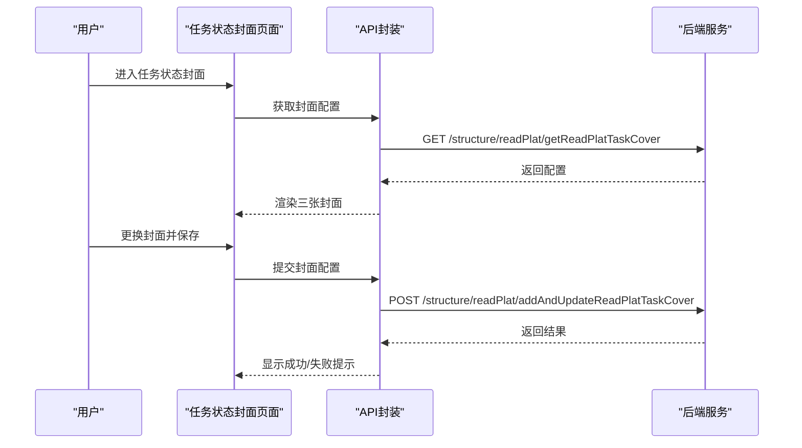

图表来源
- [src/views/readingplatform/readingplatformstateimg.vue:63-120](file://src/views/readingplatform/readingplatformstateimg.vue#L63-L120)
- [src/api/readingplatform.js:25-43](file://src/api/readingplatform.js#L25-L43)
- [src/api/readingplatform.js:32-42](file://src/api/readingplatform.js#L32-L42)

章节来源
- [src/views/readingplatform/readingplatformstateimg.vue:40-123](file://src/views/readingplatform/readingplatformstateimg.vue#L40-L123)
- [src/api/readingplatform.js:25-43](file://src/api/readingplatform.js#L25-L43)
- [src/api/readingplatform.js:32-42](file://src/api/readingplatform.js#L32-L42)

### 阅读活动与统计（扩展）
- 阅读活动组织与参与统计
  - 通过独立的阅读统计API进行数据采集与报表生成
  - 支持按年级、班级、时间维度统计阅读行为
- 效果评估与习惯培养
  - 基于阅读记录与统计结果，评估阅读完成度与活跃度
  - 结合积分体系与等级徽章，激励持续阅读

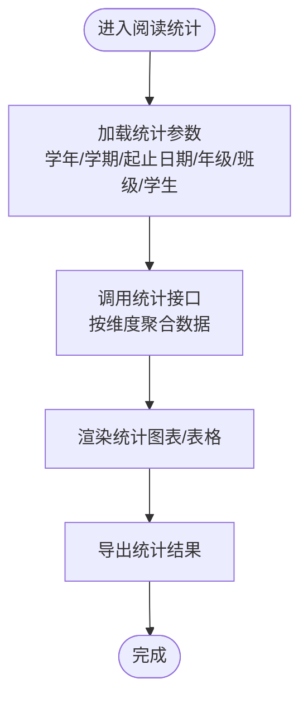

图表来源
- [src/api/readBookBeiyou.js:200-271](file://src/api/readBookBeiyou.js#L200-L271)

章节来源
- [src/api/readBookBeiyou.js:150-271](file://src/api/readBookBeiyou.js#L150-L271)

## 依赖关系分析
- 组件耦合
  - 各页面组件均依赖API封装模块，形成清晰的调用链
  - 页面间通过路由跳转连接，避免直接耦合
- 外部依赖
  - Element UI组件库用于表格、分页、对话框等
  - 图片预览组件用于徽章与封面图展示
- 权限控制
  - 通过权限接口查询用户权限，控制页面访问与操作按钮显示

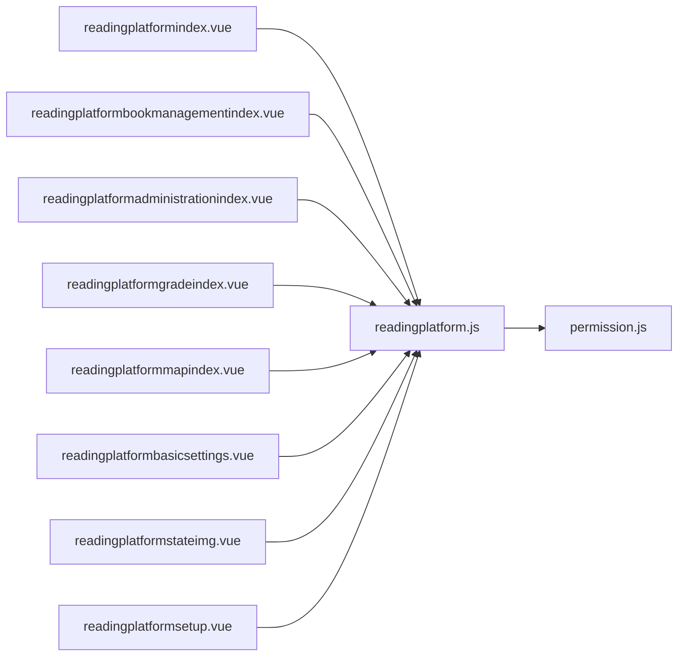

图表来源
- [src/views/readingplatform/readingplatformindex.vue:33-34](file://src/views/readingplatform/readingplatformindex.vue#L33-L34)
- [src/views/readingplatform/readingplatformbookmanagementindex.vue:165-173](file://src/views/readingplatform/readingplatformbookmanagementindex.vue#L165-L173)
- [src/views/readingplatform/readingplatformadministrationindex.vue:68-68](file://src/views/readingplatform/readingplatformadministrationindex.vue#L68-L68)
- [src/views/readingplatform/readingplatformgradeindex.vue:54-55](file://src/views/readingplatform/readingplatformgradeindex.vue#L54-L55)
- [src/views/readingplatform/readingplatformmapindex.vue:23-23](file://src/views/readingplatform/readingplatformmapindex.vue#L23-L23)
- [src/views/readingplatform/readingplatformbasicsettings.vue:31-31](file://src/views/readingplatform/readingplatformbasicsettings.vue#L31-L31)
- [src/views/readingplatform/readingplatformstateimg.vue:40-40](file://src/views/readingplatform/readingplatformstateimg.vue#L40-L40)
- [src/views/readingplatform/readingplatformsetup.vue:34-34](file://src/views/readingplatform/readingplatformsetup.vue#L34-L34)
- [src/api/readingplatform.js:1-3](file://src/api/readingplatform.js#L1-L3)
- [src/api/systemSet/permission.js:9-39](file://src/api/systemSet/permission.js#L9-L39)

章节来源
- [src/views/readingplatform/readingplatformindex.vue:32-58](file://src/views/readingplatform/readingplatformindex.vue#L32-L58)
- [src/api/readingplatform.js:1-3](file://src/api/readingplatform.js#L1-L3)
- [src/api/systemSet/permission.js:9-39](file://src/api/systemSet/permission.js#L9-L39)

## 性能考量
- 列表分页与懒加载
  - 使用Element UI分页组件，合理设置每页条数，减少一次性渲染压力
- 图片资源优化
  - 封面与徽章图片采用预览组件，避免大图阻塞
- 接口幂等与缓存
  - 对高频查询接口（如平台设置、字典值）建议前端做简单缓存，降低重复请求
- 表单校验前置
  - 在保存前进行必填字段校验，减少无效请求

## 故障排查指南
- 常见问题
  - 初始化失败：检查后端初始化接口返回状态，确认是否有未配置的依赖
  - 删除失败：确认ID参数是否正确传递，后端返回错误信息时提示具体原因
  - 图片上传/替换异常：检查图片URL是否有效，预设图集是否可用
- 排查步骤
  - 打开浏览器开发者工具，查看网络面板中对应接口的请求与响应
  - 根据返回码与消息定位问题（如code非200或result为false）
  - 若为权限问题，检查权限接口返回的用户角色与菜单权限

章节来源
- [src/views/readingplatform/readingplatformbookmanagementindex.vue:223-242](file://src/views/readingplatform/readingplatformbookmanagementindex.vue#L223-L242)
- [src/views/readingplatform/readingplatformstateimg.vue:107-120](file://src/views/readingplatform/readingplatformstateimg.vue#L107-L120)
- [src/api/systemSet/permission.js:15-39](file://src/api/systemSet/permission.js#L15-L39)

## 结论
阅读平台管理模块通过清晰的路由与页面划分、完善的API封装与权限控制，实现了从平台开关、资源管理、管理员维护、积分等级、地图配置到基础设置与封面管理的全链路能力。配合独立的阅读统计API，可进一步完善效果评估与习惯培养分析。建议在后续迭代中增强统计维度与可视化能力，并完善权限分级与审计日志。

## 附录
- 路由入口参考
  - 阅读平台首页、书籍管理、管理员管理、积分等级、地图管理、基础设置、任务状态封面、平台设置等路由定义位于教学研究模块路由文件中

章节来源
- [src/router/normal/teachingStudy.js:511-579](file://src/router/normal/teachingStudy.js#L511-L579)