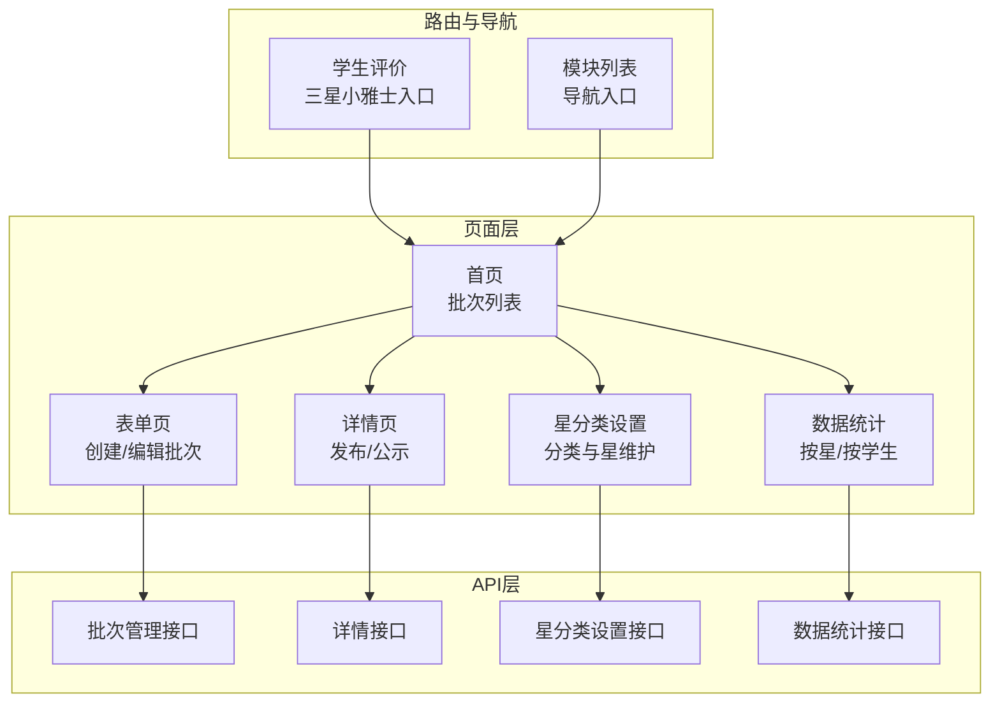
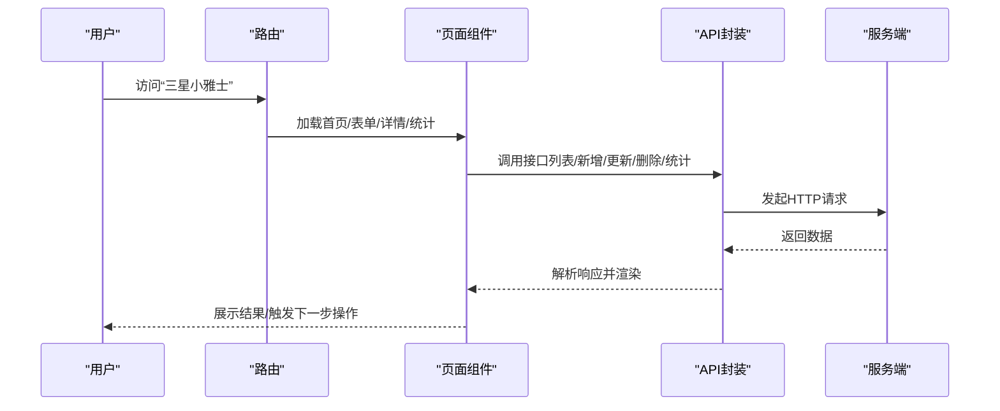
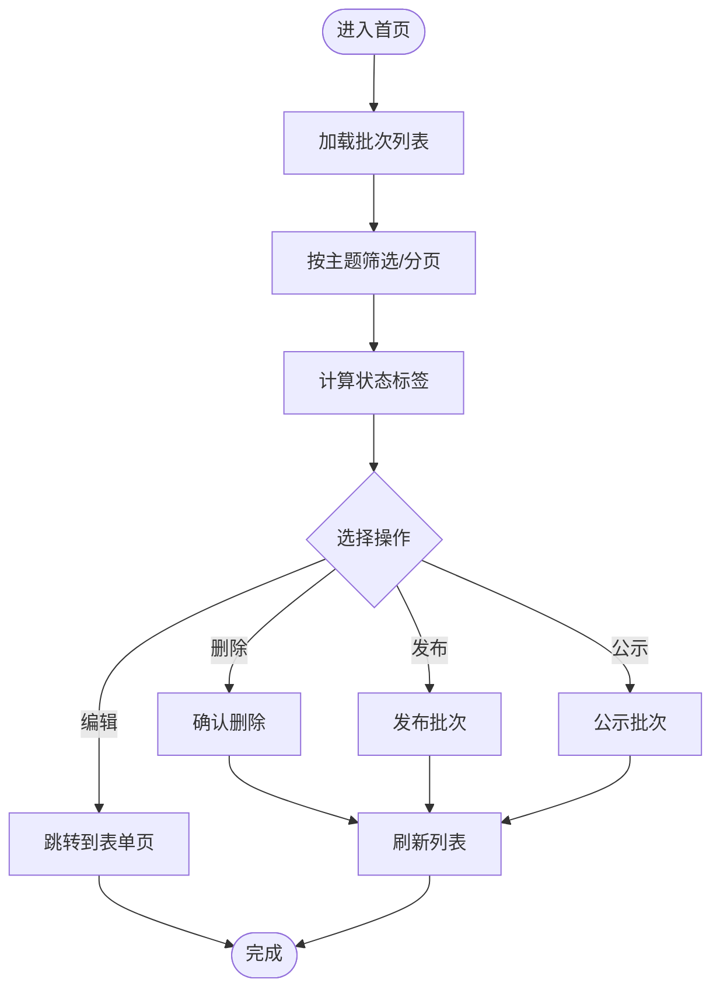
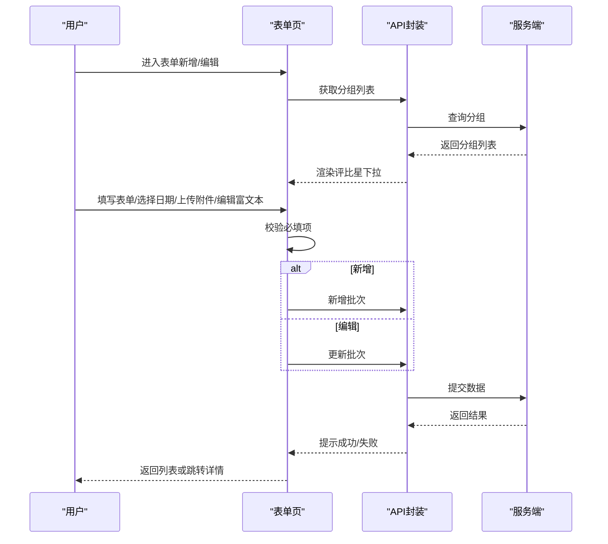
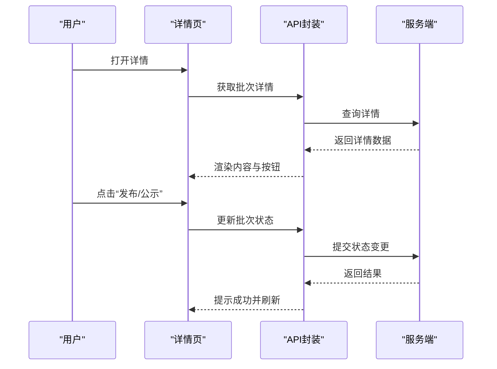
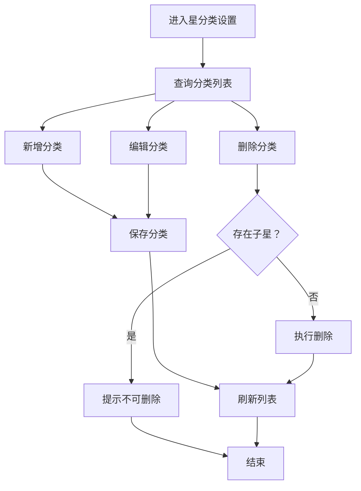
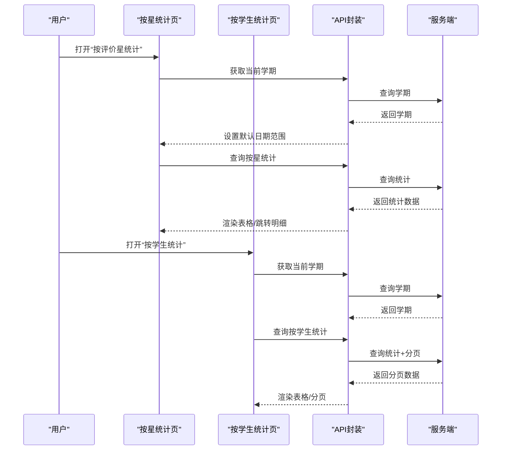
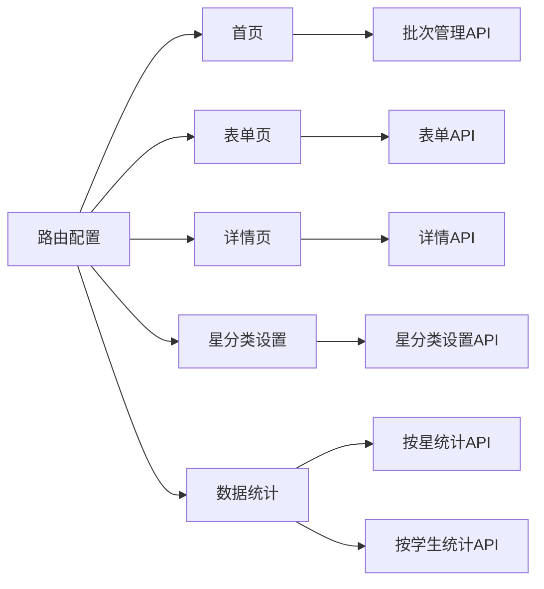

# 雅星绅士培养计划

<cite>
**本文引用的文件**
- [src/router/normal/stuEvaluate.js](file://src/router/normal/stuEvaluate.js)
- [src/router/moduleList.js](file://src/router/moduleList.js)
- [src/api/yaxing.js](file://src/api/yaxing.js)
- [src/views/homeSchool/yaxing/threeStarsGentleman/index.vue](file://src/views/homeSchool/yaxing/threeStarsGentleman/index.vue)
- [src/views/homeSchool/yaxing/threeStarsGentleman/form.vue](file://src/views/homeSchool/yaxing/threeStarsGentleman/form.vue)
- [src/views/homeSchool/yaxing/threeStarsGentleman/detail/index.vue](file://src/views/homeSchool/yaxing/threeStarsGentleman/detail/index.vue)
- [src/views/homeSchool/yaxing/threeStarsGentleman/starTypeSettings/index.vue](file://src/views/homeSchool/yaxing/threeStarsGentleman/starTypeSettings/index.vue)
- [src/views/homeSchool/yaxing/threeStarsGentleman/dataStatistics/index.vue](file://src/views/homeSchool/yaxing/threeStarsGentleman/dataStatistics/index.vue)
- [src/views/homeSchool/yaxing/threeStarsGentleman/dataStatistics/byStar/index.vue](file://src/views/homeSchool/yaxing/threeStarsGentleman/dataStatistics/byStar/index.vue)
- [src/views/homeSchool/yaxing/threeStarsGentleman/dataStatistics/byStudent/index.vue](file://src/views/homeSchool/yaxing/threeStarsGentleman/dataStatistics/byStudent/index.vue)
- [src/api/homeSchool/yaxing/threeStarsGentleman/index.js](file://src/api/homeSchool/yaxing/threeStarsGentleman/index.js)
- [src/api/homeSchool/yaxing/threeStarsGentleman/form.js](file://src/api/homeSchool/yaxing/threeStarsGentleman/form.js)
- [src/api/homeSchool/yaxing/threeStarsGentleman/detail/index.js](file://src/api/homeSchool/yaxing/threeStarsGentleman/detail/index.js)
- [src/api/homeSchool/yaxing/threeStarsGentleman/starTypeSettings/index.js](file://src/api/homeSchool/yaxing/threeStarsGentleman/starTypeSettings/index.js)
- [src/api/homeSchool/yaxing/threeStarsGentleman/dataStatistics/byStar/index.js](file://src/api/homeSchool/yaxing/threeStarsGentleman/dataStatistics/byStar/index.js)
- [src/api/homeSchool/yaxing/threeStarsGentleman/dataStatistics/byStudent/index.js](file://src/api/homeSchool/yaxing/threeStarsGentleman/dataStatistics/byStudent/index.js)
</cite>

## 目录
1. [简介](#简介)
2. [项目结构](#项目结构)
3. [核心组件](#核心组件)
4. [架构总览](#架构总览)
5. [详细组件分析](#详细组件分析)
6. [依赖关系分析](#依赖关系分析)
7. [性能考虑](#性能考虑)
8. [故障排查指南](#故障排查指南)
9. [结论](#结论)
10. [附录](#附录)

## 简介
本文件面向“雅星绅士培养计划”，系统性梳理其评价体系与实施机制，覆盖星级评价标准、培养目标与考核方式的设计原则；文档化数据管理、进度跟踪与效果评估功能；解释培养过程中的激励机制与荣誉体系；并提供配置管理、权限控制与统计分析的技术实现要点，以及培养效果分析与持续改进的分析能力。

## 项目结构
围绕“三星小雅士”（即“雅星绅士培养计划”的核心模块），前端采用 Vue + Element UI 技术栈，路由与页面组织如下：
- 路由入口：在“学生评价”模块下挂载“三星小雅士”功能入口，并在模块列表中提供统一导航。
- 页面层次：首页（活动批次管理）、表单页（创建/编辑批次）、详情页（发布/公示流程）、星分类设置、数据统计（按星统计、按学生统计）。
- API 层：按功能域拆分，如“批次管理”“详情”“星分类设置”“数据统计”等，统一通过封装的 fetch 工具发起请求。

图表来源
- [src/router/normal/stuEvaluate.js:142-161](file://src/router/normal/stuEvaluate.js#L142-L161)
- [src/router/moduleList.js:2124-2129](file://src/router/moduleList.js#L2124-L2129)
- [src/views/homeSchool/yaxing/threeStarsGentleman/index.vue:1-362](file://src/views/homeSchool/yaxing/threeStarsGentleman/index.vue#L1-L362)
- [src/views/homeSchool/yaxing/threeStarsGentleman/form.vue:1-306](file://src/views/homeSchool/yaxing/threeStarsGentleman/form.vue#L1-L306)
- [src/views/homeSchool/yaxing/threeStarsGentleman/detail/index.vue:1-213](file://src/views/homeSchool/yaxing/threeStarsGentleman/detail/index.vue#L1-L213)
- [src/views/homeSchool/yaxing/threeStarsGentleman/starTypeSettings/index.vue:1-294](file://src/views/homeSchool/yaxing/threeStarsGentleman/starTypeSettings/index.vue#L1-L294)
- [src/views/homeSchool/yaxing/threeStarsGentleman/dataStatistics/index.vue:1-39](file://src/views/homeSchool/yaxing/threeStarsGentleman/dataStatistics/index.vue#L1-L39)

章节来源
- [src/router/normal/stuEvaluate.js:142-161](file://src/router/normal/stuEvaluate.js#L142-L161)
- [src/router/moduleList.js:2124-2129](file://src/router/moduleList.js#L2124-L2129)

## 核心组件
- 批次管理首页：支持创建、编辑、删除、发布、公示等生命周期操作；支持按主题筛选与分页。
- 批次表单页：支持设置主题、日期范围、评比星、附件与富文本说明；支持草稿与发布流程。
- 批次详情页：展示发布/公示后的通知内容、附件与操作入口。
- 星分类设置：维护“评比星分类”与“评比星”，支撑不同维度的评价与激励。
- 数据统计：提供“按评价星统计”和“按学生统计”两类报表，支持时间范围与分页筛选。

章节来源
- [src/views/homeSchool/yaxing/threeStarsGentleman/index.vue:1-362](file://src/views/homeSchool/yaxing/threeStarsGentleman/index.vue#L1-L362)
- [src/views/homeSchool/yaxing/threeStarsGentleman/form.vue:1-306](file://src/views/homeSchool/yaxing/threeStarsGentleman/form.vue#L1-L306)
- [src/views/homeSchool/yaxing/threeStarsGentleman/detail/index.vue:1-213](file://src/views/homeSchool/yaxing/threeStarsGentleman/detail/index.vue#L1-L213)
- [src/views/homeSchool/yaxing/threeStarsGentleman/starTypeSettings/index.vue:1-294](file://src/views/homeSchool/yaxing/threeStarsGentleman/starTypeSettings/index.vue#L1-L294)
- [src/views/homeSchool/yaxing/threeStarsGentleman/dataStatistics/index.vue:1-39](file://src/views/homeSchool/yaxing/threeStarsGentleman/dataStatistics/index.vue#L1-L39)

## 架构总览
整体采用“路由驱动页面 + 组件化页面 + API 封装”的三层结构：
- 路由层：定义“三星小雅士”模块入口与子页面路径。
- 视图层：以组件形式承载业务页面，负责交互、校验与跳转。
- API 层：对后端接口进行统一封装，提供列表、新增、更新、删除、详情、统计等方法。

图表来源
- [src/router/normal/stuEvaluate.js:142-161](file://src/router/normal/stuEvaluate.js#L142-L161)
- [src/views/homeSchool/yaxing/threeStarsGentleman/index.vue:185-209](file://src/views/homeSchool/yaxing/threeStarsGentleman/index.vue#L185-L209)
- [src/api/homeSchool/yaxing/threeStarsGentleman/index.js:12-39](file://src/api/homeSchool/yaxing/threeStarsGentleman/index.js#L12-L39)

## 详细组件分析

### 批次管理首页（活动批次）
- 功能要点
  - 列表展示：主题、日期范围、评比星、状态（草稿/未开始/进行中/已结束/已公示）。
  - 生命周期：草稿可编辑/删除；发布后进入“未开始/进行中/已结束”状态；结束后可“公示”。
  - 搜索与分页：按主题筛选与分页切换。
- 设计原则
  - 状态机：根据当前时间与批次日期范围动态判断状态标签。
  - 权限控制：仅在对应状态下显示可执行的操作按钮。
- 数据流
  - 列表请求 → 后端返回分页数据 → 前端渲染表格与分页控件。

图表来源
- [src/views/homeSchool/yaxing/threeStarsGentleman/index.vue:137-159](file://src/views/homeSchool/yaxing/threeStarsGentleman/index.vue#L137-L159)
- [src/views/homeSchool/yaxing/threeStarsGentleman/index.vue:184-316](file://src/views/homeSchool/yaxing/threeStarsGentleman/index.vue#L184-L316)

章节来源
- [src/views/homeSchool/yaxing/threeStarsGentleman/index.vue:1-362](file://src/views/homeSchool/yaxing/threeStarsGentleman/index.vue#L1-L362)
- [src/api/homeSchool/yaxing/threeStarsGentleman/index.js:12-39](file://src/api/homeSchool/yaxing/threeStarsGentleman/index.js#L12-L39)

### 批次表单页（创建/编辑）
- 功能要点
  - 表单字段：主题、日期范围、评比星、附件、富文本说明。
  - 流程控制：草稿可保存；发布后进入“进行中/已结束”阶段。
  - 校验规则：必填项校验与富文本非空校验。
- 设计原则
  - 只读/可编辑联动：根据状态决定是否显示“发布”按钮。
  - 文件上传：限制扩展名，支持单文件上传。
- 数据流
  - 读取分组列表 → 加载批次详情（编辑时）→ 校验提交 → 新增或更新 → 成功后返回列表。

图表来源
- [src/views/homeSchool/yaxing/threeStarsGentleman/form.vue:144-198](file://src/views/homeSchool/yaxing/threeStarsGentleman/form.vue#L144-L198)
- [src/views/homeSchool/yaxing/threeStarsGentleman/form.vue:208-285](file://src/views/homeSchool/yaxing/threeStarsGentleman/form.vue#L208-L285)
- [src/api/homeSchool/yaxing/threeStarsGentleman/form.js](file://src/api/homeSchool/yaxing/threeStarsGentleman/form.js)

章节来源
- [src/views/homeSchool/yaxing/threeStarsGentleman/form.vue:1-306](file://src/views/homeSchool/yaxing/threeStarsGentleman/form.vue#L1-L306)

### 批次详情页（发布/公示）
- 功能要点
  - 展示：主题、评比星、日期范围、富文本内容与附件。
  - 操作：草稿可编辑；发布后可“公示”；公示后不可再编辑。
- 设计原则
  - 状态驱动：根据状态显示可用操作按钮。
  - 内容安全：富文本内容使用预览组件渲染。
- 数据流
  - 加载详情 → 渲染内容 → 按钮联动 → 更新状态 → 刷新详情。

图表来源
- [src/views/homeSchool/yaxing/threeStarsGentleman/detail/index.vue:98-148](file://src/views/homeSchool/yaxing/threeStarsGentleman/detail/index.vue#L98-L148)
- [src/api/homeSchool/yaxing/threeStarsGentleman/detail/index.js](file://src/api/homeSchool/yaxing/threeStarsGentleman/detail/index.js)

章节来源
- [src/views/homeSchool/yaxing/threeStarsGentleman/detail/index.vue:1-213](file://src/views/homeSchool/yaxing/threeStarsGentleman/detail/index.vue#L1-L213)

### 星分类设置（分类与星维护）
- 功能要点
  - 分类管理：新增/编辑/删除“评比星分类”，删除前需检查是否存在子星。
  - 星维护：进入“评比星维护”页面，对分类下的星进行配置。
- 设计原则
  - 分级结构：分类为一级，星为二级，便于多维度评价。
  - 可视化：在列表中直接展示分类下的星集合。
- 数据流
  - 查询分类列表 → 弹窗新增/编辑 → 删除前二次确认 → 成功后刷新列表。

图表来源
- [src/views/homeSchool/yaxing/threeStarsGentleman/starTypeSettings/index.vue:122-230](file://src/views/homeSchool/yaxing/threeStarsGentleman/starTypeSettings/index.vue#L122-L230)
- [src/api/homeSchool/yaxing/threeStarsGentleman/starTypeSettings/index.js:12-49](file://src/api/homeSchool/yaxing/threeStarsGentleman/starTypeSettings/index.js#L12-L49)

章节来源
- [src/views/homeSchool/yaxing/threeStarsGentleman/starTypeSettings/index.vue:1-294](file://src/views/homeSchool/yaxing/threeStarsGentleman/starTypeSettings/index.vue#L1-L294)

### 数据统计（按评价星/按学生）
- 按评价星统计
  - 默认展示当前学期至当前日期的时间范围，支持自定义日期范围。
  - 展示“评价星”“获得人数”“获得人次”，点击人数可跳转到人员明细。
- 按学生统计
  - 支持按学生姓名与日期范围筛选，支持分页。
  - 展示学号、姓名、班级及各星的累计次数。
- 设计原则
  - 时间轴：默认取当前学期起止，确保统计口径一致。
  - 多维聚合：按星统计与按人统计互补，满足不同管理层级需求。
- 数据流
  - 获取当前学期 → 查询统计 → 渲染表格与分页 → 跳转明细。

图表来源
- [src/views/homeSchool/yaxing/threeStarsGentleman/dataStatistics/byStar/index.vue:72-122](file://src/views/homeSchool/yaxing/threeStarsGentleman/dataStatistics/byStar/index.vue#L72-L122)
- [src/views/homeSchool/yaxing/threeStarsGentleman/dataStatistics/byStudent/index.vue:133-204](file://src/views/homeSchool/yaxing/threeStarsGentleman/dataStatistics/byStudent/index.vue#L133-L204)
- [src/api/homeSchool/yaxing/threeStarsGentleman/dataStatistics/byStar/index.js:12-27](file://src/api/homeSchool/yaxing/threeStarsGentleman/dataStatistics/byStar/index.js#L12-L27)
- [src/api/homeSchool/yaxing/threeStarsGentleman/dataStatistics/byStudent/index.js:12-33](file://src/api/homeSchool/yaxing/threeStarsGentleman/dataStatistics/byStudent/index.js#L12-L33)

章节来源
- [src/views/homeSchool/yaxing/threeStarsGentleman/dataStatistics/index.vue:1-39](file://src/views/homeSchool/yaxing/threeStarsGentleman/dataStatistics/index.vue#L1-L39)
- [src/views/homeSchool/yaxing/threeStarsGentleman/dataStatistics/byStar/index.vue:1-151](file://src/views/homeSchool/yaxing/threeStarsGentleman/dataStatistics/byStar/index.vue#L1-L151)
- [src/views/homeSchool/yaxing/threeStarsGentleman/dataStatistics/byStudent/index.vue:1-220](file://src/views/homeSchool/yaxing/threeStarsGentleman/dataStatistics/byStudent/index.vue#L1-L220)

## 依赖关系分析
- 路由与页面
  - “学生评价”模块下挂载“三星小雅士”入口，模块列表提供导航。
  - 子页面通过相对路径跳转，形成清晰的页面依赖链。
- 页面与 API
  - 各页面通过对应的 API 封装调用后端接口，职责清晰、耦合度低。
- 状态与权限
  - 页面根据状态显示/隐藏操作按钮，体现“状态驱动”的权限控制思想。
  - 路由配置中包含权限路径，便于统一鉴权。

图表来源
- [src/router/normal/stuEvaluate.js:142-161](file://src/router/normal/stuEvaluate.js#L142-L161)
- [src/router/moduleList.js:2124-2129](file://src/router/moduleList.js#L2124-L2129)
- [src/api/homeSchool/yaxing/threeStarsGentleman/index.js:12-39](file://src/api/homeSchool/yaxing/threeStarsGentleman/index.js#L12-L39)
- [src/api/homeSchool/yaxing/threeStarsGentleman/form.js](file://src/api/homeSchool/yaxing/threeStarsGentleman/form.js)
- [src/api/homeSchool/yaxing/threeStarsGentleman/detail/index.js](file://src/api/homeSchool/yaxing/threeStarsGentleman/detail/index.js)
- [src/api/homeSchool/yaxing/threeStarsGentleman/starTypeSettings/index.js:12-49](file://src/api/homeSchool/yaxing/threeStarsGentleman/starTypeSettings/index.js#L12-L49)
- [src/api/homeSchool/yaxing/threeStarsGentleman/dataStatistics/byStar/index.js:12-27](file://src/api/homeSchool/yaxing/threeStarsGentleman/dataStatistics/byStar/index.js#L12-L27)
- [src/api/homeSchool/yaxing/threeStarsGentleman/dataStatistics/byStudent/index.js:12-33](file://src/api/homeSchool/yaxing/threeStarsGentleman/dataStatistics/byStudent/index.js#L12-L33)

章节来源
- [src/router/normal/stuEvaluate.js:142-161](file://src/router/normal/stuEvaluate.js#L142-L161)
- [src/router/moduleList.js:2124-2129](file://src/router/moduleList.js#L2124-L2129)

## 性能考虑
- 列表分页：按需加载，避免一次性渲染大量数据。
- 状态计算：在前端基于时间计算状态，减少重复请求。
- 图片/富文本：使用预览组件渲染，避免大段 HTML 直接注入 DOM。
- 接口合并：同一页面内的多个小请求可考虑合并或延迟加载，降低网络压力。

## 故障排查指南
- 列表无数据或异常
  - 检查筛选条件（主题、状态、日期范围）是否过严。
  - 确认分页参数（页码、每页条数）是否合理。
- 发布/公示失败
  - 核对当前状态与可执行操作按钮是否匹配。
  - 查看接口返回错误码与消息，定位具体字段问题。
- 统计数据不准确
  - 确认默认学期时间是否正确，日期范围是否覆盖统计周期。
  - 检查按星统计与按学生统计的查询参数是否一致。
- 文件上传失败
  - 校验文件类型与大小限制，确认上传组件配置正确。

章节来源
- [src/views/homeSchool/yaxing/threeStarsGentleman/index.vue:184-209](file://src/views/homeSchool/yaxing/threeStarsGentleman/index.vue#L184-L209)
- [src/views/homeSchool/yaxing/threeStarsGentleman/form.vue:208-285](file://src/views/homeSchool/yaxing/threeStarsGentleman/form.vue#L208-L285)
- [src/views/homeSchool/yaxing/threeStarsGentleman/detail/index.vue:98-148](file://src/views/homeSchool/yaxing/threeStarsGentleman/detail/index.vue#L98-L148)
- [src/views/homeSchool/yaxing/threeStarsGentleman/dataStatistics/byStar/index.vue:94-122](file://src/views/homeSchool/yaxing/threeStarsGentleman/dataStatistics/byStar/index.vue#L94-L122)
- [src/views/homeSchool/yaxing/threeStarsGentleman/dataStatistics/byStudent/index.vue:155-204](file://src/views/homeSchool/yaxing/threeStarsGentleman/dataStatistics/byStudent/index.vue#L155-L204)

## 结论
“雅星绅士培养计划”通过“批次管理—星分类—数据统计—发布/公示”的完整闭环，实现了对绅士品格培养的系统化管理与可视化追踪。前端以组件化与路由化的方式清晰划分职责，API 层统一封装提升可维护性。建议后续在权限细化、报表导出、移动端适配与自动化提醒等方面持续优化，进一步完善激励与持续改进机制。

## 附录
- 路由与导航
  - “三星小雅士”在“学生评价”模块下提供入口，模块列表中提供统一导航。
- API 一览
  - 批次管理：列表、新增、更新、删除。
  - 详情：获取详情、更新状态。
  - 星分类设置：查询、新增、更新、删除。
  - 数据统计：按星统计、按学生统计、获取当前学期。

章节来源
- [src/router/normal/stuEvaluate.js:142-161](file://src/router/normal/stuEvaluate.js#L142-L161)
- [src/router/moduleList.js:2124-2129](file://src/router/moduleList.js#L2124-L2129)
- [src/api/homeSchool/yaxing/threeStarsGentleman/index.js:12-39](file://src/api/homeSchool/yaxing/threeStarsGentleman/index.js#L12-L39)
- [src/api/homeSchool/yaxing/threeStarsGentleman/detail/index.js](file://src/api/homeSchool/yaxing/threeStarsGentleman/detail/index.js)
- [src/api/homeSchool/yaxing/threeStarsGentleman/starTypeSettings/index.js:12-49](file://src/api/homeSchool/yaxing/threeStarsGentleman/starTypeSettings/index.js#L12-L49)
- [src/api/homeSchool/yaxing/threeStarsGentleman/dataStatistics/byStar/index.js:12-27](file://src/api/homeSchool/yaxing/threeStarsGentleman/dataStatistics/byStar/index.js#L12-L27)
- [src/api/homeSchool/yaxing/threeStarsGentleman/dataStatistics/byStudent/index.js:12-33](file://src/api/homeSchool/yaxing/threeStarsGentleman/dataStatistics/byStudent/index.js#L12-L33)