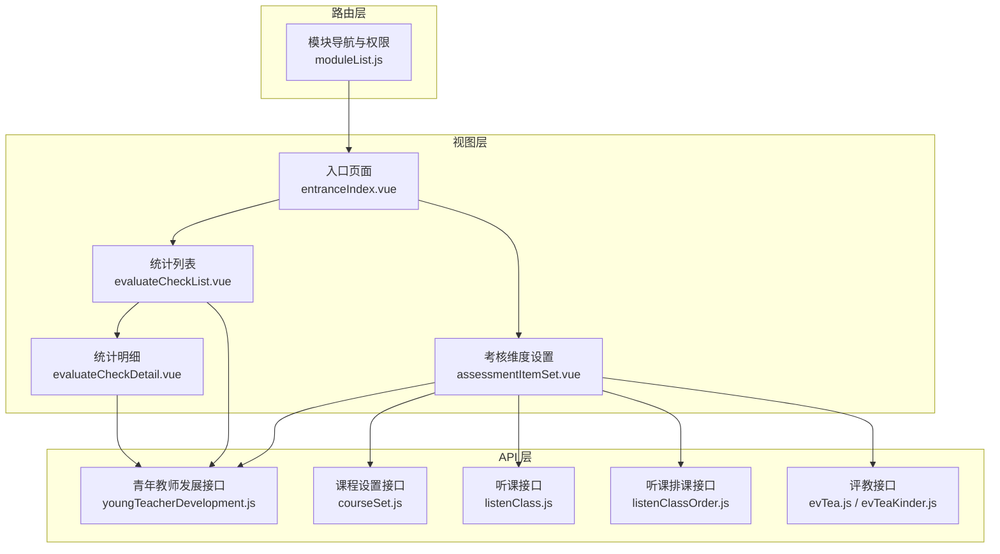
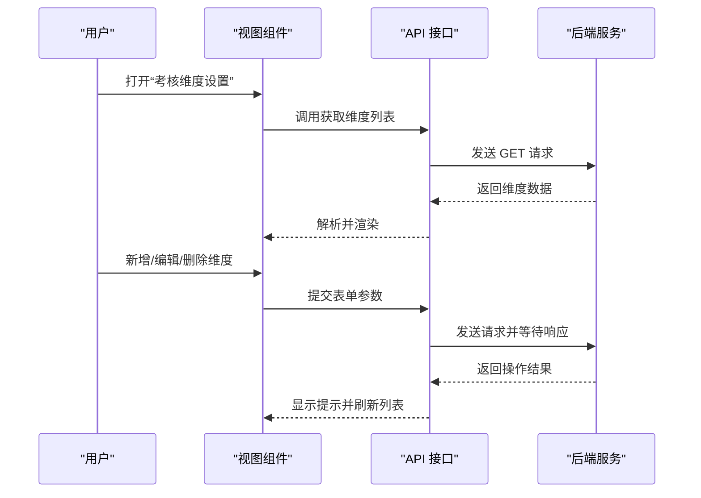
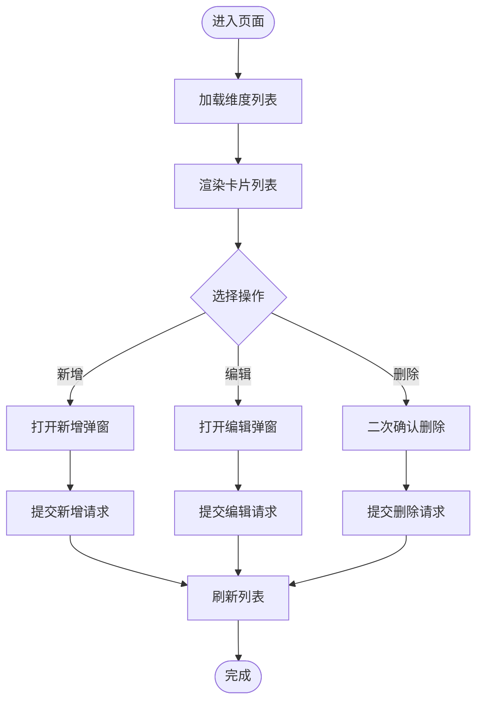
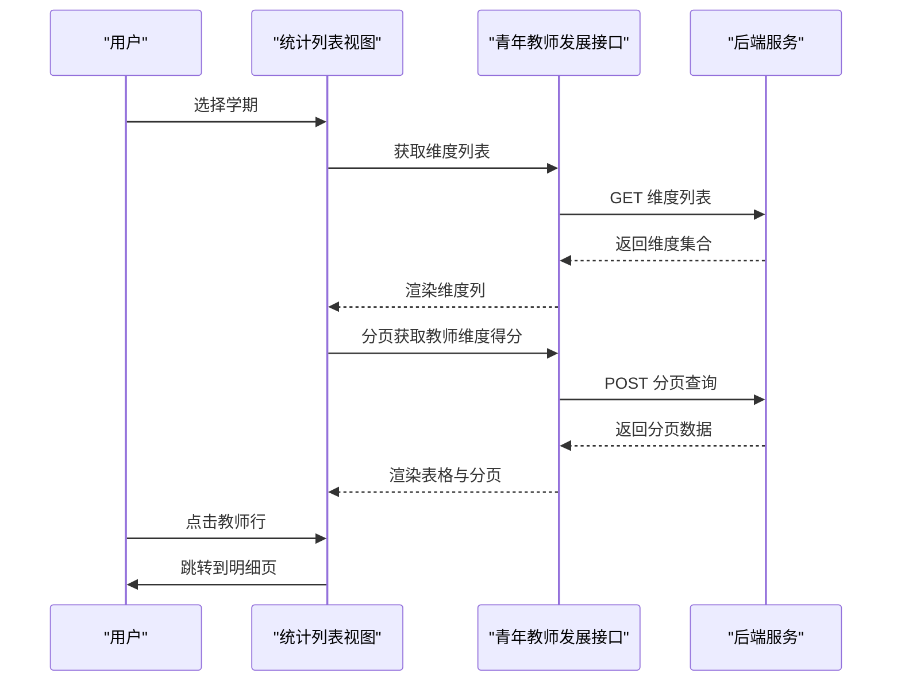
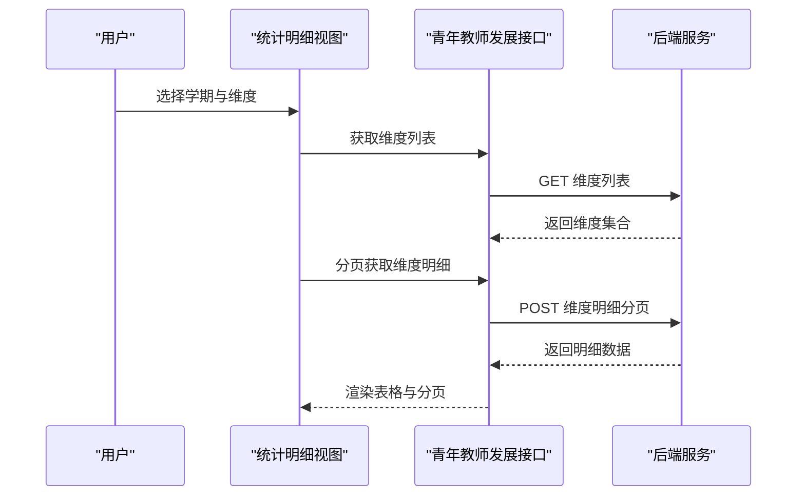
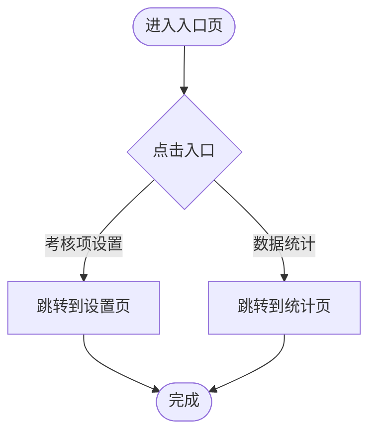
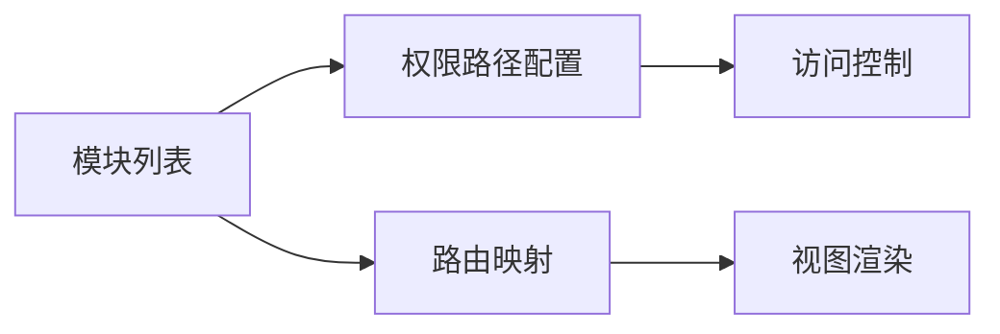
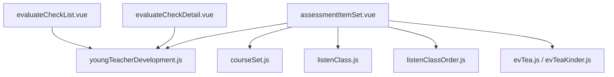

# 培养计划

<cite>
**本文引用的文件**
- [youngTeacherDevelopment.js](file://src/api/youngTeacherDevelopment.js)
- [entranceIndex.vue](file://src/views/youngTeacherDevelopment/entranceIndex.vue)
- [assessmentItemSet.vue](file://src/views/youngTeacherDevelopment/assessmentItemSet.vue)
- [evaluateCheckList.vue](file://src/views/youngTeacherDevelopment/evaluateCheckList.vue)
- [evaluateCheckDetail.vue](file://src/views/youngTeacherDevelopment/evaluateCheckDetail.vue)
- [moduleList.js](file://src/router/moduleList.js)
- [courseSet.js](file://src/api/systemSet/courseSet.js)
- [listenClass.js](file://src/api/listenClass.js)
- [listenClassOrder.js](file://src/api/teachingStudy/listenClassOrder.js)
- [evTea.js](file://src/api/evTea.js)
- [evTeaKinder.js](file://src/api/evTeaKinder.js)
</cite>

## 目录
1. [简介](#简介)
2. [项目结构](#项目结构)
3. [核心组件](#核心组件)
4. [架构总览](#架构总览)
5. [详细组件分析](#详细组件分析)
6. [依赖关系分析](#依赖关系分析)
7. [性能考虑](#性能考虑)
8. [故障排查指南](#故障排查指南)
9. [结论](#结论)
10. [附录](#附录)

## 简介
本技术文档围绕“培养计划”功能展开，聚焦于青年教师个性化培养方案的设计、实施与跟踪。系统通过“考核维度与考核项设置”、“学期数据统计与明细查看”、“课程与教学活动支撑”以及“听课评课与评教评学”的闭环机制，实现对教师成长过程的动态调整、执行监督与效果评估，并支持成果展示与持续改进。

## 项目结构
培养计划相关模块主要由以下部分组成：
- 视图层：入口页面、考核维度设置、统计列表与明细查看
- API 层：青年教师发展相关接口封装
- 路由层：模块导航与权限配置
- 支撑能力：课程设置、听课评课、评教评学等

**图表来源**
- [entranceIndex.vue:1-81](file://src/views/youngTeacherDevelopment/entranceIndex.vue#L1-L81)
- [assessmentItemSet.vue:1-264](file://src/views/youngTeacherDevelopment/assessmentItemSet.vue#L1-L264)
- [evaluateCheckList.vue:1-172](file://src/views/youngTeacherDevelopment/evaluateCheckList.vue#L1-L172)
- [evaluateCheckDetail.vue:1-170](file://src/views/youngTeacherDevelopment/evaluateCheckDetail.vue#L1-L170)
- [youngTeacherDevelopment.js:1-194](file://src/api/youngTeacherDevelopment.js#L1-L194)
- [courseSet.js:57-216](file://src/api/systemSet/courseSet.js#L57-L216)
- [listenClass.js](file://src/api/listenClass.js)
- [listenClassOrder.js](file://src/api/teachingStudy/listenClassOrder.js)
- [evTea.js](file://src/api/evTea.js)
- [evTeaKinder.js](file://src/api/evTeaKinder.js)
- [moduleList.js:683-741](file://src/router/moduleList.js#L683-L741)

**章节来源**
- [entranceIndex.vue:1-81](file://src/views/youngTeacherDevelopment/entranceIndex.vue#L1-L81)
- [assessmentItemSet.vue:1-264](file://src/views/youngTeacherDevelopment/assessmentItemSet.vue#L1-L264)
- [evaluateCheckList.vue:1-172](file://src/views/youngTeacherDevelopment/evaluateCheckList.vue#L1-L172)
- [evaluateCheckDetail.vue:1-170](file://src/views/youngTeacherDevelopment/evaluateCheckDetail.vue#L1-L170)
- [youngTeacherDevelopment.js:1-194](file://src/api/youngTeacherDevelopment.js#L1-L194)
- [moduleList.js:683-741](file://src/router/moduleList.js#L683-L741)

## 核心组件
- 入口页面：提供“考核项设置”“数据统计”两个入口，引导用户进入培养计划的配置与监控流程。
- 考核维度设置：维护青年教师培养的“维度”与“考核项”，支持新增、编辑、删除与“其他”类目开关。
- 数据统计与明细：按学期聚合教师维度得分并支持导出；点击教师可查看其各维度明细与加减分记录。
- 路由与权限：模块化导航与权限路径配置，确保功能访问受控。

**章节来源**
- [entranceIndex.vue:1-81](file://src/views/youngTeacherDevelopment/entranceIndex.vue#L1-L81)
- [assessmentItemSet.vue:1-264](file://src/views/youngTeacherDevelopment/assessmentItemSet.vue#L1-L264)
- [evaluateCheckList.vue:1-172](file://src/views/youngTeacherDevelopment/evaluateCheckList.vue#L1-L172)
- [evaluateCheckDetail.vue:1-170](file://src/views/youngTeacherDevelopment/evaluateCheckDetail.vue#L1-L170)
- [moduleList.js:683-741](file://src/router/moduleList.js#L683-L741)

## 架构总览
培养计划采用“视图-接口-路由”三层结构：
- 视图层负责交互与数据展示；
- 接口层封装后端 REST 请求，统一参数构造与响应处理；
- 路由层定义模块入口与子菜单，结合权限路径控制访问。

**图表来源**
- [assessmentItemSet.vue:73-179](file://src/views/youngTeacherDevelopment/assessmentItemSet.vue#L73-L179)
- [youngTeacherDevelopment.js:6-50](file://src/api/youngTeacherDevelopment.js#L6-L50)

**章节来源**
- [assessmentItemSet.vue:1-264](file://src/views/youngTeacherDevelopment/assessmentItemSet.vue#L1-L264)
- [youngTeacherDevelopment.js:1-194](file://src/api/youngTeacherDevelopment.js#L1-L194)

## 详细组件分析

### 组件一：考核维度设置（assessmentItemSet）
职责与流程：
- 加载维度列表并以卡片形式展示，支持编辑与删除图标悬停显示。
- 弹窗表单支持设置维度名称、初始分值、是否启用“其他”类目。
- 新增或编辑维度时进行表单校验，提交后根据结果提示并刷新列表。
- 删除维度前进行二次确认，避免误操作。

**图表来源**
- [assessmentItemSet.vue:73-179](file://src/views/youngTeacherDevelopment/assessmentItemSet.vue#L73-L179)
- [youngTeacherDevelopment.js:18-64](file://src/api/youngTeacherDevelopment.js#L18-L64)

**章节来源**
- [assessmentItemSet.vue:1-264](file://src/views/youngTeacherDevelopment/assessmentItemSet.vue#L1-L264)
- [youngTeacherDevelopment.js:1-194](file://src/api/youngTeacherDevelopment.js#L1-L194)

### 组件二：数据统计列表（evaluateCheckList）
职责与流程：
- 通过学期选择器切换统计周期，自动加载维度列表与分页数据。
- 表格列动态生成，包含教师姓名、部门、各维度分值、总分与排名。
- 支持导出当前学期的汇总数据，点击教师跳转到明细页面。

**图表来源**
- [evaluateCheckList.vue:115-152](file://src/views/youngTeacherDevelopment/evaluateCheckList.vue#L115-L152)
- [youngTeacherDevelopment.js:135-160](file://src/api/youngTeacherDevelopment.js#L135-L160)

**章节来源**
- [evaluateCheckList.vue:1-172](file://src/views/youngTeacherDevelopment/evaluateCheckList.vue#L1-L172)
- [youngTeacherDevelopment.js:135-160](file://src/api/youngTeacherDevelopment.js#L135-L160)

### 组件三：统计明细（evaluateCheckDetail）
职责与流程：
- 选择学期与考评维度后，分页展示该教师在该维度下的所有加减分记录。
- 明细包括考评人、时间、项目类型（加分/减分）、单项得分。
- 通过维度切换与分页变更驱动数据刷新。

**图表来源**
- [evaluateCheckDetail.vue:101-154](file://src/views/youngTeacherDevelopment/evaluateCheckDetail.vue#L101-L154)
- [youngTeacherDevelopment.js:165-193](file://src/api/youngTeacherDevelopment.js#L165-L193)

**章节来源**
- [evaluateCheckDetail.vue:1-170](file://src/views/youngTeacherDevelopment/evaluateCheckDetail.vue#L1-L170)
- [youngTeacherDevelopment.js:165-193](file://src/api/youngTeacherDevelopment.js#L165-L193)

### 组件四：入口页面（entranceIndex）
职责与流程：
- 提供“考核项设置”“数据统计”两个入口按钮，点击后跳转对应页面。

**图表来源**
- [entranceIndex.vue:30-34](file://src/views/youngTeacherDevelopment/entranceIndex.vue#L30-L34)

**章节来源**
- [entranceIndex.vue:1-81](file://src/views/youngTeacherDevelopment/entranceIndex.vue#L1-L81)

### 组件五：路由与模块导航（moduleList）
职责与流程：
- 在模块列表中配置“评教评学”“组织听课”等子模块，提供权限路径与路由映射，便于统一管理与访问控制。

**图表来源**
- [moduleList.js:683-741](file://src/router/moduleList.js#L683-L741)

**章节来源**
- [moduleList.js:683-741](file://src/router/moduleList.js#L683-L741)

## 依赖关系分析
- 视图组件依赖 API 接口层进行数据拉取与写入。
- 统计列表与明细依赖“学期”作为筛选条件，形成强耦合的时间维度。
- 设置页依赖课程、听课、评教等能力，作为培养计划的配套支撑。

**图表来源**
- [assessmentItemSet.vue:38-179](file://src/views/youngTeacherDevelopment/assessmentItemSet.vue#L38-L179)
- [evaluateCheckList.vue:58-152](file://src/views/youngTeacherDevelopment/evaluateCheckList.vue#L58-L152)
- [evaluateCheckDetail.vue:49-154](file://src/views/youngTeacherDevelopment/evaluateCheckDetail.vue#L49-L154)
- [youngTeacherDevelopment.js:1-194](file://src/api/youngTeacherDevelopment.js#L1-L194)
- [courseSet.js:57-216](file://src/api/systemSet/courseSet.js#L57-L216)
- [listenClass.js](file://src/api/listenClass.js)
- [listenClassOrder.js](file://src/api/teachingStudy/listenClassOrder.js)
- [evTea.js](file://src/api/evTea.js)
- [evTeaKinder.js](file://src/api/evTeaKinder.js)

**章节来源**
- [assessmentItemSet.vue:1-264](file://src/views/youngTeacherDevelopment/assessmentItemSet.vue#L1-L264)
- [evaluateCheckList.vue:1-172](file://src/views/youngTeacherDevelopment/evaluateCheckList.vue#L1-L172)
- [evaluateCheckDetail.vue:1-170](file://src/views/youngTeacherDevelopment/evaluateCheckDetail.vue#L1-L170)
- [youngTeacherDevelopment.js:1-194](file://src/api/youngTeacherDevelopment.js#L1-L194)

## 性能考虑
- 列表分页：统计与明细均采用分页加载，降低一次性渲染压力。
- 动态列渲染：根据维度数量动态生成列，避免固定列导致的冗余渲染。
- 事件节流：在频繁筛选场景（如学期切换）建议对请求做去抖处理，避免重复请求。
- 图片资源：维度卡片背景图使用 CDN，减少本地体积与首屏阻塞。

[本节为通用建议，不直接分析具体文件]

## 故障排查指南
- 新增/编辑失败：检查表单必填字段与数值范围，确认接口返回状态码与消息提示。
- 删除确认：删除操作需二次确认，避免误删；若未触发确认框，检查事件绑定与弹窗状态。
- 统计无数据：确认所选学期有效且存在对应维度；检查分页参数与后端分页逻辑。
- 明细为空：确认维度 ID 与教师 ID 参数正确，以及筛选条件与分页参数一致。

**章节来源**
- [assessmentItemSet.vue:94-179](file://src/views/youngTeacherDevelopment/assessmentItemSet.vue#L94-L179)
- [evaluateCheckList.vue:123-152](file://src/views/youngTeacherDevelopment/evaluateCheckList.vue#L123-L152)
- [evaluateCheckDetail.vue:121-154](file://src/views/youngTeacherDevelopment/evaluateCheckDetail.vue#L121-L154)

## 结论
培养计划通过“维度与考核项设置—学期统计—明细追踪—导出归档”的完整链路，实现了对青年教师成长过程的可视化与可量化管理。配合课程、听课、评教等能力，形成多维度支撑体系，既满足日常管理需求，也为持续改进与经验沉淀提供了数据基础。

[本节为总结性内容，不直接分析具体文件]

## 附录
- 关键接口一览（示例）
  - 获取维度列表：POST /structure/youngTeacher/getSchoolYoungTeacherDimensionList
  - 新增维度：GET /structure/youngTeacher/addYoungTeacherDimension
  - 编辑维度：GET /structure/youngTeacher/editYoungTeacherDimension
  - 删除维度：GET /structure/youngTeacher/delYoungTeacherDimension
  - 按学期获取维度列表（统计）：POST /structure/youngTeacher/getYoungTeacherDimensionListFromScore
  - 学期维度得分分页列表：POST /structure/youngTeacher/getSchoolThDimScoreCollectPageList
  - 维度类型得分分页列表：POST /structure/youngTeacher/getThDimensionTypeScorePageList

**章节来源**
- [youngTeacherDevelopment.js:1-194](file://src/api/youngTeacherDevelopment.js#L1-L194)