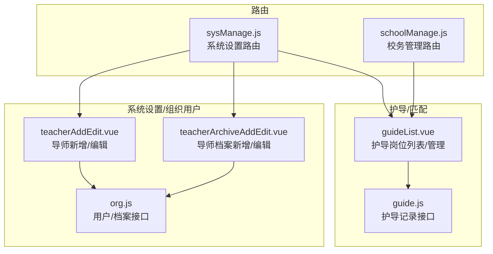
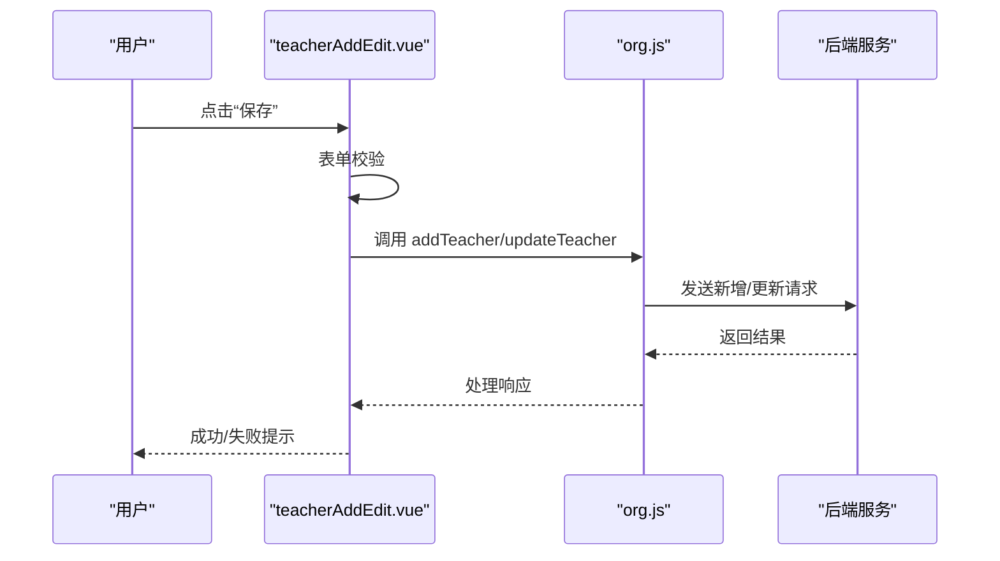
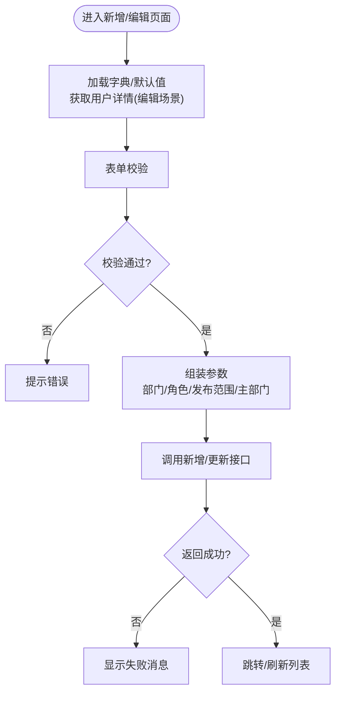
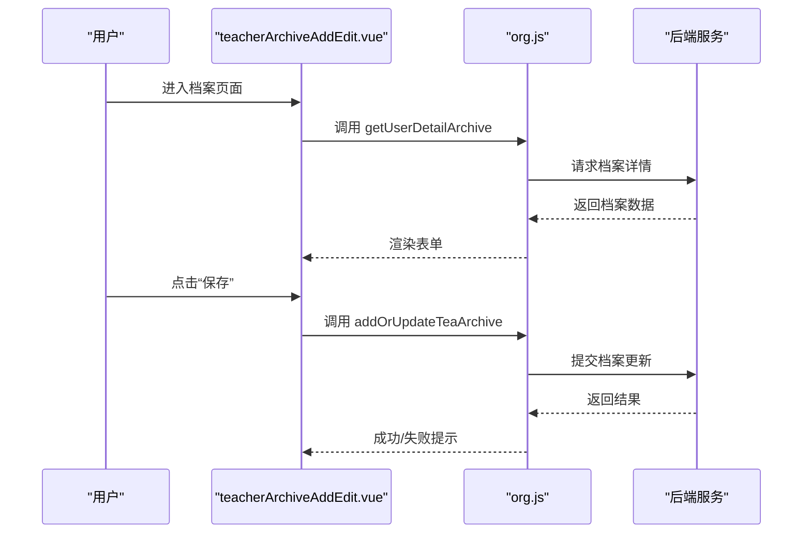
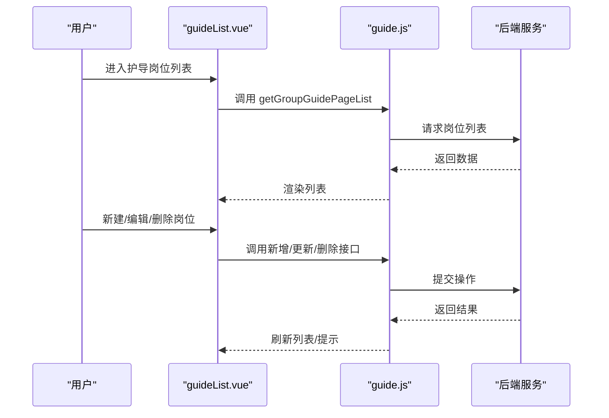
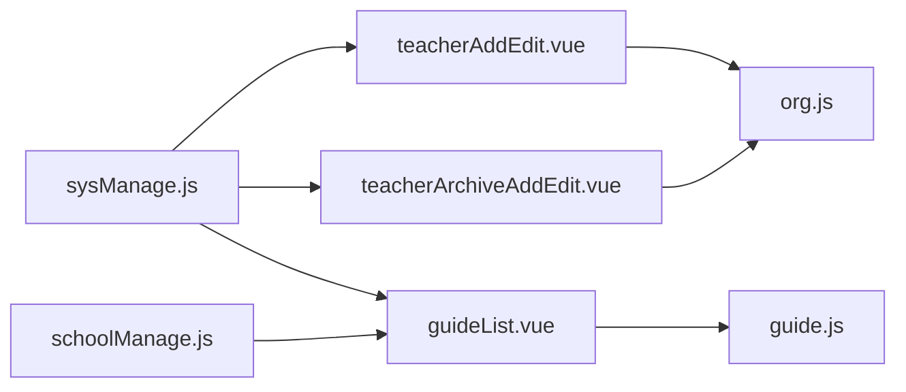

# 导师管理

<cite>
**本文引用的文件**
- [org.js](file://src/api/systemSet/org.js)
- [teacherAddEdit.vue](file://src/views/sysSet/org/user/teacherAddEdit.vue)
- [teacherArchiveAddEdit.vue](file://src/views/sysSet/org/user/teacherArchiveAddEdit.vue)
- [guideList.vue](file://src/views/sysSet/guide/guideList.vue)
- [sysManage.js](file://src/router\normal\sysManage.js)
- [schoolManage.js](file://src/router\normal\schoolManage.js)
- [guide.js](file://src/api/guide.js)
</cite>

## 目录
1. [简介](#简介)
2. [项目结构](#项目结构)
3. [核心组件](#核心组件)
4. [架构总览](#架构总览)
5. [详细组件分析](#详细组件分析)
6. [依赖关系分析](#依赖关系分析)
7. [性能考量](#性能考量)
8. [故障排查指南](#故障排查指南)
9. [结论](#结论)
10. [附录](#附录)

## 简介
本技术文档围绕“导师管理”主题，系统化梳理导师信息维护、导师档案管理与导师状态控制的前端实现机制，并扩展到导师资格审核、状态变更与权限分配、导师与徒弟匹配（护导）流程、指导计划与进度跟踪、评价指标与激励措施、以及退出机制的设计思路。文档基于现有代码库中的接口与页面进行归纳总结，帮助开发者快速理解并扩展相关功能。

## 项目结构
- 导师管理涉及的核心模块包括：
  - 系统设置/组织用户管理：负责导师的基础信息与权限配置
  - 档案管理：负责导师的专业背景、资格证书、教学经历等档案信息
  - 护导（导师匹配）：负责导师与徒弟的岗位分配、二维码生成与管理
  - 路由配置：统一挂载上述页面与接口调用路径

**图表来源**
- [teacherAddEdit.vue](file://src/views/sysSet/org/user/teacherAddEdit.vue)
- [teacherArchiveAddEdit.vue](file://src/views/sysSet/org/user/teacherArchiveAddEdit.vue)
- [org.js](file://src/api/systemSet/org.js)
- [guideList.vue](file://src/views/sysSet/guide/guideList.vue)
- [guide.js](file://src/api/guide.js)
- [sysManage.js](file://src/router\normal\sysManage.js)
- [schoolManage.js](file://src/router\normal\schoolManage.js)

**章节来源**
- [org.js](file://src/api/systemSet/org.js)
- [teacherAddEdit.vue](file://src/views/sysSet/org/user/teacherAddEdit.vue)
- [teacherArchiveAddEdit.vue](file://src/views/sysSet/org/user/teacherArchiveAddEdit.vue)
- [guideList.vue](file://src/views/sysSet/guide/guideList.vue)
- [sysManage.js](file://src/router\normal\sysManage.js)
- [schoolManage.js](file://src/router\normal\schoolManage.js)

## 核心组件
- 导师信息维护（新增/编辑/删除/查询）
  - 基础信息：姓名、性别、出生日期、证件类型/号码、手机号、教师类型、职务、人员状态、所在部门、发布范围、主部门、角色、用户名等
  - 权限与状态：通过角色与发布范围控制可见性与操作范围；人员状态用于启用/禁用
  - 接口：新增/更新用户、获取用户详情、删除用户、移动用户、启用/禁用用户等
- 导师档案管理（专业背景、资格证书、教学经历等）
  - 档案字段：民族、籍贯、政治面貌、专业、学历、学位、职称、荣誉称号、教师编制、从教年月、教师资格证类型/编号、上岗资质等
  - 接口：获取档案详情、新增/更新档案
- 导师状态控制（启用/禁用、流出/流入、导入）
  - 通过人员状态与来源标识控制导师生命周期
- 护导（导师与徒弟匹配）
  - 护导岗位列表、新增/编辑/删除岗位、导出二维码、负责人设置、时间设置
  - 护导记录按周统计与查询
- 指导计划与进度跟踪（建议）
  - 可基于现有护导框架扩展“指导计划”字段与“进度跟踪”记录，结合现有接口进行二次开发
- 评价指标与激励措施（建议）
  - 可复用现有“教师荣誉设置”模块，扩展导师专属荣誉/积分/奖励体系
- 退出机制（建议）
  - 通过“流出用户”流程与“启用/禁用”配合实现导师离校/停用流程

**章节来源**
- [org.js](file://src/api/systemSet/org.js)
- [teacherAddEdit.vue](file://src/views/sysSet/org/user/teacherAddEdit.vue)
- [teacherArchiveAddEdit.vue](file://src/views/sysSet/org/user/teacherArchiveAddEdit.vue)
- [guideList.vue](file://src/views/sysSet/guide/guideList.vue)
- [guide.js](file://src/api/guide.js)

## 架构总览
- 前端采用 Vue + Element UI 组件库，页面通过路由挂载，接口通过统一的 fetch 封装调用后端服务
- 导师管理相关页面与接口分布如下：
  - 用户管理：teacherAddEdit.vue -> org.js（新增/更新/删除/详情）
  - 档案管理：teacherArchiveAddEdit.vue -> org.js（档案详情/新增/更新）
  - 护导管理：guideList.vue -> guide.js（岗位列表/新增/更新/删除/导出二维码）、路由 sysManage.js/schoolManage.js
- 数据流：页面组件发起请求 -> API 层封装 -> 后端服务 -> 返回数据 -> 页面渲染/提示

**图表来源**
- [teacherAddEdit.vue](file://src/views/sysSet/org/user/teacherAddEdit.vue)
- [org.js](file://src/api/systemSet/org.js)

**章节来源**
- [teacherAddEdit.vue](file://src/views/sysSet/org/user/teacherAddEdit.vue)
- [org.js](file://src/api/systemSet/org.js)

## 详细组件分析

### 导师信息维护（新增/编辑/删除/查询）
- 功能要点
  - 新增/编辑：收集基础信息、角色、发布范围、主部门、人员状态等，提交后调用新增/更新接口
  - 删除：支持批量删除
  - 查询：分页查询用户列表，支持过滤状态、搜索关键字、是否包含子部门等
  - 状态控制：启用/禁用用户；支持流出/流入用户
- 关键接口
  - 新增/更新用户：addTeacher/updateTeacher
  - 获取用户详情：getUserDetail
  - 删除用户：deleteTeacher
  - 启用/禁用：enableUser
  - 移动用户/移除部门：moveTeacher/removeTeacherDepart
  - 导入进度/结果：importTeacherSchedule/importTeacherResult
- 页面交互
  - 表单校验：姓名、手机号、性别、出生日期、证件类型、所在部门、角色、用户名、职务、人员状态、发布范围等
  - 主部门设置：支持在多部门中选择主部门
  - 手机号变更策略：根据学校客户端类型与同步状态动态控制

**图表来源**
- [teacherAddEdit.vue](file://src/views/sysSet/org/user/teacherAddEdit.vue)
- [org.js](file://src/api/systemSet/org.js)

**章节来源**
- [teacherAddEdit.vue](file://src/views/sysSet/org/user/teacherAddEdit.vue)
- [org.js](file://src/api/systemSet/org.js)

### 导师档案管理（专业背景、资格证书、教学经历等）
- 功能要点
  - 档案字段覆盖民族、籍贯、政治面貌、专业、学历、学位、职称、荣誉称号、教师编制、从教年月、教师资格证类型/编号、上岗资质等
  - 支持查看/编辑，保存后返回成功提示
- 关键接口
  - 获取档案详情：getUserDetailArchive
  - 新增/更新档案：addOrUpdateTeaArchive
- 页面交互
  - 字典项加载：国家/民族、政治面貌、学历、学位、专业、职称、教师编制、证书类型等
  - 日期控件：从教年月选择月份

**图表来源**
- [teacherArchiveAddEdit.vue](file://src/views/sysSet/org/user/teacherArchiveAddEdit.vue)
- [org.js](file://src/api/systemSet/org.js)

**章节来源**
- [teacherArchiveAddEdit.vue](file://src/views/sysSet/org/user/teacherArchiveAddEdit.vue)
- [org.js](file://src/api/systemSet/org.js)

### 导师状态控制（启用/禁用、流出/流入、导入）
- 功能要点
  - 启用/禁用：通过 enableUser 控制用户状态
  - 流出/流入：outflowTeacher/removeTeacherDepart 等接口用于跨部门流转
  - 导入：提供导入进度与结果查询接口
- 实现要点
  - 人员状态与来源常量用于区分教师、园外用户、流入用户、流出用户
  - 手机号变更策略与外部同步状态联动

**章节来源**
- [org.js](file://src/api/systemSet/org.js)
- [teacherAddEdit.vue](file://src/views/sysSet/org/user/teacherAddEdit.vue)

### 护导（导师与徒弟匹配）与指导计划
- 功能要点
  - 护导岗位管理：新增/编辑/删除岗位、导出二维码、负责人设置、时间设置
  - 护导记录：按周统计与查询
- 关键接口
  - 岗位列表/新增/更新/删除：guideList.vue 与 guide.js
  - 护导记录按周查询：getManagerGuideRecordsByWeek
- 页面交互
  - 岗位列表展示二维码，支持编辑/删除
  - 支持按名称搜索与分页
  - 通过路由挂载到系统设置与校务管理模块

**图表来源**
- [guideList.vue](file://src/views/sysSet/guide/guideList.vue)
- [guide.js](file://src/api/guide.js)

**章节来源**
- [guideList.vue](file://src/views/sysSet/guide/guideList.vue)
- [guide.js](file://src/api/guide.js)
- [sysManage.js](file://src/router\normal\sysManage.js)
- [schoolManage.js](file://src/router\normal\schoolManage.js)

### 指导计划制定与进度跟踪（建议）
- 设计建议
  - 在现有护导框架上扩展“指导计划”字段（如计划周期、目标、里程碑），并与护导岗位绑定
  - 引入“进度跟踪”记录，记录每次指导的时间、内容、成果与评价
  - 结合现有“护导记录按周查询”接口，扩展“导师指导记录”的查询能力
- 集成点
  - 页面：可复用 guideList.vue 的列表/弹窗模式
  - 接口：在 guide.js 中扩展相应接口，或新增独立模块

[本节为概念性设计，不直接分析具体文件，故无“章节来源”]

### 评价指标与激励措施（建议）
- 设计建议
  - 复用“教师荣誉设置”模块，扩展导师专属荣誉/积分/奖励体系
  - 与护导记录、指导计划进度联动，自动触发奖励条件
- 集成点
  - 路由：sysManage.js 中已有“教师荣誉设置”相关路由

**章节来源**
- [sysManage.js](file://src/router\normal\sysManage.js)

### 退出机制（建议）
- 设计建议
  - 通过“流出用户”流程与“启用/禁用”配合，实现导师离校/停用流程
  - 在档案与状态控制处增加“离校日期”、“离校原因”等字段
- 集成点
  - 使用 org.js 中的 enableUser 与 outflowTeacher 等接口

**章节来源**
- [org.js](file://src/api/systemSet/org.js)

## 依赖关系分析
- 组件与接口耦合
  - teacherAddEdit.vue 依赖 org.js 的用户管理接口
  - teacherArchiveAddEdit.vue 依赖 org.js 的档案管理接口
  - guideList.vue 依赖 guide.js 的护导接口
- 路由集成
  - sysManage.js 与 schoolManage.js 将相关页面挂载到系统设置与校务管理菜单下
- 外部依赖
  - Element UI 组件库用于表单、表格、分页、对话框等
  - moment 用于日期格式化

**图表来源**
- [teacherAddEdit.vue](file://src/views/sysSet/org/user/teacherAddEdit.vue)
- [teacherArchiveAddEdit.vue](file://src/views/sysSet/org/user/teacherArchiveAddEdit.vue)
- [guideList.vue](file://src/views/sysSet/guide/guideList.vue)
- [org.js](file://src/api/systemSet/org.js)
- [guide.js](file://src/api/guide.js)
- [sysManage.js](file://src/router\normal\sysManage.js)
- [schoolManage.js](file://src/router\normal\schoolManage.js)

**章节来源**
- [teacherAddEdit.vue](file://src/views/sysSet/org/user/teacherAddEdit.vue)
- [teacherArchiveAddEdit.vue](file://src/views/sysSet/org/user/teacherArchiveAddEdit.vue)
- [guideList.vue](file://src/views/sysSet/guide/guideList.vue)
- [org.js](file://src/api/systemSet/org.js)
- [guide.js](file://src/api/guide.js)
- [sysManage.js](file://src/router\normal\sysManage.js)
- [schoolManage.js](file://src/router\normal\schoolManage.js)

## 性能考量
- 列表分页与搜索：通过 pageNo/pageSize 与关键词搜索减少一次性数据传输
- 表单校验前置：在提交前完成校验，避免无效请求
- 图片预览与二维码：仅在需要时加载，避免阻塞页面渲染
- 接口超时与重试：统一的 fetch 封装可配置超时与重试策略（需在封装层实现）

[本节为通用优化建议，不直接分析具体文件，故无“章节来源”]

## 故障排查指南
- 常见问题
  - 表单校验失败：检查必填字段与格式规则（姓名、手机号、证件类型、部门、角色、发布范围等）
  - 接口返回失败：查看返回的 msg 字段，确认参数与权限
  - 二维码为空：确认导出接口返回的 URL 与 token 是否有效
- 定位方法
  - 打开浏览器网络面板，查看请求与响应
  - 在页面上查看提示消息，确认业务逻辑分支
  - 检查路由是否正确挂载到 sysManage.js/schoolManage.js

**章节来源**
- [teacherAddEdit.vue](file://src/views/sysSet/org/user/teacherAddEdit.vue)
- [teacherArchiveAddEdit.vue](file://src/views/sysSet/org/user/teacherArchiveAddEdit.vue)
- [guideList.vue](file://src/views/sysSet/guide/guideList.vue)
- [org.js](file://src/api/systemSet/org.js)
- [guide.js](file://src/api/guide.js)

## 结论
本技术文档基于现有代码库梳理了导师管理的关键实现：用户信息维护、档案管理、状态控制与护导匹配。通过统一的接口封装与路由集成，前端实现了完整的导师生命周期管理能力。建议在现有基础上扩展“指导计划与进度跟踪”“评价与激励”“退出机制”等模块，以形成闭环的导师管理体系。

[本节为总结性内容，不直接分析具体文件，故无“章节来源”]

## 附录
- 路由挂载参考
  - 系统设置：sysManage.js 中包含“护导组/岗位/时间/负责人设置”等路由
  - 校务管理：schoolManage.js 中包含“护导统计”相关路由
- 接口清单参考
  - 用户管理：新增/更新/删除/详情、启用/禁用、导入进度/结果
  - 档案管理：档案详情、新增/更新
  - 护导管理：岗位列表、新增/更新/删除、导出二维码、护导记录按周查询

**章节来源**
- [sysManage.js](file://src/router\normal\sysManage.js)
- [schoolManage.js](file://src/router\normal\schoolManage.js)
- [org.js](file://src/api/systemSet/org.js)
- [guide.js](file://src/api/guide.js)