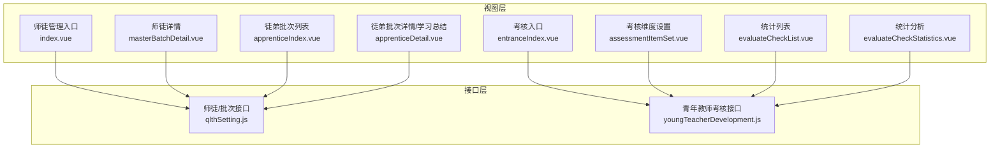
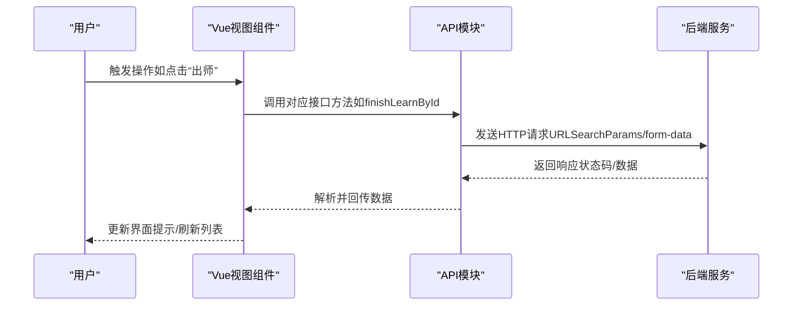
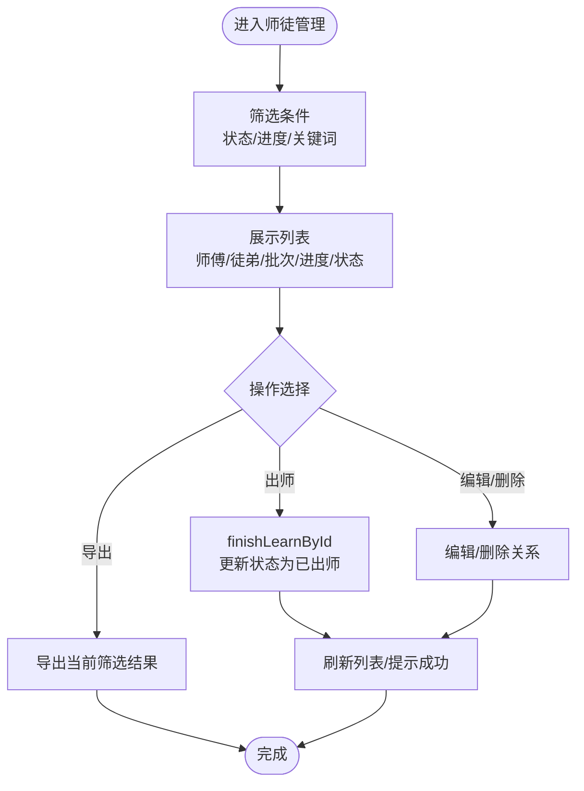
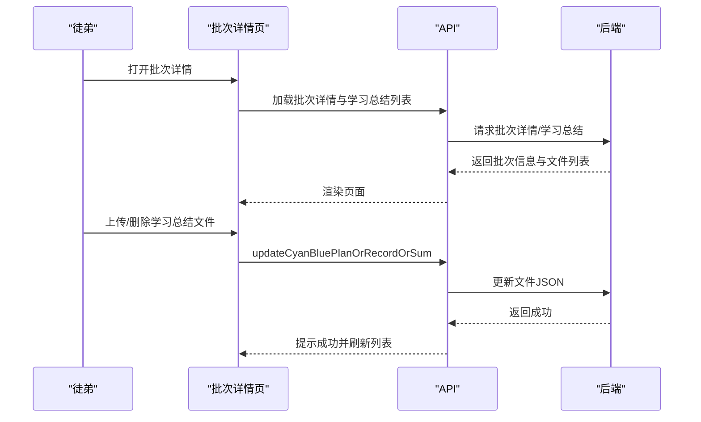
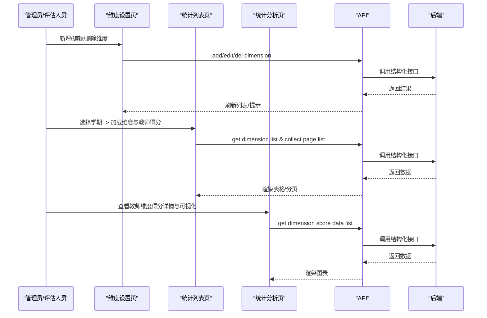
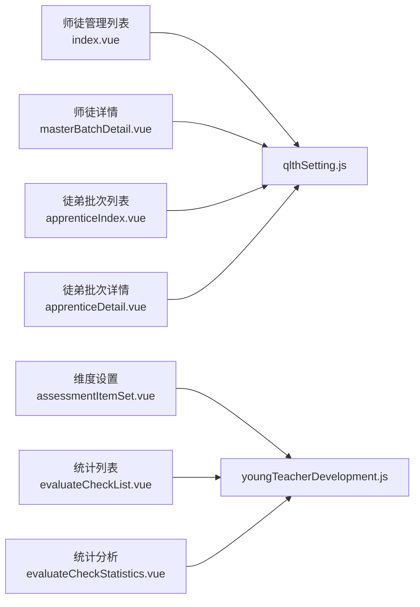

# 徒弟管理

<cite>
**本文引用的文件**
- [src/views/qlth/apprenticeIndex.vue](file://src/views/qlth/apprenticeIndex.vue)
- [src/views/qlth/apprenticeDetail.vue](file://src/views/qlth/apprenticeDetail.vue)
- [src/views/sysSet/qlthSetting/index.vue](file://src/views/sysSet/qlthSetting/index.vue)
- [src/views/sysSet/qlthSetting/masterBatchDetail.vue](file://src/views/sysSet/qlthSetting/masterBatchDetail.vue)
- [src/api/qlthSetting.js](file://src/api/qlthSetting.js)
- [src/views/youngTeacherDevelopment/entranceIndex.vue](file://src/views/youngTeacherDevelopment/entranceIndex.vue)
- [src/views/youngTeacherDevelopment/assessmentItemSet.vue](file://src/views/youngTeacherDevelopment/assessmentItemSet.vue)
- [src/views/youngTeacherDevelopment/evaluateCheckList.vue](file://src/views/youngTeacherDevelopment/evaluateCheckList.vue)
- [src/views/youngTeacherDevelopment/evaluateCheckStatistics.vue](file://src/views/youngTeacherDevelopment/evaluateCheckStatistics.vue)
- [src/api/youngTeacherDevelopment.js](file://src/api/youngTeacherDevelopment.js)
</cite>

## 目录
1. [简介](#简介)
2. [项目结构](#项目结构)
3. [核心组件](#核心组件)
4. [架构总览](#架构总览)
5. [详细组件分析](#详细组件分析)
6. [依赖分析](#依赖分析)
7. [性能考虑](#性能考虑)
8. [故障排查指南](#故障排查指南)
9. [结论](#结论)
10. [附录](#附录)

## 简介
本技术文档围绕“徒弟管理”功能展开，覆盖以下方面：
- 徒弟信息管理：包括师徒关系建立、编辑、删除、导出等。
- 培养计划跟踪：批次管理、培养计划、帮扶记录、学习总结的发布与查看。
- 学习进度监控：听课记录、阶段性评估与统计分析。
- 成长轨迹与能力评价：按学期维度的分数汇总、图表化展示。
- 转正流程与后续发展：出师操作、状态变更与导出归档。

系统由两大部分组成：
- 师徒关系与培养流程管理（qlthSetting）：面向管理员与师傅/徒弟，负责关系建立、批次管理、培养材料上传与审核、转正等。
- 青年教师考核体系（youngTeacherDevelopment）：面向教学评估，提供考核维度与项设置、统计与可视化分析。

## 项目结构
与“徒弟管理”直接相关的前端模块分布如下：
- 视图层（views）
  - 师徒管理入口与列表：index.vue
  - 师徒详情与批次详情：masterBatchDetail.vue
  - 徒弟端批次列表与学习总结：apprenticeIndex.vue、apprenticeDetail.vue
  - 青年教师考核入口与设置：entranceIndex.vue、assessmentItemSet.vue
  - 考核统计与分析：evaluateCheckList.vue、evaluateCheckStatistics.vue
- 接口层（api）
  - 师徒与批次接口：qlthSetting.js
  - 青年教师考核接口：youngTeacherDevelopment.js

**图表来源**
- [src/views/sysSet/qlthSetting/index.vue:1-284](file://src/views/sysSet/qlthSetting/index.vue#L1-L284)
- [src/views/sysSet/qlthSetting/masterBatchDetail.vue:1-394](file://src/views/sysSet/qlthSetting/masterBatchDetail.vue#L1-L394)
- [src/views/qlth/apprenticeIndex.vue:1-123](file://src/views/qlth/apprenticeIndex.vue#L1-L123)
- [src/views/qlth/apprenticeDetail.vue:1-199](file://src/views/qlth/apprenticeDetail.vue#L1-L199)
- [src/views/youngTeacherDevelopment/entranceIndex.vue:1-81](file://src/views/youngTeacherDevelopment/entranceIndex.vue#L1-L81)
- [src/views/youngTeacherDevelopment/assessmentItemSet.vue:1-264](file://src/views/youngTeacherDevelopment/assessmentItemSet.vue#L1-L264)
- [src/views/youngTeacherDevelopment/evaluateCheckList.vue:1-172](file://src/views/youngTeacherDevelopment/evaluateCheckList.vue#L1-L172)
- [src/views/youngTeacherDevelopment/evaluateCheckStatistics.vue:1-224](file://src/views/youngTeacherDevelopment/evaluateCheckStatistics.vue#L1-L224)
- [src/api/qlthSetting.js:1-370](file://src/api/qlthSetting.js#L1-L370)
- [src/api/youngTeacherDevelopment.js:1-194](file://src/api/youngTeacherDevelopment.js#L1-L194)

**章节来源**
- [src/views/sysSet/qlthSetting/index.vue:1-284](file://src/views/sysSet/qlthSetting/index.vue#L1-L284)
- [src/views/sysSet/qlthSetting/masterBatchDetail.vue:1-394](file://src/views/sysSet/qlthSetting/masterBatchDetail.vue#L1-L394)
- [src/views/qlth/apprenticeIndex.vue:1-123](file://src/views/qlth/apprenticeIndex.vue#L1-L123)
- [src/views/qlth/apprenticeDetail.vue:1-199](file://src/views/qlth/apprenticeDetail.vue#L1-L199)
- [src/views/youngTeacherDevelopment/entranceIndex.vue:1-81](file://src/views/youngTeacherDevelopment/entranceIndex.vue#L1-L81)
- [src/views/youngTeacherDevelopment/assessmentItemSet.vue:1-264](file://src/views/youngTeacherDevelopment/assessmentItemSet.vue#L1-L264)
- [src/views/youngTeacherDevelopment/evaluateCheckList.vue:1-172](file://src/views/youngTeacherDevelopment/evaluateCheckList.vue#L1-L172)
- [src/views/youngTeacherDevelopment/evaluateCheckStatistics.vue:1-224](file://src/views/youngTeacherDevelopment/evaluateCheckStatistics.vue#L1-L224)
- [src/api/qlthSetting.js:1-370](file://src/api/qlthSetting.js#L1-L370)
- [src/api/youngTeacherDevelopment.js:1-194](file://src/api/youngTeacherDevelopment.js#L1-L194)

## 核心组件
- 师徒关系与批次管理（管理员/师傅）
  - 列表筛选、新增、编辑、删除、导出、出师操作
  - 批次详情：培养计划、听课记录、帮扶记录、学习总结
- 徒弟端培养流程
  - 批次列表、听课记录、学习总结上传与查看
- 青年教师考核体系（评估侧）
  - 考核维度与项设置、按学期统计、图表化分析

**章节来源**
- [src/views/sysSet/qlthSetting/index.vue:112-268](file://src/views/sysSet/qlthSetting/index.vue#L112-L268)
- [src/views/sysSet/qlthSetting/masterBatchDetail.vue:149-250](file://src/views/sysSet/qlthSetting/masterBatchDetail.vue#L149-L250)
- [src/views/qlth/apprenticeIndex.vue:58-108](file://src/views/qlth/apprenticeIndex.vue#L58-L108)
- [src/views/qlth/apprenticeDetail.vue:34-130](file://src/views/qlth/apprenticeDetail.vue#L34-L130)
- [src/views/youngTeacherDevelopment/assessmentItemSet.vue:37-181](file://src/views/youngTeacherDevelopment/assessmentItemSet.vue#L37-L181)
- [src/views/youngTeacherDevelopment/evaluateCheckList.vue:55-154](file://src/views/youngTeacherDevelopment/evaluateCheckList.vue#L55-L154)
- [src/views/youngTeacherDevelopment/evaluateCheckStatistics.vue:32-119](file://src/views/youngTeacherDevelopment/evaluateCheckStatistics.vue#L32-L119)

## 架构总览
系统采用前后端分离，前端通过统一的 fetch 封装调用后端接口，接口以 URLSearchParams 或 form-data 形式传递参数。数据流自上而下分为：
- 视图层（Vue 组件）负责交互与展示
- 接口层（API 模块）封装请求方法
- 后端服务（结构化接口前缀）处理业务逻辑与数据持久化

**图表来源**
- [src/views/sysSet/qlthSetting/index.vue:177-195](file://src/views/sysSet/qlthSetting/index.vue#L177-L195)
- [src/api/qlthSetting.js:340-346](file://src/api/qlthSetting.js#L340-L346)

**章节来源**
- [src/api/qlthSetting.js:1-370](file://src/api/qlthSetting.js#L1-L370)

## 详细组件分析

### 师徒关系与批次管理（管理员/师傅）
- 功能要点
  - 列表筛选：按状态、批次进度、关键词搜索
  - 批量导出：支持按条件导出师徒关系数据
  - 出师操作：将“进行中”状态更新为“已出师”，触发流程闭环
  - 批次详情：集中展示培养计划、听课记录、帮扶记录、学习总结
- 关键接口
  - 查询师徒关系列表、删除、导出、出师
  - 获取批次详情、培养计划/记录/总结列表
- 数据与状态
  - 状态枚举：未开始、进行中、已出师；批次进度：草稿、培养计划、帮扶记录、学习总结

**图表来源**
- [src/views/sysSet/qlthSetting/index.vue:112-268](file://src/views/sysSet/qlthSetting/index.vue#L112-L268)
- [src/api/qlthSetting.js:112-118](file://src/api/qlthSetting.js#L112-L118)
- [src/api/qlthSetting.js:340-346](file://src/api/qlthSetting.js#L340-L346)

**章节来源**
- [src/views/sysSet/qlthSetting/index.vue:112-268](file://src/views/sysSet/qlthSetting/index.vue#L112-L268)
- [src/views/sysSet/qlthSetting/masterBatchDetail.vue:149-250](file://src/views/sysSet/qlthSetting/masterBatchDetail.vue#L149-L250)
- [src/api/qlthSetting.js:112-118](file://src/api/qlthSetting.js#L112-L118)
- [src/api/qlthSetting.js:340-346](file://src/api/qlthSetting.js#L340-L346)

### 徒弟端培养流程（批次与学习总结）
- 功能要点
  - 批次列表：按批次名称、创建人、创建时间、师徒人数、状态展示
  - 听课记录：按批次查看听课记录与图片
  - 学习总结：在规定时间内上传/删除学习总结文件，支持多文件
- 关键接口
  - 批次列表、听课记录、学习总结列表、更新学习总结文件
  - 批次详情与时间窗口控制（仅在上报期内可操作）

**图表来源**
- [src/views/qlth/apprenticeDetail.vue:72-130](file://src/views/qlth/apprenticeDetail.vue#L72-L130)
- [src/api/qlthSetting.js:232-238](file://src/api/qlthSetting.js#L232-L238)

**章节来源**
- [src/views/qlth/apprenticeIndex.vue:58-108](file://src/views/qlth/apprenticeIndex.vue#L58-L108)
- [src/views/qlth/apprenticeDetail.vue:34-130](file://src/views/qlth/apprenticeDetail.vue#L34-L130)
- [src/api/qlthSetting.js:256-286](file://src/api/qlthSetting.js#L256-L286)
- [src/api/qlthSetting.js:232-238](file://src/api/qlthSetting.js#L232-L238)

### 青年教师考核体系（评估侧）
- 功能要点
  - 考核维度设置：新增/编辑/删除维度，支持“其他”类型开关
  - 考核项设置：按维度配置评分项
  - 统计与导出：按学期维度汇总，支持导出
  - 能力发展可视化：柱状图展示各维度得分
- 关键接口
  - 维度列表、新增/编辑/删除维度
  - 按学期获取维度列表、按页获取教师维度得分汇总
  - 教师维度得分明细列表

**图表来源**
- [src/views/youngTeacherDevelopment/assessmentItemSet.vue:37-181](file://src/views/youngTeacherDevelopment/assessmentItemSet.vue#L37-L181)
- [src/views/youngTeacherDevelopment/evaluateCheckList.vue:55-154](file://src/views/youngTeacherDevelopment/evaluateCheckList.vue#L55-L154)
- [src/views/youngTeacherDevelopment/evaluateCheckStatistics.vue:32-119](file://src/views/youngTeacherDevelopment/evaluateCheckStatistics.vue#L32-L119)
- [src/api/youngTeacherDevelopment.js:6-13](file://src/api/youngTeacherDevelopment.js#L6-L13)
- [src/api/youngTeacherDevelopment.js:86-96](file://src/api/youngTeacherDevelopment.js#L86-L96)
- [src/api/youngTeacherDevelopment.js:149-193](file://src/api/youngTeacherDevelopment.js#L149-L193)

**章节来源**
- [src/views/youngTeacherDevelopment/assessmentItemSet.vue:37-181](file://src/views/youngTeacherDevelopment/assessmentItemSet.vue#L37-L181)
- [src/views/youngTeacherDevelopment/evaluateCheckList.vue:55-154](file://src/views/youngTeacherDevelopment/evaluateCheckList.vue#L55-L154)
- [src/views/youngTeacherDevelopment/evaluateCheckStatistics.vue:32-119](file://src/views/youngTeacherDevelopment/evaluateCheckStatistics.vue#L32-L119)
- [src/api/youngTeacherDevelopment.js:6-13](file://src/api/youngTeacherDevelopment.js#L6-L13)
- [src/api/youngTeacherDevelopment.js:86-96](file://src/api/youngTeacherDevelopment.js#L86-L96)
- [src/api/youngTeacherDevelopment.js:149-193](file://src/api/youngTeacherDevelopment.js#L149-L193)

## 依赖分析
- 组件与接口耦合
  - 师徒管理视图直接依赖 qlthSetting.js 的多个方法（查询、删除、导出、出师、详情等）
  - 徒弟详情依赖 qlthSetting.js 的批次详情与学习总结接口
  - 考核设置与统计依赖 youngTeacherDevelopment.js 的维度与统计接口
- 外部依赖
  - Element UI 表格、分页、对话框等组件用于交互
  - 图片预览组件用于听课记录图片展示
  - 文件上传组件用于学习总结文件的上传与删除

**图表来源**
- [src/views/sysSet/qlthSetting/index.vue:112-268](file://src/views/sysSet/qlthSetting/index.vue#L112-L268)
- [src/views/sysSet/qlthSetting/masterBatchDetail.vue:149-250](file://src/views/sysSet/qlthSetting/masterBatchDetail.vue#L149-L250)
- [src/views/qlth/apprenticeIndex.vue:58-108](file://src/views/qlth/apprenticeIndex.vue#L58-L108)
- [src/views/qlth/apprenticeDetail.vue:34-130](file://src/views/qlth/apprenticeDetail.vue#L34-L130)
- [src/views/youngTeacherDevelopment/assessmentItemSet.vue:37-181](file://src/views/youngTeacherDevelopment/assessmentItemSet.vue#L37-L181)
- [src/views/youngTeacherDevelopment/evaluateCheckList.vue:55-154](file://src/views/youngTeacherDevelopment/evaluateCheckList.vue#L55-L154)
- [src/views/youngTeacherDevelopment/evaluateCheckStatistics.vue:32-119](file://src/views/youngTeacherDevelopment/evaluateCheckStatistics.vue#L32-L119)
- [src/api/qlthSetting.js:1-370](file://src/api/qlthSetting.js#L1-L370)
- [src/api/youngTeacherDevelopment.js:1-194](file://src/api/youngTeacherDevelopment.js#L1-L194)

**章节来源**
- [src/api/qlthSetting.js:1-370](file://src/api/qlthSetting.js#L1-L370)
- [src/api/youngTeacherDevelopment.js:1-194](file://src/api/youngTeacherDevelopment.js#L1-L194)

## 性能考虑
- 列表分页与筛选
  - 使用分页参数控制数据量，避免一次性加载过多数据
  - 在统计页根据学期切换时缓存维度列表，减少重复请求
- 图表渲染
  - 可视化时按最大分值动态计算高度比例，避免固定高度导致的视觉失真
- 文件上传与预览
  - 上传/删除学习总结后及时刷新列表，避免重复请求
  - 图片预览组件按需渲染，减少 DOM 压力

[本节为通用建议，无需特定文件引用]

## 故障排查指南
- 出师失败或状态未更新
  - 检查接口返回状态码与消息，确认网络请求是否成功
  - 确认当前关系状态是否为“进行中”
- 学习总结无法上传/删除
  - 确认当前日期是否在上报起止日期范围内
  - 检查文件类型与大小限制，确保扩展名符合要求
- 维度设置保存失败
  - 校验必填字段（名称、初始分），确认“其他”类型勾选逻辑
  - 查看接口返回错误信息并提示用户
- 统计列表为空或维度不显示
  - 确认所选学期是否正确，导出链接是否携带 token
  - 检查维度列表是否已按学期加载

**章节来源**
- [src/views/sysSet/qlthSetting/index.vue:177-195](file://src/views/sysSet/qlthSetting/index.vue#L177-L195)
- [src/views/qlth/apprenticeDetail.vue:78-112](file://src/views/qlth/apprenticeDetail.vue#L78-L112)
- [src/views/youngTeacherDevelopment/assessmentItemSet.vue:94-153](file://src/views/youngTeacherDevelopment/assessmentItemSet.vue#L94-L153)
- [src/views/youngTeacherDevelopment/evaluateCheckList.vue:78-84](file://src/views/youngTeacherDevelopment/evaluateCheckList.vue#L78-L84)

## 结论
“徒弟管理”功能通过清晰的视图与接口分层，实现了从师徒关系建立、批次培养到学习总结与评估统计的完整闭环。管理员与师傅可高效管理培养流程，徒弟可在规定时间内完成学习总结。同时，青年教师考核体系提供了可配置的评估维度与可视化分析，便于持续改进培养质量。建议在实际部署中关注接口稳定性、权限控制与数据导出的安全性。

[本节为总结性内容，无需特定文件引用]

## 附录
- 常用接口一览（路径前缀：structure/cyanBlue、structure/youngTeacher）
  - 师徒关系：新增、列表、删除、编辑、导出、出师、详情
  - 批次：列表、详情、培养计划/记录/总结、发布通知、提醒未上报
  - 听课记录：管理端列表、排名统计、按批次/月份查询
  - 青年教师考核：维度列表、新增/编辑/删除维度、维度项列表、统计汇总、导出

**章节来源**
- [src/api/qlthSetting.js:16-370](file://src/api/qlthSetting.js#L16-L370)
- [src/api/youngTeacherDevelopment.js:6-194](file://src/api/youngTeacherDevelopment.js#L6-L194)