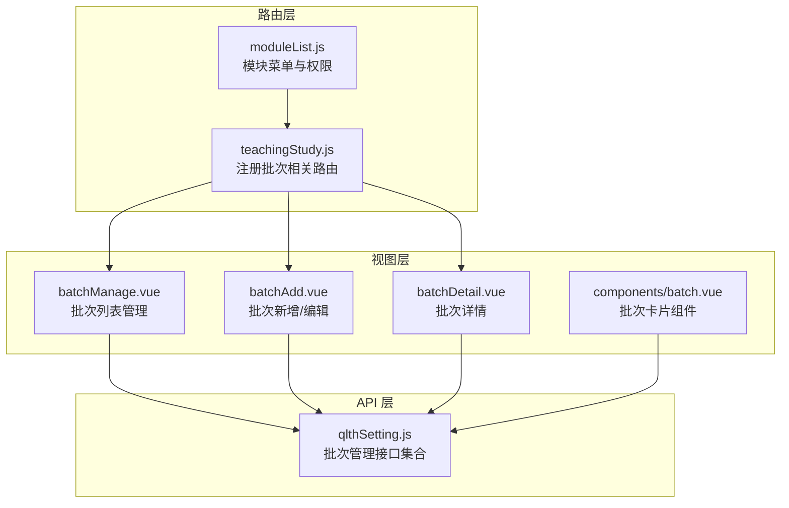
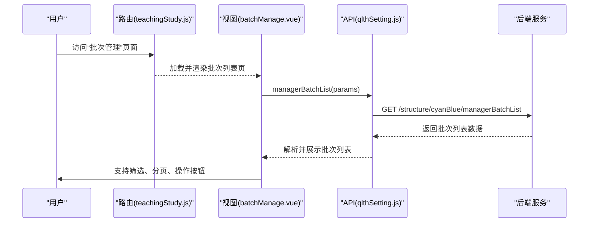
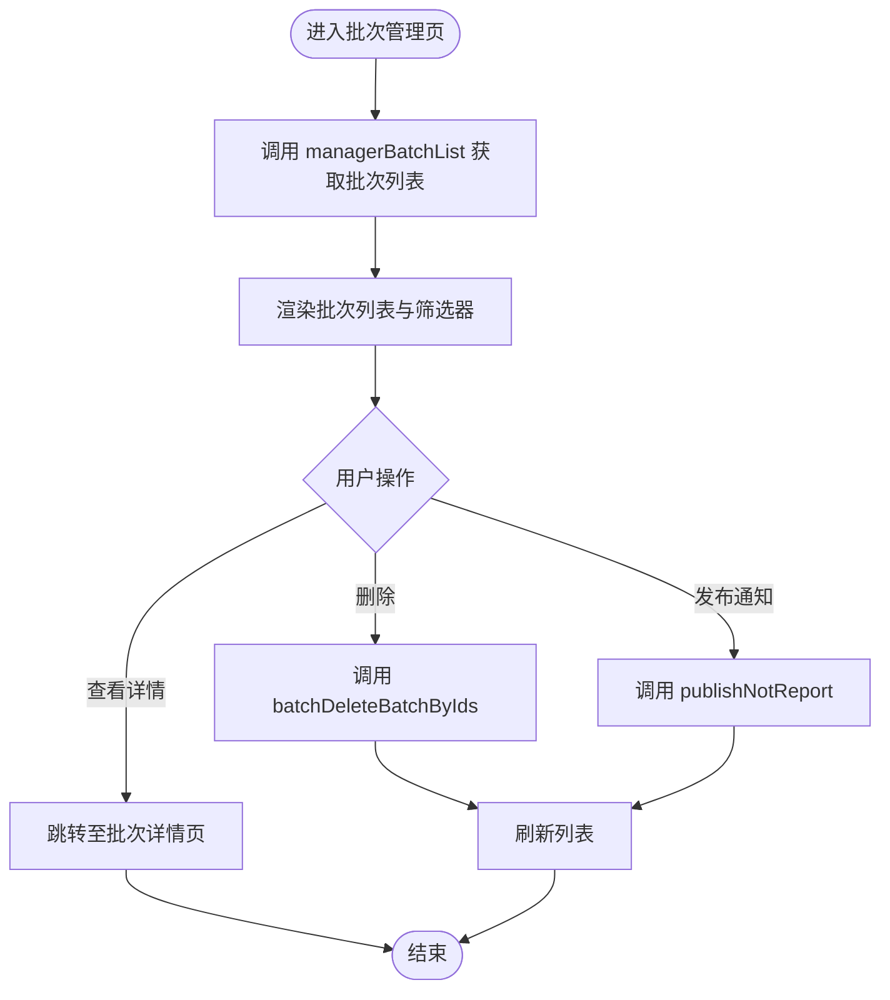
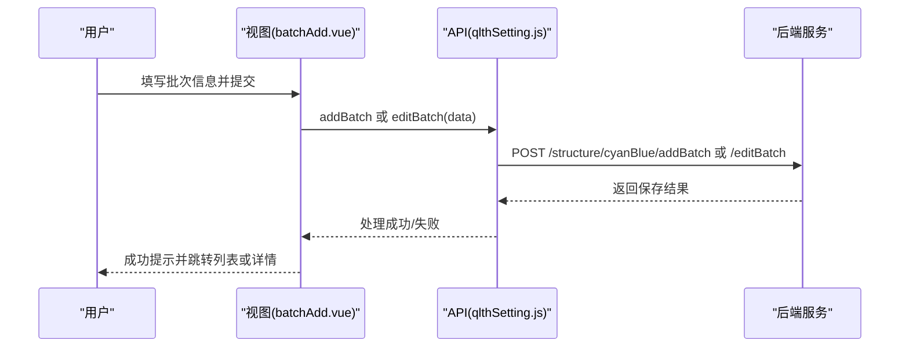
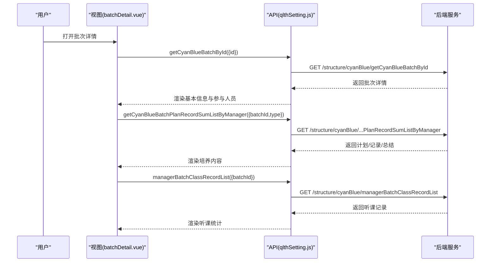
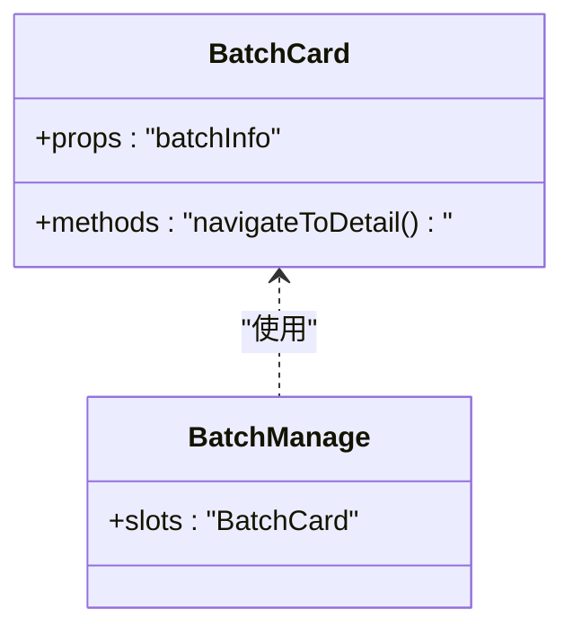
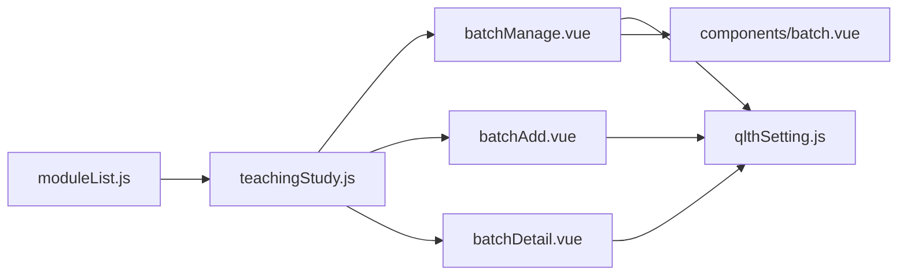

# 批次管理

<cite>
**本文引用的文件**
- [src/router/moduleList.js](file://src/router/moduleList.js)
- [src/router/normal/teachingStudy.js](file://src/router/normal/teachingStudy.js)
- [src/api/qlthSetting.js](file://src/api/qlthSetting.js)
- [src/views/qlth/batchManage.vue](file://src/views/qlth/batchManage.vue)
- [src/views/qlth/batchAdd.vue](file://src/views/qlth/batchAdd.vue)
- [src/views/qlth/batchDetail.vue](file://src/views/qlth/batchDetail.vue)
- [src/views/qlth/components/batch.vue](file://src/views/qlth/components/batch.vue)
</cite>

## 目录
1. [简介](#简介)
2. [项目结构](#项目结构)
3. [核心组件](#核心组件)
4. [架构总览](#架构总览)
5. [详细组件分析](#详细组件分析)
6. [依赖分析](#依赖分析)
7. [性能考虑](#性能考虑)
8. [故障排查指南](#故障排查指南)
9. [结论](#结论)
10. [附录](#附录)

## 简介
本技术文档围绕“导师制批次”管理功能展开，系统性阐述批次的创建、配置、运行与管理机制。内容覆盖时间安排、参与人员筛选、培养周期设置、资源配置、开班条件、学员招募、导师分配、课程安排、进度监控、质量评估、效果分析、结业标准、证书颁发及后续跟踪等全流程设计。文档以实际代码文件为依据，结合路由、API 与视图组件，提供可操作的实现参考与最佳实践建议。

## 项目结构
批次管理功能位于教学研究模块下的“青蓝同辉”体系中，前端通过路由注册、API 接口调用与视图组件协同完成。关键结构如下：
- 路由层：在教学研究模块中注册批次管理相关页面，包括批次列表、新增、详情以及“师/徒”端入口。
- API 层：封装批次管理所需的所有后端接口，涵盖批次 CRUD、师徒关系维护、听课记录、统计报表、发布通知等。
- 视图层：提供批次管理界面、新增/编辑界面、详情界面及通用批次卡片组件。

图表来源
- [src/router/normal/teachingStudy.js:590-646](file://src/router/normal/teachingStudy.js#L590-L646)
- [src/router/moduleList.js:800-825](file://src/router/moduleList.js#L800-L825)
- [src/api/qlthSetting.js:76-118](file://src/api/qlthSetting.js#L76-L118)
- [src/views/qlth/batchManage.vue](file://src/views/qlth/batchManage.vue)
- [src/views/qlth/batchAdd.vue](file://src/views/qlth/batchAdd.vue)
- [src/views/qlth/batchDetail.vue](file://src/views/qlth/batchDetail.vue)
- [src/views/qlth/components/batch.vue](file://src/views/qlth/components/batch.vue)

章节来源
- [src/router/normal/teachingStudy.js:590-646](file://src/router/normal/teachingStudy.js#L590-L646)
- [src/router/moduleList.js:800-825](file://src/router/moduleList.js#L800-L825)

## 核心组件
- 批次管理列表页：用于展示批次列表、筛选条件、批量操作与跳转详情。
- 批次新增/编辑页：负责批次基本信息、周期设置、资源配置、开班条件等字段的录入与提交。
- 批次详情页：展示批次整体信息、参与人员、培养计划、听课记录、统计图表与进度看板。
- 批次卡片组件：复用的批次信息展示组件，支持在不同页面中渲染批次概览。

章节来源
- [src/views/qlth/batchManage.vue](file://src/views/qlth/batchManage.vue)
- [src/views/qlth/batchAdd.vue](file://src/views/qlth/batchAdd.vue)
- [src/views/qlth/batchDetail.vue](file://src/views/qlth/batchDetail.vue)
- [src/views/qlth/components/batch.vue](file://src/views/qlth/components/batch.vue)

## 架构总览
批次管理采用“路由驱动 + API 调用 + 视图渲染”的三层架构。路由负责页面导航与缓存策略；API 层统一封装请求参数与响应数据；视图层根据业务需求组合基础组件与业务组件，形成完整的管理界面。

图表来源
- [src/router/normal/teachingStudy.js:590-611](file://src/router/normal/teachingStudy.js#L590-L611)
- [src/api/qlthSetting.js:76-81](file://src/api/qlthSetting.js#L76-L81)
- [src/views/qlth/batchManage.vue](file://src/views/qlth/batchManage.vue)

## 详细组件分析

### 批次管理列表页（batchManage.vue）
职责与能力
- 列表展示：加载并展示批次列表，支持分页与排序。
- 条件筛选：按名称、状态、时间范围等条件过滤。
- 批量操作：删除、发布通知、导出等。
- 跳转详情：进入批次详情或编辑页面。

数据流与交互
- 通过 API 获取批次列表，渲染到表格。
- 用户操作触发批量删除、发布通知等动作，调用对应 API 并刷新列表。

图表来源
- [src/api/qlthSetting.js:76-94](file://src/api/qlthSetting.js#L76-L94)
- [src/api/qlthSetting.js:159-165](file://src/api/qlthSetting.js#L159-L165)
- [src/views/qlth/batchManage.vue](file://src/views/qlth/batchManage.vue)

章节来源
- [src/views/qlth/batchManage.vue](file://src/views/qlth/batchManage.vue)
- [src/api/qlthSetting.js:76-94](file://src/api/qlthSetting.js#L76-L94)
- [src/api/qlthSetting.js:159-165](file://src/api/qlthSetting.js#L159-L165)

### 批次新增/编辑页（batchAdd.vue）
职责与能力
- 表单填写：批次名称、起止时间、培养周期、资源分配、开班条件等。
- 数据校验：对必填字段与格式进行校验。
- 提交保存：调用新增或编辑接口，完成后返回列表或详情。

关键流程
- 新增：调用新增接口提交表单数据。
- 编辑：先加载详情，再调用编辑接口更新。

图表来源
- [src/api/qlthSetting.js:100-118](file://src/api/qlthSetting.js#L100-L118)
- [src/views/qlth/batchAdd.vue](file://src/views/qlth/batchAdd.vue)

章节来源
- [src/views/qlth/batchAdd.vue](file://src/views/qlth/batchAdd.vue)
- [src/api/qlthSetting.js:100-118](file://src/api/qlthSetting.js#L100-L118)

### 批次详情页（batchDetail.vue）
职责与能力
- 信息总览：展示批次基本信息、参与人员、培养计划、听课记录与统计。
- 进度看板：可视化展示学习进度、听课次数、完成率等指标。
- 操作入口：结业、导出、发布通知等。

数据来源
- 批次详情：通过批次 ID 查询详情。
- 培养计划/帮扶记录/学习总结：按类型聚合查询。
- 听课记录与排名：按批次维度统计。

图表来源
- [src/api/qlthSetting.js:135-152](file://src/api/qlthSetting.js#L135-L152)
- [src/api/qlthSetting.js:171-177](file://src/api/qlthSetting.js#L171-L177)
- [src/views/qlth/batchDetail.vue](file://src/views/qlth/batchDetail.vue)

章节来源
- [src/views/qlth/batchDetail.vue](file://src/views/qlth/batchDetail.vue)
- [src/api/qlthSetting.js:135-152](file://src/api/qlthSetting.js#L135-L152)
- [src/api/qlthSetting.js:171-177](file://src/api/qlthSetting.js#L171-L177)

### 批次卡片组件（components/batch.vue）
职责与能力
- 通用展示：在不同页面中复用，展示批次名称、状态、时间、参与人数等关键信息。
- 跳转能力：点击卡片跳转到详情或编辑页面。

图表来源
- [src/views/qlth/components/batch.vue](file://src/views/qlth/components/batch.vue)
- [src/views/qlth/batchManage.vue](file://src/views/qlth/batchManage.vue)

章节来源
- [src/views/qlth/components/batch.vue](file://src/views/qlth/components/batch.vue)

## 依赖分析
- 路由依赖：teachingStudy.js 注册了批次管理相关路由，moduleList.js 提供模块菜单与权限控制。
- 视图依赖：各页面依赖 qlthSetting.js 中的 API 方法，实现数据拉取与提交。
- 组件依赖：batch.vue 在多个页面中被复用，降低重复开发成本。

图表来源
- [src/router/moduleList.js:800-825](file://src/router/moduleList.js#L800-L825)
- [src/router/normal/teachingStudy.js:590-646](file://src/router/normal/teachingStudy.js#L590-L646)
- [src/api/qlthSetting.js:76-118](file://src/api/qlthSetting.js#L76-L118)
- [src/views/qlth/batchManage.vue](file://src/views/qlth/batchManage.vue)
- [src/views/qlth/batchAdd.vue](file://src/views/qlth/batchAdd.vue)
- [src/views/qlth/batchDetail.vue](file://src/views/qlth/batchDetail.vue)
- [src/views/qlth/components/batch.vue](file://src/views/qlth/components/batch.vue)

章节来源
- [src/router/moduleList.js:800-825](file://src/router/moduleList.js#L800-L825)
- [src/router/normal/teachingStudy.js:590-646](file://src/router/normal/teachingStudy.js#L590-L646)
- [src/api/qlthSetting.js:76-118](file://src/api/qlthSetting.js#L76-L118)

## 性能考虑
- 列表分页与筛选：在列表页使用分页与条件筛选，避免一次性加载大量数据。
- 缓存策略：路由 meta 中对部分页面启用缓存，减少重复渲染与请求。
- 组件复用：通过通用批次卡片组件减少重复逻辑与 DOM 结构。
- 请求合并：对多处使用的相同数据，尽量在进入页面时一次性拉取，避免多次请求。

## 故障排查指南
常见问题与定位思路
- 页面无法访问：检查路由注册与权限路径是否正确。
- 列表为空：确认筛选条件与分页参数是否合理，查看网络请求返回。
- 新增/编辑失败：检查表单字段校验与接口返回错误信息。
- 听课统计异常：确认批次 ID 与查询参数是否匹配，检查后端接口返回。

章节来源
- [src/router/normal/teachingStudy.js:590-611](file://src/router/normal/teachingStudy.js#L590-L611)
- [src/api/qlthSetting.js:76-118](file://src/api/qlthSetting.js#L76-L118)

## 结论
批次管理功能以路由、API 与视图为骨架，实现了从创建到运行再到评估的全生命周期管理。通过统一的接口规范与可复用的组件，提升了开发效率与用户体验。后续可在以下方面持续优化：完善开班条件与招募规则、增强进度可视化与质量评估模型、扩展证书颁发与跟踪机制，并加强异常处理与日志埋点以提升可观测性。

## 附录
- 路由与模块菜单
  - 教学研究模块中的“青蓝同辉”菜单项包含批次管理、师/徒入口与师徒管理。
  - 具体路由注册见 teachingStudy.js 对应路径。
- 关键 API 汇总
  - 批次列表：managerBatchList
  - 批次新增/编辑：addBatch、editBatch
  - 批次详情：getCyanBlueBatchById
  - 培养计划/帮扶记录/学习总结：getCyanBlueBatchPlanRecordSumListByManager
  - 听课记录与统计：managerBatchClassRecordList、batchClassRecordRankList
  - 发布通知：publishNotReport
  - 批量删除：batchDeleteBatchByIds

章节来源
- [src/router/moduleList.js:800-825](file://src/router/moduleList.js#L800-L825)
- [src/router/normal/teachingStudy.js:590-646](file://src/router/normal/teachingStudy.js#L590-L646)
- [src/api/qlthSetting.js:76-189](file://src/api/qlthSetting.js#L76-L189)