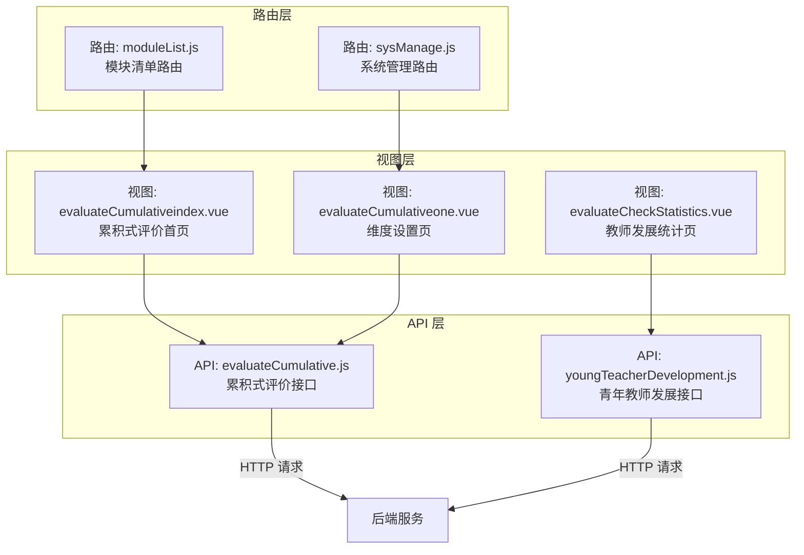
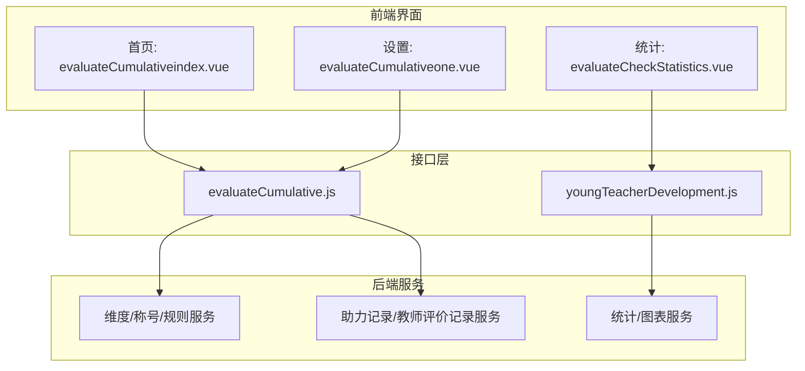
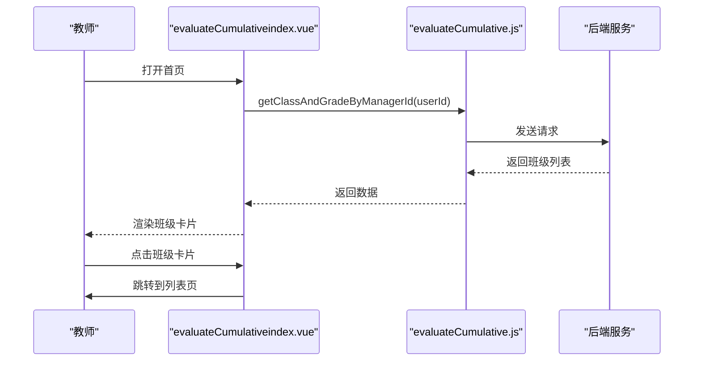
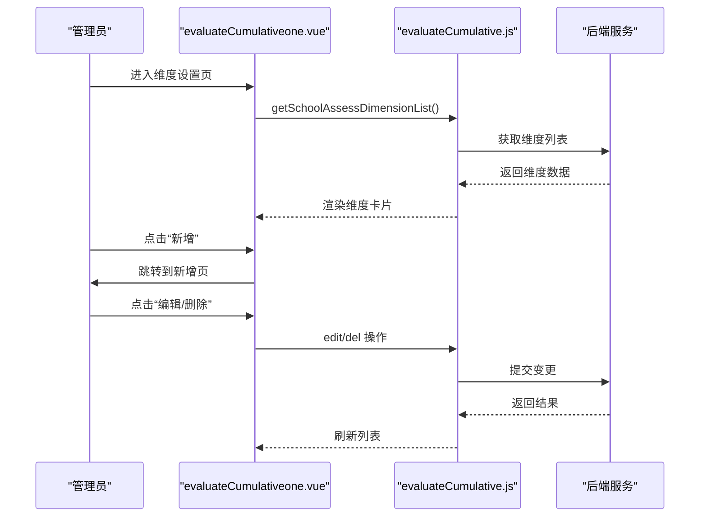
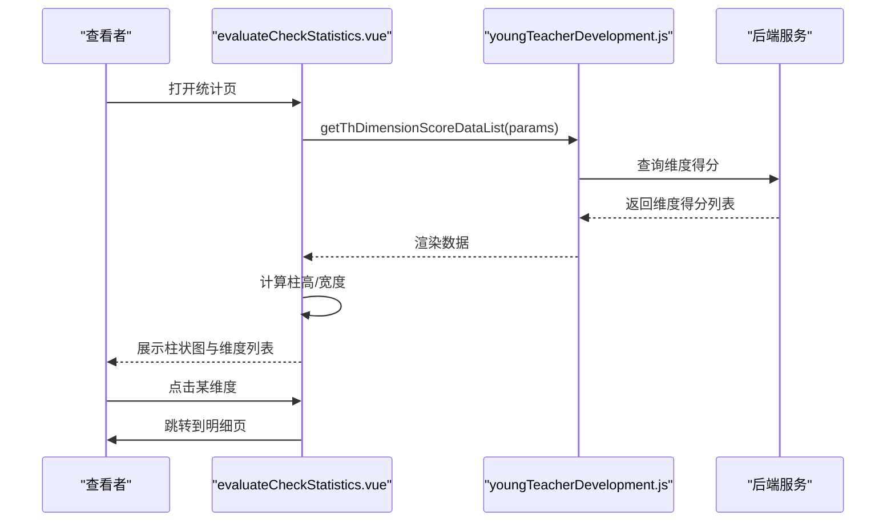
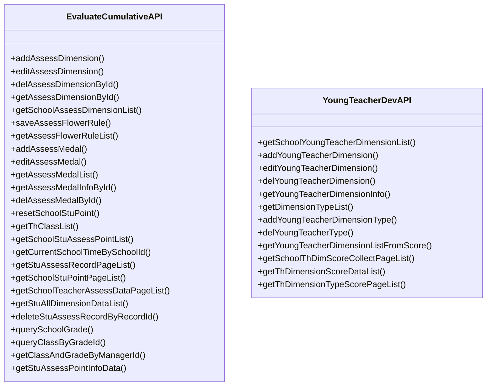
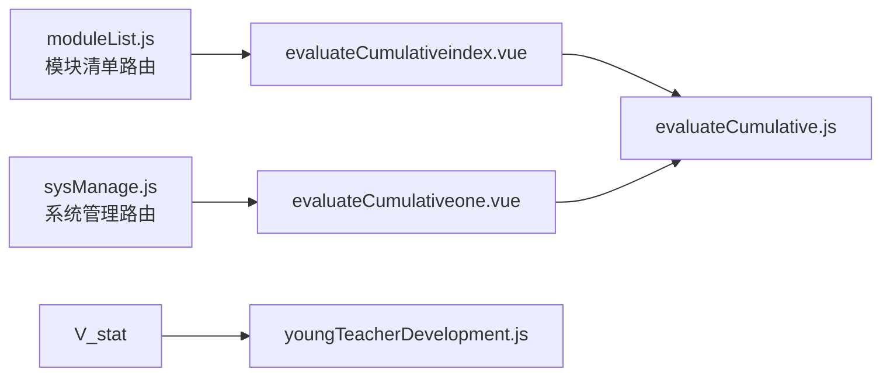

# 评价体系

<cite>
**本文引用的文件**
- [evaluateCumulative.js](file://src/api/evaluateCumulative.js)
- [youngTeacherDevelopment.js](file://src/api/youngTeacherDevelopment.js)
- [evaluateCumulativeindex.vue](file://src/views/evaluateCumulative/evaluateCumulativeindex.vue)
- [evaluateCumulativeone.vue](file://src/views/sysSet/evaluateCumulative/evaluateCumulativeone.vue)
- [evaluateCheckStatistics.vue](file://src/views/youngTeacherDevelopment/evaluateCheckStatistics.vue)
- [sysManage.js](file://src/router/normal/sysManage.js)
- [moduleList.js](file://src/router/moduleList.js)
</cite>

## 目录
1. [引言](#引言)
2. [项目结构](#项目结构)
3. [核心组件](#核心组件)
4. [架构总览](#架构总览)
5. [详细组件分析](#详细组件分析)
6. [依赖关系分析](#依赖关系分析)
7. [性能考虑](#性能考虑)
8. [故障排查指南](#故障排查指南)
9. [结论](#结论)
10. [附录](#附录)

## 引言
本技术文档围绕“导师制评价体系”在本项目的实现进行系统化梳理，重点覆盖以下方面：
- 导师指导效果、徒弟学习成果与培养质量的评价机制
- 评价指标设计、评分标准制定、评价流程管理与结果应用
- 多元评价主体（导师自评、徒弟自评、互评、同行评议、专家评审）的综合评价模式
- 评价数据统计分析、反馈改进与激励约束机制
- 结果可视化与持续优化策略

本项目中与“累积式评价”“青年教师发展评价”直接相关的前端模块与接口已具备基础能力，可作为构建导师制评价体系的参考与扩展基础。

## 项目结构
本项目采用 Vue 单页应用架构，前端通过路由组织功能模块，API 层封装后端接口调用，视图层承载具体业务页面。与评价体系相关的关键位置如下：
- 路由配置：在系统管理与模块清单中定义了“累积式评价”“青年教师发展评价”等入口
- API 封装：提供维度设置、统计查询、记录查询等接口方法
- 视图页面：提供维度管理、统计图表、详情跳转等页面

**图示来源**
- [sysManage.js:777-778](file://src/router/normal/sysManage.js#L777-L778)
- [moduleList.js:2131-2136](file://src/router/moduleList.js#L2131-L2136)
- [evaluateCumulative.js:1-315](file://src/api/evaluateCumulative.js#L1-L315)
- [youngTeacherDevelopment.js:1-194](file://src/api/youngTeacherDevelopment.js#L1-L194)
- [evaluateCumulativeindex.vue:1-95](file://src/views/evaluateCumulative/evaluateCumulativeindex.vue#L1-L95)
- [evaluateCumulativeone.vue:1-139](file://src/views/sysSet/evaluateCumulative/evaluateCumulativeone.vue#L1-L139)
- [evaluateCheckStatistics.vue:1-224](file://src/views/youngTeacherDevelopment/evaluateCheckStatistics.vue#L1-L224)

**章节来源**
- [sysManage.js:747-778](file://src/router/normal/sysManage.js#L747-L778)
- [moduleList.js:1998-2136](file://src/router/moduleList.js#L1998-L2136)

## 核心组件
本节聚焦与导师制评价体系直接相关的前端组件与接口，说明其职责与交互方式。

- 累积式评价接口（evaluateCumulative.js）
  - 职责：提供维度设置、称号设置、花朵兑换规则、助力记录、学生成长点统计、教师评价记录、当前学期获取、班级列表等接口
  - 关键能力：支持按维度/按时间段/按班级/按用户查询；支持重置学生成绩、删除助力记录等管理操作
  - 典型用途：构建“徒弟学习成果—导师指导效果—培养质量”的多维累计评价

- 青年教师发展接口（youngTeacherDevelopment.js）
  - 职责：提供维度与考核项设置、维度列表、教师维度得分、维度类型得分明细、维度得分统计等接口
  - 关键能力：支持按学期/教师/维度查询；支持统计维度总分并生成可视化图表
  - 典型用途：作为“导师自评—同行评议—专家评审—徒弟互评”的评分依据与可视化展示

- 累积式评价首页（evaluateCumulativeindex.vue）
  - 职责：展示教师所带班级列表，进入班级维度下的评价与统计
  - 关键能力：根据当前用户获取管理班级，点击进入列表页

- 累积式评价维度设置（evaluateCumulativeone.vue）
  - 职责：系统管理员维度与称号设置、换算规则、晋升设置的入口
  - 关键能力：维度卡片展示、新增/编辑/删除、标签切换到其他设置页

- 教师发展统计（evaluateCheckStatistics.vue）
  - 职责：展示教师在各维度的总分与可视化柱状图，支持跳转到维度明细
  - 关键能力：动态计算柱高、居中布局、响应式尺寸适配

**章节来源**
- [evaluateCumulative.js:1-315](file://src/api/evaluateCumulative.js#L1-L315)
- [youngTeacherDevelopment.js:1-194](file://src/api/youngTeacherDevelopment.js#L1-L194)
- [evaluateCumulativeindex.vue:1-95](file://src/views/evaluateCumulative/evaluateCumulativeindex.vue#L1-L95)
- [evaluateCumulativeone.vue:1-139](file://src/views/sysSet/evaluateCumulative/evaluateCumulativeone.vue#L1-L139)
- [evaluateCheckStatistics.vue:1-224](file://src/views/youngTeacherDevelopment/evaluateCheckStatistics.vue#L1-L224)

## 架构总览
下图展示了“导师制评价体系”的前端架构与数据流，涵盖多主体参与、多维度累计、统计与可视化等关键环节。

**图示来源**
- [evaluateCumulativeindex.vue:1-95](file://src/views/evaluateCumulative/evaluateCumulativeindex.vue#L1-L95)
- [evaluateCumulativeone.vue:1-139](file://src/views/sysSet/evaluateCumulative/evaluateCumulativeone.vue#L1-L139)
- [evaluateCheckStatistics.vue:1-224](file://src/views/youngTeacherDevelopment/evaluateCheckStatistics.vue#L1-L224)
- [evaluateCumulative.js:1-315](file://src/api/evaluateCumulative.js#L1-L315)
- [youngTeacherDevelopment.js:1-194](file://src/api/youngTeacherDevelopment.js#L1-L194)

## 详细组件分析

### 组件一：累积式评价首页（evaluateCumulativeindex.vue）
- 功能定位：教师视角查看所带班级，进入班级维度下的评价与统计
- 数据来源：通过用户 ID 查询管理的班级列表
- 交互流程：点击班级卡片跳转至列表页，支持无数据时的占位提示

**图示来源**
- [evaluateCumulativeindex.vue:1-95](file://src/views/evaluateCumulative/evaluateCumulativeindex.vue#L1-L95)
- [evaluateCumulative.js:297-305](file://src/api/evaluateCumulative.js#L297-L305)

**章节来源**
- [evaluateCumulativeindex.vue:1-95](file://src/views/evaluateCumulative/evaluateCumulativeindex.vue#L1-L95)
- [evaluateCumulative.js:297-305](file://src/api/evaluateCumulative.js#L297-L305)

### 组件二：累积式评价维度设置（evaluateCumulativeone.vue）
- 功能定位：系统管理员对评价维度、称号、换算规则进行配置
- 数据来源：维度列表、称号列表、规则列表
- 交互流程：维度卡片悬停显示编辑/删除按钮；点击标签页跳转到换算/晋升设置页

**图示来源**
- [evaluateCumulativeone.vue:1-139](file://src/views/sysSet/evaluateCumulative/evaluateCumulativeone.vue#L1-L139)
- [evaluateCumulative.js:101-106](file://src/api/evaluateCumulative.js#L101-L106)

**章节来源**
- [evaluateCumulativeone.vue:1-139](file://src/views/sysSet/evaluateCumulative/evaluateCumulativeone.vue#L1-L139)
- [evaluateCumulative.js:1-178](file://src/api/evaluateCumulative.js#L1-L178)

### 组件三：教师发展统计（evaluateCheckStatistics.vue）
- 功能定位：展示教师在各维度的总分与可视化柱状图，支持跳转到维度明细
- 数据来源：按学期与教师查询维度得分列表
- 交互流程：计算最大分值以确定柱高，动态渲染柱状图；点击维度跳转到明细页

**图示来源**
- [evaluateCheckStatistics.vue:1-224](file://src/views/youngTeacherDevelopment/evaluateCheckStatistics.vue#L1-L224)
- [youngTeacherDevelopment.js:165-175](file://src/api/youngTeacherDevelopment.js#L165-L175)

**章节来源**
- [evaluateCheckStatistics.vue:1-224](file://src/views/youngTeacherDevelopment/evaluateCheckStatistics.vue#L1-L224)
- [youngTeacherDevelopment.js:135-193](file://src/api/youngTeacherDevelopment.js#L135-L193)

### 组件四：接口层（evaluateCumulative.js 与 youngTeacherDevelopment.js）
- 累积式评价接口要点
  - 维度管理：新增/编辑/删除维度；按 ID 查询维度详情；获取维度列表
  - 称号与规则：新增/编辑/删除称号；保存/获取花朵兑换规则
  - 记录与统计：助力记录分页查询；学生成长点分页查询；教师评价记录分页查询；重置学生成绩；删除助力记录
  - 班级与学期：获取教师班级列表；获取当前学期；按年级/班级查询
- 青年教师发展接口要点
  - 维度与项：维度列表、维度项列表、新增/编辑/删除维度项
  - 统计：按学期获取维度列表；按学期/教师获取维度得分；维度类型得分分页查询

**图示来源**
- [evaluateCumulative.js:1-315](file://src/api/evaluateCumulative.js#L1-L315)
- [youngTeacherDevelopment.js:1-194](file://src/api/youngTeacherDevelopment.js#L1-L194)

**章节来源**
- [evaluateCumulative.js:1-315](file://src/api/evaluateCumulative.js#L1-L315)
- [youngTeacherDevelopment.js:1-194](file://src/api/youngTeacherDevelopment.js#L1-L194)

## 依赖关系分析
- 路由依赖
  - “累积式评价”在模块清单中作为学生评价模块之一出现，便于统一导航
  - “系统设置—累积式评价”在系统管理路由中提供维度/规则/称号设置入口
- 视图与接口依赖
  - 首页与设置页均依赖 evaluateCumulative.js 的接口方法
  - 统计页依赖 youngTeacherDevelopment.js 的接口方法
- 数据依赖
  - 累积式评价依赖维度、称号、规则、记录、班级、学期等数据
  - 青年教师发展依赖维度、维度项、得分、统计等数据

**图示来源**
- [moduleList.js:2131-2136](file://src/router/moduleList.js#L2131-L2136)
- [sysManage.js:777-778](file://src/router/normal/sysManage.js#L777-L778)
- [evaluateCumulativeindex.vue:1-95](file://src/views/evaluateCumulative/evaluateCumulativeindex.vue#L1-L95)
- [evaluateCumulativeone.vue:1-139](file://src/views/sysSet/evaluateCumulative/evaluateCumulativeone.vue#L1-L139)
- [evaluateCheckStatistics.vue:1-224](file://src/views/youngTeacherDevelopment/evaluateCheckStatistics.vue#L1-L224)
- [evaluateCumulative.js:1-315](file://src/api/evaluateCumulative.js#L1-L315)
- [youngTeacherDevelopment.js:1-194](file://src/api/youngTeacherDevelopment.js#L1-L194)

**章节来源**
- [moduleList.js:1998-2136](file://src/router/moduleList.js#L1998-L2136)
- [sysManage.js:747-778](file://src/router/normal/sysManage.js#L747-L778)

## 性能考虑
- 接口分页与参数化
  - 成长点统计、教师评价记录、维度类型得分等均支持分页查询，建议在大数据量场景下启用分页加载，避免一次性传输过多数据
- 图表渲染优化
  - 统计页根据最大分值动态计算柱高，建议在数据量较大时采用虚拟滚动或分批渲染，减少 DOM 压力
- 缓存与复用
  - 当前学期、班级列表等静态或低频变化的数据可在组件初始化时缓存，减少重复请求
- 响应式适配
  - 统计页使用 mixin 控制高度，建议结合媒体查询与弹性布局提升移动端体验

## 故障排查指南
- 无数据或空白页
  - 累积式评价首页：检查当前用户是否具有管理班级权限；确认接口返回状态码与数据结构
  - 维度设置页：确认维度列表是否为空；检查删除操作后的刷新逻辑
- 统计异常
  - 检查维度得分接口参数（学期 ID、教师 ID）是否正确；确认最大分值计算逻辑是否被正确执行
- 接口错误
  - 统一通过接口层的 Promise 错误处理进行提示；建议在路由守卫或全局拦截器中捕获网络异常并引导用户重试

**章节来源**
- [evaluateCumulativeindex.vue:1-95](file://src/views/evaluateCumulative/evaluateCumulativeindex.vue#L1-L95)
- [evaluateCumulativeone.vue:1-139](file://src/views/sysSet/evaluateCumulative/evaluateCumulativeone.vue#L1-L139)
- [evaluateCheckStatistics.vue:1-224](file://src/views/youngTeacherDevelopment/evaluateCheckStatistics.vue#L1-L224)
- [evaluateCumulative.js:1-315](file://src/api/evaluateCumulative.js#L1-L315)
- [youngTeacherDevelopment.js:1-194](file://src/api/youngTeacherDevelopment.js#L1-L194)

## 结论
本项目已具备“累积式评价”与“青年教师发展评价”的前端基础能力，能够支撑导师制评价体系中的多主体、多维度、可视化统计需求。建议在此基础上进一步完善：
- 明确导师制评价的指标体系与权重分配
- 设计徒弟自评、互评、同行评议、专家评审的流程与评分标准
- 完善激励约束机制与结果应用（如称号晋升、积分兑换、荣誉联动）
- 加强统计分析与可视化展示，形成持续优化闭环

## 附录
- 路由入口
  - 累积式评价模块入口：模块清单路由中“累积式评价”
  - 系统设置—累积式评价：系统管理路由中“evaluateCumulativeone”
- 接口清单（节选）
  - 累积式评价：维度管理、称号与规则、记录与统计、班级与学期
  - 青年教师发展：维度与项设置、统计与明细

**章节来源**
- [moduleList.js:2131-2136](file://src/router/moduleList.js#L2131-L2136)
- [sysManage.js:777-778](file://src/router/normal/sysManage.js#L777-L778)
- [evaluateCumulative.js:1-315](file://src/api/evaluateCumulative.js#L1-L315)
- [youngTeacherDevelopment.js:1-194](file://src/api/youngTeacherDevelopment.js#L1-L194)