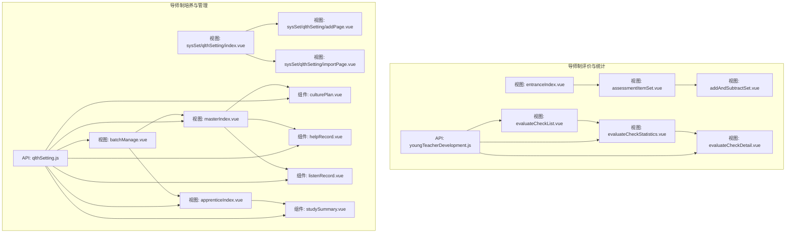
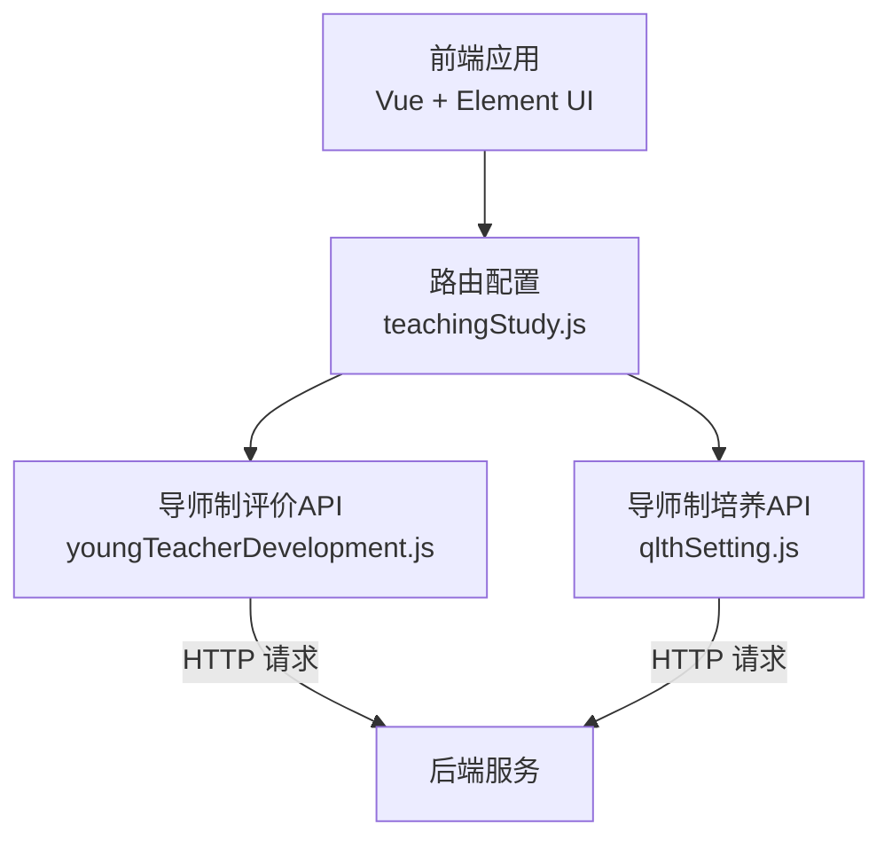
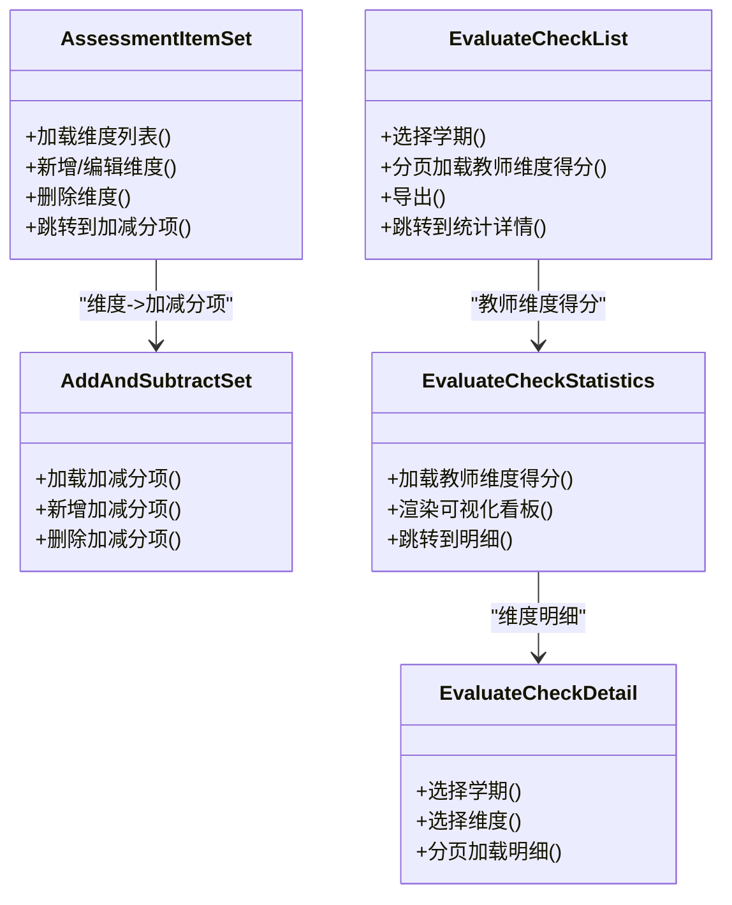
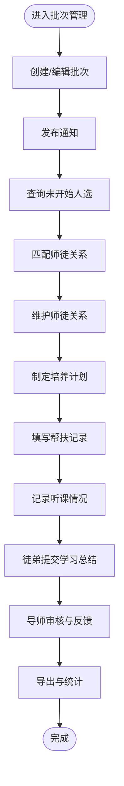
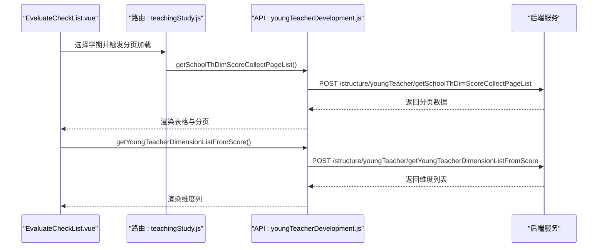
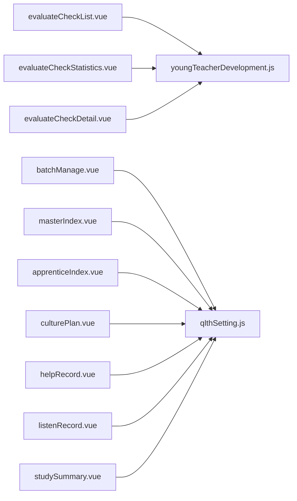

# 青蓝工程导师制

<cite>
**本文引用的文件**
- [src/api/youngTeacherDevelopment.js](file://src/api/youngTeacherDevelopment.js)
- [src/views/youngTeacherDevelopment/entranceIndex.vue](file://src/views/youngTeacherDevelopment/entranceIndex.vue)
- [src/views/youngTeacherDevelopment/assessmentItemSet.vue](file://src/views/youngTeacherDevelopment/assessmentItemSet.vue)
- [src/views/youngTeacherDevelopment/addAndSubtractSet.vue](file://src/views/youngTeacherDevelopment/addAndSubtractSet.vue)
- [src/views/youngTeacherDevelopment/evaluateCheckList.vue](file://src/views/youngTeacherDevelopment/evaluateCheckList.vue)
- [src/views/youngTeacherDevelopment/evaluateCheckDetail.vue](file://src/views/youngTeacherDevelopment/evaluateCheckDetail.vue)
- [src/views/youngTeacherDevelopment/evaluateCheckStatistics.vue](file://src/views/youngTeacherDevelopment/evaluateCheckStatistics.vue)
- [src/router/normal/teachingStudy.js](file://src/router/normal/teachingStudy.js)
- [src/api/qlthSetting.js](file://src/api/qlthSetting.js)
- [src/views/qlth/masterIndex.vue](file://src/views/qlth/masterIndex.vue)
- [src/views/qlth/apprenticeIndex.vue](file://src/views/qlth/apprenticeIndex.vue)
- [src/views/qlth/batchManage.vue](file://src/views/qlth/batchManage.vue)
- [src/views/qlth/components/culturePlan.vue](file://src/views/qlth/components/culturePlan.vue)
- [src/views/qlth/components/helpRecord.vue](file://src/views/qlth/components/helpRecord.vue)
- [src/views/qlth/components/listenRecord.vue](file://src/views/qlth/components/listenRecord.vue)
- [src/views/qlth/components/studySummary.vue](file://src/views/qlth/components/studySummary.vue)
- [src/views/sysSet/qlthSetting/index.vue](file://src/views/sysSet/qlthSetting/index.vue)
- [src/views/sysSet/qlthSetting/addPage.vue](file://src/views/sysSet/qlthSetting/addPage.vue)
- [src/views/sysSet/qlthSetting/importPage.vue](file://src/views/sysSet/qlthSetting/importPage.vue)
</cite>

## 目录
1. [简介](#简介)
2. [项目结构](#项目结构)
3. [核心组件](#核心组件)
4. [架构总览](#架构总览)
5. [详细组件分析](#详细组件分析)
6. [依赖分析](#依赖分析)
7. [性能考虑](#性能考虑)
8. [故障排查指南](#故障排查指南)
9. [结论](#结论)
10. [附录](#附录)

## 简介
本技术文档围绕“青蓝工程导师制”功能，系统梳理并阐述师徒结对、导师指导与青年教师培养的管理体系。文档覆盖数据模型、匹配机制、跟踪评估、信息维护、任务分配、成果记录、评价体系、激励机制、持续改进、配置选项、权限控制与统计分析等关键主题，并通过可视化图表帮助读者快速理解系统架构与业务流程。

## 项目结构
“青蓝工程导师制”功能由两部分构成：
- 导师制评价与统计模块：负责考核维度与加分/减分项设置、按学期统计与导出、教师维度得分明细与排名等。
- 导师制培养与管理模块：负责批次管理、师徒关系建立与维护、培养计划、帮扶记录、听课记录、学习总结、通知发布与提醒等。

**图表来源**
- [src/views/youngTeacherDevelopment/entranceIndex.vue:1-81](file://src/views/youngTeacherDevelopment/entranceIndex.vue#L1-L81)
- [src/views/youngTeacherDevelopment/assessmentItemSet.vue:1-264](file://src/views/youngTeacherDevelopment/assessmentItemSet.vue#L1-L264)
- [src/views/youngTeacherDevelopment/addAndSubtractSet.vue:1-298](file://src/views/youngTeacherDevelopment/addAndSubtractSet.vue#L1-L298)
- [src/views/youngTeacherDevelopment/evaluateCheckList.vue:1-172](file://src/views/youngTeacherDevelopment/evaluateCheckList.vue#L1-L172)
- [src/views/youngTeacherDevelopment/evaluateCheckDetail.vue:1-170](file://src/views/youngTeacherDevelopment/evaluateCheckDetail.vue#L1-L170)
- [src/views/youngTeacherDevelopment/evaluateCheckStatistics.vue:1-224](file://src/views/youngTeacherDevelopment/evaluateCheckStatistics.vue#L1-L224)
- [src/api/youngTeacherDevelopment.js:1-194](file://src/api/youngTeacherDevelopment.js#L1-L194)
- [src/views/qlth/masterIndex.vue](file://src/views/qlth/masterIndex.vue)
- [src/views/qlth/apprenticeIndex.vue](file://src/views/qlth/apprenticeIndex.vue)
- [src/views/qlth/batchManage.vue](file://src/views/qlth/batchManage.vue)
- [src/views/qlth/components/culturePlan.vue](file://src/views/qlth/components/culturePlan.vue)
- [src/views/qlth/components/helpRecord.vue](file://src/views/qlth/components/helpRecord.vue)
- [src/views/qlth/components/listenRecord.vue](file://src/views/qlth/components/listenRecord.vue)
- [src/views/qlth/components/studySummary.vue](file://src/views/qlth/components/studySummary.vue)
- [src/views/sysSet/qlthSetting/index.vue](file://src/views/sysSet/qlthSetting/index.vue)
- [src/views/sysSet/qlthSetting/addPage.vue](file://src/views/sysSet/qlthSetting/addPage.vue)
- [src/views/sysSet/qlthSetting/importPage.vue](file://src/views/sysSet/qlthSetting/importPage.vue)
- [src/api/qlthSetting.js:1-353](file://src/api/qlthSetting.js#L1-L353)

**章节来源**
- [src/router/normal/teachingStudy.js:613-646](file://src/router/normal/teachingStudy.js#L613-L646)

## 核心组件
- 导师制评价与统计
  - 考核维度设置：支持新增、编辑、删除维度，以及“其他”类型开关；维度下可配置加分/减分项。
  - 加减分项设置：按维度维护加分项与减分项，默认分值可调整。
  - 数据统计：按学期选择，展示教师维度得分与总分、排名，支持分页与导出。
  - 明细查看：按维度与教师筛选，查看具体评价记录明细。
  - 统计分析：按教师维度得分绘制可视化看板，辅助分析能力发展与评价结果。
- 导师制培养与管理
  - 批次管理：创建、编辑、删除培养批次，发布通知，统计未上报提醒。
  - 师徒关系：建立、维护、查询师徒关系，支持导出。
  - 培养计划：批次内文化育人计划的制定与跟踪。
  - 帮扶记录：记录导师对徒弟的指导过程与成效。
  - 听课记录：记录导师或徒弟的课堂观察与评价。
  - 学习总结：徒弟提交阶段性学习总结，导师审核与反馈。
  - 设置入口：系统设置中提供批次与模板的导入、新增与管理页面。

**章节来源**
- [src/views/youngTeacherDevelopment/assessmentItemSet.vue:1-264](file://src/views/youngTeacherDevelopment/assessmentItemSet.vue#L1-L264)
- [src/views/youngTeacherDevelopment/addAndSubtractSet.vue:1-298](file://src/views/youngTeacherDevelopment/addAndSubtractSet.vue#L1-L298)
- [src/views/youngTeacherDevelopment/evaluateCheckList.vue:1-172](file://src/views/youngTeacherDevelopment/evaluateCheckList.vue#L1-L172)
- [src/views/youngTeacherDevelopment/evaluateCheckDetail.vue:1-170](file://src/views/youngTeacherDevelopment/evaluateCheckDetail.vue#L1-L170)
- [src/views/youngTeacherDevelopment/evaluateCheckStatistics.vue:1-224](file://src/views/youngTeacherDevelopment/evaluateCheckStatistics.vue#L1-L224)
- [src/views/qlth/batchManage.vue](file://src/views/qlth/batchManage.vue)
- [src/views/qlth/masterIndex.vue](file://src/views/qlth/masterIndex.vue)
- [src/views/qlth/apprenticeIndex.vue](file://src/views/qlth/apprenticeIndex.vue)
- [src/views/qlth/components/culturePlan.vue](file://src/views/qlth/components/culturePlan.vue)
- [src/views/qlth/components/helpRecord.vue](file://src/views/qlth/components/helpRecord.vue)
- [src/views/qlth/components/listenRecord.vue](file://src/views/qlth/components/listenRecord.vue)
- [src/views/qlth/components/studySummary.vue](file://src/views/qlth/components/studySummary.vue)
- [src/views/sysSet/qlthSetting/index.vue](file://src/views/sysSet/qlthSetting/index.vue)
- [src/views/sysSet/qlthSetting/addPage.vue](file://src/views/sysSet/qlthSetting/addPage.vue)
- [src/views/sysSet/qlthSetting/importPage.vue](file://src/views/sysSet/qlthSetting/importPage.vue)

## 架构总览
系统采用前后端分离架构，前端通过 Vue + Element UI 实现业务界面与交互，后端接口以结构化 REST API 形式提供。导师制评价与统计模块与培养管理模块分别对应独立的 API 与视图层，二者通过统一的路由与权限体系集成到教学研究模块中。

**图表来源**
- [src/api/youngTeacherDevelopment.js:1-194](file://src/api/youngTeacherDevelopment.js#L1-L194)
- [src/api/qlthSetting.js:1-353](file://src/api/qlthSetting.js#L1-L353)
- [src/router/normal/teachingStudy.js:613-646](file://src/router/normal/teachingStudy.js#L613-L646)

## 详细组件分析

### 组件A：导师制评价与统计（类图）
该组件群围绕“考核维度—加分/减分项—统计—明细—分析”的闭环展开，数据流清晰，职责边界明确。

**图表来源**
- [src/views/youngTeacherDevelopment/assessmentItemSet.vue:1-264](file://src/views/youngTeacherDevelopment/assessmentItemSet.vue#L1-L264)
- [src/views/youngTeacherDevelopment/addAndSubtractSet.vue:1-298](file://src/views/youngTeacherDevelopment/addAndSubtractSet.vue#L1-L298)
- [src/views/youngTeacherDevelopment/evaluateCheckList.vue:1-172](file://src/views/youngTeacherDevelopment/evaluateCheckList.vue#L1-L172)
- [src/views/youngTeacherDevelopment/evaluateCheckDetail.vue:1-170](file://src/views/youngTeacherDevelopment/evaluateCheckDetail.vue#L1-L170)
- [src/views/youngTeacherDevelopment/evaluateCheckStatistics.vue:1-224](file://src/views/youngTeacherDevelopment/evaluateCheckStatistics.vue#L1-L224)

**章节来源**
- [src/views/youngTeacherDevelopment/assessmentItemSet.vue:1-264](file://src/views/youngTeacherDevelopment/assessmentItemSet.vue#L1-L264)
- [src/views/youngTeacherDevelopment/addAndSubtractSet.vue:1-298](file://src/views/youngTeacherDevelopment/addAndSubtractSet.vue#L1-L298)
- [src/views/youngTeacherDevelopment/evaluateCheckList.vue:1-172](file://src/views/youngTeacherDevelopment/evaluateCheckList.vue#L1-L172)
- [src/views/youngTeacherDevelopment/evaluateCheckDetail.vue:1-170](file://src/views/youngTeacherDevelopment/evaluateCheckDetail.vue#L1-L170)
- [src/views/youngTeacherDevelopment/evaluateCheckStatistics.vue:1-224](file://src/views/youngTeacherDevelopment/evaluateCheckStatistics.vue#L1-L224)

### 组件B：导师制培养与管理（流程图）
该流程强调“批次—师徒—计划/记录/总结”的主线，支持导师与徒弟双角色协作与管理。

**图表来源**
- [src/views/qlth/batchManage.vue](file://src/views/qlth/batchManage.vue)
- [src/views/qlth/masterIndex.vue](file://src/views/qlth/masterIndex.vue)
- [src/views/qlth/apprenticeIndex.vue](file://src/views/qlth/apprenticeIndex.vue)
- [src/views/qlth/components/culturePlan.vue](file://src/views/qlth/components/culturePlan.vue)
- [src/views/qlth/components/helpRecord.vue](file://src/views/qlth/components/helpRecord.vue)
- [src/views/qlth/components/listenRecord.vue](file://src/views/qlth/components/listenRecord.vue)
- [src/views/qlth/components/studySummary.vue](file://src/views/qlth/components/studySummary.vue)
- [src/api/qlthSetting.js:1-353](file://src/api/qlthSetting.js#L1-L353)

**章节来源**
- [src/views/qlth/batchManage.vue](file://src/views/qlth/batchManage.vue)
- [src/views/qlth/masterIndex.vue](file://src/views/qlth/masterIndex.vue)
- [src/views/qlth/apprenticeIndex.vue](file://src/views/qlth/apprenticeIndex.vue)
- [src/views/qlth/components/culturePlan.vue](file://src/views/qlth/components/culturePlan.vue)
- [src/views/qlth/components/helpRecord.vue](file://src/views/qlth/components/helpRecord.vue)
- [src/views/qlth/components/listenRecord.vue](file://src/views/qlth/components/listenRecord.vue)
- [src/views/qlth/components/studySummary.vue](file://src/views/qlth/components/studySummary.vue)
- [src/api/qlthSetting.js:1-353](file://src/api/qlthSetting.js#L1-L353)

### 组件C：API 调用序列（序列图）
以下序列图展示“教师维度得分统计”从页面到 API 的调用链路，体现前后端交互与数据流转。

**图表来源**
- [src/views/youngTeacherDevelopment/evaluateCheckList.vue:115-136](file://src/views/youngTeacherDevelopment/evaluateCheckList.vue#L115-L136)
- [src/api/youngTeacherDevelopment.js:135-160](file://src/api/youngTeacherDevelopment.js#L135-L160)

**章节来源**
- [src/views/youngTeacherDevelopment/evaluateCheckList.vue:115-136](file://src/views/youngTeacherDevelopment/evaluateCheckList.vue#L115-L136)
- [src/api/youngTeacherDevelopment.js:135-160](file://src/api/youngTeacherDevelopment.js#L135-L160)

## 依赖分析
- 模块耦合
  - 导师制评价与统计模块内部高内聚，与培养管理模块低耦合，通过路由与权限解耦。
  - 视图层依赖对应的 API 层，API 层仅暴露结构化接口，便于替换与扩展。
- 外部依赖
  - Element UI 组件库用于表单、表格、分页与对话框等交互。
  - 路由模块 teachingStudy.js 将导师制相关页面纳入统一导航与权限体系。
- 可能的循环依赖
  - 当前结构未发现直接循环依赖；若后续扩展，建议保持 API 层与视图层单向依赖。

**图表来源**
- [src/views/youngTeacherDevelopment/evaluateCheckList.vue:1-172](file://src/views/youngTeacherDevelopment/evaluateCheckList.vue#L1-L172)
- [src/views/youngTeacherDevelopment/evaluateCheckStatistics.vue:1-224](file://src/views/youngTeacherDevelopment/evaluateCheckStatistics.vue#L1-L224)
- [src/views/youngTeacherDevelopment/evaluateCheckDetail.vue:1-170](file://src/views/youngTeacherDevelopment/evaluateCheckDetail.vue#L1-L170)
- [src/api/youngTeacherDevelopment.js:1-194](file://src/api/youngTeacherDevelopment.js#L1-L194)
- [src/views/qlth/batchManage.vue](file://src/views/qlth/batchManage.vue)
- [src/views/qlth/masterIndex.vue](file://src/views/qlth/masterIndex.vue)
- [src/views/qlth/apprenticeIndex.vue](file://src/views/qlth/apprenticeIndex.vue)
- [src/views/qlth/components/culturePlan.vue](file://src/views/qlth/components/culturePlan.vue)
- [src/views/qlth/components/helpRecord.vue](file://src/views/qlth/components/helpRecord.vue)
- [src/views/qlth/components/listenRecord.vue](file://src/views/qlth/components/listenRecord.vue)
- [src/views/qlth/components/studySummary.vue](file://src/views/qlth/components/studySummary.vue)
- [src/api/qlthSetting.js:1-353](file://src/api/qlthSetting.js#L1-L353)

**章节来源**
- [src/router/normal/teachingStudy.js:613-646](file://src/router/normal/teachingStudy.js#L613-L646)

## 性能考虑
- 分页与懒加载
  - 统计与明细均采用分页加载，避免一次性传输大量数据，提升首屏与滚动性能。
- 可视化渲染优化
  - 维度得分看板根据最大分值动态计算高度，避免固定布局导致的重绘压力。
- 接口幂等与缓存
  - 对于只读查询（如维度列表、学期列表），可在前端进行轻量缓存，减少重复请求。
- 图片与资源
  - 使用相对路径与按需加载策略，避免大体积静态资源阻塞渲染。

## 故障排查指南
- 维度设置异常
  - 症状：新增/编辑维度失败或列表为空。
  - 排查：检查网络请求与返回码；确认必填字段与范围限制；核对后端接口状态。
- 加减分项缺失
  - 症状：维度下无加减分项。
  - 排查：确认维度 ID 传参正确；检查接口返回数据结构；验证 type 参数（0/1）。
- 统计无数据
  - 症状：选择学期后无教师得分或维度列为空。
  - 排查：确认当前学期是否已归档；检查分页参数 pageNo/pageSize；核对教师是否存在维度得分。
- 导出失败
  - 症状：导出按钮不可用或下载失败。
  - 排查：确认 exportUrl 是否拼接 token；检查后端导出接口可用性与权限。
- 师徒关系问题
  - 症状：匹配失败或导出异常。
  - 排查：核对批次状态与人员资格；检查批量操作参数格式；确认后端接口返回码。

**章节来源**
- [src/views/youngTeacherDevelopment/assessmentItemSet.vue:113-146](file://src/views/youngTeacherDevelopment/assessmentItemSet.vue#L113-L146)
- [src/views/youngTeacherDevelopment/addAndSubtractSet.vue:125-172](file://src/views/youngTeacherDevelopment/addAndSubtractSet.vue#L125-L172)
- [src/views/youngTeacherDevelopment/evaluateCheckList.vue:123-136](file://src/views/youngTeacherDevelopment/evaluateCheckList.vue#L123-L136)
- [src/views/youngTeacherDevelopment/evaluateCheckDetail.vue:121-134](file://src/views/youngTeacherDevelopment/evaluateCheckDetail.vue#L121-L134)
- [src/api/youngTeacherDevelopment.js:1-194](file://src/api/youngTeacherDevelopment.js#L1-L194)
- [src/api/qlthSetting.js:1-353](file://src/api/qlthSetting.js#L1-L353)

## 结论
“青蓝工程导师制”功能通过清晰的模块划分与稳定的 API 接口，实现了从“考核维度—加减分项—统计—明细—分析”的闭环，同时结合“批次—师徒—计划/记录/总结”的培养主线，满足了导师制在制度化、可视化与可追溯方面的管理需求。建议后续在权限细化、移动端适配与自动化提醒方面持续优化，进一步提升用户体验与治理效率。

## 附录
- 权限控制
  - 路由层面通过 teachingStudy.js 将导师制相关页面纳入统一导航与权限标识，便于后台统一授权。
- 配置选项
  - 系统设置中的批次与模板页面支持新增、导入与管理，便于管理员灵活配置培养方案。
- 统计分析
  - 支持按学期维度导出教师得分与明细，便于形成周期性报告与持续改进依据。

**章节来源**
- [src/router/normal/teachingStudy.js:613-646](file://src/router/normal/teachingStudy.js#L613-L646)
- [src/views/sysSet/qlthSetting/index.vue](file://src/views/sysSet/qlthSetting/index.vue)
- [src/views/sysSet/qlthSetting/addPage.vue](file://src/views/sysSet/qlthSetting/addPage.vue)
- [src/views/sysSet/qlthSetting/importPage.vue](file://src/views/sysSet/qlthSetting/importPage.vue)