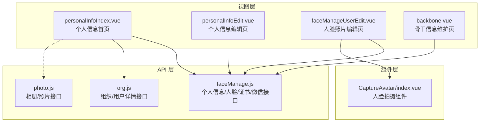
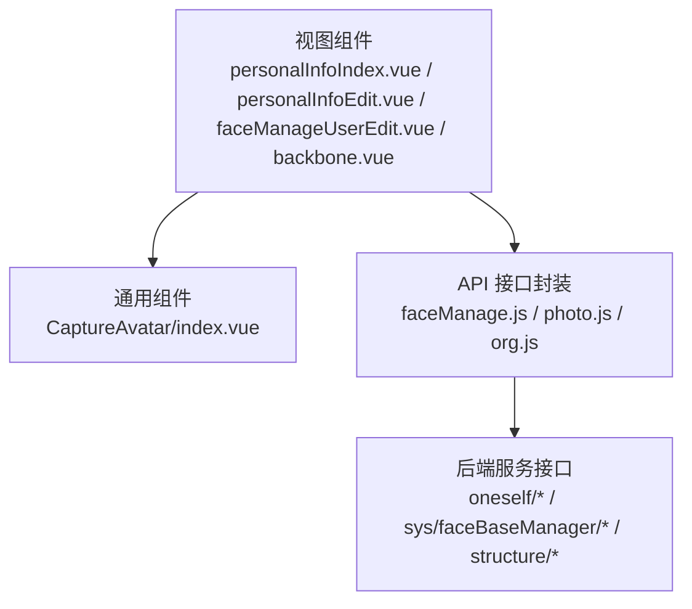
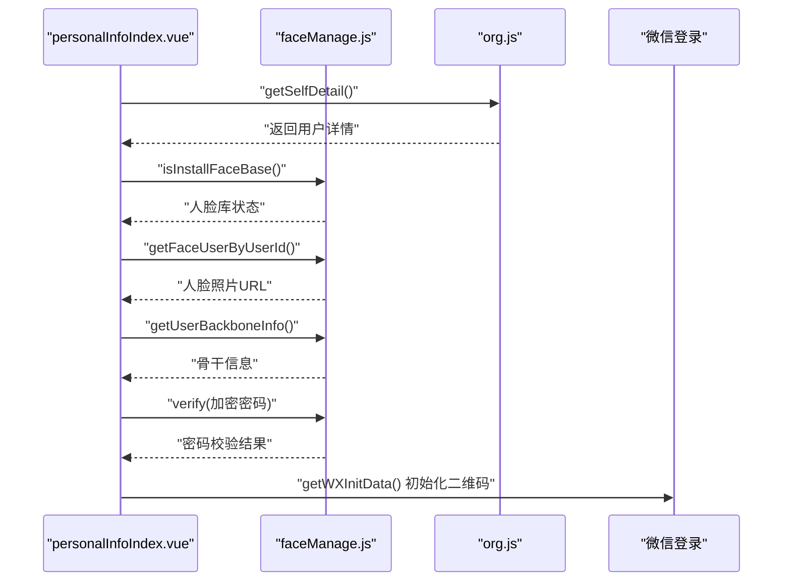
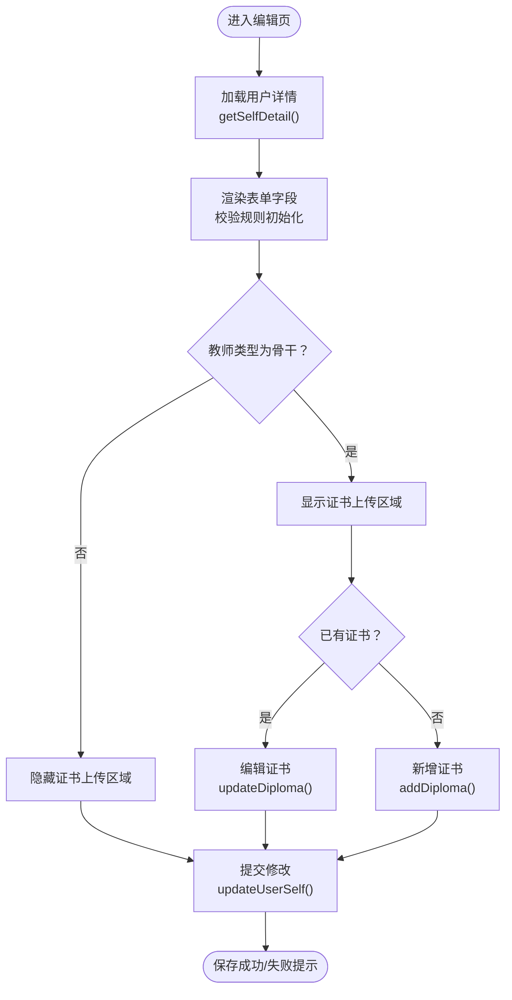
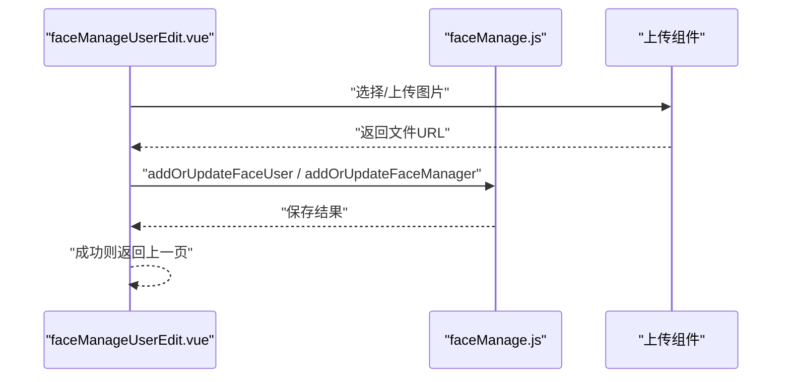
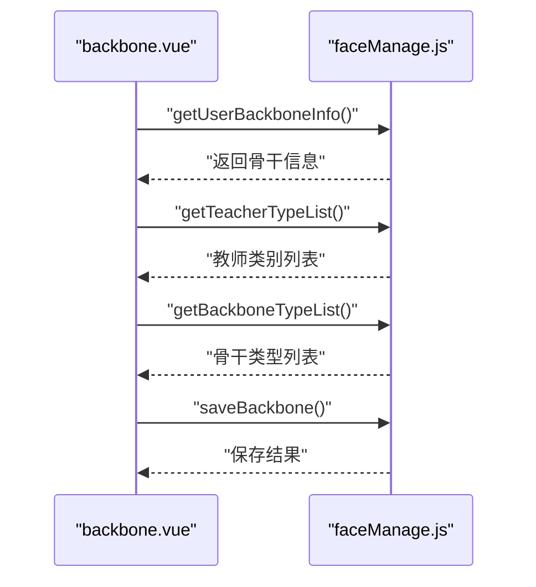
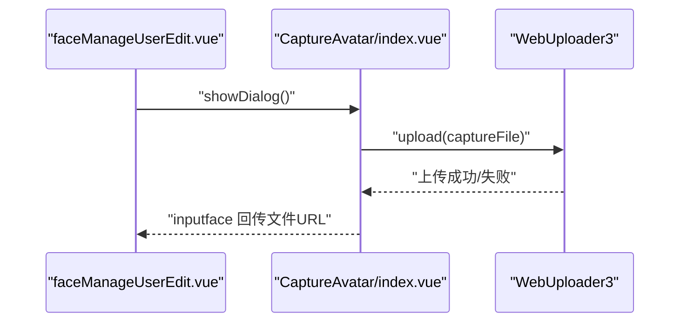
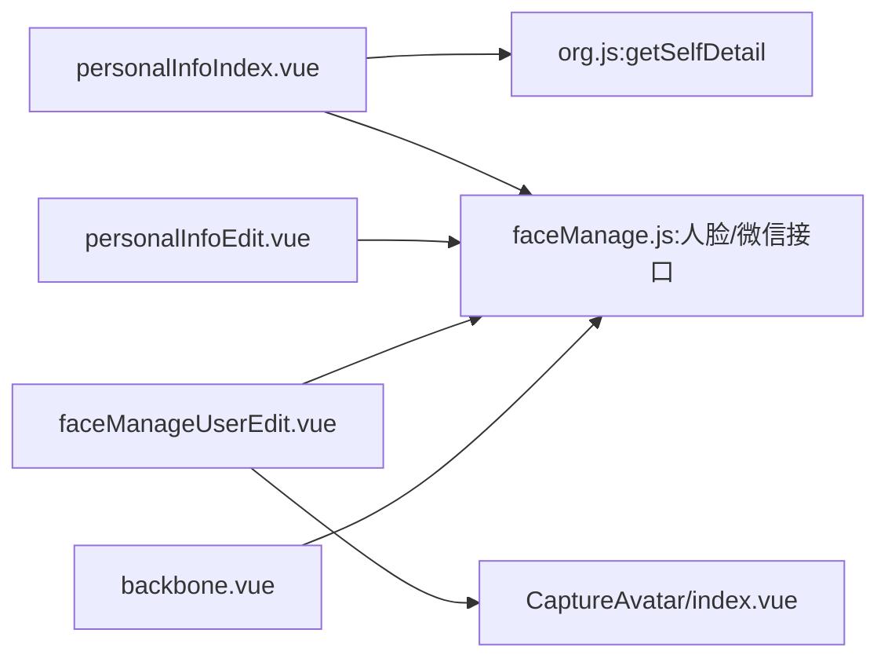

# 学生基本信息管理

<cite>
**本文引用的文件**   
- [personalInfoIndex.vue](file://src/views/personalInfo/personalInfoIndex.vue)
- [personalInfoEdit.vue](file://src/views/personalInfo/personalInfoEdit.vue)
- [faceManage.js](file://src/api/faceManage.js)
- [photo.js](file://src/api/photo.js)
- [faceManageUserEdit.vue](file://src/views/personalInfo/faceManageUserEdit.vue)
- [backbone.vue](file://src/views/personalInfo/backbone.vue)
- [org.js](file://src/api/systemSet/org.js)
- [index.vue](file://src/components/CaptureAvatar/index.vue)
</cite>

## 目录
1. [简介](#简介)
2. [项目结构](#项目结构)
3. [核心组件](#核心组件)
4. [架构总览](#架构总览)
5. [详细组件分析](#详细组件分析)
6. [依赖关系分析](#依赖关系分析)
7. [性能考量](#性能考量)
8. [故障排查指南](#故障排查指南)
9. [结论](#结论)
10. [附录](#附录)

## 简介
本技术文档围绕“学生基本信息管理”功能展开，系统性梳理了个人信息采集、维护与管理的前端实现，涵盖以下方面：
- 个人信息展示与编辑：姓名、性别、手机号、邮箱、出生日期、政治面貌、身份证号、教师类型、主教学科、职务、所在学校等字段的展示与校验。
- 人脸照片管理：人脸照片的上传、查看与编辑，支持个人中心与管理员两种入口。
- 骨干教师信息：骨干类别、骨干类型、评定时间与证书照片的维护。
- 微信绑定与同步：通过密码校验后与微信账号绑定或解除绑定，并支持与微信信息同步。
- 数据来源与接口：统一通过 API 层调用后端服务，确保数据一致性与安全性。

## 项目结构
学生基本信息管理功能主要分布在以下目录与文件中：
- 视图层（Views）：个人信息展示与编辑页面、人脸照片编辑页、骨干信息维护页。
- API 层（API）：统一封装与后端交互的接口，包括个人信息、人脸、证书、微信绑定等。
- 组件层（Components）：通用上传组件、人脸拍摄组件等。
- 路由与权限：通过路由配置与权限控制保障访问安全。

**图表来源**
- [personalInfoIndex.vue:1-813](file://src/views/personalInfo/personalInfoIndex.vue#L1-L813)
- [personalInfoEdit.vue:1-519](file://src/views/personalInfo/personalInfoEdit.vue#L1-L519)
- [faceManage.js:1-371](file://src/api/faceManage.js#L1-L371)
- [photo.js:1-215](file://src/api/photo.js#L1-L215)
- [org.js:414-423](file://src/api/systemSet/org.js#L414-L423)
- [index.vue:1-49](file://src/components/CaptureAvatar/index.vue#L1-L49)

**章节来源**
- [personalInfoIndex.vue:1-813](file://src/views/personalInfo/personalInfoIndex.vue#L1-L813)
- [personalInfoEdit.vue:1-519](file://src/views/personalInfo/personalInfoEdit.vue#L1-L519)
- [faceManage.js:1-371](file://src/api/faceManage.js#L1-L371)
- [photo.js:1-215](file://src/api/photo.js#L1-L215)
- [org.js:414-423](file://src/api/systemSet/org.js#L414-L423)
- [index.vue:1-49](file://src/components/CaptureAvatar/index.vue#L1-L49)

## 核心组件
- 个人信息首页（personalInfoIndex.vue）
  - 功能：展示用户头像、姓名、登录名、所在部门、所教班级/课程、角色、基础信息表格、骨干信息、人脸照片区域等；支持与微信同步、绑定/解除微信登录。
  - 关键点：调用 getSelfDetail 获取用户详情；调用 isInstallFaceBase 判断人脸库状态；调用 getUserBackboneInfo 获取骨干信息；调用 getFaceUserByUserId 获取人脸照片；调用 verify 进行密码校验后发起微信绑定流程。
- 个人信息编辑页（personalInfoEdit.vue）
  - 功能：表单编辑姓名、性别、手机号、邮箱、出生日期、政治面貌、身份证号、教师类型、主教学科等；对手机号、邮箱、姓名等字段进行前端校验；支持骨干证书上传与更新。
  - 关键点：getSelfDetail 获取初始值；updateUserSelf 提交修改；getDiplomaDetail/addDiploma/updateDiploma 处理证书相关逻辑；teacherTypeChange 控制证书上传区域显示。
- 人脸照片编辑页（faceManageUserEdit.vue）
  - 功能：上传/替换人脸照片，支持个人入口与管理员入口；调用 addOrUpdateFaceUser 或 addOrUpdateFaceManager 保存。
  - 关键点：根据 isPersonal 参数决定调用接口；保存前校验文件是否上传。
- 骨干信息维护页（backbone.vue）
  - 功能：维护教师骨干类别、骨干类型、评定时间与证书图片；支持从 getUserBackboneInfo 初始化表单；提交 saveBackbone。
  - 关键点：getTeacherTypeList/getBackboneTypeList 获取下拉选项；校验必填项并格式化日期。
- 人脸拍摄组件（CaptureAvatar/index.vue）
  - 功能：封装摄像头拍摄与上传流程，供人脸照片编辑页使用。
  - 关键点：handleSave 调用上传组件完成拍摄文件上传；inputface 回传结果。

**章节来源**
- [personalInfoIndex.vue:1-813](file://src/views/personalInfo/personalInfoIndex.vue#L1-L813)
- [personalInfoEdit.vue:1-519](file://src/views/personalInfo/personalInfoEdit.vue#L1-L519)
- [faceManageUserEdit.vue:1-138](file://src/views/personalInfo/faceManageUserEdit.vue#L1-L138)
- [backbone.vue:1-193](file://src/views/personalInfo/backbone.vue#L1-L193)
- [index.vue:1-49](file://src/components/CaptureAvatar/index.vue#L1-L49)

## 架构总览
前端采用“视图层-组件层-API 层-后端服务”的分层架构，统一通过 fetchNew/systemFetch/renlianfetch 等封装的 HTTP 客户端与后端交互，确保请求参数标准化与错误处理一致化。

**图表来源**
- [faceManage.js:1-371](file://src/api/faceManage.js#L1-L371)
- [photo.js:1-215](file://src/api/photo.js#L1-L215)
- [org.js:414-423](file://src/api/systemSet/org.js#L414-L423)
- [personalInfoIndex.vue:1-813](file://src/views/personalInfo/personalInfoIndex.vue#L1-L813)
- [personalInfoEdit.vue:1-519](file://src/views/personalInfo/personalInfoEdit.vue#L1-L519)
- [faceManageUserEdit.vue:1-138](file://src/views/personalInfo/faceManageUserEdit.vue#L1-L138)
- [backbone.vue:1-193](file://src/views/personalInfo/backbone.vue#L1-L193)
- [index.vue:1-49](file://src/components/CaptureAvatar/index.vue#L1-L49)

## 详细组件分析

### 个人信息首页（personalInfoIndex.vue）
- 数据加载与展示
  - 通过 getSelfDetail 获取用户基础信息（头像、姓名、性别、手机号、邮箱、出生日期、政治面貌、身份证号、所在部门、所教班级/课程、角色、主教学科、教师类型、所在学校等），并进行性别文本映射与空值处理。
  - 通过 queryRoleAndModuleBySchoolId 获取当前用户在各模块下的角色列表，用于“更多> >”弹窗展示。
- 人脸照片与骨干信息
  - 通过 isInstallFaceBase 判断人脸库是否可用；若可用则调用 getFaceUserByUserId 获取人脸照片并展示。
  - 通过 getUserBackboneInfo 获取骨干信息（骨干类型、评定时间、证书图片、用户类型名称等）。
- 微信绑定与同步
  - 通过 isBindingWx 查询当前是否已绑定微信；支持解除绑定与绑定流程；绑定前需通过 verify 校验登录密码，随后调用 getWXInitData 初始化微信登录二维码。
- 权限与交互
  - 使用 isShowByPermission 控制“修改”按钮与“与微信同步”按钮的可见性；支持跳转至编辑页与骨干信息页。

**图表来源**
- [personalInfoIndex.vue:338-531](file://src/views/personalInfo/personalInfoIndex.vue#L338-L531)
- [faceManage.js:157-166](file://src/api/faceManage.js#L157-L166)
- [org.js:414-423](file://src/api/systemSet/org.js#L414-L423)

**章节来源**
- [personalInfoIndex.vue:1-813](file://src/views/personalInfo/personalInfoIndex.vue#L1-L813)
- [faceManage.js:1-371](file://src/api/faceManage.js#L1-L371)
- [org.js:414-423](file://src/api/systemSet/org.js#L414-L423)

### 个人信息编辑页（personalInfoEdit.vue）
- 字段与校验
  - 姓名、手机号、邮箱、出生日期、政治面貌、身份证号、教师类型、主教学科等字段均在表单中展示；对姓名长度、手机号格式、邮箱格式进行前端校验。
  - 手机号修改受学校配置与用户状态限制，通过 checkMobileReadonly 判断是否允许修改。
- 证书上传与更新
  - 当教师类型为“骨干教师（学科/德育）”时，显示证书上传区域；通过 getDiplomaDetail 判断是否存在证书记录，决定新增或编辑流程；通过 addDiploma 或 updateDiploma 提交。
- 提交流程
  - 校验通过后，组装参数调用 updateUserSelf 提交修改；成功后自动返回上一页。

**图表来源**
- [personalInfoEdit.vue:303-494](file://src/views/personalInfo/personalInfoEdit.vue#L303-L494)
- [faceManage.js:180-198](file://src/api/faceManage.js#L180-L198)
- [faceManage.js:200-241](file://src/api/faceManage.js#L200-L241)

**章节来源**
- [personalInfoEdit.vue:1-519](file://src/views/personalInfo/personalInfoEdit.vue#L1-L519)
- [faceManage.js:1-371](file://src/api/faceManage.js#L1-L371)

### 人脸照片编辑页（faceManageUserEdit.vue）
- 入口区分
  - 个人入口：调用 getFaceUserByUserId 获取当前用户的人脸照片；管理员入口：调用 getFaceUserManager 获取。
- 上传与保存
  - 通过上传组件选择图片后，调用 addOrUpdateFaceUser 或 addOrUpdateFaceManager 保存；保存前校验文件是否已上传。

**图表来源**
- [faceManageUserEdit.vue:68-125](file://src/views/personalInfo/faceManageUserEdit.vue#L68-L125)
- [faceManage.js:83-106](file://src/api/faceManage.js#L83-L106)

**章节来源**
- [faceManageUserEdit.vue:1-138](file://src/views/personalInfo/faceManageUserEdit.vue#L1-L138)
- [faceManage.js:1-371](file://src/api/faceManage.js#L1-L371)

### 骨干信息维护页（backbone.vue）
- 下拉选项
  - 通过 getTeacherTypeList 与 getBackboneTypeList 获取教师类别与骨干类型列表，动态填充表单。
- 表单校验与提交
  - 对教师骨干类别、骨干类型、评定时间进行必填校验；当为骨干教师时，要求上传证书图片；提交前格式化日期；调用 saveBackbone 保存。

**图表来源**
- [backbone.vue:102-175](file://src/views/personalInfo/backbone.vue#L102-L175)
- [faceManage.js:297-323](file://src/api/faceManage.js#L297-L323)

**章节来源**
- [backbone.vue:1-193](file://src/views/personalInfo/backbone.vue#L1-L193)
- [faceManage.js:1-371](file://src/api/faceManage.js#L1-L371)

### 人脸拍摄组件（CaptureAvatar/index.vue）
- 功能：封装摄像头拍摄与上传流程，供人脸照片编辑页调用；拍摄成功后通过上传组件将文件上传并回传结果。

**图表来源**
- [index.vue:24-44](file://src/components/CaptureAvatar/index.vue#L24-L44)
- [faceManageUserEdit.vue:68-86](file://src/views/personalInfo/faceManageUserEdit.vue#L68-L86)

**章节来源**
- [index.vue:1-49](file://src/components/CaptureAvatar/index.vue#L1-L49)
- [faceManageUserEdit.vue:1-138](file://src/views/personalInfo/faceManageUserEdit.vue#L1-L138)

## 依赖关系分析
- 视图组件依赖 API 层提供的接口函数，统一通过 fetchNew/systemFetch/renlianfetch 发起请求。
- 个人信息首页依赖组织与用户详情接口（org.js）与人脸接口（faceManage.js）。
- 个人信息编辑页依赖人脸接口与上传组件，实现证书上传与更新。
- 人脸照片编辑页依赖人脸接口与上传组件，实现图片上传与保存。
- 骨干信息维护页依赖人脸接口中的骨干教师相关接口，实现类别与类型的下拉获取与保存。

**图表来源**
- [personalInfoIndex.vue:1-813](file://src/views/personalInfo/personalInfoIndex.vue#L1-L813)
- [personalInfoEdit.vue:1-519](file://src/views/personalInfo/personalInfoEdit.vue#L1-L519)
- [faceManageUserEdit.vue:1-138](file://src/views/personalInfo/faceManageUserEdit.vue#L1-L138)
- [backbone.vue:1-193](file://src/views/personalInfo/backbone.vue#L1-L193)
- [faceManage.js:1-371](file://src/api/faceManage.js#L1-L371)
- [org.js:414-423](file://src/api/systemSet/org.js#L414-L423)
- [index.vue:1-49](file://src/components/CaptureAvatar/index.vue#L1-L49)

**章节来源**
- [personalInfoIndex.vue:1-813](file://src/views/personalInfo/personalInfoIndex.vue#L1-L813)
- [personalInfoEdit.vue:1-519](file://src/views/personalInfo/personalInfoEdit.vue#L1-L519)
- [faceManageUserEdit.vue:1-138](file://src/views/personalInfo/faceManageUserEdit.vue#L1-L138)
- [backbone.vue:1-193](file://src/views/personalInfo/backbone.vue#L1-L193)
- [faceManage.js:1-371](file://src/api/faceManage.js#L1-L371)
- [org.js:414-423](file://src/api/systemSet/org.js#L414-L423)
- [index.vue:1-49](file://src/components/CaptureAvatar/index.vue#L1-L49)

## 性能考量
- 请求合并与去抖：对于频繁触发的查询（如角色列表、课程列表），建议在组件内缓存结果，避免重复请求。
- 图片上传优化：上传组件应支持断点续传与压缩策略，减少带宽占用与等待时间。
- 渲染优化：个人信息首页在角色较多时使用“更多> >”弹窗展示，避免长列表渲染压力。
- 本地存储：对用户基础信息可在 Vuex 中缓存，减少重复请求；对敏感操作（如密码校验）仅在必要时发起网络请求。

## 故障排查指南
- 微信绑定失败
  - 现象：绑定后无法同步或解除绑定无效。
  - 排查：确认 verify 是否返回成功；检查 getWXInitData 返回的参数是否正确；确认 removeBindingWX 与 bindingWx 的返回状态。
- 人脸照片上传失败
  - 现象：上传成功但保存失败或页面无变化。
  - 排查：确认上传组件已返回文件URL；检查 addOrUpdateFaceUser/addOrUpdateFaceManager 的入参与返回；确认 isPersonal 参数是否正确。
- 证书上传校验失败
  - 现象：骨干教师类型下未填写发证日期或未上传证书即提交。
  - 排查：检查 teacherTypeChange 逻辑与 showPhoto 显示；确认 deriveTime 与 filePaths 的赋值时机；核对 addDiploma/updateDiploma 的入参。
- 个人信息修改失败
  - 现象：提交后提示失败或无响应。
  - 排查：检查表单校验规则；确认 updateUserSelf 的参数组装；核对后端返回的错误信息。

**章节来源**
- [personalInfoIndex.vue:443-508](file://src/views/personalInfo/personalInfoIndex.vue#L443-L508)
- [faceManageUserEdit.vue:68-125](file://src/views/personalInfo/faceManageUserEdit.vue#L68-L125)
- [personalInfoEdit.vue:303-367](file://src/views/personalInfo/personalInfoEdit.vue#L303-L367)
- [faceManage.js:180-241](file://src/api/faceManage.js#L180-L241)

## 结论
本功能通过清晰的分层架构与统一的 API 封装，实现了个人信息的完整生命周期管理：从展示、编辑、人脸照片维护到骨干信息与微信绑定。前端在用户体验与数据安全之间取得平衡，后续可在上传优化、缓存策略与权限细化方面进一步提升稳定性与性能。

## 附录
- 数据模型与字段说明（基于接口与页面展示）
  - 基础信息字段：姓名、性别、手机号、邮箱、出生日期、政治面貌、身份证号、教师类型、主教学科、所在部门、所教班级/课程、角色、所在学校等。
  - 骨干信息字段：用户类型、骨干类型、骨干评定时间、证书文件URL/ID。
  - 人脸字段：人脸照片URL。
  - 微信绑定字段：是否绑定、绑定/解除绑定状态。
- 验证规则示例（基于前端校验）
  - 姓名：非空且长度不超过20字符。
  - 手机号：符合中国大陆手机号格式。
  - 邮箱：符合邮箱格式（可为空时跳过校验）。
  - 证书上传：骨干教师类型下必须上传证书并填写发证日期。
- 权限与安全
  - 通过 isShowByPermission 控制按钮可见性；密码校验 verify 用于敏感操作保护；上传组件与后端接口配合确保文件合规。
- 集成与扩展
  - 与学籍系统、人脸识别系统、校园卡系统的对接建议通过统一的 API 层进行抽象，保持前端稳定；对第三方系统变更采用适配器模式降低耦合。