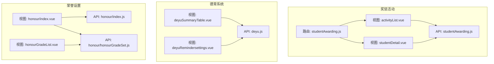
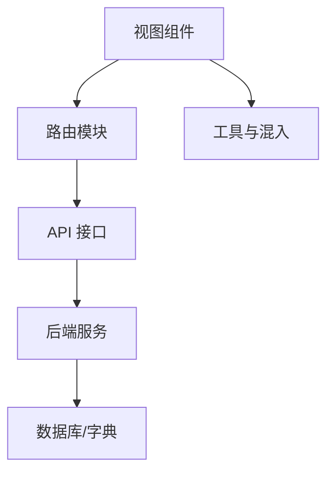
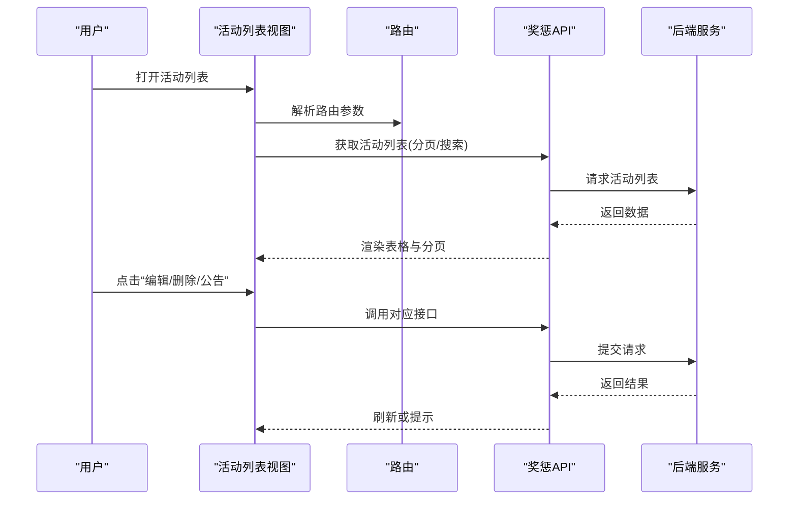
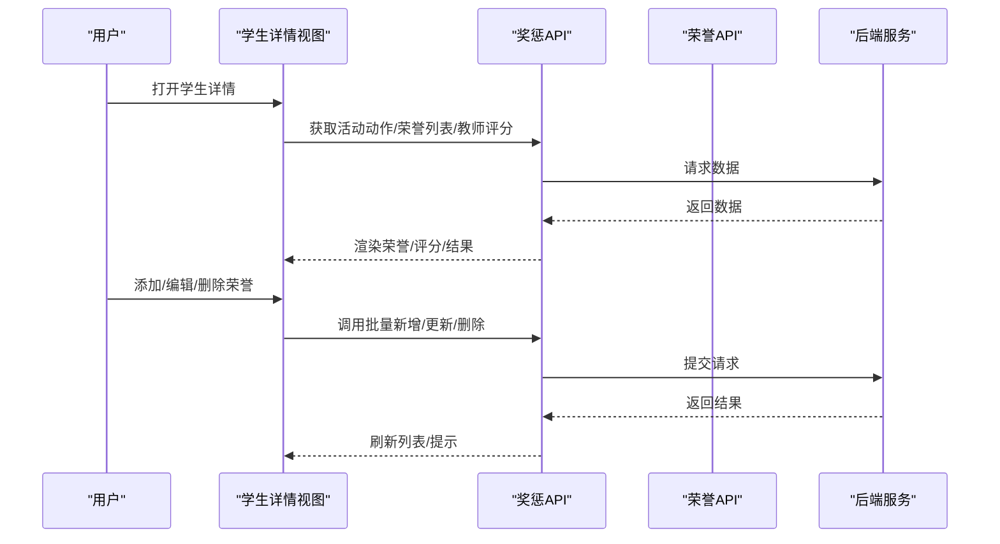
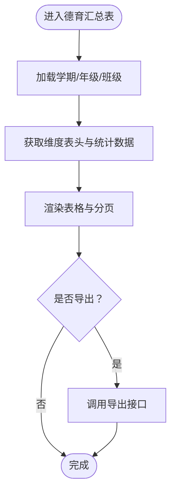
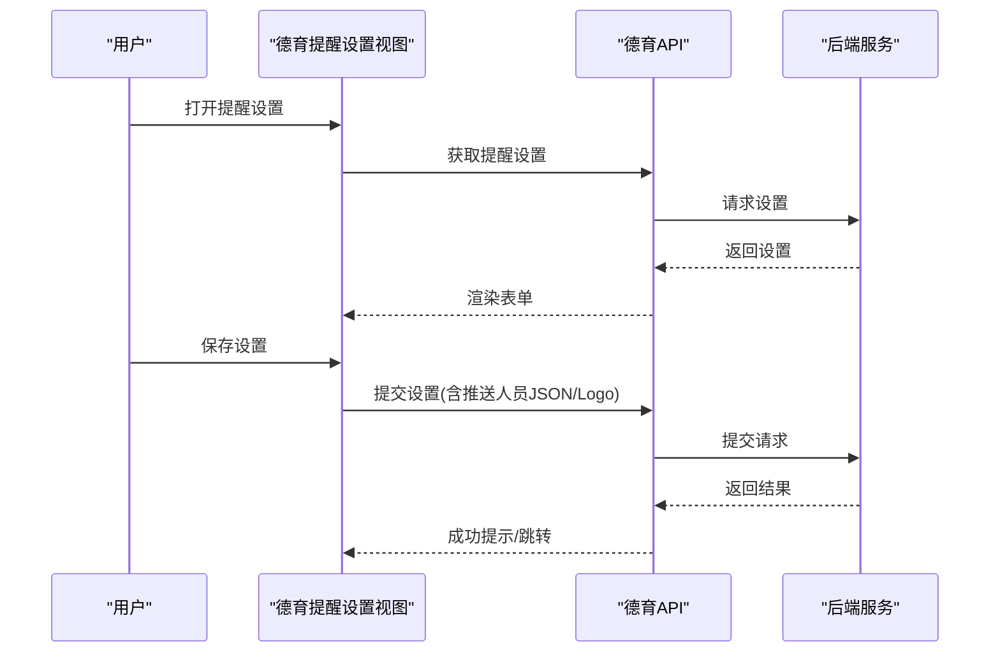
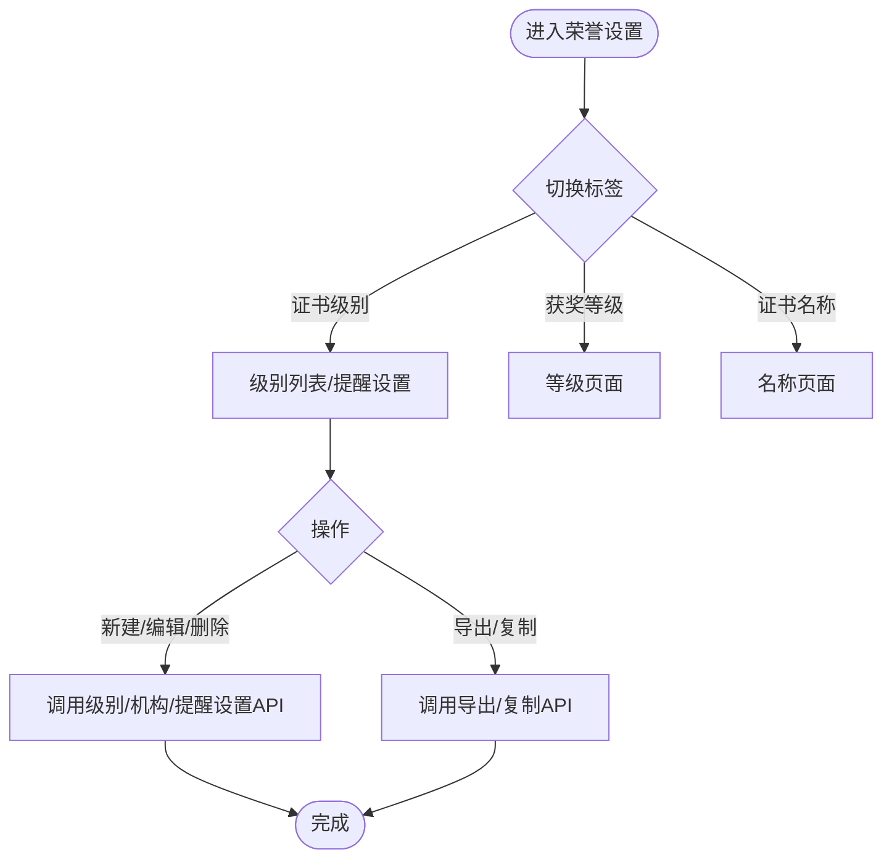
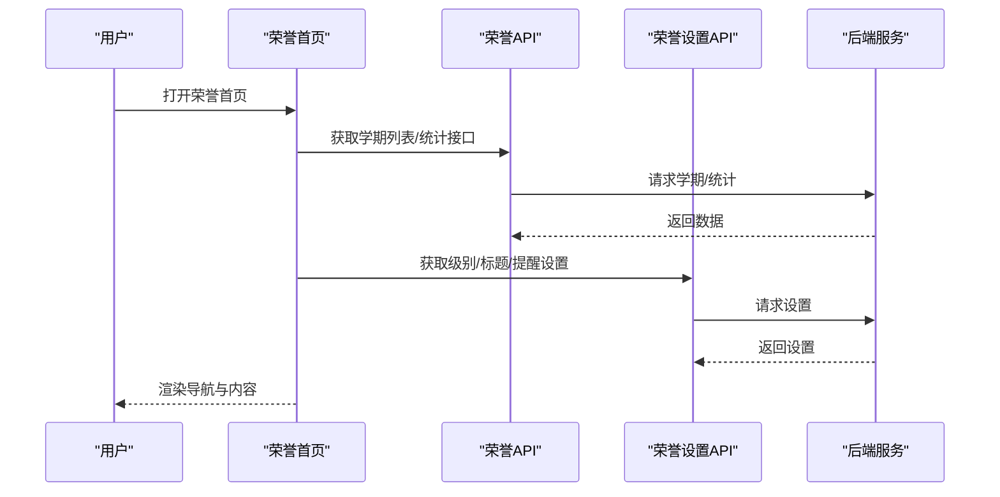
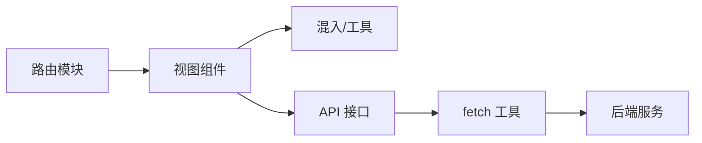

# 学生奖惩管理

<cite>
**本文引用的文件**
- [src/api/studentAwarding.js](file://src/api/studentAwarding.js)
- [src/router/modules/studentAwarding/studentAwarding.js](file://src/router/modules/studentAwarding/studentAwarding.js)
- [src/views/studentAwarding/activityList.vue](file://src/views/studentAwarding/activityList.vue)
- [src/views/studentAwarding/studentDetail.vue](file://src/views/studentAwarding/studentDetail.vue)
- [src/api/deyu.js](file://src/api/deyu.js)
- [src/views/deyu/deyuSummaryTable.vue](file://src/views/deyu/deyuSummaryTable.vue)
- [src/views/deyu/deyuRemindersettings.vue](file://src/views/deyu/deyuRemindersettings.vue)
- [src/api/honour/index.js](file://src/api/honour/index.js)
- [src/api/honour/honourGradeSet.js](file://src/api/honour/honourGradeSet.js)
- [src/views/honour/index.vue](file://src/views/honour/index.vue)
- [src/views/honourGradeSet/honourGradeList.vue](file://src/views/honourGradeSet/honourGradeList.vue)
</cite>

## 目录
1. [引言](#引言)
2. [项目结构](#项目结构)
3. [核心组件](#核心组件)
4. [架构总览](#架构总览)
5. [详细组件分析](#详细组件分析)
6. [依赖关系分析](#依赖关系分析)
7. [性能考量](#性能考量)
8. [故障排查指南](#故障排查指南)
9. [结论](#结论)
10. [附录](#附录)

## 引言
本技术文档围绕“学生奖惩管理”主题，系统梳理并说明以下能力与流程：
- 奖励管理：活动创建、班级/校级评审、荣誉授予、统计与公示、档案导出。
- 处分管理：德育评价体系对接、评价维度与类型管理、提醒与反馈机制。
- 数据对接：与德育系统、综合素质评价系统的数据交互与结果反馈。
- 统计分析：按学期、年级、班级、证书级别的多维统计与可视化。
- 档案管理：荣誉证书的录入、编辑、删除、导出与归档。

文档以代码为依据，结合前端路由、API 接口与视图组件，给出架构图、时序图与流程图，帮助开发者与运维人员快速理解与维护功能模块。

## 项目结构
学生奖惩管理相关模块主要分布在如下区域：
- 奖惩活动与评审：API 层定义活动、评审、荣誉等接口；路由模块组织页面入口；视图层承载列表、详情、评审与导出等功能。
- 德育评价：API 提供维度、类型、提醒设置与统计；视图提供汇总表与提醒设置界面。
- 荣誉设置：API 提供证书级别、类型、标题、提醒设置；视图提供级别列表与提醒设置。

图表来源
- [src/router/modules/studentAwarding/studentAwarding.js:1-176](file://src/router/modules/studentAwarding/studentAwarding.js#L1-L176)
- [src/views/studentAwarding/activityList.vue:1-211](file://src/views/studentAwarding/activityList.vue#L1-L211)
- [src/views/studentAwarding/studentDetail.vue:1-800](file://src/views/studentAwarding/studentDetail.vue#L1-L800)
- [src/api/studentAwarding.js:1-514](file://src/api/studentAwarding.js#L1-L514)
- [src/views/deyu/deyuSummaryTable.vue:1-228](file://src/views/deyu/deyuSummaryTable.vue#L1-L228)
- [src/views/deyu/deyuRemindersettings.vue:1-149](file://src/views/deyu/deyuRemindersettings.vue#L1-L149)
- [src/api/deyu.js:1-397](file://src/api/deyu.js#L1-L397)
- [src/views/honour/index.vue:1-83](file://src/views/honour/index.vue#L1-L83)
- [src/views/honourGradeSet/honourGradeList.vue:1-308](file://src/views/honourGradeSet/honourGradeList.vue#L1-L308)
- [src/api/honour/index.js:1-245](file://src/api/honour/index.js#L1-L245)
- [src/api/honour/honourGradeSet.js:1-302](file://src/api/honour/honourGradeSet.js#L1-L302)

章节来源
- [src/router/modules/studentAwarding/studentAwarding.js:1-176](file://src/router/modules/studentAwarding/studentAwarding.js#L1-L176)
- [src/views/studentAwarding/activityList.vue:1-211](file://src/views/studentAwarding/activityList.vue#L1-L211)
- [src/views/studentAwarding/studentDetail.vue:1-800](file://src/views/studentAwarding/studentDetail.vue#L1-L800)
- [src/api/studentAwarding.js:1-514](file://src/api/studentAwarding.js#L1-L514)
- [src/views/deyu/deyuSummaryTable.vue:1-228](file://src/views/deyu/deyuSummaryTable.vue#L1-L228)
- [src/views/deyu/deyuRemindersettings.vue:1-149](file://src/views/deyu/deyuRemindersettings.vue#L1-L149)
- [src/api/deyu.js:1-397](file://src/api/deyu.js#L1-L397)
- [src/views/honour/index.vue:1-83](file://src/views/honour/index.vue#L1-L83)
- [src/views/honourGradeSet/honourGradeList.vue:1-308](file://src/views/honourGradeSet/honourGradeList.vue#L1-L308)
- [src/api/honour/index.js:1-245](file://src/api/honour/index.js#L1-L245)
- [src/api/honour/honourGradeSet.js:1-302](file://src/api/honour/honourGradeSet.js#L1-L302)

## 核心组件
- 奖惩活动 API：提供活动 CRUD、评审状态变更、荣誉批量新增/删除/更新、教师评分、班级/校级上报、导出等接口。
- 德育 API：提供学期、年级/班级、维度与类型、统计与提醒设置等接口。
- 荣誉设置 API：提供证书级别、类型、标题、提醒设置、等级映射等接口。
- 视图组件：活动列表、活动详情、学生荣誉详情、德育汇总表、德育提醒设置、荣誉级别列表等。

章节来源
- [src/api/studentAwarding.js:1-514](file://src/api/studentAwarding.js#L1-L514)
- [src/api/deyu.js:1-397](file://src/api/deyu.js#L1-L397)
- [src/api/honour/honourGradeSet.js:1-302](file://src/api/honour/honourGradeSet.js#L1-L302)
- [src/views/studentAwarding/activityList.vue:1-211](file://src/views/studentAwarding/activityList.vue#L1-L211)
- [src/views/studentAwarding/studentDetail.vue:1-800](file://src/views/studentAwarding/studentDetail.vue#L1-L800)
- [src/views/deyu/deyuSummaryTable.vue:1-228](file://src/views/deyu/deyuSummaryTable.vue#L1-L228)
- [src/views/deyu/deyuRemindersettings.vue:1-149](file://src/views/deyu/deyuRemindersettings.vue#L1-L149)
- [src/views/honourGradeSet/honourGradeList.vue:1-308](file://src/views/honourGradeSet/honourGradeList.vue#L1-L308)

## 架构总览
整体采用“路由驱动 + API 调用 + 视图渲染”的前端架构。奖惩活动与德育、荣誉设置分别由独立 API 模块支撑，视图通过统一的工具方法与混入扩展能力，实现权限控制、分页与导出等功能。

图表来源
- [src/router/modules/studentAwarding/studentAwarding.js:1-176](file://src/router/modules/studentAwarding/studentAwarding.js#L1-L176)
- [src/api/studentAwarding.js:1-514](file://src/api/studentAwarding.js#L1-L514)
- [src/api/deyu.js:1-397](file://src/api/deyu.js#L1-L397)
- [src/api/honour/index.js:1-245](file://src/api/honour/index.js#L1-L245)
- [src/api/honour/honourGradeSet.js:1-302](file://src/api/honour/honourGradeSet.js#L1-L302)

## 详细组件分析

### 奖惩活动管理（活动列表与详情）
- 活动列表：支持分页、搜索、状态展示、公告开关、删除、复制、更新任课老师等操作；调用活动列表、删除、公告开关、更新任课老师等 API。
- 学生详情：展示学生基本信息、荣誉获奖、教师评分、学生投票、其他维度得分、班级/校级评审结果；支持添加/编辑/删除荣誉、编辑评语、退回学生等。

图表来源
- [src/views/studentAwarding/activityList.vue:97-204](file://src/views/studentAwarding/activityList.vue#L97-L204)
- [src/api/studentAwarding.js:17-65](file://src/api/studentAwarding.js#L17-L65)

图表来源
- [src/views/studentAwarding/studentDetail.vue:524-800](file://src/views/studentAwarding/studentDetail.vue#L524-L800)
- [src/api/studentAwarding.js:155-204](file://src/api/studentAwarding.js#L155-L204)
- [src/api/honour/honourGradeSet.js:188-220](file://src/api/honour/honourGradeSet.js#L188-L220)

章节来源
- [src/views/studentAwarding/activityList.vue:1-211](file://src/views/studentAwarding/activityList.vue#L1-L211)
- [src/views/studentAwarding/studentDetail.vue:1-800](file://src/views/studentAwarding/studentDetail.vue#L1-L800)
- [src/api/studentAwarding.js:1-514](file://src/api/studentAwarding.js#L1-L514)
- [src/api/honour/honourGradeSet.js:1-302](file://src/api/honour/honourGradeSet.js#L1-L302)

### 德育评价与提醒（维度、类型、统计、提醒）
- 维度与类型：支持维度列表、类型列表、新增/编辑/删除维度与类型；支持按维度查询行为类型得分。
- 统计：按班级/年级/维度统计，支持导出；提供总分与排名。
- 提醒设置：支持推送开关、推送对象、输入分数控制、Banner 图片上传等。

图表来源
- [src/views/deyu/deyuSummaryTable.vue:102-203](file://src/views/deyu/deyuSummaryTable.vue#L102-L203)
- [src/api/deyu.js:16-86](file://src/api/deyu.js#L16-L86)

图表来源
- [src/views/deyu/deyuRemindersettings.vue:76-131](file://src/views/deyu/deyuRemindersettings.vue#L76-L131)
- [src/api/deyu.js:307-332](file://src/api/deyu.js#L307-L332)

章节来源
- [src/views/deyu/deyuSummaryTable.vue:1-228](file://src/views/deyu/deyuSummaryTable.vue#L1-L228)
- [src/views/deyu/deyuRemindersettings.vue:1-149](file://src/views/deyu/deyuRemindersettings.vue#L1-L149)
- [src/api/deyu.js:1-397](file://src/api/deyu.js#L1-L397)

### 荣誉设置与统计（证书级别、类型、标题、统计）
- 荣誉级别：支持列表、新建、编辑、删除、提醒设置；支持按级别筛选。
- 荣誉标题：支持查询、新增、修改、删除、复制上学期标题、批量删除。
- 统计：支持按学期/证书级别/年级/班级的荣誉分布与明细统计。

图表来源
- [src/views/honourGradeSet/honourGradeList.vue:144-281](file://src/views/honourGradeSet/honourGradeList.vue#L144-L281)
- [src/api/honour/honourGradeSet.js:4-143](file://src/api/honour/honourGradeSet.js#L4-L143)

图表来源
- [src/views/honour/index.vue:1-83](file://src/views/honour/index.vue#L1-L83)
- [src/api/honour/index.js:1-245](file://src/api/honour/index.js#L1-L245)
- [src/api/honour/honourGradeSet.js:188-301](file://src/api/honour/honourGradeSet.js#L188-L301)

章节来源
- [src/views/honour/index.vue:1-83](file://src/views/honour/index.vue#L1-L83)
- [src/views/honourGradeSet/honourGradeList.vue:1-308](file://src/views/honourGradeSet/honourGradeList.vue#L1-L308)
- [src/api/honour/index.js:1-245](file://src/api/honour/index.js#L1-L245)
- [src/api/honour/honourGradeSet.js:1-302](file://src/api/honour/honourGradeSet.js#L1-L302)

## 依赖关系分析
- 路由到视图：路由模块集中声明奖惩活动相关页面路径与缓存策略，视图组件按需懒加载。
- 视图到 API：视图通过统一的 fetch 工具调用 API，API 再转发到后端服务。
- 权限与混入：视图使用权限判断与窗口自适应混入，提升复用性与一致性。
- 统一导出：德育汇总表提供按班级/年级导出链接，便于报表落地。

图表来源
- [src/router/modules/studentAwarding/studentAwarding.js:1-176](file://src/router/modules/studentAwarding/studentAwarding.js#L1-L176)
- [src/views/studentAwarding/activityList.vue:92-120](file://src/views/studentAwarding/activityList.vue#L92-L120)
- [src/views/studentAwarding/studentDetail.vue:517-548](file://src/views/studentAwarding/studentDetail.vue#L517-L548)
- [src/api/studentAwarding.js:1-5](file://src/api/studentAwarding.js#L1-L5)
- [src/api/deyu.js:1-4](file://src/api/deyu.js#L1-L4)
- [src/api/honour/index.js:1](file://src/api/honour/index.js#L1-L1)
- [src/api/honour/honourGradeSet.js:1-2](file://src/api/honour/honourGradeSet.js#L1-L2)

章节来源
- [src/router/modules/studentAwarding/studentAwarding.js:1-176](file://src/router/modules/studentAwarding/studentAwarding.js#L1-L176)
- [src/views/studentAwarding/activityList.vue:1-211](file://src/views/studentAwarding/activityList.vue#L1-L211)
- [src/views/studentAwarding/studentDetail.vue:1-800](file://src/views/studentAwarding/studentDetail.vue#L1-L800)
- [src/api/studentAwarding.js:1-514](file://src/api/studentAwarding.js#L1-L514)
- [src/api/deyu.js:1-397](file://src/api/deyu.js#L1-L397)
- [src/api/honour/index.js:1-245](file://src/api/honour/index.js#L1-L245)
- [src/api/honour/honourGradeSet.js:1-302](file://src/api/honour/honourGradeSet.js#L1-L302)

## 性能考量
- 分页与懒加载：活动列表与统计页面均采用分页，减少一次性渲染压力；视图组件使用懒加载路由降低首屏体积。
- 导出优化：德育汇总表提供直接下载链接，避免前端大对象拼装；建议后端对导出数据进行分批处理。
- 图片与附件：荣誉编辑支持图片上传，建议限制文件大小与格式，避免超大附件影响提交与存储。
- 权限与缓存：路由 meta 中的缓存标记用于页面缓存，合理利用可减少重复请求。

## 故障排查指南
- 活动状态异常
  - 症状：活动状态显示“未开始/已结束”，但实际应为“进行中”。
  - 排查：检查当前时间与活动起止时间比较逻辑，确认接口返回的时间字段格式。
  - 参考：[src/views/studentAwarding/activityList.vue:43-48](file://src/views/studentAwarding/activityList.vue#L43-L48)
- 荣誉添加失败
  - 症状：添加荣誉后列表未更新或提示失败。
  - 排查：确认批量新增/更新/删除接口调用顺序与参数；检查后端返回码与提示信息。
  - 参考：[src/api/studentAwarding.js:155-204](file://src/api/studentAwarding.js#L155-L204)
- 德育导出为空
  - 症状：点击导出无响应或空文件。
  - 排查：确认学期/年级/班级参数是否齐全；检查导出链接拼接与 token 参数。
  - 参考：[src/views/deyu/deyuSummaryTable.vue:168-169](file://src/views/deyu/deyuSummaryTable.vue#L168-L169)
- 提醒设置未生效
  - 症状：保存提醒设置后未收到推送。
  - 排查：确认推送人员 JSON 是否正确序列化；检查开关状态与 Banner 图片上传。
  - 参考：[src/views/deyu/deyuRemindersettings.vue:104-131](file://src/views/deyu/deyuRemindersettings.vue#L104-L131)

章节来源
- [src/views/studentAwarding/activityList.vue:43-48](file://src/views/studentAwarding/activityList.vue#L43-L48)
- [src/api/studentAwarding.js:155-204](file://src/api/studentAwarding.js#L155-L204)
- [src/views/deyu/deyuSummaryTable.vue:168-169](file://src/views/deyu/deyuSummaryTable.vue#L168-L169)
- [src/views/deyu/deyuRemindersettings.vue:104-131](file://src/views/deyu/deyuRemindersettings.vue#L104-L131)

## 结论
本功能模块以清晰的路由与视图划分、完善的 API 接口与统计能力，构建了覆盖“活动管理—评审—荣誉—德育—统计—提醒”的完整闭环。通过合理的权限控制、分页与导出机制，以及与德育与荣誉系统的紧密协作，满足学校在学生奖惩管理中的多样化需求。后续可在导出性能、图片上传限制与跨系统数据同步方面持续优化。

## 附录
- 使用指南（概要）
  - 活动管理：在活动列表中创建/编辑/删除活动，设置公告与任课老师，查看班级/校级评审进度。
  - 荣誉管理：在学生详情中添加/编辑/删除荣誉，填写评语，退回材料并注明原因。
  - 德育管理：在德育汇总表中查看维度得分与排名，按需导出；在提醒设置中配置推送与提醒。
  - 荣誉设置：在荣誉设置中维护证书级别、类型与标题，配置提醒规则，复制上学期标题以提高效率。
- 数据对接要点
  - 奖惩活动与荣誉数据通过统一 API 接口与后端服务交互，确保数据一致性。
  - 德育评价维度与类型作为奖惩评审的重要参考，建议保持与奖惩活动的联动配置。