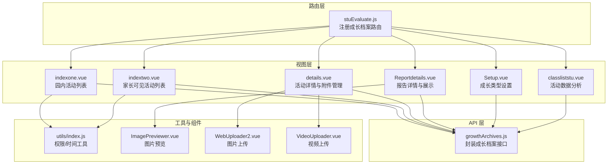
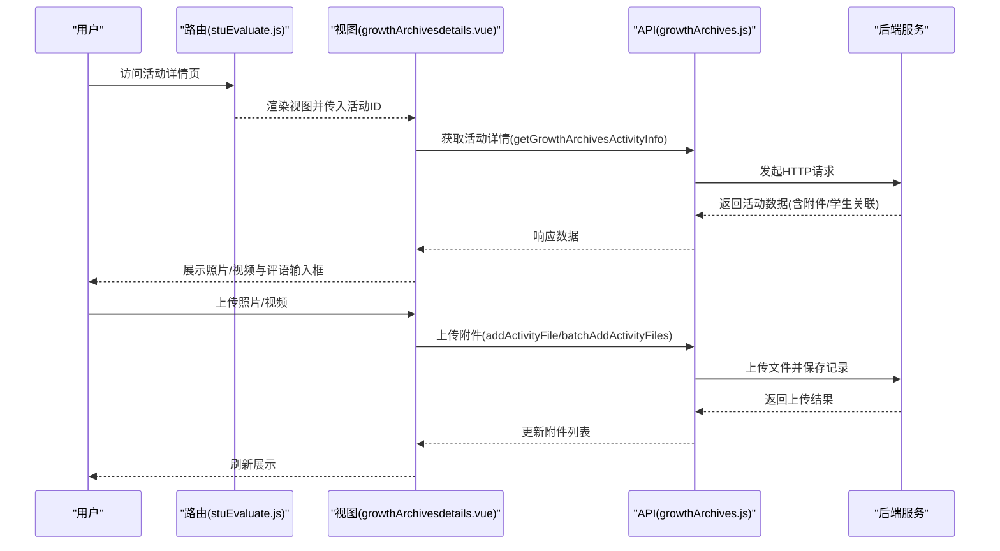
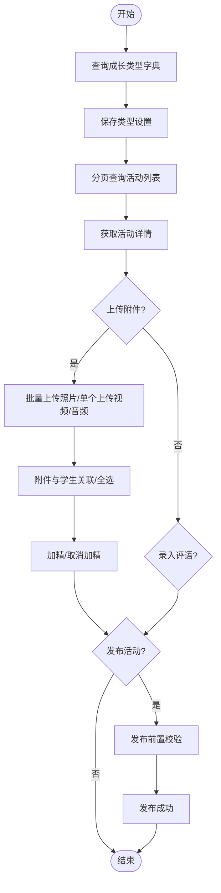
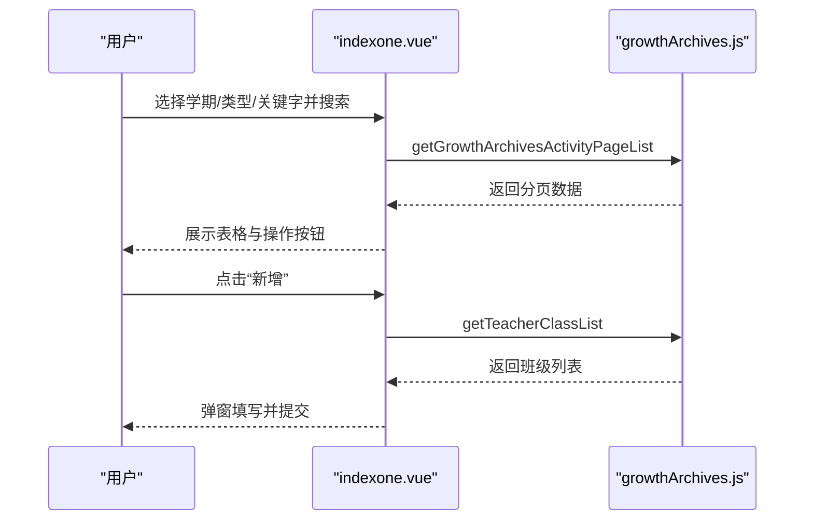
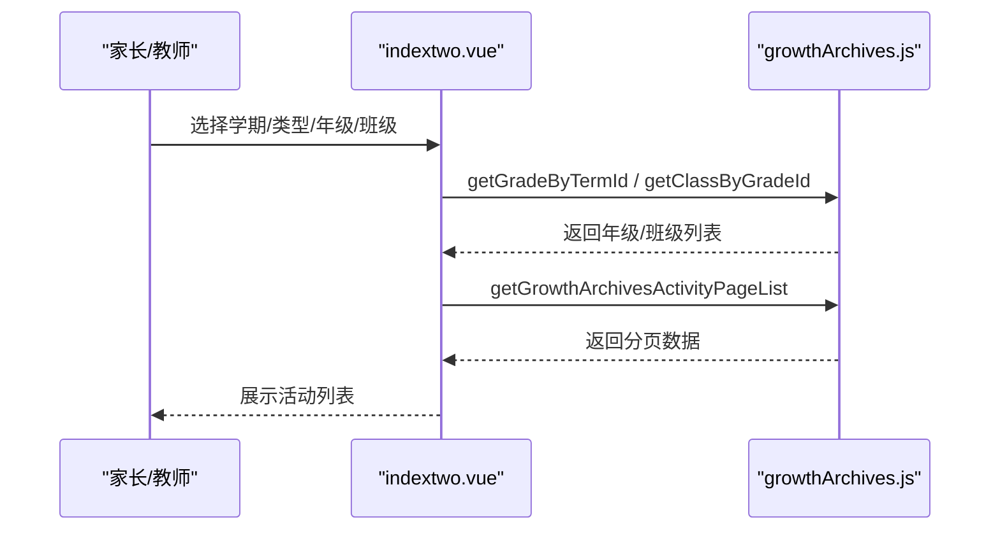
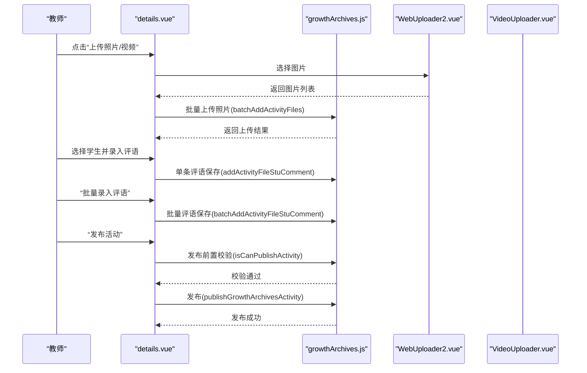
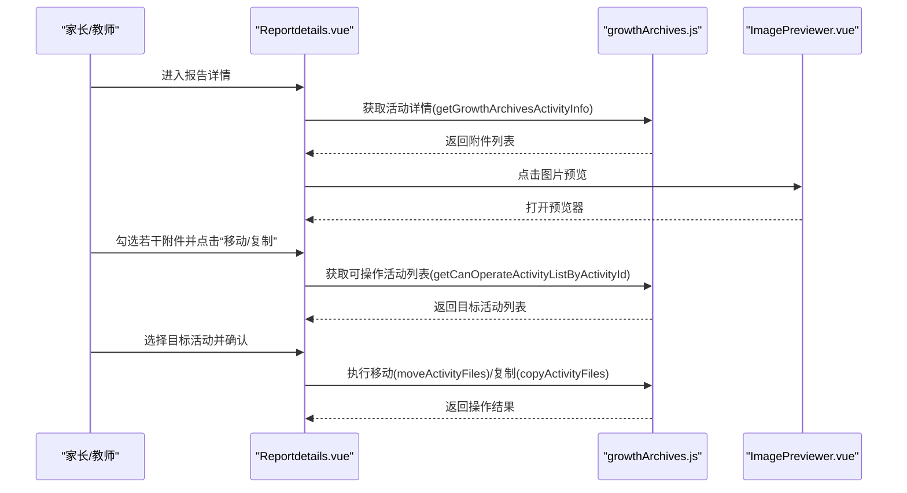
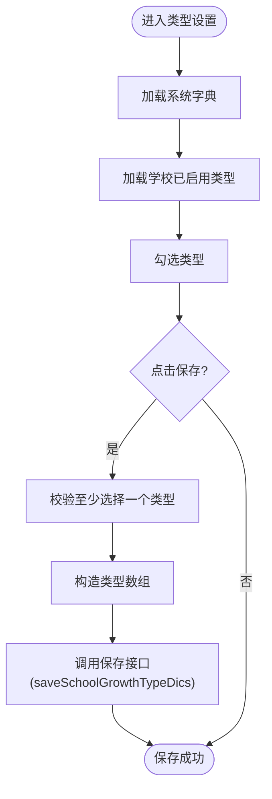
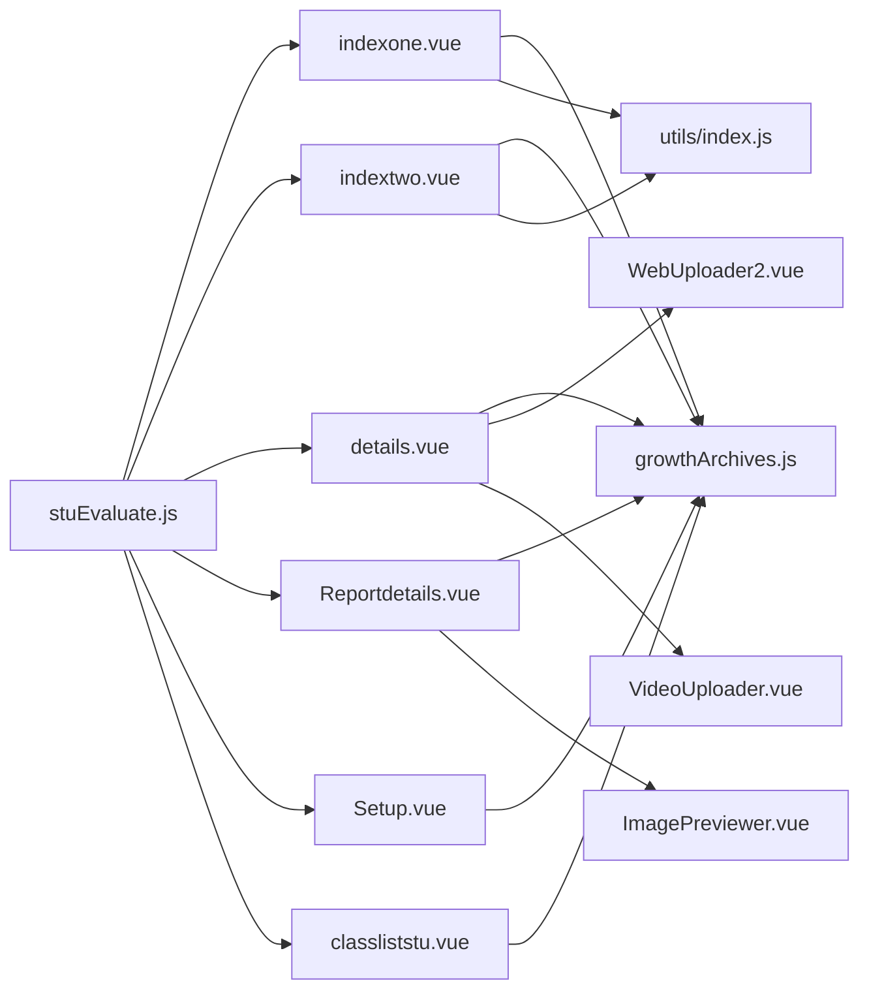

# 学生成长档案

<cite>
**本文引用的文件**
- [growthArchives.js](file://src/api/growthArchives.js)
- [growthArchivesindexone.vue](file://src/views/growthArchives/growthArchivesindexone.vue)
- [growthArchivesindextwo.vue](file://src/views/growthArchives/growthArchivesindextwo.vue)
- [growthArchivesSetup.vue](file://src/views/growthArchives/growthArchivesSetup.vue)
- [growthArchivesdetails.vue](file://src/views/growthArchives/growthArchivesdetails.vue)
- [growthArchivesclassliststu.vue](file://src/views/growthArchives/growthArchivesclassliststu.vue)
- [growthArchivesReportdetails.vue](file://src/views/growthArchives/growthArchivesReportdetails.vue)
- [stuEvaluate.js](file://src/router/normal/stuEvaluate.js)
- [index.js](file://src/utils/index.js)
- [ImagePreviewer.vue](file://src/components/ImagePreviewer/ImagePreviewer.vue)
- [WebUploader2.vue](file://src/components/Uploader/WebUploader2.vue)
- [VideoUploader.vue](file://src/components/Uploader/VideoUploader.vue)
</cite>

## 目录
1. [简介](#简介)
2. [项目结构](#项目结构)
3. [核心组件](#核心组件)
4. [架构总览](#架构总览)
5. [详细组件分析](#详细组件分析)
6. [依赖关系分析](#依赖关系分析)
7. [性能考量](#性能考量)
8. [故障排查指南](#故障排查指南)
9. [结论](#结论)
10. [附录](#附录)

## 简介
本技术文档围绕“学生成长档案”功能进行全面解析，涵盖成长轨迹的记录、展示与管理，包括学习记录、活动参与、作品展示（照片/视频）、评语记录等多元化内容。系统支持按学期、类型、关键字、班级/年级等多维筛选，提供时间轴式展示、活动数据分析、附件移动/复制、评语批量录入、留言互动等功能。同时，文档阐述了权限控制、隐私保护与家校共享机制，并给出与各业务系统的数据关联与自动归档建议，以及个性化展示、导出打印与长期保存的技术实现路径。

## 项目结构
学生成长档案功能由前端路由、视图页面、API 接口层与通用工具/组件构成，采用模块化组织方式：
- 路由层：在统一的评估路由模块中注册成长档案相关页面，便于权限与导航管理。
- 视图层：包含活动列表、活动详情、报告详情、类型设置、数据分析等页面。
- API 层：封装成长档案相关的增删改查、附件上传、评语留言、发布与统计等接口。
- 工具与组件：提供权限判断、时间格式化、图片预览、文件上传组件等通用能力。

**图表来源**
- [stuEvaluate.js:383-422](file://src/router/normal/stuEvaluate.js#L383-L422)
- [growthArchivesindexone.vue:1-454](file://src/views/growthArchives/growthArchivesindexone.vue#L1-L454)
- [growthArchivesindextwo.vue:1-261](file://src/views/growthArchives/growthArchivesindextwo.vue#L1-L261)
- [growthArchivesdetails.vue:1-974](file://src/views/growthArchives/growthArchivesdetails.vue#L1-L974)
- [growthArchivesReportdetails.vue:1-378](file://src/views/growthArchives/growthArchivesReportdetails.vue#L1-L378)
- [growthArchivesSetup.vue:1-94](file://src/views/growthArchives/growthArchivesSetup.vue#L1-L94)
- [growthArchivesclassliststu.vue:1-84](file://src/views/growthArchives/growthArchivesclassliststu.vue#L1-L84)
- [growthArchives.js:1-425](file://src/api/growthArchives.js#L1-L425)
- [index.js:241-246](file://src/utils/index.js#L241-L246)
- [ImagePreviewer.vue:1-236](file://src/components/ImagePreviewer/ImagePreviewer.vue#L1-L236)
- [WebUploader2.vue:46-177](file://src/components/Uploader/WebUploader2.vue#L46-L177)
- [VideoUploader.vue:1-166](file://src/components/Uploader/VideoUploader.vue#L1-L166)

**章节来源**
- [stuEvaluate.js:383-422](file://src/router/normal/stuEvaluate.js#L383-L422)
- [growthArchives.js:1-425](file://src/api/growthArchives.js#L1-L425)

## 核心组件
- 成长档案 API 模块：统一管理活动列表、类型设置、附件上传、评语留言、发布与统计等接口，使用 fetch 封装进行请求。
- 园内活动列表页：支持学期筛选、类型筛选、关键字筛选、活动标题搜索、分页展示与操作（编辑/删除）。
- 家长活动列表页：支持学期、类型、年级/班级筛选，仅展示家长可查看的活动。
- 活动详情页：支持照片/视频附件上传、加精/删除、学生关联、评语录入与批量录入、发布流程控制。
- 报告详情页：面向家长/教师的只读展示，支持附件移动/复制目标活动、查看评语与留言数量。
- 类型设置页：维护成长档案活动类型字典，支持保存与回显。
- 数据分析页：按班级统计附件数量，直观展示学生参与情况。
- 权限与工具：基于 store 的权限判断与角色判断，提供时间格式化等工具方法。
- 上传与预览组件：图片上传（WebUploader2）、视频上传（VideoUploader）、图片预览（ImagePreviewer）。

**章节来源**
- [growthArchives.js:1-425](file://src/api/growthArchives.js#L1-L425)
- [growthArchivesindexone.vue:1-454](file://src/views/growthArchives/growthArchivesindexone.vue#L1-L454)
- [growthArchivesindextwo.vue:1-261](file://src/views/growthArchives/growthArchivesindextwo.vue#L1-L261)
- [growthArchivesdetails.vue:1-974](file://src/views/growthArchives/growthArchivesdetails.vue#L1-L974)
- [growthArchivesReportdetails.vue:1-378](file://src/views/growthArchives/growthArchivesReportdetails.vue#L1-L378)
- [growthArchivesSetup.vue:1-94](file://src/views/growthArchives/growthArchivesSetup.vue#L1-L94)
- [growthArchivesclassliststu.vue:1-84](file://src/views/growthArchives/growthArchivesclassliststu.vue#L1-L84)
- [index.js:241-246](file://src/utils/index.js#L241-L246)
- [ImagePreviewer.vue:1-236](file://src/components/ImagePreviewer/ImagePreviewer.vue#L1-L236)
- [WebUploader2.vue:46-177](file://src/components/Uploader/WebUploader2.vue#L46-L177)
- [VideoUploader.vue:1-166](file://src/components/Uploader/VideoUploader.vue#L1-L166)

## 架构总览
系统采用前后端分离架构，前端通过 API 模块调用后端接口，完成数据的增删改查与业务处理。路由层统一管理页面跳转与权限入口，视图层负责交互与展示，工具与组件层提供通用能力支撑。

**图表来源**
- [stuEvaluate.js:383-422](file://src/router/normal/stuEvaluate.js#L383-L422)
- [growthArchivesdetails.vue:244-694](file://src/views/growthArchives/growthArchivesdetails.vue#L244-L694)
- [growthArchives.js:146-171](file://src/api/growthArchives.js#L146-L171)

**章节来源**
- [growthArchivesdetails.vue:244-694](file://src/views/growthArchives/growthArchivesdetails.vue#L244-L694)
- [growthArchives.js:146-171](file://src/api/growthArchives.js#L146-L171)

## 详细组件分析

### 成长档案 API 模块
- 字典与类型管理
  - 查询学校字典与成长类型字典、保存类型设置。
- 活动管理
  - 分页查询活动列表（支持园内/个人、学期、类型、关键字、班级/年级、标题模糊搜索）。
  - 新增/编辑/删除活动，获取活动模型与详情。
  - 发布活动与发布前置校验。
- 附件管理
  - 批量上传照片、单个上传视频/音频、删除附件。
  - 附件加精/取消加精、附件与学生关联/取消关联、全选/取消全选。
  - 移动/复制附件至其他活动。
- 评语与留言
  - 单条/批量录入评语，删除评语。
  - 新增/删除留言，查询附件留言列表。
- 统计与分析
  - 活动学生静态数据统计（按班级/学生维度）。

**图表来源**
- [growthArchives.js:31-50](file://src/api/growthArchives.js#L31-L50)
- [growthArchives.js:52-67](file://src/api/growthArchives.js#L52-L67)
- [growthArchives.js:108-144](file://src/api/growthArchives.js#L108-L144)
- [growthArchives.js:146-171](file://src/api/growthArchives.js#L146-L171)
- [growthArchives.js:269-287](file://src/api/growthArchives.js#L269-L287)

**章节来源**
- [growthArchives.js:31-50](file://src/api/growthArchives.js#L31-L50)
- [growthArchives.js:52-67](file://src/api/growthArchives.js#L52-L67)
- [growthArchives.js:108-144](file://src/api/growthArchives.js#L108-L144)
- [growthArchives.js:146-171](file://src/api/growthArchives.js#L146-L171)
- [growthArchives.js:269-287](file://src/api/growthArchives.js#L269-L287)

### 园内活动列表页（indexone）
- 功能要点
  - 学期/类型/关键字筛选，标题搜索，分页展示。
  - 支持新增/编辑/删除活动，跳转到活动详情或报告详情。
  - 类型设置入口（权限控制）。
- 关键交互
  - 选择学期后默认选中当前学期；加载类型字典与关键字字典。
  - 编辑时回显班级、类型、关键字与名称等字段。
  - 删除采用二次确认弹窗。

**图表来源**
- [growthArchivesindexone.vue:108-398](file://src/views/growthArchives/growthArchivesindexone.vue#L108-L398)
- [growthArchives.js:118-123](file://src/api/growthArchives.js#L118-L123)
- [growthArchives.js:52-67](file://src/api/growthArchives.js#L52-L67)

**章节来源**
- [growthArchivesindexone.vue:108-398](file://src/views/growthArchives/growthArchivesindexone.vue#L108-L398)
- [growthArchives.js:118-123](file://src/api/growthArchives.js#L118-L123)
- [growthArchives.js:52-67](file://src/api/growthArchives.js#L52-L67)

### 家长活动列表页（indextwo）
- 功能要点
  - 支持学期、类型、年级/班级筛选；仅展示家长可查看的活动。
  - 根据用户历史班主任身份动态获取可查看的班级列表。
- 关键交互
  - 若用户具备特定角色，则显示删除按钮；否则隐藏。
  - 点击活动名称跳转到报告详情页（带创建人 ID 参数）。

**图表来源**
- [growthArchivesindextwo.vue:72-237](file://src/views/growthArchives/growthArchivesindextwo.vue#L72-L237)
- [growthArchives.js:345-367](file://src/api/growthArchives.js#L345-L367)

**章节来源**
- [growthArchivesindextwo.vue:72-237](file://src/views/growthArchives/growthArchivesindextwo.vue#L72-L237)
- [growthArchives.js:345-367](file://src/api/growthArchives.js#L345-L367)

### 活动详情页（details）
- 功能要点
  - 照片/视频附件轮播展示，支持加精、删除、全选/逐个关联学生。
  - 评语录入与批量录入，支持按附件维度批量写入。
  - 发布前置校验与发布流程控制。
  - 上传弹窗支持图片/视频选择，视频上传组件集成。
- 关键交互
  - 上传照片时异步获取图片尺寸以判断横竖版，随后批量上传。
  - 附件与学生关联采用全选/逐个勾选，支持取消关联。
  - 评语变更触发单条保存，批量评语弹窗一次性提交。

**图表来源**
- [growthArchivesdetails.vue:244-694](file://src/views/growthArchives/growthArchivesdetails.vue#L244-L694)
- [growthArchives.js:146-171](file://src/api/growthArchives.js#L146-L171)
- [growthArchives.js:240-267](file://src/api/growthArchives.js#L240-L267)
- [growthArchives.js:269-287](file://src/api/growthArchives.js#L269-L287)
- [WebUploader2.vue:46-177](file://src/components/Uploader/WebUploader2.vue#L46-L177)
- [VideoUploader.vue:1-166](file://src/components/Uploader/VideoUploader.vue#L1-L166)

**章节来源**
- [growthArchivesdetails.vue:244-694](file://src/views/growthArchives/growthArchivesdetails.vue#L244-L694)
- [growthArchives.js:146-171](file://src/api/growthArchives.js#L146-L171)
- [growthArchives.js:240-267](file://src/api/growthArchives.js#L240-L267)
- [growthArchives.js:269-287](file://src/api/growthArchives.js#L269-L287)
- [WebUploader2.vue:46-177](file://src/components/Uploader/WebUploader2.vue#L46-L177)
- [VideoUploader.vue:1-166](file://src/components/Uploader/VideoUploader.vue#L1-L166)

### 报告详情页（Reportdetails）
- 功能要点
  - 只读展示照片/视频附件，支持勾选多个附件进行移动/复制到其他活动。
  - 查看附件关联学生数量与留言数量，点击进入留言列表页。
  - 图片预览组件支持多图浏览与键盘切换。
- 关键交互
  - 勾选附件后弹出目标活动选择对话框，执行移动/复制操作。
  - 点击“活动数据分析”跳转到数据分析页。

**图表来源**
- [growthArchivesReportdetails.vue:111-254](file://src/views/growthArchives/growthArchivesReportdetails.vue#L111-L254)
- [growthArchives.js:417-425](file://src/api/growthArchives.js#L417-L425)
- [ImagePreviewer.vue:1-236](file://src/components/ImagePreviewer/ImagePreviewer.vue#L1-L236)

**章节来源**
- [growthArchivesReportdetails.vue:111-254](file://src/views/growthArchives/growthArchivesReportdetails.vue#L111-L254)
- [growthArchives.js:417-425](file://src/api/growthArchives.js#L417-L425)
- [ImagePreviewer.vue:1-236](file://src/components/ImagePreviewer/ImagePreviewer.vue#L1-L236)

### 类型设置页（Setup）
- 功能要点
  - 加载系统字典作为可选项，回显学校已启用的类型并支持保存。
- 关键交互
  - 至少选择一个类型方可保存；保存时构造类型数组并调用保存接口。

**图表来源**
- [growthArchivesSetup.vue:17-78](file://src/views/growthArchives/growthArchivesSetup.vue#L17-L78)
- [growthArchives.js:31-50](file://src/api/growthArchives.js#L31-L50)

**章节来源**
- [growthArchivesSetup.vue:17-78](file://src/views/growthArchives/growthArchivesSetup.vue#L17-L78)
- [growthArchives.js:31-50](file://src/api/growthArchives.js#L31-L50)

### 数据分析页（classliststu）
- 功能要点
  - 按班级统计每个学生的附件数量，未参与的学生以警示标签提示。
- 关键交互
  - 从活动详情页跳转而来，展示清晰的数据概览。

**章节来源**
- [growthArchivesclassliststu.vue:21-45](file://src/views/growthArchives/growthArchivesclassliststu.vue#L21-L45)

## 依赖关系分析
- 路由依赖：所有成长档案页面均在统一路由模块中注册，便于集中管理与权限控制。
- 视图依赖：活动列表页依赖 API 获取数据；活动详情页依赖上传组件与图片预览组件；报告详情页依赖图片预览组件与移动/复制接口。
- 工具依赖：权限判断与角色判断依赖 store 中的权限列表与角色列表；时间格式化用于展示友好时间。
- 组件依赖：WebUploader2 与 VideoUploader 提供文件上传能力；ImagePreviewer 提供图片浏览能力。

**图表来源**
- [stuEvaluate.js:383-422](file://src/router/normal/stuEvaluate.js#L383-L422)
- [growthArchivesindexone.vue:108-398](file://src/views/growthArchives/growthArchivesindexone.vue#L108-L398)
- [growthArchivesindextwo.vue:72-237](file://src/views/growthArchives/growthArchivesindextwo.vue#L72-L237)
- [growthArchivesdetails.vue:244-694](file://src/views/growthArchives/growthArchivesdetails.vue#L244-L694)
- [growthArchivesReportdetails.vue:111-254](file://src/views/growthArchives/growthArchivesReportdetails.vue#L111-L254)
- [growthArchivesSetup.vue:17-78](file://src/views/growthArchives/growthArchivesSetup.vue#L17-L78)
- [growthArchivesclassliststu.vue:21-45](file://src/views/growthArchives/growthArchivesclassliststu.vue#L21-L45)
- [growthArchives.js:1-425](file://src/api/growthArchives.js#L1-L425)
- [index.js:241-246](file://src/utils/index.js#L241-L246)
- [WebUploader2.vue:46-177](file://src/components/Uploader/WebUploader2.vue#L46-L177)
- [VideoUploader.vue:1-166](file://src/components/Uploader/VideoUploader.vue#L1-L166)
- [ImagePreviewer.vue:1-236](file://src/components/ImagePreviewer/ImagePreviewer.vue#L1-L236)

**章节来源**
- [stuEvaluate.js:383-422](file://src/router/normal/stuEvaluate.js#L383-L422)
- [growthArchives.js:1-425](file://src/api/growthArchives.js#L1-L425)
- [index.js:241-246](file://src/utils/index.js#L241-L246)
- [WebUploader2.vue:46-177](file://src/components/Uploader/WebUploader2.vue#L46-L177)
- [VideoUploader.vue:1-166](file://src/components/Uploader/VideoUploader.vue#L1-L166)
- [ImagePreviewer.vue:1-236](file://src/components/ImagePreviewer/ImagePreviewer.vue#L1-L236)

## 性能考量
- 列表分页与筛选：通过分页参数与筛选条件减少一次性传输数据量，提升首屏渲染速度。
- 附件上传优化：图片上传前先获取尺寸信息，避免后续重排与缩放带来的性能损耗；视频上传采用进度反馈，改善用户体验。
- 图片预览：图片预览组件支持多图浏览与键盘切换，减少重复加载，提高浏览效率。
- 评语批量录入：批量接口减少多次网络往返，降低服务器压力与前端等待时间。
- 统计分析：按班级/学生维度聚合数据，避免前端复杂计算，提升响应速度。

## 故障排查指南
- 发布失败
  - 现象：发布按钮不可用或发布后状态未更新。
  - 排查：检查发布前置校验接口返回信息；确认活动是否满足发布条件；查看网络请求与返回码。
- 附件上传失败
  - 现象：上传后附件未出现在列表。
  - 排查：确认上传组件初始化是否成功；检查文件类型与大小限制；查看上传进度回调与错误回调。
- 评语保存异常
  - 现象：录入评语后未持久化。
  - 排查：检查单条评语保存接口调用；确认附件与学生关联状态；查看批量评语接口参数。
- 权限问题
  - 现象：无法看到某些页面或操作按钮。
  - 排查：核对权限列表与角色判断逻辑；确认路由注册与页面访问权限。

**章节来源**
- [growthArchives.js:269-287](file://src/api/growthArchives.js#L269-L287)
- [growthArchivesdetails.vue:541-651](file://src/views/growthArchives/growthArchivesdetails.vue#L541-L651)
- [growthArchives.js:240-267](file://src/api/growthArchives.js#L240-L267)
- [index.js:241-246](file://src/utils/index.js#L241-L246)

## 结论
学生成长档案功能通过完善的 API 封装、清晰的页面分工与强大的工具/组件支持，实现了从活动创建、附件管理、评语留言到报告展示与数据分析的全流程闭环。系统具备良好的扩展性与可维护性，能够满足园内教师与家长在成长档案记录与共享方面的需求。建议后续进一步完善隐私策略与导出打印能力，以满足更广泛的使用场景。

## 附录
- 权限与角色
  - 使用 isShowByPermission 与 isShowByRole 对页面与操作按钮进行权限控制。
- 时间格式化
  - 提供 parseTime 与 formatTime 方法，用于展示友好时间与相对时间。
- 家校共享与自动归档
  - 建议：通过“家长可见活动列表”实现家校共享；结合业务系统（如考勤、成绩、荣誉等）在合适节点自动归档至成长档案，形成完整成长轨迹。

**章节来源**
- [index.js:241-246](file://src/utils/index.js#L241-L246)
- [index.js:3-62](file://src/utils/index.js#L3-L62)