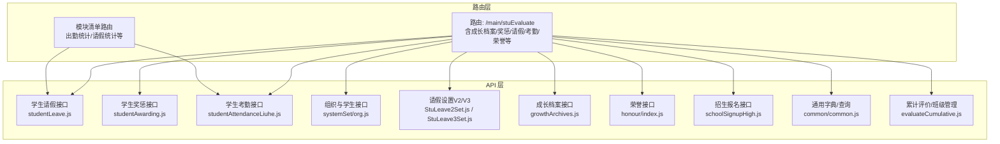
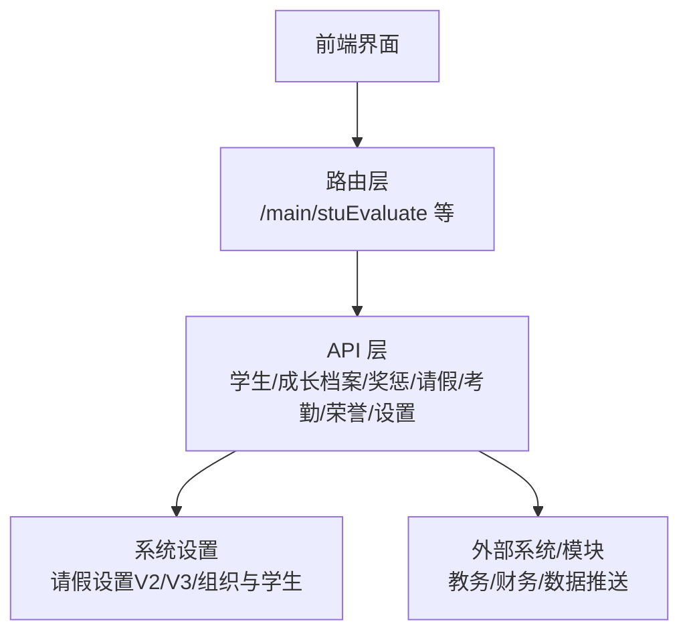
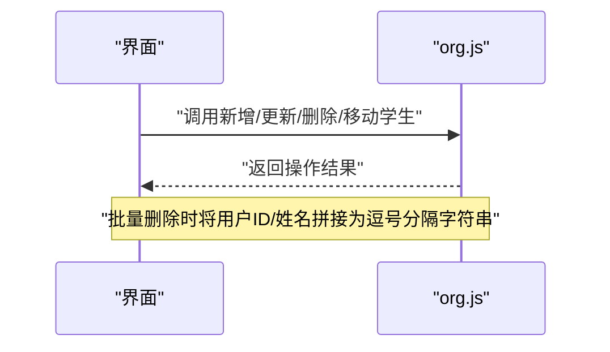
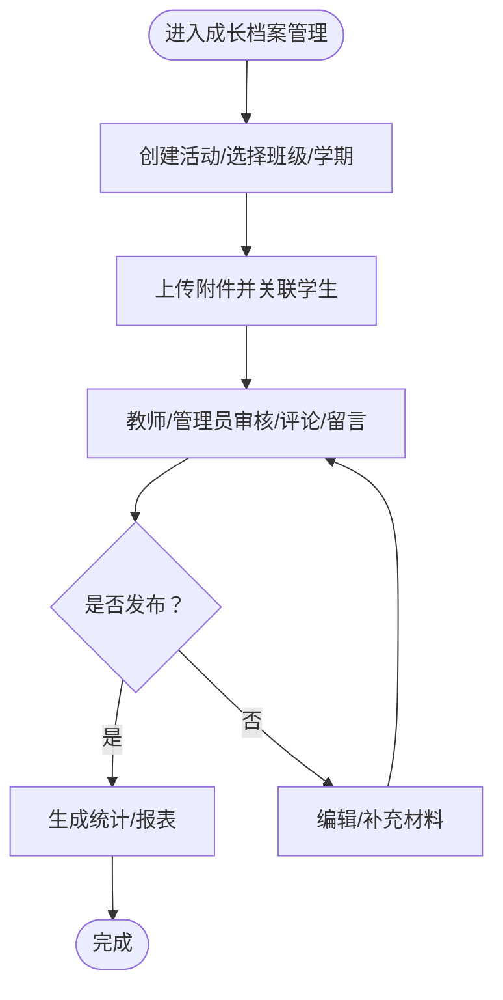
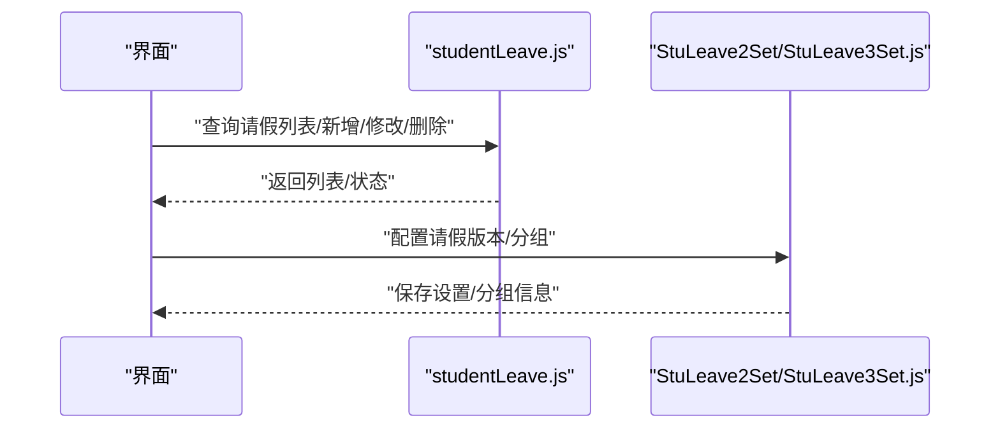
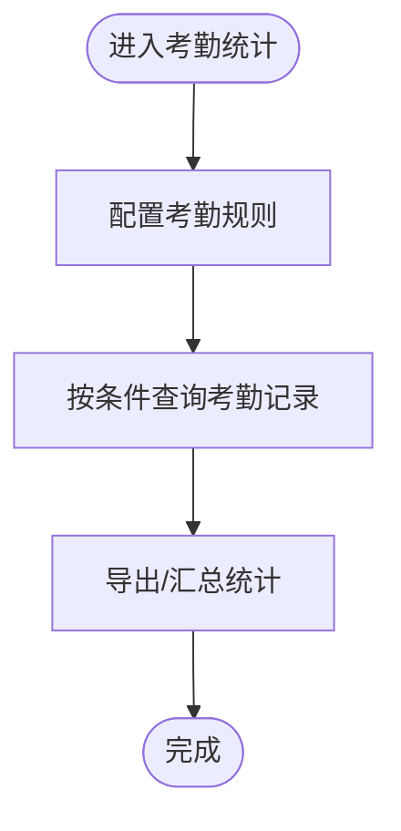
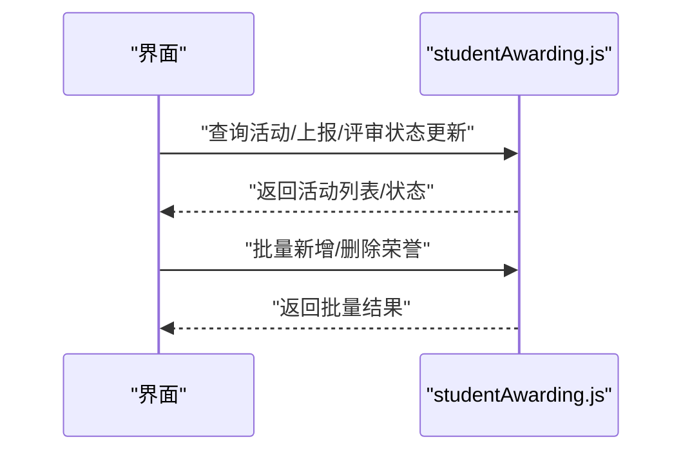
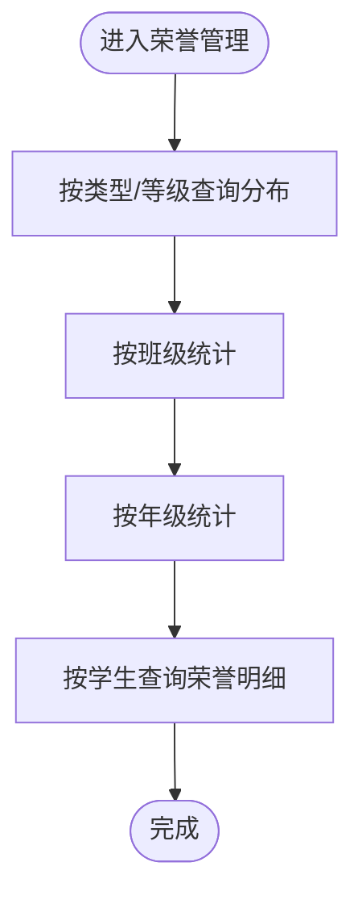
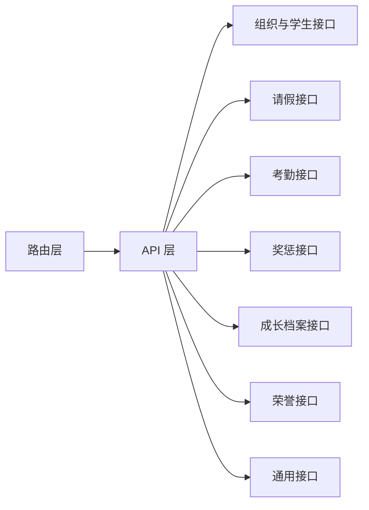

# 学生管理

<cite>
**本文引用的文件**
- [src/api/studentLeave.js](file://src/api/studentLeave.js)
- [src/api/studentAwarding.js](file://src/api/studentAwarding.js)
- [src/api/studentAttendanceLiuhe.js](file://src/api/studentAttendanceLiuhe.js)
- [src/api/systemSet/org.js](file://src/api/systemSet/org.js)
- [src/api/systemSet/StuLeave2Set.js](file://src/api/systemSet/StuLeave2Set.js)
- [src/api/systemSet/StuLeave3Set.js](file://src/api/systemSet/StuLeave3Set.js)
- [src/api/growthArchives.js](file://src/api/growthArchives.js)
- [src/router/normal/stuEvaluate.js](file://src/router/normal/stuEvaluate.js)
- [src/router/moduleList.js](file://src/router/moduleList.js)
- [src/api/honour/index.js](file://src/api/honour/index.js)
- [src/api/schoolSignupHigh.js](file://src/api/schoolSignupHigh.js)
- [src/api/common/common.js](file://src/api/common/common.js)
- [src/api/evaluateCumulative.js](file://src/api/evaluateCumulative.js)
</cite>

## 目录
1. [引言](#引言)
2. [项目结构](#项目结构)
3. [核心组件](#核心组件)
4. [架构总览](#架构总览)
5. [详细组件分析](#详细组件分析)
6. [依赖关系分析](#依赖关系分析)
7. [性能考虑](#性能考虑)
8. [故障排查指南](#故障排查指南)
9. [结论](#结论)
10. [附录](#附录)

## 引言
本文件面向“学生管理”业务域，系统性梳理学生信息管理、学籍管理、成绩与奖惩记录、成长档案、请假与考勤统计、荣誉奖励管理以及跨模块数据交互与权限控制策略。文档旨在帮助开发与运维人员快速理解系统能力边界与实现要点，并为后续扩展与优化提供参考。

## 项目结构
围绕学生管理的关键模块与接口，前端采用“路由 + API 模块”的组织方式：
- 路由层：集中定义学生相关业务入口与页面路径，覆盖成长档案、奖惩、请假、考勤、荣誉等。
- API 层：按功能域拆分接口文件，统一通过封装的 fetch 工具发起请求，便于集中治理与扩展。
- 配置与设置：提供请假版本设置、组织机构与学生 CRUD 等支撑能力。

图表来源
- [src/router/normal/stuEvaluate.js:1-457](file://src/router/normal/stuEvaluate.js#L1-L457)
- [src/router/moduleList.js:1020-1046](file://src/router/moduleList.js#L1020-L1046)
- [src/api/studentLeave.js:1-243](file://src/api/studentLeave.js#L1-L243)
- [src/api/studentAwarding.js:1-514](file://src/api/studentAwarding.js#L1-L514)
- [src/api/studentAttendanceLiuhe.js:1-87](file://src/api/studentAttendanceLiuhe.js#L1-L87)
- [src/api/systemSet/org.js:679-751](file://src/api/systemSet/org.js#L679-L751)
- [src/api/systemSet/StuLeave2Set.js:1-100](file://src/api/systemSet/StuLeave2Set.js#L1-L100)
- [src/api/systemSet/StuLeave3Set.js:1-27](file://src/api/systemSet/StuLeave3Set.js#L1-L27)
- [src/api/growthArchives.js:1-425](file://src/api/growthArchives.js#L1-L425)
- [src/api/honour/index.js:42-211](file://src/api/honour/index.js#L42-L211)
- [src/api/schoolSignupHigh.js:284-661](file://src/api/schoolSignupHigh.js#L284-L661)
- [src/api/common/common.js:42-90](file://src/api/common/common.js#L42-L90)
- [src/api/evaluateCumulative.js:298-315](file://src/api/evaluateCumulative.js#L298-L315)

章节来源
- [src/router/normal/stuEvaluate.js:1-457](file://src/router/normal/stuEvaluate.js#L1-L457)
- [src/router/moduleList.js:1020-1046](file://src/router/moduleList.js#L1020-L1046)

## 核心组件
- 学生信息与学籍管理
  - 提供新增、更新、删除、移动班级等能力，支持批量操作与参数校验。
  - 关键接口：新增/更新/删除学生、移动学生到班级、查询班级学生列表等。
- 成长档案管理
  - 支持活动创建/编辑/发布、附件上传与关联、评论/留言、统计与复制/移动资料等。
  - 关键接口：活动分页列表、活动详情、附件增删改、发布、统计等。
- 请假管理
  - 支持按班级/个人查询、批量新增、统计、设置版本与分组、停餐/作息联动等。
  - 关键接口：请假列表、新增/修改/删除、统计、初始化设置、分组管理等。
- 考勤统计
  - 支持规则配置、周期记录分页查询、按人/按班/按年级统计。
  - 关键接口：规则增删改查、记录分页、统计列表等。
- 奖惩记录管理
  - 支持活动管理、班级上报、评审状态变更、批量导入导出、荣誉发放等。
  - 关键接口：活动列表、活动详情、上报/通过名单、评审状态更新、批量操作等。
- 荣誉奖励管理
  - 支持按班级/年级/全校统计、荣誉类型分布、学生荣誉明细、统计图表等。
  - 关键接口：班级/年级统计、荣誉类型分布、学生荣誉列表等。
- 数据采集与查询
  - 通用字典、学期、年级/班级选择、学生信息查询等。
  - 关键接口：字典查询、学期列表、按班级批量查询学生等。
- 权限与集成
  - 路由级权限标识、模块开关、跨模块数据交互（如招生报名、考勤统计、荣誉统计）。

章节来源
- [src/api/systemSet/org.js:679-751](file://src/api/systemSet/org.js#L679-L751)
- [src/api/growthArchives.js:52-182](file://src/api/growthArchives.js#L52-L182)
- [src/api/studentLeave.js:15-243](file://src/api/studentLeave.js#L15-L243)
- [src/api/studentAttendanceLiuhe.js:49-87](file://src/api/studentAttendanceLiuhe.js#L49-L87)
- [src/api/studentAwarding.js:18-514](file://src/api/studentAwarding.js#L18-L514)
- [src/api/honour/index.js:42-211](file://src/api/honour/index.js#L42-L211)
- [src/api/common/common.js:42-90](file://src/api/common/common.js#L42-L90)

## 架构总览
学生管理模块在前端通过路由聚合业务入口，在 API 层按功能域拆分职责，统一通过 fetch 工具发起请求；同时通过系统设置接口完成请假版本、规则与组织管理等支撑能力。

图表来源
- [src/router/normal/stuEvaluate.js:1-457](file://src/router/normal/stuEvaluate.js#L1-L457)
- [src/api/systemSet/StuLeave2Set.js:1-100](file://src/api/systemSet/StuLeave2Set.js#L1-L100)
- [src/api/systemSet/StuLeave3Set.js:1-27](file://src/api/systemSet/StuLeave3Set.js#L1-L27)
- [src/api/systemSet/org.js:679-751](file://src/api/systemSet/org.js#L679-L751)

## 详细组件分析

### 学生信息与学籍管理
- 功能要点
  - 新增/更新/删除学生，支持批量删除与参数拼装。
  - 移动学生到其他班级，自动跟随家长信息联动。
  - 查询班级学生列表，支持排序与筛选。
- 关键接口路径
  - 新增学生：[src/api/systemSet/org.js:679-697](file://src/api/systemSet/org.js#L679-L697)
  - 更新学生：[src/api/systemSet/org.js:703-724](file://src/api/systemSet/org.js#L703-L724)
  - 删除学生：[src/api/systemSet/org.js:730-751](file://src/api/systemSet/org.js#L730-L751)
  - 移动学生：[src/api/systemSet/org.js:642-673](file://src/api/systemSet/org.js#L642-L673)
  - 查询班级学生：[src/api/growthArchives.js:173-182](file://src/api/growthArchives.js#L173-L182)

图表来源
- [src/api/systemSet/org.js:730-751](file://src/api/systemSet/org.js#L730-L751)
- [src/api/systemSet/org.js:642-673](file://src/api/systemSet/org.js#L642-L673)

章节来源
- [src/api/systemSet/org.js:642-751](file://src/api/systemSet/org.js#L642-L751)
- [src/api/growthArchives.js:173-182](file://src/api/growthArchives.js#L173-L182)

### 成长档案管理
- 功能要点
  - 活动生命周期：创建/编辑/删除、发布、统计。
  - 附件管理：批量添加/删除、加星/取消、复制/移动、评论/留言。
  - 角色与权限：判断角色、获取可操作活动列表。
- 关键接口路径
  - 活动分页列表：[src/api/growthArchives.js:52-68](file://src/api/growthArchives.js#L52-L68)
  - 活动详情：[src/api/growthArchives.js:108-116](file://src/api/growthArchives.js#L108-L116)
  - 附件增删改：[src/api/growthArchives.js:146-238](file://src/api/growthArchives.js#L146-L238)
  - 发布/统计：[src/api/growthArchives.js:279-297](file://src/api/growthArchives.js#L279-L297)
  - 角色判断/可操作列表：[src/api/growthArchives.js:335-425](file://src/api/growthArchives.js#L335-L425)

图表来源
- [src/api/growthArchives.js:52-116](file://src/api/growthArchives.js#L52-L116)
- [src/api/growthArchives.js:146-238](file://src/api/growthArchives.js#L146-L238)
- [src/api/growthArchives.js:279-297](file://src/api/growthArchives.js#L279-L297)

章节来源
- [src/api/growthArchives.js:52-425](file://src/api/growthArchives.js#L52-L425)

### 请假管理
- 功能要点
  - 列表查询：按班级/状态/日期范围/学生名筛选。
  - 批量新增/修改/删除：支持 JSON 与表单参数混合提交。
  - 初始化设置与分组：支持版本二/版本三设置、班级分组。
  - 统计与联动：按人统计、停餐设置、作息联动。
- 关键接口路径
  - 请假列表：[src/api/studentLeave.js:15-30](file://src/api/studentLeave.js#L15-L30)
  - 新增请假：[src/api/studentLeave.js:43-81](file://src/api/studentLeave.js#L43-L81)
  - 批量新增：[src/api/studentLeave.js:83-92](file://src/api/studentLeave.js#L83-L92)
  - 修改请假：[src/api/studentLeave.js:167-177](file://src/api/studentLeave.js#L167-L177)
  - 统计列表：[src/api/studentLeave.js:118-132](file://src/api/studentLeave.js#L118-L132)
  - 初始化设置：[src/api/systemSet/StuLeave2Set.js:7-26](file://src/api/systemSet/StuLeave2Set.js#L7-L26)
  - 分组管理：[src/api/systemSet/StuLeave2Set.js:33-99](file://src/api/systemSet/StuLeave2Set.js#L33-L99)
  - 版本三设置：[src/api/systemSet/StuLeave3Set.js:6-26](file://src/api/systemSet/StuLeave3Set.js#L6-L26)

图表来源
- [src/api/studentLeave.js:15-177](file://src/api/studentLeave.js#L15-L177)
- [src/api/systemSet/StuLeave2Set.js:7-99](file://src/api/systemSet/StuLeave2Set.js#L7-L99)
- [src/api/systemSet/StuLeave3Set.js:6-26](file://src/api/systemSet/StuLeave3Set.js#L6-L26)

章节来源
- [src/api/studentLeave.js:15-243](file://src/api/studentLeave.js#L15-L243)
- [src/api/systemSet/StuLeave2Set.js:1-100](file://src/api/systemSet/StuLeave2Set.js#L1-L100)
- [src/api/systemSet/StuLeave3Set.js:1-27](file://src/api/systemSet/StuLeave3Set.js#L1-L27)

### 考勤统计
- 功能要点
  - 考勤规则：新增/编辑/删除/查询规则。
  - 记录统计：按日期区间、年级/班级/学生名分页查询。
- 关键接口路径
  - 规则增删改查：[src/api/studentAttendanceLiuhe.js:4-67](file://src/api/studentAttendanceLiuhe.js#L4-L67)
  - 记录分页查询：[src/api/studentAttendanceLiuhe.js:69-87](file://src/api/studentAttendanceLiuhe.js#L69-L87)

图表来源
- [src/api/studentAttendanceLiuhe.js:4-87](file://src/api/studentAttendanceLiuhe.js#L4-L87)

章节来源
- [src/api/studentAttendanceLiuhe.js:1-87](file://src/api/studentAttendanceLiuhe.js#L1-L87)

### 奖惩记录管理
- 功能要点
  - 活动管理：新增/编辑/删除活动，查询活动列表。
  - 班级上报：按活动/班级/科目/奖项维度上报与查看。
  - 评审状态：按活动/班级/奖项更新评审状态。
  - 批量操作：批量新增/修改/删除荣誉，导出名单。
- 关键接口路径
  - 活动列表/详情/删除/更新：[src/api/studentAwarding.js:4-65](file://src/api/studentAwarding.js#L4-L65)
  - 上报/通过名单：[src/api/studentAwarding.js:286-297](file://src/api/studentAwarding.js#L286-L297)
  - 评审状态更新：[src/api/studentAwarding.js:182-192](file://src/api/studentAwarding.js#L182-L192)
  - 批量操作：[src/api/studentAwarding.js:413-425](file://src/api/studentAwarding.js#L413-L425)

图表来源
- [src/api/studentAwarding.js:4-65](file://src/api/studentAwarding.js#L4-L65)
- [src/api/studentAwarding.js:286-297](file://src/api/studentAwarding.js#L286-L297)
- [src/api/studentAwarding.js:182-192](file://src/api/studentAwarding.js#L182-L192)
- [src/api/studentAwarding.js:413-425](file://src/api/studentAwarding.js#L413-L425)

章节来源
- [src/api/studentAwarding.js:1-514](file://src/api/studentAwarding.js#L1-L514)

### 荣誉奖励管理
- 功能要点
  - 统计维度：按班级、年级、全校荣誉分布与等级统计。
  - 学生荣誉明细：按学期/学生分页查询。
  - 图表展示：荣誉类型分布图、等级分布图。
- 关键接口路径
  - 班级统计：[src/api/honour/index.js:182-194](file://src/api/honour/index.js#L182-L194)
  - 年级统计：[src/api/honour/index.js:197-209](file://src/api/honour/index.js#L197-L209)
  - 学生荣誉列表：[src/api/honour/index.js:168-179](file://src/api/honour/index.js#L168-L179)
  - 类型分布图：[src/api/honour/index.js:70-81](file://src/api/honour/index.js#L70-L81)

图表来源
- [src/api/honour/index.js:70-179](file://src/api/honour/index.js#L70-L179)
- [src/api/honour/index.js:182-209](file://src/api/honour/index.js#L182-L209)

章节来源
- [src/api/honour/index.js:42-211](file://src/api/honour/index.js#L42-L211)

### 数据采集与查询
- 功能要点
  - 字典与学期：查询学校字典、学期列表、年级/班级选择。
  - 学生信息：按 ID/名称查询学生信息。
- 关键接口路径
  - 字典查询：[src/api/common/common.js:42-90](file://src/api/common/common.js#L42-L90)
  - 学期列表：[src/api/growthArchives.js:24-29](file://src/api/growthArchives.js#L24-L29)
  - 学生查询：[src/api/common/common.js:85-90](file://src/api/common/common.js#L85-L90)

章节来源
- [src/api/common/common.js:42-90](file://src/api/common/common.js#L42-L90)
- [src/api/growthArchives.js:24-29](file://src/api/growthArchives.js#L24-L29)

### 跨模块数据交互与权限控制
- 路由与权限
  - 路由层通过 permissionPath 定义访问权限，模块清单路由包含出勤统计、请假统计等入口。
- 模块交互
  - 出勤统计/请假统计：通过路由与 API 接口联动。
  - 招生报名：与报名流程、审批、短信发送、名单分组等模块交互。
- 关键路径
  - 出勤统计路由：[src/router/moduleList.js:1020-1046](file://src/router/moduleList.js#L1020-L1046)
  - 招生报名路由与权限：[src/router/moduleList.js:740-788](file://src/router/moduleList.js#L740-L788)

章节来源
- [src/router/moduleList.js:1020-1046](file://src/router/moduleList.js#L1020-L1046)
- [src/router/moduleList.js:740-788](file://src/router/moduleList.js#L740-L788)

## 依赖关系分析
- 组件耦合
  - 路由层依赖 API 层接口；API 层内部按功能域解耦，减少相互依赖。
  - 设置类接口（请假设置、组织管理）被多业务模块复用。
- 外部依赖
  - 通过 fetch 工具统一发起请求，便于集中治理与扩展。
- 潜在风险
  - 批量操作需注意参数拼装与后端格式一致性。
  - 路由权限标识需与后端权限策略保持一致。

图表来源
- [src/router/normal/stuEvaluate.js:1-457](file://src/router/normal/stuEvaluate.js#L1-L457)
- [src/api/systemSet/org.js:679-751](file://src/api/systemSet/org.js#L679-L751)
- [src/api/studentLeave.js:15-243](file://src/api/studentLeave.js#L15-L243)
- [src/api/studentAttendanceLiuhe.js:49-87](file://src/api/studentAttendanceLiuhe.js#L49-L87)
- [src/api/studentAwarding.js:18-514](file://src/api/studentAwarding.js#L18-L514)
- [src/api/growthArchives.js:52-425](file://src/api/growthArchives.js#L52-L425)
- [src/api/honour/index.js:42-211](file://src/api/honour/index.js#L42-L211)
- [src/api/common/common.js:42-90](file://src/api/common/common.js#L42-L90)

## 性能考虑
- 批量操作
  - 批量新增/删除/修改建议分批提交，避免超大 JSON 导致请求超时。
- 分页查询
  - 列表查询统一使用分页参数，合理设置页大小与查询条件。
- 接口合并
  - 对于频繁调用的字典与学期查询，可在前端做缓存与去重处理。
- 资源上传
  - 成长档案附件上传建议限制文件大小与类型，提升上传成功率。

## 故障排查指南
- 常见问题
  - 批量删除失败：检查用户 ID/姓名拼装格式与后端要求是否一致。
  - 请假批量新增异常：确认 JSON 参数与表单参数混合提交格式。
  - 荣誉统计为空：核对学期、日期范围、班级/年级选择是否正确。
- 定位方法
  - 查看网络面板请求与响应，确认接口路径与参数。
  - 检查路由权限标识与后端权限策略是否匹配。
- 相关接口路径
  - 批量删除：[src/api/systemSet/org.js:730-751](file://src/api/systemSet/org.js#L730-L751)
  - 批量新增请假：[src/api/studentLeave.js:83-92](file://src/api/studentLeave.js#L83-L92)
  - 荣誉统计：[src/api/honour/index.js:182-209](file://src/api/honour/index.js#L182-L209)

章节来源
- [src/api/systemSet/org.js:730-751](file://src/api/systemSet/org.js#L730-L751)
- [src/api/studentLeave.js:83-92](file://src/api/studentLeave.js#L83-L92)
- [src/api/honour/index.js:182-209](file://src/api/honour/index.js#L182-L209)

## 结论
学生管理模块通过清晰的路由与 API 分层，实现了从信息维护到成长档案、奖惩、请假与考勤的全链路覆盖。配合系统设置与通用接口，满足了日常运营与统计分析需求。建议在后续迭代中进一步完善权限校验、批量操作的容错与提示，并持续优化接口性能与用户体验。

## 附录
- 路由入口与页面
  - 成长档案相关页面：[src/router/normal/stuEvaluate.js:384-422](file://src/router/normal/stuEvaluate.js#L384-L422)
- 招生报名相关接口
  - 报名流程与统计：[src/api/schoolSignupHigh.js:284-661](file://src/api/schoolSignupHigh.js#L284-L661)
- 累计评价与班级管理
  - 班级与学生查询：[src/api/evaluateCumulative.js:298-315](file://src/api/evaluateCumulative.js#L298-L315)