# 学生考勤管理

<cite>
**本文引用的文件**
- [src/api/schoolManage/teacherAttendanceStatistics.js](file://src/api/schoolManage/teacherAttendanceStatistics.js)
- [src/api/readPunchClock.js](file://src/api/readPunchClock.js)
- [src/api/systemSet/teacherAttendanceSet.js](file://src/api/systemSet/teacherAttendanceSet.js)
- [src/api/attendanceStatistics.js](file://src/api/attendanceStatistics.js)
- [src/api/rollCall.js](file://src/api/rollCall.js)
- [src/api/morningCheck.js](file://src/api/morningCheck.js)
- [src/api/morninginspectionrobot.js](file://src/api/morninginspectionrobot.js)
- [src/api/gate.js](file://src/api/gate.js)
- [src/api/temperatureSetup.js](file://src/api/temperatureSetup.js)
- [src/api/classroomEvaluationApp.js](file://src/api/classroomEvaluationApp.js)
- [src/api/studentAttendanceLiuhe.js](file://src/api/studentAttendanceLiuhe.js)
- [src/router/normal/sysManage.js](file://src/router/normal/sysManage.js)
- [src/router/normal/homeSchool.js](file://src/router/normal/homeSchool.js)
</cite>

## 目录
1. [引言](#引言)
2. [项目结构](#项目结构)
3. [核心组件](#核心组件)
4. [架构总览](#架构总览)
5. [详细组件分析](#详细组件分析)
6. [依赖关系分析](#依赖关系分析)
7. [性能考虑](#性能考虑)
8. [故障排查指南](#故障排查指南)
9. [结论](#结论)
10. [附录](#附录)

## 引言
本技术文档围绕“学生考勤管理”主题，系统化梳理课堂考勤、早操/集合点名、门禁通行、体温检测、电子班牌联动等多场景下的数据采集、规则配置、异常处理与统计分析能力。文档同时覆盖与门禁系统、体温检测系统、电子班牌的对接与实时同步机制，并提供数据分析、预警与家校沟通的使用指南。

## 项目结构
本项目采用前端单页应用架构，考勤相关功能主要分布在以下区域：
- API 层：封装各类考勤接口，如教师考勤统计、课堂行为考勤、打卡统计、门禁与晨检、温度上报设置等。
- 视图层：对应路由配置的页面组件，负责展示与交互。
- 路由层：集中定义考勤相关页面路径与懒加载组件。

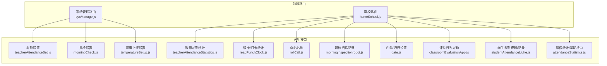

图表来源
- [src/router/normal/sysManage.js:629-661](file://src/router/normal/sysManage.js#L629-L661)
- [src/router/normal/homeSchool.js:1128-1145](file://src/router/normal/homeSchool.js#L1128-L1145)
- [src/api/systemSet/teacherAttendanceSet.js:184-208](file://src/api/systemSet/teacherAttendanceSet.js#L184-L208)
- [src/api/morningCheck.js:1-19](file://src/api/morningCheck.js#L1-L19)
- [src/api/temperatureSetup.js:1-24](file://src/api/temperatureSetup.js#L1-L24)
- [src/api/schoolManage/teacherAttendanceStatistics.js:74-177](file://src/api/schoolManage/teacherAttendanceStatistics.js#L74-L177)
- [src/api/readPunchClock.js:112-160](file://src/api/readPunchClock.js#L112-L160)
- [src/api/rollCall.js:1-10](file://src/api/rollCall.js#L1-L10)
- [src/api/morninginspectionrobot.js:39-58](file://src/api/morninginspectionrobot.js#L39-L58)
- [src/api/gate.js:1-102](file://src/api/gate.js#L1-L102)
- [src/api/classroomEvaluationApp.js:153-189](file://src/api/classroomEvaluationApp.js#L153-L189)
- [src/api/studentAttendanceLiuhe.js:49-86](file://src/api/studentAttendanceLiuhe.js#L49-L86)
- [src/api/attendanceStatistics.js:1-100](file://src/api/attendanceStatistics.js#L1-L100)

章节来源
- [src/router/normal/sysManage.js:629-661](file://src/router/normal/sysManage.js#L629-L661)
- [src/router/normal/homeSchool.js:1128-1145](file://src/router/normal/homeSchool.js#L1128-L1145)

## 核心组件
- 教师考勤统计与分析
  - 提供按类型、时间段、部门筛选的当日/历史考勤分析接口；支持按用户类型与时间段获取记录列表、补签操作等。
- 课堂行为考勤
  - 支持按课程、班级、是否上午、节次查询学生课堂考勤列表及座位维度统计，并支持批量新增/更新。
- 打卡/读卡统计
  - 提供按周、班级、日期统计学生打卡完成度，支持获取学生周计划与打卡详情。
- 点名与集合
  - 提供按日期查询点名名称的能力，支撑日常集合点名场景。
- 晨检与机器人巡检
  - 提供晨检设置的新增/修改与查询；支持扫码设备获取晨检记录列表与详情。
- 门禁与通行
  - 提供门禁记录查询、年级/班级列表、进出校时间设置、提醒设置等接口。
- 温度上报设置
  - 提供学校体温检查时段设置的保存与查询。
- 学生考勤规则与记录
  - 提供学生考勤规则的查询、编辑与分页记录查询，支撑规则驱动的考勤判定。
- 请假统计与学期接口
  - 提供按日期、区域、学段的请假统计接口，以及学期日期查询接口。

章节来源
- [src/api/schoolManage/teacherAttendanceStatistics.js:74-177](file://src/api/schoolManage/teacherAttendanceStatistics.js#L74-L177)
- [src/api/classroomEvaluationApp.js:153-189](file://src/api/classroomEvaluationApp.js#L153-L189)
- [src/api/readPunchClock.js:112-160](file://src/api/readPunchClock.js#L112-L160)
- [src/api/rollCall.js:1-10](file://src/api/rollCall.js#L1-L10)
- [src/api/morningCheck.js:1-19](file://src/api/morningCheck.js#L1-L19)
- [src/api/morninginspectionrobot.js:39-58](file://src/api/morninginspectionrobot.js#L39-L58)
- [src/api/gate.js:1-102](file://src/api/gate.js#L1-L102)
- [src/api/temperatureSetup.js:1-24](file://src/api/temperatureSetup.js#L1-L24)
- [src/api/studentAttendanceLiuhe.js:49-86](file://src/api/studentAttendanceLiuhe.js#L49-L86)
- [src/api/attendanceStatistics.js:1-100](file://src/api/attendanceStatistics.js#L1-L100)

## 架构总览
前端通过统一的 fetch 工具发起请求，路由层按需加载视图组件，API 层封装具体业务接口。考勤数据在多个子系统间流转：课堂行为、门禁、晨检、温度上报、读卡/打卡、请假统计等，最终汇聚到统计分析与报表生成环节。

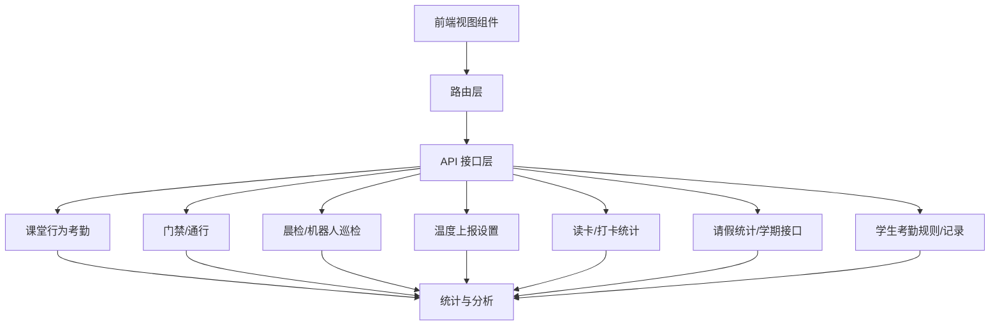

图表来源
- [src/router/normal/homeSchool.js:1128-1145](file://src/router/normal/homeSchool.js#L1128-L1145)
- [src/api/classroomEvaluationApp.js:153-189](file://src/api/classroomEvaluationApp.js#L153-L189)
- [src/api/gate.js:1-102](file://src/api/gate.js#L1-L102)
- [src/api/morningCheck.js:1-19](file://src/api/morningCheck.js#L1-L19)
- [src/api/temperatureSetup.js:1-24](file://src/api/temperatureSetup.js#L1-L24)
- [src/api/readPunchClock.js:112-160](file://src/api/readPunchClock.js#L112-L160)
- [src/api/attendanceStatistics.js:1-100](file://src/api/attendanceStatistics.js#L1-L100)
- [src/api/studentAttendanceLiuhe.js:49-86](file://src/api/studentAttendanceLiuhe.js#L49-L86)

## 详细组件分析

### 组件一：课堂行为考勤
- 功能要点
  - 按课程、班级、是否上午、节次查询学生课堂考勤列表。
  - 支持按座位统计。
  - 支持批量新增/更新课堂考勤记录。
- 关键接口
  - 查询课堂考勤列表
  - 按座位统计
  - 批量新增/更新
- 处理逻辑
  - 前端传入筛选参数后，调用对应接口获取数据并渲染。
  - 批量更新时以 JSON 形式提交，确保字段完整性与一致性。

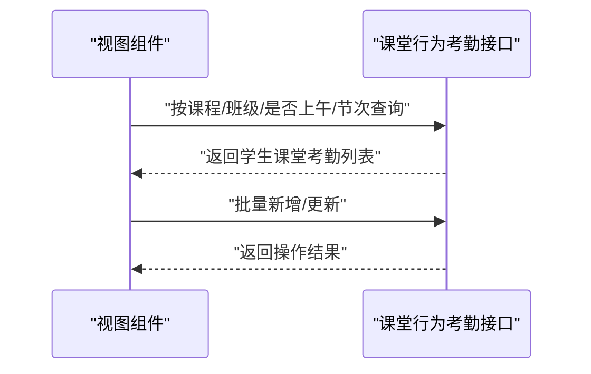

图表来源
- [src/api/classroomEvaluationApp.js:153-189](file://src/api/classroomEvaluationApp.js#L153-L189)

章节来源
- [src/api/classroomEvaluationApp.js:153-189](file://src/api/classroomEvaluationApp.js#L153-L189)

### 组件二：教师考勤统计与分析
- 功能要点
  - 当日考勤类型分析（迟到、早退、正常签到/签退、未签到/未签退）。
  - 用户维度的考勤类型统计与时间段筛选。
  - 补签操作（补签到、补签退、全补、异常补）。
  - 学校总统计（时间段内汇总）。
- 关键接口
  - 当日类型分析
  - 用户类型统计
  - 补签
  - 总统计

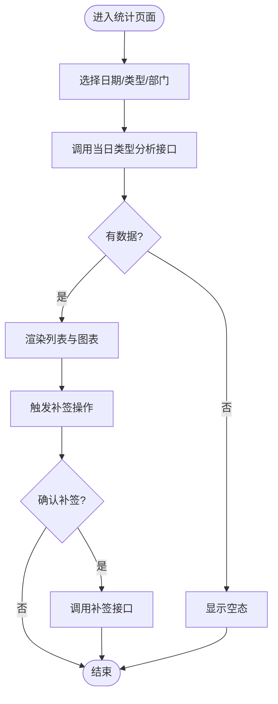

图表来源
- [src/api/schoolManage/teacherAttendanceStatistics.js:74-177](file://src/api/schoolManage/teacherAttendanceStatistics.js#L74-L177)

章节来源
- [src/api/schoolManage/teacherAttendanceStatistics.js:74-177](file://src/api/schoolManage/teacherAttendanceStatistics.js#L74-L177)

### 组件三：读卡/打卡统计
- 功能要点
  - 按周、班级、日期统计学生打卡完成情况。
  - 获取学生周计划与打卡详情。
- 关键接口
  - 年级打卡统计
  - 班级打卡条件查询
  - 学生周计划与打卡详情

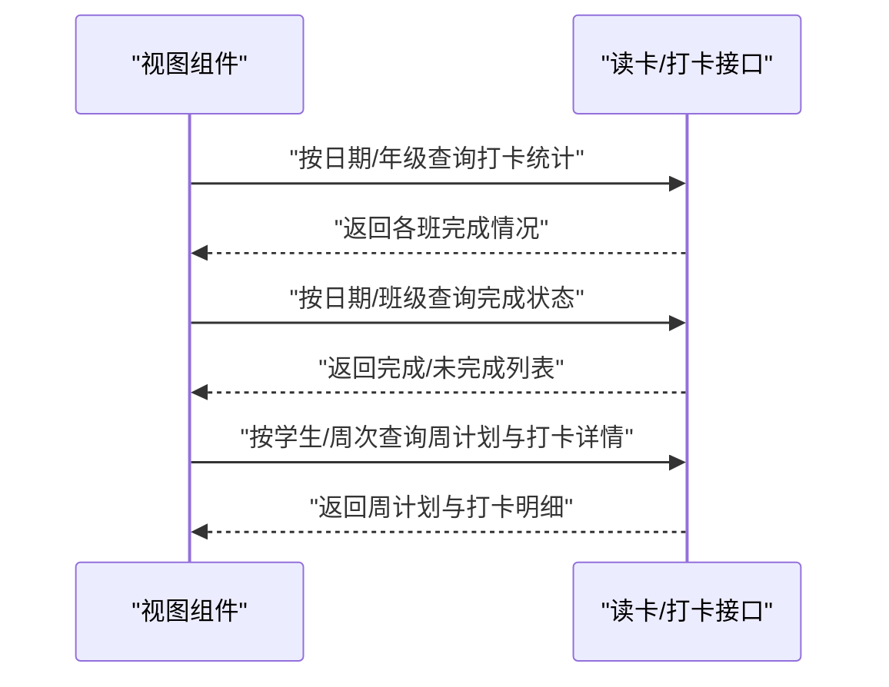

图表来源
- [src/api/readPunchClock.js:112-160](file://src/api/readPunchClock.js#L112-L160)

章节来源
- [src/api/readPunchClock.js:112-160](file://src/api/readPunchClock.js#L112-L160)

### 组件四：点名与集合
- 功能要点
  - 按日期查询点名名称，用于集合点名场景。
- 关键接口
  - 点名名称查询

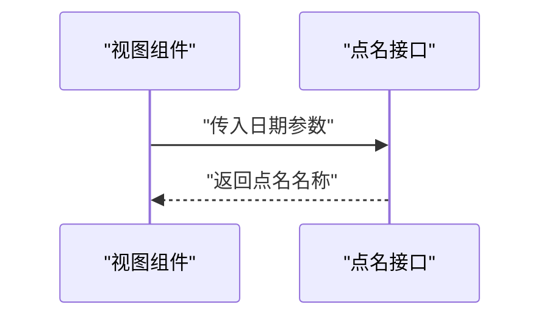

图表来源
- [src/api/rollCall.js:1-10](file://src/api/rollCall.js#L1-L10)

章节来源
- [src/api/rollCall.js:1-10](file://src/api/rollCall.js#L1-L10)

### 组件五：晨检与机器人巡检
- 功能要点
  - 晨检设置的新增/修改与查询。
  - 扫码设备获取晨检记录列表与详情。
- 关键接口
  - 晨检设置新增/修改
  - 晨检设置查询
  - 晨检记录列表
  - 晨检记录详情

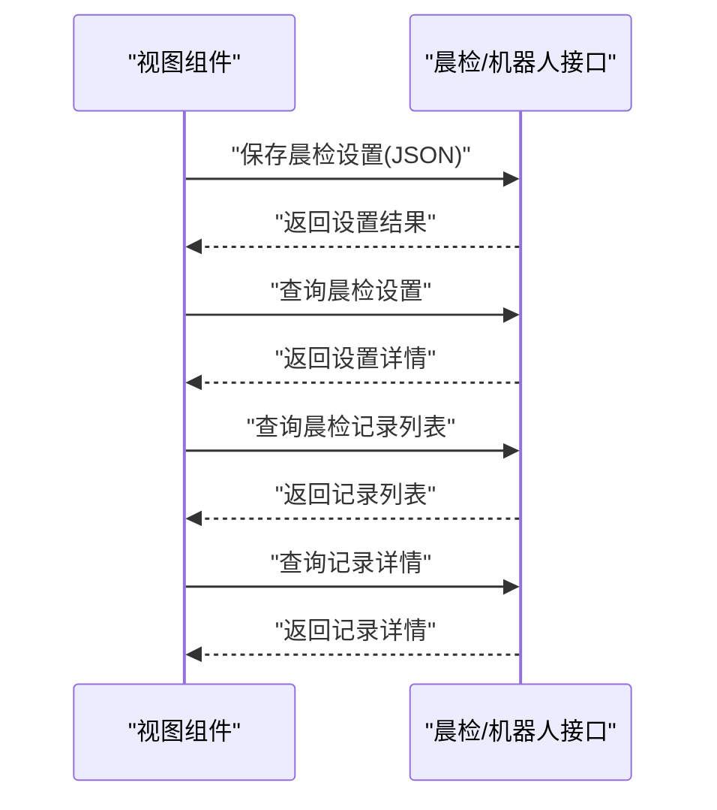

图表来源
- [src/api/morningCheck.js:1-19](file://src/api/morningCheck.js#L1-L19)
- [src/api/morninginspectionrobot.js:39-58](file://src/api/morninginspectionrobot.js#L39-L58)

章节来源
- [src/api/morningCheck.js:1-19](file://src/api/morningCheck.js#L1-L19)
- [src/api/morninginspectionrobot.js:39-58](file://src/api/morninginspectionrobot.js#L39-L58)

### 组件六：门禁与通行
- 功能要点
  - 门禁记录查询（按日期、类型、用户类型、年级/班级）。
  - 年级/班级列表查询。
  - 进出校时间设置与提醒设置。
- 关键接口
  - 门禁记录查询
  - 年级/班级列表
  - 进出校时间设置
  - 提醒设置

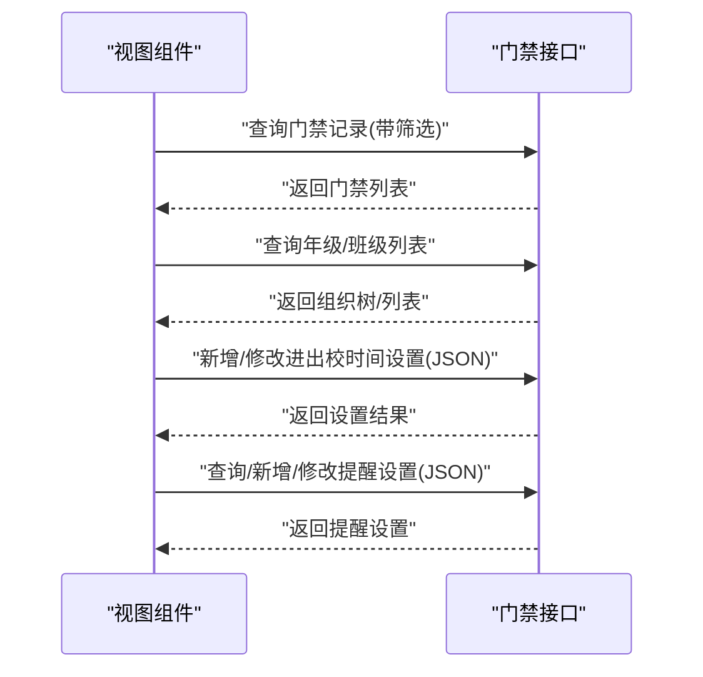

图表来源
- [src/api/gate.js:1-102](file://src/api/gate.js#L1-L102)

章节来源
- [src/api/gate.js:1-102](file://src/api/gate.js#L1-L102)

### 组件七：温度上报设置
- 功能要点
  - 保存学校体温检查时段设置（上午/下午起止时间与发送系统开关）。
  - 查询当前设置。
- 关键接口
  - 保存设置
  - 查询设置

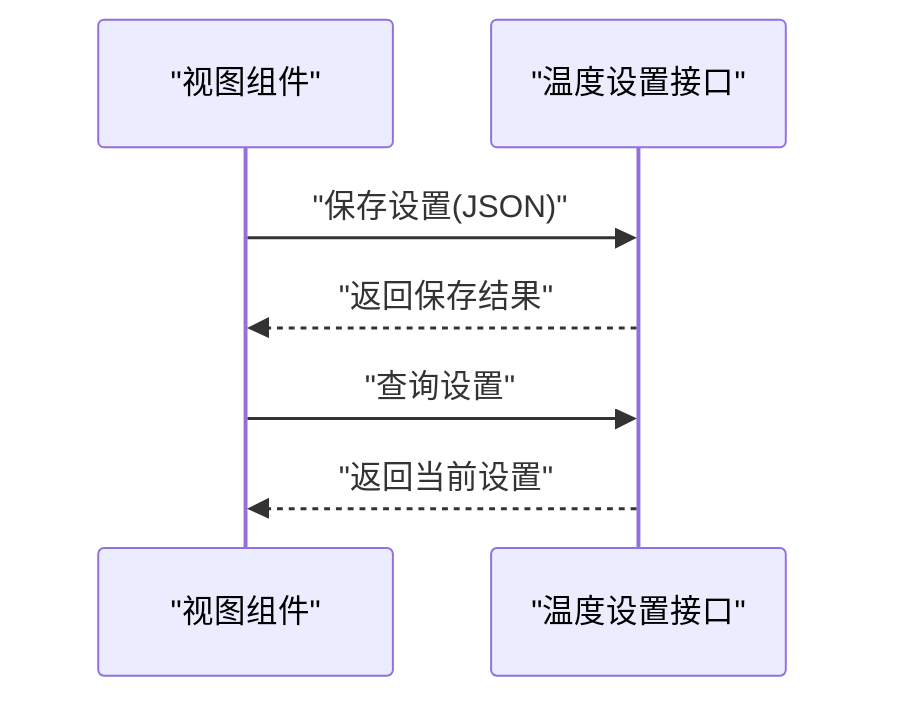

图表来源
- [src/api/temperatureSetup.js:1-24](file://src/api/temperatureSetup.js#L1-L24)

章节来源
- [src/api/temperatureSetup.js:1-24](file://src/api/temperatureSetup.js#L1-L24)

### 组件八：学生考勤规则与记录
- 功能要点
  - 查询/编辑学生考勤规则。
  - 分页查询学生考勤记录（按日期、年级/班级、姓名）。
- 关键接口
  - 查询规则列表
  - 查询规则详情
  - 分页查询记录

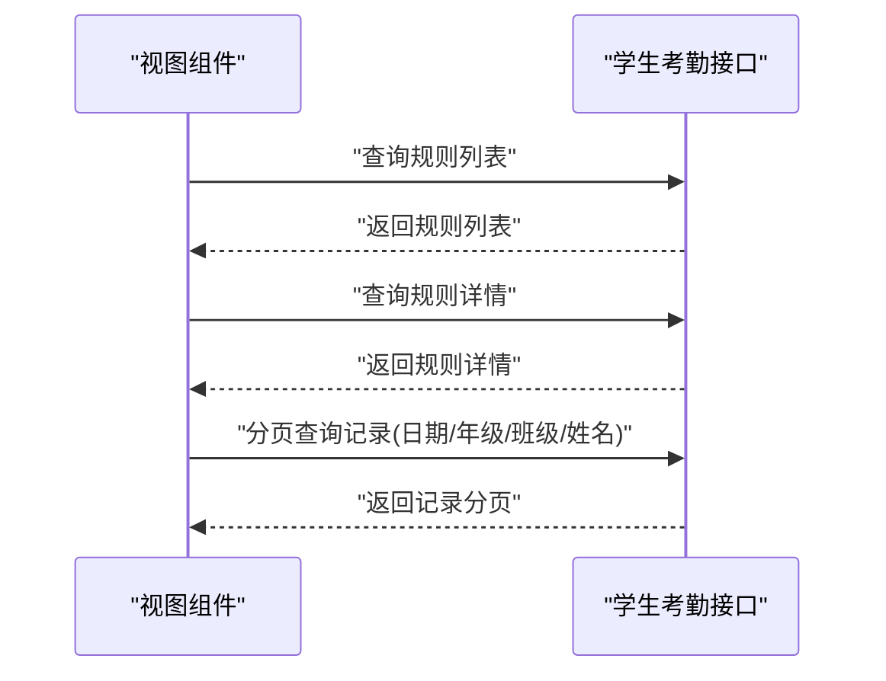

图表来源
- [src/api/studentAttendanceLiuhe.js:49-86](file://src/api/studentAttendanceLiuhe.js#L49-L86)

章节来源
- [src/api/studentAttendanceLiuhe.js:49-86](file://src/api/studentAttendanceLiuhe.js#L49-L86)

### 组件九：请假统计与学期接口
- 功能要点
  - 按日期、区域、学段查询请假统计（学生/教师/区级）。
  - 查询学期日期。
- 关键接口
  - 区/学段/教师请假统计
  - 学期日期查询

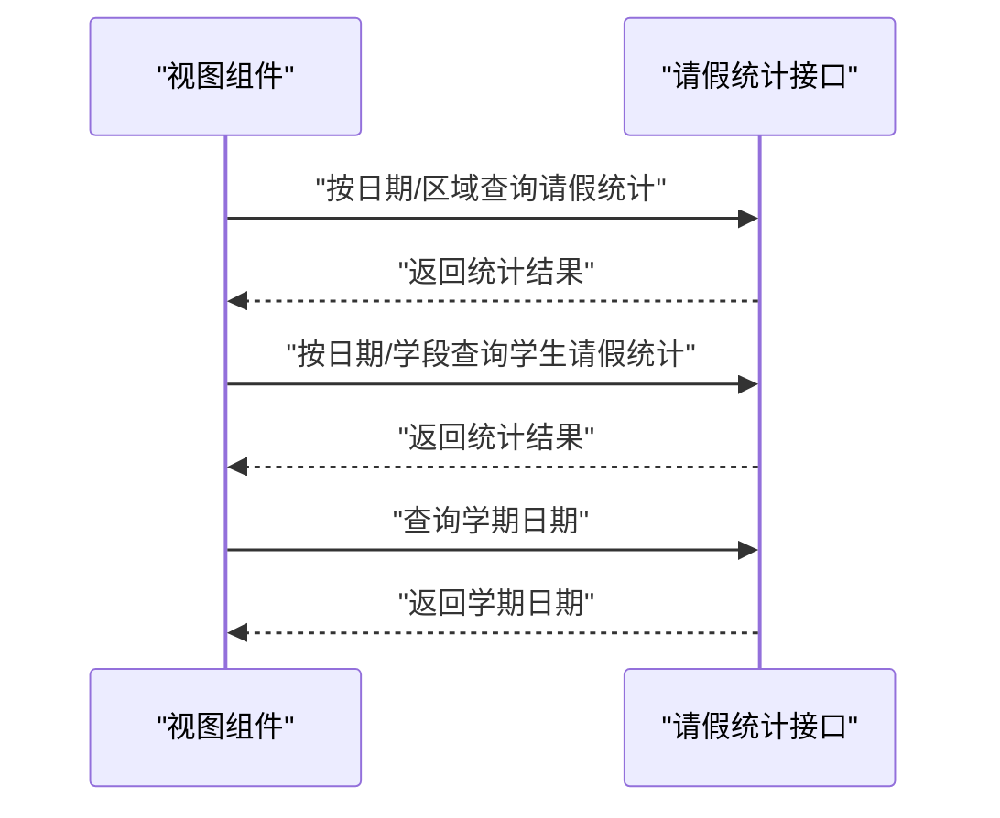

图表来源
- [src/api/attendanceStatistics.js:1-100](file://src/api/attendanceStatistics.js#L1-L100)

章节来源
- [src/api/attendanceStatistics.js:1-100](file://src/api/attendanceStatistics.js#L1-L100)

## 依赖关系分析
- 路由与视图
  - 系统管理路由中包含“对接考勤机”“晨检设置”“温度上报设置”等入口。
  - 家校路由中包含“课堂行为考勤”“读卡/打卡统计”“点名”“门禁”“学生考勤规则/记录”“请假统计/学期接口”等入口。
- API 依赖
  - 课堂行为考勤依赖课程/班级/节次等上下文参数。
  - 读卡/打卡统计依赖日期/年级/班级/周次等参数。
  - 门禁与晨检依赖组织树与设置项。
  - 温度上报设置依赖时段与开关配置。
  - 请假统计依赖日期/区域/学段等维度。
- 数据耦合
  - 多个子系统（课堂、门禁、晨检、温度、读卡）的数据最终汇聚到统计分析模块，形成统一报表与预警。

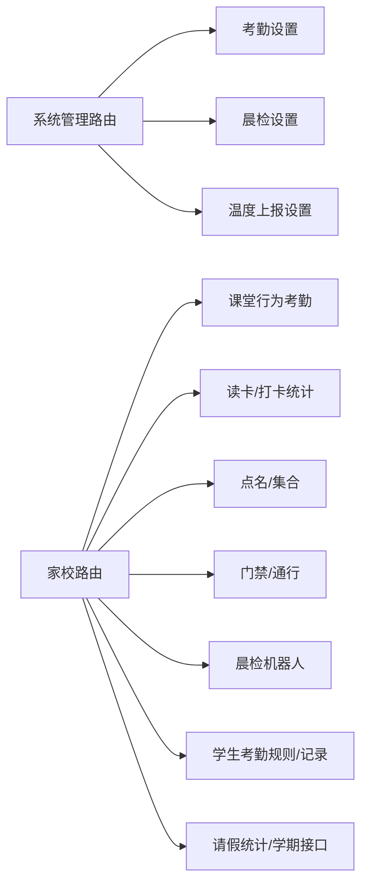

图表来源
- [src/router/normal/sysManage.js:629-661](file://src/router/normal/sysManage.js#L629-L661)
- [src/router/normal/homeSchool.js:1128-1145](file://src/router/normal/homeSchool.js#L1128-L1145)

章节来源
- [src/router/normal/sysManage.js:629-661](file://src/router/normal/sysManage.js#L629-L661)
- [src/router/normal/homeSchool.js:1128-1145](file://src/router/normal/homeSchool.js#L1128-L1145)

## 性能考虑
- 请求合并与分页
  - 使用分页参数控制单次请求数据量，避免一次性拉取过多记录导致渲染压力。
- 参数校验
  - 在调用前对日期、类型、组织等参数进行校验，减少无效请求。
- 缓存策略
  - 对不频繁变动的设置类接口（如晨检设置、温度设置、考勤设置）可采用本地缓存，降低重复请求。
- 图表渲染
  - 统计图表建议采用虚拟滚动或懒加载，仅在可视区域内渲染节点。

## 故障排查指南
- 常见问题
  - 接口无数据：检查日期范围、组织筛选条件是否正确；确认权限是否包含对应年级/班级。
  - 补签失败：确认 recordId 与 type 参数是否正确；检查补签权限。
  - 课堂考勤更新失败：确认提交格式为 JSON，字段完整且类型正确。
  - 门禁记录为空：确认门禁设备已启用、时间段设置合理。
  - 晨检/机器人记录异常：检查设备扫码是否成功、记录是否存在。
- 排查步骤
  - 使用浏览器开发者工具查看网络请求与响应状态码。
  - 核对请求参数与接口文档一致。
  - 若为权限问题，确认当前角色是否具备相应组织范围内的操作权限。
  - 对于设置类接口，先查询再保存，确保前后端字段一致。

章节来源
- [src/api/schoolManage/teacherAttendanceStatistics.js:163-173](file://src/api/schoolManage/teacherAttendanceStatistics.js#L163-L173)
- [src/api/classroomEvaluationApp.js:184-189](file://src/api/classroomEvaluationApp.js#L184-L189)
- [src/api/gate.js:1-102](file://src/api/gate.js#L1-L102)
- [src/api/morningCheck.js:1-19](file://src/api/morningCheck.js#L1-L19)
- [src/api/morninginspectionrobot.js:39-58](file://src/api/morninginspectionrobot.js#L39-L58)

## 结论
本系统通过清晰的路由与 API 设计，实现了课堂考勤、早操/集合点名、门禁通行、晨检与机器人巡检、温度上报、读卡/打卡、请假统计与学期接口等多场景的考勤管理能力。配合规则配置与统计分析，能够满足日常教学与管理中的考勤记录、异常处理与报表生成需求，并为后续与门禁、体温检测、电子班牌系统的对接提供了稳定的数据通道。

## 附录
- 路由入口参考
  - 系统管理路由：对接考勤机、晨检设置、温度上报设置等。
  - 家校路由：课堂行为考勤、读卡/打卡统计、点名/集合、门禁、学生考勤规则/记录、请假统计/学期接口等。
- 关键接口清单
  - 教师考勤统计与分析：当日类型分析、用户类型统计、补签、总统计。
  - 课堂行为考勤：按课程/班级/节次查询、按座位统计、批量新增/更新。
  - 读卡/打卡统计：按日期/年级/班级/周次统计与详情。
  - 点名与集合：按日期查询点名名称。
  - 晨检与机器人巡检：设置新增/修改/查询、记录列表与详情。
  - 门禁与通行：记录查询、组织列表、进出校时间与提醒设置。
  - 温度上报设置：保存与查询。
  - 学生考勤规则与记录：规则查询/编辑、记录分页查询。
  - 请假统计与学期接口：按日期/区域/学段统计、学期日期查询。

章节来源
- [src/router/normal/sysManage.js:629-661](file://src/router/normal/sysManage.js#L629-L661)
- [src/router/normal/homeSchool.js:1128-1145](file://src/router/normal/homeSchool.js#L1128-L1145)
- [src/api/schoolManage/teacherAttendanceStatistics.js:74-177](file://src/api/schoolManage/teacherAttendanceStatistics.js#L74-L177)
- [src/api/classroomEvaluationApp.js:153-189](file://src/api/classroomEvaluationApp.js#L153-L189)
- [src/api/readPunchClock.js:112-160](file://src/api/readPunchClock.js#L112-L160)
- [src/api/rollCall.js:1-10](file://src/api/rollCall.js#L1-L10)
- [src/api/morningCheck.js:1-19](file://src/api/morningCheck.js#L1-L19)
- [src/api/morninginspectionrobot.js:39-58](file://src/api/morninginspectionrobot.js#L39-L58)
- [src/api/gate.js:1-102](file://src/api/gate.js#L1-L102)
- [src/api/temperatureSetup.js:1-24](file://src/api/temperatureSetup.js#L1-L24)
- [src/api/studentAttendanceLiuhe.js:49-86](file://src/api/studentAttendanceLiuhe.js#L49-L86)
- [src/api/attendanceStatistics.js:1-100](file://src/api/attendanceStatistics.js#L1-L100)