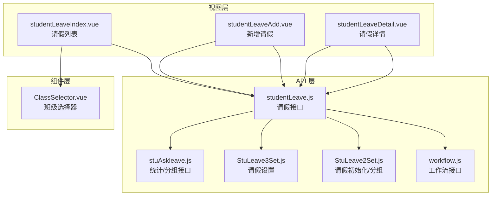
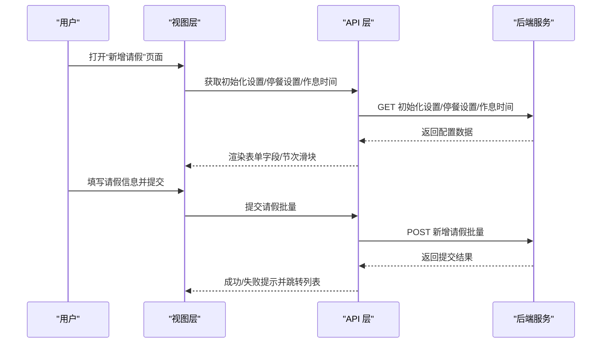
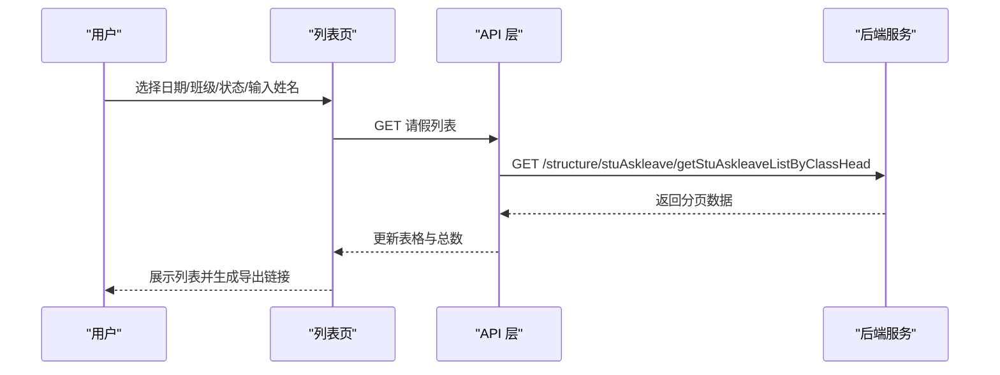
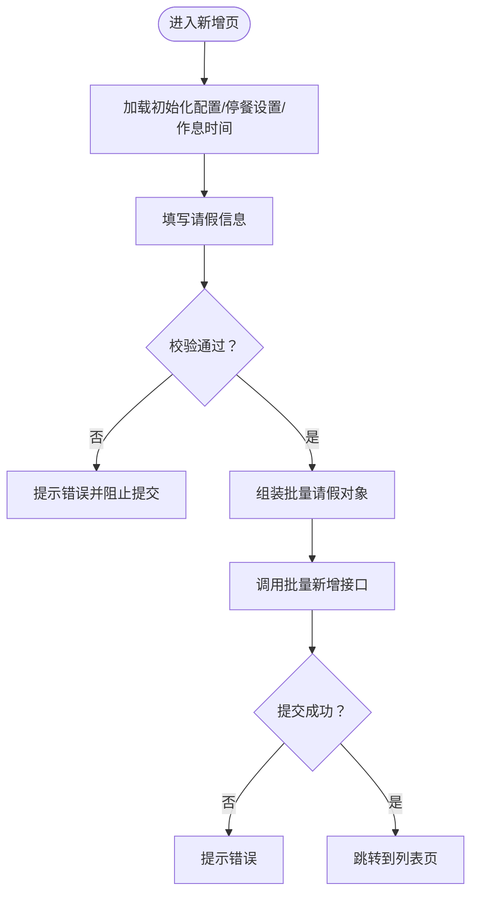
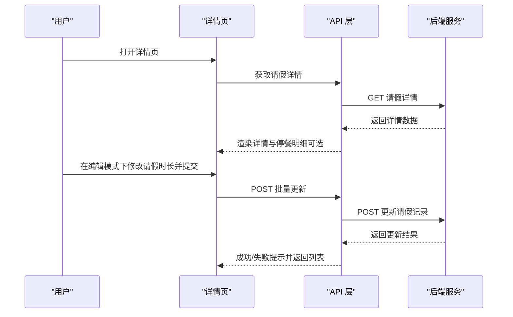
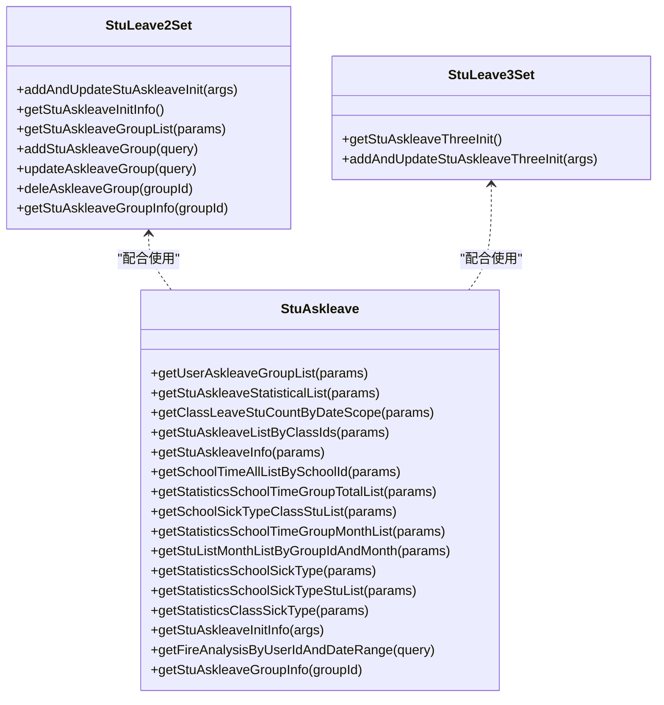
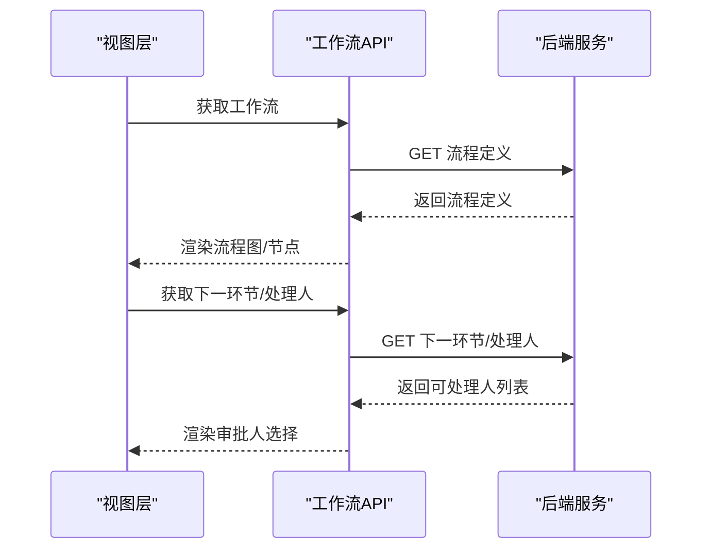
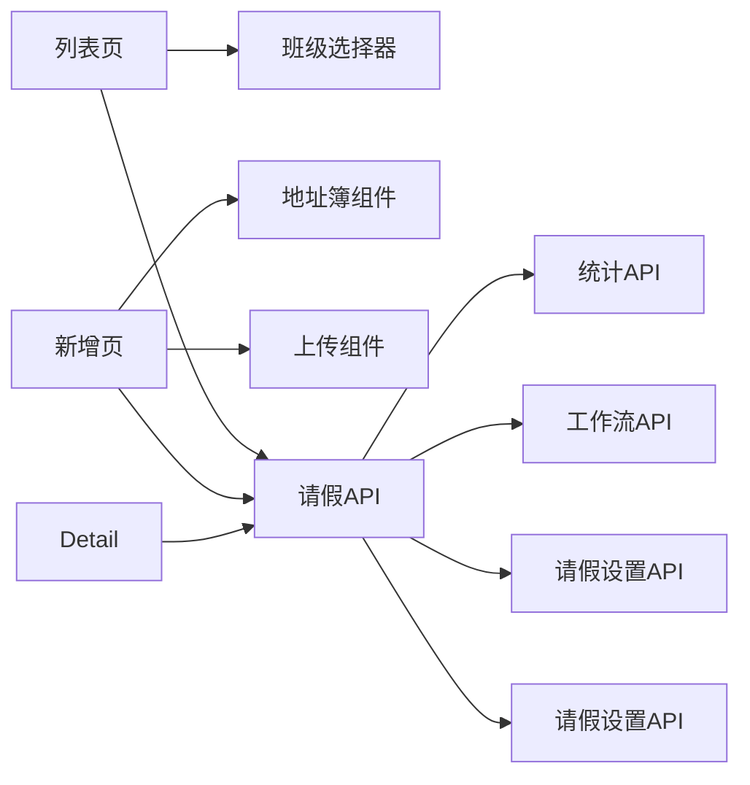

# 学生请假管理

<cite>
**本文引用的文件**
- [src/api/studentLeave.js](file://src/api/studentLeave.js)
- [src/views/studentLeave/studentLeaveIndex.vue](file://src/views/studentLeave/studentLeaveIndex.vue)
- [src/views/studentLeave/studentLeaveAdd.vue](file://src/views/studentLeave/studentLeaveAdd.vue)
- [src/views/studentLeave/studentLeaveDetail.vue](file://src/views/studentLeave/studentLeaveDetail.vue)
- [src/api/systemSet/StuLeave2Set.js](file://src/api/systemSet/StuLeave2Set.js)
- [src/api/systemSet/StuLeave3Set.js](file://src/api/systemSet/StuLeave3Set.js)
- [src/api/workflow.js](file://src/api/workflow.js)
- [src/api/stuAskleave.js](file://src/api/stuAskleave.js)
- [src/components/ClassSelector/ClassSelector.vue](file://src/components/ClassSelector/ClassSelector.vue)
</cite>

## 目录
1. [简介](#简介)
2. [项目结构](#项目结构)
3. [核心组件](#核心组件)
4. [架构总览](#架构总览)
5. [详细组件分析](#详细组件分析)
6. [依赖关系分析](#依赖关系分析)
7. [性能考量](#性能考量)
8. [故障排查指南](#故障排查指南)
9. [结论](#结论)
10. [附录](#附录)

## 简介
本技术文档围绕学生请假管理功能展开，覆盖请假申请、审批与记录管理全流程，包含病假、事假、丧假等类型处理；阐述请假时间计算规则、假期类型设置与特殊情况处理；解释请假记录与考勤系统的数据联动、统计报表生成与异常提醒机制；并提供权限控制、流程优化与用户体验改进建议。

## 项目结构
学生请假管理功能主要由三层构成：
- 视图层：请假列表页、新增页、详情页
- API 层：请假接口、系统设置接口、工作流接口、统计接口
- 组件层：班级选择器等通用组件

**图表来源**
- [src/views/studentLeave/studentLeaveIndex.vue:1-328](file://src/views/studentLeave/studentLeaveIndex.vue#L1-L328)
- [src/views/studentLeave/studentLeaveAdd.vue:1-618](file://src/views/studentLeave/studentLeaveAdd.vue#L1-L618)
- [src/views/studentLeave/studentLeaveDetail.vue:1-303](file://src/views/studentLeave/studentLeaveDetail.vue#L1-L303)
- [src/api/studentLeave.js:1-243](file://src/api/studentLeave.js#L1-L243)
- [src/api/systemSet/StuLeave2Set.js:1-100](file://src/api/systemSet/StuLeave2Set.js#L1-L100)
- [src/api/systemSet/StuLeave3Set.js:1-27](file://src/api/systemSet/StuLeave3Set.js#L1-L27)
- [src/api/workflow.js:1-150](file://src/api/workflow.js#L1-L150)
- [src/api/stuAskleave.js:1-174](file://src/api/stuAskleave.js#L1-L174)
- [src/components/ClassSelector/ClassSelector.vue:38-77](file://src/components/ClassSelector/ClassSelector.vue#L38-L77)

**章节来源**
- [src/views/studentLeave/studentLeaveIndex.vue:1-328](file://src/views/studentLeave/studentLeaveIndex.vue#L1-L328)
- [src/views/studentLeave/studentLeaveAdd.vue:1-618](file://src/views/studentLeave/studentLeaveAdd.vue#L1-L618)
- [src/views/studentLeave/studentLeaveDetail.vue:1-303](file://src/views/studentLeave/studentLeaveDetail.vue#L1-L303)
- [src/api/studentLeave.js:1-243](file://src/api/studentLeave.js#L1-L243)
- [src/api/systemSet/StuLeave2Set.js:1-100](file://src/api/systemSet/StuLeave2Set.js#L1-L100)
- [src/api/systemSet/StuLeave3Set.js:1-27](file://src/api/systemSet/StuLeave3Set.js#L1-L27)
- [src/api/workflow.js:1-150](file://src/api/workflow.js#L1-L150)
- [src/api/stuAskleave.js:1-174](file://src/api/stuAskleave.js#L1-L174)
- [src/components/ClassSelector/ClassSelector.vue:38-77](file://src/components/ClassSelector/ClassSelector.vue#L38-L77)

## 核心组件
- 请假列表页：支持按日期范围、班级、状态筛选，分页展示，导出功能，支持编辑与删除。
- 新增请假页：支持请假类型、病假类型、症状、就医情况、停餐设置、请假方式（天数/节次）、节次滑块、上传附件等。
- 请假详情页：展示请假信息、停餐明细（可选模块联动）、编辑请假时长（仅天数请假且允许编辑时）。
- 系统设置接口：提供请假初始化设置、班级分组、请假设置等。
- 工作流接口：提供流程定义、历史记录、下一环节、提交流程等能力（用于扩展审批流程）。
- 统计接口：提供按班级组、学期、月份等维度的请假统计与图表数据。

**章节来源**
- [src/views/studentLeave/studentLeaveIndex.vue:1-328](file://src/views/studentLeave/studentLeaveIndex.vue#L1-L328)
- [src/views/studentLeave/studentLeaveAdd.vue:1-618](file://src/views/studentLeave/studentLeaveAdd.vue#L1-L618)
- [src/views/studentLeave/studentLeaveDetail.vue:1-303](file://src/views/studentLeave/studentLeaveDetail.vue#L1-L303)
- [src/api/systemSet/StuLeave2Set.js:1-100](file://src/api/systemSet/StuLeave2Set.js#L1-L100)
- [src/api/systemSet/StuLeave3Set.js:1-27](file://src/api/systemSet/StuLeave3Set.js#L1-L27)
- [src/api/workflow.js:1-150](file://src/api/workflow.js#L1-L150)
- [src/api/stuAskleave.js:1-174](file://src/api/stuAskleave.js#L1-L174)

## 架构总览
请假管理采用前后端分离架构，前端通过 API 层调用后端服务，实现请假申请、审批、统计与联动。

**图表来源**
- [src/views/studentLeave/studentLeaveAdd.vue:308-588](file://src/views/studentLeave/studentLeaveAdd.vue#L308-L588)
- [src/api/studentLeave.js:35-92](file://src/api/studentLeave.js#L35-L92)
- [src/api/studentLeave.js:199-208](file://src/api/studentLeave.js#L199-L208)

## 详细组件分析

### 请假列表页（studentLeaveIndex.vue）
- 功能要点
  - 支持按日期范围、班级、状态筛选，姓名搜索。
  - 分页加载，导出链接拼接。
  - 列表字段包含：姓名、性别、班级、类型、疾病类型/症状、就医情况、就诊医院、家长联系方式、内容、开始日期、请假时长、审批人、状态。
  - 操作列支持编辑与删除，编辑按钮在特定条件下禁用（如非天数请假、不在学期范围内、已撤回/不同意）。
- 关键交互
  - 班级切换、状态变更、分页大小/页码变化均触发重新拉取数据。
  - 导出链接动态拼接查询参数与令牌。

**图表来源**
- [src/views/studentLeave/studentLeaveIndex.vue:227-273](file://src/views/studentLeave/studentLeaveIndex.vue#L227-L273)
- [src/api/studentLeave.js:14-30](file://src/api/studentLeave.js#L14-L30)

**章节来源**
- [src/views/studentLeave/studentLeaveIndex.vue:1-328](file://src/views/studentLeave/studentLeaveIndex.vue#L1-L328)
- [src/api/studentLeave.js:14-30](file://src/api/studentLeave.js#L14-L30)

### 新增请假页（studentLeaveAdd.vue）
- 功能要点
  - 请假类型下拉：支持病假、事假、丧假等。
  - 病假类型与症状：根据配置显示/隐藏，支持多选症状与必填校验。
  - 就医情况与就诊医院：门诊/住院时需上传附件。
  - 停餐设置：根据配置决定是否启用停餐选项与停餐项。
  - 请假方式：天数请假（0.5 天起步，步进 0.5）或节次请假（基于当天作息节次滑块）。
  - 上传附件：支持图片类型与数量限制。
  - 保存逻辑：组装批量请假对象，调用批量新增接口。
- 关键逻辑
  - 依据“是否需要审批”自动设置默认状态。
  - 节次请假时计算开始/结束时间与节次名称。
  - 病例类请假必须上传附件。

**图表来源**
- [src/views/studentLeave/studentLeaveAdd.vue:308-588](file://src/views/studentLeave/studentLeaveAdd.vue#L308-L588)
- [src/api/studentLeave.js:35-92](file://src/api/studentLeave.js#L35-L92)
- [src/api/studentLeave.js:199-208](file://src/api/studentLeave.js#L199-L208)

**章节来源**
- [src/views/studentLeave/studentLeaveAdd.vue:1-618](file://src/views/studentLeave/studentLeaveAdd.vue#L1-L618)
- [src/api/studentLeave.js:35-92](file://src/api/studentLeave.js#L35-L92)

### 请假详情页（studentLeaveDetail.vue）
- 功能要点
  - 展示请假人、性别、手机号、请假内容、类型、疾病类型/症状、就医情况、就诊医院、开始时间、请假时长、停餐明细（可选模块联动）。
  - 编辑模式下允许调整天数请假时长，提交后调用批量更新接口。
- 关键逻辑
  - 通过 isOpenModule 判断是否开启停餐分析模块，分别调用不同接口获取停餐明细。
  - 对于特定类型（如放学后等）隐藏编辑入口与停餐字段。

**图表来源**
- [src/views/studentLeave/studentLeaveDetail.vue:132-255](file://src/views/studentLeave/studentLeaveDetail.vue#L132-L255)
- [src/api/studentLeave.js:95-104](file://src/api/studentLeave.js#L95-L104)
- [src/api/studentLeave.js:178-197](file://src/api/studentLeave.js#L178-L197)
- [src/api/studentLeave.js:210-230](file://src/api/studentLeave.js#L210-L230)

**章节来源**
- [src/views/studentLeave/studentLeaveDetail.vue:1-303](file://src/views/studentLeave/studentLeaveDetail.vue#L1-L303)
- [src/api/studentLeave.js:95-104](file://src/api/studentLeave.js#L95-L104)
- [src/api/studentLeave.js:178-197](file://src/api/studentLeave.js#L178-L197)
- [src/api/studentLeave.js:210-230](file://src/api/studentLeave.js#L210-L230)

### 系统设置与统计接口
- 请假初始化设置与分组
  - 初始化设置：控制是否显示停餐、是否需要审批、是否显示特殊字段等。
  - 班级分组：支持新增、修改、删除、查询分组信息。
- 请假设置
  - 查询与新增/修改请假设置。
- 统计与分组
  - 提供按班级组、学期、月份等维度的请假统计与图表数据。

**图表来源**
- [src/api/systemSet/StuLeave2Set.js:1-100](file://src/api/systemSet/StuLeave2Set.js#L1-L100)
- [src/api/systemSet/StuLeave3Set.js:1-27](file://src/api/systemSet/StuLeave3Set.js#L1-L27)
- [src/api/stuAskleave.js:1-174](file://src/api/stuAskleave.js#L1-L174)

**章节来源**
- [src/api/systemSet/StuLeave2Set.js:1-100](file://src/api/systemSet/StuLeave2Set.js#L1-L100)
- [src/api/systemSet/StuLeave3Set.js:1-27](file://src/api/systemSet/StuLeave3Set.js#L1-L27)
- [src/api/stuAskleave.js:1-174](file://src/api/stuAskleave.js#L1-L174)

### 工作流接口（用于扩展审批流程）
- 提供流程定义、当前环节、下一环节、处理人查询与流程提交等能力，可用于将请假审批接入统一工作流引擎。

**图表来源**
- [src/api/workflow.js:6-149](file://src/api/workflow.js#L6-L149)

**章节来源**
- [src/api/workflow.js:1-150](file://src/api/workflow.js#L1-L150)

## 依赖关系分析
- 组件耦合
  - 列表页依赖班级选择器组件以支持按班级筛选。
  - 新增页依赖地址簿组件选择学生，依赖上传组件上传附件。
- API 耦合
  - 列表页依赖请假列表接口；详情页依赖详情与停餐分析接口；新增页依赖初始化设置、停餐设置、作息时间与批量新增接口。
- 外部依赖
  - 请假统计与分组接口来自独立模块，便于扩展与维护。

**图表来源**
- [src/views/studentLeave/studentLeaveIndex.vue:128-180](file://src/views/studentLeave/studentLeaveIndex.vue#L128-L180)
- [src/views/studentLeave/studentLeaveAdd.vue:122-136](file://src/views/studentLeave/studentLeaveAdd.vue#L122-L136)
- [src/components/ClassSelector/ClassSelector.vue:38-77](file://src/components/ClassSelector/ClassSelector.vue#L38-L77)
- [src/api/studentLeave.js:1-243](file://src/api/studentLeave.js#L1-L243)
- [src/api/stuAskleave.js:1-174](file://src/api/stuAskleave.js#L1-L174)
- [src/api/workflow.js:1-150](file://src/api/workflow.js#L1-L150)
- [src/api/systemSet/StuLeave2Set.js:1-100](file://src/api/systemSet/StuLeave2Set.js#L1-L100)
- [src/api/systemSet/StuLeave3Set.js:1-27](file://src/api/systemSet/StuLeave3Set.js#L1-L27)

**章节来源**
- [src/views/studentLeave/studentLeaveIndex.vue:128-180](file://src/views/studentLeave/studentLeaveIndex.vue#L128-L180)
- [src/views/studentLeave/studentLeaveAdd.vue:122-136](file://src/views/studentLeave/studentLeaveAdd.vue#L122-L136)
- [src/components/ClassSelector/ClassSelector.vue:38-77](file://src/components/ClassSelector/ClassSelector.vue#L38-L77)
- [src/api/studentLeave.js:1-243](file://src/api/studentLeave.js#L1-L243)
- [src/api/stuAskleave.js:1-174](file://src/api/stuAskleave.js#L1-L174)
- [src/api/workflow.js:1-150](file://src/api/workflow.js#L1-L150)
- [src/api/systemSet/StuLeave2Set.js:1-100](file://src/api/systemSet/StuLeave2Set.js#L1-L100)
- [src/api/systemSet/StuLeave3Set.js:1-27](file://src/api/systemSet/StuLeave3Set.js#L1-L27)

## 性能考量
- 列表分页与筛选
  - 使用分页参数避免一次性加载大量数据；按日期范围与班级筛选减少无效渲染。
- 图片上传
  - 控制文件类型与数量，建议在客户端进行基础校验与压缩，降低网络传输与后端存储压力。
- 节次选择
  - 仅在启用节次请假时加载当天作息时间，避免不必要的请求。
- 导出功能
  - 导出链接拼接查询参数与令牌，确保后端按需生成报表，避免前端缓存大体量数据。

## 故障排查指南
- 新增失败
  - 病例类请假未上传附件导致校验失败；检查“门诊/住院”与附件上传逻辑。
  - 节次请假时当天无作息节次，需提示用户当前日期未设置节次。
- 列表为空
  - 确认筛选条件（日期范围、班级、状态）是否过严；检查分页参数与总数。
- 停餐明细不显示
  - 确认模块开关 isOpenModule 是否开启；若关闭则不会展示停餐分析。
- 审批流程
  - 若需接入工作流，检查流程定义、下一环节与处理人查询接口返回值。

**章节来源**
- [src/views/studentLeave/studentLeaveAdd.vue:430-588](file://src/views/studentLeave/studentLeaveAdd.vue#L430-L588)
- [src/views/studentLeave/studentLeaveIndex.vue:227-273](file://src/views/studentLeave/studentLeaveIndex.vue#L227-L273)
- [src/views/studentLeave/studentLeaveDetail.vue:169-206](file://src/views/studentLeave/studentLeaveDetail.vue#L169-L206)
- [src/api/workflow.js:1-150](file://src/api/workflow.js#L1-L150)

## 结论
该请假管理功能通过清晰的视图层与 API 层划分，实现了请假申请、审批与记录管理的完整闭环。系统支持多种请假类型与时间计算方式，具备与考勤系统的停餐联动能力，并提供统计与导出功能。通过引入工作流接口，可进一步扩展审批流程。建议在后续迭代中完善权限控制、异常提醒与报表可视化，持续优化用户体验。

## 附录

### 请假类型与时间计算规则
- 请假类型
  - 支持病假、事假、丧假等；病假可细分类型与症状，就医情况与就诊医院可选。
- 时间计算
  - 天数请假：支持 0.5 天起步，步进 0.5。
  - 节次请假：基于当天作息节次滑块选择起止节次，自动计算时长与节次名称。
- 特殊类型
  - 放学后等类型不参与天数/节次计算，停餐字段隐藏。

**章节来源**
- [src/views/studentLeave/studentLeaveAdd.vue:15-110](file://src/views/studentLeave/studentLeaveAdd.vue#L15-L110)
- [src/views/studentLeave/studentLeaveAdd.vue:368-404](file://src/views/studentLeave/studentLeaveAdd.vue#L368-L404)
- [src/views/studentLeave/studentLeaveDetail.vue:64-71](file://src/views/studentLeave/studentLeaveDetail.vue#L64-L71)

### 权限控制与最佳实践
- 权限控制
  - 可结合系统权限接口与路由权限路径进行访问控制。
- 最佳实践
  - 明确“是否需要审批”的默认状态，减少人工干预。
  - 在新增页对必填字段进行即时校验，提升填写体验。
  - 对导出与统计接口增加缓存策略，降低后端压力。

**章节来源**
- [src/api/systemSet/permission.js:1-39](file://src/api/systemSet/permission.js#L1-L39)
- [src/router/moduleList.js:1020-1046](file://src/router/moduleList.js#L1020-L1046)
- [src/router/normal/schoolManage.js:728-799](file://src/router/normal/schoolManage.js#L728-L799)