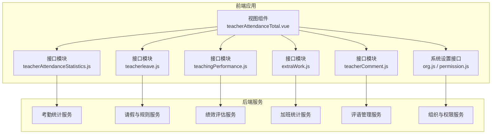
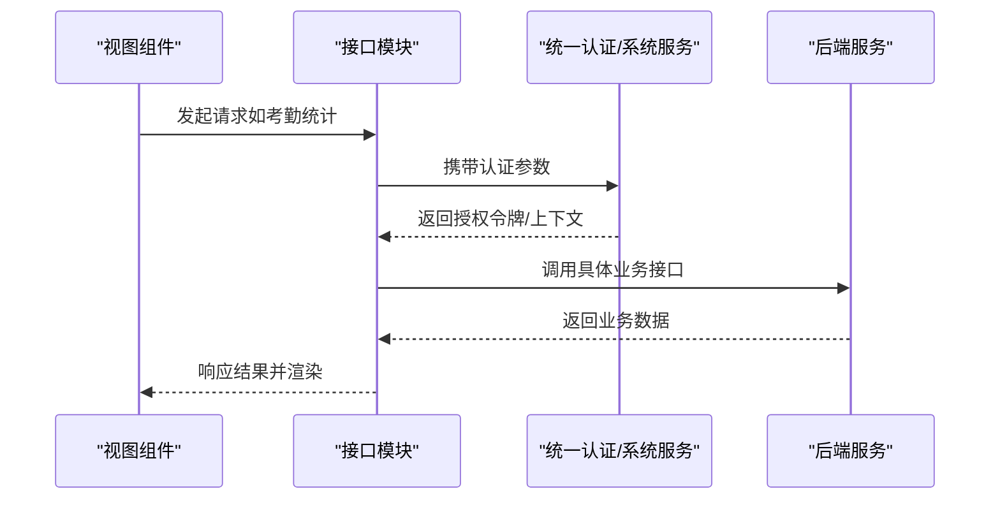
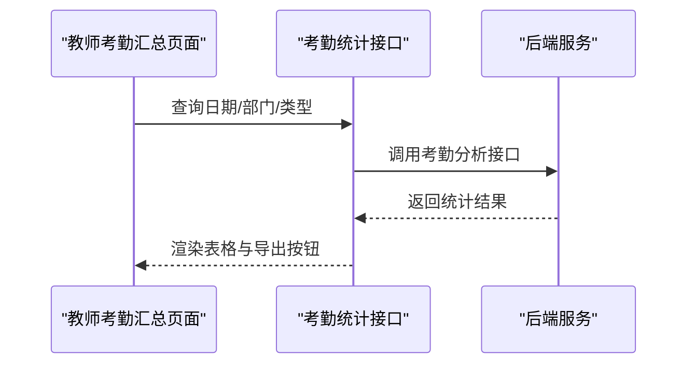
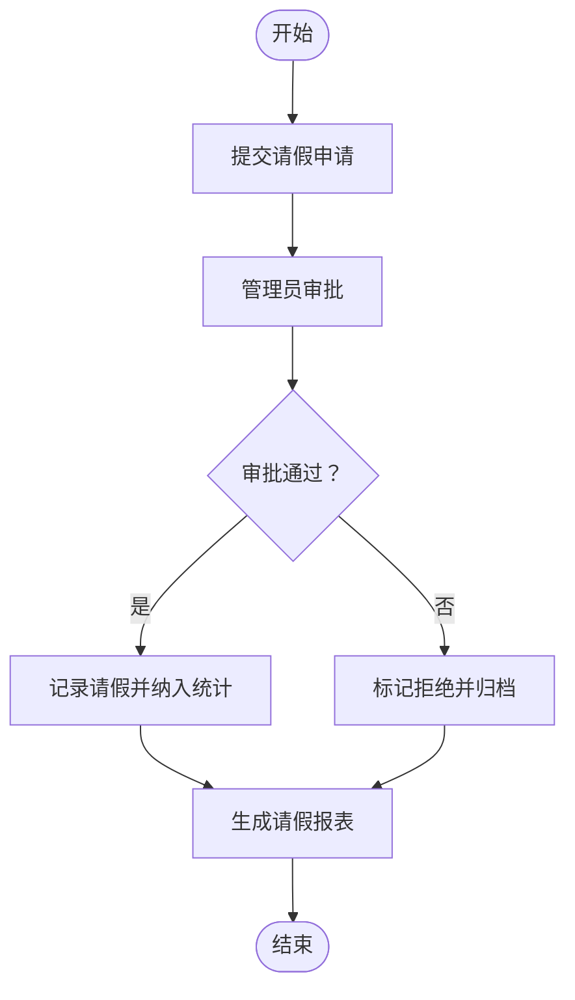
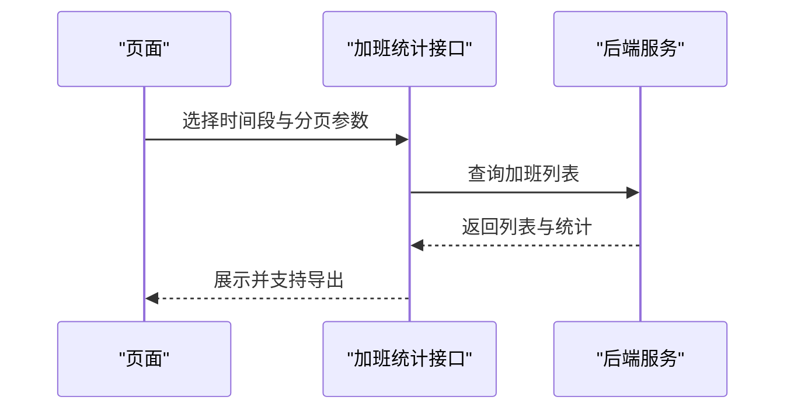
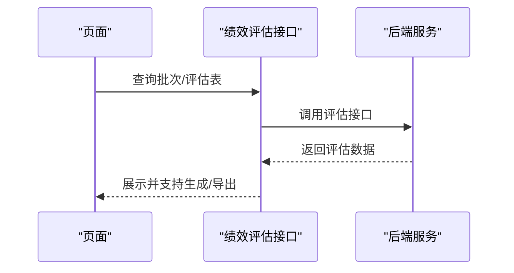
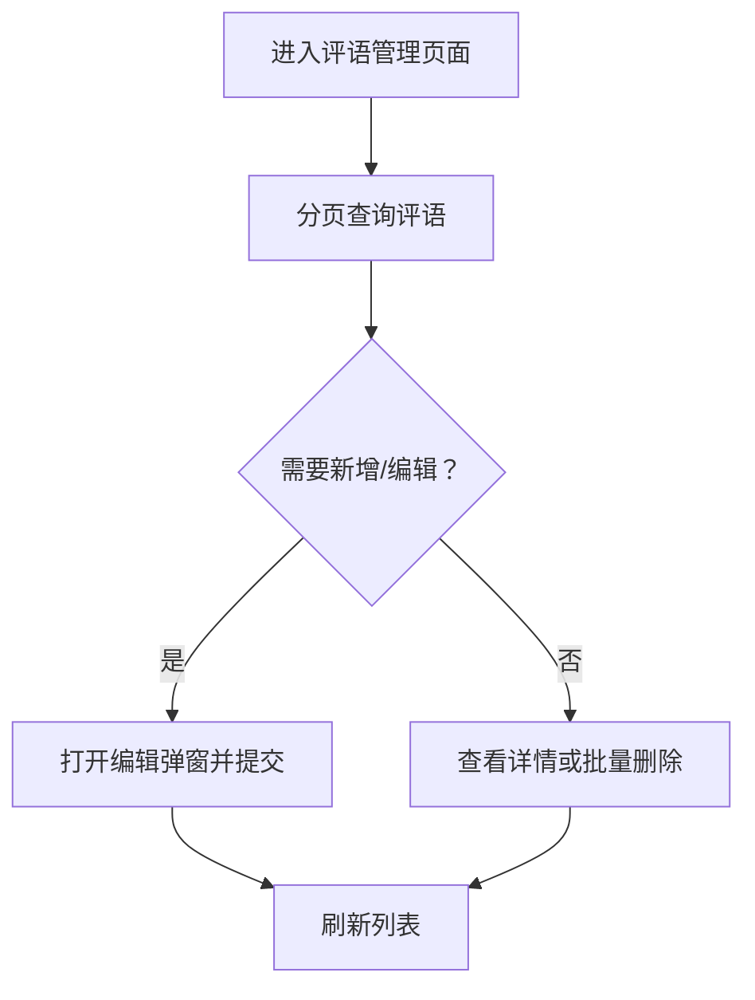
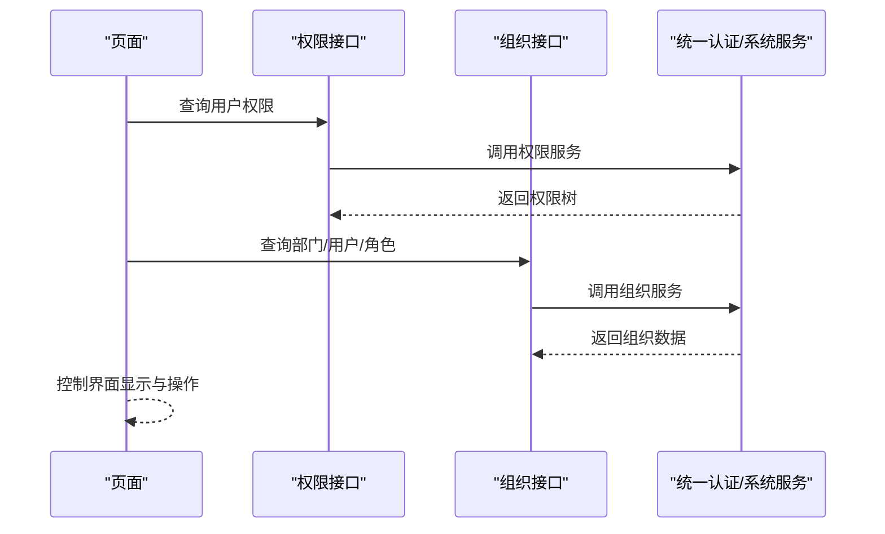
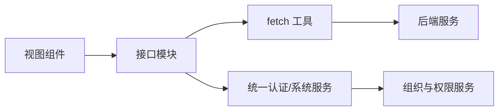

# 教师管理

<cite>
**本文引用的文件**
- [src/api/schoolManage/teacherAttendanceStatistics.js](file://src/api/schoolManage/teacherAttendanceStatistics.js)
- [src/api/systemSet/teacherLeave4Setting.js](file://src/api/systemSet/teacherLeave4Setting.js)
- [src/api/teachingPerformance.js](file://src/api/teachingPerformance.js)
- [src/api/teacherleave.js](file://src/api/teacherleave.js)
- [src/api/teacherComment.js](file://src/api/teacherComment.js)
- [src/api/extraWork.js](file://src/api/extraWork.js)
- [src/views/attendanceStatistics/teacherAttendanceTotal.vue](file://src/views/attendanceStatistics/teacherAttendanceTotal.vue)
- [src/api/attendanceStatistics.js](file://src/api/attendanceStatistics.js)
- [src/api/systemSet/org.js](file://src/api/systemSet/org.js)
- [src/api/systemSet/permission.js](file://src/api/systemSet/permission.js)
</cite>

## 目录
1. [简介](#简介)
2. [项目结构](#项目结构)
3. [核心组件](#核心组件)
4. [架构总览](#架构总览)
5. [详细组件分析](#详细组件分析)
6. [依赖分析](#依赖分析)
7. [性能考虑](#性能考虑)
8. [故障排查指南](#故障排查指南)
9. [结论](#结论)
10. [附录](#附录)

## 简介
本文件面向教师管理功能的业务文档，覆盖教师信息管理、教学工作量统计、考勤管理、请假管理、教学绩效评估等模块。文档说明教师数据的维护流程、权限分配机制、工作量计算规则；梳理考勤统计算法实现、请假审批流程与绩效评价体系；并解释与人事系统、教务系统的集成方案与数据交换格式；最后提供配置参数、报表生成与数据分析的使用说明。

## 项目结构
教师管理相关能力主要分布在以下层次：
- API 层：封装与后端服务交互的接口，包括考勤统计、请假设置、绩效评估、加班统计、教师评语、组织与权限等。
- 视图层：提供教师考勤汇总报表等前端页面，负责数据展示与导出。
- 集成层：通过 fetch 工具对接统一认证与系统服务，支持多租户与多系统数据互通。

图表来源
- [src/views/attendanceStatistics/teacherAttendanceTotal.vue:1-259](file://src/views/attendanceStatistics/teacherAttendanceTotal.vue#L1-L259)
- [src/api/schoolManage/teacherAttendanceStatistics.js:1-248](file://src/api/schoolManage/teacherAttendanceStatistics.js#L1-L248)
- [src/api/teacherleave.js:1-108](file://src/api/teacherleave.js#L1-L108)
- [src/api/teachingPerformance.js:1-140](file://src/api/teachingPerformance.js#L1-L140)
- [src/api/extraWork.js:1-70](file://src/api/extraWork.js#L1-L70)
- [src/api/teacherComment.js:1-69](file://src/api/teacherComment.js#L1-L69)
- [src/api/systemSet/org.js:1-800](file://src/api/systemSet/org.js#L1-L800)
- [src/api/systemSet/permission.js:1-40](file://src/api/systemSet/permission.js#L1-L40)

章节来源
- [src/views/attendanceStatistics/teacherAttendanceTotal.vue:1-259](file://src/views/attendanceStatistics/teacherAttendanceTotal.vue#L1-L259)
- [src/api/schoolManage/teacherAttendanceStatistics.js:1-248](file://src/api/schoolManage/teacherAttendanceStatistics.js#L1-L248)

## 核心组件
- 考勤统计接口：提供按日、按月、按类型、按用户维度的考勤分析与汇总，支持异常门禁统计与补签操作。
- 请假管理接口：提供请假统计、列表查询、详情查询、模块开关查询，并支持基于时间段的请假分析。
- 绩效评估接口：提供学年/批次/班级/评估表的分页查询、生成、删除、详情与保存。
- 加班统计接口：提供加班列表、详情统计、初始化配置与规则维护。
- 教师评语接口：提供评语的分页查询、详情、新增、编辑与批量删除。
- 组织与权限接口：提供部门、用户、角色、模块权限等基础能力，支撑教师数据维护与权限控制。

章节来源
- [src/api/schoolManage/teacherAttendanceStatistics.js:1-248](file://src/api/schoolManage/teacherAttendanceStatistics.js#L1-L248)
- [src/api/teacherleave.js:1-108](file://src/api/teacherleave.js#L1-L108)
- [src/api/teachingPerformance.js:1-140](file://src/api/teachingPerformance.js#L1-L140)
- [src/api/extraWork.js:1-70](file://src/api/extraWork.js#L1-L70)
- [src/api/teacherComment.js:1-69](file://src/api/teacherComment.js#L1-L69)
- [src/api/systemSet/org.js:1-800](file://src/api/systemSet/org.js#L1-L800)
- [src/api/systemSet/permission.js:1-40](file://src/api/systemSet/permission.js#L1-L40)

## 架构总览
教师管理采用前后端分离架构，前端通过统一 fetch 工具调用后端接口，后端提供结构化的 REST 接口，涵盖考勤、请假、绩效、加班、评语与组织权限等模块。系统支持多租户与多系统数据互通，通过统一认证路径与系统服务实现跨域与权限控制。

图表来源
- [src/views/attendanceStatistics/teacherAttendanceTotal.vue:1-259](file://src/views/attendanceStatistics/teacherAttendanceTotal.vue#L1-L259)
- [src/api/schoolManage/teacherAttendanceStatistics.js:1-248](file://src/api/schoolManage/teacherAttendanceStatistics.js#L1-L248)
- [src/api/systemSet/permission.js:1-40](file://src/api/systemSet/permission.js#L1-L40)

## 详细组件分析

### 考勤统计与报表
- 功能要点
  - 支持按日、按月、按类型、按用户维度的考勤分析。
  - 提供异常门禁统计与异常列表查询。
  - 支持补签操作（补签到、补签退、全补、异常补）。
  - 报表支持导出 Excel，按学校与人员类别汇总统计。
- 数据流
  - 前端页面发起查询，接口组装参数并调用后端服务，返回结构化数据并在表格中展示与导出。

图表来源
- [src/views/attendanceStatistics/teacherAttendanceTotal.vue:1-259](file://src/views/attendanceStatistics/teacherAttendanceTotal.vue#L1-L259)
- [src/api/schoolManage/teacherAttendanceStatistics.js:1-248](file://src/api/schoolManage/teacherAttendanceStatistics.js#L1-L248)

章节来源
- [src/views/attendanceStatistics/teacherAttendanceTotal.vue:1-259](file://src/views/attendanceStatistics/teacherAttendanceTotal.vue#L1-L259)
- [src/api/schoolManage/teacherAttendanceStatistics.js:1-248](file://src/api/schoolManage/teacherAttendanceStatistics.js#L1-L248)

### 请假管理与审批流程
- 功能要点
  - 支持按时间段、部门、状态、类型查询教师请假列表与统计。
  - 支持请假规则的新增、修改、删除、查询与初始化配置。
  - 支持模块开关查询，用于控制功能启用。
- 流程示意
  - 申请：教师提交请假申请。
  - 审批：管理员在系统中进行审核与处理。
  - 记录：请假记录进入统计与报表。

图表来源
- [src/api/teacherleave.js:1-108](file://src/api/teacherleave.js#L1-L108)
- [src/api/systemSet/teacherLeave4Setting.js:1-71](file://src/api/systemSet/teacherLeave4Setting.js#L1-L71)

章节来源
- [src/api/teacherleave.js:1-108](file://src/api/teacherleave.js#L1-L108)
- [src/api/systemSet/teacherLeave4Setting.js:1-71](file://src/api/systemSet/teacherLeave4Setting.js#L1-L71)

### 教学工作量统计
- 功能要点
  - 提供加班列表查询、详情统计、初始化配置与规则维护。
  - 支持按时间段筛选与分页查询。
- 处理逻辑
  - 前端传入起止时间与分页参数，后端返回统计明细与汇总。

图表来源
- [src/api/extraWork.js:1-70](file://src/api/extraWork.js#L1-L70)

章节来源
- [src/api/extraWork.js:1-70](file://src/api/extraWork.js#L1-L70)

### 教学绩效评估
- 功能要点
  - 提供学年/批次/班级/评估表的分页查询与详情。
  - 支持生成学年绩效评估表、删除批次、保存批次配置。
  - 支持按年级查询已生成成绩分析的考试。
- 处理逻辑
  - 前端选择学年与批次，后端返回对应评估数据，支持批量生成与导出。

图表来源
- [src/api/teachingPerformance.js:1-140](file://src/api/teachingPerformance.js#L1-L140)

章节来源
- [src/api/teachingPerformance.js:1-140](file://src/api/teachingPerformance.js#L1-L140)

### 教师评语管理
- 功能要点
  - 提供评语的分页查询、详情、新增、编辑与批量删除。
- 使用场景
  - 用于教师年度评语、评优评先等场景的数据维护与展示。

图表来源
- [src/api/teacherComment.js:1-69](file://src/api/teacherComment.js#L1-L69)

章节来源
- [src/api/teacherComment.js:1-69](file://src/api/teacherComment.js#L1-L69)

### 权限与组织集成
- 权限接口
  - 支持查询用户权限与子权限，用于控制教师管理相关功能的访问。
- 组织接口
  - 提供部门、用户、角色、模块权限等基础能力，支撑教师数据维护与角色分配。
- 集成方案
  - 通过统一认证路径与系统服务实现跨域与权限控制，支持多租户与多系统数据互通。

图表来源
- [src/api/systemSet/permission.js:1-40](file://src/api/systemSet/permission.js#L1-L40)
- [src/api/systemSet/org.js:1-800](file://src/api/systemSet/org.js#L1-L800)

章节来源
- [src/api/systemSet/permission.js:1-40](file://src/api/systemSet/permission.js#L1-L40)
- [src/api/systemSet/org.js:1-800](file://src/api/systemSet/org.js#L1-L800)

## 依赖分析
- 组件耦合
  - 视图组件依赖接口模块，接口模块依赖统一 fetch 工具与后端服务。
  - 权限与组织接口为其他模块提供基础能力，降低重复开发成本。
- 外部依赖
  - 统一认证与系统服务作为外部依赖，提供权限与组织数据。
- 数据交换格式
  - 参数传递采用 URLSearchParams 或 JSON，响应数据为结构化对象，便于前端解析与渲染。

图表来源
- [src/views/attendanceStatistics/teacherAttendanceTotal.vue:1-259](file://src/views/attendanceStatistics/teacherAttendanceTotal.vue#L1-L259)
- [src/api/schoolManage/teacherAttendanceStatistics.js:1-248](file://src/api/schoolManage/teacherAttendanceStatistics.js#L1-L248)
- [src/api/systemSet/permission.js:1-40](file://src/api/systemSet/permission.js#L1-L40)
- [src/api/systemSet/org.js:1-800](file://src/api/systemSet/org.js#L1-L800)

章节来源
- [src/views/attendanceStatistics/teacherAttendanceTotal.vue:1-259](file://src/views/attendanceStatistics/teacherAttendanceTotal.vue#L1-L259)
- [src/api/schoolManage/teacherAttendanceStatistics.js:1-248](file://src/api/schoolManage/teacherAttendanceStatistics.js#L1-L248)
- [src/api/systemSet/permission.js:1-40](file://src/api/systemSet/permission.js#L1-L40)
- [src/api/systemSet/org.js:1-800](file://src/api/systemSet/org.js#L1-L800)

## 性能考虑
- 请求合并与分页：建议在查询接口中合理设置分页参数，避免一次性加载大量数据。
- 导出优化：报表导出时尽量在服务端生成，前端仅做触发与下载提示，减少大表格渲染压力。
- 缓存策略：对不频繁变化的基础数据（如部门、角色、请假规则）可引入本地缓存，提升交互体验。
- 并发控制：对高频接口调用进行节流与去抖，避免重复请求。

## 故障排查指南
- 接口无响应或超时
  - 检查网络连通性与统一认证服务状态。
  - 确认请求参数是否正确（如日期范围、分页参数）。
- 权限不足
  - 使用权限接口确认当前用户权限树，核对所需模块权限是否已授予。
- 数据不一致
  - 核对组织与权限服务返回的部门/用户/角色数据，确保与实际一致。
- 报表导出失败
  - 确认导出接口是否可用，检查浏览器兼容性与插件支持情况。

章节来源
- [src/api/systemSet/permission.js:1-40](file://src/api/systemSet/permission.js#L1-L40)
- [src/api/systemSet/org.js:1-800](file://src/api/systemSet/org.js#L1-L800)

## 结论
教师管理功能通过清晰的接口划分与视图组件实现，覆盖了考勤、请假、绩效、加班、评语与组织权限等关键领域。系统采用统一认证与系统服务，支持多租户与多系统数据互通。建议在实际部署中完善权限配置、优化报表导出与缓存策略，并持续监控接口稳定性与数据一致性。

## 附录
- 配置参数
  - 考勤统计：日期、部门、类型、分页参数等。
  - 请假管理：起止日期、部门、状态、类型、分页参数等。
  - 绩效评估：批次 ID、学年 ID、分页参数等。
  - 加班统计：起止时间、分页参数等。
  - 评语管理：内容、类型、分页参数等。
- 报表生成与数据分析
  - 考勤汇总报表支持导出 Excel，便于线下分析与归档。
  - 请假统计与绩效评估支持按批次与学年生成，便于纵向对比与横向分析。