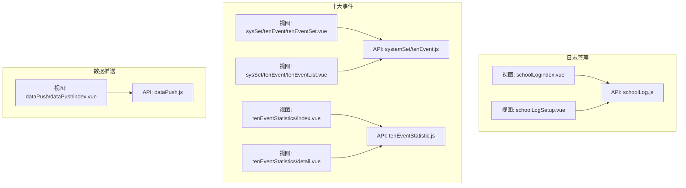
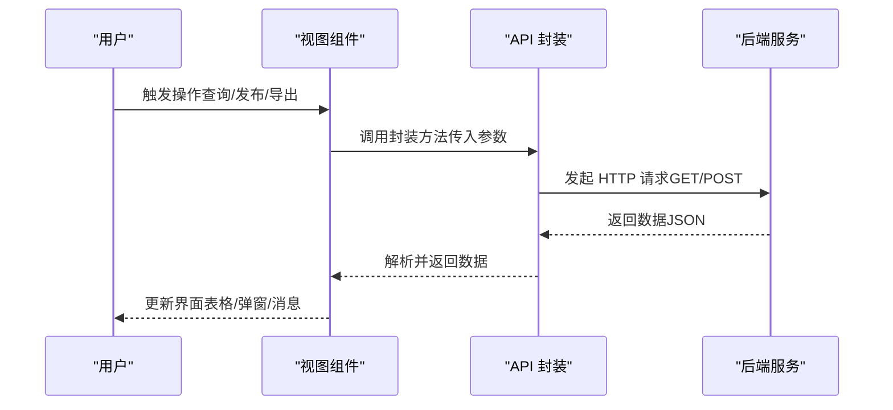
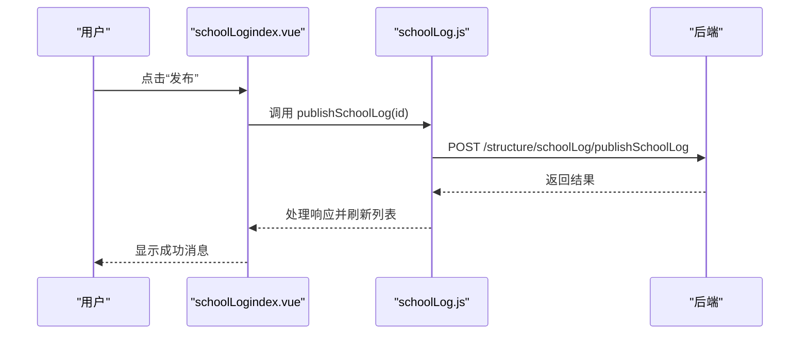
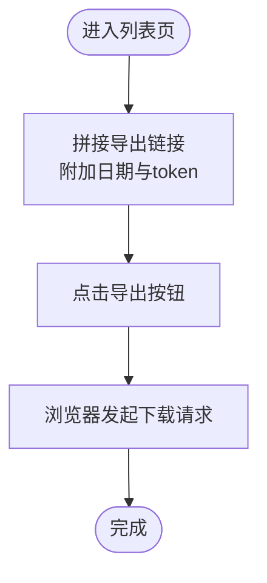
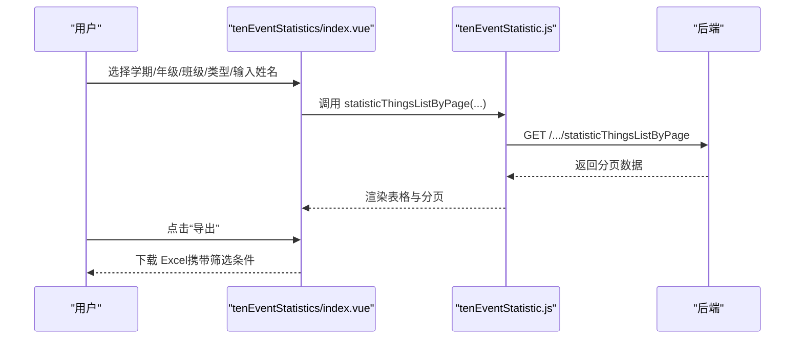
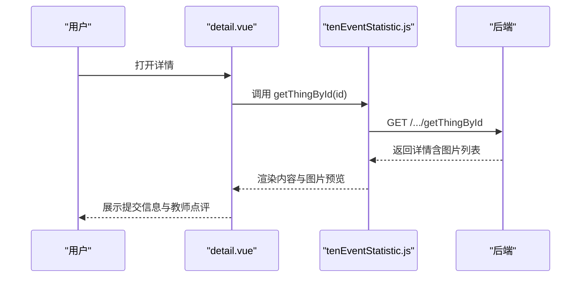
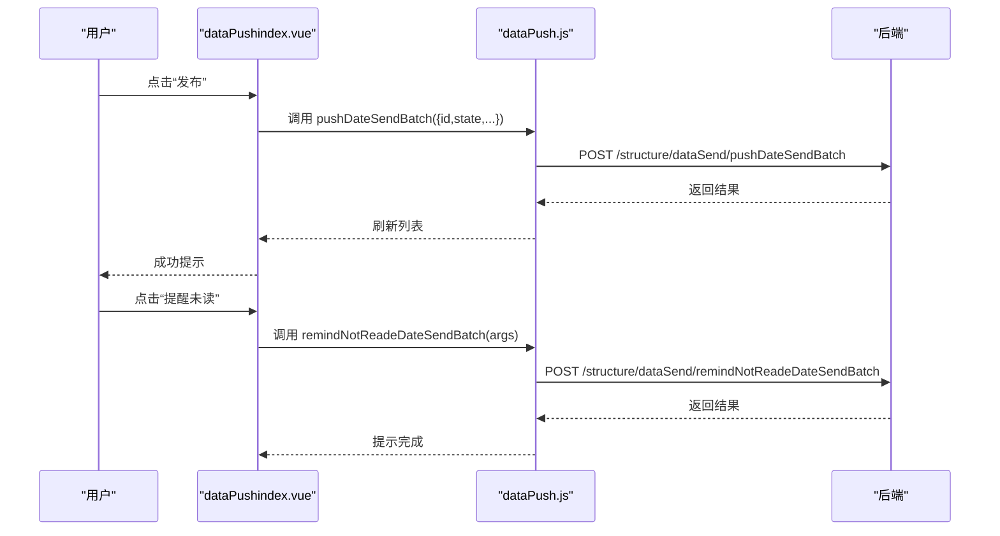
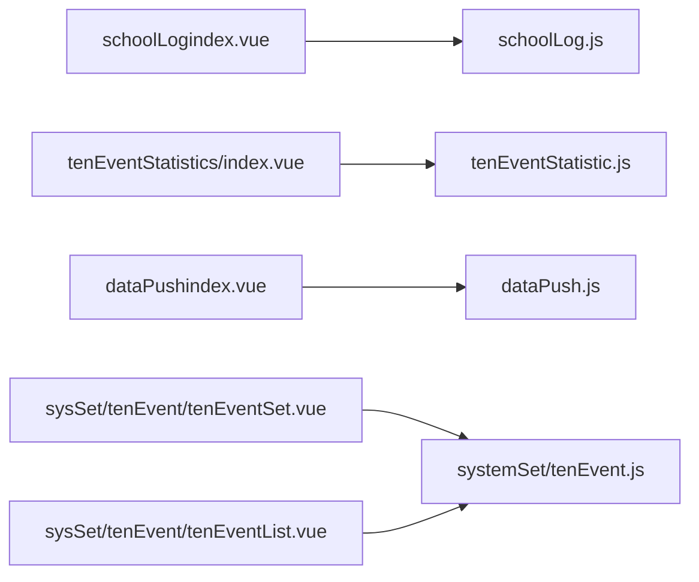

# 日志报表管理

<cite>
**本文引用的文件**
- [src/api/schoolLog.js](file://src/api/schoolLog.js)
- [src/views/schoolLog/schoolLogindex.vue](file://src/views/schoolLog/schoolLogindex.vue)
- [src/views/schoolLog/schoolLogSetup.vue](file://src/views/schoolLog/schoolLogSetup.vue)
- [src/api/systemSet/tenEvent.js](file://src/api/systemSet/tenEvent.js)
- [src/views/sysSet/tenEvent/tenEventSet.vue](file://src/views/sysSet/tenEvent/tenEventSet.vue)
- [src/views/sysSet/tenEvent/tenEventList.vue](file://src/views/sysSet/tenEvent/tenEventList.vue)
- [src/api/tenEventStatistic.js](file://src/api/tenEventStatistic.js)
- [src/views/tenEventStatistics/index.vue](file://src/views/tenEventStatistics/index.vue)
- [src/views/tenEventStatistics/detail.vue](file://src/views/tenEventStatistics/detail.vue)
- [src/api/dataPush.js](file://src/api/dataPush.js)
- [src/views/dataPush/dataPushindex.vue](file://src/views/dataPush/dataPushindex.vue)
</cite>

## 目录
1. [简介](#简介)
2. [项目结构](#项目结构)
3. [核心组件](#核心组件)
4. [架构总览](#架构总览)
5. [详细组件分析](#详细组件分析)
6. [依赖关系分析](#依赖关系分析)
7. [性能考量](#性能考量)
8. [故障排查指南](#故障排查指南)
9. [结论](#结论)
10. [附录](#附录)

## 简介
本文件面向“日志报表管理”业务域，系统性梳理并文档化以下能力：
- 校务日志：记录、查阅、发布、导出与权限控制
- 数据看板：配置、展示与个性化定制机制
- 数据推送：规则设置、数据格式转换与推送历史管理
- 十大事件统计：指标定义、计算逻辑与报表生成流程
- 权限控制、数据安全与报表导出使用说明

## 项目结构
围绕日志报表管理的相关模块主要分布在以下路径：
- 日志管理：API 与页面
  - API：src/api/schoolLog.js
  - 页面：src/views/schoolLog/*
- 十大事件：系统设置与统计报表
  - API：src/api/systemSet/tenEvent.js、src/api/tenEventStatistic.js
  - 页面：src/views/sysSet/tenEvent/*、src/views/tenEventStatistics/*
- 数据推送：规则与历史
  - API：src/api/dataPush.js
  - 页面：src/views/dataPush/*

图表来源
- [src/views/schoolLog/schoolLogindex.vue](file://src/views/schoolLog/schoolLogindex.vue)
- [src/views/schoolLog/schoolLogSetup.vue](file://src/views/schoolLog/schoolLogSetup.vue)
- [src/api/schoolLog.js](file://src/api/schoolLog.js)
- [src/views/sysSet/tenEvent/tenEventSet.vue](file://src/views/sysSet/tenEvent/tenEventSet.vue)
- [src/views/sysSet/tenEvent/tenEventList.vue](file://src/views/sysSet/tenEvent/tenEventList.vue)
- [src/api/systemSet/tenEvent.js](file://src/api/systemSet/tenEvent.js)
- [src/views/tenEventStatistics/index.vue](file://src/views/tenEventStatistics/index.vue)
- [src/views/tenEventStatistics/detail.vue](file://src/views/tenEventStatistics/detail.vue)
- [src/api/tenEventStatistic.js](file://src/api/tenEventStatistic.js)
- [src/views/dataPush/dataPushindex.vue](file://src/views/dataPush/dataPushindex.vue)
- [src/api/dataPush.js](file://src/api/dataPush.js)

章节来源
- [src/views/schoolLog/schoolLogindex.vue](file://src/views/schoolLog/schoolLogindex.vue)
- [src/views/schoolLog/schoolLogSetup.vue](file://src/views/schoolLog/schoolLogSetup.vue)
- [src/api/schoolLog.js](file://src/api/schoolLog.js)
- [src/views/sysSet/tenEvent/tenEventSet.vue](file://src/views/sysSet/tenEvent/tenEventSet.vue)
- [src/views/sysSet/tenEvent/tenEventList.vue](file://src/views/sysSet/tenEvent/tenEventList.vue)
- [src/api/systemSet/tenEvent.js](file://src/api/systemSet/tenEvent.js)
- [src/views/tenEventStatistics/index.vue](file://src/views/tenEventStatistics/index.vue)
- [src/views/tenEventStatistics/detail.vue](file://src/views/tenEventStatistics/detail.vue)
- [src/api/tenEventStatistic.js](file://src/api/tenEventStatistic.js)
- [src/views/dataPush/dataPushindex.vue](file://src/views/dataPush/dataPushindex.vue)
- [src/api/dataPush.js](file://src/api/dataPush.js)

## 核心组件
- 日志管理 API：提供分页查询、详情、发布、导出、删除、读写统计等接口封装
- 日志管理页面：列表、设置、新增/编辑/详情跳转、导出
- 十大事件系统设置：按年级维护事件类型（上/下学期）
- 十大事件统计：多维筛选（学期/年级/班级/类型/姓名）、分页、导出、详情
- 数据推送：批次管理、发布、提醒未读、历史查询与删除

章节来源
- [src/api/schoolLog.js](file://src/api/schoolLog.js)
- [src/views/schoolLog/schoolLogindex.vue](file://src/views/schoolLog/schoolLogindex.vue)
- [src/views/schoolLog/schoolLogSetup.vue](file://src/views/schoolLog/schoolLogSetup.vue)
- [src/api/systemSet/tenEvent.js](file://src/api/systemSet/tenEvent.js)
- [src/views/sysSet/tenEvent/tenEventSet.vue](file://src/views/sysSet/tenEvent/tenEventSet.vue)
- [src/views/sysSet/tenEvent/tenEventList.vue](file://src/views/sysSet/tenEvent/tenEventList.vue)
- [src/api/tenEventStatistic.js](file://src/api/tenEventStatistic.js)
- [src/views/tenEventStatistics/index.vue](file://src/views/tenEventStatistics/index.vue)
- [src/views/tenEventStatistics/detail.vue](file://src/views/tenEventStatistics/detail.vue)
- [src/api/dataPush.js](file://src/api/dataPush.js)
- [src/views/dataPush/dataPushindex.vue](file://src/views/dataPush/dataPushindex.vue)

## 架构总览
前端通过 API 层调用后端服务，页面负责交互与数据展示；统计类页面支持多级筛选与导出。

图表来源
- [src/api/schoolLog.js](file://src/api/schoolLog.js)
- [src/views/schoolLog/schoolLogindex.vue](file://src/views/schoolLog/schoolLogindex.vue)
- [src/api/tenEventStatistic.js](file://src/api/tenEventStatistic.js)
- [src/views/tenEventStatistics/index.vue](file://src/views/tenEventStatistics/index.vue)
- [src/api/dataPush.js](file://src/api/dataPush.js)
- [src/views/dataPush/dataPushindex.vue](file://src/views/dataPush/dataPushindex.vue)

## 详细组件分析

### 校务日志管理
- 功能点
  - 列表分页、按日期筛选、导出
  - 新增、编辑、删除、发布、详情
  - 已读/未读人数统计与分页列表
  - 设置：是否添加考勤/检查/日程数据，是否需要发布，发布范围（地址簿）
- 关键流程（发布）

图表来源
- [src/views/schoolLog/schoolLogindex.vue](file://src/views/schoolLog/schoolLogindex.vue)
- [src/api/schoolLog.js](file://src/api/schoolLog.js)

- 关键流程（导出）

图表来源
- [src/views/schoolLog/schoolLogindex.vue](file://src/views/schoolLog/schoolLogindex.vue)

章节来源
- [src/api/schoolLog.js](file://src/api/schoolLog.js)
- [src/views/schoolLog/schoolLogindex.vue](file://src/views/schoolLog/schoolLogindex.vue)
- [src/views/schoolLog/schoolLogSetup.vue](file://src/views/schoolLog/schoolLogSetup.vue)

### 十大事件统计
- 指标定义
  - 统计维度：学期、年级、班级、事件类型、学生姓名
  - 结果字段：学生姓名、所在班级、事件类型、提交时间
- 计算逻辑
  - 基于学期与年级层级选择，动态加载事件类型列表
  - 分页查询并支持导出
- 报表生成流程

图表来源
- [src/views/tenEventStatistics/index.vue](file://src/views/tenEventStatistics/index.vue)
- [src/api/tenEventStatistic.js](file://src/api/tenEventStatistic.js)

- 详情页

图表来源
- [src/views/tenEventStatistics/detail.vue](file://src/views/tenEventStatistics/detail.vue)
- [src/api/tenEventStatistic.js](file://src/api/tenEventStatistic.js)

章节来源
- [src/api/systemSet/tenEvent.js](file://src/api/systemSet/tenEvent.js)
- [src/views/sysSet/tenEvent/tenEventSet.vue](file://src/views/sysSet/tenEvent/tenEventSet.vue)
- [src/views/sysSet/tenEvent/tenEventList.vue](file://src/views/sysSet/tenEvent/tenEventList.vue)
- [src/api/tenEventStatistic.js](file://src/api/tenEventStatistic.js)
- [src/views/tenEventStatistics/index.vue](file://src/views/tenEventStatistics/index.vue)
- [src/views/tenEventStatistics/detail.vue](file://src/views/tenEventStatistics/detail.vue)

### 数据推送
- 规则设置
  - 批次管理：新建、编辑、发布、删除
  - 发布：将批次状态置为“已发布”，触发推送
  - 提醒未读：对未读人员进行提醒
- 历史管理
  - 分页查询批次、人员花名册
  - 删除批次或花名册条目
- 数据格式转换
  - 批次发布时以 JSON 形式传递批次信息
  - 字典值通过系统字典接口获取
- 流程示意

图表来源
- [src/views/dataPush/dataPushindex.vue](file://src/views/dataPush/dataPushindex.vue)
- [src/api/dataPush.js](file://src/api/dataPush.js)

章节来源
- [src/api/dataPush.js](file://src/api/dataPush.js)
- [src/views/dataPush/dataPushindex.vue](file://src/views/dataPush/dataPushindex.vue)

### 数据看板（概念性说明）
- 配置：可基于学校/年级/班级/学生维度选择统计类型（如行为评价、学科分数等）
- 展示：按类型聚合展示，支持分页与导出
- 个性化：通过选择器切换不同统计口径，动态加载数据

（本节为概念说明，不直接对应具体源码文件）

## 依赖关系分析
- 页面到 API 的依赖
  - schoolLogindex.vue 依赖 schoolLog.js
  - tenEventStatistics/index.vue 依赖 tenEventStatistic.js
  - dataPushindex.vue 依赖 dataPush.js
  - sysSet/tenEvent/* 依赖 systemSet/tenEvent.js
- API 到后端的服务依赖
  - 所有 API 通过统一 fetch 封装发起请求
  - 导出与历史查询依赖后端提供的分页与下载接口

图表来源
- [src/views/schoolLog/schoolLogindex.vue](file://src/views/schoolLog/schoolLogindex.vue)
- [src/api/schoolLog.js](file://src/api/schoolLog.js)
- [src/views/tenEventStatistics/index.vue](file://src/views/tenEventStatistics/index.vue)
- [src/api/tenEventStatistic.js](file://src/api/tenEventStatistic.js)
- [src/views/dataPush/dataPushindex.vue](file://src/views/dataPush/dataPushindex.vue)
- [src/api/dataPush.js](file://src/api/dataPush.js)
- [src/views/sysSet/tenEvent/tenEventSet.vue](file://src/views/sysSet/tenEvent/tenEventSet.vue)
- [src/views/sysSet/tenEvent/tenEventList.vue](file://src/views/sysSet/tenEvent/tenEventList.vue)
- [src/api/systemSet/tenEvent.js](file://src/api/systemSet/tenEvent.js)

章节来源
- [src/views/schoolLog/schoolLogindex.vue](file://src/views/schoolLog/schoolLogindex.vue)
- [src/api/schoolLog.js](file://src/api/schoolLog.js)
- [src/views/tenEventStatistics/index.vue](file://src/views/tenEventStatistics/index.vue)
- [src/api/tenEventStatistic.js](file://src/api/tenEventStatistic.js)
- [src/views/dataPush/dataPushindex.vue](file://src/views/dataPush/dataPushindex.vue)
- [src/api/dataPush.js](file://src/api/dataPush.js)
- [src/views/sysSet/tenEvent/tenEventSet.vue](file://src/views/sysSet/tenEvent/tenEventSet.vue)
- [src/views/sysSet/tenEvent/tenEventList.vue](file://src/views/sysSet/tenEvent/tenEventList.vue)
- [src/api/systemSet/tenEvent.js](file://src/api/systemSet/tenEvent.js)

## 性能考量
- 列表分页：通过 pageNo/pageSize 控制数据量，避免一次性加载过多
- 导出：采用后端分页导出，前端仅拼接下载链接，降低内存压力
- 图片预览：按需渲染，避免大图阻塞
- 接口超时：部分统计接口设置了较长超时时间，确保复杂查询稳定返回

（本节为通用建议，不直接引用具体代码行）

## 故障排查指南
- 发布失败
  - 检查批次状态是否为“草稿”
  - 确认后端返回状态码与消息
- 导出为空
  - 核对筛选条件是否过严（学期/年级/班级/类型/姓名）
  - 确认 token 有效且未过期
- 未读提醒无效
  - 确认推送已发布且目标用户存在未读记录
  - 检查后端提醒接口返回
- 事件类型维护异常
  - 新增/编辑/删除时注意必填校验与后端错误提示

章节来源
- [src/views/schoolLog/schoolLogindex.vue](file://src/views/schoolLog/schoolLogindex.vue)
- [src/views/dataPush/dataPushindex.vue](file://src/views/dataPush/dataPushindex.vue)
- [src/views/sysSet/tenEvent/tenEventList.vue](file://src/views/sysSet/tenEvent/tenEventList.vue)
- [src/views/tenEventStatistics/index.vue](file://src/views/tenEventStatistics/index.vue)

## 结论
本系统围绕“日志管理、十大事件统计、数据推送”三大主线，提供了从配置、记录、统计到导出的完整闭环。通过清晰的页面与 API 分层，配合灵活的筛选与导出能力，满足日常运营与管理需求。后续可在权限细化、推送策略扩展与可视化增强方面持续优化。

## 附录
- 使用建议
  - 日志管理：定期发布，规范导出归档
  - 十大事件：按学年维护事件类型，结合统计报表进行复盘
  - 数据推送：明确发布范围与提醒策略，关注未读率
- 安全与权限
  - 发布范围由地址簿配置，确保仅向授权对象推送
  - 导出链接包含 token，避免外泄；建议在网关层限制导出频率与来源