# 校园管理

<cite>
**本文引用的文件**
- [src/api/schoolManage/stuAttendanceRecord.js](file://src/api/schoolManage/stuAttendanceRecord.js)
- [src/api/schoolManage/teacherAttendanceStatistics.js](file://src/api/schoolManage/teacherAttendanceStatistics.js)
- [src/api/schoolManage/onDutyStatistics.js](file://src/api/schoolManage/onDutyStatistics.js)
- [src/api/schoolManage/diseaseReport.js](file://src/api/schoolManage/diseaseReport.js)
- [src/api/schoolManage/repair.js](file://src/api/schoolManage/repair.js)
- [src/api/systemSet/deviceManage.js](file://src/api/systemSet/deviceManage.js)
- [src/api/systemSet/permission.js](file://src/api/systemSet/permission.js)
- [src/api/systemSet/org.js](file://src/api/systemSet/org.js)
- [src/api/systemSet/dataReport.js](file://src/api/systemSet/dataReport.js)
- [src/components/Charts/barPercent.vue](file://src/components/Charts/barPercent.vue)
</cite>

## 目录
1. [引言](#引言)
2. [项目结构](#项目结构)
3. [核心组件](#核心组件)
4. [架构总览](#架构总览)
5. [详细组件分析](#详细组件分析)
6. [依赖分析](#依赖分析)
7. [性能考虑](#性能考虑)
8. [故障排查指南](#故障排查指南)
9. [结论](#结论)
10. [附录](#附录)

## 引言
本文件面向“校园管理”模块，系统性梳理并文档化以下业务能力与技术实现：
- 学生信息管理：围绕学生考勤记录、统计汇总与班级/年级联动的数据接口
- 教师信息管理：教师考勤统计、加班扣款统计、值班登记与异常门禁统计
- 设备资产管理：扫码设备与设备用户管理、同步提醒与库表查询
- 考勤统计分析：按日、按类型、按用户维度的多维统计与补签流程
- 检查管理功能：疾病上报、流动人口与风险用户统计、导出与重置
- 数据维护流程：组织机构与用户数据的新增、编辑、移动、启用/禁用、同步
- 权限控制机制：基于用户ID与学校ID的权限查询与子权限获取
- 数据安全策略：统一通过封装的请求工具发起调用，使用全局基础路径与超时控制
- 统计报表与可视化：图表组件对统计数据的渲染与交互
- 系统集成方案：与教务、人事、财务系统的对接点（通过统一接口层与系统服务）
- 配置参数与扩展接口：数据上报初始化、设备库查询与设备用户同步
- 自定义开发指南：如何在现有接口基础上扩展新报表与统计维度

## 项目结构
校园管理相关代码主要分布在如下位置：
- API 层：位于 src/api 下，按业务域划分，如 schoolManage、systemSet
- 视图与页面：位于 src/views 下，承载具体业务页面
- 组件：位于 src/components 下，包含通用图表等复用组件
- 工具与状态：位于 src/utils、src/store 等目录，提供网络请求、加密、常量等支撑

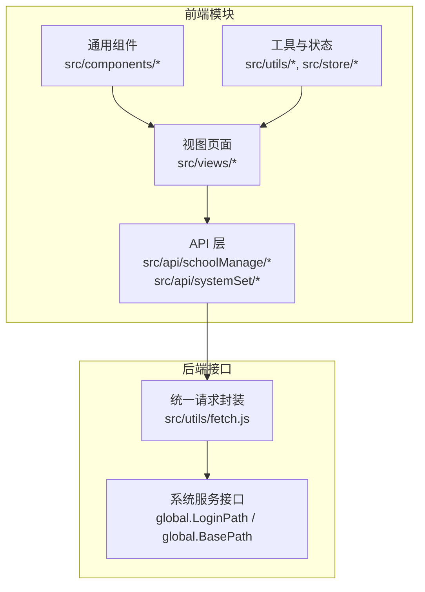

**图表来源**
- [src/api/schoolManage/stuAttendanceRecord.js:1-111](file://src/api/schoolManage/stuAttendanceRecord.js#L1-L111)
- [src/api/systemSet/deviceManage.js:1-189](file://src/api/systemSet/deviceManage.js#L1-L189)
- [src/api/systemSet/permission.js:1-40](file://src/api/systemSet/permission.js#L1-L40)
- [src/api/systemSet/org.js:1-800](file://src/api/systemSet/org.js#L1-L800)
- [src/components/Charts/barPercent.vue:1-105](file://src/components/Charts/barPercent.vue#L1-L105)

**章节来源**
- [src/api/schoolManage/stuAttendanceRecord.js:1-111](file://src/api/schoolManage/stuAttendanceRecord.js#L1-L111)
- [src/api/schoolManage/teacherAttendanceStatistics.js:1-248](file://src/api/schoolManage/teacherAttendanceStatistics.js#L1-L248)
- [src/api/schoolManage/onDutyStatistics.js:1-52](file://src/api/schoolManage/onDutyStatistics.js#L1-L52)
- [src/api/schoolManage/diseaseReport.js:1-238](file://src/api/schoolManage/diseaseReport.js#L1-L238)
- [src/api/schoolManage/repair.js:1-19](file://src/api/schoolManage/repair.js#L1-L19)
- [src/api/systemSet/deviceManage.js:1-189](file://src/api/systemSet/deviceManage.js#L1-L189)
- [src/api/systemSet/permission.js:1-40](file://src/api/systemSet/permission.js#L1-L40)
- [src/api/systemSet/org.js:1-800](file://src/api/systemSet/org.js#L1-L800)
- [src/api/systemSet/dataReport.js:1-26](file://src/api/systemSet/dataReport.js#L1-L26)
- [src/components/Charts/barPercent.vue:1-105](file://src/components/Charts/barPercent.vue#L1-L105)

## 核心组件
- 学生考勤与统计
  - 接口：按班级统计、获取年级/班级列表、获取所教学班、考勤明细、统计汇总
  - 用途：支持按日/时间段查看学生出勤情况，生成班级与个人统计
- 教师考勤与值班
  - 接口：当日分析、时间段总统计、类型分析、用户维度统计、补签、加班扣款月度统计、异常门禁统计
  - 用途：支撑教师考勤质量评估、值班登记与异常处理
- 疾病上报与检查
  - 接口：学校上报详情、回执单、去国外人员、班级明细、省平台导出、重置上报、每日统计、流动人口明细、未上报用户、健康统计、风险统计与用户列表
  - 用途：满足疫情防控与属地上报要求
- 报修管理
  - 接口：报修列表分页查询
  - 用途：校园设施维修登记与跟踪
- 设备资产管理
  - 接口：设备列表、新增/编辑、批量删除、设备用户查询、新增/同步/删除用户、提醒未上传照片、设备库查询与详情
  - 用途：扫码设备与用户绑定、设备库管理与同步
- 数据维护与组织管理
  - 接口：部门与用户查询、年级/班级查询、新增/更新/删除部门、移动教师/学生、启用/禁用用户、同步部门/用户、角色与权限查询、个人信息查询
  - 用途：维护组织架构与人员信息
- 权限控制
  - 接口：用户权限查询、子权限查询
  - 用途：基于用户与学校维度的权限下发与继承
- 数据报表初始化
  - 接口：查询与新增/修改数据报告初始化设置
  - 用途：统一配置数据上报模板与字段
- 可视化组件
  - 组件：柱状百分比图表，用于进度类指标展示

**章节来源**
- [src/api/schoolManage/stuAttendanceRecord.js:1-111](file://src/api/schoolManage/stuAttendanceRecord.js#L1-L111)
- [src/api/schoolManage/teacherAttendanceStatistics.js:1-248](file://src/api/schoolManage/teacherAttendanceStatistics.js#L1-L248)
- [src/api/schoolManage/onDutyStatistics.js:1-52](file://src/api/schoolManage/onDutyStatistics.js#L1-L52)
- [src/api/schoolManage/diseaseReport.js:1-238](file://src/api/schoolManage/diseaseReport.js#L1-L238)
- [src/api/schoolManage/repair.js:1-19](file://src/api/schoolManage/repair.js#L1-L19)
- [src/api/systemSet/deviceManage.js:1-189](file://src/api/systemSet/deviceManage.js#L1-L189)
- [src/api/systemSet/org.js:1-800](file://src/api/systemSet/org.js#L1-L800)
- [src/api/systemSet/permission.js:1-40](file://src/api/systemSet/permission.js#L1-L40)
- [src/api/systemSet/dataReport.js:1-26](file://src/api/systemSet/dataReport.js#L1-L26)
- [src/components/Charts/barPercent.vue:1-105](file://src/components/Charts/barPercent.vue#L1-L105)

## 架构总览
校园管理模块采用“页面 -> API 层 -> 请求封装 -> 系统服务”的分层设计。API 层集中定义各业务域接口；请求封装统一处理超时、内容类型与基础路径；系统服务通过全局变量对接不同环境的后端。

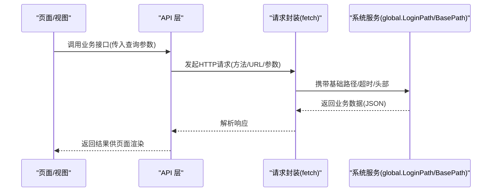

**图表来源**
- [src/api/schoolManage/stuAttendanceRecord.js:1-111](file://src/api/schoolManage/stuAttendanceRecord.js#L1-L111)
- [src/api/systemSet/org.js:1-800](file://src/api/systemSet/org.js#L1-L800)
- [src/api/systemSet/permission.js:1-40](file://src/api/systemSet/permission.js#L1-L40)

## 详细组件分析

### 学生考勤与统计
- 功能要点
  - 获取当前日期的班级考勤统计
  - 获取年级/班级列表，支持排除新生班级
  - 根据教师ID获取所教学班与班主任班级
  - 查询学生考勤明细与统计汇总（支持分页与筛选）
- 处理流程
  - 页面选择日期/班级/学生名称等条件
  - API 层构造 URLSearchParams 参数
  - 统一请求封装发起 GET/POST 请求
  - 返回数据用于表格与图表展示

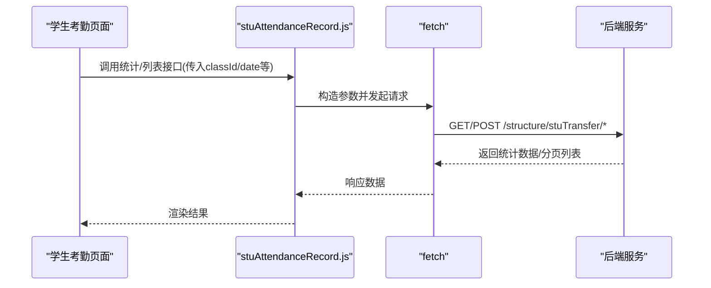

**图表来源**
- [src/api/schoolManage/stuAttendanceRecord.js:1-111](file://src/api/schoolManage/stuAttendanceRecord.js#L1-L111)

**章节来源**
- [src/api/schoolManage/stuAttendanceRecord.js:1-111](file://src/api/schoolManage/stuAttendanceRecord.js#L1-L111)

### 教师考勤与值班
- 功能要点
  - 当日考勤类型分析、时间段总统计、类型分析、用户维度统计
  - 补签操作（签到/签退/全补/异常补）
  - 加班扣款月度统计、异常门禁统计与列表
  - 值班登记与按日期/类型/姓名查询
- 处理流程
  - 页面输入日期区间/类型/姓名等
  - API 层统一构造参数并调用对应接口
  - 返回结果用于统计图表与表格

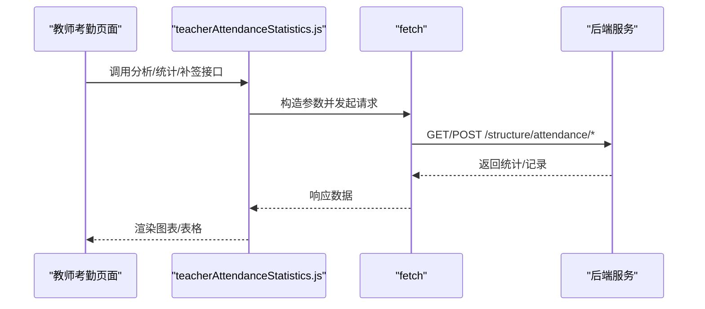

**图表来源**
- [src/api/schoolManage/teacherAttendanceStatistics.js:1-248](file://src/api/schoolManage/teacherAttendanceStatistics.js#L1-L248)

**章节来源**
- [src/api/schoolManage/teacherAttendanceStatistics.js:1-248](file://src/api/schoolManage/teacherAttendanceStatistics.js#L1-L248)
- [src/api/schoolManage/onDutyStatistics.js:1-52](file://src/api/schoolManage/onDutyStatistics.js#L1-L52)

### 疾病上报与检查
- 功能要点
  - 查询学校上报详情、回执单、去国外人员、班级明细
  - 按省平台规则导出用户列表、重置学校上报
  - 查询学校每日统计、流动人口明细、未上报用户
  - 健康统计、风险统计与风险用户列表
- 处理流程
  - 页面选择日期与用户类型
  - API 层调用对应接口，部分接口设置较长超时
  - 返回数据用于报表与导出

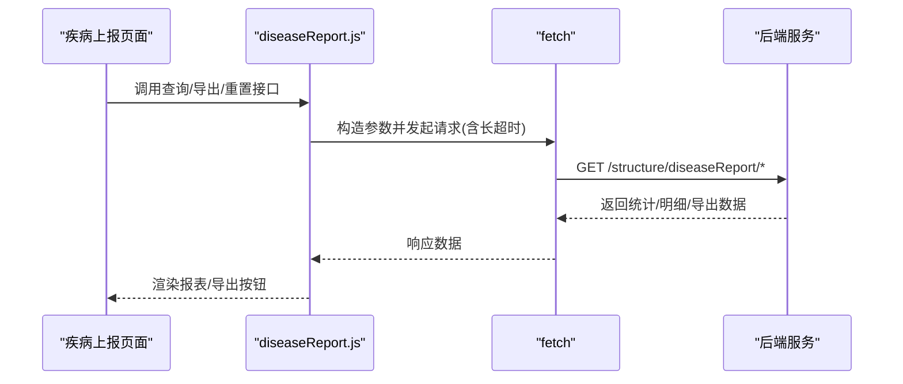

**图表来源**
- [src/api/schoolManage/diseaseReport.js:1-238](file://src/api/schoolManage/diseaseReport.js#L1-L238)

**章节来源**
- [src/api/schoolManage/diseaseReport.js:1-238](file://src/api/schoolManage/diseaseReport.js#L1-L238)

### 报修管理
- 功能要点
  - 报修列表分页查询（支持标题、起止日期筛选）
- 处理流程
  - 页面输入筛选条件
  - API 层构造参数并调用后端接口
  - 返回列表供页面展示

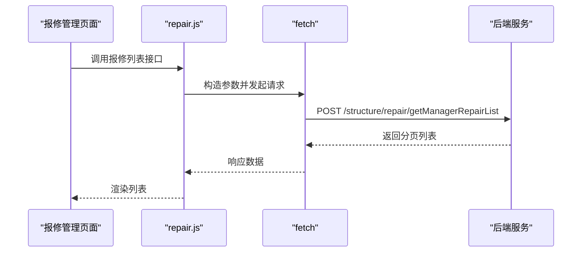

**图表来源**
- [src/api/schoolManage/repair.js:1-19](file://src/api/schoolManage/repair.js#L1-L19)

**章节来源**
- [src/api/schoolManage/repair.js:1-19](file://src/api/schoolManage/repair.js#L1-L19)

### 设备资产管理
- 功能要点
  - 全部设备查询、新增/编辑设备、批量删除
  - 设备用户查询、新增/按部门添加用户、删除用户
  - 同步设备用户、提醒未上传照片、设备库查询与详情
- 处理流程
  - 页面进行设备与用户管理操作
  - API 层统一构造参数并调用对应接口
  - 返回结果用于列表与状态提示

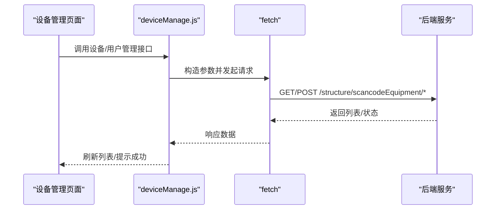

**图表来源**
- [src/api/systemSet/deviceManage.js:1-189](file://src/api/systemSet/deviceManage.js#L1-L189)

**章节来源**
- [src/api/systemSet/deviceManage.js:1-189](file://src/api/systemSet/deviceManage.js#L1-L189)

### 数据维护与组织管理
- 功能要点
  - 部门与用户查询、年级/班级查询
  - 新增/更新/删除部门、移动教师/学生、启用/禁用用户
  - 同步部门与用户、角色与权限查询、个人信息查询
- 处理流程
  - 页面进行组织与人员维护
  - API 层调用系统服务接口，部分接口设置较长超时
  - 返回结果用于刷新树形结构与列表

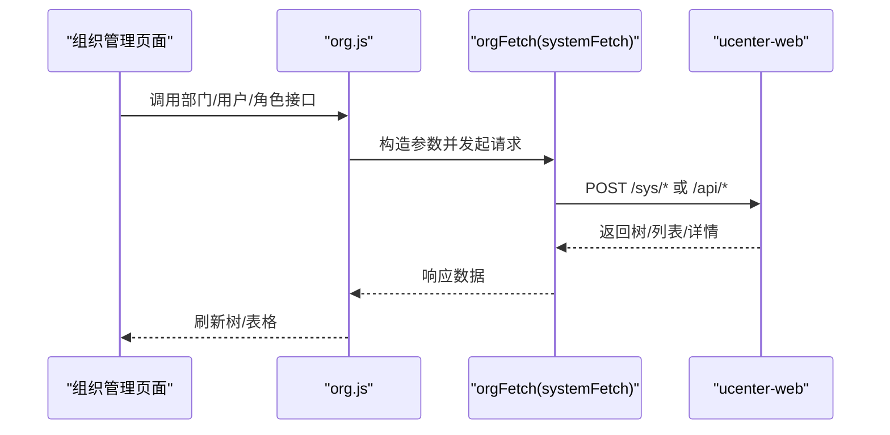

**图表来源**
- [src/api/systemSet/org.js:1-800](file://src/api/systemSet/org.js#L1-L800)

**章节来源**
- [src/api/systemSet/org.js:1-800](file://src/api/systemSet/org.js#L1-L800)

### 权限控制机制
- 功能要点
  - 查询用户在某学校的所有权限
  - 根据上级权限ID获取子权限
- 处理流程
  - 页面加载时根据当前用户与学校ID发起查询
  - 返回权限树/列表用于菜单与按钮级权限控制

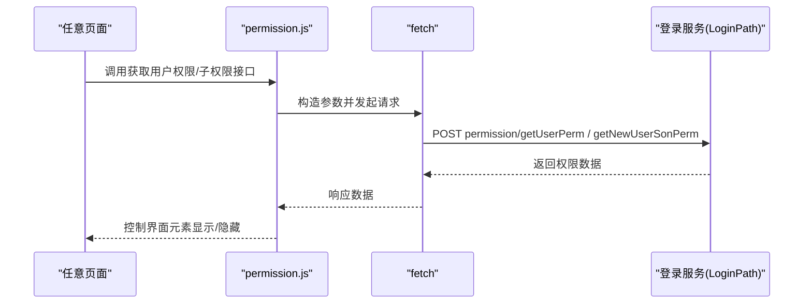

**图表来源**
- [src/api/systemSet/permission.js:1-40](file://src/api/systemSet/permission.js#L1-L40)

**章节来源**
- [src/api/systemSet/permission.js:1-40](file://src/api/systemSet/permission.js#L1-L40)

### 数据报表初始化
- 功能要点
  - 查询数据报告初始化设置
  - 新增/修改数据报告初始化设置（JSON 提交）
- 处理流程
  - 页面读取初始化配置
  - 修改后提交保存

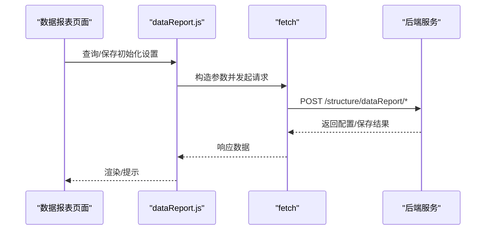

**图表来源**
- [src/api/systemSet/dataReport.js:1-26](file://src/api/systemSet/dataReport.js#L1-L26)

**章节来源**
- [src/api/systemSet/dataReport.js:1-26](file://src/api/systemSet/dataReport.js#L1-L26)

### 可视化组件
- 功能要点
  - 百分比柱状图组件，支持动态数据驱动
  - 内置提示框格式化、网格配置与动画延迟
- 使用场景
  - 展示任务完成进度、达标率等指标

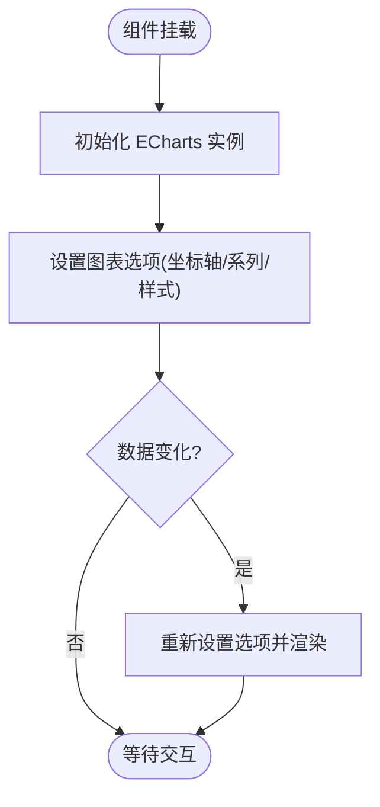

**图表来源**
- [src/components/Charts/barPercent.vue:1-105](file://src/components/Charts/barPercent.vue#L1-L105)

**章节来源**
- [src/components/Charts/barPercent.vue:1-105](file://src/components/Charts/barPercent.vue#L1-L105)

## 依赖分析
- 模块内聚与耦合
  - API 层按业务域拆分，职责清晰，内聚度高
  - 统一请求封装降低重复代码，减少跨模块耦合
- 外部依赖
  - 通过全局变量 global.LoginPath、global.BasePath 与 global.BasePath 进行服务路由
  - 部分接口设置较长超时（如疾病上报、组织同步），确保大数据量场景稳定
- 潜在循环依赖
  - API 层之间无直接相互依赖，通过请求封装与服务端接口解耦，无明显循环依赖

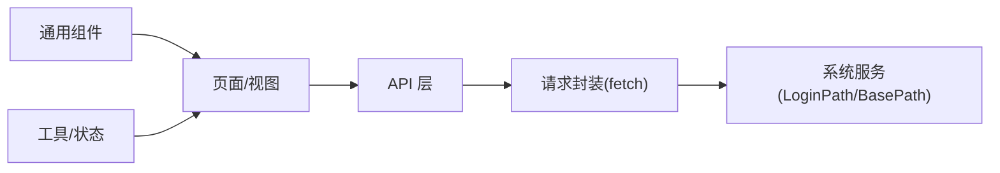

**图表来源**
- [src/api/schoolManage/stuAttendanceRecord.js:1-111](file://src/api/schoolManage/stuAttendanceRecord.js#L1-L111)
- [src/api/systemSet/org.js:1-800](file://src/api/systemSet/org.js#L1-L800)
- [src/api/systemSet/permission.js:1-40](file://src/api/systemSet/permission.js#L1-L40)
- [src/components/Charts/barPercent.vue:1-105](file://src/components/Charts/barPercent.vue#L1-L105)

**章节来源**
- [src/api/schoolManage/stuAttendanceRecord.js:1-111](file://src/api/schoolManage/stuAttendanceRecord.js#L1-L111)
- [src/api/systemSet/org.js:1-800](file://src/api/systemSet/org.js#L1-L800)
- [src/api/systemSet/permission.js:1-40](file://src/api/systemSet/permission.js#L1-L40)
- [src/components/Charts/barPercent.vue:1-105](file://src/components/Charts/barPercent.vue#L1-L105)

## 性能考虑
- 请求超时与并发
  - 疾病上报与组织同步接口设置较长超时，避免大列表查询中断
  - 建议页面层对高频查询增加防抖与缓存策略
- 图表渲染
  - 图表组件通过监听数据变化重绘，建议在数据量较大时采用分页或虚拟滚动
- 网络优化
  - 统一请求封装减少重复配置，建议结合分页与懒加载提升首屏性能

## 故障排查指南
- 常见问题
  - 接口超时：疾病上报与组织同步接口已设置较长超时，若仍失败需检查网络与后端服务状态
  - 参数缺失：确认必填参数（如日期、班级ID、用户ID）是否正确传递
  - 权限不足：确认当前用户在目标学校是否具备相应权限
- 定位步骤
  - 查看浏览器网络面板，确认请求 URL、方法与状态码
  - 检查请求头与参数是否符合接口规范
  - 核对返回数据结构，定位为空或异常的原因

**章节来源**
- [src/api/schoolManage/diseaseReport.js:1-238](file://src/api/schoolManage/diseaseReport.js#L1-L238)
- [src/api/systemSet/org.js:1-800](file://src/api/systemSet/org.js#L1-L800)
- [src/api/systemSet/permission.js:1-40](file://src/api/systemSet/permission.js#L1-L40)

## 结论
校园管理模块通过清晰的分层设计与统一的请求封装，实现了学生考勤、教师考勤、设备资产、疾病上报、报修管理等核心业务的前后端协同。配合权限控制与可视化组件，能够高效支撑日常管理与统计分析需求。建议在后续迭代中进一步完善报表维度、增强异常处理与监控告警，并持续优化接口性能与用户体验。

## 附录
- 配置参数
  - 数据报表初始化：支持查询与新增/修改配置项
- 扩展接口
  - 可在现有 API 层新增业务接口，遵循统一参数构造与请求封装规范
- 自定义开发指南
  - 在页面中引入对应 API 方法，按需传递查询参数
  - 使用图表组件时，确保数据格式与组件属性匹配
  - 对需要长耗时的接口，合理设置超时与提示

**章节来源**
- [src/api/systemSet/dataReport.js:1-26](file://src/api/systemSet/dataReport.js#L1-L26)
- [src/components/Charts/barPercent.vue:1-105](file://src/components/Charts/barPercent.vue#L1-L105)