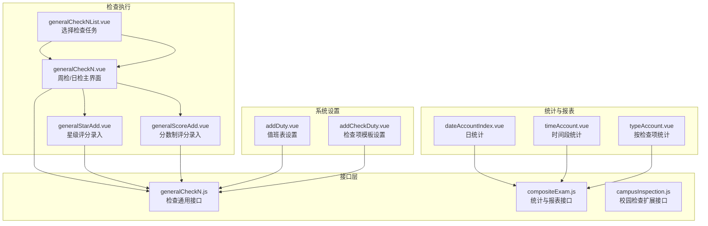
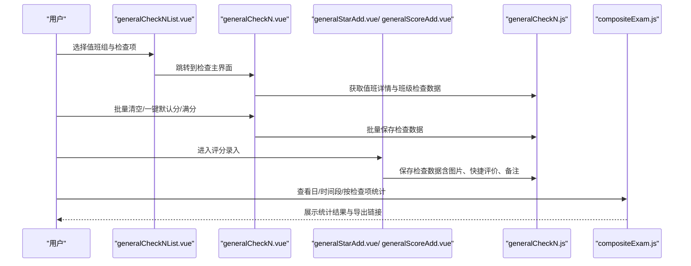
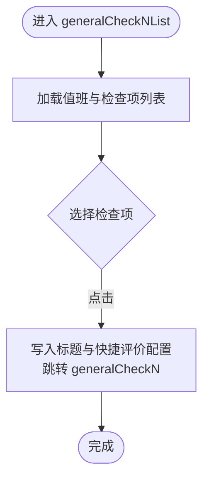
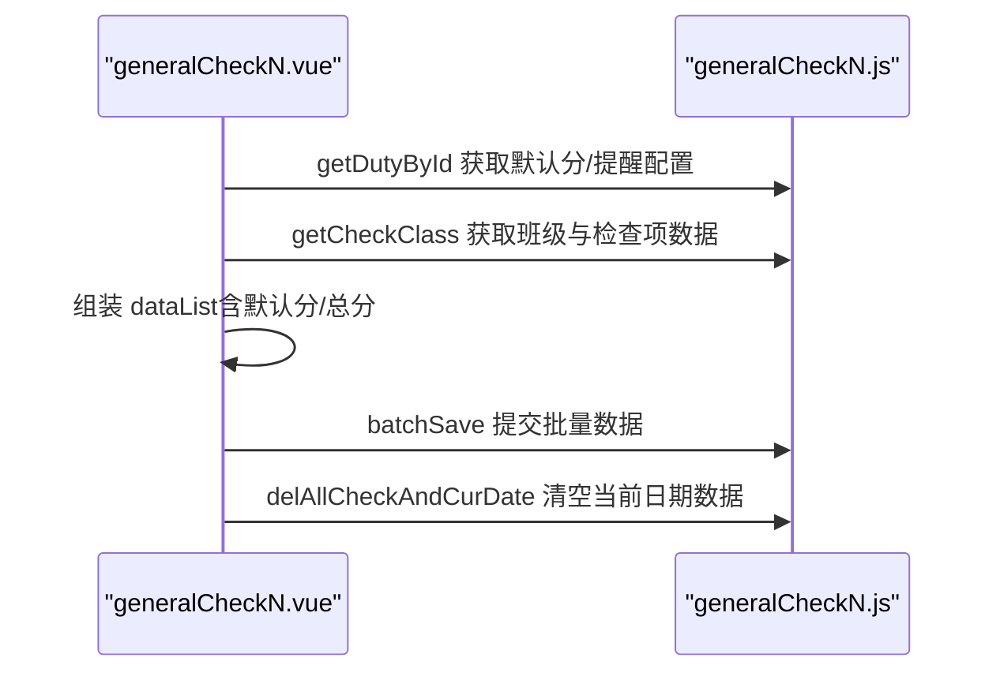
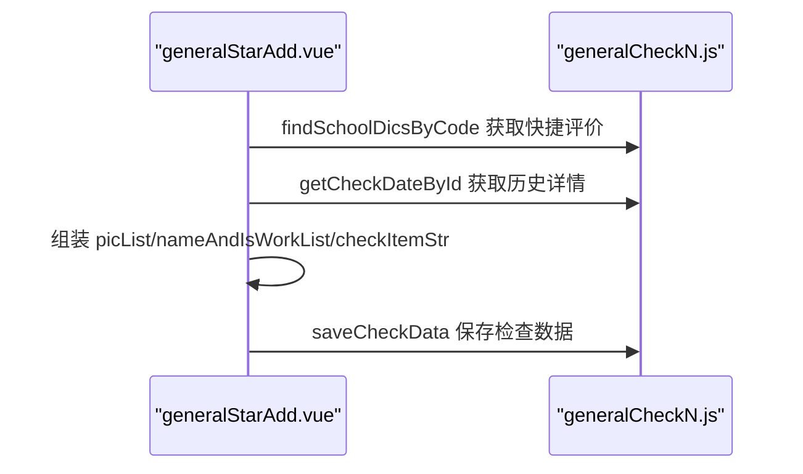
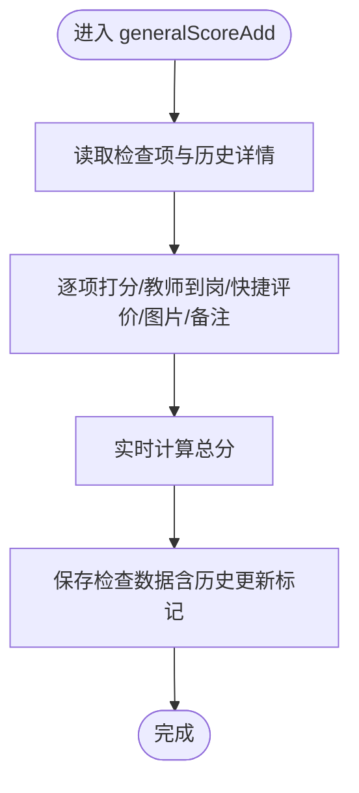
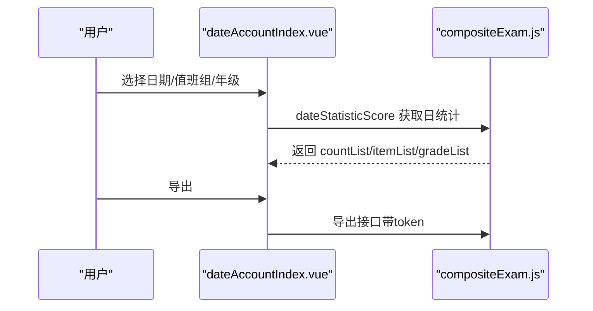
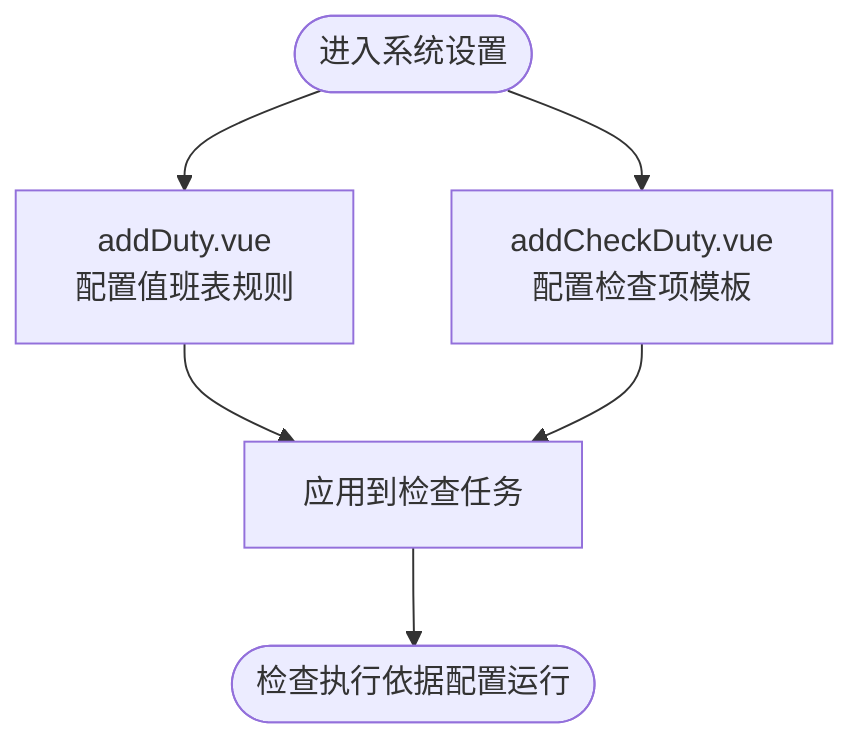
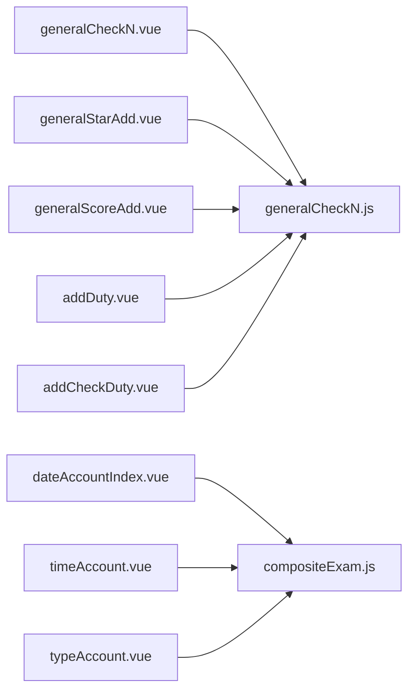

# 校园综合检查

<cite>
**本文引用的文件**
- [generalCheckN.vue](file://src/views/compositeExam/generalCheckN.vue)
- [generalCheckNList.vue](file://src/views/compositeExam/generalCheckNList.vue)
- [generalScoreAdd.vue](file://src/views/compositeExam/generalScoreAdd.vue)
- [generalStarAdd.vue](file://src/views/compositeExam/generalStarAdd.vue)
- [dateAccountIndex.vue](file://src/views/compositeExam/dateAccountIndex.vue)
- [timeAccount.vue](file://src/views/compositeExam/timeAccount.vue)
- [typeAccount.vue](file://src/views/compositeExam/typeAccount.vue)
- [generalCheckN.js](file://src/api/generalCheckN.js)
- [compositeExam.js](file://src/api/compositeExam.js)
- [campusInspection.js](file://src/api/campusInspection.js)
- [addDuty.vue](file://src/views/sysSet/compositeExamSet/addDuty.vue)
- [addCheckDuty.vue](file://src/views/sysSet/compositeExamSet/addCheckDuty.vue)
</cite>

## 目录
1. [简介](#简介)
2. [项目结构](#项目结构)
3. [核心组件](#核心组件)
4. [架构总览](#架构总览)
5. [详细组件分析](#详细组件分析)
6. [依赖关系分析](#依赖关系分析)
7. [性能考虑](#性能考虑)
8. [故障排查指南](#故障排查指南)
9. [结论](#结论)
10. [附录](#附录)

## 简介
本技术文档围绕“校园综合检查”功能，系统梳理从检查模板配置、值班表设置、检查执行、评分与权重计算、质量控制、检查报告生成到历史查询与统计分析的完整业务闭环。文档以代码级视图呈现前端实现细节，并结合后端接口定义，帮助开发者与运维人员快速理解并维护该模块。

## 项目结构
“校园综合检查”主要分布在以下目录与文件：
- 检查执行与录入
  - 检查任务入口：generalCheckNList.vue
  - 周检/日检主界面：generalCheckN.vue
  - 星级评分录入：generalStarAdd.vue
  - 分数制评分录入：generalScoreAdd.vue
- 统计与报表
  - 日统计：dateAccountIndex.vue
  - 时间段统计：timeAccount.vue
  - 按检查项统计：typeAccount.vue
- 接口层
  - 综合检查通用接口：generalCheckN.js
  - 统计与报表接口：compositeExam.js
  - 校园检查扩展接口：campusInspection.js
- 系统设置（模板与值班）
  - 值班表设置：addDuty.vue
  - 检查项模板设置：addCheckDuty.vue

图表来源
- [generalCheckNList.vue:1-184](file://src/views/compositeExam/generalCheckNList.vue#L1-L184)
- [generalCheckN.vue:1-498](file://src/views/compositeExam/generalCheckN.vue#L1-L498)
- [generalStarAdd.vue:1-569](file://src/views/compositeExam/generalStarAdd.vue#L1-L569)
- [generalScoreAdd.vue:1-657](file://src/views/compositeExam/generalScoreAdd.vue#L1-L657)
- [dateAccountIndex.vue:1-431](file://src/views/compositeExam/dateAccountIndex.vue#L1-L431)
- [timeAccount.vue:1-368](file://src/views/compositeExam/timeAccount.vue#L1-L368)
- [typeAccount.vue:1-428](file://src/views/compositeExam/typeAccount.vue#L1-L428)
- [generalCheckN.js:1-254](file://src/api/generalCheckN.js#L1-L254)
- [compositeExam.js:1-142](file://src/api/compositeExam.js#L1-L142)
- [campusInspection.js:1-28](file://src/api/campusInspection.js#L1-L28)
- [addDuty.vue:1-788](file://src/views/sysSet/compositeExamSet/addDuty.vue#L1-L788)
- [addCheckDuty.vue:1-830](file://src/views/sysSet/compositeExamSet/addCheckDuty.vue#L1-L830)

章节来源
- [generalCheckNList.vue:1-184](file://src/views/compositeExam/generalCheckNList.vue#L1-L184)
- [generalCheckN.vue:1-498](file://src/views/compositeExam/generalCheckN.vue#L1-L498)
- [generalStarAdd.vue:1-569](file://src/views/compositeExam/generalStarAdd.vue#L1-L569)
- [generalScoreAdd.vue:1-657](file://src/views/compositeExam/generalScoreAdd.vue#L1-L657)
- [dateAccountIndex.vue:1-431](file://src/views/compositeExam/dateAccountIndex.vue#L1-L431)
- [timeAccount.vue:1-368](file://src/views/compositeExam/timeAccount.vue#L1-L368)
- [typeAccount.vue:1-428](file://src/views/compositeExam/typeAccount.vue#L1-L428)
- [generalCheckN.js:1-254](file://src/api/generalCheckN.js#L1-L254)
- [compositeExam.js:1-142](file://src/api/compositeExam.js#L1-L142)
- [campusInspection.js:1-28](file://src/api/campusInspection.js#L1-L28)
- [addDuty.vue:1-788](file://src/views/sysSet/compositeExamSet/addDuty.vue#L1-L788)
- [addCheckDuty.vue:1-830](file://src/views/sysSet/compositeExamSet/addCheckDuty.vue#L1-L830)

## 核心组件
- 检查任务入口与选择
  - generalCheckNList.vue：展示值班表下的检查项列表，支持跳转至具体检查任务。
- 周检/日检主界面
  - generalCheckN.vue：按年级-班级维度展示检查结果，支持批量清空、一键默认分/满分、跳转到录入页。
- 星级评分录入
  - generalStarAdd.vue：支持星级评分、教师到岗状态、快捷评价、图片上传、备注等。
- 分数制评分录入
  - generalScoreAdd.vue：支持逐项打分、合计计算、教师到岗状态、快捷评价、图片上传、备注等。
- 统计与报表
  - dateAccountIndex.vue：按日统计，支持导出、查看明细。
  - timeAccount.vue：按时间段统计，支持导出。
  - typeAccount.vue：按检查项统计，支持分页、编辑历史记录。
- 系统设置
  - addDuty.vue：值班表配置（默认分、提醒、反馈、推送、初始化分数等）。
  - addCheckDuty.vue：检查项模板配置（星/分、加减分步长、考核项与分数、快捷评价字典、Logo等）。

章节来源
- [generalCheckNList.vue:1-184](file://src/views/compositeExam/generalCheckNList.vue#L1-L184)
- [generalCheckN.vue:1-498](file://src/views/compositeExam/generalCheckN.vue#L1-L498)
- [generalStarAdd.vue:1-569](file://src/views/compositeExam/generalStarAdd.vue#L1-L569)
- [generalScoreAdd.vue:1-657](file://src/views/compositeExam/generalScoreAdd.vue#L1-L657)
- [dateAccountIndex.vue:1-431](file://src/views/compositeExam/dateAccountIndex.vue#L1-L431)
- [timeAccount.vue:1-368](file://src/views/compositeExam/timeAccount.vue#L1-L368)
- [typeAccount.vue:1-428](file://src/views/compositeExam/typeAccount.vue#L1-L428)
- [addDuty.vue:1-788](file://src/views/sysSet/compositeExamSet/addDuty.vue#L1-L788)
- [addCheckDuty.vue:1-830](file://src/views/sysSet/compositeExamSet/addCheckDuty.vue#L1-L830)

## 架构总览
前端通过统一的 fetch 封装调用后端接口，完成检查任务下发、检查数据录入、统计与报表导出等功能。系统设置模块负责检查模板与值班规则的配置，直接影响检查执行与统计口径。

图表来源
- [generalCheckNList.vue:60-88](file://src/views/compositeExam/generalCheckNList.vue#L60-L88)
- [generalCheckN.vue:176-234](file://src/views/compositeExam/generalCheckN.vue#L176-L234)
- [generalStarAdd.vue:175-235](file://src/views/compositeExam/generalStarAdd.vue#L175-L235)
- [generalScoreAdd.vue:215-281](file://src/views/compositeExam/generalScoreAdd.vue#L215-L281)
- [generalCheckN.js:14-71](file://src/api/generalCheckN.js#L14-L71)
- [compositeExam.js:14-101](file://src/api/compositeExam.js#L14-L101)

## 详细组件分析

### 组件A：检查任务入口与选择（generalCheckNList.vue）
- 功能要点
  - 读取值班表与检查项列表，支持点击进入对应检查任务。
  - 清除本地临时存储，确保每次进入新的检查任务。
- 关键交互
  - 跳转至 generalCheckN.vue 并传递 dutyId、itemId。
- 数据流
  - 调用 getCheckCheckItemList 获取 dutyList，渲染检查项卡片。

图表来源
- [generalCheckNList.vue:62-88](file://src/views/compositeExam/generalCheckNList.vue#L62-L88)

章节来源
- [generalCheckNList.vue:1-184](file://src/views/compositeExam/generalCheckNList.vue#L1-L184)
- [generalCheckNList.vue:80-88](file://src/views/compositeExam/generalCheckNList.vue#L80-L88)

### 组件B：周检/日检主界面（generalCheckN.vue）
- 功能要点
  - 展示年级-班级检查结果，支持星级/分数两种模式。
  - 支持批量清空、一键默认分、一键满分。
  - 计算默认分与总分，组装提交数据。
- 关键逻辑
  - getDutyById 获取默认分、是否记录反馈、是否提醒班主任等配置。
  - getCheckClass 获取班级与检查项数据，组装 dataList。
  - batchSave 提交批量数据；clearSave 清空当前日期所有检查数据。

图表来源
- [generalCheckN.vue:323-338](file://src/views/compositeExam/generalCheckN.vue#L323-L338)
- [generalCheckN.vue:235-322](file://src/views/compositeExam/generalCheckN.vue#L235-L322)
- [generalCheckN.vue:176-234](file://src/views/compositeExam/generalCheckN.vue#L176-L234)
- [generalCheckN.vue:135-175](file://src/views/compositeExam/generalCheckN.vue#L135-L175)
- [generalCheckN.js:14-71](file://src/api/generalCheckN.js#L14-L71)

章节来源
- [generalCheckN.vue:1-498](file://src/views/compositeExam/generalCheckN.vue#L1-L498)
- [generalCheckN.js:14-71](file://src/api/generalCheckN.js#L14-L71)

### 组件C：星级评分录入（generalStarAdd.vue）
- 功能要点
  - 星级评分、教师到岗状态、快捷评价、图片上传、备注。
  - 支持从缓存或接口读取班级详情，支持编辑历史记录。
- 关键逻辑
  - 快捷评价字典通过 findSchoolDicsByCode 获取。
  - 保存时构造 picList、nameAndIsWorkList、checkItemStr 等字段，调用 saveCheckData。

图表来源
- [generalStarAdd.vue:103-113](file://src/views/compositeExam/generalStarAdd.vue#L103-L113)
- [generalStarAdd.vue:236-257](file://src/views/compositeExam/generalStarAdd.vue#L236-L257)
- [generalStarAdd.vue:175-235](file://src/views/compositeExam/generalStarAdd.vue#L175-L235)
- [generalCheckN.js:74-177](file://src/api/generalCheckN.js#L74-L177)

章节来源
- [generalStarAdd.vue:1-569](file://src/views/compositeExam/generalStarAdd.vue#L1-L569)
- [generalCheckN.js:74-177](file://src/api/generalCheckN.js#L74-L177)

### 组件D：分数制评分录入（generalScoreAdd.vue）
- 功能要点
  - 逐项打分、合计计算、教师到岗状态、快捷评价、图片上传、备注。
  - 支持编辑历史记录，更新历史时携带 isUpdateHis 参数。
- 关键逻辑
  - scoreChangeHandler 实时计算总分。
  - 保存前拼接 checkItemStr、picList、nameAndIsWorkList 等字段。

图表来源
- [generalScoreAdd.vue:182-185](file://src/views/compositeExam/generalScoreAdd.vue#L182-L185)
- [generalScoreAdd.vue:215-281](file://src/views/compositeExam/generalScoreAdd.vue#L215-L281)
- [generalScoreAdd.vue:282-389](file://src/views/compositeExam/generalScoreAdd.vue#L282-L389)

章节来源
- [generalScoreAdd.vue:1-657](file://src/views/compositeExam/generalScoreAdd.vue#L1-L657)

### 组件E：统计与报表（dateAccountIndex.vue/timeAccount.vue/typeAccount.vue）
- 日统计（dateAccountIndex.vue）
  - 选择日期、值班组、年级，展示各班级在各检查项上的得分与总分、排名，支持导出。
- 时间段统计（timeAccount.vue）
  - 选择起止日期、值班组、年级，展示时间段内统计结果，支持导出。
- 按检查项统计（typeAccount.vue）
  - 选择检查项、值班组、年级，分页展示各班级评分、备注、图片、检查时间与检查人，支持编辑历史记录。

图表来源
- [dateAccountIndex.vue:288-327](file://src/views/compositeExam/dateAccountIndex.vue#L288-L327)
- [dateAccountIndex.vue:268-287](file://src/views/compositeExam/dateAccountIndex.vue#L268-L287)
- [compositeExam.js:14-38](file://src/api/compositeExam.js#L14-L38)

章节来源
- [dateAccountIndex.vue:1-431](file://src/views/compositeExam/dateAccountIndex.vue#L1-L431)
- [timeAccount.vue:1-368](file://src/views/compositeExam/timeAccount.vue#L1-L368)
- [typeAccount.vue:1-428](file://src/views/compositeExam/typeAccount.vue#L1-L428)
- [compositeExam.js:1-142](file://src/api/compositeExam.js#L1-L142)

### 组件F：系统设置（addDuty.vue / addCheckDuty.vue）
- 值班表设置（addDuty.vue）
  - 配置默认分、提醒、反馈、推送、初始化分数、提醒班主任策略（表扬/批评阈值与抄送）。
- 检查项模板设置（addCheckDuty.vue）
  - 配置星/分模式、加减分步长、考核项与分数、快捷评价字典、Logo、课程表关联等。

图表来源
- [addDuty.vue:197-302](file://src/views/sysSet/compositeExamSet/addDuty.vue#L197-L302)
- [addDuty.vue:342-638](file://src/views/sysSet/compositeExamSet/addDuty.vue#L342-L638)
- [addCheckDuty.vue:318-462](file://src/views/sysSet/compositeExamSet/addCheckDuty.vue#L318-L462)
- [addCheckDuty.vue:507-597](file://src/views/sysSet/compositeExamSet/addCheckDuty.vue#L507-L597)

章节来源
- [addDuty.vue:1-788](file://src/views/sysSet/compositeExamSet/addDuty.vue#L1-L788)
- [addCheckDuty.vue:1-830](file://src/views/sysSet/compositeExamSet/addCheckDuty.vue#L1-L830)

## 依赖关系分析
- 组件耦合
  - generalCheckN.vue 依赖 generalCheckN.js 的 getDutyById、getCheckClass、batchSaveCheckData、delAllCheckAndCurDate。
  - generalStarAdd.vue / generalScoreAdd.vue 依赖 generalCheckN.js 的 findSchoolDicsByCode、getCheckDateById、saveCheckData。
  - 统计页面依赖 compositeExam.js 的 findDutyList、dateStatisticScore、timeStatisticScore、findStatisticByItem。
- 外部依赖
  - 图片上传组件（WebUploader）、地址簿组件（AddressBook）、图片预览组件（ImagePreviewer）等。

图表来源
- [generalCheckN.vue:52-53](file://src/views/compositeExam/generalCheckN.vue#L52-L53)
- [generalStarAdd.vue:96-96](file://src/views/compositeExam/generalStarAdd.vue#L96-L96)
- [generalScoreAdd.vue:96-96](file://src/views/compositeExam/generalScoreAdd.vue#L96-L96)
- [dateAccountIndex.vue:205-209](file://src/views/compositeExam/dateAccountIndex.vue#L205-L209)
- [timeAccount.vue:110-111](file://src/views/compositeExam/timeAccount.vue#L110-L111)
- [typeAccount.vue:140-143](file://src/views/compositeExam/typeAccount.vue#L140-L143)
- [addDuty.vue:185-185](file://src/views/sysSet/compositeExamSet/addDuty.vue#L185-L185)
- [addCheckDuty.vue:302-303](file://src/views/sysSet/compositeExamSet/addCheckDuty.vue#L302-L303)

章节来源
- [generalCheckN.vue:52-53](file://src/views/compositeExam/generalCheckN.vue#L52-L53)
- [generalStarAdd.vue:96-96](file://src/views/compositeExam/generalStarAdd.vue#L96-L96)
- [generalScoreAdd.vue:96-96](file://src/views/compositeExam/generalScoreAdd.vue#L96-L96)
- [dateAccountIndex.vue:205-209](file://src/views/compositeExam/dateAccountIndex.vue#L205-L209)
- [timeAccount.vue:110-111](file://src/views/compositeExam/timeAccount.vue#L110-L111)
- [typeAccount.vue:140-143](file://src/views/compositeExam/typeAccount.vue#L140-L143)
- [addDuty.vue:185-185](file://src/views/sysSet/compositeExamSet/addDuty.vue#L185-L185)
- [addCheckDuty.vue:302-303](file://src/views/sysSet/compositeExamSet/addCheckDuty.vue#L302-L303)

## 性能考虑
- 列表渲染优化
  - 使用虚拟滚动或分页（如 typeAccount.vue 的分页），避免一次性渲染大量行。
- 图片处理
  - 图片上传采用 WebUploader，建议在保存前进行尺寸与格式校验，减少后端压力。
- 请求合并
  - 在批量保存场景（generalCheckN.vue）可考虑合并多次请求为一次，降低网络开销。
- 缓存策略
  - 对检查项模板与快捷评价字典进行本地缓存，减少重复请求。

## 故障排查指南
- 常见问题
  - 无法进入检查任务：检查 generalCheckNList.vue 是否正确获取 dutyList，路由参数 dutyId、itemId 是否传入。
  - 批量保存失败：检查 batchSaveCheckData 返回码与提示，确认 isStar 与 dataList 结构。
  - 图片上传失败：确认 WebUploader 配置与后端上传接口可用性。
  - 统计为空：确认日期/值班组/年级筛选条件是否正确，导出链接是否包含 token。
- 排查步骤
  - 打开浏览器开发者工具，查看 Network 面板中的接口响应。
  - 在控制台输出关键变量（如 dataList、checkIdList、isStar）以定位问题。
  - 对照接口定义核对请求参数与字段命名。

章节来源
- [generalCheckN.vue:176-234](file://src/views/compositeExam/generalCheckN.vue#L176-L234)
- [generalCheckN.vue:135-175](file://src/views/compositeExam/generalCheckN.vue#L135-L175)
- [generalCheckN.js:38-60](file://src/api/generalCheckN.js#L38-L60)
- [dateAccountIndex.vue:321-327](file://src/views/compositeExam/dateAccountIndex.vue#L321-L327)

## 结论
“校园综合检查”功能通过清晰的前端组件划分与统一的接口封装，实现了从模板配置、值班表设置到检查执行、评分与统计的全链路闭环。系统支持星级与分数两种评分模式、快捷评价、图片与反馈记录、多维度统计与导出，满足日常校园检查的多样化需求。建议在后续版本中进一步完善批量保存的事务性保障与前端缓存策略，提升用户体验与系统稳定性。

## 附录
- 术语
  - 值班表：包含检查范围、检查方式、默认分、提醒与推送策略等配置。
  - 检查项模板：定义检查内容、评分方式、考核项与分数、快捷评价字典等。
  - 统计口径：按日、时间段、检查项三种维度进行统计与导出。