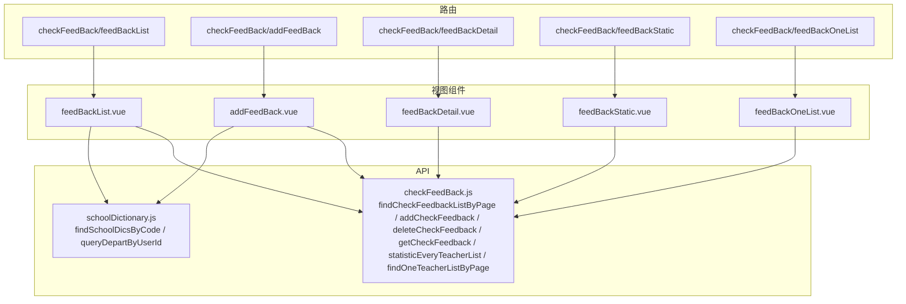
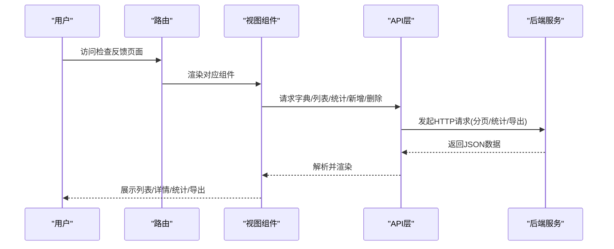
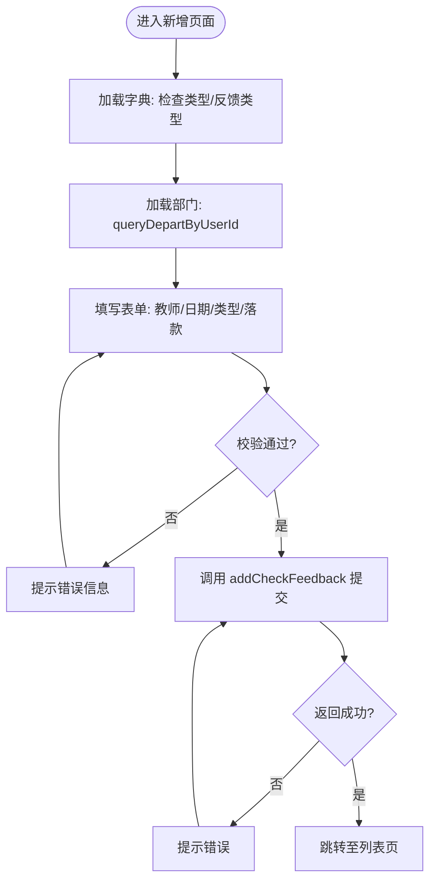
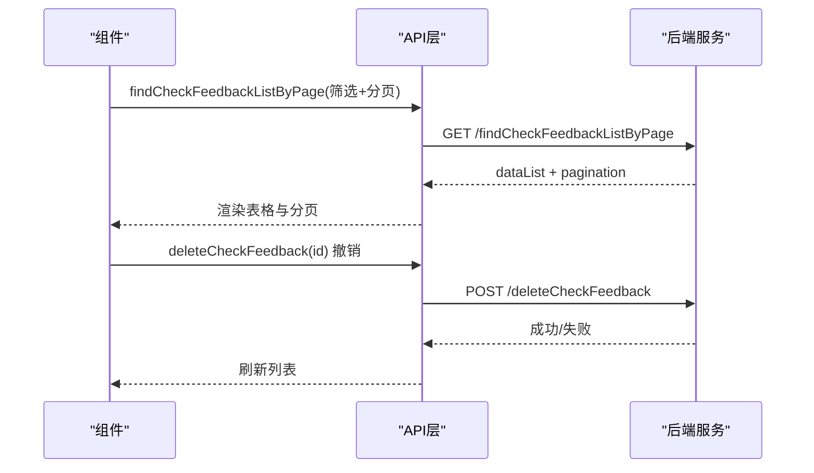
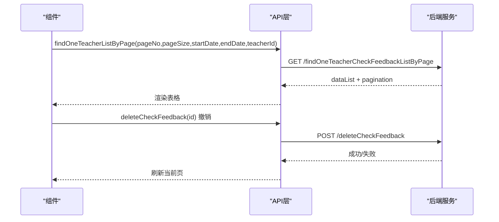
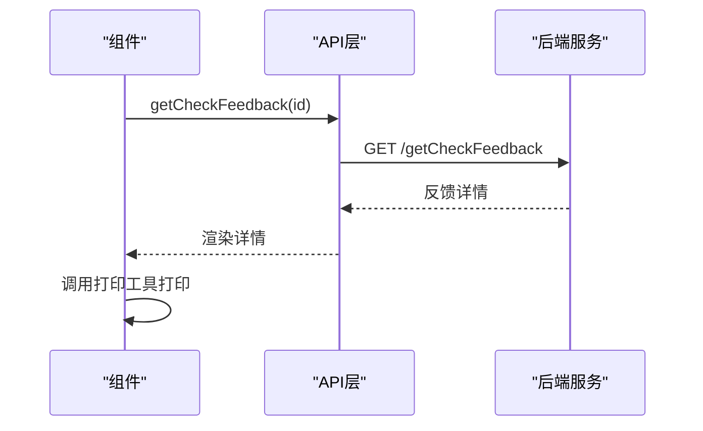
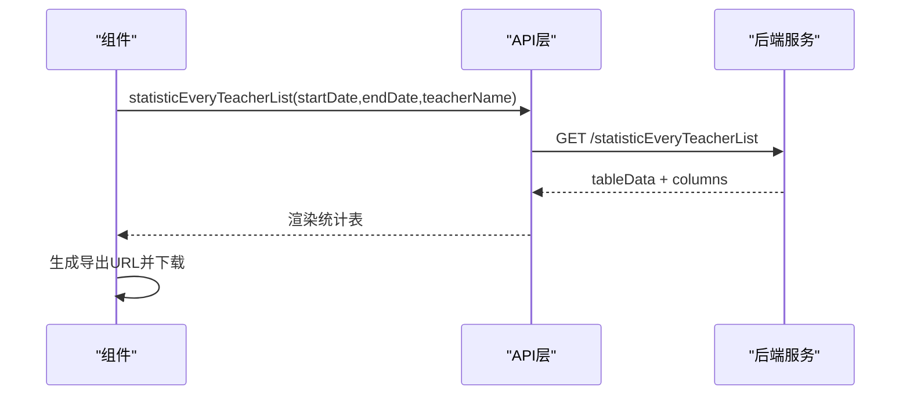
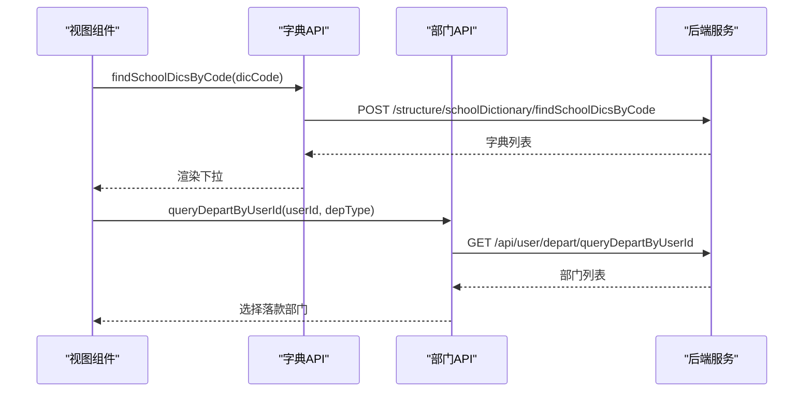
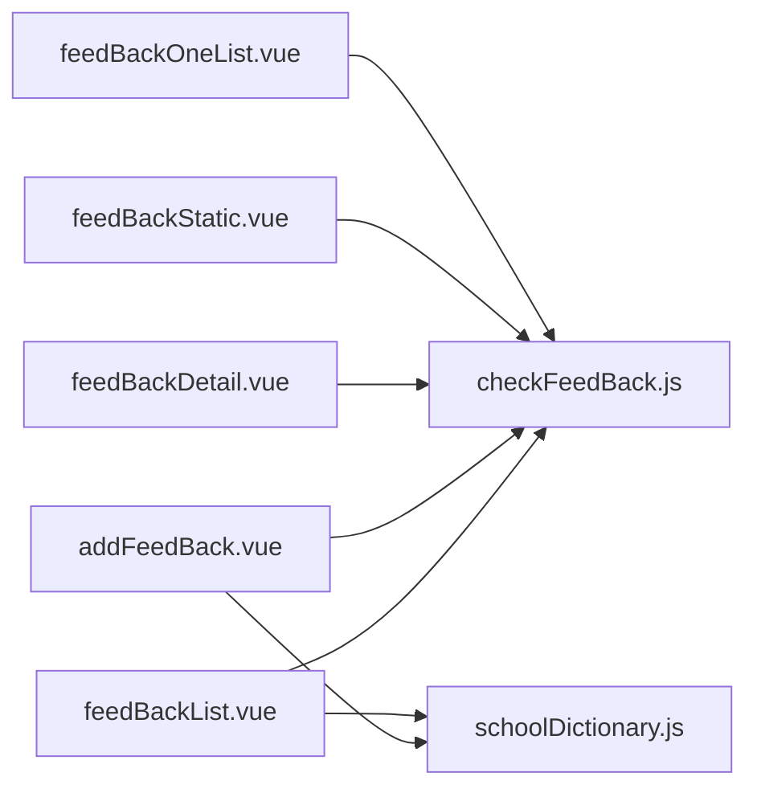

# 检查反馈管理

<cite>
**本文引用的文件**
- [checkFeedBack.js](file://src/api/checkFeedBack.js)
- [addFeedBack.vue](file://src/views/checkFeedBack/addFeedBack.vue)
- [feedBackDetail.vue](file://src/views/checkFeedBack/feedBackDetail.vue)
- [feedBackList.vue](file://src/views/checkFeedBack/feedBackList.vue)
- [feedBackOneList.vue](file://src/views/checkFeedBack/feedBackOneList.vue)
- [feedBackStatic.vue](file://src/views/checkFeedBack/feedBackStatic.vue)
- [schoolManage.js](file://src/router/normal/schoolManage.js)
- [schoolDictionary.js](file://src/api/systemSet/schoolDictionary.js)
</cite>

## 目录
1. [简介](#简介)
2. [项目结构](#项目结构)
3. [核心组件](#核心组件)
4. [架构总览](#架构总览)
5. [详细组件分析](#详细组件分析)
6. [依赖关系分析](#依赖关系分析)
7. [性能考量](#性能考量)
8. [故障排查指南](#故障排查指南)
9. [结论](#结论)
10. [附录](#附录)

## 简介
本技术文档围绕“检查反馈管理”功能展开，系统性阐述检查发现问题的反馈流程、整改建议的提出与处理、反馈信息的收集分类、分派与跟踪机制，并覆盖标准流程、责任人分配与完成时限管理、统计分析（数量统计、处理时效、整改效果）、反馈模板管理、历史查询与报表生成等实现要点。文档基于前端Vue代码与后端接口定义进行梳理，帮助开发者与产品人员快速理解并扩展该模块。

## 项目结构
检查反馈管理功能由以下层次构成：
- 路由层：在“学校管理”模块下挂载多个页面，包含新增、列表、详情、统计、个人反馈列表等。
- 视图层：对应页面负责表单填写、列表展示、详情打印、统计图表与导出。
- API层：封装检查反馈相关接口，包括字典加载、反馈新增、删除、分页查询、统计等。
- 数据源与字典：通过学校字典维护“检查类型”“反馈类型”，并通过部门选择器支持落款单位。

**图表来源**
- [schoolManage.js:552-571](file://src/router/normal/schoolManage.js#L552-L571)
- [feedBackList.vue:109-114](file://src/views/checkFeedBack/feedBackList.vue#L109-L114)
- [addFeedBack.vue:77-79](file://src/views/checkFeedBack/addFeedBack.vue#L77-L79)
- [feedBackDetail.vue:33-35](file://src/views/checkFeedBack/feedBackDetail.vue#L33-L35)
- [feedBackStatic.vue:66-67](file://src/views/checkFeedBack/feedBackStatic.vue#L66-L67)
- [feedBackOneList.vue:60-64](file://src/views/checkFeedBack/feedBackOneList.vue#L60-L64)
- [checkFeedBack.js:26-103](file://src/api/checkFeedBack.js#L26-L103)
- [schoolDictionary.js:1-188](file://src/api/systemSet/schoolDictionary.js#L1-L188)

**章节来源**
- [schoolManage.js:552-571](file://src/router/normal/schoolManage.js#L552-L571)

## 核心组件
- 接口层（API）：封装检查反馈的CRUD与统计接口，统一使用fetch请求；同时提供字典与部门查询能力。
- 页面组件（Views）：负责交互、筛选、分页、导出、打印、权限控制与跳转。
- 路由配置：在“学校管理”模块下注册检查反馈相关页面，形成清晰的导航入口。

关键职责划分：
- 新增反馈：表单校验、字典加载、落款部门选择、提交接口调用。
- 反馈列表：日期范围筛选、检查类型/反馈类型过滤、教师姓名搜索、分页、撤销操作、导出。
- 个人反馈列表：按教师维度分页查询。
- 反馈详情：打印、格式化时间显示。
- 统计页面：按教师维度统计各检查类型/反馈类型的数量，支持导出。

**章节来源**
- [checkFeedBack.js:26-103](file://src/api/checkFeedBack.js#L26-L103)
- [addFeedBack.vue:77-110](file://src/views/checkFeedBack/addFeedBack.vue#L77-L110)
- [feedBackList.vue:109-134](file://src/views/checkFeedBack/feedBackList.vue#L109-L134)
- [feedBackOneList.vue:60-80](file://src/views/checkFeedBack/feedBackOneList.vue#L60-L80)
- [feedBackDetail.vue:31-67](file://src/views/checkFeedBack/feedBackDetail.vue#L31-L67)
- [feedBackStatic.vue:64-84](file://src/views/checkFeedBack/feedBackStatic.vue#L64-L84)

## 架构总览
整体采用前后端分离架构，前端通过API层调用后端接口，后端提供分页查询、统计、导出等服务。字典与部门数据作为基础数据支撑业务配置。

**图表来源**
- [schoolManage.js:552-571](file://src/router/normal/schoolManage.js#L552-L571)
- [checkFeedBack.js:26-103](file://src/api/checkFeedBack.js#L26-L103)

## 详细组件分析

### 新增检查反馈（addFeedBack.vue）
- 功能要点
  - 表单字段：通报教师（地址簿选择）、检查日期、检查类型、反馈类型、落款部门。
  - 字典加载：通过字典编码加载“检查类型”“反馈类型”。
  - 落款部门：支持从用户所属部门中选择或手动输入。
  - 提交逻辑：参数校验、组装数据、调用新增接口、成功后跳转列表。
- 关键流程

**图表来源**
- [addFeedBack.vue:126-179](file://src/views/checkFeedBack/addFeedBack.vue#L126-L179)
- [checkFeedBack.js:14-24](file://src/api/checkFeedBack.js#L14-L24)
- [checkFeedBack.js:43-53](file://src/api/checkFeedBack.js#L43-L53)

**章节来源**
- [addFeedBack.vue:77-110](file://src/views/checkFeedBack/addFeedBack.vue#L77-L110)
- [addFeedBack.vue:126-256](file://src/views/checkFeedBack/addFeedBack.vue#L126-L256)
- [checkFeedBack.js:4-24](file://src/api/checkFeedBack.js#L4-L24)
- [checkFeedBack.js:43-53](file://src/api/checkFeedBack.js#L43-L53)

### 检查反馈列表（feedBackList.vue）
- 功能要点
  - 筛选条件：日期范围、检查类型、反馈类型、教师姓名。
  - 分页：pageNo/pageSize，动态计算导出URL。
  - 操作：撤销通报（调用删除接口），跳转详情。
  - 导出：拼接导出URL，包含字段与标题映射。
- 关键流程

**图表来源**
- [feedBackList.vue:155-199](file://src/views/checkFeedBack/feedBackList.vue#L155-L199)
- [checkFeedBack.js:26-41](file://src/api/checkFeedBack.js#L26-L41)
- [checkFeedBack.js:55-64](file://src/api/checkFeedBack.js#L55-L64)

**章节来源**
- [feedBackList.vue:109-134](file://src/views/checkFeedBack/feedBackList.vue#L109-L134)
- [feedBackList.vue:155-289](file://src/views/checkFeedBack/feedBackList.vue#L155-L289)
- [checkFeedBack.js:26-41](file://src/api/checkFeedBack.js#L26-L41)
- [checkFeedBack.js:55-64](file://src/api/checkFeedBack.js#L55-L64)

### 个人反馈列表（feedBackOneList.vue）
- 功能要点
  - 依据路由参数（教师ID、起止日期）查询该教师的反馈记录。
  - 支持分页与撤销操作。
- 关键流程

**图表来源**
- [feedBackOneList.vue:95-148](file://src/views/checkFeedBack/feedBackOneList.vue#L95-L148)
- [checkFeedBack.js:90-103](file://src/api/checkFeedBack.js#L90-L103)

**章节来源**
- [feedBackOneList.vue:60-80](file://src/views/checkFeedBack/feedBackOneList.vue#L60-L80)
- [feedBackOneList.vue:95-148](file://src/views/checkFeedBack/feedBackOneList.vue#L95-L148)
- [checkFeedBack.js:90-103](file://src/api/checkFeedBack.js#L90-L103)

### 反馈详情（feedBackDetail.vue）
- 功能要点
  - 展示反馈详情（教师、日期、检查类型、反馈类型、落款部门、创建时间）。
  - 打印功能：通过打印工具打印指定区域。
- 关键流程

**图表来源**
- [feedBackDetail.vue:86-100](file://src/views/checkFeedBack/feedBackDetail.vue#L86-L100)
- [checkFeedBack.js:66-75](file://src/api/checkFeedBack.js#L66-L75)

**章节来源**
- [feedBackDetail.vue:31-67](file://src/views/checkFeedBack/feedBackDetail.vue#L31-L67)
- [feedBackDetail.vue:86-100](file://src/views/checkFeedBack/feedBackDetail.vue#L86-L100)
- [checkFeedBack.js:66-75](file://src/api/checkFeedBack.js#L66-L75)

### 统计分析（feedBackStatic.vue）
- 功能要点
  - 日期范围筛选、教师姓名搜索。
  - 统计每名教师在选定时间段内各检查类型/反馈类型的数量。
  - 导出统计结果。
- 关键流程

**图表来源**
- [feedBackStatic.vue:95-130](file://src/views/checkFeedBack/feedBackStatic.vue#L95-L130)
- [checkFeedBack.js:77-88](file://src/api/checkFeedBack.js#L77-L88)

**章节来源**
- [feedBackStatic.vue:64-84](file://src/views/checkFeedBack/feedBackStatic.vue#L64-L84)
- [feedBackStatic.vue:95-130](file://src/views/checkFeedBack/feedBackStatic.vue#L95-L130)
- [checkFeedBack.js:77-88](file://src/api/checkFeedBack.js#L77-L88)

### 字典与部门数据支撑
- 字典加载：通过字典编码加载“检查类型”“反馈类型”。
- 部门查询：根据用户ID与部门类型查询可选部门，用于落款单位选择。

**图表来源**
- [addFeedBack.vue:212-242](file://src/views/checkFeedBack/addFeedBack.vue#L212-L242)
- [addFeedBack.vue:199-211](file://src/views/checkFeedBack/addFeedBack.vue#L199-L211)
- [checkFeedBack.js:4-12](file://src/api/checkFeedBack.js#L4-L12)
- [checkFeedBack.js:13-24](file://src/api/checkFeedBack.js#L13-L24)
- [schoolDictionary.js:1-188](file://src/api/systemSet/schoolDictionary.js#L1-L188)

**章节来源**
- [addFeedBack.vue:77-110](file://src/views/checkFeedBack/addFeedBack.vue#L77-L110)
- [addFeedBack.vue:199-242](file://src/views/checkFeedBack/addFeedBack.vue#L199-L242)
- [checkFeedBack.js:4-24](file://src/api/checkFeedBack.js#L4-L24)
- [schoolDictionary.js:1-188](file://src/api/systemSet/schoolDictionary.js#L1-L188)

## 依赖关系分析
- 组件与API的耦合
  - 列表/详情/统计/个人列表均依赖checkFeedBack.js提供的接口。
  - 新增页面额外依赖字典与部门查询接口。
- 路由与视图的绑定
  - 路由在“学校管理”模块下注册，形成清晰的功能入口。
- 外部依赖
  - Element UI组件库用于表单、表格、分页、对话框等。
  - lodash防抖优化输入搜索。
  - moment用于时间格式化。

**图表来源**
- [feedBackList.vue:109-114](file://src/views/checkFeedBack/feedBackList.vue#L109-L114)
- [addFeedBack.vue:77-79](file://src/views/checkFeedBack/addFeedBack.vue#L77-L79)
- [feedBackDetail.vue:32-35](file://src/views/checkFeedBack/feedBackDetail.vue#L32-L35)
- [feedBackStatic.vue:66-67](file://src/views/checkFeedBack/feedBackStatic.vue#L66-L67)
- [feedBackOneList.vue:60-64](file://src/views/checkFeedBack/feedBackOneList.vue#L60-L64)
- [checkFeedBack.js:26-103](file://src/api/checkFeedBack.js#L26-L103)
- [schoolDictionary.js:1-188](file://src/api/systemSet/schoolDictionary.js#L1-L188)

**章节来源**
- [feedBackList.vue:109-114](file://src/views/checkFeedBack/feedBackList.vue#L109-L114)
- [addFeedBack.vue:77-79](file://src/views/checkFeedBack/addFeedBack.vue#L77-L79)
- [feedBackDetail.vue:32-35](file://src/views/checkFeedBack/feedBackDetail.vue#L32-L35)
- [feedBackStatic.vue:66-67](file://src/views/checkFeedBack/feedBackStatic.vue#L66-L67)
- [feedBackOneList.vue:60-64](file://src/views/checkFeedBack/feedBackOneList.vue#L60-L64)
- [checkFeedBack.js:26-103](file://src/api/checkFeedBack.js#L26-L103)
- [schoolDictionary.js:1-188](file://src/api/systemSet/schoolDictionary.js#L1-L188)

## 性能考量
- 防抖优化：对搜索输入与日期变更进行防抖，减少频繁请求。
- 分页与导出：列表与统计均支持分页与导出，避免一次性加载大量数据。
- 时间格式化：在前端进行格式化，减轻后端压力。
- 建议
  - 对高频筛选字段增加本地缓存策略。
  - 统计页面可考虑懒加载与虚拟滚动提升大数据量体验。
  - 导出接口支持异步任务与进度反馈。

[本节为通用指导，无需特定文件来源]

## 故障排查指南
- 新增失败
  - 现象：提交后无响应或报错。
  - 排查：确认必填项（教师、日期、类型、落款）是否完整；检查网络面板与接口返回码。
  - 参考路径：[addFeedBack.vue:126-179](file://src/views/checkFeedBack/addFeedBack.vue#L126-L179)，[checkFeedBack.js:43-53](file://src/api/checkFeedBack.js#L43-L53)
- 列表为空或分页异常
  - 现象：切换页码后数据为空或总数不正确。
  - 排查：确认pageNo/pageSize传参；检查后端分页逻辑与total返回。
  - 参考路径：[feedBackList.vue:155-199](file://src/views/checkFeedBack/feedBackList.vue#L155-L199)，[checkFeedBack.js:26-41](file://src/api/checkFeedBack.js#L26-L41)
- 撤销失败
  - 现象：点击撤销无反应或提示失败。
  - 排查：确认id正确传递与接口返回状态；检查权限与数据状态。
  - 参考路径：[feedBackList.vue:208-223](file://src/views/checkFeedBack/feedBackList.vue#L208-L223)，[checkFeedBack.js:55-64](file://src/api/checkFeedBack.js#L55-L64)
- 统计无数据
  - 现象：统计表为空。
  - 排查：确认日期范围与教师名称筛选条件；检查后端统计接口返回。
  - 参考路径：[feedBackStatic.vue:95-130](file://src/views/checkFeedBack/feedBackStatic.vue#L95-L130)，[checkFeedBack.js:77-88](file://src/api/checkFeedBack.js#L77-L88)
- 导出异常
  - 现象：导出链接无效或下载失败。
  - 排查：核对导出URL拼接参数（token、字段、标题）；确认后端导出接口可用。
  - 参考路径：[feedBackList.vue:186-188](file://src/views/checkFeedBack/feedBackList.vue#L186-L188)，[feedBackStatic.vue:114-116](file://src/views/checkFeedBack/feedBackStatic.vue#L114-L116)

**章节来源**
- [addFeedBack.vue:126-179](file://src/views/checkFeedBack/addFeedBack.vue#L126-L179)
- [feedBackList.vue:155-223](file://src/views/checkFeedBack/feedBackList.vue#L155-L223)
- [feedBackStatic.vue:95-130](file://src/views/checkFeedBack/feedBackStatic.vue#L95-L130)
- [checkFeedBack.js:26-64](file://src/api/checkFeedBack.js#L26-L64)

## 结论
检查反馈管理模块通过清晰的路由与视图分工、完善的API接口与字典/部门数据支撑，实现了从“发现问题—发布通报—统计分析—导出归档”的闭环流程。建议后续在模板管理、整改时限与责任人分配方面进一步完善，以满足更复杂的业务场景。

[本节为总结性内容，无需特定文件来源]

## 附录

### 接口清单与用途
- findCheckFeedbackListByPage：分页查询检查反馈列表
- addCheckFeedback：新增检查反馈
- deleteCheckFeedback：删除检查反馈
- getCheckFeedback：获取单条反馈详情
- statisticEveryTeacherList：按教师统计反馈数量
- findOneTeacherListByPage：按教师分页查询反馈
- findSchoolDicsByCode：按字典编码获取字典值列表
- queryDepartByUserId：按用户ID查询部门列表

**章节来源**
- [checkFeedBack.js:26-103](file://src/api/checkFeedBack.js#L26-L103)

### 路由与页面映射
- checkFeedBack/feedBackList → 列表页
- checkFeedBack/addFeedBack → 新增页
- checkFeedBack/feedBackDetail → 详情页
- checkFeedBack/feedBackStatic → 统计页
- checkFeedBack/feedBackOneList → 个人反馈列表页

**章节来源**
- [schoolManage.js:552-571](file://src/router/normal/schoolManage.js#L552-L571)