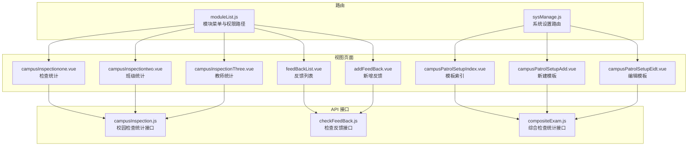
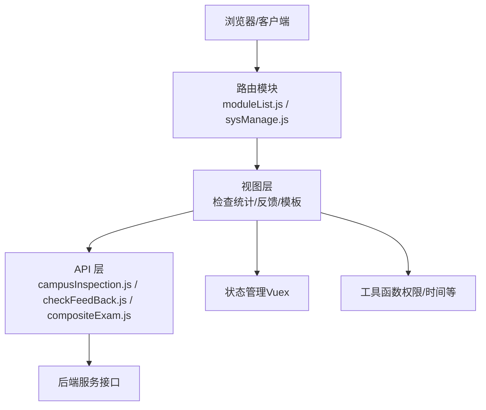
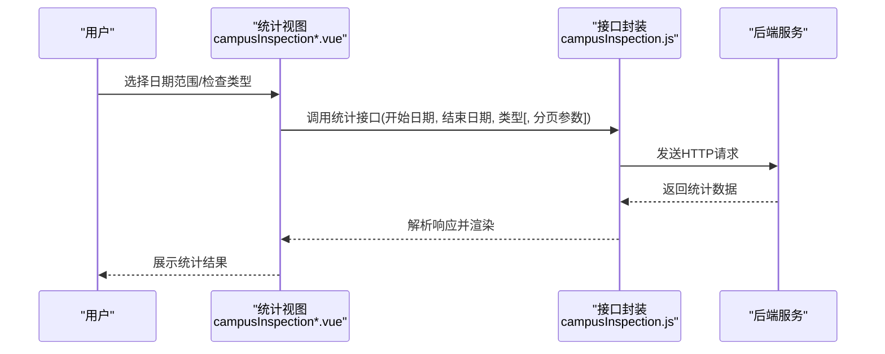
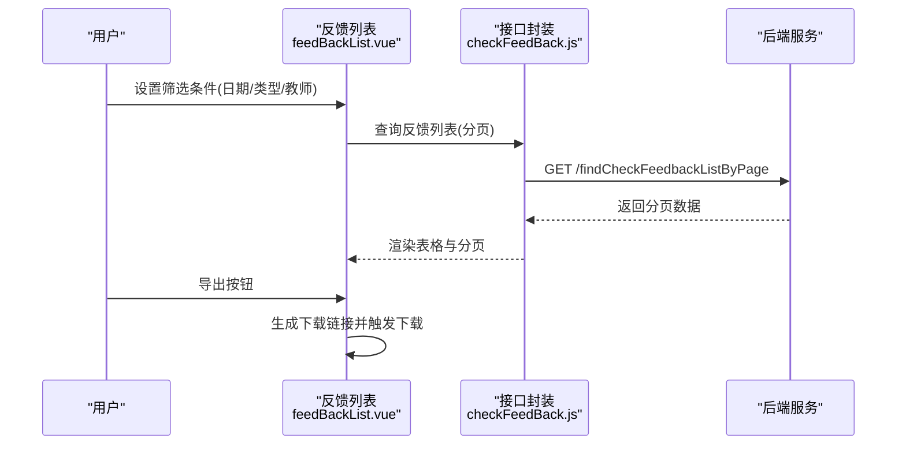
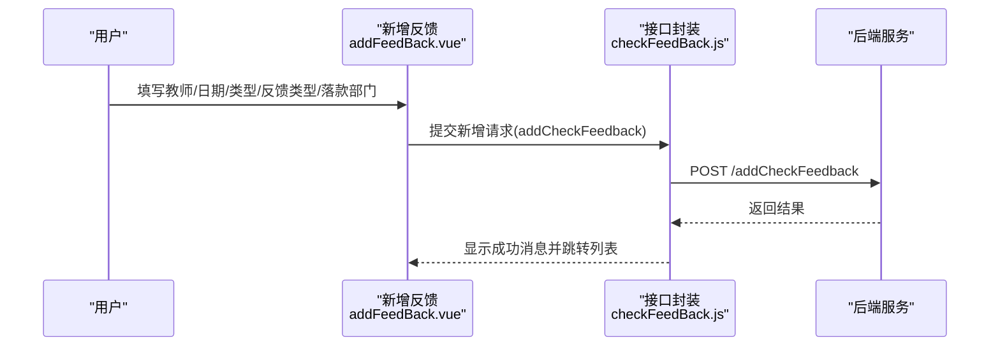
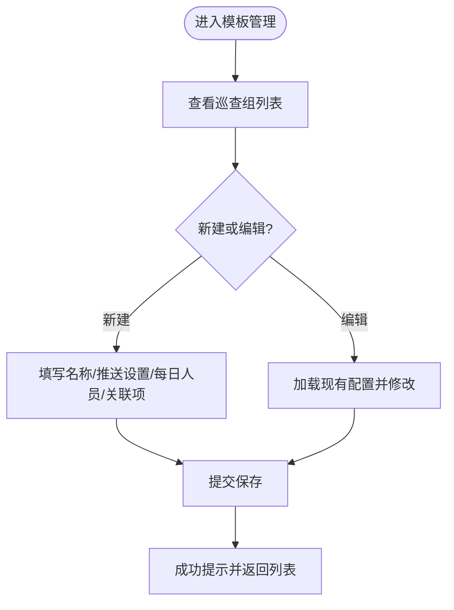
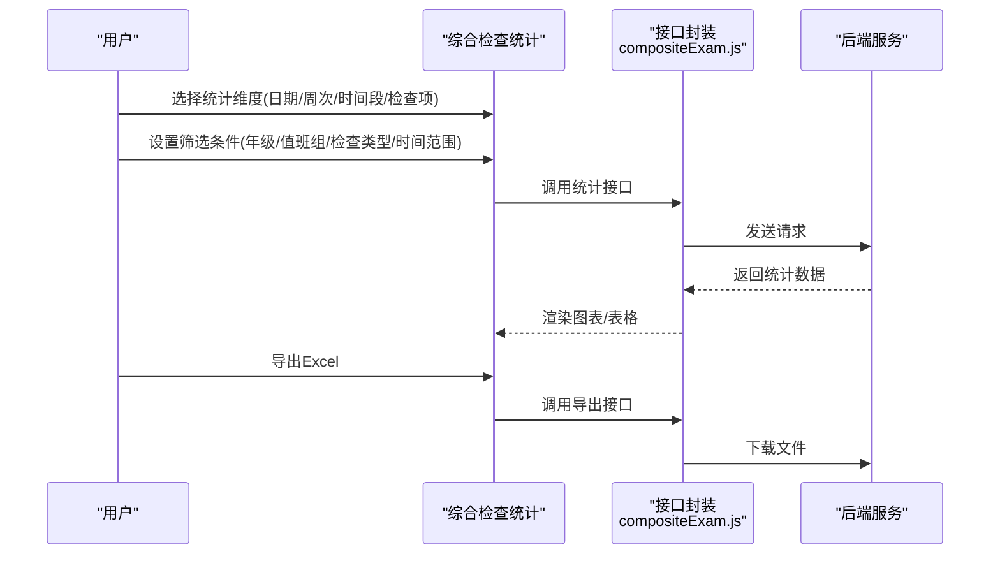
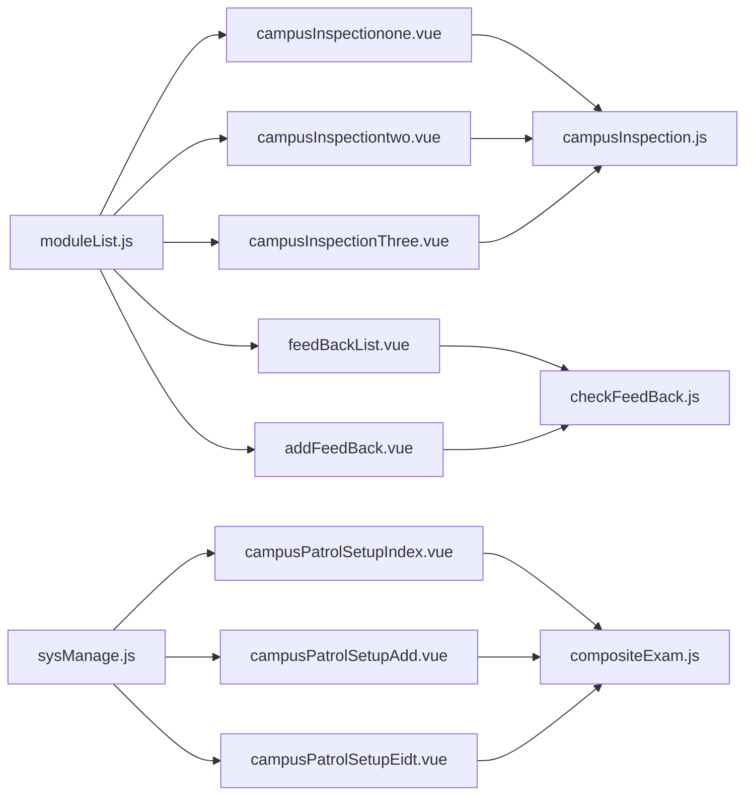

# 检查管理

<cite>
**本文引用的文件**
- [moduleList.js](file://src/router/moduleList.js)
- [sysManage.js](file://src/router/normal/sysManage.js)
- [campusInspection.js](file://src/api/campusInspection.js)
- [checkFeedBack.js](file://src/api/checkFeedBack.js)
- [compositeExam.js](file://src/api/compositeExam.js)
- [campusInspectionone.vue](file://src/views/campusInspection/campusInspectionone.vue)
- [campusInspectiontwo.vue](file://src/views/campusInspection/campusInspectiontwo.vue)
- [campusInspectionThree.vue](file://src/views/campusInspection/campusInspectionThree.vue)
- [feedBackList.vue](file://src/views/checkFeedBack/feedBackList.vue)
- [addFeedBack.vue](file://src/views/checkFeedBack/addFeedBack.vue)
- [campusPatrolSetupIndex.vue](file://src/views/sysSet/compositeExamSetTwo/campusPatrolSetupIndex.vue)
- [campusPatrolSetupAdd.vue](file://src/views/sysSet/compositeExamSetTwo/campusPatrolSetupAdd.vue)
- [campusPatrolSetupEidt.vue](file://src/views/sysSet/compositeExamSetTwo/campusPatrolSetupEidt.vue)
</cite>

## 目录
1. [引言](#引言)
2. [项目结构](#项目结构)
3. [核心组件](#核心组件)
4. [架构总览](#架构总览)
5. [详细组件分析](#详细组件分析)
6. [依赖关系分析](#依赖关系分析)
7. [性能考虑](#性能考虑)
8. [故障排查指南](#故障排查指南)
9. [结论](#结论)
10. [附录](#附录)

## 引言
本文件面向“检查管理”业务域，围绕校园综合检查、专项检查与日常检查的全生命周期管理进行系统化梳理。内容覆盖检查计划制定、检查执行、问题反馈与整改跟踪的闭环流程；明确评分标准与权重分配、统计分析与报表生成；阐述检查数据采集、质量控制与报告生成逻辑；并说明权限配置、检查模板管理与结果可视化展示能力。

## 项目结构
检查管理相关模块主要分布在以下区域：
- 路由模块：用于导航至检查统计、检查反馈、系统设置中的检查模板配置等页面
- API 层：封装检查统计、检查反馈、综合检查统计等接口调用
- 视图层：包含检查统计看板、检查反馈列表与新增、检查模板配置界面

图表来源
- [moduleList.js:1144-1162](file://src/router/moduleList.js#L1144-L1162)
- [sysManage.js:328-370](file://src/router/normal/sysManage.js#L328-L370)
- [campusInspection.js:1-28](file://src/api/campusInspection.js#L1-L28)
- [checkFeedBack.js:1-103](file://src/api/checkFeedBack.js#L1-L103)
- [compositeExam.js:1-142](file://src/api/compositeExam.js#L1-L142)
- [campusInspectionone.vue:1-315](file://src/views/campusInspection/campusInspectionone.vue#L1-L315)
- [campusInspectiontwo.vue:1-355](file://src/views/campusInspection/campusInspectiontwo.vue#L1-L355)
- [campusInspectionThree.vue:1-283](file://src/views/campusInspection/campusInspectionThree.vue#L1-L283)
- [feedBackList.vue:1-309](file://src/views/checkFeedBack/feedBackList.vue#L1-L309)
- [addFeedBack.vue:1-314](file://src/views/checkFeedBack/addFeedBack.vue#L1-L314)
- [campusPatrolSetupIndex.vue:1-196](file://src/views/sysSet/compositeExamSetTwo/campusPatrolSetupIndex.vue#L1-L196)
- [campusPatrolSetupAdd.vue:1-339](file://src/views/sysSet/compositeExamSetTwo/campusPatrolSetupAdd.vue#L1-L339)
- [campusPatrolSetupEidt.vue:1-371](file://src/views/sysSet/compositeExamSetTwo/campusPatrolSetupEidt.vue#L1-L371)

章节来源
- [moduleList.js:1144-1162](file://src/router/moduleList.js#L1144-L1162)
- [sysManage.js:328-370](file://src/router/normal/sysManage.js#L328-L370)

## 核心组件
- 校园检查统计视图：支持按日期范围、检查类型进行筛选，展示检查人员次数、班级检查次数、教师被检次数及问题占比等
- 检查反馈视图：提供反馈列表、新增反馈、撤销通报、导出等功能
- 系统设置（检查模板）：支持新建/编辑/删除巡查组、配置推送策略与关联检查项
- 综合检查统计接口：提供按日期、周次、时间段、检查项维度的统计与明细查询

章节来源
- [campusInspectionone.vue:1-315](file://src/views/campusInspection/campusInspectionone.vue#L1-L315)
- [campusInspectiontwo.vue:1-355](file://src/views/campusInspection/campusInspectiontwo.vue#L1-L355)
- [campusInspectionThree.vue:1-283](file://src/views/campusInspection/campusInspectionThree.vue#L1-L283)
- [feedBackList.vue:1-309](file://src/views/checkFeedBack/feedBackList.vue#L1-L309)
- [addFeedBack.vue:1-314](file://src/views/checkFeedBack/addFeedBack.vue#L1-L314)
- [campusPatrolSetupIndex.vue:1-196](file://src/views/sysSet/compositeExamSetTwo/campusPatrolSetupIndex.vue#L1-L196)
- [campusPatrolSetupAdd.vue:1-339](file://src/views/sysSet/compositeExamSetTwo/campusPatrolSetupAdd.vue#L1-L339)
- [campusPatrolSetupEidt.vue:1-371](file://src/views/sysSet/compositeExamSetTwo/campusPatrolSetupEidt.vue#L1-L371)
- [campusInspection.js:1-28](file://src/api/campusInspection.js#L1-L28)
- [checkFeedBack.js:1-103](file://src/api/checkFeedBack.js#L1-L103)
- [compositeExam.js:1-142](file://src/api/compositeExam.js#L1-L142)

## 架构总览
检查管理采用前端单页应用（SPA）架构，通过路由模块组织页面，API 层统一处理后端接口调用，视图层负责交互与展示。系统设置中的检查模板通过“巡查组”概念实现检查计划的配置与下发。

图表来源
- [moduleList.js:1144-1162](file://src/router/moduleList.js#L1144-L1162)
- [sysManage.js:328-370](file://src/router/normal/sysManage.js#L328-L370)
- [campusInspection.js:1-28](file://src/api/campusInspection.js#L1-L28)
- [checkFeedBack.js:1-103](file://src/api/checkFeedBack.js#L1-L103)
- [compositeExam.js:1-142](file://src/api/compositeExam.js#L1-L142)

## 详细组件分析

### 校园检查统计（按人员/班级/教师）
- 功能要点
  - 支持按日期范围与检查类型筛选
  - 人员维度：展示检查人员数量与检查次数
  - 班级维度：展示各年级班级检查次数、问题次数与问题占比
  - 教师维度：分页展示教师被检次数、问题次数与问题占比
- 数据来源
  - 人员统计：campusInspection.js 的 getCheckUserRecordList
  - 班级统计：getClassCheckCountRecordList
  - 教师统计：getThCheckCountRecordList（含分页）
- 关键流程
  - 选择日期范围与检查类型后，调用对应接口获取数据并渲染
  - 教师统计页面支持分页切换与重新加载

图表来源
- [campusInspection.js:5-28](file://src/api/campusInspection.js#L5-L28)
- [campusInspectionone.vue:166-177](file://src/views/campusInspection/campusInspectionone.vue#L166-L177)
- [campusInspectiontwo.vue:157-191](file://src/views/campusInspection/campusInspectiontwo.vue#L157-L191)
- [campusInspectionThree.vue:166-182](file://src/views/campusInspection/campusInspectionThree.vue#L166-L182)

章节来源
- [campusInspection.js:1-28](file://src/api/campusInspection.js#L1-L28)
- [campusInspectionone.vue:1-315](file://src/views/campusInspection/campusInspectionone.vue#L1-L315)
- [campusInspectiontwo.vue:1-355](file://src/views/campusInspection/campusInspectiontwo.vue#L1-L355)
- [campusInspectionThree.vue:1-283](file://src/views/campusInspection/campusInspectionThree.vue#L1-L283)

### 检查反馈（问题反馈与整改跟踪）
- 功能要点
  - 列表：按日期、检查类型、反馈类型、教师姓名筛选，支持分页与导出
  - 新增：选择教师、日期、检查类型、反馈类型、落款部门，发布公示
  - 撤销：对已发布反馈执行撤销操作
  - 统计：按教师维度统计反馈类型分布
- 数据来源
  - 列表：findCheckFeedbackListByPage
  - 新增：addCheckFeedback
  - 撤销：deleteCheckFeedback
  - 字典：findSchoolDicsByCode（检查类型、反馈类型）
  - 部门：queryDepartByUserId
- 关键流程
  - 新增时校验必填项，组装参数后提交
  - 列表支持多条件组合查询与导出 Excel

图表来源
- [checkFeedBack.js:27-41](file://src/api/checkFeedBack.js#L27-L41)
- [feedBackList.vue:157-199](file://src/views/checkFeedBack/feedBackList.vue#L157-L199)
- [feedBackList.vue:186-188](file://src/views/checkFeedBack/feedBackList.vue#L186-L188)

图表来源
- [addFeedBack.vue:127-179](file://src/views/checkFeedBack/addFeedBack.vue#L127-L179)
- [checkFeedBack.js:44-53](file://src/api/checkFeedBack.js#L44-L53)

章节来源
- [checkFeedBack.js:1-103](file://src/api/checkFeedBack.js#L1-L103)
- [feedBackList.vue:1-309](file://src/views/checkFeedBack/feedBackList.vue#L1-L309)
- [addFeedBack.vue:1-314](file://src/views/checkFeedBack/addFeedBack.vue#L1-L314)

### 系统设置（检查模板管理）
- 功能要点
  - 巡查组索引：查看、删除、进入详情
  - 新建/编辑：配置巡查组名称、推送设置（指定人员/级部主任/责任人）、每日巡查人员、关联检查项
  - 关联检查项：通过弹窗勾选，支持预览与删除
- 数据来源
  - 获取检查项列表：getComplexCheckItemList
  - 新建/更新：addComplexCheckBase / updateComplexCheckBase
  - 删除：delComplexCheckBase
- 关键流程
  - 新建/编辑时校验必填项，组装人员 ID 串与检查项 ID 列表后提交
  - 支持按周配置每日巡查人员

图表来源
- [campusPatrolSetupIndex.vue:47-92](file://src/views/sysSet/compositeExamSetTwo/campusPatrolSetupIndex.vue#L47-L92)
- [campusPatrolSetupAdd.vue:193-244](file://src/views/sysSet/compositeExamSetTwo/campusPatrolSetupAdd.vue#L193-L244)
- [campusPatrolSetupEidt.vue:225-276](file://src/views/sysSet/compositeExamSetTwo/campusPatrolSetupEidt.vue#L225-L276)

章节来源
- [campusPatrolSetupIndex.vue:1-196](file://src/views/sysSet/compositeExamSetTwo/campusPatrolSetupIndex.vue#L1-L196)
- [campusPatrolSetupAdd.vue:1-339](file://src/views/sysSet/compositeExamSetTwo/campusPatrolSetupAdd.vue#L1-L339)
- [campusPatrolSetupEidt.vue:1-371](file://src/views/sysSet/compositeExamSetTwo/campusPatrolSetupEidt.vue#L1-L371)

### 综合检查统计（按日期/周次/时间段/检查项）
- 功能要点
  - 按日期统计：支持按年级、值班组、检查类型进行聚合
  - 按周次统计：支持按周次聚合
  - 按时间段统计：支持起止时间区间
  - 按检查项统计：支持分页查询
  - 问题反馈记录：提供查询与导出
- 数据来源
  - 统计接口：dateStatisticScore / weekStatisticScore / timeStatisticScore / findStatisticByItem
  - 明细接口：dateDetailByDate / weekDetailByDate
  - 问题反馈：findDutyBasehavingRecordList / findCheckEventListByPage / exportFindCheckEventList
- 关键流程
  - 选择统计维度与筛选条件后，调用对应接口获取数据
  - 支持导出 Excel

图表来源
- [compositeExam.js:14-25](file://src/api/compositeExam.js#L14-L25)
- [compositeExam.js:42-53](file://src/api/compositeExam.js#L42-L53)
- [compositeExam.js:72-85](file://src/api/compositeExam.js#L72-L85)
- [compositeExam.js:88-101](file://src/api/compositeExam.js#L88-L101)
- [compositeExam.js:121-142](file://src/api/compositeExam.js#L121-L142)

章节来源
- [compositeExam.js:1-142](file://src/api/compositeExam.js#L1-L142)

## 依赖关系分析
- 路由到视图：moduleList.js 与 sysManage.js 将菜单与页面路径绑定，确保权限与导航一致
- 视图到 API：各视图通过对应的 API 文件发起请求，避免重复封装
- 视图到工具：使用权限判断与窗口尺寸适配等通用工具
- 视图到状态：通过 Vuex 获取用户与学校信息，用于默认值与落款部门填充

图表来源
- [moduleList.js:1144-1162](file://src/router/moduleList.js#L1144-L1162)
- [sysManage.js:328-370](file://src/router/normal/sysManage.js#L328-L370)
- [campusInspection.js:1-28](file://src/api/campusInspection.js#L1-L28)
- [checkFeedBack.js:1-103](file://src/api/checkFeedBack.js#L1-L103)
- [compositeExam.js:1-142](file://src/api/compositeExam.js#L1-L142)

章节来源
- [moduleList.js:1144-1162](file://src/router/moduleList.js#L1144-L1162)
- [sysManage.js:328-370](file://src/router/normal/sysManage.js#L328-L370)

## 性能考虑
- 列表分页：教师统计与反馈列表均采用分页，减少一次性传输数据量
- 防抖查询：反馈列表对教师姓名输入使用防抖，降低频繁请求压力
- 图表自适应：通过混入计算容器高度，提升不同分辨率下的渲染效率
- 导出优化：导出链接直接拼接参数，避免额外请求开销

章节来源
- [campusInspectionThree.vue:183-190](file://src/views/campusInspection/campusInspectionThree.vue#L183-L190)
- [feedBackList.vue:224-230](file://src/views/checkFeedBack/feedBackList.vue#L224-L230)
- [campusInspectionone.vue:73-88](file://src/views/campusInspection/campusInspectionone.vue#L73-L88)
- [feedBackList.vue:186-188](file://src/views/checkFeedBack/feedBackList.vue#L186-L188)

## 故障排查指南
- 检查统计无数据
  - 确认所选日期范围与检查类型是否匹配；尝试扩大日期范围或切换类型
  - 班级统计需确保存在对应年级与班级记录
- 反馈列表为空或分页异常
  - 检查筛选条件是否过于严格；若当前页无数据，系统会自动回退到上一页并刷新
  - 确认导出链接参数是否正确生成
- 新增反馈失败
  - 校验必填项（教师、日期、检查类型、反馈类型、落款部门）是否完整
  - 落款部门可通过对话框选择或手动输入，确保非空
- 模板保存失败
  - 校验巡查组名称、推送设置与关联检查项是否填写
  - 每日人员 ID 串由组件自动拼接，确保地址簿选择有效

章节来源
- [campusInspectionone.vue:166-177](file://src/views/campusInspection/campusInspectionone.vue#L166-L177)
- [campusInspectiontwo.vue:157-191](file://src/views/campusInspection/campusInspectiontwo.vue#L157-L191)
- [campusInspectionThree.vue:166-182](file://src/views/campusInspection/campusInspectionThree.vue#L166-L182)
- [feedBackList.vue:157-199](file://src/views/checkFeedBack/feedBackList.vue#L157-L199)
- [addFeedBack.vue:127-179](file://src/views/checkFeedBack/addFeedBack.vue#L127-L179)
- [campusPatrolSetupAdd.vue:193-244](file://src/views/sysSet/compositeExamSetTwo/campusPatrolSetupAdd.vue#L193-L244)
- [campusPatrolSetupEidt.vue:225-276](file://src/views/sysSet/compositeExamSetTwo/campusPatrolSetupEidt.vue#L225-L276)

## 结论
检查管理系统以“检查统计—问题反馈—模板配置—综合统计”为主线，形成从执行到闭环的完整流程。通过灵活的筛选与分页、字典化配置与导出能力，满足校园综合检查、专项检查与日常检查的多样化需求。建议后续在评分标准与权重分配、质量控制规则与报告自动化方面进一步完善，以支撑更精细化的评估与改进。

## 附录
- 权限配置
  - 路由模块通过 permissionPath 控制菜单显示与访问
  - 页面内通过 isShowByPermission 判断具体按钮与区域的可见性
- 检查模板管理
  - 支持按周配置每日巡查人员，便于日常检查排班
  - 支持推送策略配置，确保检查结果及时触达相关人员
- 可视化展示
  - 人员统计采用卡片式布局，直观展示检查次数
  - 班级统计按年级分组，支持横向滚动查看更多条目
  - 教师统计采用表格与分页，支持问题占比计算与排序

章节来源
- [moduleList.js:1144-1162](file://src/router/moduleList.js#L1144-L1162)
- [campusInspectionone.vue:107-139](file://src/views/campusInspection/campusInspectionone.vue#L107-L139)
- [campusInspectiontwo.vue:98-130](file://src/views/campusInspection/campusInspectiontwo.vue#L98-L130)
- [campusInspectionThree.vue:84-116](file://src/views/campusInspection/campusInspectionThree.vue#L84-L116)
- [campusPatrolSetupAdd.vue:19-18](file://src/views/sysSet/compositeExamSetTwo/campusPatrolSetupAdd.vue#L19-L18)
- [campusPatrolSetupEidt.vue:14-17](file://src/views/sysSet/compositeExamSetTwo/campusPatrolSetupEidt.vue#L14-L17)