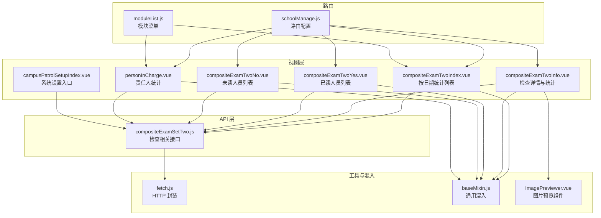
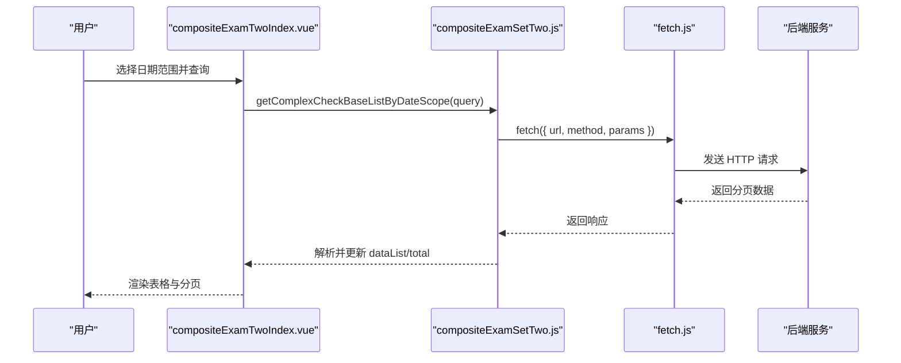
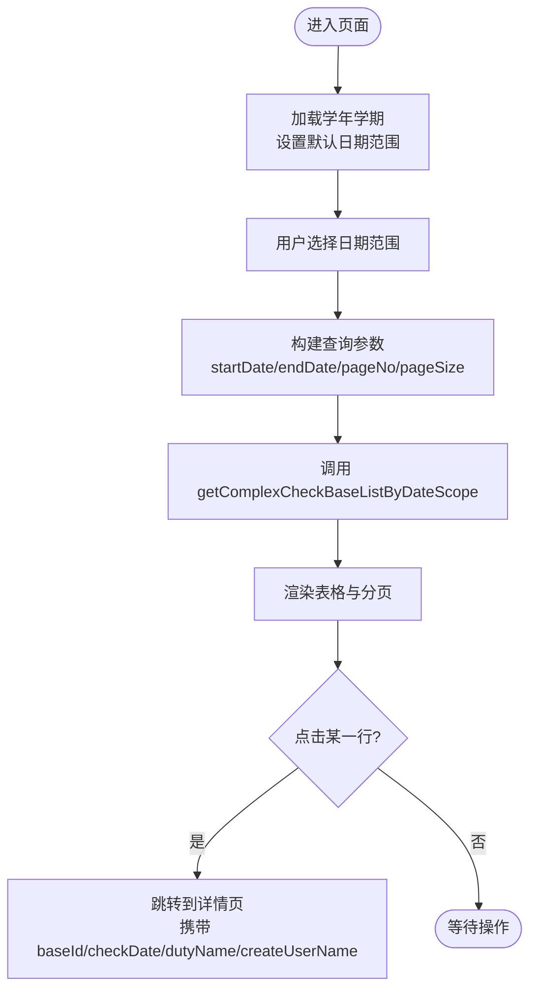
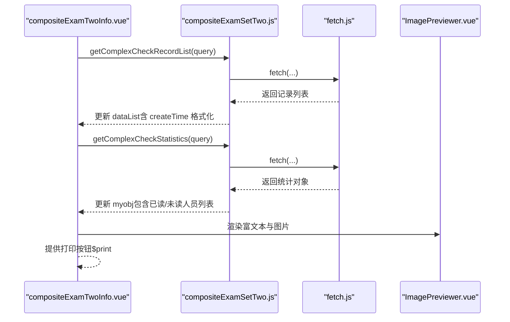
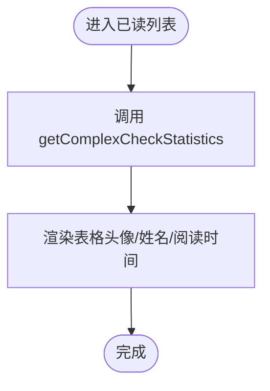
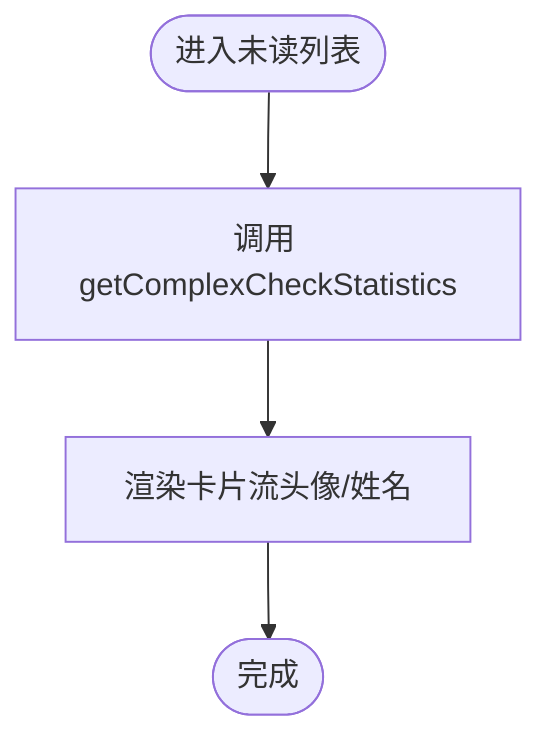
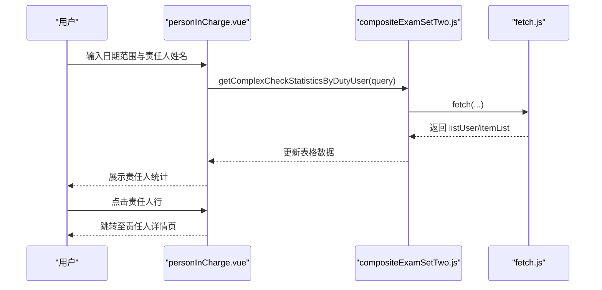
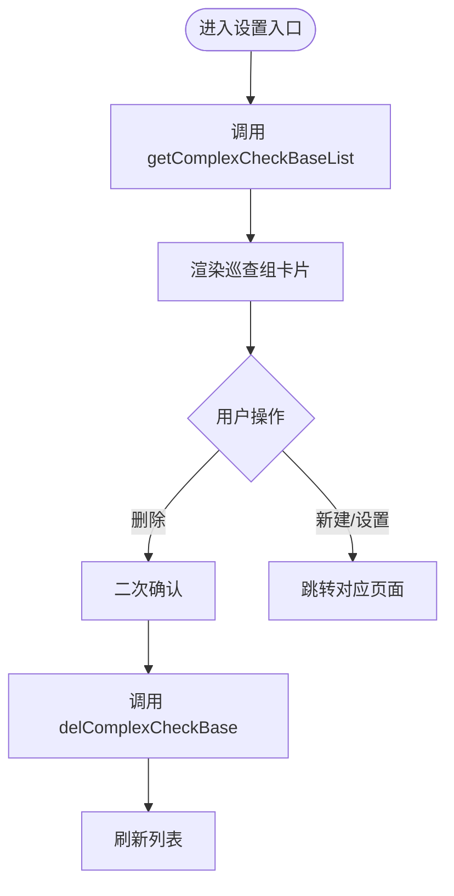
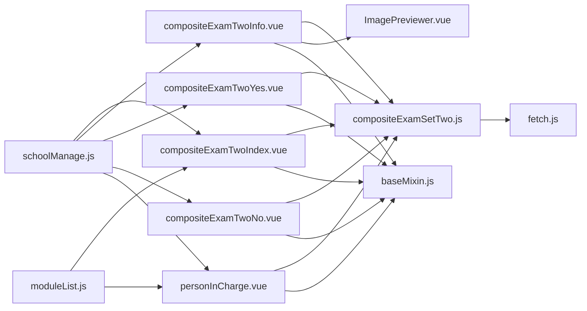

# 综合检查二

<cite>
**本文引用的文件**
- [compositeExamTwoIndex.vue](file://src/views/compositeExamTwo/compositeExamTwoIndex.vue)
- [compositeExamTwoInfo.vue](file://src/views/compositeExamTwo/compositeExamTwoInfo.vue)
- [compositeExamTwoYes.vue](file://src/views/compositeExamTwo/compositeExamTwoYes.vue)
- [compositeExamTwoNo.vue](file://src/views/compositeExamTwo/compositeExamTwoNo.vue)
- [personInCharge.vue](file://src/views/compositeExamTwo/personInCharge.vue)
- [compositeExamSetTwo.js](file://src/api/compositeExamSetTwo.js)
- [fetch.js](file://src/utils/fetch.js)
- [baseMixin.js](file://src/mixins/baseMixin.js)
- [ImagePreviewer.vue](file://src/components/ImagePreviewer/ImagePreviewer.vue)
- [campusPatrolSetupIndex.vue](file://src/views/sysSet/compositeExamSetTwo/campusPatrolSetupIndex.vue)
- [schoolManage.js](file://src/router/normal/schoolManage.js)
- [moduleList.js](file://src/router/moduleList.js)
</cite>

## 目录
1. [简介](#简介)
2. [项目结构](#项目结构)
3. [核心组件](#核心组件)
4. [架构总览](#架构总览)
5. [组件详解](#组件详解)
6. [依赖关系分析](#依赖关系分析)
7. [性能考量](#性能考量)
8. [故障排查指南](#故障排查指南)
9. [结论](#结论)
10. [附录](#附录)

## 简介
本技术文档围绕“综合检查二”功能展开，系统性阐述其业务特性、技术实现与与“综合检查一”的差异点，重点覆盖以下方面：
- 业务特性与检查范围：按日期与责任人维度的检查统计、检查记录详情、人员阅读状态统计与导出。
- 技术实现差异：接口设计、数据流、UI 展示与交互逻辑。
- 特殊流程与数据处理：日期范围筛选、图片预览、PDF 导出、已读/未读人员列表。
- 结果展示格式：检查项清单、评价等级、备注文本与图片、记录人与时间等。
- 责任分工与进度管理：值班组与责任人统计、推送设置入口、系统配置维护。
- 质量监督与评估：已读率、未读人员可视化、导出与对比分析支持。
- 经验总结与分享：通过导出与统计报表沉淀检查经验。

## 项目结构
综合检查二功能位于前端工程的“views/compositeExamTwo”目录下，配合 API 层“src/api/compositeExamSetTwo.js”，并由路由模块“src/router/normal/schoolManage.js”与“src/router/moduleList.js”进行模块注册与导航配置；系统设置侧在“src/views/sysSet/compositeExamSetTwo”提供巡查组与推送设置入口。

图表来源
- [compositeExamTwoIndex.vue:1-113](file://src/views/compositeExamTwo/compositeExamTwoIndex.vue#L1-L113)
- [compositeExamTwoInfo.vue:1-194](file://src/views/compositeExamTwo/compositeExamTwoInfo.vue#L1-L194)
- [compositeExamTwoYes.vue:1-81](file://src/views/compositeExamTwo/compositeExamTwoYes.vue#L1-L81)
- [compositeExamTwoNo.vue:1-72](file://src/views/compositeExamTwo/compositeExamTwoNo.vue#L1-L72)
- [personInCharge.vue:1-133](file://src/views/compositeExamTwo/personInCharge.vue#L1-L133)
- [campusPatrolSetupIndex.vue:1-196](file://src/views/sysSet/compositeExamSetTwo/campusPatrolSetupIndex.vue#L1-L196)
- [compositeExamSetTwo.js:1-175](file://src/api/compositeExamSetTwo.js#L1-L175)
- [fetch.js:1-240](file://src/utils/fetch.js#L1-L240)
- [baseMixin.js:1-103](file://src/mixins/baseMixin.js#L1-L103)
- [ImagePreviewer.vue:1-236](file://src/components/ImagePreviewer/ImagePreviewer.vue#L1-L236)
- [schoolManage.js:456-477](file://src/router/normal/schoolManage.js#L456-L477)
- [moduleList.js:1125-1136](file://src/router/moduleList.js#L1125-L1136)

章节来源
- [compositeExamTwoIndex.vue:1-113](file://src/views/compositeExamTwo/compositeExamTwoIndex.vue#L1-L113)
- [compositeExamTwoInfo.vue:1-194](file://src/views/compositeExamTwo/compositeExamTwoInfo.vue#L1-L194)
- [compositeExamTwoYes.vue:1-81](file://src/views/compositeExamTwo/compositeExamTwoYes.vue#L1-L81)
- [compositeExamTwoNo.vue:1-72](file://src/views/compositeExamTwo/compositeExamTwoNo.vue#L1-L72)
- [personInCharge.vue:1-133](file://src/views/compositeExamTwo/personInCharge.vue#L1-L133)
- [campusPatrolSetupIndex.vue:1-196](file://src/views/sysSet/compositeExamSetTwo/campusPatrolSetupIndex.vue#L1-L196)
- [compositeExamSetTwo.js:1-175](file://src/api/compositeExamSetTwo.js#L1-L175)
- [fetch.js:1-240](file://src/utils/fetch.js#L1-L240)
- [baseMixin.js:1-103](file://src/mixins/baseMixin.js#L1-L103)
- [ImagePreviewer.vue:1-236](file://src/components/ImagePreviewer/ImagePreviewer.vue#L1-L236)
- [schoolManage.js:456-477](file://src/router/normal/schoolManage.js#L456-L477)
- [moduleList.js:1125-1136](file://src/router/moduleList.js#L1125-L1136)

## 核心组件
- 按日期统计列表：支持日期范围筛选，展示检查组、值班人员，点击进入详情。
- 检查详情与统计：展示检查项、评价等级、备注与图片、记录人与时间，并提供导出 PDF 与已读/未读人员跳转。
- 已读人员列表：以表格形式展示头像、姓名、阅读时间。
- 未读人员列表：以卡片流形式展示头像与姓名。
- 责任人统计：按责任人维度统计各检查项数量与总计。
- 系统设置入口：提供巡查组管理、巡查项设置、推送设置与新建巡查组。

章节来源
- [compositeExamTwoIndex.vue:1-113](file://src/views/compositeExamTwo/compositeExamTwoIndex.vue#L1-L113)
- [compositeExamTwoInfo.vue:1-194](file://src/views/compositeExamTwo/compositeExamTwoInfo.vue#L1-L194)
- [compositeExamTwoYes.vue:1-81](file://src/views/compositeExamTwo/compositeExamTwoYes.vue#L1-L81)
- [compositeExamTwoNo.vue:1-72](file://src/views/compositeExamTwo/compositeExamTwoNo.vue#L1-L72)
- [personInCharge.vue:1-133](file://src/views/compositeExamTwo/personInCharge.vue#L1-L133)
- [campusPatrolSetupIndex.vue:1-196](file://src/views/sysSet/compositeExamSetTwo/campusPatrolSetupIndex.vue#L1-L196)

## 架构总览
综合检查二采用典型的 Vue 单页应用架构，视图层通过 API 层调用后端服务，HTTP 请求由统一的 fetch 封装处理，混入提供通用能力（如表格布局、日期格式化、导出），图片预览组件用于富文本中的图片浏览。

图表来源
- [compositeExamTwoIndex.vue:90-99](file://src/views/compositeExamTwo/compositeExamTwoIndex.vue#L90-L99)
- [compositeExamSetTwo.js:112-123](file://src/api/compositeExamSetTwo.js#L112-L123)
- [fetch.js:104-169](file://src/utils/fetch.js#L104-L169)

章节来源
- [compositeExamTwoIndex.vue:74-99](file://src/views/compositeExamTwo/compositeExamTwoIndex.vue#L74-L99)
- [compositeExamSetTwo.js:112-123](file://src/api/compositeExamSetTwo.js#L112-L123)
- [fetch.js:104-169](file://src/utils/fetch.js#L104-L169)

## 组件详解

### 按日期统计列表（compositeExamTwoIndex.vue）
- 功能要点
  - 默认取当前学年当前学期的起止时间作为日期范围。
  - 支持切换页大小与页码，重新查询基础检查列表。
  - 点击日期列进入检查详情页，传递 baseId、checkDate、值班人员与检查组信息。
- 数据流
  - 通过 getSchoolTimeAllList 获取当前学年学期区间，设置 daterange。
  - 调用 getComplexCheckBaseListByDateScope(query) 获取分页数据。
- 交互细节
  - 使用 Element UI 的日期选择器与分页组件，高度自适应窗口。

图表来源
- [compositeExamTwoIndex.vue:58-99](file://src/views/compositeExamTwo/compositeExamTwoIndex.vue#L58-L99)
- [compositeExamSetTwo.js:112-123](file://src/api/compositeExamSetTwo.js#L112-L123)

章节来源
- [compositeExamTwoIndex.vue:35-100](file://src/views/compositeExamTwo/compositeExamTwoIndex.vue#L35-L100)
- [compositeExamSetTwo.js:112-123](file://src/api/compositeExamSetTwo.js#L112-L123)

### 检查详情与统计（compositeExamTwoInfo.vue）
- 功能要点
  - 展示检查组名称、日期与星期、值班人员。
  - 列表展示每个检查项的名称、评价等级、年级标识（如有）、备注与图片。
  - 提供导出 PDF 按钮，使用内置打印能力。
  - 统计已读/未读人数，点击跳转至对应列表页。
- 数据流
  - 先拉取检查记录列表 getComplexCheckRecordList，再拉取统计 getComplexCheckStatistics。
  - 备注中的图片通过 JSON 字符串解析后逐个渲染。
- 图片预览
  - 使用 ImagePreviewer 组件，支持富文本中的图片点击放大浏览。

图表来源
- [compositeExamTwoInfo.vue:64-98](file://src/views/compositeExamTwo/compositeExamTwoInfo.vue#L64-L98)
- [compositeExamSetTwo.js:138-174](file://src/api/compositeExamSetTwo.js#L138-L174)
- [ImagePreviewer.vue:1-236](file://src/components/ImagePreviewer/ImagePreviewer.vue#L1-L236)
- [fetch.js:104-169](file://src/utils/fetch.js#L104-L169)

章节来源
- [compositeExamTwoInfo.vue:43-99](file://src/views/compositeExamTwo/compositeExamTwoInfo.vue#L43-L99)
- [compositeExamSetTwo.js:138-174](file://src/api/compositeExamSetTwo.js#L138-L174)
- [ImagePreviewer.vue:1-236](file://src/components/ImagePreviewer/ImagePreviewer.vue#L1-L236)

### 已读人员列表（compositeExamTwoYes.vue）
- 功能要点
  - 展示头像、姓名、阅读时间，支持时间过滤显示。
  - 使用 windowResize 混入适配窗口高度。
- 数据流
  - 仅需调用 getComplexCheckStatistics 获取已读人员列表。

图表来源
- [compositeExamTwoYes.vue:38-62](file://src/views/compositeExamTwo/compositeExamTwoYes.vue#L38-L62)
- [compositeExamSetTwo.js:164-174](file://src/api/compositeExamSetTwo.js#L164-L174)

章节来源
- [compositeExamTwoYes.vue:1-81](file://src/views/compositeExamTwo/compositeExamTwoYes.vue#L1-L81)
- [compositeExamSetTwo.js:164-174](file://src/api/compositeExamSetTwo.js#L164-L174)

### 未读人员列表（compositeExamTwoNo.vue）
- 功能要点
  - 以卡片流展示未读人员头像与姓名。
  - 使用 windowResize 混入适配窗口高度。
- 数据流
  - 仅需调用 getComplexCheckStatistics 获取未读人员列表。

图表来源
- [compositeExamTwoNo.vue:20-39](file://src/views/compositeExamTwo/compositeExamTwoNo.vue#L20-L39)
- [compositeExamSetTwo.js:164-174](file://src/api/compositeExamSetTwo.js#L164-L174)

章节来源
- [compositeExamTwoNo.vue:1-72](file://src/views/compositeExamTwo/compositeExamTwoNo.vue#L1-L72)
- [compositeExamSetTwo.js:164-174](file://src/api/compositeExamSetTwo.js#L164-L174)

### 责任人统计（personInCharge.vue）
- 功能要点
  - 支持按日期范围与责任人姓名筛选。
  - 展示责任人、各检查项的数量与合计。
  - 点击责任人跳转至其检查详情页。
- 数据流
  - 调用 getComplexCheckStatisticsByDutyUser 获取责任人统计与检查项列表。

图表来源
- [personInCharge.vue:71-120](file://src/views/compositeExamTwo/personInCharge.vue#L71-L120)
- [compositeExamSetTwo.js:126-136](file://src/api/compositeExamSetTwo.js#L126-L136)
- [fetch.js:104-169](file://src/utils/fetch.js#L104-L169)

章节来源
- [personInCharge.vue:47-121](file://src/views/compositeExamTwo/personInCharge.vue#L47-L121)
- [compositeExamSetTwo.js:126-136](file://src/api/compositeExamSetTwo.js#L126-L136)

### 系统设置入口（campusPatrolSetupIndex.vue）
- 功能要点
  - 提供“巡查项设置”“推送设置”“新建巡查组”等入口。
  - 支持删除巡查组，二次确认。
- 数据流
  - 调用 getComplexCheckBaseList 获取巡查组列表，delComplexCheckBase 删除指定组。

图表来源
- [campusPatrolSetupIndex.vue:30-94](file://src/views/sysSet/compositeExamSetTwo/campusPatrolSetupIndex.vue#L30-L94)
- [compositeExamSetTwo.js:22-35](file://src/api/compositeExamSetTwo.js#L22-L35)

章节来源
- [campusPatrolSetupIndex.vue:1-196](file://src/views/sysSet/compositeExamSetTwo/campusPatrolSetupIndex.vue#L1-L196)
- [compositeExamSetTwo.js:22-35](file://src/api/compositeExamSetTwo.js#L22-L35)

## 依赖关系分析
- 视图组件依赖 API 层提供的接口函数，API 层通过 fetch 统一封装 HTTP 请求。
- 混入 baseMixin 提供通用能力（如表格布局、日期格式化、导出），减少重复代码。
- ImagePreviewer 作为通用组件被详情页复用，提升图片浏览体验。
- 路由模块 schoolManage.js 与 moduleList.js 定义了模块菜单与页面路径，确保导航一致。

图表来源
- [compositeExamTwoIndex.vue:35-100](file://src/views/compositeExamTwo/compositeExamTwoIndex.vue#L35-L100)
- [compositeExamTwoInfo.vue:43-99](file://src/views/compositeExamTwo/compositeExamTwoInfo.vue#L43-L99)
- [compositeExamTwoYes.vue:38-62](file://src/views/compositeExamTwo/compositeExamTwoYes.vue#L38-L62)
- [compositeExamTwoNo.vue:20-39](file://src/views/compositeExamTwo/compositeExamTwoNo.vue#L20-L39)
- [personInCharge.vue:47-121](file://src/views/compositeExamTwo/personInCharge.vue#L47-L121)
- [compositeExamSetTwo.js:1-175](file://src/api/compositeExamSetTwo.js#L1-L175)
- [fetch.js:1-240](file://src/utils/fetch.js#L1-L240)
- [baseMixin.js:1-103](file://src/mixins/baseMixin.js#L1-L103)
- [ImagePreviewer.vue:1-236](file://src/components/ImagePreviewer/ImagePreviewer.vue#L1-L236)
- [schoolManage.js:456-477](file://src/router/normal/schoolManage.js#L456-L477)
- [moduleList.js:1125-1136](file://src/router/moduleList.js#L1125-L1136)

章节来源
- [compositeExamSetTwo.js:1-175](file://src/api/compositeExamSetTwo.js#L1-L175)
- [fetch.js:1-240](file://src/utils/fetch.js#L1-L240)
- [baseMixin.js:1-103](file://src/mixins/baseMixin.js#L1-L103)
- [ImagePreviewer.vue:1-236](file://src/components/ImagePreviewer/ImagePreviewer.vue#L1-L236)
- [schoolManage.js:456-477](file://src/router/normal/schoolManage.js#L456-L477)
- [moduleList.js:1125-1136](file://src/router/moduleList.js#L1125-L1136)

## 性能考量
- 表格渲染优化：使用 Element UI 的虚拟滚动与固定高度，避免大数据量时的重排。
- 图片加载：图片尺寸较小（70x70），预览组件按需渲染，减少首屏压力。
- 请求合并：详情页先拉取记录列表，再拉取统计，避免重复请求。
- 缓存与刷新：路由混入中对表格布局进行重绘，减少布局错位带来的重绘成本。

## 故障排查指南
- 接口异常
  - 若出现统一错误提示，检查 fetch 封装中的拦截器是否返回错误码与消息。
  - 关注 token 与签名参数是否正确附加。
- 数据为空
  - 确认日期范围是否合理，以及后端是否支持该时间段的数据。
  - 检查查询参数构造（URLSearchParams）是否正确。
- 图片无法显示
  - 确认 JSON 中的图片地址有效且可访问。
  - 检查 ImagePreviewer 组件的富文本解析逻辑。
- 打印异常
  - 确认打印容器存在且内容完整，检查浏览器打印权限与样式。

章节来源
- [fetch.js:104-169](file://src/utils/fetch.js#L104-L169)
- [compositeExamTwoInfo.vue:65-68](file://src/views/compositeExamTwo/compositeExamTwoInfo.vue#L65-L68)
- [ImagePreviewer.vue:103-124](file://src/components/ImagePreviewer/ImagePreviewer.vue#L103-L124)

## 结论
综合检查二在“综合检查一”的基础上，强化了按日期与责任人维度的统计能力，完善了检查记录的详情展示与人员阅读状态追踪，并提供了系统设置入口与导出能力。通过清晰的组件划分、统一的 API 封装与混入复用，实现了良好的可维护性与扩展性。建议后续在移动端适配、图片懒加载与统计报表导出等方面持续优化。

## 附录
- 路由与菜单
  - 模块菜单包含“按日期统计”“按责任人统计”等入口。
  - 页面路径与组件映射见 schoolManage.js 与 moduleList.js。
- 系统设置
  - 巡查组管理、巡查项设置、推送设置与新建巡查组入口见 campusPatrolSetupIndex.vue。

章节来源
- [schoolManage.js:456-477](file://src/router/normal/schoolManage.js#L456-L477)
- [moduleList.js:1125-1136](file://src/router/moduleList.js#L1125-L1136)
- [campusPatrolSetupIndex.vue:1-196](file://src/views/sysSet/compositeExamSetTwo/campusPatrolSetupIndex.vue#L1-L196)