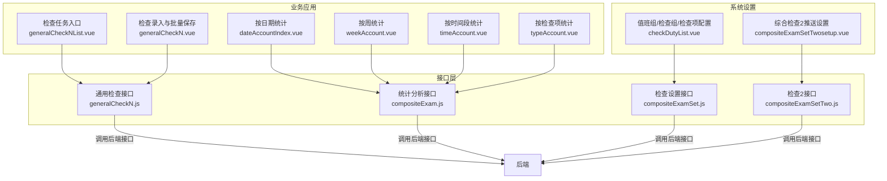
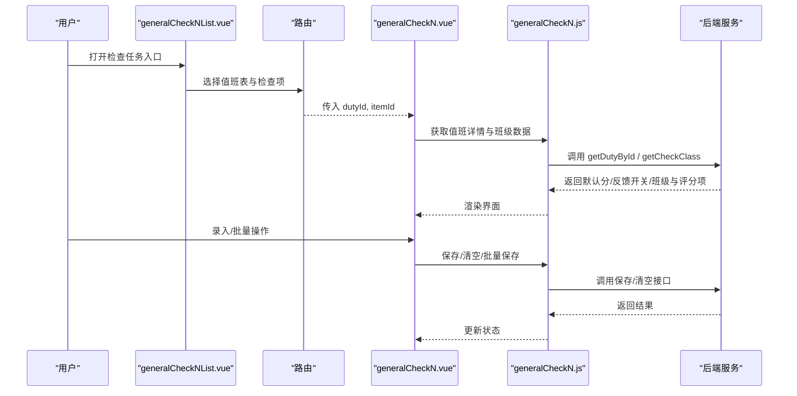
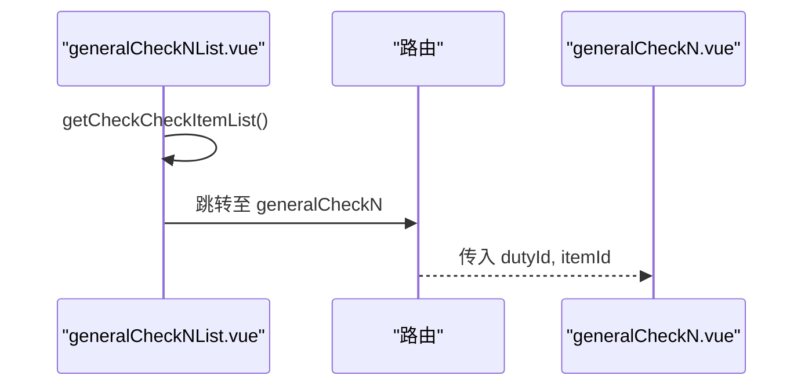
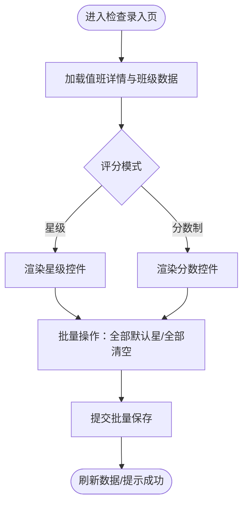
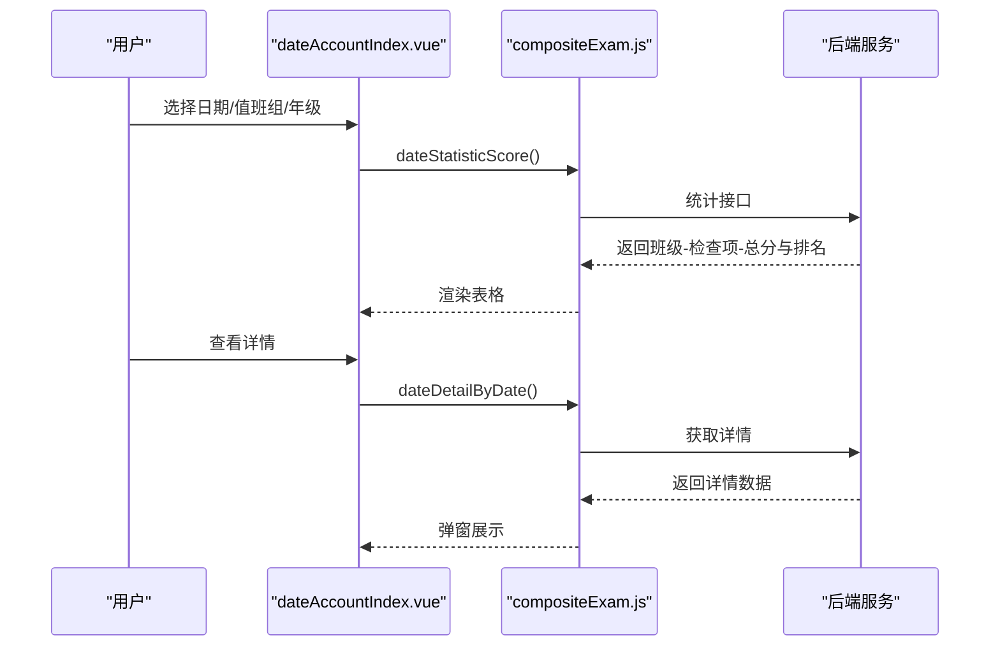
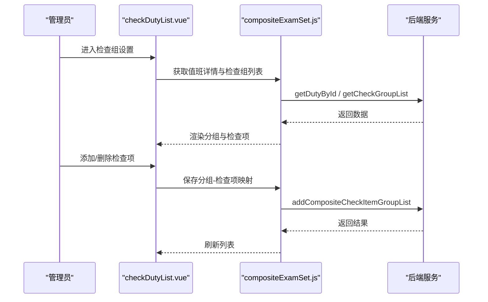
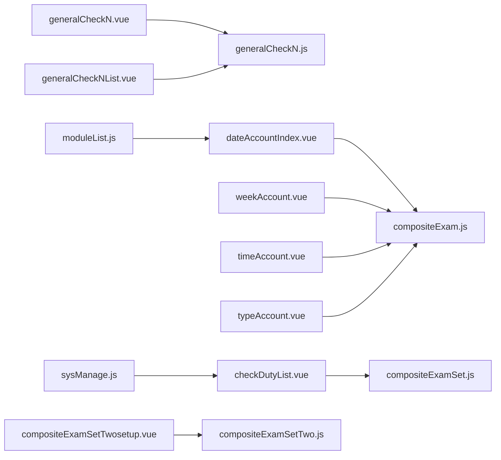

# 综合检查管理

<cite>
**本文引用的文件**
- [generalCheckN.js](file://src/api/generalCheckN.js)
- [compositeExam.js](file://src/api/compositeExam.js)
- [compositeExamSet.js](file://src/api/compositeExamSet.js)
- [compositeExamSetTwo.js](file://src/api/compositeExamSetTwo.js)
- [generalCheckN.vue](file://src/views/compositeExam/generalCheckN.vue)
- [generalCheckNList.vue](file://src/views/compositeExam/generalCheckNList.vue)
- [dateAccountIndex.vue](file://src/views/compositeExam/dateAccountIndex.vue)
- [weekAccount.vue](file://src/views/compositeExam/weekAccount.vue)
- [timeAccount.vue](file://src/views/compositeExam/timeAccount.vue)
- [typeAccount.vue](file://src/views/compositeExam/typeAccount.vue)
- [checkDutyList.vue](file://src/views/sysSet/compositeExamSet/checkDutyList.vue)
- [compositeExamSetTwosetup.vue](file://src/views/sysSet/compositeExamSetTwo/compositeExamSetTwosetup.vue)
- [sysManage.js](file://src/router/normal/sysManage.js)
- [moduleList.js](file://src/router/moduleList.js)
</cite>

## 目录
1. [简介](#简介)
2. [项目结构](#项目结构)
3. [核心组件](#核心组件)
4. [架构总览](#架构总览)
5. [详细组件分析](#详细组件分析)
6. [依赖关系分析](#依赖关系分析)
7. [性能考量](#性能考量)
8. [故障排查指南](#故障排查指南)
9. [结论](#结论)
10. [附录](#附录)

## 简介
本技术文档围绕“综合检查管理”功能，系统阐述其组织架构、检查维度与评分体系设计、检查项目的创建与维护、检查标准与权重配置、检查结果的录入与审核、统计分析与排名机制，以及检查模板、批量处理与报告生成等能力。文档以代码级可视化方式呈现前后端交互流程，并提供可操作的优化建议与排障指引。

## 项目结构
综合检查管理由“系统设置”和“业务应用”两大部分构成：
- 系统设置：值班组/检查组/检查项的配置与维护，支持检查模板与推送策略设置。
- 业务应用：检查录入、批量处理、结果审核、统计分析与导出。

图表来源
- [checkDutyList.vue](file://src/views/sysSet/compositeExamSet/checkDutyList.vue)
- [compositeExamSetTwosetup.vue](file://src/views/sysSet/compositeExamSetTwo/compositeExamSetTwosetup.vue)
- [generalCheckNList.vue](file://src/views/compositeExam/generalCheckNList.vue)
- [generalCheckN.vue](file://src/views/compositeExam/generalCheckN.vue)
- [dateAccountIndex.vue](file://src/views/compositeExam/dateAccountIndex.vue)
- [weekAccount.vue](file://src/views/compositeExam/weekAccount.vue)
- [timeAccount.vue](file://src/views/compositeExam/timeAccount.vue)
- [typeAccount.vue](file://src/views/compositeExam/typeAccount.vue)
- [generalCheckN.js](file://src/api/generalCheckN.js)
- [compositeExam.js](file://src/api/compositeExam.js)
- [compositeExamSet.js](file://src/api/compositeExamSet.js)
- [compositeExamSetTwo.js](file://src/api/compositeExamSetTwo.js)

章节来源
- [generalCheckN.js](file://src/api/generalCheckN.js)
- [compositeExam.js](file://src/api/compositeExam.js)
- [compositeExamSet.js](file://src/api/compositeExamSet.js)
- [compositeExamSetTwo.js](file://src/api/compositeExamSetTwo.js)
- [generalCheckN.vue](file://src/views/compositeExam/generalCheckN.vue)
- [generalCheckNList.vue](file://src/views/compositeExam/generalCheckNList.vue)
- [dateAccountIndex.vue](file://src/views/compositeExam/dateAccountIndex.vue)
- [weekAccount.vue](file://src/views/compositeExam/weekAccount.vue)
- [timeAccount.vue](file://src/views/compositeExam/timeAccount.vue)
- [typeAccount.vue](file://src/views/compositeExam/typeAccount.vue)
- [checkDutyList.vue](file://src/views/sysSet/compositeExamSet/checkDutyList.vue)
- [compositeExamSetTwosetup.vue](file://src/views/sysSet/compositeExamSetTwo/compositeExamSetTwosetup.vue)

## 核心组件
- 检查任务入口与跳转：generalCheckNList.vue 提供值班表与检查项的入口，点击后携带 dutyId、itemId 跳转至检查录入页。
- 检查录入与批量保存：generalCheckN.vue 支持星级评分与分数制两种模式，提供“全部默认分/全部满分/全部清空”等批量操作。
- 统计分析：dateAccountIndex.vue（按日期）、weekAccount.vue（按周）、timeAccount.vue（按时间段）、typeAccount.vue（按检查项）四类统计视图。
- 系统设置：checkDutyList.vue 配置检查组与检查项映射；compositeExamSetTwosetup.vue 配置全局推送与提醒名单。

章节来源
- [generalCheckN.vue](file://src/views/compositeExam/generalCheckN.vue)
- [generalCheckNList.vue](file://src/views/compositeExam/generalCheckNList.vue)
- [dateAccountIndex.vue](file://src/views/compositeExam/dateAccountIndex.vue)
- [weekAccount.vue](file://src/views/compositeExam/weekAccount.vue)
- [timeAccount.vue](file://src/views/compositeExam/timeAccount.vue)
- [typeAccount.vue](file://src/views/compositeExam/typeAccount.vue)
- [checkDutyList.vue](file://src/views/sysSet/compositeExamSet/checkDutyList.vue)
- [compositeExamSetTwosetup.vue](file://src/views/sysSet/compositeExamSetTwo/compositeExamSetTwosetup.vue)

## 架构总览
综合检查管理采用“前端路由+接口封装”的分层架构：
- 视图层：各统计与录入页面负责用户交互与数据展示。
- 接口层：统一封装 HTTP 请求，屏蔽参数构造细节。
- 控制流：通过路由参数传递 dutyId、itemId 等关键上下文，保证检查范围与维度一致。

图表来源
- [generalCheckNList.vue](file://src/views/compositeExam/generalCheckNList.vue)
- [generalCheckN.vue](file://src/views/compositeExam/generalCheckN.vue)
- [generalCheckN.js](file://src/api/generalCheckN.js)

## 详细组件分析

### 检查任务入口与跳转
- 功能要点
  - 展示值班表与检查项列表，支持图标与名称显示。
  - 点击后写入会话存储（标题、快速评价标记等），并携带 dutyId、itemId 跳转至检查录入页。
- 关键流程
  - 获取检查范围与检查项列表。
  - 跳转时携带查询参数，确保后续接口调用上下文一致。

图表来源
- [generalCheckNList.vue](file://src/views/compositeExam/generalCheckNList.vue)
- [generalCheckN.vue](file://src/views/compositeExam/generalCheckN.vue)

章节来源
- [generalCheckNList.vue](file://src/views/compositeExam/generalCheckNList.vue)

### 检查录入与批量处理
- 星级评分与分数制双模式
  - 星级模式：使用评分控件展示星级，支持默认星数与一键全星。
  - 分数制模式：支持默认分、满分、批量默认分与批量满分。
- 批量操作
  - 全部默认分：按默认分填充并提交。
  - 全部满分：按总分填充并提交。
  - 全部清空：删除当前日期已存在的检查数据。
- 数据组装与提交
  - 将每个班级的评分项与教师到岗状态打包，调用批量保存接口。

图表来源
- [generalCheckN.vue](file://src/views/compositeExam/generalCheckN.vue)
- [generalCheckN.js](file://src/api/generalCheckN.js)

章节来源
- [generalCheckN.vue](file://src/views/compositeExam/generalCheckN.vue)
- [generalCheckN.js](file://src/api/generalCheckN.js)

### 统计分析与排名
- 按日期统计
  - 支持筛选值班组、年级，导出报表。
  - 点击单元格可查看具体检查详情（含图片、备注、到岗情况）。
- 按周统计
  - 周次选择联动，支持查看多周累计得分与排名。
- 按时间段统计
  - 日期区间选择，支持跨区间统计与导出。
- 按检查项统计
  - 多个检查项标签切换，分页展示各班评分与图片、备注、检查人、时间等。

图表来源
- [dateAccountIndex.vue](file://src/views/compositeExam/dateAccountIndex.vue)
- [compositeExam.js](file://src/api/compositeExam.js)

章节来源
- [dateAccountIndex.vue](file://src/views/compositeExam/dateAccountIndex.vue)
- [weekAccount.vue](file://src/views/compositeExam/weekAccount.vue)
- [timeAccount.vue](file://src/views/compositeExam/timeAccount.vue)
- [typeAccount.vue](file://src/views/compositeExam/typeAccount.vue)
- [compositeExam.js](file://src/api/compositeExam.js)

### 系统设置与模板管理
- 检查组与检查项映射
  - 在检查组设置页，按分组维护检查项列表，支持添加/删除检查项。
  - 保存时将分组与检查项的关联批量提交。
- 综合检查2推送设置
  - 开启全局推送后，配置提醒名单，保存后生效。
- 路由与模块入口
  - 系统管理路由包含检查相关的设置与统计页面入口。

图表来源
- [checkDutyList.vue](file://src/views/sysSet/compositeExamSet/checkDutyList.vue)
- [compositeExamSet.js](file://src/api/compositeExamSet.js)

章节来源
- [checkDutyList.vue](file://src/views/sysSet/compositeExamSet/checkDutyList.vue)
- [compositeExamSetTwosetup.vue](file://src/views/sysSet/compositeExamSetTwo/compositeExamSetTwosetup.vue)
- [sysManage.js](file://src/router/normal/sysManage.js)
- [moduleList.js](file://src/router/moduleList.js)

## 依赖关系分析
- 视图组件与接口层
  - 录入页依赖通用检查接口（获取值班详情、班级数据、保存/清空等）。
  - 统计页依赖统计分析接口（按日期/周/时间段/检查项统计）。
  - 设置页依赖检查设置与检查2接口（配置检查组、检查项、推送设置）。
- 路由与模块
  - 模块列表与系统管理路由定义了“校园检查”“综合检查”等模块入口与子页面路径。

图表来源
- [generalCheckN.vue](file://src/views/compositeExam/generalCheckN.vue)
- [generalCheckNList.vue](file://src/views/compositeExam/generalCheckNList.vue)
- [dateAccountIndex.vue](file://src/views/compositeExam/dateAccountIndex.vue)
- [weekAccount.vue](file://src/views/compositeExam/weekAccount.vue)
- [timeAccount.vue](file://src/views/compositeExam/timeAccount.vue)
- [typeAccount.vue](file://src/views/compositeExam/typeAccount.vue)
- [checkDutyList.vue](file://src/views/sysSet/compositeExamSet/checkDutyList.vue)
- [compositeExamSetTwosetup.vue](file://src/views/sysSet/compositeExamSetTwo/compositeExamSetTwosetup.vue)
- [generalCheckN.js](file://src/api/generalCheckN.js)
- [compositeExam.js](file://src/api/compositeExam.js)
- [compositeExamSet.js](file://src/api/compositeExamSet.js)
- [compositeExamSetTwo.js](file://src/api/compositeExamSetTwo.js)
- [moduleList.js](file://src/router/moduleList.js)
- [sysManage.js](file://src/router/normal/sysManage.js)

章节来源
- [generalCheckN.js](file://src/api/generalCheckN.js)
- [compositeExam.js](file://src/api/compositeExam.js)
- [compositeExamSet.js](file://src/api/compositeExamSet.js)
- [compositeExamSetTwo.js](file://src/api/compositeExamSetTwo.js)
- [moduleList.js](file://src/router/moduleList.js)
- [sysManage.js](file://src/router/normal/sysManage.js)

## 性能考量
- 批量操作优化
  - 录入页提供“全部默认分/全部满分/全部清空”，减少逐条操作的网络往返。
- 分页与导出
  - 按检查项统计采用分页，避免一次性传输大量数据；导出接口支持字段裁剪与分页参数。
- 图片与详情弹窗
  - 统计详情仅在点击时拉取，避免初始渲染压力。
- 建议
  - 对超大表格启用虚拟滚动（如需）。
  - 导出接口支持服务端分批拼接，避免内存峰值。

## 故障排查指南
- 常见问题
  - 无法加载检查项：检查 getCheckCheckItemList 与 getDutyById 的返回状态码与数据结构。
  - 批量保存失败：核对 dataList 参数序列化与必填字段；查看后端返回的错误消息。
  - 统计为空：确认筛选条件（值班组、年级、日期/周/时间段）是否正确；检查导出链接中的 token 是否有效。
- 排查步骤
  - 打开浏览器开发者工具，定位接口请求与响应。
  - 核对路由参数（dutyId、itemId）是否完整传递。
  - 若涉及图片预览，检查图片 URL 是否可访问。

章节来源
- [generalCheckN.vue](file://src/views/compositeExam/generalCheckN.vue)
- [dateAccountIndex.vue](file://src/views/compositeExam/dateAccountIndex.vue)
- [typeAccount.vue](file://src/views/compositeExam/typeAccount.vue)

## 结论
综合检查管理通过清晰的“系统设置—业务应用”分层与完善的接口封装，实现了从检查模板配置、检查录入与批量处理，到统计分析与导出的闭环。系统支持星级与分数制两种评分模式，提供多种统计维度与导出能力，满足日常检查工作的多样化需求。建议在后续版本中进一步增强数据可视化与移动端体验，并完善异常监控与日志追踪。

## 附录
- 路由与模块入口
  - 模块列表包含“校园检查”模块及其子页面。
  - 系统管理路由包含检查相关的设置与统计页面入口。
- 关键接口一览
  - 通用检查：获取值班详情、班级与评分项、批量保存、清空等。
  - 统计分析：按日期/周/时间段/检查项统计，详情查询与导出。
  - 检查设置：值班组/检查组/检查项的增删改查与映射保存。
  - 检查2推送：全局推送开关与提醒名单保存。

章节来源
- [moduleList.js](file://src/router/moduleList.js)
- [sysManage.js](file://src/router/normal/sysManage.js)
- [generalCheckN.js](file://src/api/generalCheckN.js)
- [compositeExam.js](file://src/api/compositeExam.js)
- [compositeExamSet.js](file://src/api/compositeExamSet.js)
- [compositeExamSetTwo.js](file://src/api/compositeExamSetTwo.js)