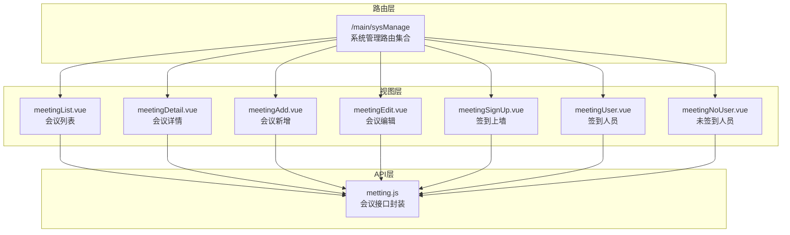
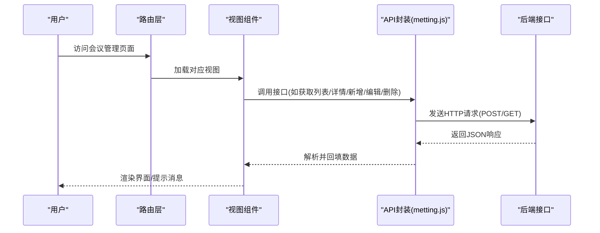
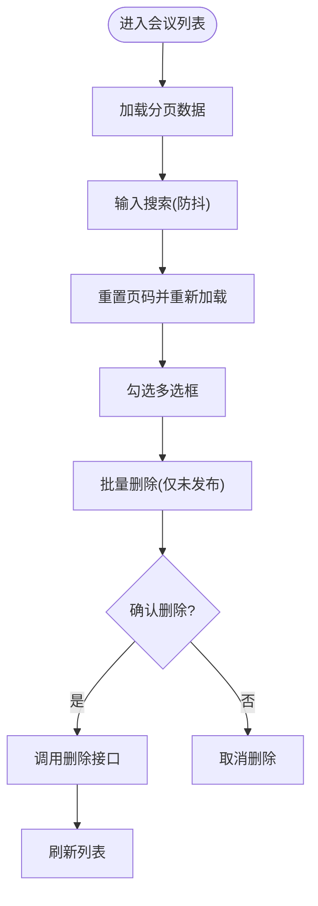
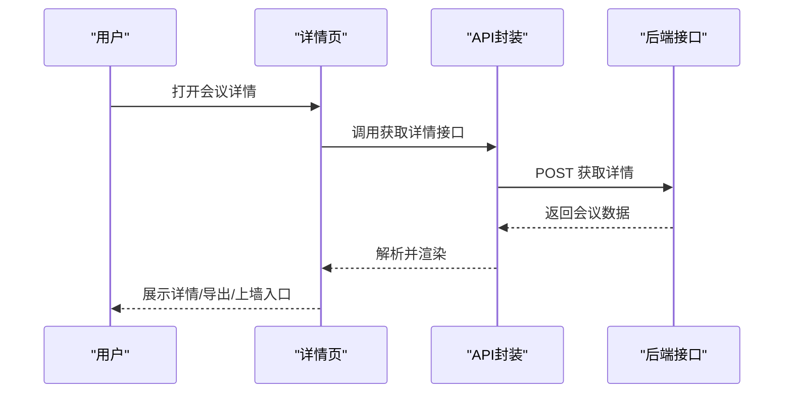
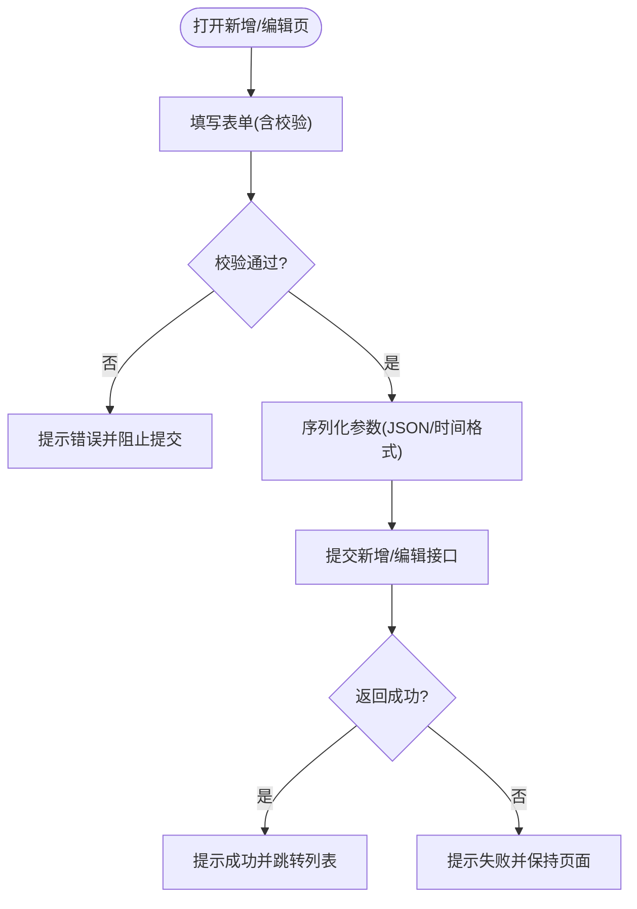
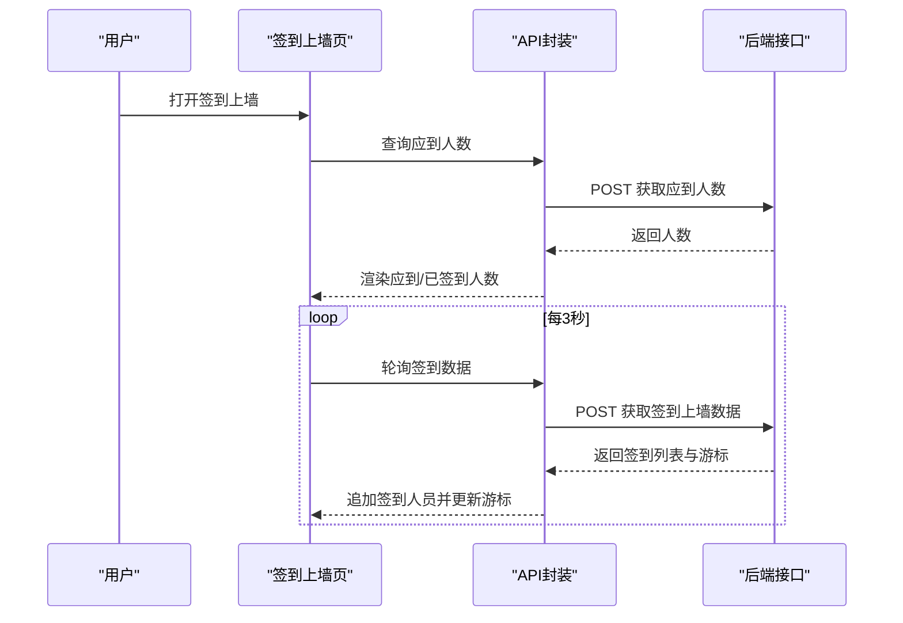
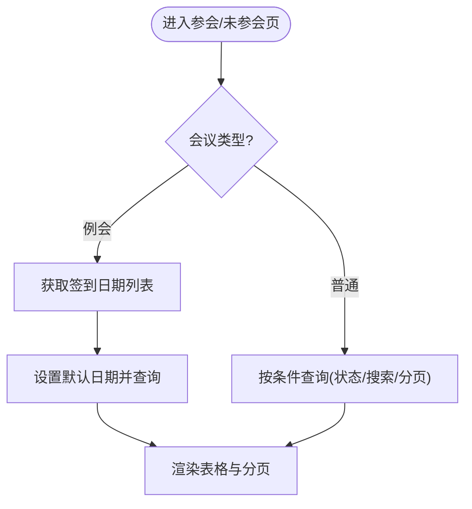
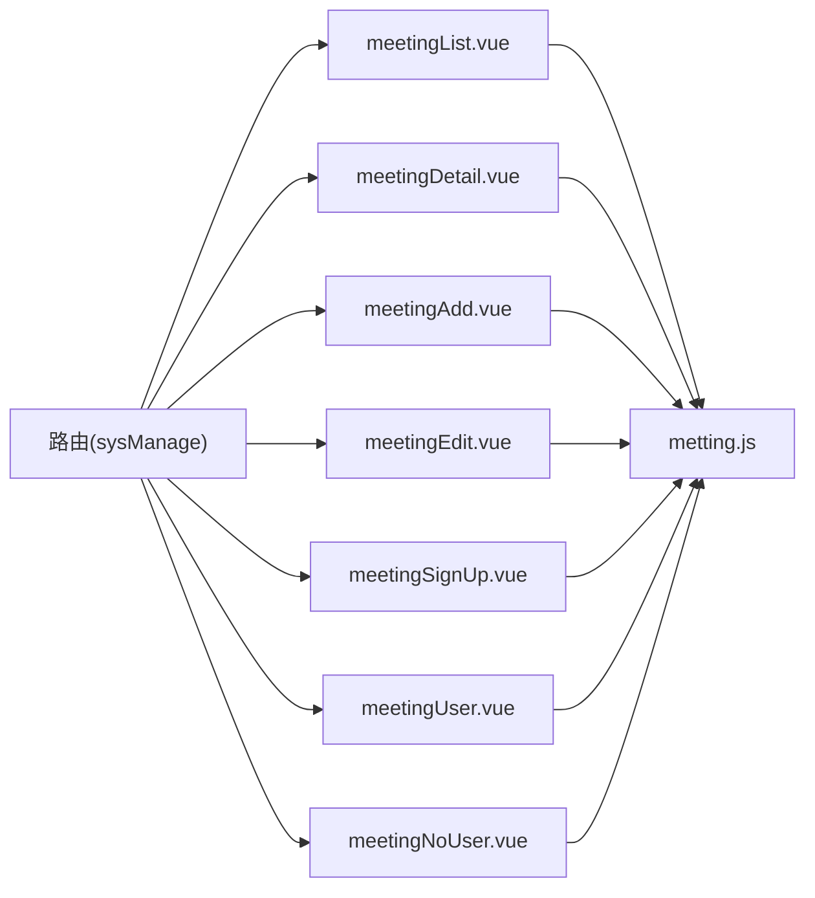
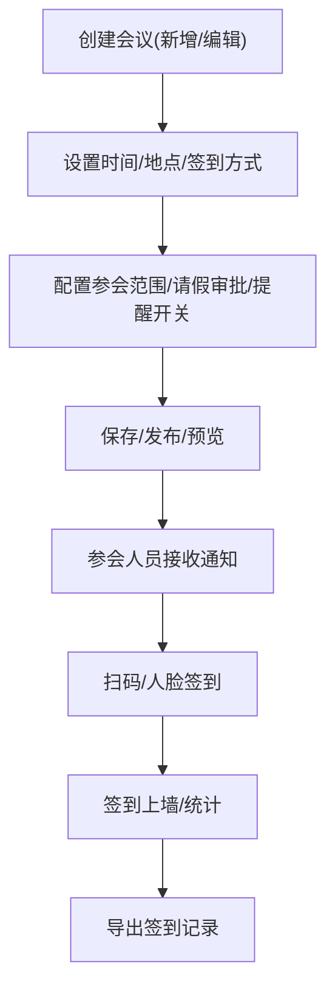

# 会议管理

<cite>
**本文引用的文件**
- [src/api/metting.js](file://src/api/metting.js)
- [src/views/meeting/meetingList.vue](file://src/views/meeting/meetingList.vue)
- [src/views/meeting/meetingDetail.vue](file://src/views/meeting/meetingDetail.vue)
- [src/views/meeting/meetingAdd.vue](file://src/views/meeting/meetingAdd.vue)
- [src/views/meeting/meetingEdit.vue](file://src/views/meeting/meetingEdit.vue)
- [src/views/meeting/meetingSignUp.vue](file://src/views/meeting/meetingSignUp.vue)
- [src/views/meeting/meetingUser.vue](file://src/views/meeting/meetingUser.vue)
- [src/views/meeting/meetingNoUser.vue](file://src/views/meeting/meetingNoUser.vue)
- [src/router/index.js](file://src/router/index.js)
- [src/router/normal/sysManage.js](file://src/router/normal/sysManage.js)
</cite>

## 目录
1. [简介](#简介)
2. [项目结构](#项目结构)
3. [核心组件](#核心组件)
4. [架构总览](#架构总览)
5. [详细组件分析](#详细组件分析)
6. [依赖关系分析](#依赖关系分析)
7. [性能考虑](#性能考虑)
8. [故障排查指南](#故障排查指南)
9. [结论](#结论)
10. [附录](#附录)

## 简介
本文件面向“会议管理”业务模块，系统性梳理在线会议的预约、组织与管理流程，覆盖会议创建、编辑、删除与查询；参会人员管理、签到统计与会议记录；会议通知与提醒机制；权限控制；以及会议资源分配、会议室预订与冲突检测的技术方案，并给出用户体验设计与数据安全建议。

## 项目结构
会议管理功能位于前端工程的 meeting 模块，采用按功能域划分的视图组织方式：
- API 层：统一在 API 模块封装会议相关接口，便于调用与扩展
- 视图层：包含会议列表、详情、新增、编辑、签到展示、参会人员、未参会人员等页面
- 路由层：通过路由将各页面挂载到系统导航下，形成完整的业务入口

图表来源
- [src/router/index.js:136-148](file://src/router/index.js#L136-L148)
- [src/views/meeting/meetingList.vue:1-272](file://src/views/meeting/meetingList.vue#L1-L272)
- [src/views/meeting/meetingDetail.vue:1-540](file://src/views/meeting/meetingDetail.vue#L1-L540)
- [src/views/meeting/meetingAdd.vue:1-703](file://src/views/meeting/meetingAdd.vue#L1-L703)
- [src/views/meeting/meetingEdit.vue:1-786](file://src/views/meeting/meetingEdit.vue#L1-L786)
- [src/views/meeting/meetingSignUp.vue:1-263](file://src/views/meeting/meetingSignUp.vue#L1-L263)
- [src/views/meeting/meetingUser.vue:1-237](file://src/views/meeting/meetingUser.vue#L1-L237)
- [src/views/meeting/meetingNoUser.vue:1-240](file://src/views/meeting/meetingNoUser.vue#L1-L240)
- [src/api/metting.js:1-204](file://src/api/metting.js#L1-L204)

章节来源
- [src/router/index.js:136-148](file://src/router/index.js#L136-L148)
- [src/router/normal/sysManage.js:1-928](file://src/router/normal/sysManage.js#L1-L928)

## 核心组件
- 会议列表页：支持分页查询、筛选、批量删除、状态与类型标识、跳转详情与编辑
- 会议详情页：集中展示会议基本信息、参会范围、签到方式、提醒开关、附件与导出
- 会议新增/编辑页：支持单次会议与常规例会两种模式，签到时间限制、签到位置限制、人脸识别设备选择、请假审批人配置、富文本介绍与附件上传
- 签到上墙页：实时展示签到人数与签到人员头像流，定时刷新
- 参会人员/未参会人员页：支持按签到状态与日期筛选，支持搜索与分页

章节来源
- [src/views/meeting/meetingList.vue:1-272](file://src/views/meeting/meetingList.vue#L1-L272)
- [src/views/meeting/meetingDetail.vue:1-540](file://src/views/meeting/meetingDetail.vue#L1-L540)
- [src/views/meeting/meetingAdd.vue:1-703](file://src/views/meeting/meetingAdd.vue#L1-L703)
- [src/views/meeting/meetingEdit.vue:1-786](file://src/views/meeting/meetingEdit.vue#L1-L786)
- [src/views/meeting/meetingSignUp.vue:1-263](file://src/views/meeting/meetingSignUp.vue#L1-L263)
- [src/views/meeting/meetingUser.vue:1-237](file://src/views/meeting/meetingUser.vue#L1-L237)
- [src/views/meeting/meetingNoUser.vue:1-240](file://src/views/meeting/meetingNoUser.vue#L1-L240)

## 架构总览
前端采用“路由 + 视图 + API 封装”的三层结构，API 层对后端接口进行统一封装，视图层负责交互与数据展示，路由层负责页面导航与权限入口。

图表来源
- [src/router/index.js:136-148](file://src/router/index.js#L136-L148)
- [src/api/metting.js:1-204](file://src/api/metting.js#L1-L204)

## 详细组件分析

### 会议列表组件（meetingList）
- 功能要点
  - 分页查询与关键词搜索（会议主题）
  - 复选框多选删除（仅未发布的单次/例会可删）
  - 状态标签与类型标签展示
  - 跳转至详情与编辑
- 关键流程
  - 输入防抖处理搜索
  - 分页参数变更触发重新加载
  - 删除前二次确认与批量删除

图表来源
- [src/views/meeting/meetingList.vue:144-255](file://src/views/meeting/meetingList.vue#L144-L255)
- [src/api/metting.js:16-25](file://src/api/metting.js#L16-L25)

章节来源
- [src/views/meeting/meetingList.vue:1-272](file://src/views/meeting/meetingList.vue#L1-L272)
- [src/api/metting.js:1-204](file://src/api/metting.js#L1-L204)

### 会议详情组件（meetingDetail）
- 功能要点
  - 展示会议类型、主题、时间、地点、参会范围、签到方式、提醒开关
  - 导出签到、签到上墙、查看签到人员/未签到人员
  - 附件列表与富文本详情
- 关键流程
  - 获取会议详情并解析参会范围、设备列表、文件列表
  - 生成导出链接（含token）

图表来源
- [src/views/meeting/meetingDetail.vue:287-313](file://src/views/meeting/meetingDetail.vue#L287-L313)
- [src/api/metting.js:133-142](file://src/api/metting.js#L133-L142)

章节来源
- [src/views/meeting/meetingDetail.vue:1-540](file://src/views/meeting/meetingDetail.vue#L1-L540)
- [src/api/metting.js:1-204](file://src/api/metting.js#L1-L204)

### 会议新增/编辑组件（meetingAdd/meetingEdit）
- 功能要点
  - 单次会议：设置开始/结束时间，支持签到时间限制
  - 常规例会：设置周次、会议时间段、执行起止日期
  - 签到方式：扫码签到（支持位置限制与半径）或人脸识别（设备选择）
  - 请假审批人（可选）、富文本介绍、附件上传
  - 保存/发布/预览三种状态提交
- 关键流程
  - 表单校验（必填、时间先后、签到时间合法性、设备/位置必选）
  - 参数序列化（时间格式化、JSON序列化参会范围与设备列表）
  - 提交新增/编辑接口并跳转列表

图表来源
- [src/views/meeting/meetingAdd.vue:341-595](file://src/views/meeting/meetingAdd.vue#L341-L595)
- [src/views/meeting/meetingEdit.vue:403-664](file://src/views/meeting/meetingEdit.vue#L403-L664)
- [src/api/metting.js:47-132](file://src/api/metting.js#L47-L132)

章节来源
- [src/views/meeting/meetingAdd.vue:1-703](file://src/views/meeting/meetingAdd.vue#L1-L703)
- [src/views/meeting/meetingEdit.vue:1-786](file://src/views/meeting/meetingEdit.vue#L1-L786)
- [src/api/metting.js:1-204](file://src/api/metting.js#L1-L204)

### 签到上墙组件（meetingSignUp）
- 功能要点
  - 实时展示应到人数与已签到人数
  - 定时轮询签到数据，动态追加签到人员头像
  - 支持扫码签到二维码展示
- 关键流程
  - 初始化时根据会议类型决定是否携带日期参数
  - 定时器轮询签到数据，更新最大游标与累计签到人数

图表来源
- [src/views/meeting/meetingSignUp.vue:49-122](file://src/views/meeting/meetingSignUp.vue#L49-L122)
- [src/api/metting.js:183-203](file://src/api/metting.js#L183-L203)

章节来源
- [src/views/meeting/meetingSignUp.vue:1-263](file://src/views/meeting/meetingSignUp.vue#L1-L263)
- [src/api/metting.js:1-204](file://src/api/metting.js#L1-L204)

### 参会人员/未参会人员组件（meetingUser/meetingNoUser）
- 功能要点
  - 支持按签到状态与日期筛选（例会场景）
  - 支持按姓名搜索与分页
  - 例会场景下自动加载签到日期列表
- 关键流程
  - 例会：先拉取签到日期列表，再按日期查询
  - 普通会议：直接按条件查询

图表来源
- [src/views/meeting/meetingUser.vue:124-216](file://src/views/meeting/meetingUser.vue#L124-L216)
- [src/views/meeting/meetingNoUser.vue:127-219](file://src/views/meeting/meetingNoUser.vue#L127-L219)
- [src/api/metting.js:143-182](file://src/api/metting.js#L143-L182)

章节来源
- [src/views/meeting/meetingUser.vue:1-237](file://src/views/meeting/meetingUser.vue#L1-L237)
- [src/views/meeting/meetingNoUser.vue:1-240](file://src/views/meeting/meetingNoUser.vue#L1-L240)
- [src/api/metting.js:1-204](file://src/api/metting.js#L1-L204)

## 依赖关系分析
- 视图组件依赖 API 封装（metting.js），统一发起 HTTP 请求
- 路由层将会议管理页面挂载到系统管理模块下，形成统一入口
- 各组件之间通过路由参数传递 meetingId、meetingType、isCanAskLeav 等关键字段

图表来源
- [src/router/normal/sysManage.js:1-928](file://src/router/normal/sysManage.js#L1-L928)
- [src/views/meeting/meetingList.vue:1-272](file://src/views/meeting/meetingList.vue#L1-L272)
- [src/views/meeting/meetingDetail.vue:1-540](file://src/views/meeting/meetingDetail.vue#L1-L540)
- [src/views/meeting/meetingAdd.vue:1-703](file://src/views/meeting/meetingAdd.vue#L1-L703)
- [src/views/meeting/meetingEdit.vue:1-786](file://src/views/meeting/meetingEdit.vue#L1-L786)
- [src/views/meeting/meetingSignUp.vue:1-263](file://src/views/meeting/meetingSignUp.vue#L1-L263)
- [src/views/meeting/meetingUser.vue:1-237](file://src/views/meeting/meetingUser.vue#L1-L237)
- [src/views/meeting/meetingNoUser.vue:1-240](file://src/views/meeting/meetingNoUser.vue#L1-L240)
- [src/api/metting.js:1-204](file://src/api/metting.js#L1-L204)

章节来源
- [src/router/index.js:136-148](file://src/router/index.js#L136-L148)
- [src/router/normal/sysManage.js:1-928](file://src/router/normal/sysManage.js#L1-L928)

## 性能考虑
- 列表查询使用防抖减少频繁请求
- 签到上墙采用定时轮询，建议根据实际并发与带宽调整轮询间隔
- 图片与附件懒加载，避免一次性加载过多资源
- 分页参数合理设置，避免一次性拉取大量数据

## 故障排查指南
- 接口异常
  - 列表/详情/签到查询失败：检查网络与后端接口可用性
  - 删除失败：确认会议状态与权限
- 表单校验
  - 时间顺序错误、签到时间非法、设备/位置缺失、参会人员为空等均会阻断提交
- 实时签到
  - 若签到上墙无数据：确认会议类型与日期参数是否正确，检查后端签到数据是否产生

章节来源
- [src/views/meeting/meetingList.vue:191-218](file://src/views/meeting/meetingList.vue#L191-L218)
- [src/views/meeting/meetingAdd.vue:341-490](file://src/views/meeting/meetingAdd.vue#L341-L490)
- [src/views/meeting/meetingEdit.vue:403-553](file://src/views/meeting/meetingEdit.vue#L403-L553)
- [src/views/meeting/meetingSignUp.vue:56-69](file://src/views/meeting/meetingSignUp.vue#L56-L69)

## 结论
会议管理模块通过清晰的视图分层与统一的 API 封装，实现了从会议创建、编辑、删除到查询的完整闭环；配合参会人员管理、签到统计与导出能力，满足了日常会议组织与监管需求。后续可在冲突检测、资源分配与权限细化方面进一步增强，同时优化实时签到的轮询策略与前端渲染性能。

## 附录

### 会议管理流程图（概念）

[此图为概念流程，无需图表来源]