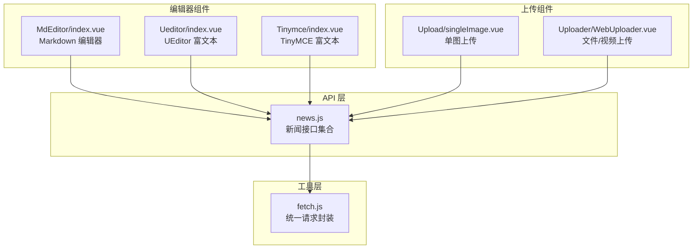
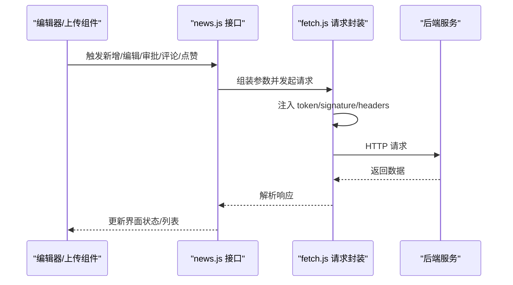
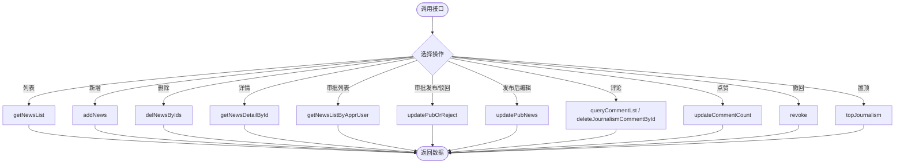
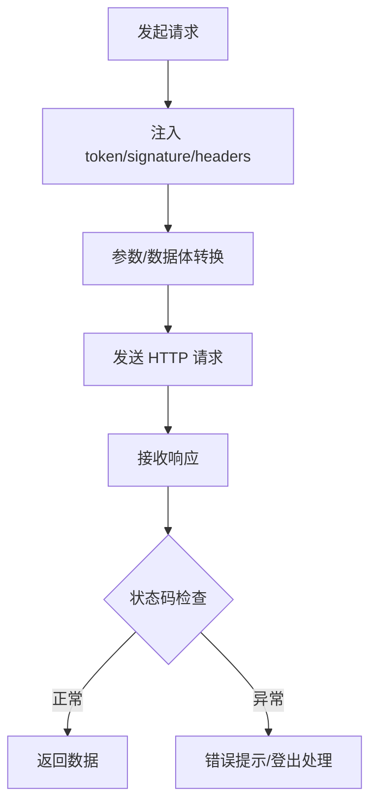
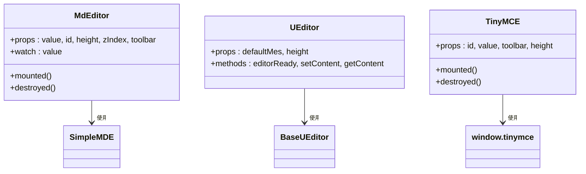
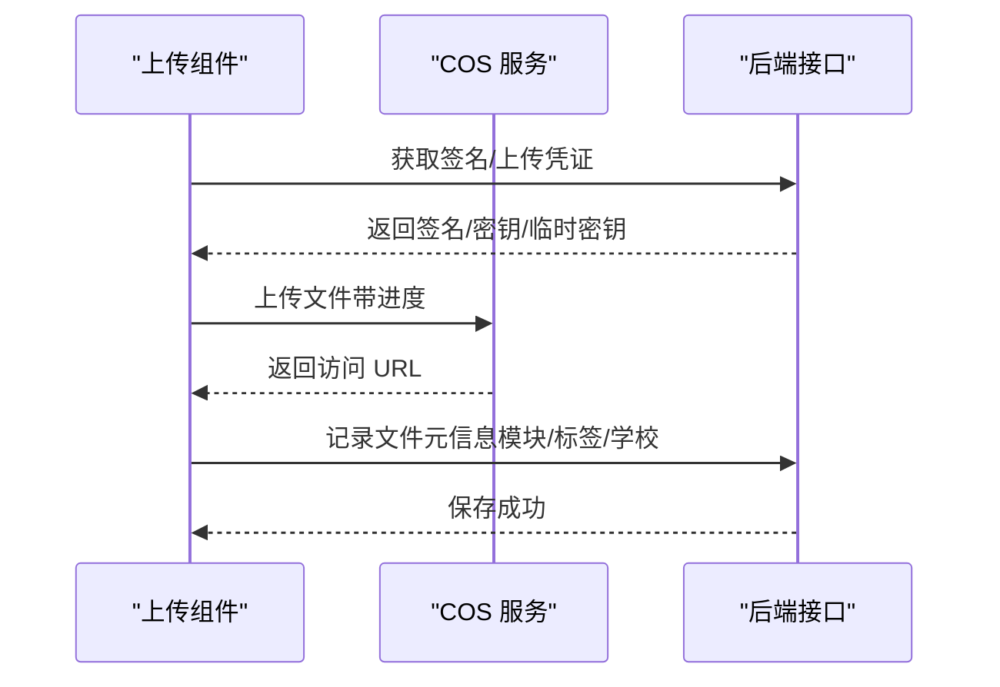
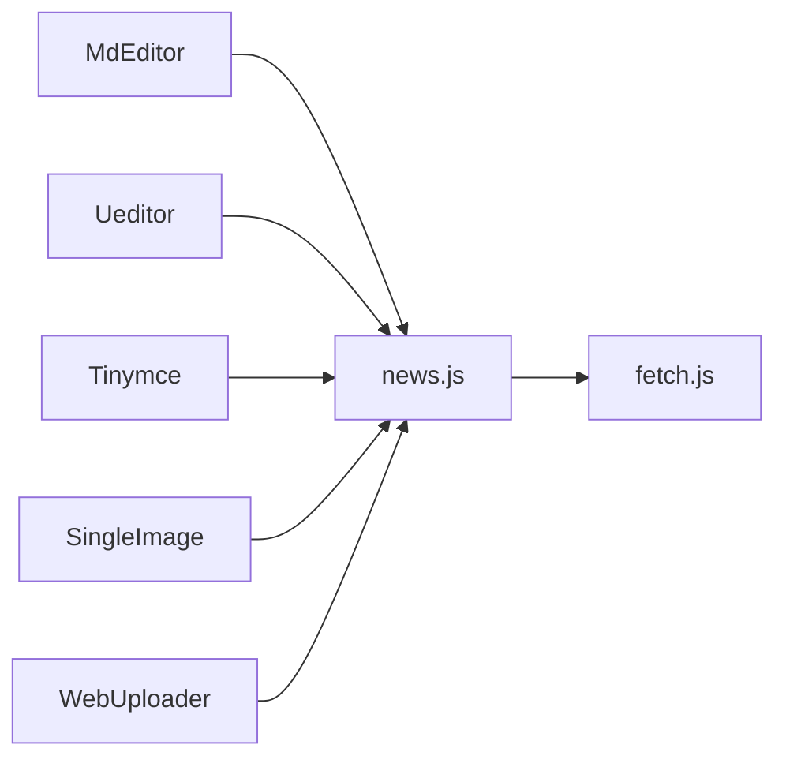
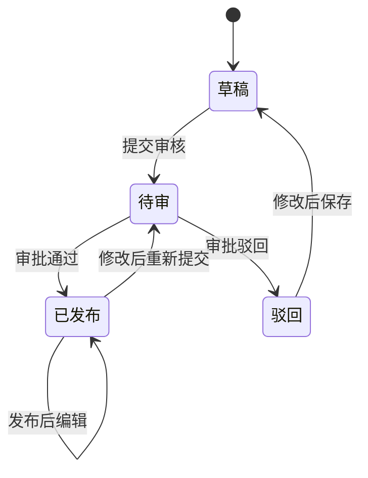

# 新闻发布

<cite>
**本文引用的文件**
- [news.js](file://src/api/news.js)
- [fetch.js](file://src/utils/fetch.js)
- [MdEditor/index.vue](file://src/components/MdEditor/index.vue)
- [Ueditor/index.vue](file://src/components/Ueditor/index.vue)
- [Tinymce/index.vue](file://src/components/Tinymce/index.vue)
- [Upload/singleImage.vue](file://src/components/Upload/singleImage.vue)
- [Uploader/WebUploader.vue](file://src/components/Uploader/WebUploader.vue)
</cite>

## 目录
1. [简介](#简介)
2. [项目结构](#项目结构)
3. [核心组件](#核心组件)
4. [架构总览](#架构总览)
5. [详细组件分析](#详细组件分析)
6. [依赖关系分析](#依赖关系分析)
7. [性能考虑](#性能考虑)
8. [故障排查指南](#故障排查指南)
9. [结论](#结论)
10. [附录](#附录)

## 简介
本文件面向“新闻发布”业务，系统性梳理从采集、编辑、审核到发布的全流程，覆盖富文本编辑、图片与多媒体素材管理、审批流与状态管理、阅读统计、分类与标签、搜索优化、推荐与热点分析、用户反馈以及SEO与多平台分发策略。文档基于现有前端能力进行落地说明，并给出可扩展建议。

## 项目结构
新闻发布相关能力主要分布在以下模块：
- API 层：封装新闻增删改查、审批、评论、点赞、置顶等接口
- 编辑器组件：Markdown、UEditor、TinyMCE 三种富文本编辑器
- 上传组件：单图上传、通用文件/视频上传（基于腾讯云COS）
- 工具层：统一请求封装 fetch，自动注入 token、签名、错误处理

图表来源
- [news.js:1-266](file://src/api/news.js#L1-L266)
- [fetch.js:1-240](file://src/utils/fetch.js#L1-L240)
- [MdEditor/index.vue:1-112](file://src/components/MdEditor/index.vue#L1-L112)
- [Ueditor/index.vue:1-82](file://src/components/Ueditor/index.vue#L1-L82)
- [Tinymce/index.vue:1-249](file://src/components/Tinymce/index.vue#L1-L249)
- [Upload/singleImage.vue:1-128](file://src/components/Upload/singleImage.vue#L1-L128)
- [Uploader/WebUploader.vue:1-651](file://src/components/Uploader/WebUploader.vue#L1-L651)

章节来源
- [news.js:1-266](file://src/api/news.js#L1-L266)
- [fetch.js:1-240](file://src/utils/fetch.js#L1-L240)

## 核心组件
- 新闻接口集合：提供列表、新增、删除、详情、审批列表、审批发布/驳回、评论、点赞、撤回、置顶等功能
- 统一请求封装：自动注入 token、签名、错误提示与重定向逻辑
- 富文本编辑器：Markdown、UEditor、TinyMCE 三种编辑器组件，满足不同编辑需求
- 上传组件：单图上传与通用文件/视频上传，支持进度、封面生成、删除与标签打标

章节来源
- [news.js:1-266](file://src/api/news.js#L1-L266)
- [fetch.js:1-240](file://src/utils/fetch.js#L1-L240)
- [MdEditor/index.vue:1-112](file://src/components/MdEditor/index.vue#L1-L112)
- [Ueditor/index.vue:1-82](file://src/components/Ueditor/index.vue#L1-L82)
- [Tinymce/index.vue:1-249](file://src/components/Tinymce/index.vue#L1-L249)
- [Upload/singleImage.vue:1-128](file://src/components/Upload/singleImage.vue#L1-L128)
- [Uploader/WebUploader.vue:1-651](file://src/components/Uploader/WebUploader.vue#L1-L651)

## 架构总览
新闻发布前后端交互采用“组件-接口-服务”的分层设计：
- 组件层：编辑器与上传组件负责内容输入与素材管理
- 接口层：news.js 将业务动作映射为 RESTful 请求
- 工具层：fetch.js 统一处理请求头、参数、鉴权与错误响应

图表来源
- [news.js:1-266](file://src/api/news.js#L1-L266)
- [fetch.js:1-240](file://src/utils/fetch.js#L1-L240)

## 详细组件分析

### 新闻接口层（news.js）
- 列表与筛选：支持分页、标题/时间范围筛选
- 新建/编辑：标题、封面、部门、是否推送网站、内容、评论开关、状态、操作类型等
- 删除：批量删除
- 详情与驳回原因：详情查询、驳回原因列表
- 审批：审批列表、审批发布/驳回、发布后编辑
- 互动：点赞、评论列表、删除评论、撤回、置顶
- 其他：基础信息、部门列表

图表来源
- [news.js:1-266](file://src/api/news.js#L1-L266)

章节来源
- [news.js:1-266](file://src/api/news.js#L1-L266)

### 统一请求封装（fetch.js）
- 自动注入 token 与签名参数
- GET/POST 参数序列化与 JSON 数据体转换
- 统一错误码处理与登录态失效跳转
- 多环境 baseURL 切换

图表来源
- [fetch.js:1-240](file://src/utils/fetch.js#L1-L240)

章节来源
- [fetch.js:1-240](file://src/utils/fetch.js#L1-L240)

### 富文本编辑器组件
- Markdown 编辑器（MdEditor）：轻量、专注写作，适合简洁内容
- UEditor（Ueditor）：功能丰富，支持图片/音频/视频插入与样式配置
- TinyMCE（Tinymce）：插件化强，支持水印、媒体、链接、格式化等

图表来源
- [MdEditor/index.vue:1-112](file://src/components/MdEditor/index.vue#L1-L112)
- [Ueditor/index.vue:1-82](file://src/components/Ueditor/index.vue#L1-L82)
- [Tinymce/index.vue:1-249](file://src/components/Tinymce/index.vue#L1-L249)

章节来源
- [MdEditor/index.vue:1-112](file://src/components/MdEditor/index.vue#L1-L112)
- [Ueditor/index.vue:1-82](file://src/components/Ueditor/index.vue#L1-L82)
- [Tinymce/index.vue:1-249](file://src/components/Tinymce/index.vue#L1-L249)

### 图片与多媒体上传组件
- 单图上传（Upload/singleImage.vue）：对接七牛 Token 获取，支持预览与删除
- 文件/视频上传（Uploader/WebUploader.vue）：基于腾讯云COS，支持多文件、进度、封面、删除、标签打标

图表来源
- [Upload/singleImage.vue:1-128](file://src/components/Upload/singleImage.vue#L1-L128)
- [Uploader/WebUploader.vue:1-651](file://src/components/Uploader/WebUploader.vue#L1-L651)

章节来源
- [Upload/singleImage.vue:1-128](file://src/components/Upload/singleImage.vue#L1-L128)
- [Uploader/WebUploader.vue:1-651](file://src/components/Uploader/WebUploader.vue#L1-L651)

## 依赖关系分析
- 组件依赖接口：编辑器与上传组件均通过 news.js 调用后端接口
- 接口依赖工具：news.js 通过 fetch.js 统一发起请求
- 上传链路：单图上传依赖七牛，通用上传依赖腾讯云COS

图表来源
- [news.js:1-266](file://src/api/news.js#L1-L266)
- [fetch.js:1-240](file://src/utils/fetch.js#L1-L240)
- [MdEditor/index.vue:1-112](file://src/components/MdEditor/index.vue#L1-L112)
- [Ueditor/index.vue:1-82](file://src/components/Ueditor/index.vue#L1-L82)
- [Tinymce/index.vue:1-249](file://src/components/Tinymce/index.vue#L1-L249)
- [Upload/singleImage.vue:1-128](file://src/components/Upload/singleImage.vue#L1-L128)
- [Uploader/WebUploader.vue:1-651](file://src/components/Uploader/WebUploader.vue#L1-L651)

章节来源
- [news.js:1-266](file://src/api/news.js#L1-L266)
- [fetch.js:1-240](file://src/utils/fetch.js#L1-L240)

## 性能考虑
- 上传性能
  - 使用进度回调与分片/直传策略（COS 支持）降低失败重传成本
  - 图片上传自动附加缩略规则，减少前端渲染压力
- 请求性能
  - fetch 统一参数序列化，避免重复拼装
  - 批量操作（如批量删除、评论删除）减少请求次数
- 渲染性能
  - 富文本编辑器按需加载，避免不必要的初始化
  - 上传组件在删除时同步调用后端删除并清理本地状态

## 故障排查指南
- 登录态失效
  - 现象：统一错误码触发登出并跳转登录页
  - 处理：重新登录后刷新页面
- 上传失败
  - 检查签名/凭证是否过期，重新获取后重试
  - 确认文件类型与大小限制
- 富文本编辑异常
  - 检查编辑器初始化参数与依赖库加载情况
  - 清除浏览器缓存后重试
- 审批/发布异常
  - 确认当前用户权限与审批状态
  - 查看接口返回的错误信息并按提示修正

章节来源
- [fetch.js:104-169](file://src/utils/fetch.js#L104-L169)
- [Uploader/WebUploader.vue:296-440](file://src/components/Uploader/WebUploader.vue#L296-L440)

## 结论
本新闻发布系统以“接口即业务”的方式组织功能，结合多种富文本编辑器与完善的上传能力，覆盖了从采集、编辑、审核到发布的全链路。配合统一的请求封装与错误处理，具备良好的可维护性与扩展性。后续可在搜索优化、推荐与热点分析、用户反馈与SEO多平台分发方面持续增强。

## 附录

### 业务流程与状态管理（概念示意）

### SEO 与多平台分发（技术方案建议）
- SEO
  - 动态生成结构化数据（JSON-LD）、Open Graph 标签
  - 自动生成 sitemap 与 robots.txt
  - 关键词与摘要抽取，Meta 描述优化
- 多平台分发
  - 通过接口将内容同步至微信公众号、官网、APP 等渠道
  - 为不同平台生成适配的封面与摘要
  - 建立分发任务队列与失败重试机制