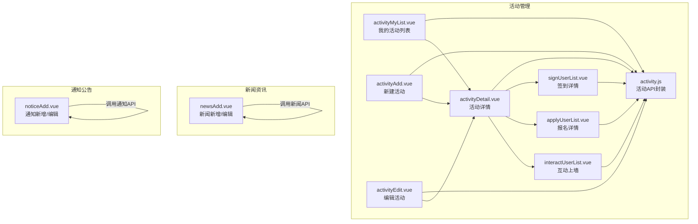
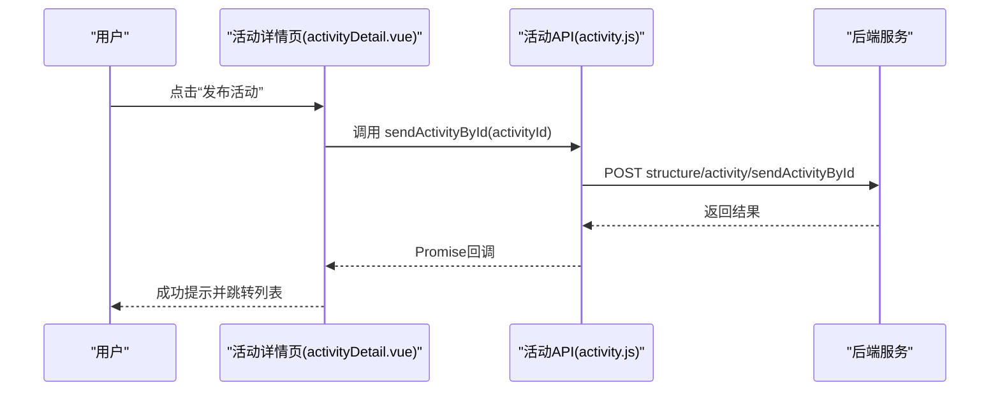
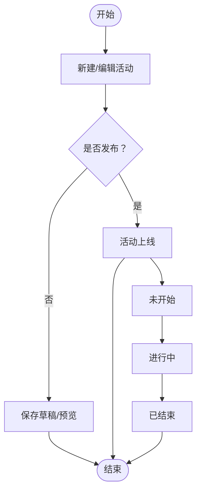
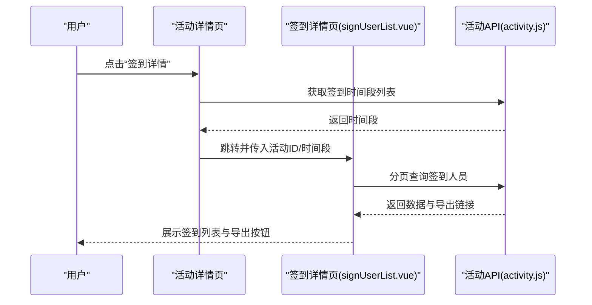
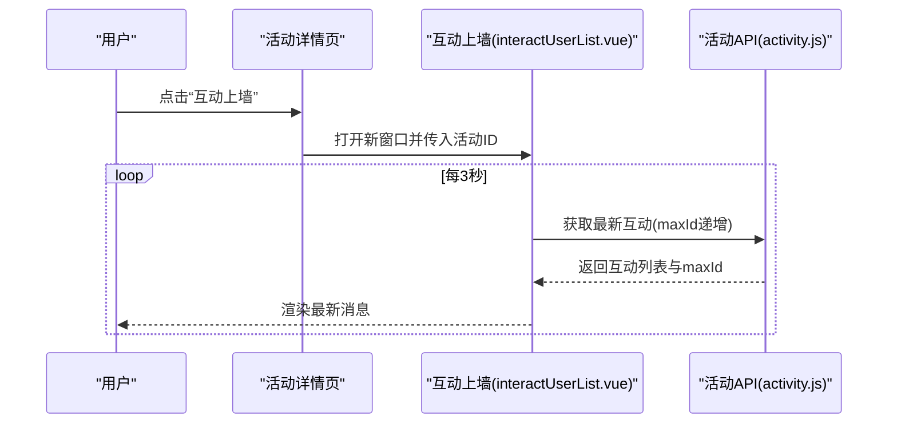
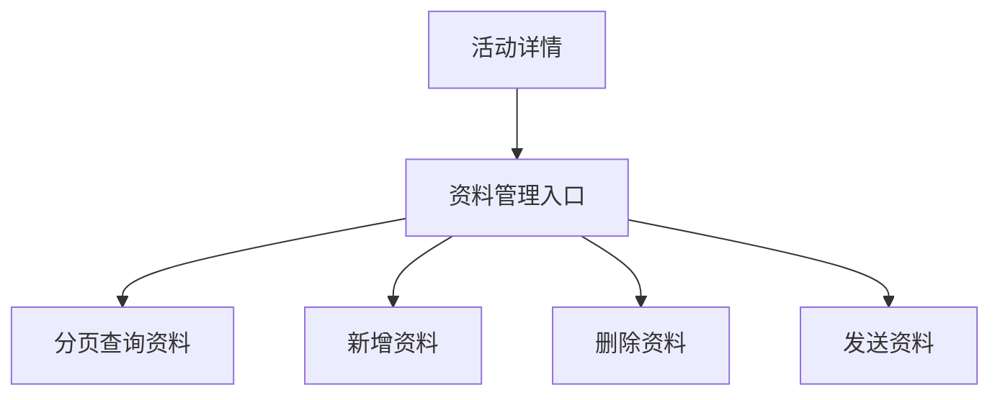
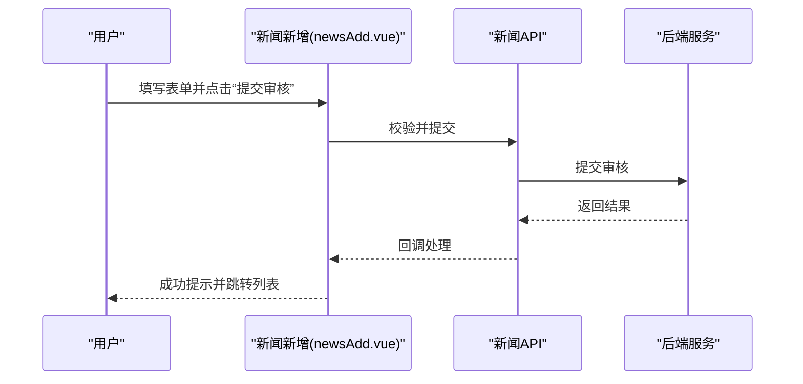
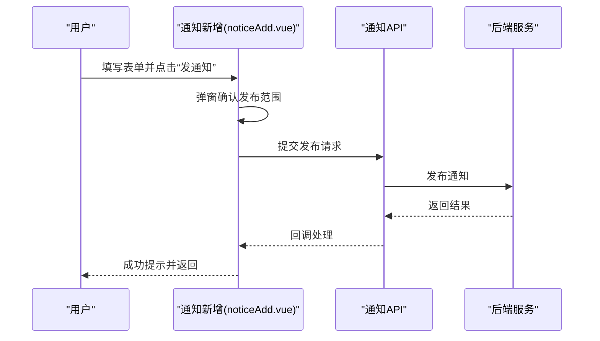
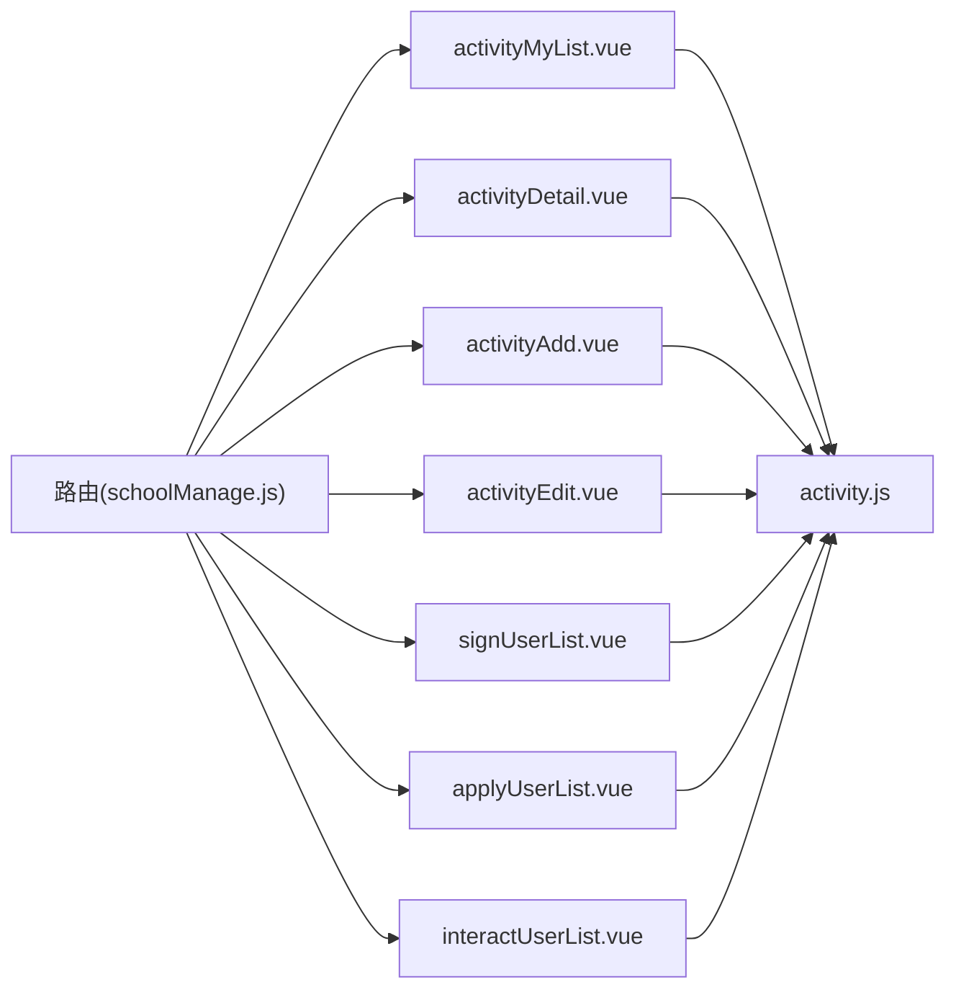

# 活动事件管理

<cite>
**本文引用的文件**
- [activity.js](file://src/api/activity.js)
- [activityAdd.vue](file://src/views/activity/activityAdd.vue)
- [activityDetail.vue](file://src/views/activity/activityDetail.vue)
- [activityEdit.vue](file://src/views/activity/activityEdit.vue)
- [activityMyList.vue](file://src/views/activity/activityMyList.vue)
- [signUserList.vue](file://src/views/activity/signUserList.vue)
- [applyUserList.vue](file://src/views/activity/applyUserList.vue)
- [interactUserList.vue](file://src/views/activity/interactUserList.vue)
- [newsAdd.vue](file://src/views/news/newsAdd.vue)
- [noticeAdd.vue](file://src/views/notice/noticeAdd.vue)
- [schoolManage.js](file://src/router/normal/schoolManage.js)
</cite>

## 目录
1. [简介](#简介)
2. [项目结构](#项目结构)
3. [核心组件](#核心组件)
4. [架构总览](#架构总览)
5. [详细组件分析](#详细组件分析)
6. [依赖关系分析](#依赖关系分析)
7. [性能考虑](#性能考虑)
8. [故障排查指南](#故障排查指南)
9. [结论](#结论)
10. [附录](#附录)

## 简介
本业务文档围绕“活动事件管理”能力，系统性梳理校园活动从策划、组织、执行到总结的全流程，覆盖活动报名、签到、互动与评价、资料管理等关键环节；同时文档化新闻资讯的发布、审核与推送机制，以及通知公告的分类管理、发布流程与阅读统计能力。最后给出权限控制、数据备份与活动效果分析的使用建议。

## 项目结构
活动事件管理功能主要由三部分构成：
- 活动管理前端页面与API封装：位于 src/views/activity 与 src/api/activity.js
- 新闻资讯发布与审核：位于 src/views/news 与 src/api/news.js（对应文件未直接列出，但API调用存在）
- 通知公告发布与配置：位于 src/views/notice 与 src/api/notice.js（对应文件未直接列出，但API调用存在）

图表来源
- [activityMyList.vue:1-273](file://src/views/activity/activityMyList.vue#L1-L273)
- [activityAdd.vue:1-808](file://src/views/activity/activityAdd.vue#L1-L808)
- [activityEdit.vue:1-850](file://src/views/activity/activityEdit.vue#L1-L850)
- [activityDetail.vue:1-794](file://src/views/activity/activityDetail.vue#L1-L794)
- [signUserList.vue:1-258](file://src/views/activity/signUserList.vue#L1-L258)
- [applyUserList.vue:1-178](file://src/views/activity/applyUserList.vue#L1-L178)
- [interactUserList.vue:1-198](file://src/views/activity/interactUserList.vue#L1-L198)
- [activity.js:1-418](file://src/api/activity.js#L1-L418)

章节来源
- [activity.js:1-418](file://src/api/activity.js#L1-L418)
- [activityMyList.vue:1-273](file://src/views/activity/activityMyList.vue#L1-L273)
- [activityAdd.vue:1-808](file://src/views/activity/activityAdd.vue#L1-L808)
- [activityEdit.vue:1-850](file://src/views/activity/activityEdit.vue#L1-L850)
- [activityDetail.vue:1-794](file://src/views/activity/activityDetail.vue#L1-L794)
- [signUserList.vue:1-258](file://src/views/activity/signUserList.vue#L1-L258)
- [applyUserList.vue:1-178](file://src/views/activity/applyUserList.vue#L1-L178)
- [interactUserList.vue:1-198](file://src/views/activity/interactUserList.vue#L1-L198)

## 核心组件
- 活动列表与筛选：支持分页、搜索、批量删除、状态展示
- 活动新增与编辑：支持活动类型（内部/外部）、报名、签到、调查、落款部门、封面图、附件、富文本内容、定时发送等
- 活动详情与管理：发布、互动提醒、互动上墙、签到上墙、报名详情、签到详情、资料管理、补发活动、资源预约
- 报名与签到：报名人员列表、签到人员列表（含导出）、未签到人员、签到时间段选择
- 互动与评价：互动上墙实时滚动、签到上墙弹窗
- 新闻资讯：标题、封面、审批人、落款部门、内容、限制范围、订阅/网站发布、分享与评论
- 通知公告：标题、范围、封面、附件、内容、接收确认方式、落款部门、回复策略、定时发送、过期时间

章节来源
- [activityMyList.vue:1-273](file://src/views/activity/activityMyList.vue#L1-L273)
- [activityAdd.vue:1-808](file://src/views/activity/activityAdd.vue#L1-L808)
- [activityEdit.vue:1-850](file://src/views/activity/activityEdit.vue#L1-L850)
- [activityDetail.vue:1-794](file://src/views/activity/activityDetail.vue#L1-L794)
- [signUserList.vue:1-258](file://src/views/activity/signUserList.vue#L1-L258)
- [applyUserList.vue:1-178](file://src/views/activity/applyUserList.vue#L1-L178)
- [interactUserList.vue:1-198](file://src/views/activity/interactUserList.vue#L1-L198)
- [newsAdd.vue:1-407](file://src/views/news/newsAdd.vue#L1-L407)
- [noticeAdd.vue:1-514](file://src/views/notice/noticeAdd.vue#L1-L514)

## 架构总览
活动事件管理采用“视图层 + API封装 + 后端接口”的三层结构：
- 视图层：各页面组件负责表单校验、交互与数据展示
- API封装：统一的fetch请求封装，集中管理参数构造与接口映射
- 后端接口：通过结构化REST接口提供活动、新闻、通知相关能力

图表来源
- [activityDetail.vue:356-383](file://src/views/activity/activityDetail.vue#L356-L383)
- [activity.js:376-385](file://src/api/activity.js#L376-L385)

章节来源
- [activityDetail.vue:356-383](file://src/views/activity/activityDetail.vue#L356-L383)
- [activity.js:376-385](file://src/api/activity.js#L376-L385)

## 详细组件分析

### 活动生命周期与流程
- 策划阶段：新增/编辑活动，设置活动类型、时间、地点、封面、附件、富文本、报名/签到/调查、落款部门、定时发送等
- 组织阶段：发布前可预览；发布后进入“未开始/进行中/已结束”状态流转
- 执行阶段：互动提醒、互动上墙、签到上墙、报名/签到详情、资料管理、资源预约
- 总结阶段：导出报名/签到统计、活动剪影管理、效果评估

图表来源
- [activityAdd.vue:344-624](file://src/views/activity/activityAdd.vue#L344-L624)
- [activityEdit.vue:413-697](file://src/views/activity/activityEdit.vue#L413-L697)
- [activityDetail.vue:356-383](file://src/views/activity/activityDetail.vue#L356-L383)

章节来源
- [activityAdd.vue:344-624](file://src/views/activity/activityAdd.vue#L344-L624)
- [activityEdit.vue:413-697](file://src/views/activity/activityEdit.vue#L413-L697)
- [activityDetail.vue:356-383](file://src/views/activity/activityDetail.vue#L356-L383)

### 活动报名与签到
- 报名：支持截止时间、人数上限、分页查询与导出
- 签到：支持多时段签到、导出未签到人员、导出签到统计、签到二维码、签到上墙
- 未出席：提供“未签到人员”页面，便于后续跟进

图表来源
- [activityDetail.vue:384-407](file://src/views/activity/activityDetail.vue#L384-L407)
- [signUserList.vue:136-180](file://src/views/activity/signUserList.vue#L136-L180)
- [activity.js:159-183](file://src/api/activity.js#L159-L183)

章节来源
- [signUserList.vue:136-180](file://src/views/activity/signUserList.vue#L136-L180)
- [activity.js:159-183](file://src/api/activity.js#L159-L183)

### 互动与评价
- 互动上墙：实时拉取互动消息，支持暂停/恢复
- 签到上墙：选择签到时间段后打开签到上墙窗口
- 评价：活动调查（多选项），支持分页查询调查结果

图表来源
- [activityDetail.vue:408-428](file://src/views/activity/activityDetail.vue#L408-L428)
- [interactUserList.vue:76-87](file://src/views/activity/interactUserList.vue#L76-L87)
- [activity.js:274-285](file://src/api/activity.js#L274-L285)

章节来源
- [interactUserList.vue:76-87](file://src/views/activity/interactUserList.vue#L76-L87)
- [activity.js:274-285](file://src/api/activity.js#L274-L285)

### 资料管理
- 支持活动资料分页查询、新增、删除、按条件筛选
- 支持将资料发送给报名/签到/范围内的用户

图表来源
- [activityDetail.vue:30-31](file://src/views/activity/activityDetail.vue#L30-L31)
- [activity.js:297-360](file://src/api/activity.js#L297-L360)

章节来源
- [activityDetail.vue:30-31](file://src/views/activity/activityDetail.vue#L30-L31)
- [activity.js:297-360](file://src/api/activity.js#L297-L360)

### 新闻资讯发布与审核
- 支持标题、封面、审批人、落款部门、内容、限制范围（校友/校外）、订阅/网站发布、分享与评论
- 提供“存草稿/提交审核/手机预览”三种操作路径

图表来源
- [newsAdd.vue:200-268](file://src/views/news/newsAdd.vue#L200-L268)

章节来源
- [newsAdd.vue:200-268](file://src/views/news/newsAdd.vue#L200-L268)

### 通知公告发布与配置
- 支持标题、范围、封面、附件、内容、接收确认方式、落款部门、回复策略、定时发送、过期时间
- 发布前可弹窗确认发布范围

图表来源
- [noticeAdd.vue:367-431](file://src/views/notice/noticeAdd.vue#L367-L431)

章节来源
- [noticeAdd.vue:367-431](file://src/views/notice/noticeAdd.vue#L367-L431)

## 依赖关系分析
- 页面与API：各页面组件通过统一的API封装发起请求，降低耦合度
- 路由与页面：路由模块 schoolManage.js 将活动相关页面注册为子路由，便于导航与权限控制
- 数据流：页面组件负责UI与校验，API封装负责参数拼装与HTTP请求，后端提供结构化接口

图表来源
- [schoolManage.js:333-367](file://src/router/normal/schoolManage.js#L333-L367)
- [activityMyList.vue:1-273](file://src/views/activity/activityMyList.vue#L1-L273)
- [activityDetail.vue:1-794](file://src/views/activity/activityDetail.vue#L1-L794)
- [activityAdd.vue:1-808](file://src/views/activity/activityAdd.vue#L1-L808)
- [activityEdit.vue:1-850](file://src/views/activity/activityEdit.vue#L1-L850)
- [signUserList.vue:1-258](file://src/views/activity/signUserList.vue#L1-L258)
- [applyUserList.vue:1-178](file://src/views/activity/applyUserList.vue#L1-L178)
- [interactUserList.vue:1-198](file://src/views/activity/interactUserList.vue#L1-L198)
- [activity.js:1-418](file://src/api/activity.js#L1-L418)

章节来源
- [schoolManage.js:333-367](file://src/router/normal/schoolManage.js#L333-L367)
- [activity.js:1-418](file://src/api/activity.js#L1-L418)

## 性能考虑
- 列表分页：活动报名、签到、互动等均采用分页查询，避免一次性加载大量数据
- 实时刷新：互动上墙采用定时轮询（固定间隔），可根据实际场景调整轮询频率
- 富文本与媒体：封面、附件、图片等资源建议使用CDN加速与懒加载策略
- 导出功能：导出接口需注意数据量控制，建议分批或异步导出

## 故障排查指南
- 表单校验失败：检查必填字段与格式（时间、人数、内容等），确保富文本内容已提交
- 发布失败：确认活动时间必须晚于当前时间，外部活动签到默认开启
- 互动上墙无数据：确认活动正在进行且已开启互动提醒，maxId需正确传递
- 签到导出异常：确认时间段选择正确，导出链接包含必要参数
- 权限问题：确认用户具备相应角色与部门权限，审批人与落款部门配置正确

章节来源
- [activityAdd.vue:344-624](file://src/views/activity/activityAdd.vue#L344-L624)
- [activityDetail.vue:356-428](file://src/views/activity/activityDetail.vue#L356-L428)
- [interactUserList.vue:76-87](file://src/views/activity/interactUserList.vue#L76-L87)
- [signUserList.vue:136-180](file://src/views/activity/signUserList.vue#L136-L180)

## 结论
活动事件管理提供了从策划到总结的全链路能力，结合报名、签到、互动与评价、资料管理等功能，能够满足校园活动的多样化需求。新闻资讯与通知公告模块进一步完善了信息传播体系。建议在生产环境中配合完善的权限控制、数据备份与效果分析机制，持续优化用户体验与运营效率。

## 附录
- 权限控制：建议基于角色与部门维度控制活动发布、编辑、补发与资料管理权限
- 数据备份：定期备份活动元数据、报名/签到/互动数据与资料文件
- 活动效果分析：结合报名/签到率、互动热度、资料下载量等指标进行评估