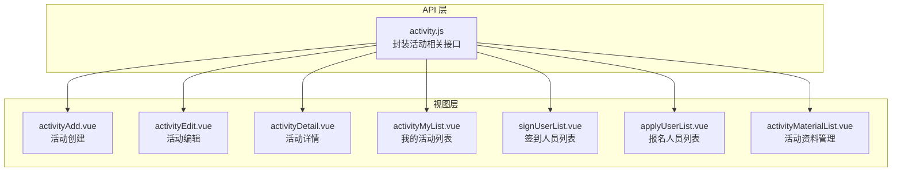
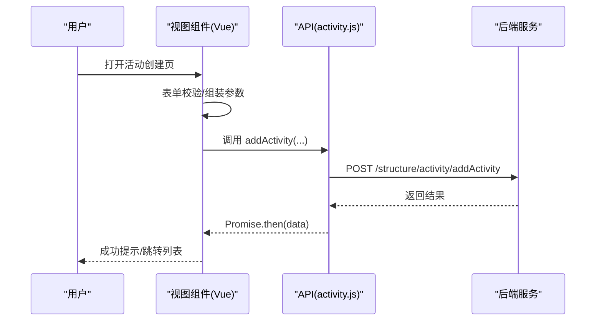
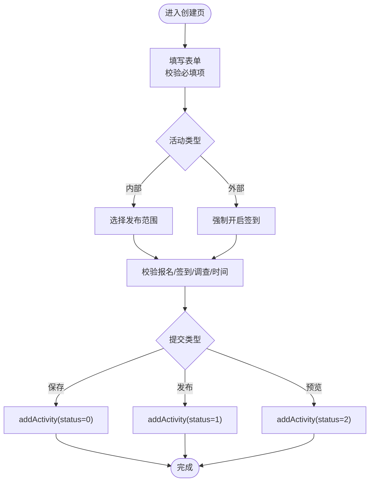
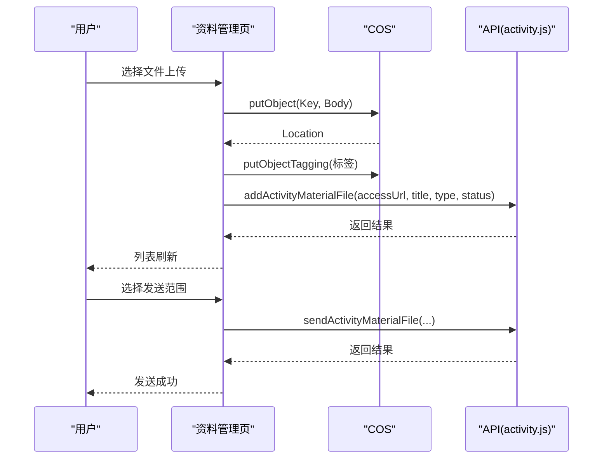
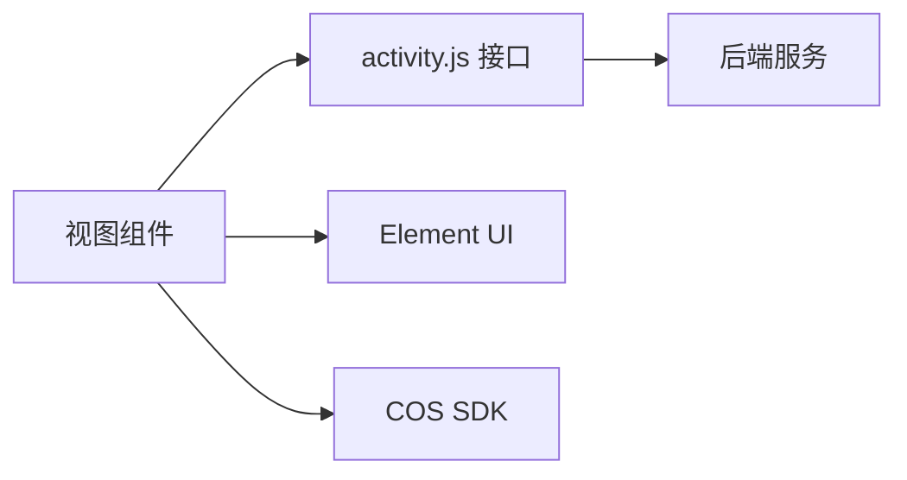

# 活动管理

<cite>
**本文引用的文件**
- [activity.js](file://src/api/activity.js)
- [activityAdd.vue](file://src/views/activity/activityAdd.vue)
- [activityDetail.vue](file://src/views/activity/activityDetail.vue)
- [activityEdit.vue](file://src/views/activity/activityEdit.vue)
- [activityMaterialList.vue](file://src/views/activity/activityMaterialList.vue)
- [activityMyList.vue](file://src/views/activity/activityMyList.vue)
- [signUserList.vue](file://src/views/activity/signUserList.vue)
- [applyUserList.vue](file://src/views/activity/applyUserList.vue)
</cite>

## 目录
1. [简介](#简介)
2. [项目结构](#项目结构)
3. [核心组件](#核心组件)
4. [架构总览](#架构总览)
5. [详细组件分析](#详细组件分析)
6. [依赖分析](#依赖分析)
7. [性能考虑](#性能考虑)
8. [故障排查指南](#故障排查指南)
9. [结论](#结论)
10. [附录](#附录)

## 简介
本文件面向“活动管理”功能，覆盖校园活动从创建、编辑、发布到管理的全生命周期，包括活动报名、签到管理、用户互动、材料管理等模块，并对活动列表展示、活动详情查看、参与人员统计与活动效果分析进行文档化。同时提供状态管理、权限控制与数据安全的最佳实践建议，以及可直接定位到源码位置的路径指引，便于开发者快速理解与扩展。

## 项目结构
活动管理相关前端代码主要由三部分组成：
- API 层：封装与后端交互的接口方法，统一请求与参数组织。
- 视图层：以 Vue 单文件组件形式呈现各业务页面（创建、编辑、详情、列表、签到、报名、资料管理等）。
- 页面路由：通过路由模块将页面与 URL 建立映射，支持跳转与参数传递。

图表来源
- [activity.js](file://src/api/activity.js)
- [activityAdd.vue](file://src/views/activity/activityAdd.vue)
- [activityEdit.vue](file://src/views/activity/activityEdit.vue)
- [activityDetail.vue](file://src/views/activity/activityDetail.vue)
- [activityMyList.vue](file://src/views/activity/activityMyList.vue)
- [signUserList.vue](file://src/views/activity/signUserList.vue)
- [applyUserList.vue](file://src/views/activity/applyUserList.vue)
- [activityMaterialList.vue](file://src/views/activity/activityMaterialList.vue)

章节来源
- [activity.js](file://src/api/activity.js)
- [activityAdd.vue](file://src/views/activity/activityAdd.vue)
- [activityDetail.vue](file://src/views/activity/activityDetail.vue)
- [activityEdit.vue](file://src/views/activity/activityEdit.vue)
- [activityMaterialList.vue](file://src/views/activity/activityMaterialList.vue)
- [activityMyList.vue](file://src/views/activity/activityMyList.vue)
- [signUserList.vue](file://src/views/activity/signUserList.vue)
- [applyUserList.vue](file://src/views/activity/applyUserList.vue)

## 核心组件
- 活动创建/编辑表单：负责收集活动基本信息、报名规则、签到安排、调查设置、附件与封面等，并调用 API 提交。
- 活动详情页：展示活动完整信息、发布范围、报名/签到/调查状态、互动与签到上墙入口、资料管理入口等。
- 我的活动列表：分页展示活动、支持筛选、批量删除、跳转至详情/编辑/资料管理。
- 报名/签到人员列表：按签到场次或默认聚合展示报名与签到明细，支持导出。
- 活动资料管理：上传、删除、发送/发布资料，支持 COS 文件直传与标签打标。

章节来源
- [activityAdd.vue](file://src/views/activity/activityAdd.vue)
- [activityEdit.vue](file://src/views/activity/activityEdit.vue)
- [activityDetail.vue](file://src/views/activity/activityDetail.vue)
- [activityMyList.vue](file://src/views/activity/activityMyList.vue)
- [signUserList.vue](file://src/views/activity/signUserList.vue)
- [applyUserList.vue](file://src/views/activity/applyUserList.vue)
- [activityMaterialList.vue](file://src/views/activity/activityMaterialList.vue)

## 架构总览
活动管理采用“视图组件 + API 封装”的分层设计，组件通过 Vuex 获取用户与学校上下文，通过 API 层与后端交互，最终完成活动的增删改查、报名统计、签到统计与资料下发。

图表来源
- [activityAdd.vue](file://src/views/activity/activityAdd.vue)
- [activity.js](file://src/api/activity.js)

## 详细组件分析

### 活动创建（activityAdd）
- 功能要点
  - 活动类型（内部/外部）、时间范围、地点、封面、报名截止与人数限制、签到时间集合、调查主题与选项、附件、落款部门、是否允许上传剪影等。
  - 定时发送开关与发送时间校验。
  - 内部活动需选择发布范围（部门/组/用户）。
  - 提交时将表单数据序列化并调用 addActivity 接口。
- 关键流程（创建/发布/预览）
  - 创建：status=0，仅保存草稿。
  - 发布：status=1，发布活动。
  - 预览：status=2，提示移动端预览。
- 数据安全与权限
  - 仅草稿状态可编辑；发布后进入管理态。
  - 发布范围与定时发送需满足时间约束。

图表来源
- [activityAdd.vue](file://src/views/activity/activityAdd.vue)
- [activity.js](file://src/api/activity.js)

章节来源
- [activityAdd.vue](file://src/views/activity/activityAdd.vue)
- [activity.js](file://src/api/activity.js)

### 活动编辑（activityEdit）
- 功能要点
  - 加载已有活动详情，回显表单。
  - 支持修改报名、签到、调查、附件、封面、落款部门等。
  - 外部活动强制签到。
- 关键流程
  - 获取详情 -> 回填表单 -> 校验 -> 提交 editActivity。

章节来源
- [activityEdit.vue](file://src/views/activity/activityEdit.vue)
- [activity.js](file://src/api/activity.js)

### 活动详情（activityDetail）
- 功能要点
  - 展示活动基础信息、发布范围、报名/签到/调查状态、附件列表、签到二维码等。
  - 管理入口：互动提醒、互动上墙、签到上墙、签到详情、报名详情、活动调查、资料管理、补发活动、资源预约。
  - 剪影上传与删除（允许时）。
- 关键流程
  - 获取详情 -> 渲染信息 -> 按状态显示管理按钮 -> 跳转对应管理页。

章节来源
- [activityDetail.vue](file://src/views/activity/activityDetail.vue)
- [activity.js](file://src/api/activity.js)

### 我的活动列表（activityMyList）
- 功能要点
  - 分页展示活动，支持按主题筛选。
  - 操作：编辑（仅草稿）、删除（仅草稿）、资料管理。
  - 导航至详情页查看状态与统计入口。
- 关键流程
  - 分页查询 getSchoolActivityPageList -> 渲染列表 -> 操作按钮可用性判断。

章节来源
- [activityMyList.vue](file://src/views/activity/activityMyList.vue)
- [activity.js](file://src/api/activity.js)

### 报名人员列表（applyUserList）
- 功能要点
  - 展示报名人员头像、姓名、手机号、部门、报名时间。
  - 支持按姓名搜索与分页。
  - 提供报名结果导出链接。
- 关键流程
  - 调用 getActivityApplyPageList -> 渲染表格 -> 导出下载。

章节来源
- [applyUserList.vue](file://src/views/activity/applyUserList.vue)
- [activity.js](file://src/api/activity.js)

### 签到人员列表（signUserList）
- 功能要点
  - 支持按签到场次筛选（多签到时间）。
  - 展示签到时间、签到场次、签到地点等。
  - 支持按姓名搜索与分页。
  - 提供签到未签统计导出链接。
- 关键流程
  - 获取签到时间列表 -> 按场次查询签到人员 -> 渲染表格 -> 导出下载。

章节来源
- [signUserList.vue](file://src/views/activity/signUserList.vue)
- [activity.js](file://src/api/activity.js)

### 活动资料管理（activityMaterialList）
- 功能要点
  - 上传资料（COS 直传，带标签） -> 列表展示 -> 删除 -> 发送/发布（按范围：全部/报名/签到）。
  - 支持分页与搜索标题。
- 关键流程
  - COS 初始化 -> 上传 putObject -> 打标签 putObjectTagging -> 新增资料 addActivityMaterialFile -> 列表加载 -> 发送/删除。

图表来源
- [activityMaterialList.vue](file://src/views/activity/activityMaterialList.vue)
- [activity.js](file://src/api/activity.js)

章节来源
- [activityMaterialList.vue](file://src/views/activity/activityMaterialList.vue)
- [activity.js](file://src/api/activity.js)

## 依赖分析
- 组件耦合
  - 各页面组件均依赖 activity.js 的接口方法，形成清晰的“视图-接口”边界。
  - 活动详情页依赖多个子功能入口（报名、签到、资料、互动等），但通过路由跳转解耦。
- 外部依赖
  - COS SDK 用于文件直传与标签打标。
  - Element UI 组件库用于表单、表格、分页、弹窗等。
- 可能的循环依赖
  - 当前结构为单向依赖（视图 -> API），无循环依赖迹象。

图表来源
- [activity.js](file://src/api/activity.js)
- [activityAdd.vue](file://src/views/activity/activityAdd.vue)
- [activityDetail.vue](file://src/views/activity/activityDetail.vue)
- [activityEdit.vue](file://src/views/activity/activityEdit.vue)
- [activityMaterialList.vue](file://src/views/activity/activityMaterialList.vue)
- [activityMyList.vue](file://src/views/activity/activityMyList.vue)
- [signUserList.vue](file://src/views/activity/signUserList.vue)
- [applyUserList.vue](file://src/views/activity/applyUserList.vue)

## 性能考虑
- 列表分页与防抖
  - 使用分页参数控制数据量，避免一次性加载过多。
  - 搜索输入采用防抖策略，降低频繁请求压力。
- 图片与富文本渲染
  - 详情页富文本内容采用延迟渲染与图片预览器，减少首屏阻塞。
- 文件上传
  - COS 直传避免前端压缩与内存占用，上传后立即打标签，缩短后续检索链路。
- 状态与权限
  - 通过状态位与按钮禁用策略，避免无效请求与界面闪烁。

## 故障排查指南
- 创建/编辑失败
  - 检查必填字段与时间校验逻辑，确保开始/结束时间、报名截止时间、签到时间顺序正确。
  - 查看接口返回的错误消息，定位具体参数问题。
- 定时发送异常
  - 确认发送时间晚于当前时间，且 isOntimeSend 开关与 sendDate 参数正确传递。
- 资料上传失败
  - 检查 COS 凭证初始化是否成功，标签打标是否返回错误。
  - 确认文件类型在允许列表内。
- 签到/报名导出为空
  - 确认当前筛选条件（签到场次、搜索关键词）是否导致无数据。
  - 检查导出链接中的 token 与活动 ID 是否有效。

章节来源
- [activityAdd.vue](file://src/views/activity/activityAdd.vue)
- [activityEdit.vue](file://src/views/activity/activityEdit.vue)
- [activityDetail.vue](file://src/views/activity/activityDetail.vue)
- [activityMaterialList.vue](file://src/views/activity/activityMaterialList.vue)
- [signUserList.vue](file://src/views/activity/signUserList.vue)
- [applyUserList.vue](file://src/views/activity/applyUserList.vue)

## 结论
活动管理模块以清晰的职责划分与完善的业务闭环实现了校园活动的全生命周期管理。通过统一的 API 封装与规范的表单校验，保障了数据一致性与用户体验。建议在后续迭代中进一步完善权限细化、审计日志与异常监控，以提升系统的可运维性与安全性。

## 附录
- 常用接口路径参考
  - 创建活动：[addActivity](file://src/api/activity.js)
  - 编辑活动：[editActivity](file://src/api/activity.js)
  - 获取活动详情：[getActivityInfo](file://src/api/activity.js)
  - 发布活动：[sendActivityById](file://src/api/activity.js)
  - 报名人员列表：[getActivityApplyPageList](file://src/api/activity.js)
  - 签到人员列表（内部）：[getActivitySignUserPageList](file://src/api/activity.js)
  - 签到人员列表（外部）：[getWxsmpActivitySignPageList](file://src/api/activity.js)
  - 活动资料列表：[getActivityMaterialPageList](file://src/api/activity.js)
  - 上传资料：[addActivityMaterialFile](file://src/api/activity.js)
  - 删除资料：[delActivityMaterial](file://src/api/activity.js)
  - 发送资料：[sendActivityMaterialFile](file://src/api/activity.js)
  - 补发活动：[reissueActivity](file://src/api/activity.js)
  - 互动上墙/签到上墙：[publishBeginAskNotice](file://src/api/activity.js)、[signUserShow](file://src/api/activity.js)
  - 剪影上传/删除：[addInteractPics](file://src/api/activity.js)、[deleteInteractPic](file://src/api/activity.js)
  - 获取互动图片：[getActivityInteractAllPicList](file://src/api/activity.js)