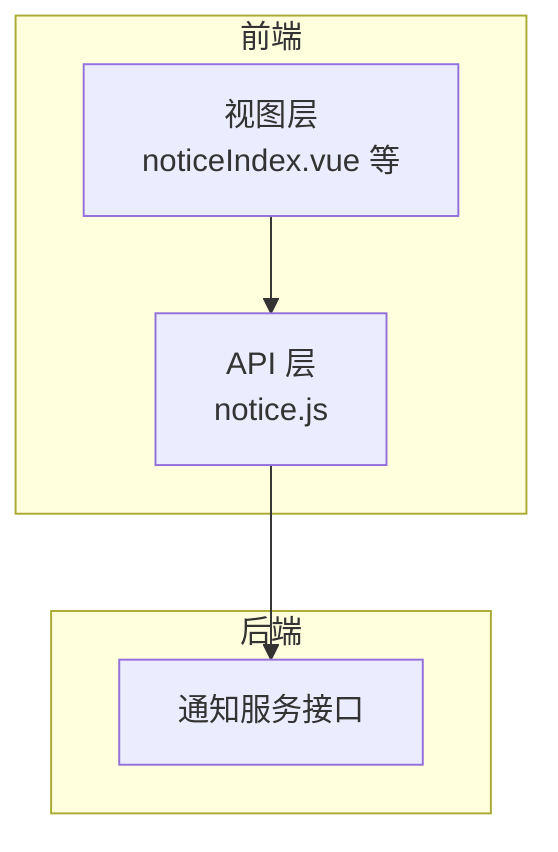
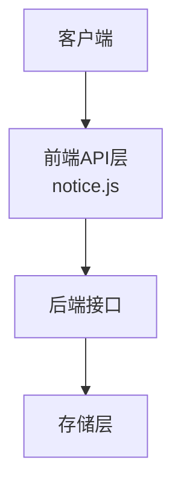
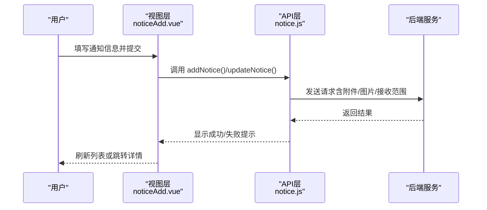
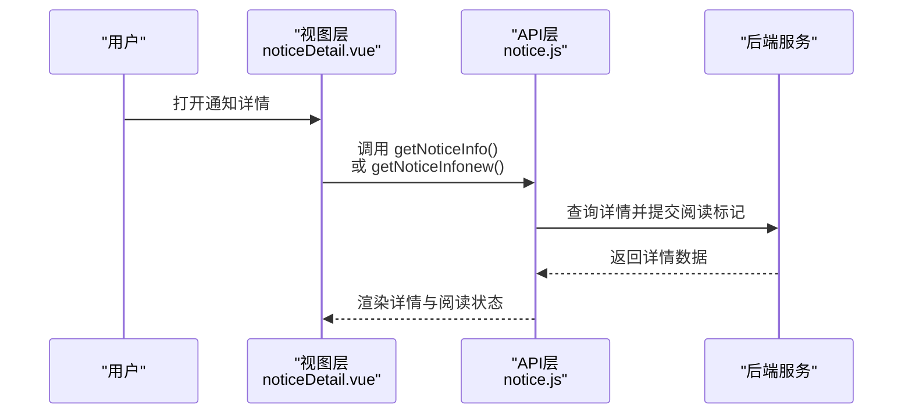
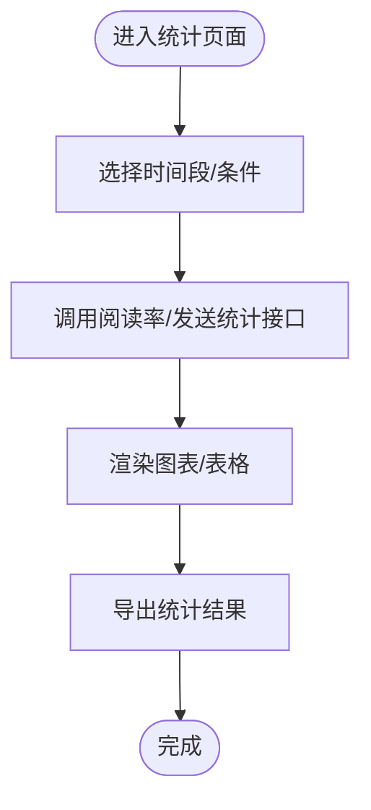
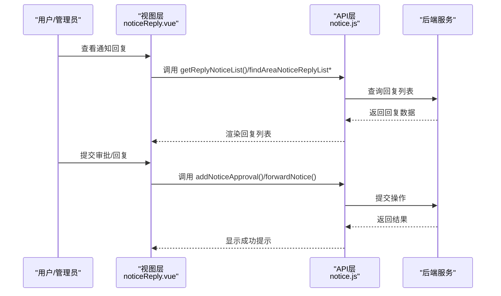
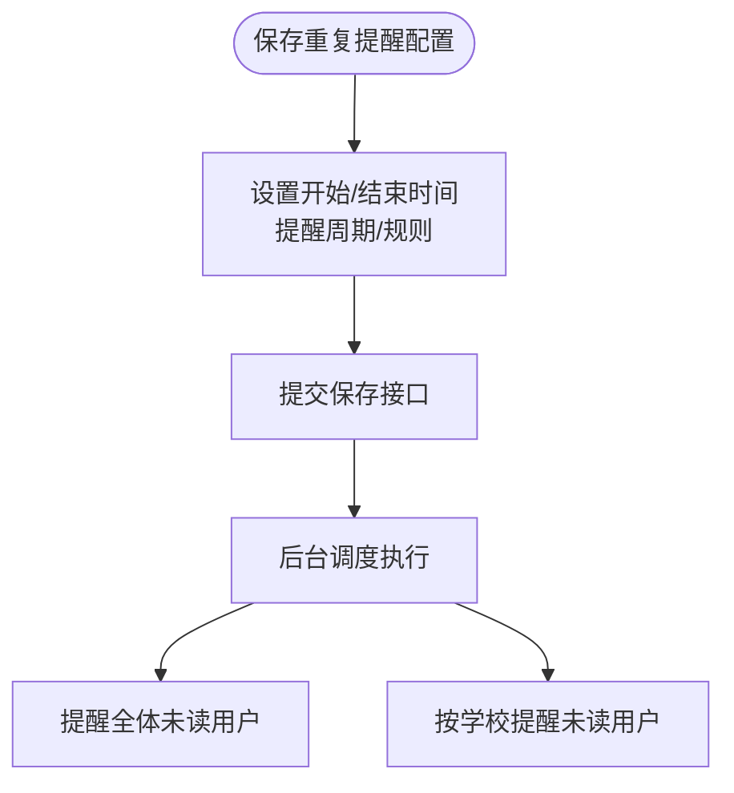
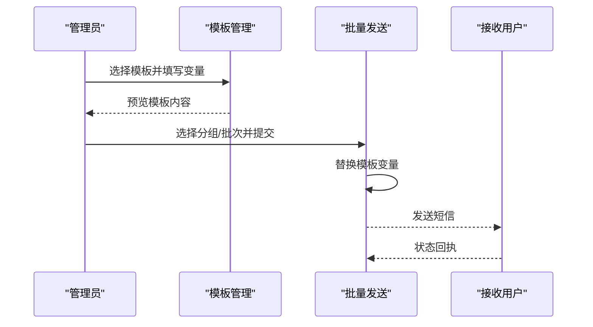
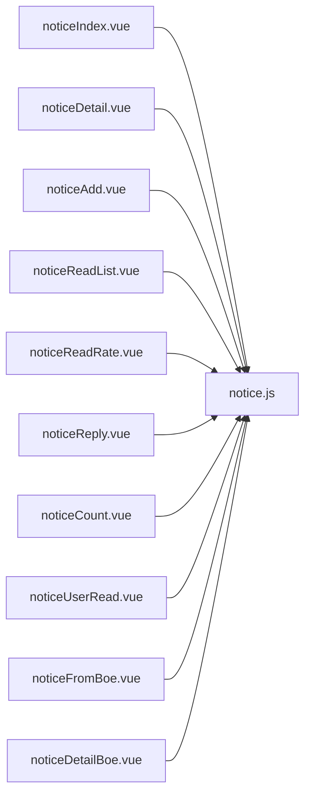

# 通知管理

<cite>
**本文引用的文件**
- [notice.js](file://src/api/notice.js)
- [noticeIndex.vue](file://src/views/notice/noticeIndex.vue)
- [noticeDetail.vue](file://src/views/notice/noticeDetail.vue)
- [noticeAdd.vue](file://src/views/notice/noticeAdd.vue)
- [noticeReadList.vue](file://src/views/notice/noticeReadList.vue)
- [noticeReadRate.vue](file://src/views/notice/noticeReadRate.vue)
- [noticeReply.vue](file://src/views/notice/noticeReply.vue)
- [noticeCount.vue](file://src/views/notice/noticeCount.vue)
- [noticeUserRead.vue](file://src/views/notice/noticeUserRead.vue)
- [noticeFromBoe.vue](file://src/views/notice/noticeFromBoe.vue)
- [noticeDetailBoe.vue](file://src/views/notice/noticeDetailBoe.vue)
- [noticeCount.vue](file://src/views/notice/noticeCount.vue)
- [noticeReadRate.vue](file://src/views/notice/noticeReadRate.vue)
- [noticeReadList.vue](file://src/views/notice/noticeReadList.vue)
- [noticeUserRead.vue](file://src/views/notice/noticeUserRead.vue)
- [noticeFromBoe.vue](file://src/views/notice/noticeFromBoe.vue)
- [noticeDetailBoe.vue](file://src/views/notice/noticeDetailBoe.vue)
- [noticeCount.vue](file://src/views/notice/noticeCount.vue)
- [noticeReadRate.vue](file://src/views/notice/noticeReadRate.vue)
- [noticeReadList.vue](file://src/views/notice/noticeReadList.vue)
- [noticeUserRead.vue](file://src/views/notice/noticeUserRead.vue)
- [noticeFromBoe.vue](file://src/views/notice/noticeFromBoe.vue)
- [noticeDetailBoe.vue](file://src/views/notice/noticeDetailBoe.vue)
</cite>

## 目录
1. [简介](#简介)
2. [项目结构](#项目结构)
3. [核心组件](#核心组件)
4. [架构概览](#架构概览)
5. [详细组件分析](#详细组件分析)
6. [依赖关系分析](#依赖关系分析)
7. [性能考虑](#性能考虑)
8. [故障排除指南](#故障排除指南)
9. [结论](#结论)
10. [附录](#附录)

## 简介
本文件为通知管理系统提供综合性业务文档，涵盖通知公告的创建、发布、接收、反馈与管理全流程。系统支持多角色（校端、区端）协同工作，具备通知分类、接收范围设置、优先级管理、阅读统计、回复处理、重复提醒等能力。同时提供模板管理、批量发送、个性化定制、推送渠道管理、送达率统计与用户行为分析等高级功能，并在权限控制、数据安全与性能优化方面提供策略指导。

## 项目结构
通知管理模块由前端API层与视图层组成：
- API层：统一通过notice.js封装通知相关接口，包括列表查询、详情获取、发布、删除、阅读统计、回复、提醒、转发、审批、置顶、重复提醒配置等。
- 视图层：提供通知管理界面，包括通知列表、详情、新增/编辑、已读未读统计、阅读率统计、回复列表、发送统计、用户阅读记录、区端通知来源与详情等页面。

图表来源
- [notice.js](file://src/api/notice.js)
- [noticeIndex.vue](file://src/views/notice/noticeIndex.vue)

章节来源
- [notice.js](file://src/api/notice.js)
- [noticeIndex.vue](file://src/views/notice/noticeIndex.vue)

## 核心组件
- 通知列表与查询
  - 用户端与发布端列表接口，支持分页、标题搜索、类型过滤。
  - 区端专用列表与详情接口，支持按学校分组阅读统计。
- 通知详情与阅读
  - 详情接口支持提交阅读标记，归档查询接口用于历史数据回看。
  - 已读/未读人员列表与部门阅读分布查询。
- 发布与管理
  - 新增、更新通知接口，支持定时发送、附件/图片、回复开关、签到、教师可见性等字段。
  - 删除、置顶、转发、审批、重复提醒配置与查询。
- 统计与分析
  - 阅读率统计、发送统计、用户阅读记录、区端阅读统计分组。
- 回复与反馈
  - 回复列表分页查询，区端回复列表与不分页查询。
- 推送与提醒
  - 对全体或特定学校提醒未读用户，重复提醒消息保存与查询。

章节来源
- [notice.js](file://src/api/notice.js)

## 架构概览
通知管理采用前后端分离架构，前端通过统一API层调用后端接口，后端提供REST风格接口，覆盖通知全生命周期管理。

图表来源
- [notice.js](file://src/api/notice.js)

## 详细组件分析

### 通知创建与发布流程
- 创建通知
  - 字段：标题、内容、发布人、状态、创建类型、是否允许回复、接收范围（部门/群组/用户）、定时发送、封面、落款、附件/图片、通知类型、教师可见性等。
  - 接口：addNotice、addNoticeDoe（区端）。
- 更新通知
  - 字段同上，支持修改接收范围、定时发送、附件/图片、通知类型等。
  - 接口：updateNotice、updateNoticeDoe。
- 发布与草稿
  - 发布状态与测试发布区分，支持草稿保存与发布切换。
- 删除
  - 支持批量删除。

图表来源
- [noticeAdd.vue](file://src/views/notice/noticeAdd.vue)
- [notice.js](file://src/api/notice.js)

章节来源
- [noticeAdd.vue](file://src/views/notice/noticeAdd.vue)
- [notice.js](file://src/api/notice.js)

### 通知接收与阅读管理
- 列表与详情
  - 用户接收列表、发布列表、区端收件列表等。
  - 详情接口支持提交阅读标记，归档查询用于历史查看。
- 已读/未读统计
  - 支持按部门、是否签到、用户类型、标题搜索等条件查询。
  - 区端支持按学校分组阅读统计与人员列表。
- 阅读签名清除
  - 支持清除阅读签名图片。

图表来源
- [noticeDetail.vue](file://src/views/notice/noticeDetail.vue)
- [notice.js](file://src/api/notice.js)

章节来源
- [noticeDetail.vue](file://src/views/notice/noticeDetail.vue)
- [notice.js](file://src/api/notice.js)

### 通知阅读统计与用户行为分析
- 阅读率统计
  - 支持按时间段、标题搜索统计阅读率。
- 发送统计
  - 支持按时间段、教师姓名统计发送数量。
- 用户阅读记录
  - 查询用户未读/已读通知列表，支持时间范围与状态筛选。
- 区端阅读统计
  - 支持按学校分组统计阅读情况。

图表来源
- [noticeReadRate.vue](file://src/views/notice/noticeReadRate.vue)
- [noticeCount.vue](file://src/views/notice/noticeCount.vue)
- [noticeUserRead.vue](file://src/views/notice/noticeUserRead.vue)
- [notice.js](file://src/api/notice.js)

章节来源
- [noticeReadRate.vue](file://src/views/notice/noticeReadRate.vue)
- [noticeCount.vue](file://src/views/notice/noticeCount.vue)
- [noticeUserRead.vue](file://src/views/notice/noticeUserRead.vue)
- [notice.js](file://src/api/notice.js)

### 回复处理与区端协作
- 回复列表
  - 分页查询通知回复列表，支持类型筛选。
- 区端回复
  - 区端回复列表与不分页查询，支持按通知ID查询。
- 批复与转发
  - 支持添加审批意见、查询转发/提交/批复用户信息。

图表来源
- [noticeReply.vue](file://src/views/notice/noticeReply.vue)
- [notice.js](file://src/api/notice.js)

章节来源
- [noticeReply.vue](file://src/views/notice/noticeReply.vue)
- [notice.js](file://src/api/notice.js)

### 重复提醒机制
- 保存重复提醒
  - 支持按通知ID保存开始/结束时间、提醒周期、是否删除等配置。
- 查询重复提醒
  - 支持按通知ID查询重复提醒配置。
- 提醒执行
  - 支持对全体或指定学校提醒未读用户。

图表来源
- [notice.js](file://src/api/notice.js)

章节来源
- [notice.js](file://src/api/notice.js)

### 模板管理、批量发送与个性化定制
- 模板管理
  - 通过短信模板接口管理模板内容与变量。
- 批量发送
  - 支持按分组或批次批量发送短信，支持模板变量替换。
- 个性化定制
  - 模板变量动态填充，支持按用户/分组个性化内容。

图表来源
- [notice.js](file://src/api/notice.js)

章节来源
- [notice.js](file://src/api/notice.js)

### 权限控制、数据安全与性能优化
- 权限控制
  - 多角色（校端/区端）接口区分，区端专用列表与统计接口，确保职责边界。
- 数据安全
  - 关键接口使用归档查询（如历史详情），避免误删；提供阅读签名清除接口，保障隐私。
- 性能优化
  - 列表分页查询、条件筛选减少数据传输；批量删除与批量发送降低交互次数；定时发送与重复提醒通过后台调度减轻前端压力。

章节来源
- [notice.js](file://src/api/notice.js)

## 依赖关系分析
通知管理模块的依赖关系主要体现在API层对后端接口的封装与视图层对API层的调用。

图表来源
- [noticeIndex.vue](file://src/views/notice/noticeIndex.vue)
- [noticeDetail.vue](file://src/views/notice/noticeDetail.vue)
- [noticeAdd.vue](file://src/views/notice/noticeAdd.vue)
- [noticeReadList.vue](file://src/views/notice/noticeReadList.vue)
- [noticeReadRate.vue](file://src/views/notice/noticeReadRate.vue)
- [noticeReply.vue](file://src/views/notice/noticeReply.vue)
- [noticeCount.vue](file://src/views/notice/noticeCount.vue)
- [noticeUserRead.vue](file://src/views/notice/noticeUserRead.vue)
- [noticeFromBoe.vue](file://src/views/notice/noticeFromBoe.vue)
- [noticeDetailBoe.vue](file://src/views/notice/noticeDetailBoe.vue)
- [notice.js](file://src/api/notice.js)

章节来源
- [noticeIndex.vue](file://src/views/notice/noticeIndex.vue)
- [noticeDetail.vue](file://src/views/notice/noticeDetail.vue)
- [noticeAdd.vue](file://src/views/notice/noticeAdd.vue)
- [noticeReadList.vue](file://src/views/notice/noticeReadList.vue)
- [noticeReadRate.vue](file://src/views/notice/noticeReadRate.vue)
- [noticeReply.vue](file://src/views/notice/noticeReply.vue)
- [noticeCount.vue](file://src/views/notice/noticeCount.vue)
- [noticeUserRead.vue](file://src/views/notice/noticeUserRead.vue)
- [noticeFromBoe.vue](file://src/views/notice/noticeFromBoe.vue)
- [noticeDetailBoe.vue](file://src/views/notice/noticeDetailBoe.vue)
- [notice.js](file://src/api/notice.js)

## 性能考虑
- 列表分页与条件筛选：减少一次性加载大量数据，提升响应速度。
- 批量操作：批量删除、批量发送降低网络往返次数。
- 后台调度：定时发送与重复提醒通过后台任务执行，避免阻塞前端。
- 归档查询：历史数据查询使用归档接口，避免主库压力。

## 故障排除指南
- 接口调用失败
  - 检查网络连接与后端服务状态；确认参数格式与必填字段。
- 通知未显示或状态异常
  - 核对通知状态（草稿/发布）、定时发送时间、接收范围设置。
- 阅读统计不准确
  - 确认阅读标记提交逻辑与统计接口参数；检查分组/学校维度统计。
- 回复/审批未生效
  - 检查审批流程与权限；确认接口返回结果与提示信息。
- 重复提醒未触发
  - 核对重复提醒配置的时间范围与提醒规则；检查后台调度日志。

章节来源
- [notice.js](file://src/api/notice.js)

## 结论
通知管理系统通过清晰的前后端分工与完善的接口设计，实现了通知从创建到发布的全生命周期管理，并提供了阅读统计、回复处理、重复提醒、模板管理与批量发送等高级能力。配合权限控制、数据安全与性能优化策略，能够满足多角色协同与大规模并发场景下的通知管理需求。

## 附录
- 术语
  - 通知类型：校端/区端标识。
  - 接收范围：部门/群组/用户三种维度。
  - 阅读统计：按时间段、学校、部门等维度统计。
  - 重复提醒：基于时间周期的自动化提醒机制。
- 参考接口清单（节选）
  - 列表与详情：getUserNoticeList、getYSendNoticeList、getNoticeInfo、getNoticeInfonew
  - 已读未读与阅读统计：getReadUserNoticeList、getNoticeReadRateList、getNoticePublishCount
  - 回复与审批：getReplyNoticeList、addNoticeApproval、forwardNotice
  - 重复提醒：saveNoticeRepeatReminderByNoticeId、getNoticeRepeatReminderByNoticeId
  - 区端专属：getUserReceiveNoticeListDoe、findAreaNoticeList、remindNotReadUsersBySchoolId

章节来源
- [notice.js](file://src/api/notice.js)