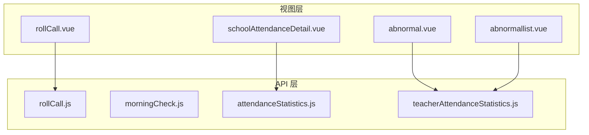
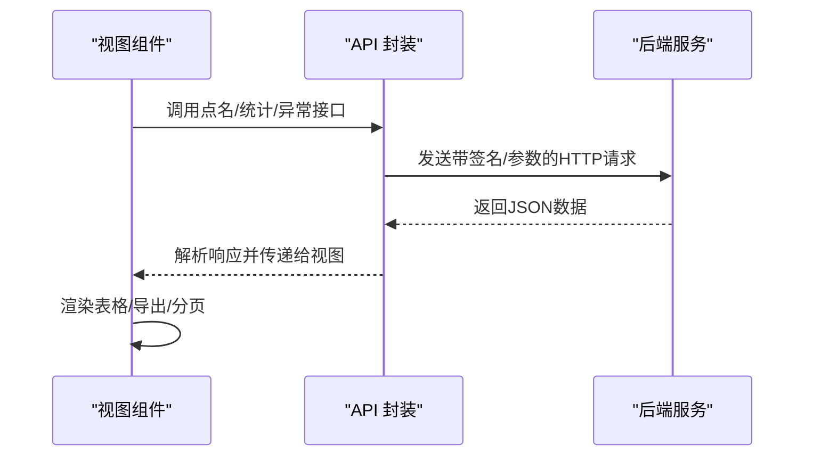
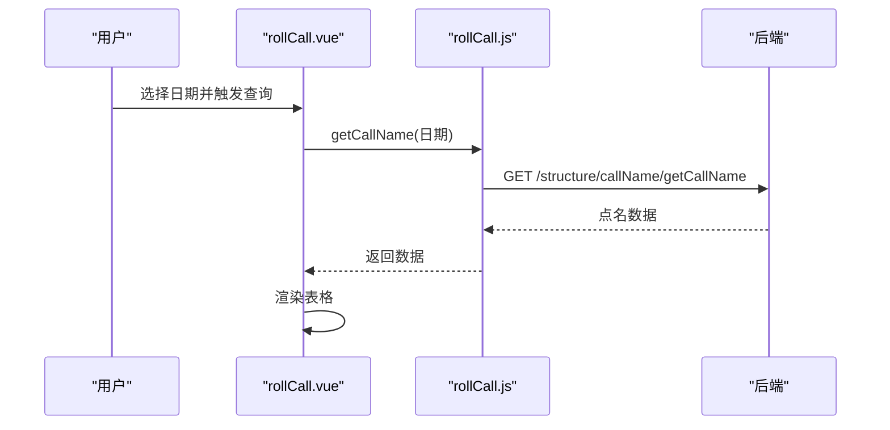
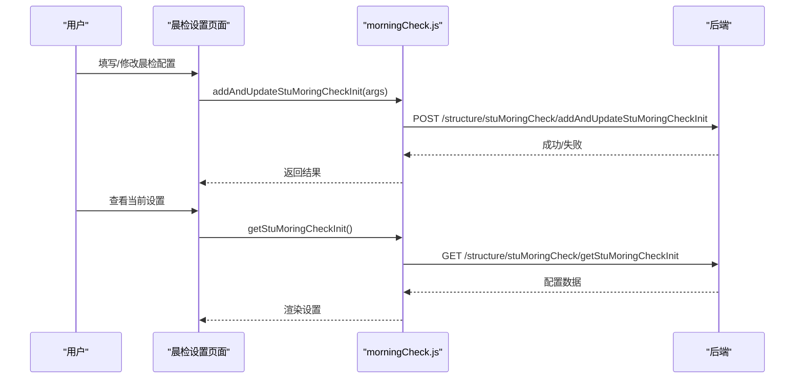
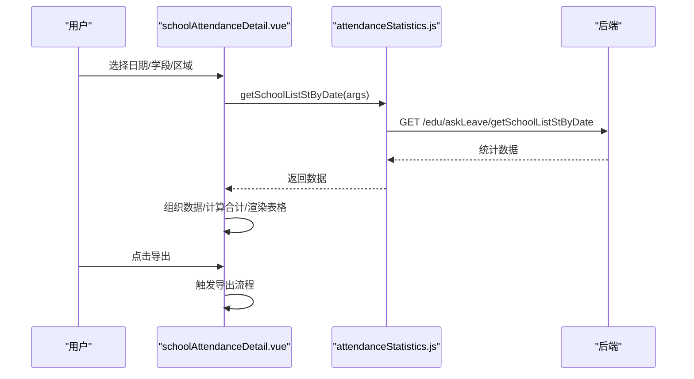
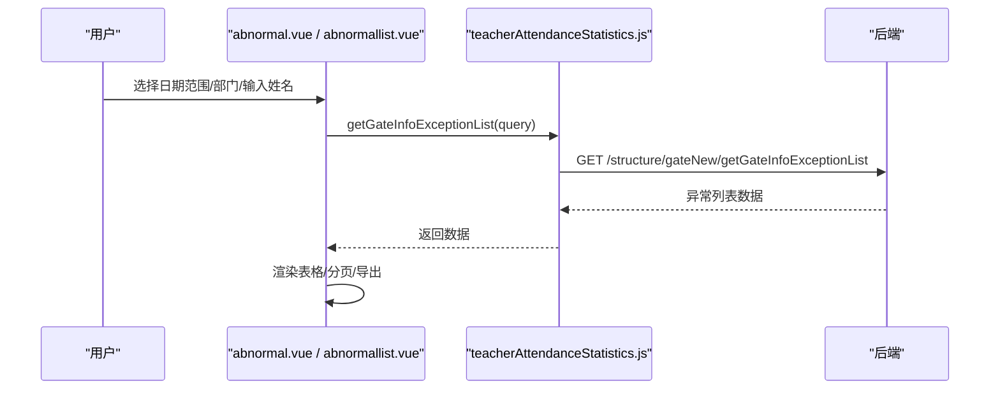
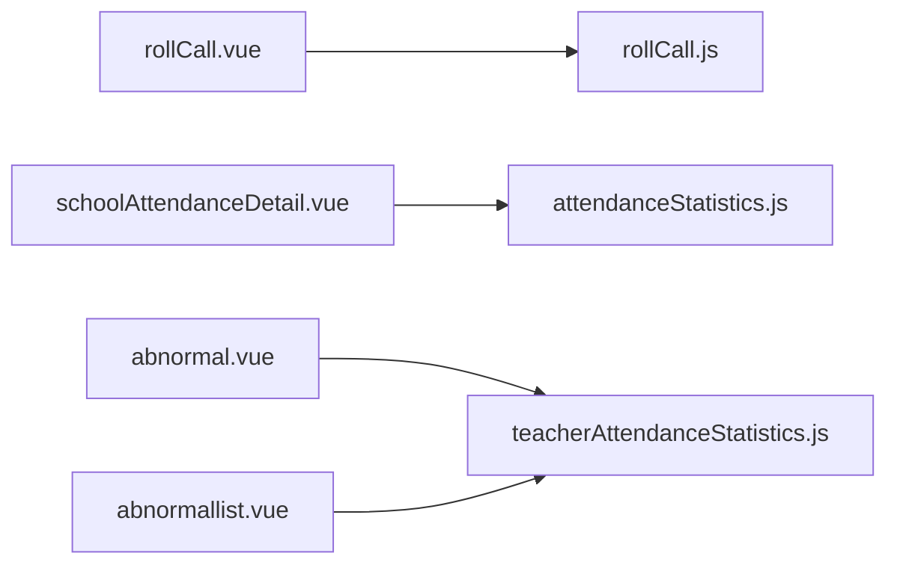

# 学生考勤

<cite>
**本文引用的文件**
- [rollCall.js](file://src/api/rollCall.js)
- [rollCall.vue](file://src/views/rollCall/rollCall.vue)
- [morningCheck.js](file://src/api/morningCheck.js)
- [attendanceStatistics.js](file://src/api/attendanceStatistics.js)
- [schoolAttendanceDetail.vue](file://src/views/attendanceStatistics/schoolAttendanceDetail.vue)
- [abnormal.vue](file://src/views/attenAccounting/abnormal.vue)
- [abnormallist.vue](file://src/views/attenAccounting/abnormallist.vue)
- [teacherAttendanceStatistics.js](file://src/api/schoolManage/teacherAttendanceStatistics.js)
</cite>

## 目录
1. [简介](#简介)
2. [项目结构](#项目结构)
3. [核心组件](#核心组件)
4. [架构总览](#架构总览)
5. [详细组件分析](#详细组件分析)
6. [依赖关系分析](#依赖关系分析)
7. [性能考虑](#性能考虑)
8. [故障排查指南](#故障排查指南)
9. [结论](#结论)
10. [附录](#附录)

## 简介
本文件面向“学生考勤”业务场景，系统性梳理前端侧与考勤相关的数据采集、统计与异常处理能力，覆盖以下方面：
- 考勤数据来源与采集机制：点名、晨检、请假统计、教师考勤异常等
- 数据验证与重复处理策略：基于接口参数签名与分页加载
- 统计维度与报表生成：按学校、年级、学期、请假类型等多维聚合
- 异常类型识别与处理流程：迟到、早退、缺勤、请假等
- 导出能力与批量处理：支持导出与分页加载
- 家长沟通提醒机制：通过请假统计与异常列表联动展示

## 项目结构
围绕“学生考勤”的前端模块主要分布在以下路径：
- API 层：封装与后端交互的接口方法
- 视图层：负责展示与交互，包含点名、晨检、考勤统计、异常列表等页面
- 混入与工具：窗口自适应、基础混入等通用能力

图表来源
- [rollCall.vue:1-88](file://src/views/rollCall/rollCall.vue#L1-L88)
- [rollCall.js:1-10](file://src/api/rollCall.js#L1-L10)
- [morningCheck.js:1-19](file://src/api/morningCheck.js#L1-L19)
- [attendanceStatistics.js:1-100](file://src/api/attendanceStatistics.js#L1-L100)
- [abnormal.vue:1-196](file://src/views/attenAccounting/abnormal.vue#L1-L196)
- [abnormallist.vue:1-200](file://src/views/attenAccounting/abnormallist.vue#L1-L200)

章节来源
- [rollCall.vue:1-88](file://src/views/rollCall/rollCall.vue#L1-L88)
- [rollCall.js:1-10](file://src/api/rollCall.js#L1-L10)
- [morningCheck.js:1-19](file://src/api/morningCheck.js#L1-L19)
- [attendanceStatistics.js:1-100](file://src/api/attendanceStatistics.js#L1-L100)
- [abnormal.vue:1-196](file://src/views/attenAccounting/abnormal.vue#L1-L196)
- [abnormallist.vue:1-200](file://src/views/attenAccounting/abnormallist.vue#L1-L200)

## 核心组件
- 点名看板（rollCall）
  - 功能：按日期查看各班级点名情况，包含应到、实到、请假、到勤人数、点名时间与教师等字段
  - 数据来源：调用点名接口获取当日数据并渲染表格
- 晨检设置（morningCheck）
  - 功能：提供晨检初始化配置的新增/修改与查询接口
- 学校考勤明细（schoolAttendanceDetail）
  - 功能：按日期、区域、学段聚合显示学校级考勤统计，支持导出
  - 数据来源：请假统计接口（含普通与特定环境的两个实现）
- 教师考勤异常（abnormal / abnormallist）
  - 功能：展示教师异常记录（如早退、外出时长等），支持分页、筛选与导出
  - 数据来源：教师考勤异常列表接口

章节来源
- [rollCall.vue:1-88](file://src/views/rollCall/rollCall.vue#L1-L88)
- [rollCall.js:1-10](file://src/api/rollCall.js#L1-L10)
- [morningCheck.js:1-19](file://src/api/morningCheck.js#L1-L19)
- [schoolAttendanceDetail.vue:1-267](file://src/views/attendanceStatistics/schoolAttendanceDetail.vue#L1-L267)
- [attendanceStatistics.js:1-100](file://src/api/attendanceStatistics.js#L1-L100)
- [abnormal.vue:1-196](file://src/views/attenAccounting/abnormal.vue#L1-L196)
- [abnormallist.vue:1-200](file://src/views/attenAccounting/abnormallist.vue#L1-L200)

## 架构总览
前端采用“视图组件 + API 封装 + 后端接口”的分层设计：
- 视图组件负责用户交互与数据展示
- API 封装统一管理请求参数、签名与跨域场景
- 后端接口提供点名、请假统计、异常列表等数据

图表来源
- [rollCall.vue:64-71](file://src/views/rollCall/rollCall.vue#L64-L71)
- [rollCall.js:2-10](file://src/api/rollCall.js#L2-L10)
- [attendanceStatistics.js:6-17](file://src/api/attendanceStatistics.js#L6-L17)
- [abnormal.vue:154-173](file://src/views/attenAccounting/abnormal.vue#L154-L173)
- [abnormallist.vue:157-177](file://src/views/attenAccounting/abnormallist.vue#L157-L177)

## 详细组件分析

### 点名看板（rollCall）
- 数据采集
  - 通过日期选择器触发查询，调用点名接口获取当日数据
  - 接口参数包含日期，后端据此返回对应班级的点名统计
- 表格字段
  - 班级、学生数、参与数、今日请假人数、到勤人数、点名时间、点名教师
- 交互与布局
  - 使用表格组件展示，支持窗口自适应高度
- 导出与批量
  - 当前页面未直接提供导出按钮；可结合通用导出能力在后续扩展

图表来源
- [rollCall.vue:50-72](file://src/views/rollCall/rollCall.vue#L50-L72)
- [rollCall.js:2-10](file://src/api/rollCall.js#L2-L10)

章节来源
- [rollCall.vue:1-88](file://src/views/rollCall/rollCall.vue#L1-L88)
- [rollCall.js:1-10](file://src/api/rollCall.js#L1-L10)

### 晨检设置（morningCheck）
- 接口职责
  - 新增/修改晨检初始化配置
  - 查询当前学校晨检设置
- 参数与格式
  - 提交时使用 JSON 格式，查询使用 GET 请求

图表来源
- [morningCheck.js:3-19](file://src/api/morningCheck.js#L3-L19)

章节来源
- [morningCheck.js:1-19](file://src/api/morningCheck.js#L1-L19)

### 学校考勤明细（schoolAttendanceDetail）
- 数据来源
  - 请假统计接口：支持按日期、区域、学段查询
  - 支持普通环境与特定环境两套实现
- 统计维度
  - 学校、年级、请假类型（含病假细分）
- 报表生成
  - 动态渲染列：按年级拆分，每级包含“应到数”、“实到数”及各类请假条目
  - 自动计算合计行
- 导出能力
  - 提供导出按钮，使用隐藏表格进行导出

图表来源
- [schoolAttendanceDetail.vue:105-125](file://src/views/attendanceStatistics/schoolAttendanceDetail.vue#L105-L125)
- [attendanceStatistics.js:32-45](file://src/api/attendanceStatistics.js#L32-L45)

章节来源
- [schoolAttendanceDetail.vue:1-267](file://src/views/attendanceStatistics/schoolAttendanceDetail.vue#L1-L267)
- [attendanceStatistics.js:1-100](file://src/api/attendanceStatistics.js#L1-L100)

### 教师考勤异常（abnormal / abnormallist）
- 数据来源
  - 教师考勤异常列表接口，支持按部门、日期范围、姓名筛选
- 字段与展示
  - 姓名、部门、日期、外出/返回时间与地点、外出时长等
- 导出能力
  - 提供导出链接，拼接起止日期、姓名、部门等参数
- 分页与批量
  - 支持分页加载与页大小切换

图表来源
- [abnormal.vue:65-96](file://src/views/attenAccounting/abnormal.vue#L65-L96)
- [abnormallist.vue:69-95](file://src/views/attenAccounting/abnormallist.vue#L69-L95)
- [teacherAttendanceStatistics.js:1-200](file://src/api/schoolManage/teacherAttendanceStatistics.js#L1-L200)

章节来源
- [abnormal.vue:1-196](file://src/views/attenAccounting/abnormal.vue#L1-L196)
- [abnormallist.vue:1-200](file://src/views/attenAccounting/abnormallist.vue#L1-L200)
- [teacherAttendanceStatistics.js:1-200](file://src/api/schoolManage/teacherAttendanceStatistics.js#L1-L200)

## 依赖关系分析
- 组件与 API 的耦合
  - 视图组件通过 API 封装调用后端接口，参数签名与环境区分由 API 层统一处理
- 外部依赖
  - 时间格式化依赖 moment 库
  - 表格与分页依赖 Element UI 组件库
- 可能的循环依赖
  - 当前文件间无直接循环导入，保持良好内聚

图表来源
- [rollCall.vue:50](file://src/views/rollCall/rollCall.vue#L50)
- [rollCall.js:1](file://src/api/rollCall.js#L1)
- [schoolAttendanceDetail.vue:105](file://src/views/attendanceStatistics/schoolAttendanceDetail.vue#L105)
- [attendanceStatistics.js:1](file://src/api/attendanceStatistics.js#L1)
- [abnormal.vue:65](file://src/views/attenAccounting/abnormal.vue#L65)
- [abnormallist.vue:69](file://src/views/attenAccounting/abnormallist.vue#L69)
- [teacherAttendanceStatistics.js:1](file://src/api/schoolManage/teacherAttendanceStatistics.js#L1)

## 性能考虑
- 列表渲染优化
  - 使用固定高度与虚拟滚动（如需）减少大表格重绘开销
- 分页加载
  - 异常列表与统计页面均采用分页，避免一次性加载过多数据
- 导出策略
  - 导出采用隐藏表格或服务端导出链接，降低前端内存压力
- 窗口自适应
  - 通过混入动态计算表格高度，提升不同分辨率下的体验

## 故障排查指南
- 网络请求失败
  - 检查接口返回码与错误提示，确认签名参数与环境配置是否正确
- 数据为空
  - 确认日期范围、区域编码、学段参数是否匹配后端预期
- 表格渲染错位
  - 触发表格布局刷新，确保 DOM 已完成渲染后再执行布局计算
- 导出无数据
  - 核对导出链接参数（起止日期、姓名、部门、token）是否完整

章节来源
- [schoolAttendanceDetail.vue:150-156](file://src/views/attendanceStatistics/schoolAttendanceDetail.vue#L150-L156)
- [abnormallist.vue:103-107](file://src/views/attenAccounting/abnormallist.vue#L103-L107)

## 结论
本项目在前端层面已形成较为完整的“学生考勤”能力闭环：从点名、晨检配置，到请假统计与教师异常列表，均具备清晰的数据流与交互体验。建议后续在以下方面持续完善：
- 扩展学生侧考勤报表与家长提醒联动
- 增强重复数据识别与去重策略（如基于主键/唯一标识）
- 优化异常识别算法（如引入规则引擎或阈值配置）

## 附录
- 关键接口清单
  - 点名：getCallName
  - 晨检：addAndUpdateStuMoringCheckInit、getStuMoringCheckInit
  - 请假统计：getSchoolListStByDate、getSchoolListStByDateOther
  - 教师异常：getGateInfoExceptionList、queryDepartByTypes

章节来源
- [rollCall.js:2-10](file://src/api/rollCall.js#L2-L10)
- [morningCheck.js:3-19](file://src/api/morningCheck.js#L3-L19)
- [attendanceStatistics.js:6-17](file://src/api/attendanceStatistics.js#L6-L17)
- [abnormal.vue:133-140](file://src/views/attenAccounting/abnormal.vue#L133-L140)
- [abnormallist.vue:145-152](file://src/views/attenAccounting/abnormallist.vue#L145-L152)