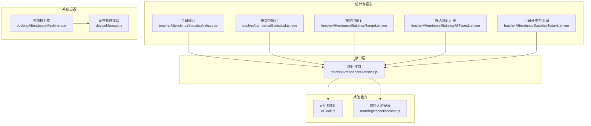
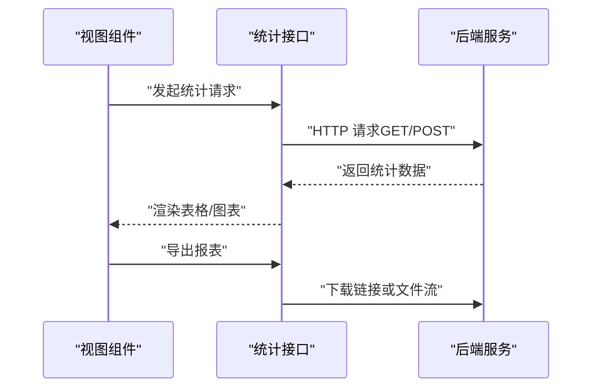
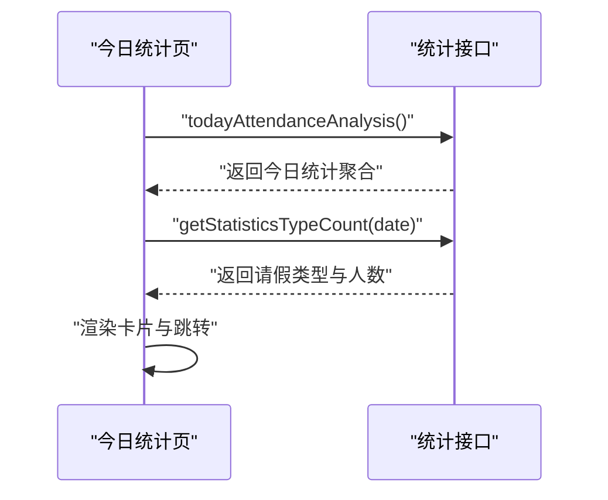
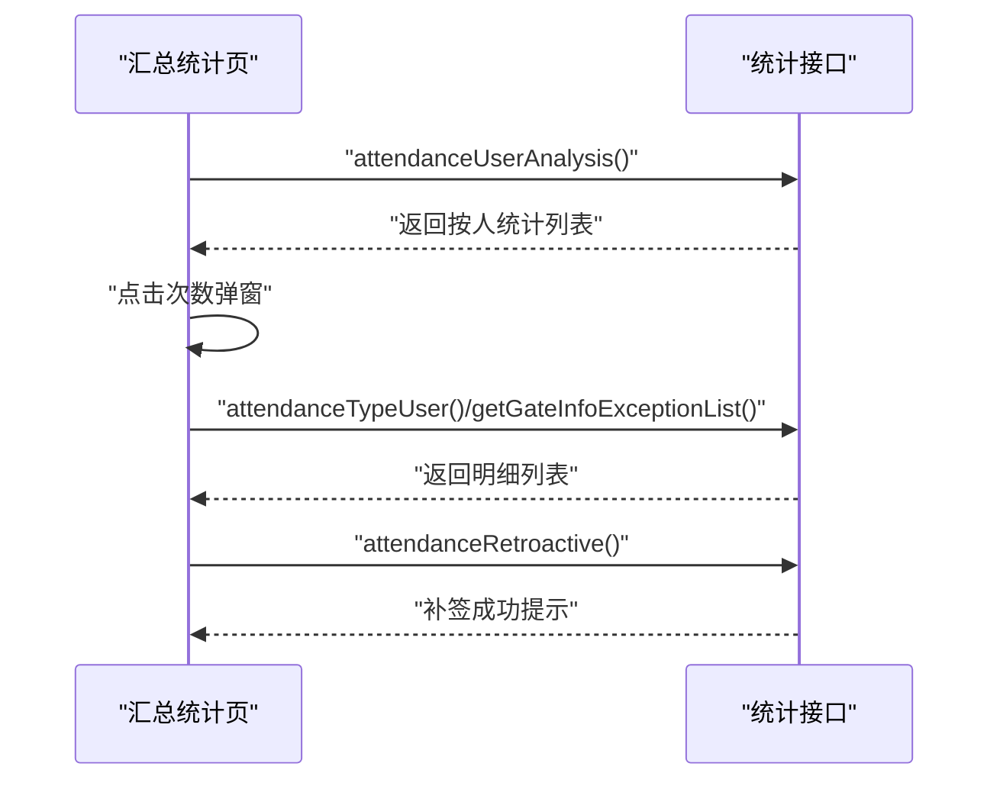
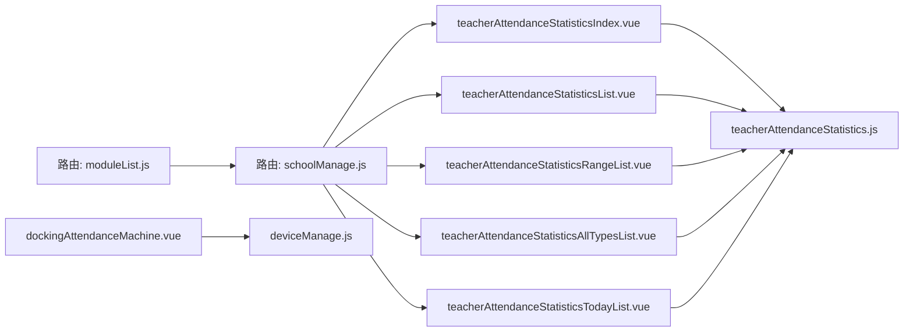

# 教师考勤

<cite>
**本文引用的文件**
- [teacherAttendanceStatistics.js](file://src/api/schoolManage/teacherAttendanceStatistics.js)
- [teacherAttendanceStatisticsAllTypesList.vue](file://src/views/teacherAttendance/teacherAttendanceStatisticsAllTypesList.vue)
- [teacherAttendanceStatisticsIndex.vue](file://src/views/teacherAttendance/teacherAttendanceStatisticsIndex.vue)
- [teacherAttendanceStatisticsList.vue](file://src/views/teacherAttendance/teacherAttendanceStatisticsList.vue)
- [teacherAttendanceStatisticsRangeList.vue](file://src/views/teacherAttendance/teacherAttendanceStatisticsRangeList.vue)
- [teacherAttendanceStatisticsTodayList.vue](file://src/views/teacherAttendance/teacherAttendanceStatisticsTodayList.vue)
- [dockingAttendanceMachine.vue](file://src/views/sysSet/teacherAttendance/dockingAttendanceMachine.vue)
- [deviceManage.js](file://src/api/systemSet/deviceManage.js)
- [teacherLeave4Setting.js](file://src/api/systemSet/teacherLeave4Setting.js)
- [overtimeDeduction.js](file://src/api/overtimeDeduction.js)
- [leaveCancelTicket.js](file://src/api/leaveCancelTicket.js)
- [schoolManage.js](file://src/router/normal/schoolManage.js)
- [moduleList.js](file://src/router/moduleList.js)
- [eClock.js](file://src/api/eClock.js)
- [morninginspectionrobot.js](file://src/api/morninginspectionrobot.js)
</cite>

## 目录
1. [简介](#简介)
2. [项目结构](#项目结构)
3. [核心组件](#核心组件)
4. [架构概览](#架构概览)
5. [详细组件分析](#详细组件分析)
6. [依赖关系分析](#依赖关系分析)
7. [性能考虑](#性能考虑)
8. [故障排查指南](#故障排查指南)
9. [结论](#结论)
10. [附录](#附录)

## 简介
本文件面向教师考勤业务，系统性梳理考勤管理机制与前端实现，覆盖以下方面：
- 考勤场景：上下班打卡、课堂考勤、会议签到等
- 数据采集：门禁卡、指纹、人脸识别、GPS定位等
- 数据同步：设备对接、用户同步、规则下发
- 统计规则：工作时间计算、加班统计、请假抵扣
- 异常识别：迟到、早退、缺勤、代打卡等
- 报表输出：按日/按人/按类型/按月统计，导出与可视化

## 项目结构
教师考勤相关前端模块主要分布在如下位置：
- 统计与报表：views/teacherAttendance 下的多个页面组件
- API 接口：api/schoolManage/teacherAttendanceStatistics.js
- 系统设置：views/sysSet/teacherAttendance 下的考勤机对接页面
- 设备管理：api/systemSet/deviceManage.js
- 请假与加班抵扣：api/systemSet/teacherLeave4Setting.js、api/overtimeDeduction.js、api/leaveCancelTicket.js
- 路由配置：router/normal/schoolManage.js、router/moduleList.js
- 其他采集能力：api/eClock.js、api/morninginspectionrobot.js

图表来源
- [teacherAttendanceStatisticsIndex.vue:1-189](file://src/views/teacherAttendance/teacherAttendanceStatisticsIndex.vue#L1-L189)
- [teacherAttendanceStatisticsList.vue:1-108](file://src/views/teacherAttendance/teacherAttendanceStatisticsList.vue#L1-L108)
- [teacherAttendanceStatisticsRangeList.vue:1-172](file://src/views/teacherAttendance/teacherAttendanceStatisticsRangeList.vue#L1-L172)
- [teacherAttendanceStatisticsAllTypesList.vue:1-436](file://src/views/teacherAttendance/teacherAttendanceStatisticsAllTypesList.vue#L1-L436)
- [teacherAttendanceStatisticsTodayList.vue:1-217](file://src/views/teacherAttendance/teacherAttendanceStatisticsTodayList.vue#L1-L217)
- [teacherAttendanceStatistics.js:1-248](file://src/api/schoolManage/teacherAttendanceStatistics.js#L1-L248)
- [dockingAttendanceMachine.vue:1-162](file://src/views/sysSet/teacherAttendance/dockingAttendanceMachine.vue#L1-L162)
- [deviceManage.js:1-189](file://src/api/systemSet/deviceManage.js#L1-L189)
- [eClock.js:125-190](file://src/api/eClock.js#L125-L190)
- [morninginspectionrobot.js:39-58](file://src/api/morninginspectionrobot.js#L39-L58)

章节来源
- [teacherAttendanceStatistics.js:1-248](file://src/api/schoolManage/teacherAttendanceStatistics.js#L1-L248)
- [teacherAttendanceStatisticsAllTypesList.vue:1-436](file://src/views/teacherAttendance/teacherAttendanceStatisticsAllTypesList.vue#L1-L436)
- [teacherAttendanceStatisticsIndex.vue:1-189](file://src/views/teacherAttendance/teacherAttendanceStatisticsIndex.vue#L1-L189)
- [teacherAttendanceStatisticsList.vue:1-108](file://src/views/teacherAttendance/teacherAttendanceStatisticsList.vue#L1-L108)
- [teacherAttendanceStatisticsRangeList.vue:1-172](file://src/views/teacherAttendance/teacherAttendanceStatisticsRangeList.vue#L1-L172)
- [teacherAttendanceStatisticsTodayList.vue:1-217](file://src/views/teacherAttendance/teacherAttendanceStatisticsTodayList.vue#L1-L217)
- [dockingAttendanceMachine.vue:1-162](file://src/views/sysSet/teacherAttendance/dockingAttendanceMachine.vue#L1-L162)
- [deviceManage.js:1-189](file://src/api/systemSet/deviceManage.js#L1-L189)
- [eClock.js:125-190](file://src/api/eClock.js#L125-L190)
- [morninginspectionrobot.js:39-58](file://src/api/morninginspectionrobot.js#L39-L58)

## 核心组件
- 今日统计页：展示签到/签退正常、迟到、早退、缺勤、未签到/未签退、请假分布等关键指标，支持跳转到当日分类型明细。
- 类型统计页：按时间段统计迟到、早退、到勤、缺勤、异常等维度，支持导出与按类型跳转明细。
- 汇总统计页：按人统计迟到、早退、到勤、缺勤、签到缺卡、签退缺卡、异常外出等，支持导出与补签。
- 当日明细页：按部门与状态筛选，展示应到/实到、应退/实退、地点、时长等，支持导出。
- 考勤机对接页：配置 appId/secretId/corpId 与版本，支持保存与清除。

章节来源
- [teacherAttendanceStatisticsIndex.vue:1-189](file://src/views/teacherAttendance/teacherAttendanceStatisticsIndex.vue#L1-L189)
- [teacherAttendanceStatisticsList.vue:1-108](file://src/views/teacherAttendance/teacherAttendanceStatisticsList.vue#L1-L108)
- [teacherAttendanceStatisticsRangeList.vue:1-172](file://src/views/teacherAttendance/teacherAttendanceStatisticsRangeList.vue#L1-L172)
- [teacherAttendanceStatisticsAllTypesList.vue:1-436](file://src/views/teacherAttendance/teacherAttendanceStatisticsAllTypesList.vue#L1-L436)
- [teacherAttendanceStatisticsTodayList.vue:1-217](file://src/views/teacherAttendance/teacherAttendanceStatisticsTodayList.vue#L1-L217)
- [dockingAttendanceMachine.vue:1-162](file://src/views/sysSet/teacherAttendance/dockingAttendanceMachine.vue#L1-L162)

## 架构概览
前端通过 API 层调用后端接口，实现考勤统计、补签、请假与加班抵扣、设备对接等功能；路由模块将统计入口与子模块进行组织。

图表来源
- [teacherAttendanceStatistics.js:74-173](file://src/api/schoolManage/teacherAttendanceStatistics.js#L74-L173)
- [teacherAttendanceStatisticsAllTypesList.vue:287-404](file://src/views/teacherAttendance/teacherAttendanceStatisticsAllTypesList.vue#L287-L404)
- [teacherAttendanceStatisticsRangeList.vue:111-146](file://src/views/teacherAttendance/teacherAttendanceStatisticsRangeList.vue#L111-L146)

## 详细组件分析

### 今日统计（teacherAttendanceStatisticsIndex.vue）
- 功能要点
  - 展示签到/签退正常、迟到、早退、缺勤、未签到/未签退、请假分布
  - 支持点击跳转到当日分类型明细
  - 今日请假类型与人数统计
- 关键交互
  - 调用今日统计接口与请假类型统计接口
  - 通过路由参数传递类型与日期

图表来源
- [teacherAttendanceStatisticsIndex.vue:96-110](file://src/views/teacherAttendance/teacherAttendanceStatisticsIndex.vue#L96-L110)
- [teacherAttendanceStatistics.js:17-26](file://src/api/schoolManage/teacherAttendanceStatistics.js#L17-L26)
- [teacherAttendanceStatistics.js:177-192](file://src/api/schoolManage/teacherAttendanceStatistics.js#L177-L192)

章节来源
- [teacherAttendanceStatisticsIndex.vue:1-189](file://src/views/teacherAttendance/teacherAttendanceStatisticsIndex.vue#L1-L189)
- [teacherAttendanceStatistics.js:17-26](file://src/api/schoolManage/teacherAttendanceStatistics.js#L17-L26)
- [teacherAttendanceStatistics.js:177-192](file://src/api/schoolManage/teacherAttendanceStatistics.js#L177-L192)

### 按类型统计（teacherAttendanceStatisticsList.vue）
- 功能要点
  - 按时间段统计迟到、早退、到勤、缺勤、异常等
  - 支持跳转到“统计汇总”与按类型明细
- 关键交互
  - 调用时间段总统计接口
  - 将起止日期写入 sessionStorage 供后续页面使用

章节来源
- [teacherAttendanceStatisticsList.vue:1-108](file://src/views/teacherAttendance/teacherAttendanceStatisticsList.vue#L1-L108)
- [teacherAttendanceStatistics.js:94-104](file://src/api/schoolManage/teacherAttendanceStatistics.js#L94-L104)

### 按范围统计（teacherAttendanceStatisticsRangeList.vue）
- 功能要点
  - 按类型展示明细（含应到/实到、应退/实退、地点、请假标签）
  - 支持分页、搜索、导出
- 关键交互
  - 调用类型分析接口，传入类型与分页参数

章节来源
- [teacherAttendanceStatisticsRangeList.vue:1-172](file://src/views/teacherAttendance/teacherAttendanceStatisticsRangeList.vue#L1-L172)
- [teacherAttendanceStatistics.js:109-123](file://src/api/schoolManage/teacherAttendanceStatistics.js#L109-L123)

### 汇总统计（teacherAttendanceStatisticsAllTypesList.vue）
- 功能要点
  - 按人统计迟到、早退、到勤、缺勤、签到缺卡、签退缺卡、异常外出
  - 支持点击次数查看具体日期明细，支持导出
  - 支持补签操作
- 关键交互
  - 调用按人统计接口与按类型明细接口
  - 补签调用 retroactive 接口

图表来源
- [teacherAttendanceStatisticsAllTypesList.vue:287-378](file://src/views/teacherAttendance/teacherAttendanceStatisticsAllTypesList.vue#L287-L378)
- [teacherAttendanceStatistics.js:128-173](file://src/api/schoolManage/teacherAttendanceStatistics.js#L128-L173)

章节来源
- [teacherAttendanceStatisticsAllTypesList.vue:1-436](file://src/views/teacherAttendance/teacherAttendanceStatisticsAllTypesList.vue#L1-L436)
- [teacherAttendanceStatistics.js:128-173](file://src/api/schoolManage/teacherAttendanceStatistics.js#L128-L173)

### 当日明细（teacherAttendanceStatisticsTodayList.vue）
- 功能要点
  - 按部门与状态筛选，展示应到/实到、应退/实退、地点、时长
  - 支持分页与导出
- 关键交互
  - 调用当日类型分析接口
  - 通过 departList 查询部门选项

章节来源
- [teacherAttendanceStatisticsTodayList.vue:1-217](file://src/views/teacherAttendance/teacherAttendanceStatisticsTodayList.vue#L1-L217)
- [teacherAttendanceStatistics.js:74-89](file://src/api/schoolManage/teacherAttendanceStatistics.js#L74-L89)
- [teacherAttendanceStatistics.js:197-206](file://src/api/schoolManage/teacherAttendanceStatistics.js#L197-L206)

### 考勤机对接（dockingAttendanceMachine.vue）
- 功能要点
  - 配置 appId、secretId、corpId 与版本
  - 支持保存与清除对接配置
- 关键交互
  - 调用对接设置接口保存或删除

章节来源
- [dockingAttendanceMachine.vue:1-162](file://src/views/sysSet/teacherAttendance/dockingAttendanceMachine.vue#L1-L162)
- [deviceManage.js:1-189](file://src/api/systemSet/deviceManage.js#L1-L189)

### 设备管理与同步（deviceManage.js）
- 功能要点
  - 设备列表、新增/编辑、批量删除
  - 设备用户查询、新增、同步、提醒未上传照片
  - 晨检设备初始化
- 关键交互
  - 调用设备与用户相关接口

章节来源
- [deviceManage.js:1-189](file://src/api/systemSet/deviceManage.js#L1-L189)

### 请假与加班抵扣
- 请假设置（teacherLeave4Setting.js）
  - 新增/编辑请假规则、查询规则列表与详情
- 加班抵扣（overtimeDeduction.js、leaveCancelTicket.js）
  - 抵扣类型管理、发放记录、抵扣记录、统计、驳回
  - 抵扣规则与统计接口

章节来源
- [teacherLeave4Setting.js:1-71](file://src/api/systemSet/teacherLeave4Setting.js#L1-L71)
- [overtimeDeduction.js:58-151](file://src/api/overtimeDeduction.js#L58-L151)
- [leaveCancelTicket.js:1-184](file://src/api/leaveCancelTicket.js#L1-L184)

### 其他采集能力
- e打卡统计（eClock.js）
  - 批次管理、更新、删除、按天统计、提醒未打卡
- 晨检人脸记录（morninginspectionrobot.js）
  - 查询人脸记录列表、按记录 ID 查询

章节来源
- [eClock.js:125-190](file://src/api/eClock.js#L125-L190)
- [morninginspectionrobot.js:39-58](file://src/api/morninginspectionrobot.js#L39-L58)

## 依赖关系分析
- 视图组件依赖统计接口模块，形成清晰的分层
- 路由模块将统计入口与子模块进行组织，便于权限控制与导航
- 系统设置与设备管理为考勤数据采集提供基础支撑

图表来源
- [schoolManage.js:279-305](file://src/router/normal/schoolManage.js#L279-L305)
- [moduleList.js:1020-1079](file://src/router/moduleList.js#L1020-L1079)
- [teacherAttendanceStatisticsIndex.vue:1-189](file://src/views/teacherAttendance/teacherAttendanceStatisticsIndex.vue#L1-L189)
- [teacherAttendanceStatisticsList.vue:1-108](file://src/views/teacherAttendance/teacherAttendanceStatisticsList.vue#L1-L108)
- [teacherAttendanceStatisticsRangeList.vue:1-172](file://src/views/teacherAttendance/teacherAttendanceStatisticsRangeList.vue#L1-L172)
- [teacherAttendanceStatisticsAllTypesList.vue:1-436](file://src/views/teacherAttendance/teacherAttendanceStatisticsAllTypesList.vue#L1-L436)
- [teacherAttendanceStatisticsTodayList.vue:1-217](file://src/views/teacherAttendance/teacherAttendanceStatisticsTodayList.vue#L1-L217)
- [teacherAttendanceStatistics.js:1-248](file://src/api/schoolManage/teacherAttendanceStatistics.js#L1-L248)
- [dockingAttendanceMachine.vue:1-162](file://src/views/sysSet/teacherAttendance/dockingAttendanceMachine.vue#L1-L162)
- [deviceManage.js:1-189](file://src/api/systemSet/deviceManage.js#L1-L189)

## 性能考虑
- 分页与搜索：明细页采用分页与关键词搜索，避免一次性加载大量数据
- 导出优化：导出链接通过后端直连，减少前端内存压力
- 时间范围：统一格式化日期字符串，避免重复计算与格式错误
- 依赖懒加载：路由中使用动态导入，降低首屏体积

## 故障排查指南
- 补签失败
  - 确认 recordId 与 type 参数正确
  - 检查后端返回状态码与消息
- 导出为空
  - 核对时间范围与搜索条件是否匹配
  - 确认 token 有效
- 考勤机对接失败
  - 校验 appId/secretId/corpId 是否填写完整
  - 清除后重试，确认接口返回成功
- 设备同步异常
  - 检查设备 ID 与用户同步接口返回
  - 使用提醒未上传照片功能辅助定位问题

章节来源
- [teacherAttendanceStatisticsAllTypesList.vue:358-373](file://src/views/teacherAttendance/teacherAttendanceStatisticsAllTypesList.vue#L358-L373)
- [teacherAttendanceStatistics.js:163-173](file://src/api/schoolManage/teacherAttendanceStatistics.js#L163-L173)
- [dockingAttendanceMachine.vue:77-104](file://src/views/sysSet/teacherAttendance/dockingAttendanceMachine.vue#L77-L104)
- [deviceManage.js:125-134](file://src/api/systemSet/deviceManage.js#L125-L134)

## 结论
该教师考勤前端模块以统计与报表为核心，结合系统设置与设备管理，实现了从数据采集、规则配置到统计分析与导出的完整闭环。通过清晰的组件划分与接口封装，满足了多场景、多维度的考勤管理需求。

## 附录
- 路由入口与权限
  - 统计入口位于“出勤统计/教师考勤统计”，支持按日/按人/按类型/按月统计与导出
- 常用接口清单
  - 今日统计、类型分析、按人统计、补签、请假统计、加班抵扣统计等

章节来源
- [moduleList.js:1020-1079](file://src/router/moduleList.js#L1020-L1079)
- [schoolManage.js:279-305](file://src/router/normal/schoolManage.js#L279-L305)
- [teacherAttendanceStatistics.js:74-248](file://src/api/schoolManage/teacherAttendanceStatistics.js#L74-L248)