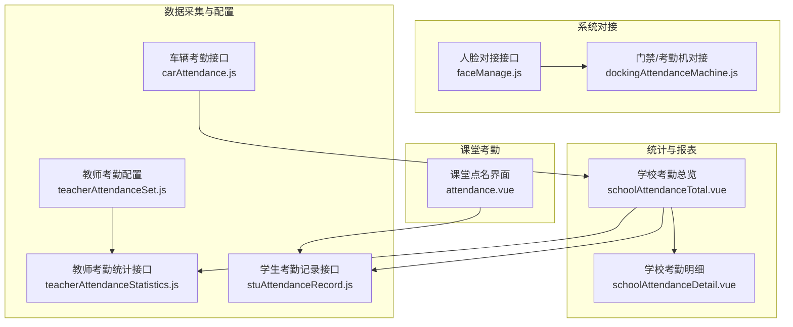
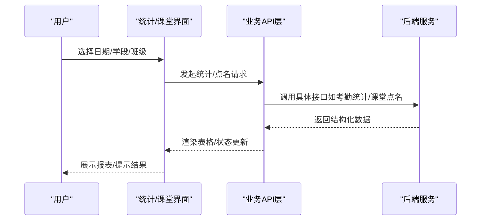
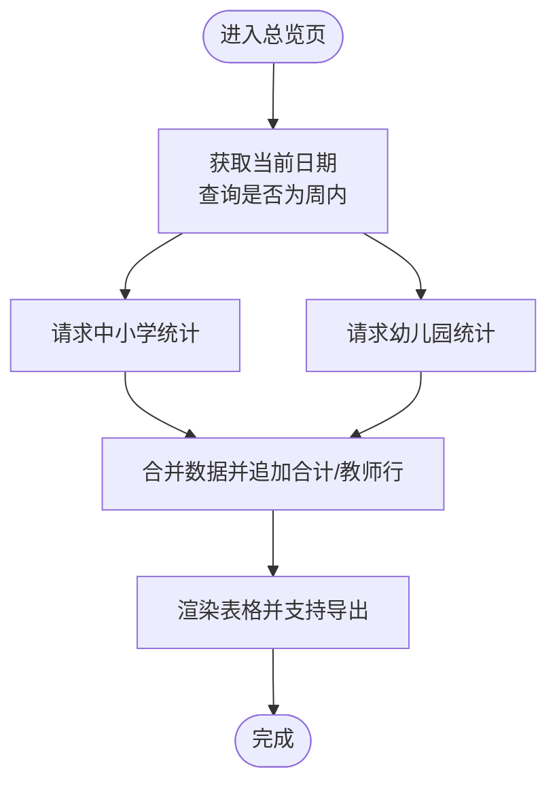
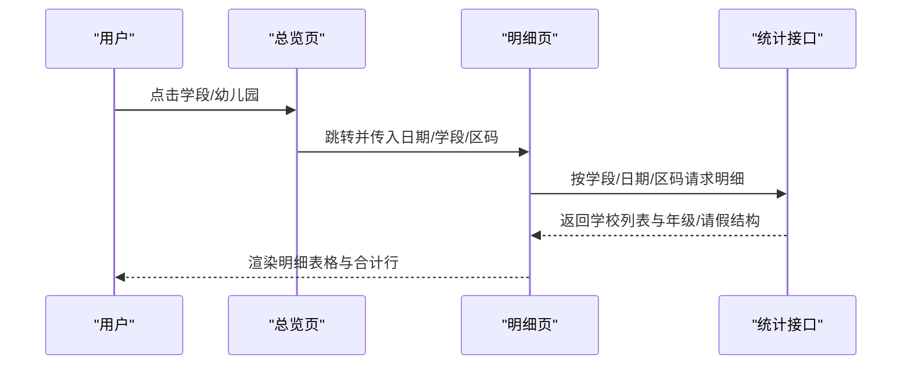
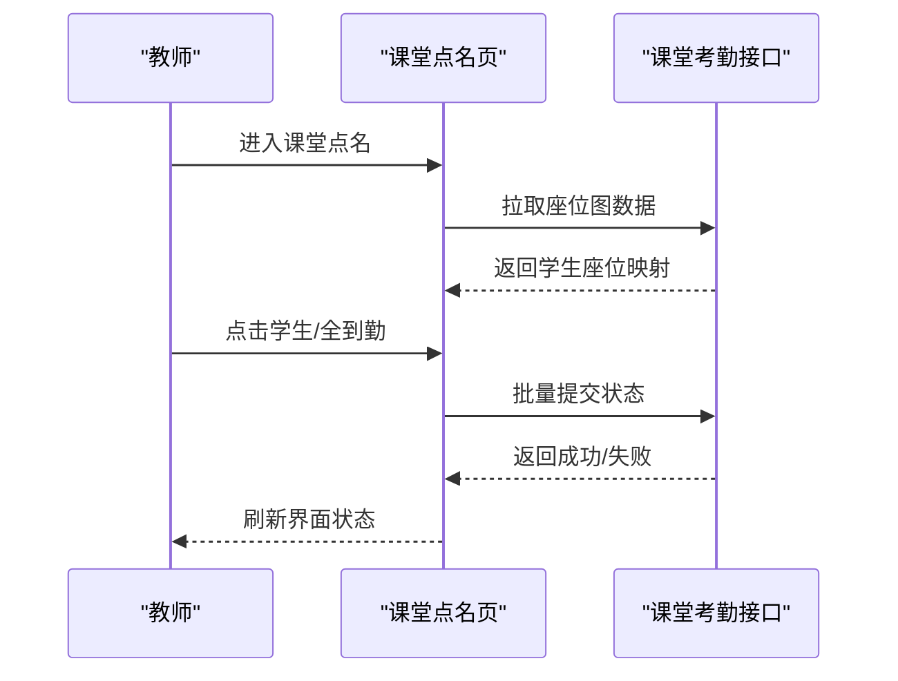
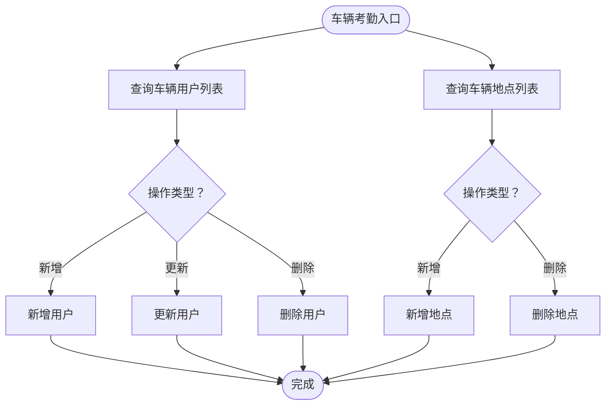
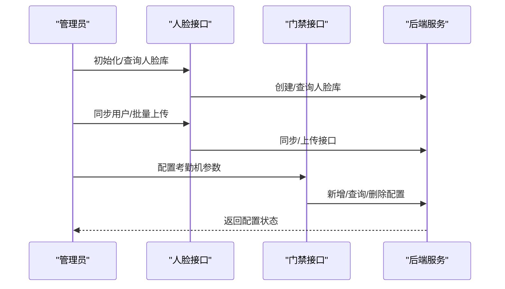
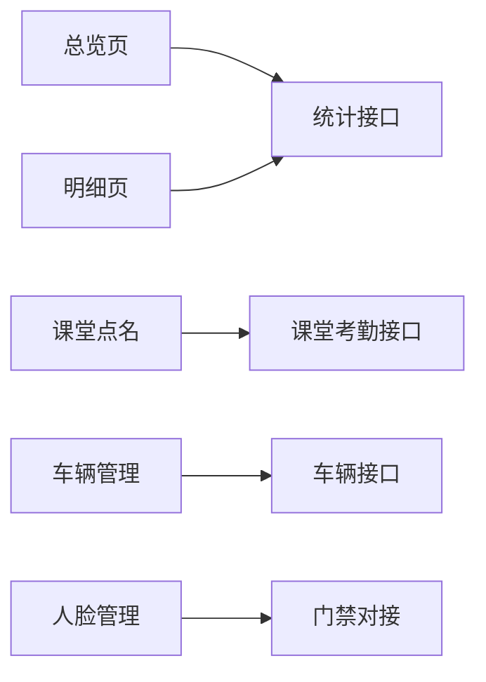

# 考勤管理

<cite>
**本文引用的文件**
- [carAttendance.js](file://src/api/carAttendance.js)
- [dockingAttendanceMachine.js](file://src/api/systemSet/dockingAttendanceMachine.js)
- [attendanceStatistics.js](file://src/api/attendanceStatistics.js)
- [faceManage.js](file://src/api/faceManage.js)
- [schoolAttendanceTotal.vue](file://src/views/attendanceStatistics/schoolAttendanceTotal.vue)
- [schoolAttendanceDetail.vue](file://src/views/attendanceStatistics/schoolAttendanceDetail.vue)
- [attendance.vue](file://src/views/classroomEvaluationApp/attendance.vue)
- [stuAttendanceRecord.js](file://src/api/schoolManage/stuAttendanceRecord.js)
- [teacherAttendanceStatistics.js](file://src/api/schoolManage/teacherAttendanceStatistics.js)
- [teacherAttendanceSet.js](file://src/api/systemSet/teacherAttendanceSet.js)
</cite>

## 目录
1. [简介](#简介)
2. [项目结构](#项目结构)
3. [核心组件](#核心组件)
4. [架构总览](#架构总览)
5. [详细组件分析](#详细组件分析)
6. [依赖关系分析](#依赖关系分析)
7. [性能考虑](#性能考虑)
8. [故障排查指南](#故障排查指南)
9. [结论](#结论)
10. [附录](#附录)

## 简介
本文件面向“考勤管理”业务，系统性梳理学生考勤、教师考勤与车辆考勤的采集、统计、异常处理与报表生成机制；并说明与门禁系统、人脸识别系统的集成方案与数据同步策略。文档同时覆盖配置参数、批量处理能力与异常处置流程，帮助技术与非技术读者快速理解与使用。

## 项目结构
围绕考勤管理的关键前端模块与接口如下：
- 车辆考勤：车辆用户与地点管理、批量导入等接口
- 考勤统计：按区县、日期、学段统计学生与教师考勤
- 课堂考勤：按班级、节次、时段进行学生到勤登记
- 人脸与门禁对接：人脸库初始化、用户同步、设备对接
- 教师考勤配置：教师考勤规则与统计口径配置

图表来源
- [schoolAttendanceTotal.vue:1-311](file://src/views/attendanceStatistics/schoolAttendanceTotal.vue#L1-L311)
- [schoolAttendanceDetail.vue:1-267](file://src/views/attendanceStatistics/schoolAttendanceDetail.vue#L1-L267)
- [attendance.vue:1-338](file://src/views/classroomEvaluationApp/attendance.vue#L1-L338)
- [faceManage.js:1-371](file://src/api/faceManage.js#L1-L371)
- [dockingAttendanceMachine.js:1-43](file://src/api/systemSet/dockingAttendanceMachine.js#L1-L43)
- [carAttendance.js:1-114](file://src/api/carAttendance.js#L1-L114)
- [teacherAttendanceSet.js](file://src/api/systemSet/teacherAttendanceSet.js)
- [teacherAttendanceStatistics.js](file://src/api/schoolManage/teacherAttendanceStatistics.js)
- [stuAttendanceRecord.js](file://src/api/schoolManage/stuAttendanceRecord.js)

章节来源
- [schoolAttendanceTotal.vue:1-311](file://src/views/attendanceStatistics/schoolAttendanceTotal.vue#L1-L311)
- [schoolAttendanceDetail.vue:1-267](file://src/views/attendanceStatistics/schoolAttendanceDetail.vue#L1-L267)
- [attendance.vue:1-338](file://src/views/classroomEvaluationApp/attendance.vue#L1-L338)
- [faceManage.js:1-371](file://src/api/faceManage.js#L1-L371)
- [dockingAttendanceMachine.js:1-43](file://src/api/systemSet/dockingAttendanceMachine.js#L1-L43)
- [carAttendance.js:1-114](file://src/api/carAttendance.js#L1-L114)
- [teacherAttendanceSet.js](file://src/api/systemSet/teacherAttendanceSet.js)
- [teacherAttendanceStatistics.js](file://src/api/schoolManage/teacherAttendanceStatistics.js)
- [stuAttendanceRecord.js](file://src/api/schoolManage/stuAttendanceRecord.js)

## 核心组件
- 学校考勤总览与明细
  - 总览页按学段聚合统计，支持导出；明细页按年级/请假类型展开，支持导出。
  - 支持区分中小学与幼儿园两类数据源，自动识别周内/非周内到勤计算。
- 课堂点名
  - 按班级座位图展示学生，支持单个/批量设置到勤状态，一键全到勤。
- 车辆考勤
  - 提供车辆用户与地点的增删改查、批量导入等接口，支撑门禁/通道闸的车辆通行记录接入。
- 人脸与门禁对接
  - 人脸库初始化、用户列表、同步、设备参数配置；对接门禁/考勤机初始化与查询。
- 教师考勤配置与统计
  - 教师考勤规则配置；按日统计教师到离岗情况，支持导出。

章节来源
- [schoolAttendanceTotal.vue:1-311](file://src/views/attendanceStatistics/schoolAttendanceTotal.vue#L1-L311)
- [schoolAttendanceDetail.vue:1-267](file://src/views/attendanceStatistics/schoolAttendanceDetail.vue#L1-L267)
- [attendance.vue:1-338](file://src/views/classroomEvaluationApp/attendance.vue#L1-L338)
- [carAttendance.js:1-114](file://src/api/carAttendance.js#L1-L114)
- [faceManage.js:1-371](file://src/api/faceManage.js#L1-L371)
- [dockingAttendanceMachine.js:1-43](file://src/api/systemSet/dockingAttendanceMachine.js#L1-L43)
- [teacherAttendanceSet.js](file://src/api/systemSet/teacherAttendanceSet.js)
- [teacherAttendanceStatistics.js](file://src/api/schoolManage/teacherAttendanceStatistics.js)
- [stuAttendanceRecord.js](file://src/api/schoolManage/stuAttendanceRecord.js)

## 架构总览
下图展示从页面到接口再到后端服务的数据流与职责边界：

图表来源
- [schoolAttendanceTotal.vue:206-214](file://src/views/attendanceStatistics/schoolAttendanceTotal.vue#L206-L214)
- [schoolAttendanceDetail.vue:170-200](file://src/views/attendanceStatistics/schoolAttendanceDetail.vue#L170-L200)
- [attendance.vue:126-184](file://src/views/classroomEvaluationApp/attendance.vue#L126-L184)
- [attendanceStatistics.js:1-100](file://src/api/attendanceStatistics.js#L1-L100)
- [stuAttendanceRecord.js](file://src/api/schoolManage/stuAttendanceRecord.js)

## 详细组件分析

### 学校考勤总览（按学段/日期统计）
- 功能要点
  - 选择日期后，分别调用中小学与幼儿园两类统计接口，合并显示。
  - 自动判断是否为周内日期以启用到勤率计算。
  - 支持导出两个表格（中小学与幼儿园）。
- 数据结构与复杂度
  - 主要为二维表渲染与列聚合，时间复杂度近似 O(n)（n 为行数），空间复杂度 O(n)。
- 异常处理
  - 接口失败时关闭加载态，避免阻塞交互。
- 可视化
  - 使用表格分组与合计行，直观呈现应到、实到、各类请假人数与到勤率。

图表来源
- [schoolAttendanceTotal.vue:133-271](file://src/views/attendanceStatistics/schoolAttendanceTotal.vue#L133-L271)

章节来源
- [schoolAttendanceTotal.vue:1-311](file://src/views/attendanceStatistics/schoolAttendanceTotal.vue#L1-L311)
- [attendanceStatistics.js:1-100](file://src/api/attendanceStatistics.js#L1-L100)

### 学校考勤明细（按年级/请假类型展开）
- 功能要点
  - 点击学段跳转至明细页，按年级/请假类型展开列。
  - 支持导出明细表。
- 复杂度
  - 表格列动态渲染，按年级与请假类型线性扩展，渲染复杂度 O(n×m)，n 为学校数，m 为组合维度。
- 异常处理
  - 请求失败关闭加载态，避免长时间等待。

图表来源
- [schoolAttendanceTotal.vue:142-195](file://src/views/attendanceStatistics/schoolAttendanceTotal.vue#L142-L195)
- [schoolAttendanceDetail.vue:142-235](file://src/views/attendanceStatistics/schoolAttendanceDetail.vue#L142-L235)
- [attendanceStatistics.js:32-45](file://src/api/attendanceStatistics.js#L32-L45)

章节来源
- [schoolAttendanceDetail.vue:1-267](file://src/views/attendanceStatistics/schoolAttendanceDetail.vue#L1-L267)
- [attendanceStatistics.js:1-100](file://src/api/attendanceStatistics.js#L1-L100)

### 课堂点名（按班级座位图登记）
- 功能要点
  - 按班级座位图展示学生，点击头像弹出状态选择（到勤/缺勤/请假/迟到）。
  - 支持一键全到勤，批量提交。
- 流程
  - 加载座位图 -> 选择状态 -> 批量提交 -> 刷新界面。

图表来源
- [attendance.vue:126-184](file://src/views/classroomEvaluationApp/attendance.vue#L126-L184)
- [stuAttendanceRecord.js](file://src/api/schoolManage/stuAttendanceRecord.js)

章节来源
- [attendance.vue:1-338](file://src/views/classroomEvaluationApp/attendance.vue#L1-L338)
- [stuAttendanceRecord.js](file://src/api/schoolManage/stuAttendanceRecord.js)

### 车辆考勤（用户与地点管理）
- 功能要点
  - 车辆用户新增/更新/删除、批量导入。
  - 车辆地点新增/删除/查询。
- 接口特性
  - 统一使用 URLSearchParams 参数格式，部分接口使用 JSON Body。

图表来源
- [carAttendance.js:16-114](file://src/api/carAttendance.js#L16-L114)

章节来源
- [carAttendance.js:1-114](file://src/api/carAttendance.js#L1-L114)

### 人脸与门禁对接
- 人脸对接
  - 人员库初始化、修改、统计。
  - 人脸用户列表、增删改、同步个人信息。
  - 批量上传人脸、设置人脸库参数。
- 门禁/考勤机对接
  - 新增/修改/删除考勤设置，按学校查询配置。

图表来源
- [faceManage.js:17-371](file://src/api/faceManage.js#L17-L371)
- [dockingAttendanceMachine.js:6-42](file://src/api/systemSet/dockingAttendanceMachine.js#L6-L42)

章节来源
- [faceManage.js:1-371](file://src/api/faceManage.js#L1-L371)
- [dockingAttendanceMachine.js:1-43](file://src/api/systemSet/dockingAttendanceMachine.js#L1-L43)

### 教师考勤配置与统计
- 配置
  - 教师考勤规则配置接口，用于定义统计口径与阈值。
- 统计
  - 按日统计教师到离岗情况，支持导出。

章节来源
- [teacherAttendanceSet.js](file://src/api/systemSet/teacherAttendanceSet.js)
- [teacherAttendanceStatistics.js](file://src/api/schoolManage/teacherAttendanceStatistics.js)

## 依赖关系分析
- 页面与接口
  - 统计页依赖统计接口；课堂点名依赖课堂考勤接口；车辆页依赖车辆接口；人脸与门禁依赖对应对接接口。
- 数据耦合
  - 日期与学段参数在多个统计接口中复用，确保前后端一致。
- 外部系统
  - 人脸与门禁通过统一接口对接，便于替换与扩展。

图表来源
- [schoolAttendanceTotal.vue](file://src/views/attendanceStatistics/schoolAttendanceTotal.vue#L80)
- [schoolAttendanceDetail.vue](file://src/views/attendanceStatistics/schoolAttendanceDetail.vue#L105)
- [attendance.vue:77-80](file://src/views/classroomEvaluationApp/attendance.vue#L77-L80)
- [carAttendance.js:1-114](file://src/api/carAttendance.js#L1-L114)
- [faceManage.js:1-371](file://src/api/faceManage.js#L1-L371)
- [dockingAttendanceMachine.js:1-43](file://src/api/systemSet/dockingAttendanceMachine.js#L1-L43)

## 性能考虑
- 渲染优化
  - 大表格采用虚拟滚动或分页（建议在现有基础上引入分页/懒加载）。
  - 动态列渲染时减少不必要的重排，优先使用 key 与缓存。
- 请求优化
  - 合并多次请求为一次（如总览与明细在同一日期下的数据）。
  - 对高频请求增加本地缓存与防抖。
- 导出优化
  - 导出前先进行数据清洗与分页，避免一次性导出超大数据集。

## 故障排查指南
- 统计无数据或到勤率为“--”
  - 检查日期是否为周内（周内才计算到勤率）。
  - 确认区码与学段参数传递正确。
- 课堂点名状态未更新
  - 确认批量提交接口返回成功后再刷新。
  - 检查网络状态与接口权限。
- 车辆用户/地点操作失败
  - 校验参数格式（URLSearchParams 与 JSON Body 的差异）。
  - 查看后端返回错误码与提示。
- 人脸/门禁对接异常
  - 先检查人脸库是否存在与初始化状态。
  - 校验设备参数与密钥配置。

章节来源
- [schoolAttendanceTotal.vue:206-214](file://src/views/attendanceStatistics/schoolAttendanceTotal.vue#L206-L214)
- [attendance.vue:143-160](file://src/views/classroomEvaluationApp/attendance.vue#L143-L160)
- [carAttendance.js:16-114](file://src/api/carAttendance.js#L16-L114)
- [faceManage.js:17-371](file://src/api/faceManage.js#L17-L371)
- [dockingAttendanceMachine.js:6-42](file://src/api/systemSet/dockingAttendanceMachine.js#L6-L42)

## 结论
本系统通过“统计页—明细页—课堂点名—车辆管理—人脸/门禁对接”的完整链路，实现了从数据采集、统计分析到报表导出的闭环。建议后续在大表渲染、批量处理与异常恢复方面进一步优化，以提升用户体验与系统稳定性。

## 附录

### 考勤统计配置参数清单
- 日期参数
  - 选择日期（用于查询当日统计）
- 区域参数
  - 区码（用于按区县聚合）
- 学段参数
  - 学段标识（用于区分中小学/幼儿园）
- 是否周内
  - 仅周内日期参与到勤率计算

章节来源
- [schoolAttendanceTotal.vue:84-106](file://src/views/attendanceStatistics/schoolAttendanceTotal.vue#L84-L106)
- [schoolAttendanceDetail.vue:108-116](file://src/views/attendanceStatistics/schoolAttendanceDetail.vue#L108-L116)

### 批量处理能力
- 课堂点名
  - 支持一键全到勤，批量提交状态。
- 人脸
  - 支持批量上传人脸图片。
- 车辆
  - 支持批量导入车辆用户。

章节来源
- [attendance.vue:161-184](file://src/views/classroomEvaluationApp/attendance.vue#L161-L184)
- [faceManage.js:362-371](file://src/api/faceManage.js#L362-L371)
- [carAttendance.js:105-114](file://src/api/carAttendance.js#L105-L114)

### 报表生成与导出
- 学校考勤总览/明细
  - 支持导出 Excel 文件，分别输出中小学与幼儿园数据。
- 课堂点名
  - 可结合后台导出能力实现报表落地。

章节来源
- [schoolAttendanceTotal.vue:134-137](file://src/views/attendanceStatistics/schoolAttendanceTotal.vue#L134-L137)
- [schoolAttendanceDetail.vue:5-9](file://src/views/attendanceStatistics/schoolAttendanceDetail.vue#L5-L9)

### 异常处理流程
- 统计接口失败
  - 关闭加载态，提示用户重试或检查日期/区码。
- 课堂点名提交失败
  - 显示错误提示，保留当前状态以便重新提交。
- 车辆/人脸/门禁接口失败
  - 校验参数与网络，必要时回滚或提示重新初始化。

章节来源
- [schoolAttendanceTotal.vue:215-239](file://src/views/attendanceStatistics/schoolAttendanceTotal.vue#L215-L239)
- [schoolAttendanceDetail.vue:170-200](file://src/views/attendanceStatistics/schoolAttendanceDetail.vue#L170-L200)
- [attendance.vue:143-160](file://src/views/classroomEvaluationApp/attendance.vue#L143-L160)
- [carAttendance.js:16-114](file://src/api/carAttendance.js#L16-L114)
- [faceManage.js:17-371](file://src/api/faceManage.js#L17-L371)
- [dockingAttendanceMachine.js:6-42](file://src/api/systemSet/dockingAttendanceMachine.js#L6-L42)