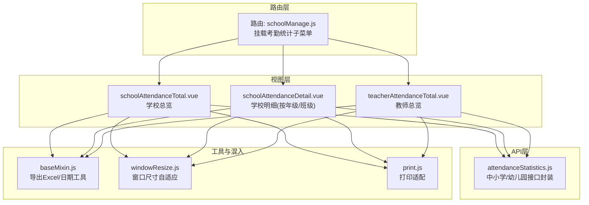
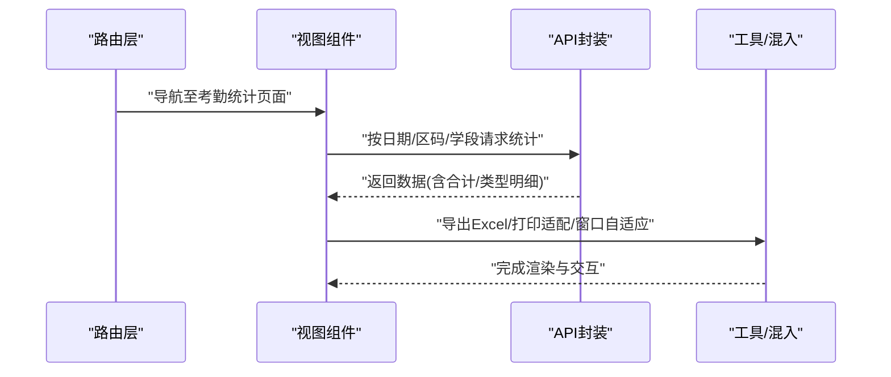
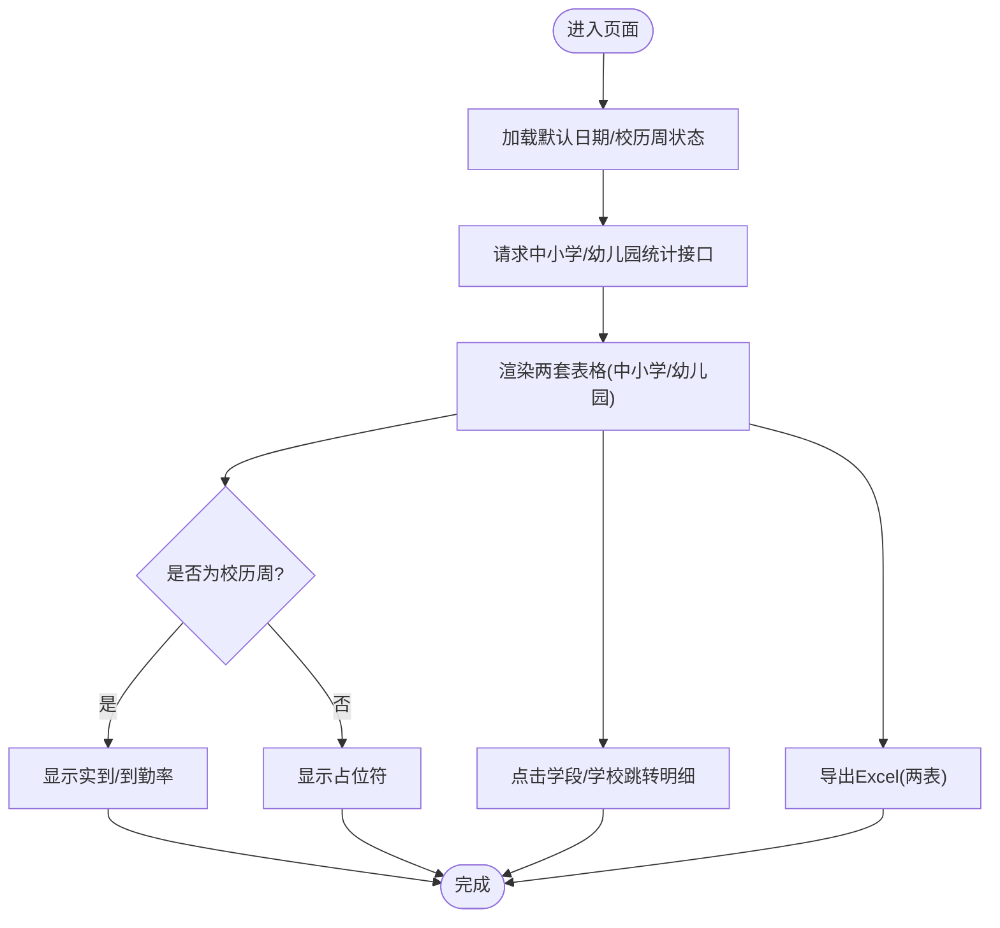
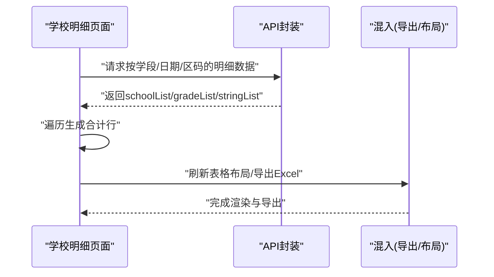
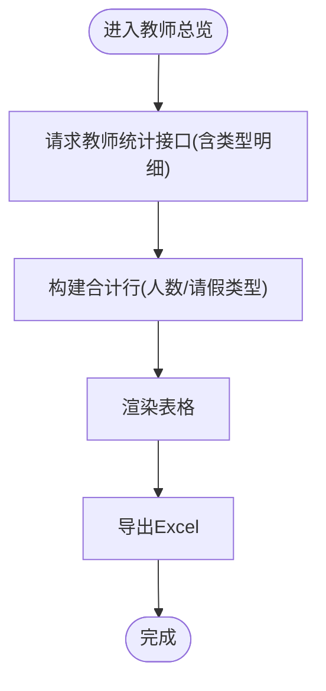
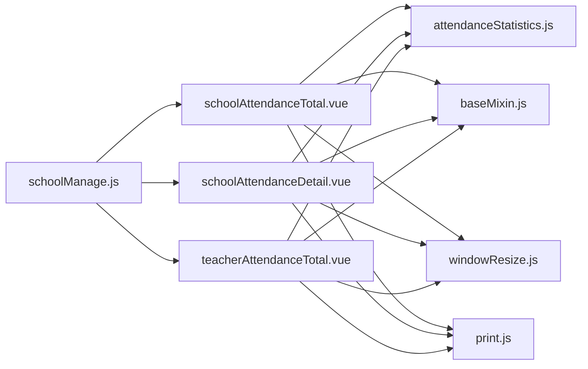

# 考勤统计分析

<cite>
**本文引用的文件**
- [src/api/attendanceStatistics.js](file://src/api/attendanceStatistics.js)
- [src/views/attendanceStatistics/schoolAttendanceTotal.vue](file://src/views/attendanceStatistics/schoolAttendanceTotal.vue)
- [src/views/attendanceStatistics/schoolAttendanceDetail.vue](file://src/views/attendanceStatistics/schoolAttendanceDetail.vue)
- [src/views/attendanceStatistics/teacherAttendanceTotal.vue](file://src/views/attendanceStatistics/teacherAttendanceTotal.vue)
- [src/router/normal/schoolManage.js](file://src/router/normal/schoolManage.js)
- [src/utils/print.js](file://src/utils/print.js)
- [src/mixins/baseMixin.js](file://src/mixins/baseMixin.js)
- [src/mixins/windowResize.js](file://src/mixins/windowResize.js)
</cite>

## 目录
1. [简介](#简介)
2. [项目结构](#项目结构)
3. [核心组件](#核心组件)
4. [架构总览](#架构总览)
5. [详细组件分析](#详细组件分析)
6. [依赖关系分析](#依赖关系分析)
7. [性能考量](#性能考量)
8. [故障排查指南](#故障排查指南)
9. [结论](#结论)
10. [附录](#附录)

## 简介
本文件面向“考勤统计分析”业务，围绕学校、年级、班级三个层级的数据采集、聚合与呈现进行系统化文档化。重点覆盖以下方面：
- 报表生成逻辑：按日期、学段（中小学/幼儿园）、教师/员工、请假类型等多维聚合
- 数据分析算法：到勤率计算、周内/非周期判断、合计行生成
- 维度与筛选：区县编码、日期、学段、是否周内、是否幼儿园标识
- 可视化方案：表格为主，结合柱状图、折线图、饼图在其他模块的通用实践
- 导出与打印：表格导出为 Excel、隐藏列控制与打印适配

## 项目结构
与考勤统计分析直接相关的前端模块分布如下：
- API 层：封装考勤统计接口，支持中小学与幼儿园两类数据源
- 视图层：提供“学校总览”“学校明细（按年级/班级）”“教师总览”三类报表页面
- 路由层：统一挂载于“学校管理”菜单下的“考勤统计”子菜单
- 工具与混入：导出 Excel、窗口尺寸自适应、打印适配

**图表来源**
- [src/router/normal/schoolManage.js:970-1066](file://src/router/normal/schoolManage.js#L970-L1066)
- [src/views/attendanceStatistics/schoolAttendanceTotal.vue:1-311](file://src/views/attendanceStatistics/schoolAttendanceTotal.vue#L1-L311)
- [src/views/attendanceStatistics/schoolAttendanceDetail.vue:1-267](file://src/views/attendanceStatistics/schoolAttendanceDetail.vue#L1-L267)
- [src/views/attendanceStatistics/teacherAttendanceTotal.vue:1-259](file://src/views/attendanceStatistics/teacherAttendanceTotal.vue#L1-L259)
- [src/api/attendanceStatistics.js:1-100](file://src/api/attendanceStatistics.js#L1-L100)
- [src/mixins/baseMixin.js:1-103](file://src/mixins/baseMixin.js#L1-L103)
- [src/mixins/windowResize.js:1-63](file://src/mixins/windowResize.js#L1-L63)
- [src/utils/print.js:1-165](file://src/utils/print.js#L1-L165)

**章节来源**
- [src/router/normal/schoolManage.js:970-1066](file://src/router/normal/schoolManage.js#L970-L1066)

## 核心组件
- API 封装：提供按日期、区码、学段查询中小学与幼儿园两类统计接口；并包含“获取某日是否为校历周”的辅助接口
- 页面组件：
  - 学校总览：按学段（中小学/幼儿园）分别展示应到、实到、各类请假人数与到勤率，并可跳转明细
  - 学校明细：按年级/班级维度展示各班应到、实到、请假类型与细分病种统计
  - 教师总览：按学校展示教师与“其他员工”的应到、实到与请假类型统计
- 工具与混入：统一导出 Excel、窗口尺寸自适应、打印适配

**章节来源**
- [src/api/attendanceStatistics.js:1-100](file://src/api/attendanceStatistics.js#L1-L100)
- [src/views/attendanceStatistics/schoolAttendanceTotal.vue:1-311](file://src/views/attendanceStatistics/schoolAttendanceTotal.vue#L1-L311)
- [src/views/attendanceStatistics/schoolAttendanceDetail.vue:1-267](file://src/views/attendanceStatistics/schoolAttendanceDetail.vue#L1-L267)
- [src/views/attendanceStatistics/teacherAttendanceTotal.vue:1-259](file://src/views/attendanceStatistics/teacherAttendanceTotal.vue#L1-L259)
- [src/mixins/baseMixin.js:65-86](file://src/mixins/baseMixin.js#L65-L86)
- [src/mixins/windowResize.js:1-63](file://src/mixins/windowResize.js#L1-L63)
- [src/utils/print.js:1-165](file://src/utils/print.js#L1-L165)

## 架构总览
下图展示从路由到视图、API、工具链的整体调用关系与数据流。

**图表来源**
- [src/router/normal/schoolManage.js:970-1066](file://src/router/normal/schoolManage.js#L970-L1066)
- [src/views/attendanceStatistics/schoolAttendanceTotal.vue:134-271](file://src/views/attendanceStatistics/schoolAttendanceTotal.vue#L134-L271)
- [src/views/attendanceStatistics/schoolAttendanceDetail.vue:142-235](file://src/views/attendanceStatistics/schoolAttendanceDetail.vue#L142-L235)
- [src/views/attendanceStatistics/teacherAttendanceTotal.vue:152-228](file://src/views/attendanceStatistics/teacherAttendanceTotal.vue#L152-L228)
- [src/api/attendanceStatistics.js:1-100](file://src/api/attendanceStatistics.js#L1-L100)
- [src/mixins/baseMixin.js:65-86](file://src/mixins/baseMixin.js#L65-L86)
- [src/utils/print.js:1-165](file://src/utils/print.js#L1-L165)

## 详细组件分析

### 组件一：学校总览（按学段）
- 功能要点
  - 日期选择器：默认今日，限制不可选未来日期
  - 查询中小学与幼儿园两类数据：分别渲染两张表格
  - 到勤率计算：实到/应到×100%，保留两位小数
  - 是否周内：通过“是否为校历周”决定是否显示实到与到勤率
  - 跳转明细：点击学段或学校标题进入明细页面
  - 导出：分别导出中小学与幼儿园两个表格为 Excel
- 关键字段
  - 应到人数、实到人数、各类请假人数、合计行
  - 教职工统计（中小学/幼儿园均包含）
- 计算规则
  - 实到 = 应到 − 未到
  - 到勤率 = 实到 ÷ 应到 × 100%
  - 合计行：对各列求和，类型明细按类型维度累加

**图表来源**
- [src/views/attendanceStatistics/schoolAttendanceTotal.vue:134-271](file://src/views/attendanceStatistics/schoolAttendanceTotal.vue#L134-L271)
- [src/api/attendanceStatistics.js:1-100](file://src/api/attendanceStatistics.js#L1-L100)

**章节来源**
- [src/views/attendanceStatistics/schoolAttendanceTotal.vue:1-311](file://src/views/attendanceStatistics/schoolAttendanceTotal.vue#L1-L311)
- [src/api/attendanceStatistics.js:1-100](file://src/api/attendanceStatistics.js#L1-L100)

### 组件二：学校明细（按年级/班级）
- 功能要点
  - 按年级/班级维度展示各班应到、实到、请假类型与细分病种
  - 支持幼儿园与中小学两种数据源切换
  - 合计行：对每列进行累加
  - 导出：导出当前表格为 Excel
- 数据结构
  - schoolList：按学校分组的明细
  - gradeList：年级/班级维度的标签与索引
  - stringList：每行的数值序列（包含应到、未到、各类请假人数等）

**图表来源**
- [src/views/attendanceStatistics/schoolAttendanceDetail.vue:142-235](file://src/views/attendanceStatistics/schoolAttendanceDetail.vue#L142-L235)
- [src/api/attendanceStatistics.js:32-45](file://src/api/attendanceStatistics.js#L32-L45)

**章节来源**
- [src/views/attendanceStatistics/schoolAttendanceDetail.vue:1-267](file://src/views/attendanceStatistics/schoolAttendanceDetail.vue#L1-L267)
- [src/api/attendanceStatistics.js:32-45](file://src/api/attendanceStatistics.js#L32-L45)

### 组件三：教师总览（按学校）
- 功能要点
  - 展示教师与“其他员工”的应到、实到与请假类型统计
  - 支持幼儿园与中小学两种数据源切换
  - 合计行：对人数与请假类型进行累加
  - 导出：导出当前表格为 Excel
- 计算规则
  - 实到（教师）= 教师应到 − 教师未到
  - 实到（其他员工）= 其他员工应到 − 其他员工未到
  - 到勤率（如需）= 实到 ÷ 应到 × 100%

**图表来源**
- [src/views/attendanceStatistics/teacherAttendanceTotal.vue:152-228](file://src/views/attendanceStatistics/teacherAttendanceTotal.vue#L152-L228)
- [src/api/attendanceStatistics.js:18-45](file://src/api/attendanceStatistics.js#L18-L45)

**章节来源**
- [src/views/attendanceStatistics/teacherAttendanceTotal.vue:1-259](file://src/views/attendanceStatistics/teacherAttendanceTotal.vue#L1-L259)
- [src/api/attendanceStatistics.js:18-45](file://src/api/attendanceStatistics.js#L18-L45)

### 可视化与图表建议
- 表格为主：当前实现以 Element 表格为核心，适合多维明细与导出
- 柱状图：用于展示“各学校/年级/班级”的应到/实到对比，或“各类请假人数”
- 折线图：用于展示“按日期序列”的到勤率趋势
- 饼图：用于展示“请假类型占比”或“病种构成”
- 通用实践参考：项目中存在图表组件与 ECharts 图表处理逻辑，可作为扩展参考

**章节来源**
- [src/utils/print.js:82-95](file://src/utils/print.js#L82-L95)

## 依赖关系分析
- 路由依赖：三类报表页面挂载于“学校管理 → 考勤统计”菜单下
- 组件耦合：三类页面共享同一 API 封装，耦合度低、职责清晰
- 工具依赖：导出 Excel 依赖 baseMixin 的导出方法；窗口自适应依赖 windowResize；打印依赖 print 工具

**图表来源**
- [src/router/normal/schoolManage.js:970-1066](file://src/router/normal/schoolManage.js#L970-L1066)
- [src/views/attendanceStatistics/schoolAttendanceTotal.vue:1-311](file://src/views/attendanceStatistics/schoolAttendanceTotal.vue#L1-L311)
- [src/views/attendanceStatistics/schoolAttendanceDetail.vue:1-267](file://src/views/attendanceStatistics/schoolAttendanceDetail.vue#L1-L267)
- [src/views/attendanceStatistics/teacherAttendanceTotal.vue:1-259](file://src/views/attendanceStatistics/teacherAttendanceTotal.vue#L1-L259)
- [src/api/attendanceStatistics.js:1-100](file://src/api/attendanceStatistics.js#L1-L100)
- [src/mixins/baseMixin.js:1-103](file://src/mixins/baseMixin.js#L1-L103)
- [src/mixins/windowResize.js:1-63](file://src/mixins/windowResize.js#L1-L63)
- [src/utils/print.js:1-165](file://src/utils/print.js#L1-L165)

**章节来源**
- [src/router/normal/schoolManage.js:970-1066](file://src/router/normal/schoolManage.js#L970-L1066)

## 性能考量
- 渲染优化
  - 使用 Element 表格的虚拟滚动与列宽自适应，避免大数据量时卡顿
  - 在明细页面使用“延迟刷新布局”策略，减少首屏渲染压力
- 请求优化
  - 合理缓存日期与查询参数，避免重复请求
  - 对合计行计算采用一次性遍历累加，降低复杂度
- 导出优化
  - 使用原生表格导出，避免额外渲染开销
  - 控制导出列数量，仅导出必要字段

[本节为通用指导，无需特定文件引用]

## 故障排查指南
- 导出失败
  - 检查导出目标 DOM 是否存在且可见
  - 确认浏览器允许弹窗与文件下载
  - 参考导出方法路径：[导出方法:65-86](file://src/mixins/baseMixin.js#L65-L86)
- 表格错位
  - 在页面激活或尺寸变化后调用布局刷新
  - 参考混入方法路径：[布局刷新:21-27](file://src/mixins/baseMixin.js#L21-L27)
- 打印异常
  - 确保打印前已将 ECharts Canvas 转换为图片
  - 参考打印工具路径：[打印适配:82-95](file://src/utils/print.js#L82-L95)
- 接口无数据
  - 校验日期、区码、学段参数是否正确
  - 参考接口定义路径：[API 定义:1-100](file://src/api/attendanceStatistics.js#L1-L100)

**章节来源**
- [src/mixins/baseMixin.js:65-86](file://src/mixins/baseMixin.js#L65-L86)
- [src/mixins/baseMixin.js:21-27](file://src/mixins/baseMixin.js#L21-L27)
- [src/utils/print.js:82-95](file://src/utils/print.js#L82-L95)
- [src/api/attendanceStatistics.js:1-100](file://src/api/attendanceStatistics.js#L1-L100)

## 结论
本功能以“日期+区码+学段”为核心筛选条件，按学校、年级/班级、教师/员工三个维度提供统计报表，具备明确的到勤率计算与合计行生成逻辑。通过统一的 API 封装与工具链，实现了稳定的导出与打印能力。后续可在现有表格基础上引入柱状/折线/饼图等可视化组件，进一步提升趋势分析与异常检测的直观性。

[本节为总结性内容，无需特定文件引用]

## 附录

### 考勤率计算公式
- 到勤率 = 实到 ÷ 应到 × 100%
- 实到 = 应到 − 未到
- 未到：由接口返回的“未到人数”字段

**章节来源**
- [src/views/attendanceStatistics/schoolAttendanceTotal.vue:196-199](file://src/views/attendanceStatistics/schoolAttendanceTotal.vue#L196-L199)
- [src/views/attendanceStatistics/schoolAttendanceDetail.vue:158-165](file://src/views/attendanceStatistics/schoolAttendanceDetail.vue#L158-L165)
- [src/views/attendanceStatistics/teacherAttendanceTotal.vue:168-194](file://src/views/attendanceStatistics/teacherAttendanceTotal.vue#L168-L194)

### 异常波动检测机制（建议）
- 周内/非周期对比：通过“是否为校历周”字段区分，非周期时到勤率可能受自然因素影响
- 多日趋势：基于“按日期序列”的到勤率折线图识别异常波动
- 类别对比：通过“请假类型/病种”柱状图识别异常集中

[本节为概念性建议，无需特定文件引用]

### 可视化图表类型与使用场景
- 柱状图：对比不同学校/年级/班级的应到/实到
- 折线图：展示按日期序列的趋势变化
- 饼图：展示请假类型/病种占比

**章节来源**
- [src/utils/print.js:82-95](file://src/utils/print.js#L82-L95)

### 导出与打印
- 导出格式：Excel（.xlsx）
- 导出触发：点击“导出”按钮，自动保存文件
- 打印适配：将 ECharts Canvas 转为图片，确保打印清晰

**章节来源**
- [src/mixins/baseMixin.js:65-86](file://src/mixins/baseMixin.js#L65-L86)
- [src/utils/print.js:82-95](file://src/utils/print.js#L82-L95)