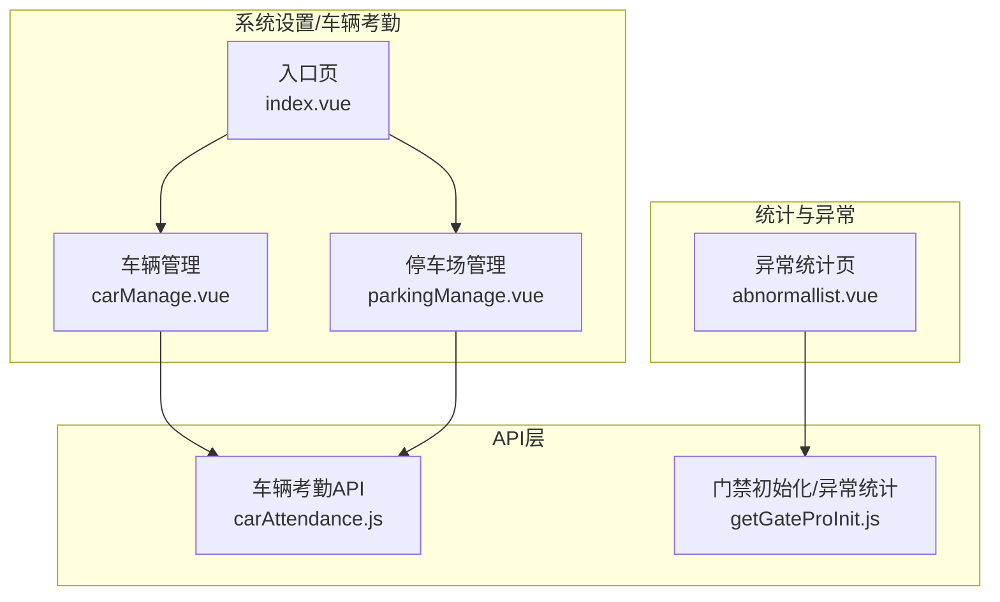
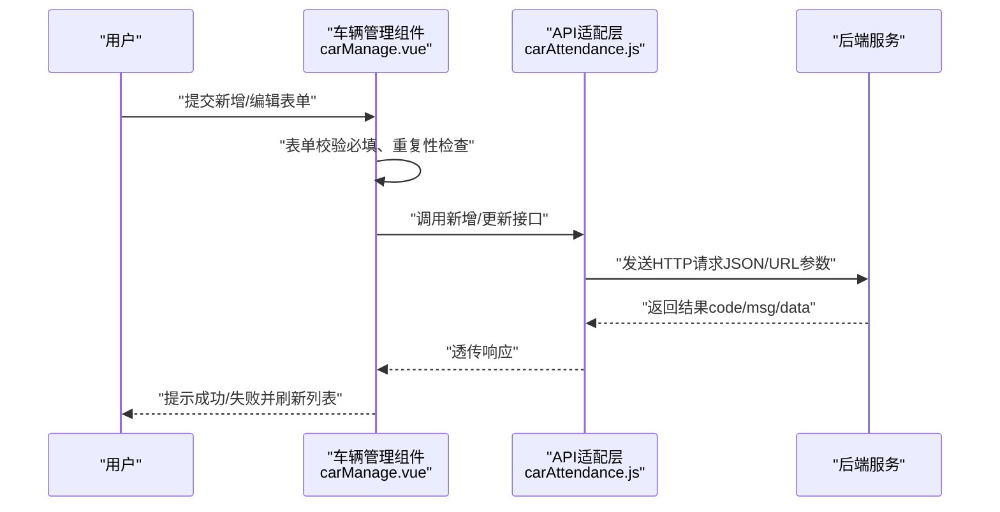
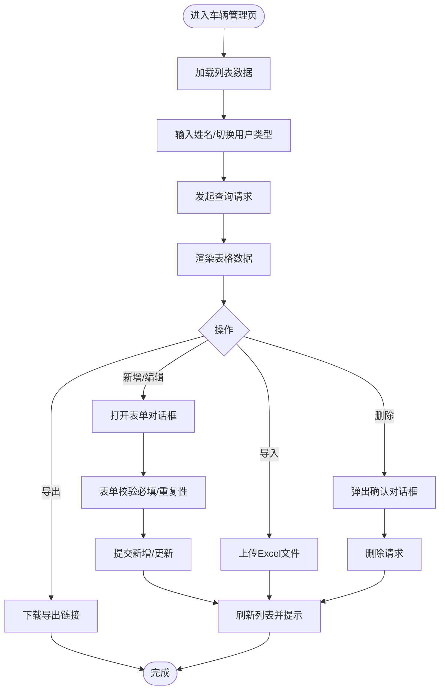
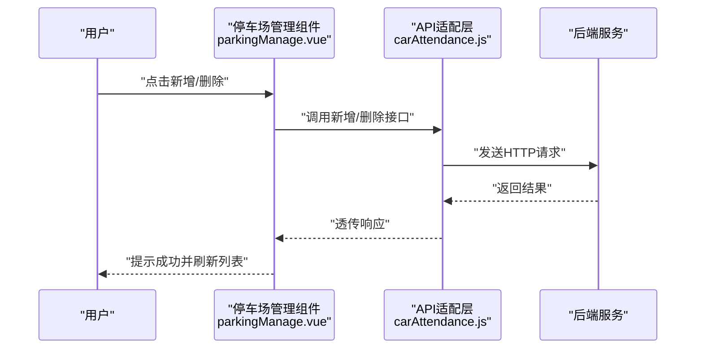
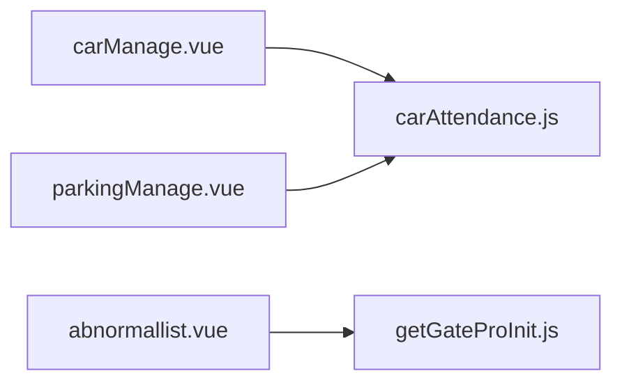

# 车辆考勤

<cite>
**本文引用的文件**
- [carAttendance.js](file://src/api/carAttendance.js)
- [index.vue](file://src/views/sysSet/carAttendance/index.vue)
- [carManage.vue](file://src/views/sysSet/carAttendance/carManage.vue)
- [parkingManage.vue](file://src/views/sysSet/carAttendance/parkingManage.vue)
- [getGateProInit.js](file://src/api/getGateProInit.js)
- [abnormallist.vue](file://src/views/attenAccounting/abnormallist.vue)
</cite>

## 目录
1. [简介](#简介)
2. [项目结构](#项目结构)
3. [核心组件](#核心组件)
4. [架构总览](#架构总览)
5. [详细组件分析](#详细组件分析)
6. [依赖关系分析](#依赖关系分析)
7. [性能考量](#性能考量)
8. [故障排查指南](#故障排查指南)
9. [结论](#结论)
10. [附录](#附录)

## 简介
本文件面向校园内车辆进出管理与考勤场景，系统性梳理“车辆考勤”模块的功能边界、数据采集方式、数据验证规则、统计逻辑、异常处理以及报表导出能力。当前前端仓库中已实现“车辆用户登记与管理”“停车场地点维护”两大功能页面，并通过统一的API适配层对接后端服务；同时，门禁异常统计接口可作为车辆考勤异常分析的参考。

## 项目结构
车辆考勤相关功能位于系统设置模块下的“carAttendance”目录，包含入口页与两个子页面：
- 入口页：聚合“车辆管理”“停车场管理”两个子页签
- 车辆管理：支持教师/学生两类用户的车辆登记、批量导入/导出、多车牌绑定、分页查询
- 停车场管理：支持停车场地点的新增与删除

图表来源
- [index.vue:1-80](file://src/views/sysSet/carAttendance/index.vue#L1-L80)
- [carManage.vue:1-482](file://src/views/sysSet/carAttendance/carManage.vue#L1-L482)
- [parkingManage.vue:1-192](file://src/views/sysSet/carAttendance/parkingManage.vue#L1-L192)
- [carAttendance.js:1-114](file://src/api/carAttendance.js#L1-L114)
- [getGateProInit.js:1-22](file://src/api/getGateProInit.js#L1-L22)
- [abnormallist.vue:1-200](file://src/views/attenAccounting/abnormallist.vue#L1-L200)

章节来源
- [index.vue:1-80](file://src/views/sysSet/carAttendance/index.vue#L1-L80)
- [carManage.vue:1-482](file://src/views/sysSet/carAttendance/carManage.vue#L1-L482)
- [parkingManage.vue:1-192](file://src/views/sysSet/carAttendance/parkingManage.vue#L1-L192)

## 核心组件
- 车辆用户登记与管理（教师/学生）
  - 支持按用户类型切换（教师/学生），分别展示不同的字段与操作
  - 教师侧支持绑定多个车牌号（最多3个），并进行重复性校验
  - 支持导入/导出模板，批量导入/导出
  - 分页查询、搜索、删除、编辑
- 停车场地点管理
  - 新增/删除停车场地点，用于标识车辆停靠区域
- 统计与异常
  - 通过门禁异常统计接口，可借鉴其异常识别思路用于车辆考勤异常分析

章节来源
- [carManage.vue:1-482](file://src/views/sysSet/carAttendance/carManage.vue#L1-L482)
- [parkingManage.vue:1-192](file://src/views/sysSet/carAttendance/parkingManage.vue#L1-L192)
- [getGateProInit.js:1-22](file://src/api/getGateProInit.js#L1-L22)

## 架构总览
前端采用“视图组件 + API适配层”的分层设计：
- 视图组件负责交互与表单校验
- API适配层封装HTTP请求，统一参数格式与响应处理
- 统计与异常分析页面复用门禁相关接口，便于扩展到车辆考勤

图表来源
- [carManage.vue:312-415](file://src/views/sysSet/carAttendance/carManage.vue#L312-L415)
- [carAttendance.js:16-114](file://src/api/carAttendance.js#L16-L114)

## 详细组件分析

### 车辆管理组件（carManage.vue）
- 用户类型与字段映射
  - 教师：展示部门/手机号，支持绑定最多3个车牌号
  - 学生：展示班级，仅支持绑定1个车牌号
- 表单校验
  - 必填项：选择用户、车牌号
  - 重复性校验：教师侧三车牌不可重复
- 导入/导出
  - 支持Excel模板导入与导出
  - 导入成功后自动刷新列表
- 分页与搜索
  - 支持按姓名搜索与分页切换
- 数据流
  - 列表查询 -> 导出链接拼装 -> 导入上传 -> 成功提示与刷新

图表来源
- [carManage.vue:448-456](file://src/views/sysSet/carAttendance/carManage.vue#L448-L456)
- [carManage.vue:279-297](file://src/views/sysSet/carAttendance/carManage.vue#L279-L297)
- [carManage.vue:432-447](file://src/views/sysSet/carAttendance/carManage.vue#L432-L447)
- [carManage.vue:312-415](file://src/views/sysSet/carAttendance/carManage.vue#L312-L415)

章节来源
- [carManage.vue:1-482](file://src/views/sysSet/carAttendance/carManage.vue#L1-L482)

### 停车场管理组件（parkingManage.vue）
- 功能点
  - 新增停车场地点（名称、编号）
  - 删除停车场地点
  - 列表展示与删除操作
- 数据流
  - 查询列表 -> 新增/删除 -> 成功提示与刷新

图表来源
- [parkingManage.vue:117-169](file://src/views/sysSet/carAttendance/parkingManage.vue#L117-L169)
- [carAttendance.js:65-96](file://src/api/carAttendance.js#L65-L96)

章节来源
- [parkingManage.vue:1-192](file://src/views/sysSet/carAttendance/parkingManage.vue#L1-L192)

### API适配层（carAttendance.js）
- 接口职责
  - 车辆用户：新增、更新、分页查询、按用户ID删除、批量导入/更新
  - 停车场地点：查询、新增、删除
- 参数与返回
  - 统一使用URLSearchParams或JSON体传递参数
  - 返回值包含code/msg/data，前端据此判断成功/失败并提示

章节来源
- [carAttendance.js:1-114](file://src/api/carAttendance.js#L1-L114)

### 异常统计与扩展建议
- 当前异常统计页基于门禁异常接口，可用于车辆考勤异常识别的参考实现
- 可借鉴的异常识别维度（示例思路）
  - 超时未出：设定最大允许停留时长，超过则标记异常
  - 重复进出：短时间内同车多次进出，触发异常
  - 无牌车辆：识别无车牌或无法识别的记录
  - 非法时段：在非开放时段出现的进出记录
- 报表与导出
  - 可沿用车辆用户列表的导出机制，扩展异常记录导出

章节来源
- [getGateProInit.js:1-22](file://src/api/getGateProInit.js#L1-L22)
- [abnormallist.vue:1-200](file://src/views/attenAccounting/abnormallist.vue#L1-L200)

## 依赖关系分析
- 组件与API
  - 车辆管理组件依赖API层提供的用户登记与导入/导出接口
  - 停车场管理组件依赖API层提供的地点维护接口
- 统计与异常
  - 异常统计页依赖门禁相关接口，可作为车辆异常识别的参考

图表来源
- [carManage.vue:152-153](file://src/views/sysSet/carAttendance/carManage.vue#L152-L153)
- [parkingManage.vue:72-72](file://src/views/sysSet/carAttendance/parkingManage.vue#L72-L72)
- [carAttendance.js:1-114](file://src/api/carAttendance.js#L1-L114)
- [getGateProInit.js:1-22](file://src/api/getGateProInit.js#L1-L22)

章节来源
- [carManage.vue:152-153](file://src/views/sysSet/carAttendance/carManage.vue#L152-L153)
- [parkingManage.vue:72-72](file://src/views/sysSet/carAttendance/parkingManage.vue#L72-L72)
- [carAttendance.js:1-114](file://src/api/carAttendance.js#L1-L114)
- [getGateProInit.js:1-22](file://src/api/getGateProInit.js#L1-L22)

## 性能考量
- 列表分页与搜索
  - 使用分页参数控制每次请求的数据量，避免一次性加载过多数据
- 导入/导出
  - 导入采用Excel模板，减少解析复杂度；导出通过后端拼接，前端仅触发下载
- 表单校验
  - 在提交前进行本地校验，减少无效请求

## 故障排查指南
- 常见问题
  - 导入失败：检查文件格式（.xls/.xlsx）、模板是否正确、网络是否稳定
  - 编辑失败：检查必填项与重复性校验（教师侧三车牌不可重复）
  - 删除失败：确认目标记录是否存在、权限是否足够
- 处理步骤
  - 查看消息提示与控制台错误
  - 重新尝试操作或刷新页面
  - 如仍失败，联系管理员或后端接口负责人

章节来源
- [carManage.vue:279-297](file://src/views/sysSet/carAttendance/carManage.vue#L279-L297)
- [carManage.vue:354-358](file://src/views/sysSet/carAttendance/carManage.vue#L354-L358)
- [carManage.vue:432-447](file://src/views/sysSet/carAttendance/carManage.vue#L432-L447)

## 结论
当前前端已实现“车辆用户登记与管理”“停车场地点维护”的核心功能，并通过统一API适配层与后端交互。结合门禁异常统计接口，可进一步扩展车辆考勤异常识别与报表导出能力。后续可在现有基础上完善数据采集（如RFID/车牌识别）接入、统计维度与异常规则配置，以满足校园内校车、公务车、访客车等多种类型车辆的考勤管理需求。

## 附录
- 数据采集方式（建议）
  - 车牌识别：通过摄像头/识别设备采集图像，经OCR识别车牌号
  - RFID感应：在出入口部署读卡器，刷卡/感应记录通行时间
  - 人工登记：对临时/无识别条件的车辆进行人工录入
- 数据验证规则（建议）
  - 车牌号格式校验（长度、字符集）
  - 同一用户多车牌去重与数量限制
  - 时间戳合法性与顺序一致性校验
- 统计逻辑（建议）
  - 出入频次：按日/周/月统计每辆车的进出次数
  - 停留时间：根据最近一次进/出时间计算停留时长
  - 违规识别：超时未出、重复进出、非法时段、无牌车辆
- 报表与导出
  - 支持按日期范围、用户类型、车牌号筛选导出
  - 导出格式可扩展为Excel/CSV/PDF