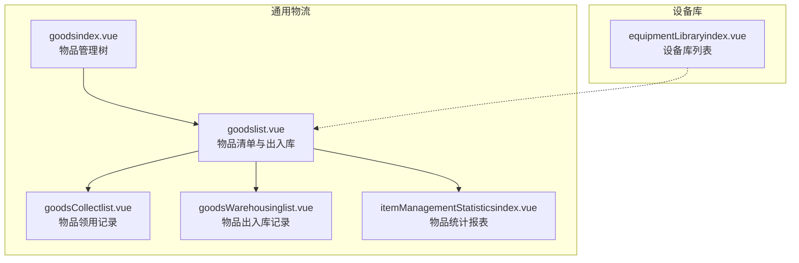
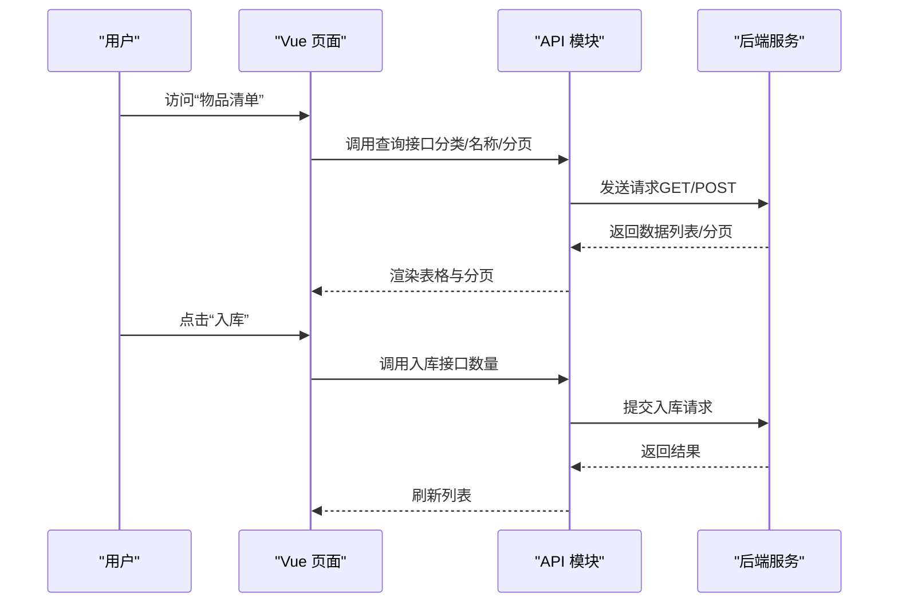
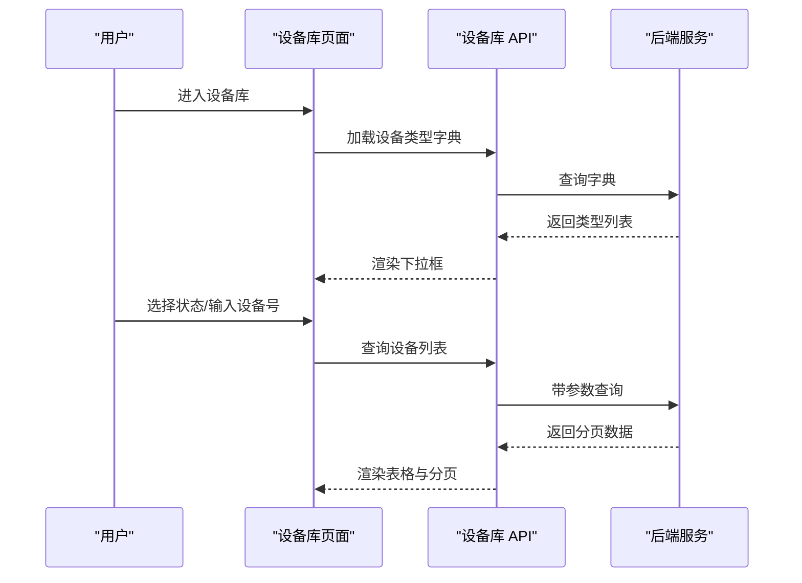
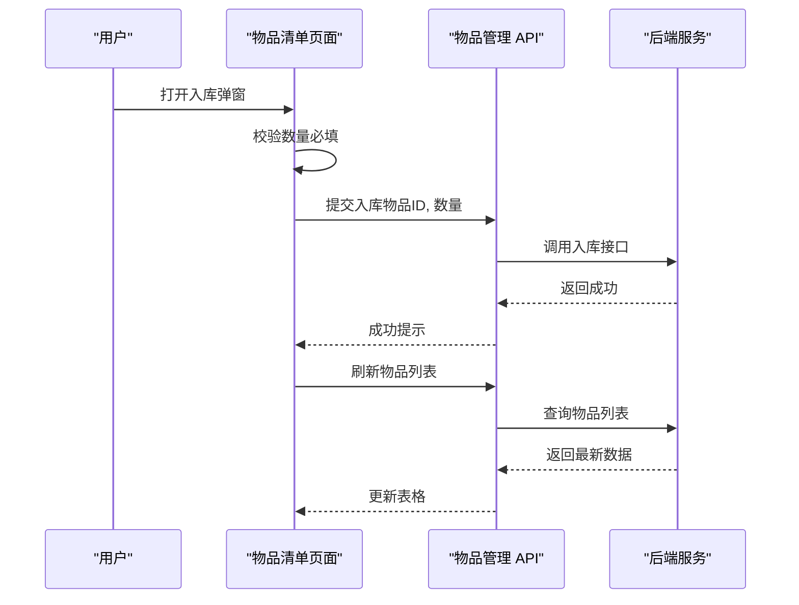
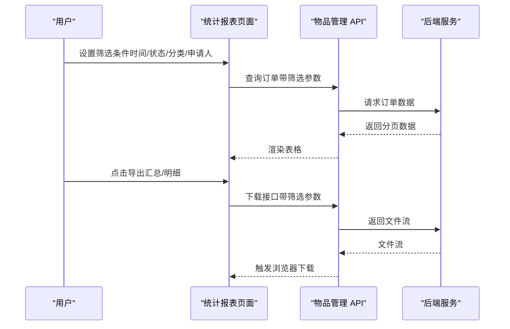
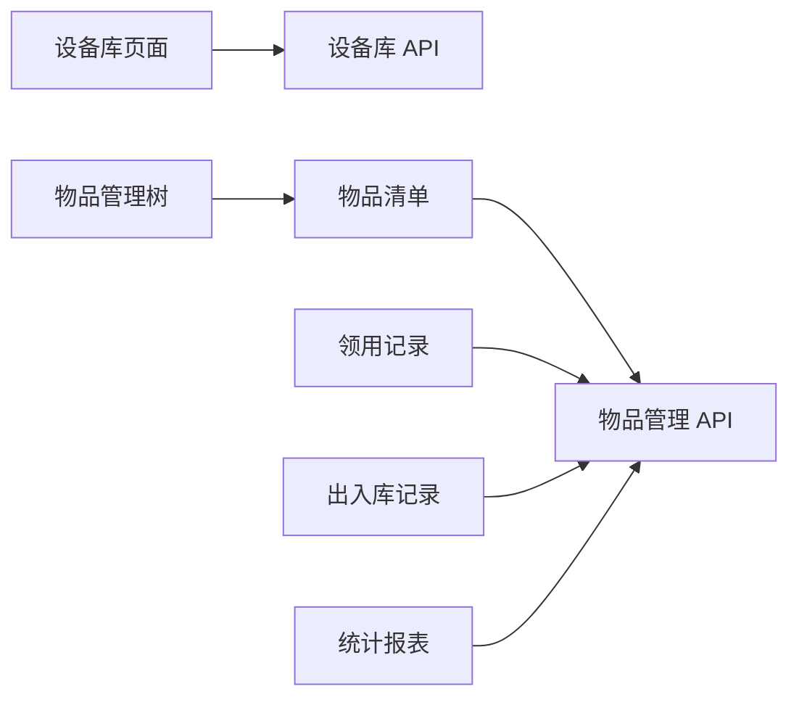

# 库存管理

<cite>
**本文引用的文件**
- [equipmentLibraryindex.vue](file://src/views/equipmentLibrary/equipmentLibraryindex.vue)
- [equipmentLibrary.js](file://src/api/equipmentLibrary.js)
- [deviceManage.js](file://src/api/systemSet/deviceManage.js)
- [goodsindex.vue](file://src/views/itemManagement/goodsindex.vue)
- [goodslist.vue](file://src/views/itemManagement/goodslist.vue)
- [goodsCollectlist.vue](file://src/views/itemManagement/goodsCollectlist.vue)
- [goodsWarehousinglist.vue](file://src/views/itemManagement/goodsWarehousinglist.vue)
- [itemManagementStatisticsindex.vue](file://src/views/itemManagement/itemManagementStatisticsindex.vue)
- [generalLogistics.js](file://src/router/generalLogistics.js)
- [homeSchool.js](file://src/router/homeSchool.js)
</cite>

## 目录
1. [简介](#简介)
2. [项目结构](#项目结构)
3. [核心组件](#核心组件)
4. [架构总览](#架构总览)
5. [详细组件分析](#详细组件分析)
6. [依赖关系分析](#依赖关系分析)
7. [性能考量](#性能考量)
8. [故障排查指南](#故障排查指南)
9. [结论](#结论)
10. [附录](#附录)

## 简介
本业务文档围绕“库存管理”主题，系统梳理并说明以下能力与流程：
- 设备库存的实时监控（设备在线/离线状态）
- 库存预警与库存调整机制（基于设备与物品的库存字段）
- 库存盘点流程（按时间范围与物品维度导出）
- 库存转移与调拨操作（物品出入库与领用记录）
- 库存报表统计（按部门、分类、时间维度汇总）
- 库存成本核算与分析（单价、数量、金额计算）
- 安全库存设置与损耗处理（通过配置项与流程控制）
- 异常处理机制（审批状态、删除与导出等）
- 操作指南与数据准确性与完整性保障措施

## 项目结构
本项目在前端侧通过路由模块划分功能域，库存管理主要分布在“通用物流”和“设备库”两个模块中：
- 通用物流模块：物品分类、物品清单、出入库记录、领用记录、统计报表
- 设备库模块：设备类型字典、设备列表与状态展示

图表来源
- [goodsindex.vue:1-137](file://src/views/itemManagement/goodsindex.vue#L1-L137)
- [goodslist.vue:1-418](file://src/views/itemManagement/goodslist.vue#L1-L418)
- [goodsCollectlist.vue:1-129](file://src/views/itemManagement/goodsCollectlist.vue#L1-L129)
- [goodsWarehousinglist.vue:1-139](file://src/views/itemManagement/goodsWarehousinglist.vue#L1-L139)
- [itemManagementStatisticsindex.vue:1-222](file://src/views/itemManagement/itemManagementStatisticsindex.vue#L1-L222)
- [equipmentLibraryindex.vue:1-136](file://src/views/equipmentLibrary/equipmentLibraryindex.vue#L1-L136)

章节来源
- [generalLogistics.js:869-899](file://src/router/generalLogistics.js#L869-L899)
- [homeSchool.js:574-610](file://src/router/homeSchool.js#L574-L610)

## 核心组件
- 设备库列表组件：提供设备类型筛选、状态筛选、设备号检索与分页展示，并支持设备状态（在线/离线）显示。
- 物品管理树组件：提供物品分类树形导航，进入物品清单页面。
- 物品清单组件：展示物品基础信息、库存数量、易耗/虚拟/需归还/需审批等属性；支持批量导出、导入、入库弹窗、领用记录跳转。
- 领用记录组件：按时间范围与申请人筛选，展示领用明细与金额合计。
- 出入库记录组件：按分类与时间范围筛选，展示入库数量与总价。
- 统计报表组件：按领取状态、分类、时间范围与申请人筛选，支持导出汇总与明细。

章节来源
- [equipmentLibraryindex.vue:1-136](file://src/views/equipmentLibrary/equipmentLibraryindex.vue#L1-L136)
- [goodsindex.vue:1-137](file://src/views/itemManagement/goodsindex.vue#L1-L137)
- [goodslist.vue:1-418](file://src/views/itemManagement/goodslist.vue#L1-L418)
- [goodsCollectlist.vue:1-129](file://src/views/itemManagement/goodsCollectlist.vue#L1-L129)
- [goodsWarehousinglist.vue:1-139](file://src/views/itemManagement/goodsWarehousinglist.vue#L1-L139)
- [itemManagementStatisticsindex.vue:1-222](file://src/views/itemManagement/itemManagementStatisticsindex.vue#L1-L222)

## 架构总览
前端采用 Vue + Element UI 的单页应用模式，通过路由模块组织功能页面；API 层通过统一的 fetch 封装进行后端接口调用。库存相关页面与接口如下：

图表来源
- [goodslist.vue:281-306](file://src/views/itemManagement/goodslist.vue#L281-L306)
- [goodsindex.vue:1-137](file://src/views/itemManagement/goodsindex.vue#L1-L137)

## 详细组件分析

### 设备库存监控（设备库）
- 功能要点
  - 设备类型字典加载与默认选择
  - 设备状态筛选（全部/在线/离线）
  - 设备号检索与分页
  - 在线/离线状态可视化标签
- 关键接口
  - 获取设备类型字典
  - 分页查询设备列表（支持状态过滤）

图表来源
- [equipmentLibraryindex.vue:88-121](file://src/views/equipmentLibrary/equipmentLibraryindex.vue#L88-L121)
- [equipmentLibrary.js:3-25](file://src/api/equipmentLibrary.js#L3-L25)

章节来源
- [equipmentLibraryindex.vue:1-136](file://src/views/equipmentLibrary/equipmentLibraryindex.vue#L1-L136)
- [equipmentLibrary.js:1-25](file://src/api/equipmentLibrary.js#L1-L25)

### 物品库存与出入库（物品管理）
- 功能要点
  - 物品清单展示：名称、品牌、规格、单位、价格、库存、易耗/虚拟/需归还/需审批等
  - 入库弹窗：校验数量必填，提交后刷新列表
  - 导出与导入：支持按分类导出物品清单，支持批量导入
  - 领用记录：按时间范围与申请人筛选，展示领用明细与金额
  - 出入库记录：按分类与时间范围筛选，展示入库数量与总价
- 关键接口
  - 物品查询（分页/名称/分类）
  - 入库提交
  - 领用明细查询
  - 出入库记录查询

图表来源
- [goodslist.vue:281-306](file://src/views/itemManagement/goodslist.vue#L281-L306)

章节来源
- [goodslist.vue:1-418](file://src/views/itemManagement/goodslist.vue#L1-L418)
- [goodsCollectlist.vue:1-129](file://src/views/itemManagement/goodsCollectlist.vue#L1-L129)
- [goodsWarehousinglist.vue:1-139](file://src/views/itemManagement/goodsWarehousinglist.vue#L1-L139)

### 库存报表统计与成本核算
- 功能要点
  - 按领取状态、分类、时间范围、申请人筛选
  - 支持导出汇总与明细
  - 明细中包含单价、数量、金额计算
- 关键接口
  - 按学校与条件查询订单
  - 下载汇总与明细

图表来源
- [itemManagementStatisticsindex.vue:177-188](file://src/views/itemManagement/itemManagementStatisticsindex.vue#L177-L188)

章节来源
- [itemManagementStatisticsindex.vue:1-222](file://src/views/itemManagement/itemManagementStatisticsindex.vue#L1-L222)

### 库存盘点流程（概念性说明）
- 流程概览
  - 选择盘点范围（时间区间、物品分类）
  - 导出当前库存与出入库明细
  - 对照实物进行盘点，生成差异
  - 记录调整原因与责任人，执行库存调整
- 关键点
  - 使用“出入库记录”与“领用记录”导出作为盘点依据
  - 调整需经审批或具备权限的管理员操作

（本节为概念性流程说明，不直接对应具体源文件）

### 库存转移与调拨操作（概念性说明）
- 操作要点
  - 通过“入库/出库”记录追踪物品流转
  - 领用记录体现调拨去向与经办人
  - 若涉及跨部门/跨仓库，建议在业务层面补充备注字段以明确转移信息

（本节为概念性说明，不直接对应具体源文件）

### 安全库存设置与损耗处理（概念性说明）
- 安全库存设置
  - 可在物品属性中配置“易耗物品/需归还/需审批”，结合流程控制实现安全库存策略
- 损耗处理
  - 通过“出库记录”中的损耗类型字段或备注字段记录损耗原因与责任人
  - 损耗需经审批或由授权人员确认后生效

（本节为概念性说明，不直接对应具体源文件）

## 依赖关系分析
- 页面到 API 的依赖
  - 设备库页面依赖设备库 API 获取字典与列表
  - 物品管理页面依赖物品管理 API 获取分类树、物品清单、出入库与领用记录
  - 统计报表页面依赖物品管理 API 的查询与下载接口
- 路由到页面的依赖
  - 通用物流模块路由指向物品管理相关页面
  - 设备库模块路由指向设备库页面

图表来源
- [equipmentLibraryindex.vue:88-121](file://src/views/equipmentLibrary/equipmentLibraryindex.vue#L88-L121)
- [goodsindex.vue:1-137](file://src/views/itemManagement/goodsindex.vue#L1-L137)
- [goodslist.vue:260-268](file://src/views/itemManagement/goodslist.vue#L260-L268)
- [goodsCollectlist.vue:106-116](file://src/views/itemManagement/goodsCollectlist.vue#L106-L116)
- [goodsWarehousinglist.vue:116-126](file://src/views/itemManagement/goodsWarehousinglist.vue#L116-L126)
- [itemManagementStatisticsindex.vue:177-188](file://src/views/itemManagement/itemManagementStatisticsindex.vue#L177-L188)

章节来源
- [generalLogistics.js:869-899](file://src/router/generalLogistics.js#L869-L899)
- [homeSchool.js:574-610](file://src/router/homeSchool.js#L574-L610)

## 性能考量
- 列表分页与筛选
  - 使用分页参数与筛选条件减少一次性传输数据量
- 图片渲染优化
  - 物品图片使用缩略尺寸，避免大图影响首屏渲染
- 导出性能
  - 导出接口按时间范围与条件筛选，避免超大数据集导出
- 状态与在线/离线标识
  - 在线/离线状态仅在特定设备类型下展示，避免不必要的计算

（本节提供通用指导，不直接分析具体文件）

## 故障排查指南
- 设备列表无数据
  - 检查设备类型字典是否加载成功
  - 确认筛选条件（状态/设备号）是否合理
- 入库失败
  - 确认数量必填校验通过
  - 查看网络请求与后端返回状态
- 导出为空
  - 检查筛选条件（时间范围/分类/名称）是否过窄
  - 确认当前登录用户的权限范围
- 权限问题
  - 部分操作（如删除、批量导入）可能需要更高权限角色

章节来源
- [goodslist.vue:281-306](file://src/views/itemManagement/goodslist.vue#L281-L306)
- [goodsCollectlist.vue:106-116](file://src/views/itemManagement/goodsCollectlist.vue#L106-L116)
- [goodsWarehousinglist.vue:116-126](file://src/views/itemManagement/goodsWarehousinglist.vue#L116-L126)
- [itemManagementStatisticsindex.vue:155-175](file://src/views/itemManagement/itemManagementStatisticsindex.vue#L155-L175)

## 结论
本库存管理方案通过“设备库”与“通用物流”两大模块实现了从设备状态监控到物品出入库、领用与统计的完整闭环。页面层提供直观的筛选与导出能力，API 层支撑分页查询与数据下载，路由层串联各功能页面。建议在后续迭代中完善“安全库存设置”“损耗处理”“库存转移与调拨”的业务字段与流程控制，以进一步提升系统的可操作性与准确性。

## 附录

### 操作指南（基于现有页面能力）
- 库存查询
  - 设备库：选择设备类型与状态，输入设备号进行检索
  - 物品清单：选择分类，输入物品名称进行检索
- 库存盘点
  - 使用“出入库记录”与“领用记录”导出功能，按时间范围与分类导出，对照实物进行盘点
- 库存转移/调拨
  - 通过“入库/出库”记录追踪流转；若涉及跨部门/跨仓库，建议在备注中明确转移信息
- 库存报表统计
  - 设置领取状态、分类、时间范围与申请人，导出汇总与明细

章节来源
- [equipmentLibraryindex.vue:88-121](file://src/views/equipmentLibrary/equipmentLibraryindex.vue#L88-L121)
- [goodslist.vue:260-268](file://src/views/itemManagement/goodslist.vue#L260-L268)
- [goodsCollectlist.vue:106-116](file://src/views/itemManagement/goodsCollectlist.vue#L106-L116)
- [goodsWarehousinglist.vue:116-126](file://src/views/itemManagement/goodsWarehousinglist.vue#L116-L126)
- [itemManagementStatisticsindex.vue:177-188](file://src/views/itemManagement/itemManagementStatisticsindex.vue#L177-L188)

### 数据准确性与完整性保障措施
- 输入校验
  - 入库数量必填校验，防止空值导致库存异常
- 权限控制
  - 删除、导入等敏感操作需具备相应权限
- 导出与审计
  - 所有关键操作均支持导出，便于审计与复核
- 状态一致性
  - 设备状态仅在适用类型下展示，避免误导

章节来源
- [goodslist.vue:157-161](file://src/views/itemManagement/goodslist.vue#L157-L161)
- [goodsCollectlist.vue:106-116](file://src/views/itemManagement/goodsCollectlist.vue#L106-L116)
- [goodsWarehousinglist.vue:116-126](file://src/views/itemManagement/goodsWarehousinglist.vue#L116-L126)
- [itemManagementStatisticsindex.vue:155-175](file://src/views/itemManagement/itemManagementStatisticsindex.vue#L155-L175)