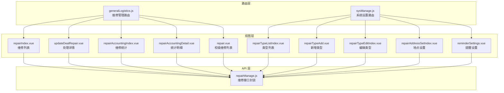
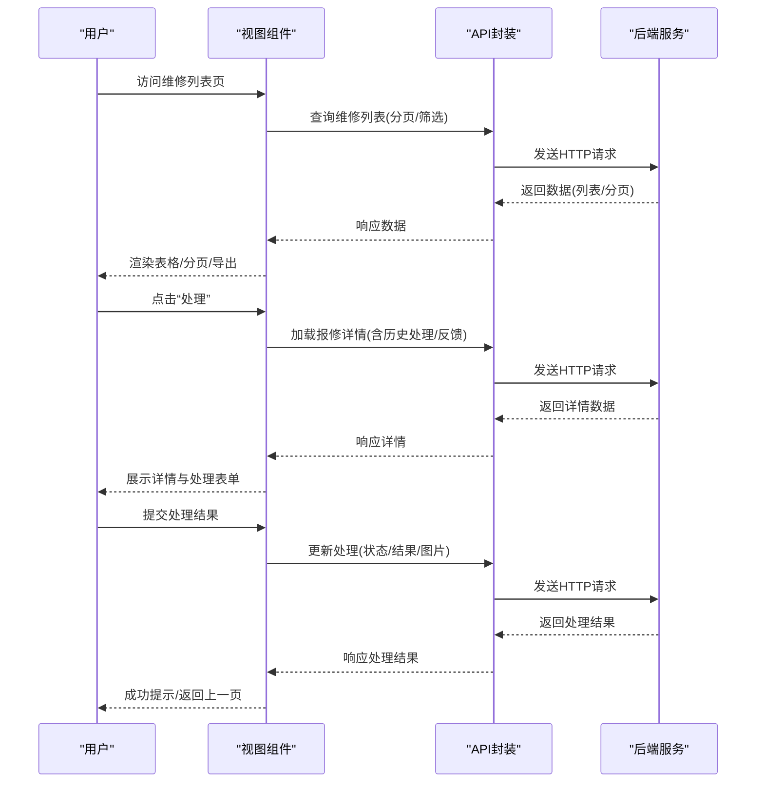
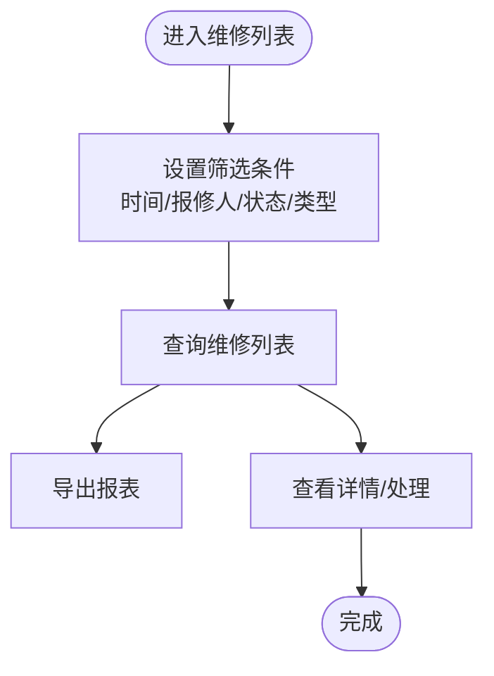
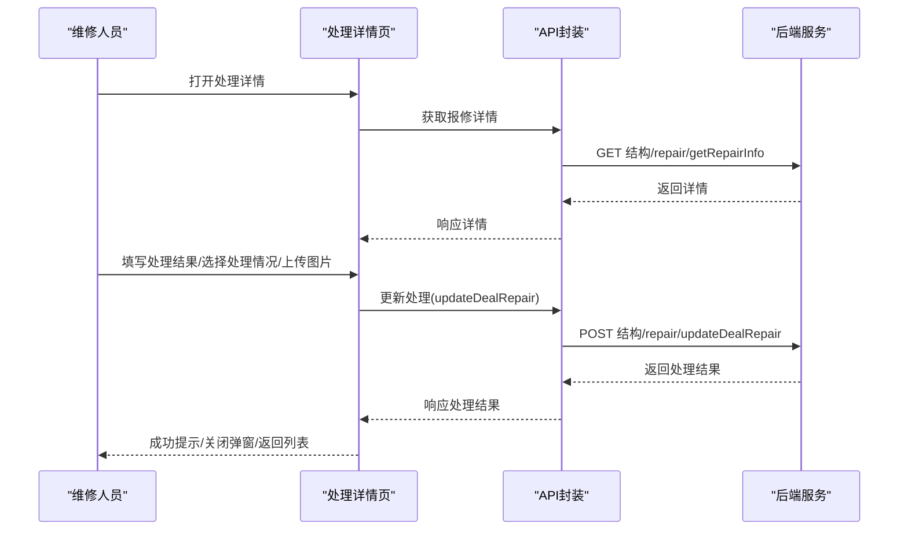
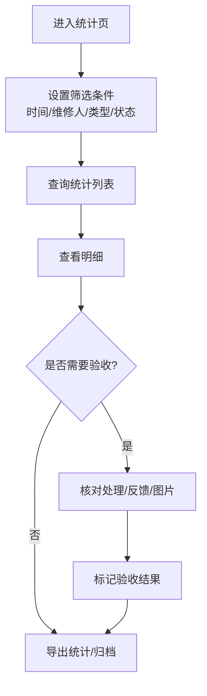
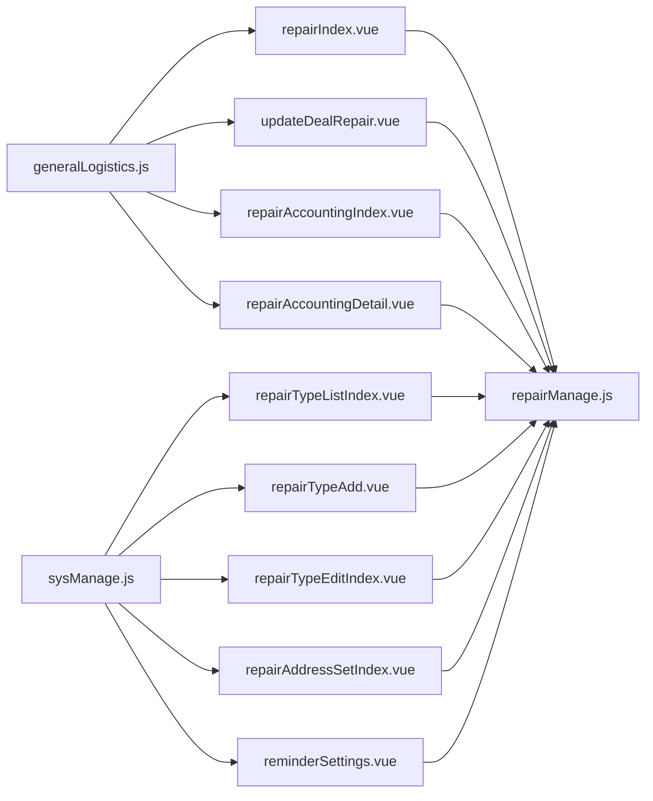

# 设备维修管理

<cite>
**本文引用的文件**
- [repairManage.js](file://src/api/repairManage.js)
- [repair.vue](file://src/views/schoolManage/repair/repair.vue)
- [repairIndex.vue](file://src/views/repairManage/repairIndex.vue)
- [updateDealRepair.vue](file://src/views/repairManage/updateDealRepair.vue)
- [repairAccountingIndex.vue](file://src/views/repairManage/repairAccountingIndex.vue)
- [repairAccountingDetail.vue](file://src/views/repairManage/repairAccountingDetail.vue)
- [repairTypeListIndex.vue](file://src/views/sysSet/repairSet/repairTypeListIndex.vue)
- [repairTypeAdd.vue](file://src/views/sysSet/repairSet/repairTypeAdd.vue)
- [repairTypeEditIndex.vue](file://src/views/sysSet/repairSet/repairTypeEditIndex.vue)
- [repairAddressSetIndex.vue](file://src/views/sysSet/repairAddressSet/repairAddressSetIndex.vue)
- [reminderSettings.vue](file://src/views/sysSet/repairSet/reminderSettings.vue)
- [generalLogistics.js](file://src/router/normal/generalLogistics.js)
- [sysManage.js](file://src/router/system/sysManage.js)
</cite>

## 目录
1. [简介](#简介)
2. [项目结构](#项目结构)
3. [核心组件](#核心组件)
4. [架构总览](#架构总览)
5. [详细组件分析](#详细组件分析)
6. [依赖关系分析](#依赖关系分析)
7. [性能考虑](#性能考虑)
8. [故障排查指南](#故障排查指南)
9. [结论](#结论)
10. [附录](#附录)

## 简介
本文件面向“设备维修管理”业务，系统性梳理从设备故障报修到维修完成的全流程，覆盖维修申请、工单创建、维修处理、进度跟踪、质量验收、费用结算、统计分析与效果评估等环节，并对维修人员、维修材料、维修记录的维护机制进行文档化。同时提供操作指南与流程控制、质量保证措施，帮助非技术用户理解并正确使用系统。

## 项目结构
维修管理功能由“前端视图层 + API 接口层 + 路由配置”构成，主要分布在以下模块：
- 视图层：维修管理主界面、处理详情、统计报表、系统设置（类型、地点、提醒）
- API 层：统一封装维修相关的 HTTP 请求方法
- 路由层：定义各页面访问路径与懒加载策略

图表来源
- [generalLogistics.js:190-215](file://src/router/normal/generalLogistics.js#L190-L215)
- [sysManage.js:150-174](file://src/router/system/sysManage.js#L150-L174)
- [repairIndex.vue:1-307](file://src/views/repairManage/repairIndex.vue#L1-L307)
- [updateDealRepair.vue:1-542](file://src/views/repairManage/updateDealRepair.vue#L1-L542)
- [repairAccountingIndex.vue:1-357](file://src/views/repairManage/repairAccountingIndex.vue#L1-L357)
- [repairAccountingDetail.vue:1-272](file://src/views/repairManage/repairAccountingDetail.vue#L1-L272)
- [repairTypeListIndex.vue:1-345](file://src/views/sysSet/repairSet/repairTypeListIndex.vue#L1-L345)
- [repairTypeAdd.vue:1-318](file://src/views/sysSet/repairSet/repairTypeAdd.vue#L1-L318)
- [repairTypeEditIndex.vue:1-381](file://src/views/sysSet/repairSet/repairTypeEditIndex.vue#L1-L381)
- [repairAddressSetIndex.vue:1-598](file://src/views/sysSet/repairAddressSet/repairAddressSetIndex.vue#L1-L598)
- [reminderSettings.vue:1-125](file://src/views/sysSet/repairSet/reminderSettings.vue#L1-L125)
- [repair.vue:1-175](file://src/views/schoolManage/repair/repair.vue#L1-L175)
- [repairManage.js:1-464](file://src/api/repairManage.js#L1-L464)

章节来源
- [repairIndex.vue:1-307](file://src/views/repairManage/repairIndex.vue#L1-L307)
- [repairManage.js:1-464](file://src/api/repairManage.js#L1-L464)
- [generalLogistics.js:190-215](file://src/router/normal/generalLogistics.js#L190-L215)
- [sysManage.js:150-174](file://src/router/system/sysManage.js#L150-L174)

## 核心组件
- 维修列表与筛选：支持按时间范围、报修人、状态、类型筛选，分页加载，导出报表
- 维修处理详情：查看报修内容、图片、历史处理与反馈，填写处理结果与图片
- 维修统计与明细：按时间段、维修人、类型、状态统计，导出报表
- 报修类型管理：新增/编辑/删除类型，设置负责人、是否反馈、排序
- 报修地点管理：树形结构维护地点，支持新增/编辑/批量删除
- 提醒设置：开关每日早间提醒报修负责人
- 校级维修列表：基础导出能力

章节来源
- [repairIndex.vue:1-307](file://src/views/repairManage/repairIndex.vue#L1-L307)
- [updateDealRepair.vue:1-542](file://src/views/repairManage/updateDealRepair.vue#L1-L542)
- [repairAccountingIndex.vue:1-357](file://src/views/repairManage/repairAccountingIndex.vue#L1-L357)
- [repairAccountingDetail.vue:1-272](file://src/views/repairManage/repairAccountingDetail.vue#L1-L272)
- [repairTypeListIndex.vue:1-345](file://src/views/sysSet/repairSet/repairTypeListIndex.vue#L1-L345)
- [repairTypeAdd.vue:1-318](file://src/views/sysSet/repairSet/repairTypeAdd.vue#L1-L318)
- [repairTypeEditIndex.vue:1-381](file://src/views/sysSet/repairSet/repairTypeEditIndex.vue#L1-L381)
- [repairAddressSetIndex.vue:1-598](file://src/views/sysSet/repairAddressSet/repairAddressSetIndex.vue#L1-L598)
- [reminderSettings.vue:1-125](file://src/views/sysSet/repairSet/reminderSettings.vue#L1-L125)
- [repair.vue:1-175](file://src/views/schoolManage/repair/repair.vue#L1-L175)

## 架构总览
系统采用前后端分离模式，前端通过统一 API 封装调用后端接口，路由负责页面导航与懒加载，视图层负责数据展示与交互。

图表来源
- [repairIndex.vue:184-287](file://src/views/repairManage/repairIndex.vue#L184-L287)
- [updateDealRepair.vue:271-342](file://src/views/repairManage/updateDealRepair.vue#L271-L342)
- [repairManage.js:19-152](file://src/api/repairManage.js#L19-L152)

## 详细组件分析

### 维修申请与工单创建
- 用户在维修列表页可查看报修内容、地点、类型、状态、时间等信息；支持按时间范围、报修人姓名、状态、类型筛选。
- 列表支持导出，便于离线分析与归档。
- 工单创建由后端根据报修信息自动生成，前端通过列表与详情页驱动流转。

图表来源
- [repairIndex.vue:1-307](file://src/views/repairManage/repairIndex.vue#L1-L307)

章节来源
- [repairIndex.vue:1-307](file://src/views/repairManage/repairIndex.vue#L1-L307)

### 维修处理与任务分配
- 维修处理详情页展示报修内容、图片、历史处理与反馈记录。
- 当前登录用户可对“待处理”的工单提交处理结果、选择处理情况字典项、上传处理图片。
- 处理完成后，状态更新为“已处理”，后续可继续反馈“已完成”。

图表来源
- [updateDealRepair.vue:261-342](file://src/views/repairManage/updateDealRepair.vue#L261-L342)
- [repairManage.js:137-152](file://src/api/repairManage.js#L137-L152)

章节来源
- [updateDealRepair.vue:1-542](file://src/views/repairManage/updateDealRepair.vue#L1-L542)
- [repairManage.js:116-152](file://src/api/repairManage.js#L116-L152)

### 维修进度跟踪与质量验收
- 统计页面支持按时间段、维修人、类型、状态筛选，查看维修次数等指标。
- 明细页展示处理结果、反馈内容、图片与时间戳，便于质量验收与追溯。
- 反馈内容支持“未解决/已解决”状态标记，形成闭环验收。

图表来源
- [repairAccountingIndex.vue:1-357](file://src/views/repairManage/repairAccountingIndex.vue#L1-L357)
- [repairAccountingDetail.vue:1-272](file://src/views/repairManage/repairAccountingDetail.vue#L1-L272)

章节来源
- [repairAccountingIndex.vue:1-357](file://src/views/repairManage/repairAccountingIndex.vue#L1-L357)
- [repairAccountingDetail.vue:1-272](file://src/views/repairManage/repairAccountingDetail.vue#L1-L272)

### 维修费用结算与统计分析
- 系统提供导出能力，支持将维修列表与统计结果导出为 Excel，便于财务结算与数据分析。
- 统计维度包括报修人、报修时间、报修内容、地点、类型、状态、维修人、维修次数等。

章节来源
- [repairIndex.vue:193-195](file://src/views/repairManage/repairIndex.vue#L193-L195)
- [repairAccountingIndex.vue:298-300](file://src/views/repairManage/repairAccountingIndex.vue#L298-L300)

### 维修人员管理与提醒机制
- 报修类型设置中可为“报修/资产”类型分别配置负责人（来自地址簿），并设置“是否需要反馈”与排序。
- 提醒设置支持开启每日早间提醒报修负责人，提升响应效率。

章节来源
- [repairTypeAdd.vue:1-318](file://src/views/sysSet/repairSet/repairTypeAdd.vue#L1-L318)
- [repairTypeEditIndex.vue:1-381](file://src/views/sysSet/repairSet/repairTypeEditIndex.vue#L1-L381)
- [reminderSettings.vue:1-125](file://src/views/sysSet/repairSet/reminderSettings.vue#L1-L125)

### 维修材料管理与记录维护
- 系统提供报修类型与地点的维护入口，便于规范材料分类与维修区域划分。
- 处理与反馈过程中的图片与文字记录，形成完整的维修档案，支持导出与查阅。

章节来源
- [repairTypeListIndex.vue:1-345](file://src/views/sysSet/repairSet/repairTypeListIndex.vue#L1-L345)
- [repairAddressSetIndex.vue:1-598](file://src/views/sysSet/repairAddressSet/repairAddressSetIndex.vue#L1-L598)
- [updateDealRepair.vue:1-542](file://src/views/repairManage/updateDealRepair.vue#L1-L542)

### 操作指南
- 设备报修
  - 在维修列表页设置筛选条件，查看待处理工单；点击“处理”进入详情页，填写处理结果与上传图片后提交。
- 工单派发
  - 在“报修类型”中为不同类型配置负责人，确保工单自动流转至对应维修人员。
- 维修处理
  - 维修人员在详情页完成处理，选择处理情况字典项，上传处理图片，提交后状态更新为“已处理”。
- 维修验收
  - 在统计明细中核对处理/反馈/图片，标记验收结果，形成闭环。

章节来源
- [repairIndex.vue:68-78](file://src/views/repairManage/repairIndex.vue#L68-L78)
- [updateDealRepair.vue:142-197](file://src/views/repairManage/updateDealRepair.vue#L142-L197)
- [repairAccountingDetail.vue:1-272](file://src/views/repairManage/repairAccountingDetail.vue#L1-L272)

## 依赖关系分析
- 路由到视图：通过路由配置将页面路径映射到具体组件，实现按需加载与导航。
- 视图到 API：各视图通过统一 API 封装调用后端接口，避免重复请求逻辑。
- API 到后端：API 封装统一使用 fetch，集中处理参数拼装与响应解析。

图表来源
- [generalLogistics.js:190-215](file://src/router/normal/generalLogistics.js#L190-L215)
- [sysManage.js:150-174](file://src/router/system/sysManage.js#L150-L174)
- [repairManage.js:1-464](file://src/api/repairManage.js#L1-L464)

章节来源
- [generalLogistics.js:190-215](file://src/router/normal/generalLogistics.js#L190-L215)
- [sysManage.js:150-174](file://src/router/system/sysManage.js#L150-L174)
- [repairManage.js:1-464](file://src/api/repairManage.js#L1-L464)

## 性能考虑
- 列表查询使用分页与防抖输入，降低频繁请求带来的压力。
- 图片上传采用分步提交与预览，减少一次性大体积传输。
- 导出功能支持按筛选条件生成报表，避免全量导出造成内存压力。

## 故障排查指南
- 列表无数据
  - 检查筛选条件是否过严（时间范围/状态/类型），适当放宽条件重试。
  - 确认网络连接正常，查看浏览器开发者工具 Network 面板是否有错误请求。
- 处理提交失败
  - 确认必填字段（处理情况/处理结果）已填写，图片格式与大小符合要求。
  - 查看后端返回的错误码与消息，按提示修正后重试。
- 统计导出异常
  - 确认筛选条件已生效，导出链接包含必要参数（如起止时间、类型、状态等）。
  - 若数据量过大，建议缩小时间范围或分批导出。

章节来源
- [repairIndex.vue:227-243](file://src/views/repairManage/repairIndex.vue#L227-L243)
- [updateDealRepair.vue:326-342](file://src/views/repairManage/updateDealRepair.vue#L326-L342)
- [repairAccountingIndex.vue:298-300](file://src/views/repairManage/repairAccountingIndex.vue#L298-L300)

## 结论
本系统围绕“设备维修管理”构建了从报修、处理、统计到验收的完整闭环，配合类型与地点的精细化配置、提醒机制与导出能力，满足日常运维与管理需求。通过清晰的流程控制与质量保证措施，可有效提升维修响应效率与服务质量。

## 附录
- 相关接口一览（节选）
  - 获取维修列表：结构/repair/getManagerRepairList
  - 获取维修详情：结构/repair/getRepairInfo
  - 更新处理：结构/repair/updateDealRepair
  - 报修类型列表：结构/repair/getRepairTypeList
  - 新增/编辑/删除报修类型：结构/repair/addRepairType、updateRepairType、delRepairTypeList
  - 地点树与列表：结构/repair/findRepairPlaceTreeList、findRepairPlaceListByModel
  - 统计导出：结构/repair/exportRepair、exportRepairListAll

章节来源
- [repairManage.js:19-464](file://src/api/repairManage.js#L19-L464)