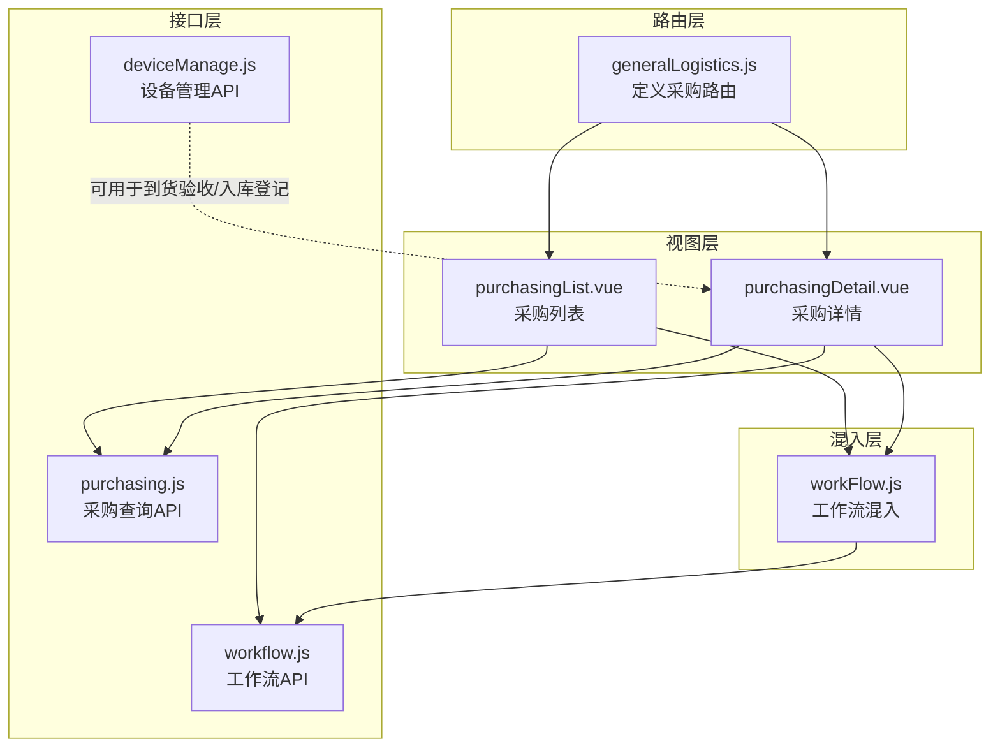
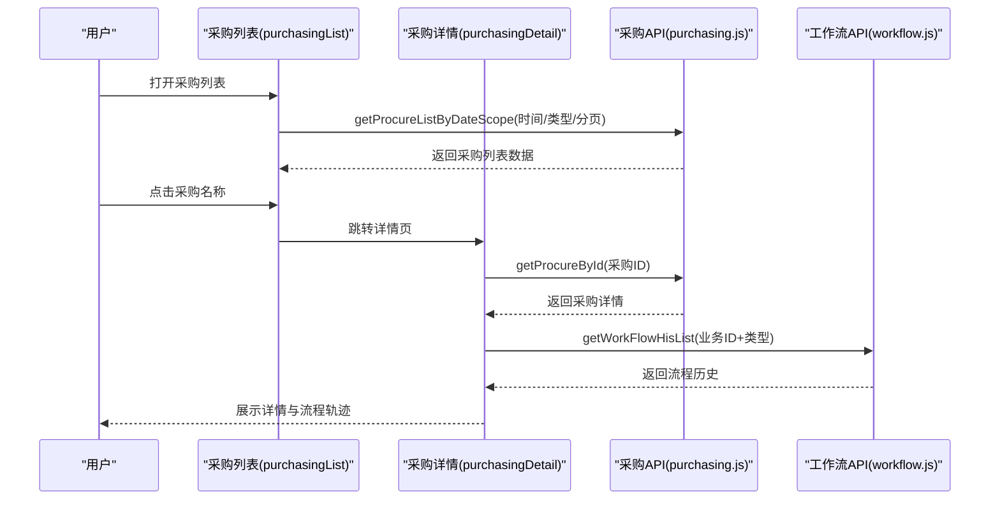
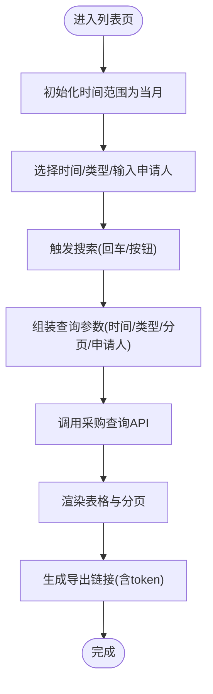
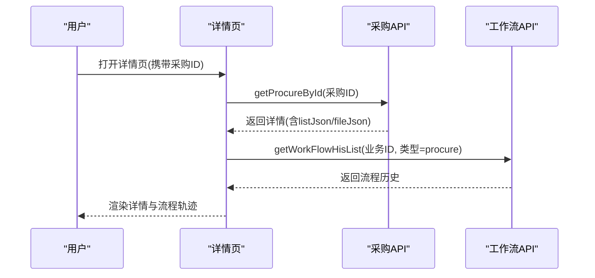
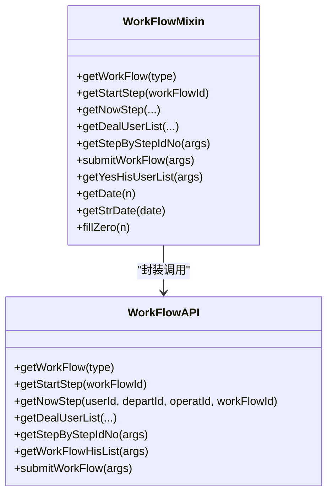
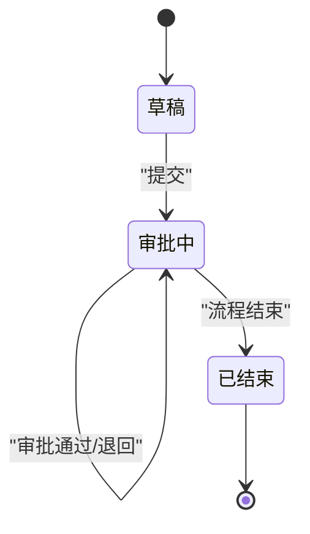
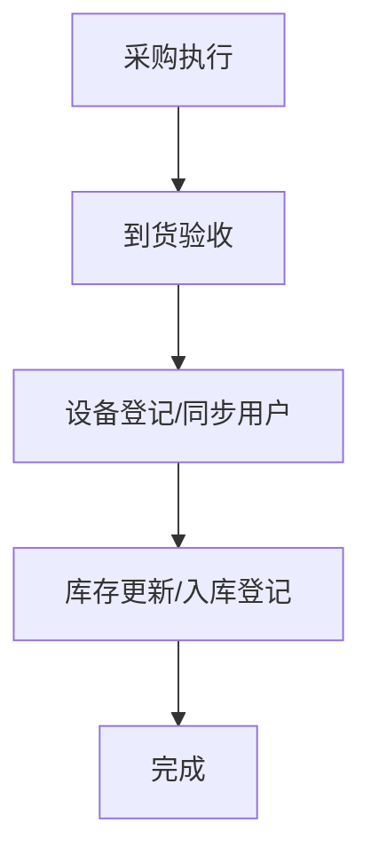
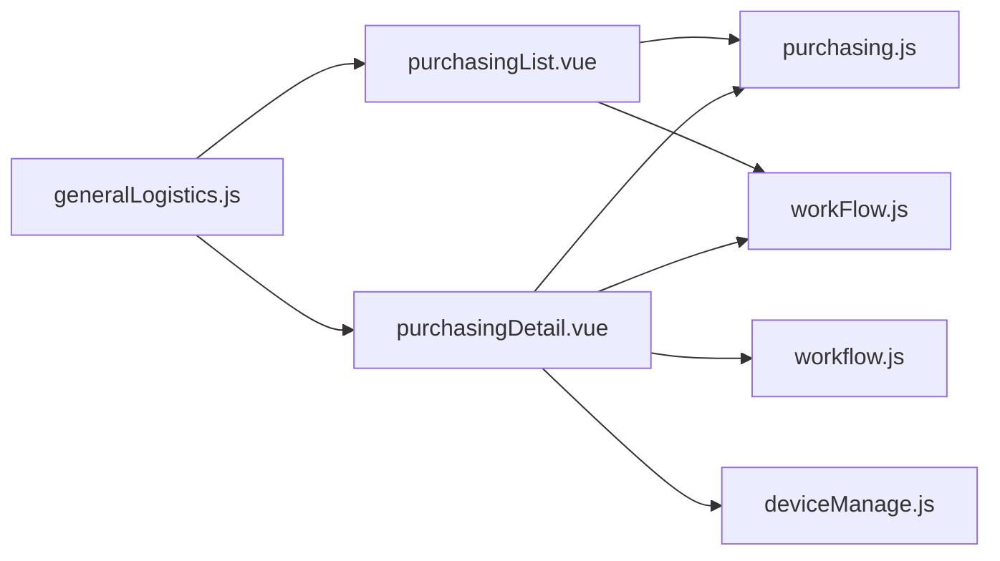

# 设备采购管理

<cite>
**本文引用的文件**
- [src/api/purchasing.js](file://src/api/purchasing.js)
- [src/views/purchasing/purchasingList.vue](file://src/views/purchasing/purchasingList.vue)
- [src/views/purchasing/purchasingDetail.vue](file://src/views/purchasing/purchasingDetail.vue)
- [src/router/normal/generalLogistics.js](file://src/router/normal/generalLogistics.js)
- [src/api/workflow.js](file://src/api/workflow.js)
- [src/mixins/workFlow.js](file://src/mixins/workFlow.js)
- [src/api/systemSet/deviceManage.js](file://src/api/systemSet/deviceManage.js)
</cite>

## 目录
1. [简介](#简介)
2. [项目结构](#项目结构)
3. [核心组件](#核心组件)
4. [架构总览](#架构总览)
5. [详细组件分析](#详细组件分析)
6. [依赖关系分析](#依赖关系分析)
7. [性能考量](#性能考量)
8. [故障排查指南](#故障排查指南)
9. [结论](#结论)
10. [附录](#附录)

## 简介
本文件面向“设备采购管理”业务场景，基于现有前端代码实现，系统性梳理并文档化以下能力与流程：
- 采购申请与审批流程：包括申请、审批、流转与归档
- 采购执行与到货验收：结合工作流接口完成节点推进与记录展示
- 采购物品分类管理：通过字典树级联选择采购类型
- 供应商与合同管理：当前仓库未发现供应商/合同专用模块，建议在后端扩展或复用通用字典体系
- 预算控制与订单管理：当前仓库未发现预算/订单专用模块，建议在后端扩展或复用通用预算/订单体系
- 价格管理、统计分析与供应商评估：当前仓库未发现对应模块，建议在后端扩展或复用通用统计/评估体系
- 操作指南：采购申请填写、审批流转、采购执行与入库登记
- 权限控制与数据安全：基于路由与工作流接口的访问控制与数据脱敏

## 项目结构
围绕“设备采购管理”的前端实现，主要涉及以下模块：
- 路由层：定义采购申请列表与详情页面的访问路径
- 视图层：采购列表与详情页面，负责数据展示与交互
- 接口层：采购查询、工作流查询与提交等API封装
- 工作流混入：封装工作流相关方法，供视图使用
- 设备管理接口：提供设备库、设备用户等能力，可作为后续“到货验收/入库登记”的基础能力

图表来源
- [src/router/normal/generalLogistics.js:484-496](file://src/router/normal/generalLogistics.js#L484-L496)
- [src/views/purchasing/purchasingList.vue:1-206](file://src/views/purchasing/purchasingList.vue#L1-L206)
- [src/views/purchasing/purchasingDetail.vue:1-456](file://src/views/purchasing/purchasingDetail.vue#L1-L456)
- [src/api/purchasing.js:1-31](file://src/api/purchasing.js#L1-L31)
- [src/api/workflow.js:1-150](file://src/api/workflow.js#L1-L150)
- [src/mixins/workFlow.js:1-103](file://src/mixins/workFlow.js#L1-L103)
- [src/api/systemSet/deviceManage.js:1-189](file://src/api/systemSet/deviceManage.js#L1-L189)

章节来源
- [src/router/normal/generalLogistics.js:484-496](file://src/router/normal/generalLogistics.js#L484-L496)
- [src/views/purchasing/purchasingList.vue:1-206](file://src/views/purchasing/purchasingList.vue#L1-L206)
- [src/views/purchasing/purchasingDetail.vue:1-456](file://src/views/purchasing/purchasingDetail.vue#L1-L456)
- [src/api/purchasing.js:1-31](file://src/api/purchasing.js#L1-L31)
- [src/api/workflow.js:1-150](file://src/api/workflow.js#L1-L150)
- [src/mixins/workFlow.js:1-103](file://src/mixins/workFlow.js#L1-L103)
- [src/api/systemSet/deviceManage.js:1-189](file://src/api/systemSet/deviceManage.js#L1-L189)

## 核心组件
- 采购列表视图：支持按时间范围、采购类型、申请人姓名筛选；支持分页与导出；点击名称跳转详情
- 采购详情视图：展示申请基本信息、采购清单、附件图片与工作流步骤轨迹
- 采购查询API：按时间范围与类型查询采购列表；按ID查询采购详情
- 工作流API：获取流程、历史记录、当前环节、下一环节、处理人列表与提交流程
- 工作流混入：封装工作流常用方法，供视图复用
- 设备管理API：提供设备库、设备用户等能力，可用于后续到货验收/入库登记

章节来源
- [src/views/purchasing/purchasingList.vue:1-206](file://src/views/purchasing/purchasingList.vue#L1-L206)
- [src/views/purchasing/purchasingDetail.vue:1-456](file://src/views/purchasing/purchasingDetail.vue#L1-L456)
- [src/api/purchasing.js:1-31](file://src/api/purchasing.js#L1-L31)
- [src/api/workflow.js:1-150](file://src/api/workflow.js#L1-L150)
- [src/mixins/workFlow.js:1-103](file://src/mixins/workFlow.js#L1-L103)
- [src/api/systemSet/deviceManage.js:1-189](file://src/api/systemSet/deviceManage.js#L1-L189)

## 架构总览
采购管理从前端到后端的关键交互如下：
- 列表页通过采购查询API拉取数据，支持筛选与分页
- 详情页通过采购查询API与工作流历史API分别获取主数据与流程轨迹
- 工作流混入封装了流程查询与提交方法，便于在业务中复用
- 到货验收/入库登记可基于设备管理API进行扩展

图表来源
- [src/views/purchasing/purchasingList.vue:172-187](file://src/views/purchasing/purchasingList.vue#L172-L187)
- [src/views/purchasing/purchasingDetail.vue:154-172](file://src/views/purchasing/purchasingDetail.vue#L154-L172)
- [src/api/purchasing.js:4-30](file://src/api/purchasing.js#L4-L30)
- [src/api/workflow.js:20-30](file://src/api/workflow.js#L20-L30)

## 详细组件分析

### 采购列表组件分析
- 功能要点
  - 时间范围筛选：默认当月，支持选择起止日期
  - 采购类型筛选：采用字典树级联加载，支持懒加载子级
  - 申请人姓名筛选：支持回车与按钮触发
  - 分页与导出：支持切换每页条数与跳转页码；导出URL拼接token
  - 数据展示：包含采购名称、申请人、申请部门、采购类型、申请时间、当前环节、总价
- 关键实现
  - 使用字典懒加载构建级联选项
  - 通过采购查询API按条件分页获取数据
  - 导出链接动态拼接token，确保鉴权

图表来源
- [src/views/purchasing/purchasingList.vue:86-189](file://src/views/purchasing/purchasingList.vue#L86-L189)

章节来源
- [src/views/purchasing/purchasingList.vue:1-206](file://src/views/purchasing/purchasingList.vue#L1-L206)

### 采购详情组件分析
- 功能要点
  - 申请信息展示：采购名称、申请人、申请部门、采购类型、申请时间
  - 采购清单展示：品名、单价、数量、总价，并显示用途
  - 附件图片展示：支持预览
  - 流程轨迹展示：垂直步骤条，显示各环节处理人、时间与图片
  - 打印功能：支持打印当前详情内容
- 关键实现
  - 通过采购查询API按ID获取详情，并解析listJson与fileJson
  - 通过工作流历史API获取流程历史并渲染
  - 使用过滤器对时间字段进行格式化

图表来源
- [src/views/purchasing/purchasingDetail.vue:132-172](file://src/views/purchasing/purchasingDetail.vue#L132-L172)
- [src/api/purchasing.js:21-30](file://src/api/purchasing.js#L21-L30)
- [src/api/workflow.js:20-30](file://src/api/workflow.js#L20-L30)

章节来源
- [src/views/purchasing/purchasingDetail.vue:1-456](file://src/views/purchasing/purchasingDetail.vue#L1-L456)

### 工作流接口与混入分析
- 工作流API
  - 获取流程、开始环节、当前环节、下一环节、处理人列表、历史记录、提交流程
- 工作流混入
  - 封装上述API为Promise形式，统一错误处理，提供日期工具方法
- 在采购详情中的应用
  - 通过历史记录API渲染流程轨迹
  - 可在后续扩展中用于审批操作（如提交流程）

图表来源
- [src/api/workflow.js:1-150](file://src/api/workflow.js#L1-L150)
- [src/mixins/workFlow.js:1-103](file://src/mixins/workFlow.js#L1-L103)

章节来源
- [src/api/workflow.js:1-150](file://src/api/workflow.js#L1-L150)
- [src/mixins/workFlow.js:1-103](file://src/mixins/workFlow.js#L1-L103)

### 采购申请流程（申请-审批-归档）
- 申请阶段
  - 填写采购申请（名称、部门、类型、清单、用途、附件），保存为草稿或提交
- 审批阶段
  - 依据工作流配置自动流转至下一环节，审批人可在流程历史中查看与处理
- 归档阶段
  - 流程结束后，状态更新为结束，可在详情页查看完整轨迹

图表来源
- [src/views/purchasing/purchasingDetail.vue:80-118](file://src/views/purchasing/purchasingDetail.vue#L80-L118)
- [src/api/workflow.js:20-30](file://src/api/workflow.js#L20-L30)

章节来源
- [src/views/purchasing/purchasingDetail.vue:1-456](file://src/views/purchasing/purchasingDetail.vue#L1-L456)
- [src/api/workflow.js:1-150](file://src/api/workflow.js#L1-L150)

### 采购执行与到货验收（扩展建议）
- 当前现状
  - 采购详情页已具备流程轨迹展示能力
  - 设备管理API提供设备库与设备用户能力，可作为到货验收/入库登记的基础
- 建议扩展
  - 在后端增加“到货验收/入库登记”流程节点，对接设备管理API完成设备登记与用户同步
  - 在前端新增“到货验收”页面，展示待验收设备清单与验收结果

图表来源
- [src/api/systemSet/deviceManage.js:162-188](file://src/api/systemSet/deviceManage.js#L162-L188)

章节来源
- [src/api/systemSet/deviceManage.js:1-189](file://src/api/systemSet/deviceManage.js#L1-L189)

### 采购物品分类管理
- 实现方式
  - 采购类型采用字典树级联选择，懒加载子级
  - 一级类型来源于“caigoudan”字典编码，二级及以下按父级编码动态加载
- 使用建议
  - 在后端完善字典项，确保类型层级清晰，便于统计与分析

章节来源
- [src/views/purchasing/purchasingList.vue:96-127](file://src/views/purchasing/purchasingList.vue#L96-L127)

### 供应商信息维护与采购合同管理
- 现状
  - 仓库未发现供应商与合同专用模块
- 建议
  - 在后端扩展供应商与合同管理接口，前端以通用字典或独立模块接入
  - 与采购申请关联供应商与合同编号，便于追溯与审计

[本节为概念性建议，不直接分析具体文件]

### 采购预算控制、采购订单管理与价格管理
- 现状
  - 仓库未发现预算、订单与价格管理专用模块
- 建议
  - 在后端扩展预算与订单接口，前端以独立模块或弹窗形式接入
  - 价格管理可与设备库联动，实现单价与总价计算

[本节为概念性建议，不直接分析具体文件]

### 采购统计分析与供应商评估
- 现状
  - 仓库未发现统计分析与供应商评估模块
- 建议
  - 在后端扩展统计与评估接口，前端以图表或报表形式呈现
  - 结合字典与流程数据，形成多维度分析

[本节为概念性建议，不直接分析具体文件]

### 操作指南
- 采购申请填写
  - 在采购列表页点击“新增”或从其他入口进入申请页面，填写基本信息与采购清单，保存为草稿或提交
- 审批流转
  - 审批人登录系统，在流程历史中查看并处理当前环节
- 采购执行与入库登记
  - 采购完成后，依据建议扩展“到货验收/入库登记”流程，完成设备登记与库存更新
- 查看与导出
  - 在列表页按需筛选与导出，详情页支持打印

章节来源
- [src/views/purchasing/purchasingList.vue:1-206](file://src/views/purchasing/purchasingList.vue#L1-L206)
- [src/views/purchasing/purchasingDetail.vue:1-456](file://src/views/purchasing/purchasingDetail.vue#L1-L456)

### 权限控制与数据安全
- 路由级缓存与访问
  - 采购列表路由开启页面缓存，减少重复请求
- 工作流接口鉴权
  - 工作流相关接口均通过统一fetch封装，建议后端配合Token校验
- 导出安全
  - 导出链接拼接token，避免未授权下载

章节来源
- [src/router/normal/generalLogistics.js:488-490](file://src/router/normal/generalLogistics.js#L488-L490)
- [src/views/purchasing/purchasingList.vue:132-134](file://src/views/purchasing/purchasingList.vue#L132-L134)
- [src/api/workflow.js:1-150](file://src/api/workflow.js#L1-L150)

## 依赖关系分析
- 路由依赖
  - generalLogistics.js定义了采购列表与详情的路由入口
- 视图依赖
  - 列表与详情均依赖采购查询API与工作流API
- 混入依赖
  - 工作流混入封装工作流相关方法，供视图复用
- 设备管理依赖
  - 设备管理API可作为到货验收/入库登记的基础能力

图表来源
- [src/router/normal/generalLogistics.js:484-496](file://src/router/normal/generalLogistics.js#L484-L496)
- [src/views/purchasing/purchasingList.vue:1-206](file://src/views/purchasing/purchasingList.vue#L1-L206)
- [src/views/purchasing/purchasingDetail.vue:1-456](file://src/views/purchasing/purchasingDetail.vue#L1-L456)
- [src/api/purchasing.js:1-31](file://src/api/purchasing.js#L1-L31)
- [src/api/workflow.js:1-150](file://src/api/workflow.js#L1-L150)
- [src/mixins/workFlow.js:1-103](file://src/mixins/workFlow.js#L1-L103)
- [src/api/systemSet/deviceManage.js:1-189](file://src/api/systemSet/deviceManage.js#L1-L189)

章节来源
- [src/router/normal/generalLogistics.js:484-496](file://src/router/normal/generalLogistics.js#L484-L496)
- [src/views/purchasing/purchasingList.vue:1-206](file://src/views/purchasing/purchasingList.vue#L1-L206)
- [src/views/purchasing/purchasingDetail.vue:1-456](file://src/views/purchasing/purchasingDetail.vue#L1-L456)
- [src/api/purchasing.js:1-31](file://src/api/purchasing.js#L1-L31)
- [src/api/workflow.js:1-150](file://src/api/workflow.js#L1-L150)
- [src/mixins/workFlow.js:1-103](file://src/mixins/workFlow.js#L1-L103)
- [src/api/systemSet/deviceManage.js:1-189](file://src/api/systemSet/deviceManage.js#L1-L189)

## 性能考量
- 列表分页与筛选
  - 使用分页参数控制数据量，避免一次性加载过多
  - 字典懒加载减少初始请求体积
- 导出优化
  - 导出链接拼接token，避免重复鉴权开销
- 流程轨迹渲染
  - 仅在详情页渲染流程历史，避免列表页额外渲染

[本节提供一般性指导，不直接分析具体文件]

## 故障排查指南
- 列表无数据
  - 检查时间范围与类型筛选是否正确；确认网络请求返回状态
- 详情空白
  - 检查ID参数是否传递；确认listJson/fileJson解析逻辑
- 流程历史为空
  - 检查业务ID与类型参数；确认后端工作流历史是否存在
- 导出失败
  - 检查token是否有效；确认后端导出接口可用

章节来源
- [src/views/purchasing/purchasingList.vue:172-187](file://src/views/purchasing/purchasingList.vue#L172-L187)
- [src/views/purchasing/purchasingDetail.vue:154-172](file://src/views/purchasing/purchasingDetail.vue#L154-L172)
- [src/api/workflow.js:20-30](file://src/api/workflow.js#L20-L30)

## 结论
当前仓库已实现“采购申请与审批”的前端能力，涵盖列表筛选、详情展示与流程轨迹可视化。建议在后端扩展“到货验收/入库登记”、“供应商与合同管理”、“预算与订单管理”、“统计分析与供应商评估”等模块，并与现有工作流与设备管理能力打通，形成完整的设备采购闭环。

[本节为总结性内容，不直接分析具体文件]

## 附录
- 路由配置参考：generalLogistics.js中定义了采购相关路由
- API参考：purchasing.js、workflow.js、deviceManage.js
- 视图参考：purchasingList.vue、purchasingDetail.vue

章节来源
- [src/router/normal/generalLogistics.js:484-496](file://src/router/normal/generalLogistics.js#L484-L496)
- [src/api/purchasing.js:1-31](file://src/api/purchasing.js#L1-L31)
- [src/api/workflow.js:1-150](file://src/api/workflow.js#L1-L150)
- [src/api/systemSet/deviceManage.js:1-189](file://src/api/systemSet/deviceManage.js#L1-L189)
- [src/views/purchasing/purchasingList.vue:1-206](file://src/views/purchasing/purchasingList.vue#L1-L206)
- [src/views/purchasing/purchasingDetail.vue:1-456](file://src/views/purchasing/purchasingDetail.vue#L1-L456)