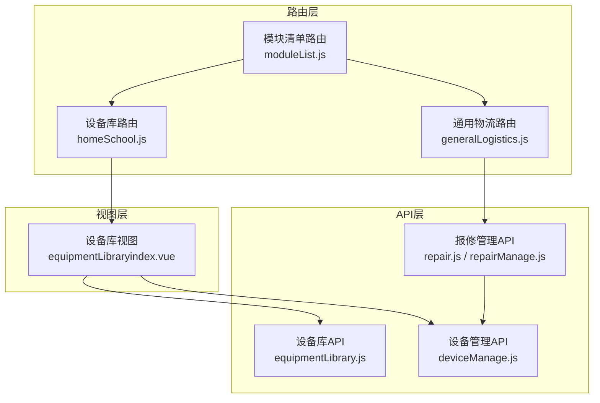
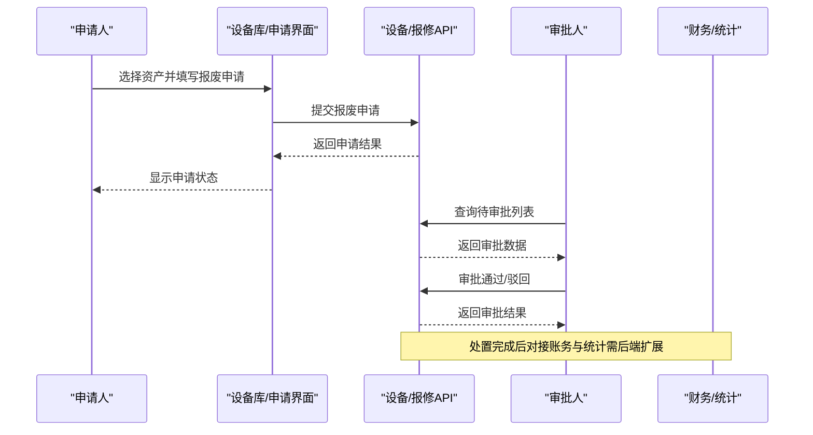
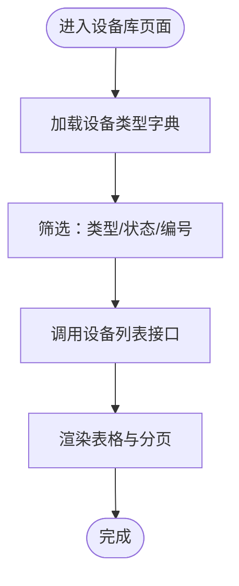
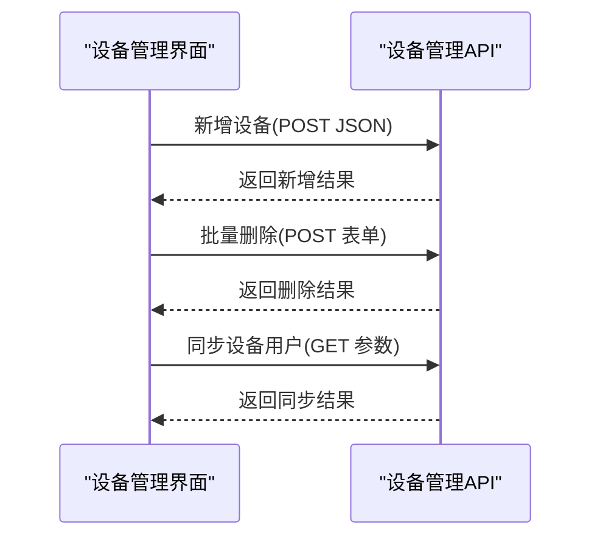
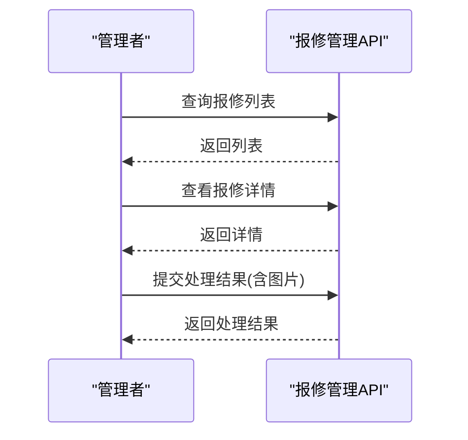
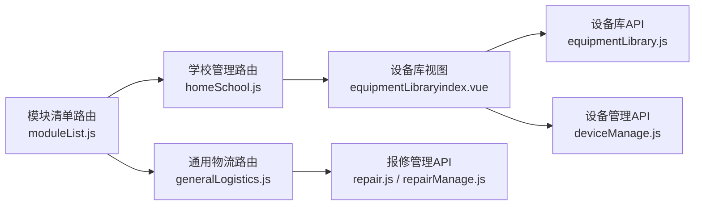

# 资产处置管理

<cite>
**本文引用的文件**
- [设备管理API（deviceManage.js）](file://src/api/systemSet/deviceManage.js)
- [设备库API（equipmentLibrary.js）](file://src/api/equipmentLibrary.js)
- [设备库路由（homeSchool.js）](file://src/router/normals/homeSchool.js)
- [设备库视图（equipmentLibraryindex.vue）](file://src/views/equipmentLibrary/equipmentLibraryindex.vue)
- [通用路由模块清单（moduleList.js）](file://src/router/moduleList.js)
- [通用物流路由（generalLogistics.js）](file://src/router/normals/generalLogistics.js)
- [报修管理API（repair.js）](file://src/api/schoolManage/repair.js)
- [报修管理API（repairManage.js）](file://src/api/repairManage.js)
</cite>

## 目录
1. [简介](#简介)
2. [项目结构](#项目结构)
3. [核心组件](#核心组件)
4. [架构总览](#架构总览)
5. [详细组件分析](#详细组件分析)
6. [依赖关系分析](#依赖关系分析)
7. [性能考虑](#性能考虑)
8. [故障排查指南](#故障排查指南)
9. [结论](#结论)
10. [附录](#附录)

## 简介
本文件面向“资产处置管理”功能，基于现有代码库中与“设备管理/设备库/报修管理”相关的实现进行业务文档化梳理。当前仓库中未发现直接名为“资产处置”的独立模块或API，但与资产生命周期密切相关的功能包括：
- 设备库查询与状态展示
- 设备管理（新增、编辑、批量删除、用户同步等）
- 报修管理（报修列表、处理、统计）

因此，本文将围绕“设备库”和“报修管理”两大能力，结合业务流程抽象，给出资产报废申请、处置审批、处置执行、处置账务处理、处置收入管理、处置统计分析、权限控制、合规审核与风险防控的实践建议与操作指南。

## 项目结构
与资产处置相关的核心模块分布如下：
- 路由层：设备库入口位于学校管理模块；报修管理入口位于通用物流模块
- 视图层：设备库页面提供设备类型、状态、更新时间等筛选与分页展示
- API层：设备库与设备管理通过统一fetch封装调用后端接口；报修管理提供完整的报修处理链路

**图表来源**
- [设备库路由（homeSchool.js）:576-579](file://src/router/normals/homeSchool.js#L576-L579)
- [通用物流路由（generalLogistics.js）:188-215](file://src/router/normals/generalLogistics.js#L188-L215)
- [模块清单路由（moduleList.js）:1808-1827](file://src/router/moduleList.js#L1808-L1827)
- [设备库视图（equipmentLibraryindex.vue）:1-136](file://src/views/equipmentLibrary/equipmentLibraryindex.vue#L1-L136)
- [设备库API（equipmentLibrary.js）:1-25](file://src/api/equipmentLibrary.js#L1-L25)
- [设备管理API（deviceManage.js）:1-189](file://src/api/systemSet/deviceManage.js#L1-L189)
- [报修管理API（repair.js）:1-18](file://src/api/schoolManage/repair.js#L1-L18)
- [报修管理API（repairManage.js）:48-464](file://src/api/repairManage.js#L48-L464)

**章节来源**
- [设备库路由（homeSchool.js）:576-579](file://src/router/normals/homeSchool.js#L576-L579)
- [通用物流路由（generalLogistics.js）:188-215](file://src/router/normals/generalLogistics.js#L188-L215)
- [模块清单路由（moduleList.js）:1808-1827](file://src/router/moduleList.js#L1808-L1827)
- [设备库视图（equipmentLibraryindex.vue）:1-136](file://src/views/equipmentLibrary/equipmentLibraryindex.vue#L1-L136)
- [设备库API（equipmentLibrary.js）:1-25](file://src/api/equipmentLibrary.js#L1-L25)
- [设备管理API（deviceManage.js）:1-189](file://src/api/systemSet/deviceManage.js#L1-L189)
- [报修管理API（repair.js）:1-18](file://src/api/schoolManage/repair.js#L1-L18)
- [报修管理API（repairManage.js）:48-464](file://src/api/repairManage.js#L48-L464)

## 核心组件
- 设备库查询与展示
  - 支持按设备类型、设备状态、设备编号筛选，分页加载
  - 展示设备编号、所属学校、设备类型、设备状态、更新时间
- 设备管理
  - 全量设备查询、新增设备、编辑设备、批量删除、设备用户查询与同步、提醒未上传照片设备用户
- 报修管理
  - 报修列表、用户报修列表、管理者处理列表、删除报修、报修详情、处理结果提交、报修类型与地点管理、处理人员列表、统计报表

**章节来源**
- [设备库视图（equipmentLibraryindex.vue）:64-125](file://src/views/equipmentLibrary/equipmentLibraryindex.vue#L64-L125)
- [设备库API（equipmentLibrary.js）:1-25](file://src/api/equipmentLibrary.js#L1-L25)
- [设备管理API（deviceManage.js）:8-189](file://src/api/systemSet/deviceManage.js#L8-L189)
- [报修管理API（repair.js）:1-18](file://src/api/schoolManage/repair.js#L1-L18)
- [报修管理API（repairManage.js）:48-464](file://src/api/repairManage.js#L48-L464)

## 架构总览
资产处置管理可借鉴现有“设备库+报修管理”的能力，抽象出以下业务闭环：
- 资产报废申请：基于设备库筛选资产，发起报废申请（可复用报修申请流程的“申请-审批-处理”范式）
- 处置审批：审批人对报废申请进行审批（可复用报修审批流程）
- 处置执行：执行处置动作（如报废、变卖），并记录处置结果（可复用报修处理流程）
- 处置账务与统计：对接财务与统计模块（当前仓库未见直接实现，需在后端扩展接口）
- 权限控制与合规风控：通过路由权限路径与审批流实现

[此图为概念性流程示意，无需图表来源]

## 详细组件分析

### 设备库组件分析
- 功能职责
  - 设备类型字典加载、设备状态筛选、设备编号过滤、分页查询
  - 在线/离线状态展示（针对特定设备类型）
- 数据流
  - 页面初始化加载设备类型字典
  - 根据筛选条件调用设备列表接口，渲染表格与分页控件
- 性能与可用性
  - 使用分页参数避免一次性加载过多数据
  - 状态字段按类型动态显示，减少无效渲染

**图表来源**
- [设备库视图（equipmentLibraryindex.vue）:82-121](file://src/views/equipmentLibrary/equipmentLibraryindex.vue#L82-L121)
- [设备库API（equipmentLibrary.js）:3-24](file://src/api/equipmentLibrary.js#L3-L24)

**章节来源**
- [设备库视图（equipmentLibraryindex.vue）:64-125](file://src/views/equipmentLibrary/equipmentLibraryindex.vue#L64-L125)
- [设备库API（equipmentLibrary.js）:1-25](file://src/api/equipmentLibrary.js#L1-L25)

### 设备管理组件分析
- 功能职责
  - 全量设备查询、新增/编辑设备、批量删除
  - 设备用户查询、按部门批量添加用户、同步用户、提醒未上传照片用户
  - 设备库列表与详情查询
- 数据流
  - 新增/编辑时以JSON格式提交请求体
  - 批量删除与用户同步使用URL参数或表单参数
  - 设备库详情支持按设备类型与设备ID查询

**图表来源**
- [设备管理API（deviceManage.js）:19-134](file://src/api/systemSet/deviceManage.js#L19-L134)

**章节来源**
- [设备管理API（deviceManage.js）:1-189](file://src/api/systemSet/deviceManage.js#L1-L189)

### 报修管理组件分析
- 功能职责
  - 管理者视角：报修列表、处理列表、删除报修、报修详情、处理结果提交
  - 系统设置：报修类型与地点管理、处理人员列表、统计报表
- 数据流
  - 列表查询使用分页参数
  - 处理结果提交包含图片附件URL数组
  - 报修类型与地点支持树形结构查询与维护

**图表来源**
- [报修管理API（repair.js）:1-18](file://src/api/schoolManage/repair.js#L1-L18)
- [报修管理API（repairManage.js）:48-152](file://src/api/repairManage.js#L48-L152)

**章节来源**
- [报修管理API（repair.js）:1-18](file://src/api/schoolManage/repair.js#L1-L18)
- [报修管理API（repairManage.js）:48-464](file://src/api/repairManage.js#L48-L464)

## 依赖关系分析
- 路由依赖
  - 设备库路由挂载于学校管理模块
  - 报修管理路由挂载于通用物流模块
  - 模块清单中定义了“报修管理”子菜单
- 视图与API依赖
  - 设备库视图依赖设备库与设备管理API
  - 报修管理视图依赖报修管理API
- 权限控制
  - 路由配置包含permissionPath，用于前端权限校验

**图表来源**
- [设备库路由（homeSchool.js）:576-579](file://src/router/normals/homeSchool.js#L576-L579)
- [通用物流路由（generalLogistics.js）:188-215](file://src/router/normals/generalLogistics.js#L188-L215)
- [模块清单路由（moduleList.js）:1808-1827](file://src/router/moduleList.js#L1808-L1827)
- [设备库视图（equipmentLibraryindex.vue）:64-64](file://src/views/equipmentLibrary/equipmentLibraryindex.vue#L64-L64)
- [设备库API（equipmentLibrary.js）:1-25](file://src/api/equipmentLibrary.js#L1-L25)
- [设备管理API（deviceManage.js）:1-189](file://src/api/systemSet/deviceManage.js#L1-L189)
- [报修管理API（repair.js）:1-18](file://src/api/schoolManage/repair.js#L1-L18)
- [报修管理API（repairManage.js）:48-464](file://src/api/repairManage.js#L48-L464)

**章节来源**
- [设备库路由（homeSchool.js）:576-579](file://src/router/normals/homeSchool.js#L576-L579)
- [通用物流路由（generalLogistics.js）:188-215](file://src/router/normals/generalLogistics.js#L188-L215)
- [模块清单路由（moduleList.js）:1808-1827](file://src/router/moduleList.js#L1808-L1827)
- [设备库视图（equipmentLibraryindex.vue）:64-64](file://src/views/equipmentLibrary/equipmentLibraryindex.vue#L64-L64)
- [设备库API（equipmentLibrary.js）:1-25](file://src/api/equipmentLibrary.js#L1-L25)
- [设备管理API（deviceManage.js）:1-189](file://src/api/systemSet/deviceManage.js#L1-L189)
- [报修管理API（repair.js）:1-18](file://src/api/schoolManage/repair.js#L1-L18)
- [报修管理API（repairManage.js）:48-464](file://src/api/repairManage.js#L48-L464)

## 性能考虑
- 分页与筛选
  - 设备库与报修列表均采用分页参数，避免一次性加载大量数据
- 渲染优化
  - 设备库视图对特定设备类型的在线/离线状态进行条件渲染，减少无效DOM
- 请求合并
  - 批量删除与用户同步尽量使用一次请求完成，降低网络开销

[本节为通用建议，无需章节来源]

## 故障排查指南
- 设备库无数据
  - 检查设备类型字典是否成功加载
  - 确认筛选条件（类型/状态/编号）是否过于严格
- 设备状态异常
  - 确认设备类型是否支持在线/离线状态展示
  - 核对后端返回的状态字段映射
- 报修处理失败
  - 检查处理结果提交接口的参数格式（含图片URL数组）
  - 确认权限路径与审批流程配置

**章节来源**
- [设备库视图（equipmentLibraryindex.vue）:82-121](file://src/views/equipmentLibrary/equipmentLibraryindex.vue#L82-L121)
- [设备库API（equipmentLibrary.js）:1-25](file://src/api/equipmentLibrary.js#L1-L25)
- [报修管理API（repairManage.js）:137-151](file://src/api/repairManage.js#L137-L151)

## 结论
当前仓库未提供“资产处置”的直接实现，但“设备库”和“报修管理”两个模块具备良好的基础能力，可作为资产报废申请、处置审批与处置执行的参考模型。建议在现有基础上扩展后端接口，完善资产报废条件判断、处置价值评估、处置方式选择、处置账务处理、处置收入管理与处置统计分析，并通过路由权限路径与审批流实现权限控制与合规风控。

[本节为总结性内容，无需章节来源]

## 附录

### 资产处置业务流程建议（基于现有能力）
- 资产报废申请
  - 基于设备库筛选目标资产，填写报废原因与附件
  - 参考报修申请流程，增加“报废申请”接口与审批流
- 处置审批
  - 审批人通过审批列表查看待审申请，执行审批操作
  - 参考报修审批流程，扩展“报废审批”接口
- 处置执行
  - 审批通过后执行处置动作（报废/变卖），记录处置结果
  - 参考报修处理流程，扩展“处置处理”接口
- 处置账务与统计
  - 处置完成后对接财务与统计模块（需后端新增接口）
- 权限控制与合规风控
  - 通过路由权限路径与审批流控制操作权限
  - 对关键操作（审批、处置）增加审计日志与合规校验

[本节为概念性建议，无需章节来源]