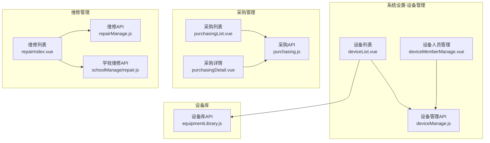
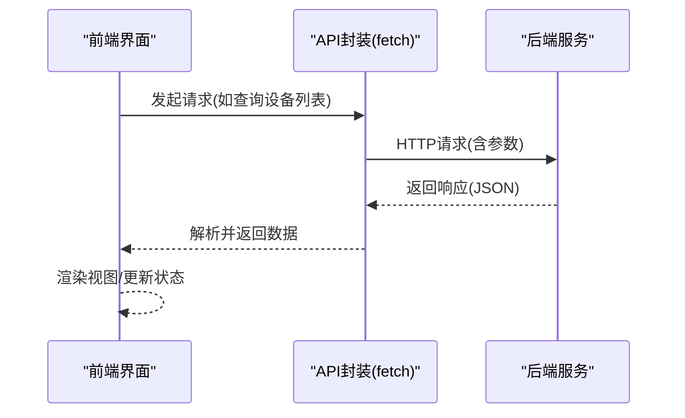
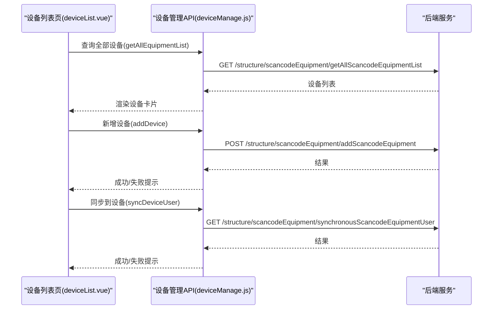
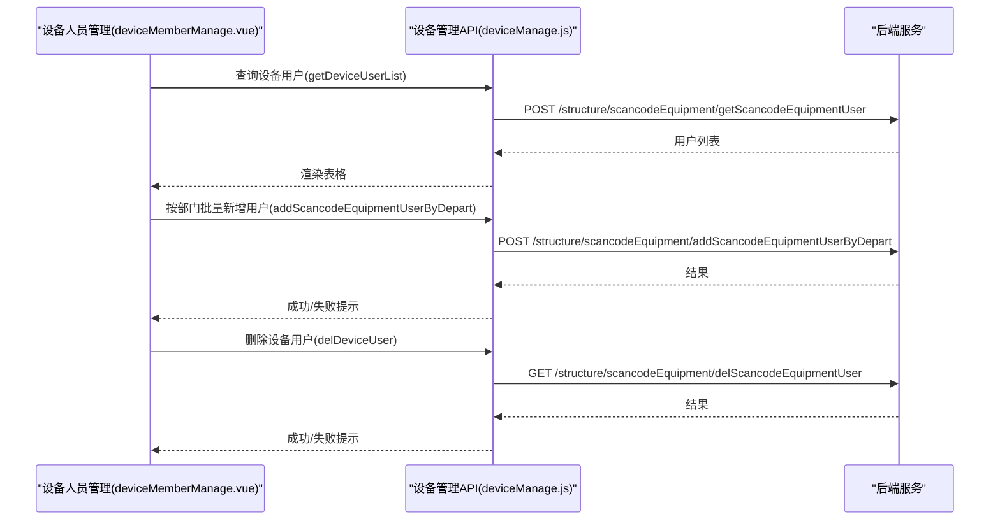
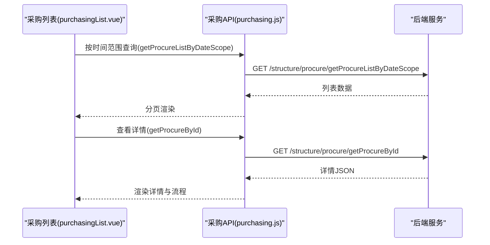
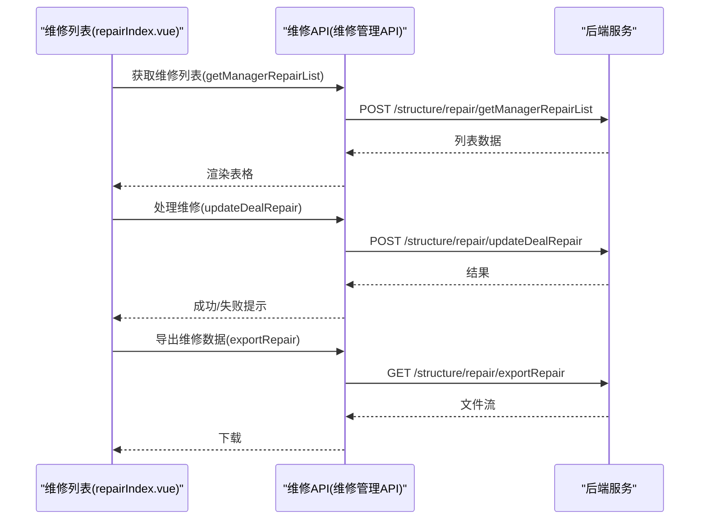
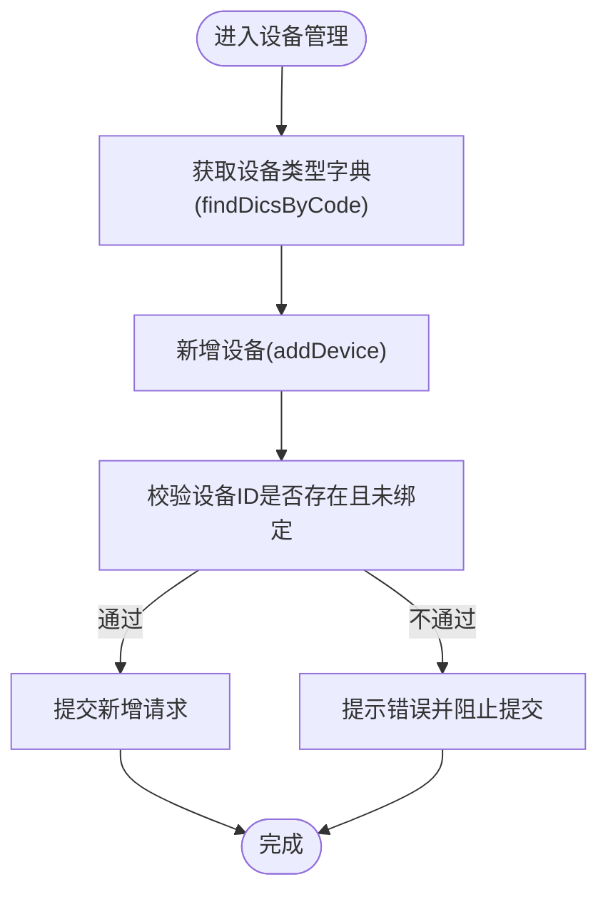
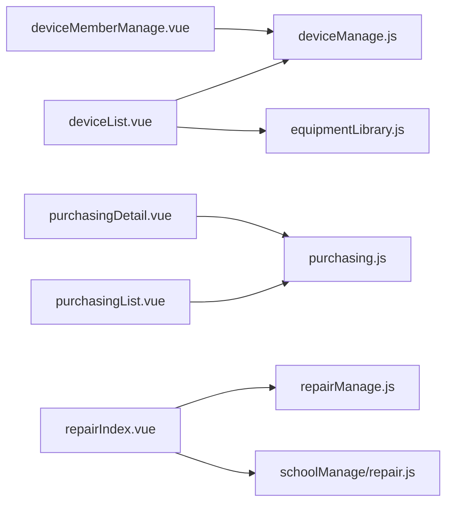
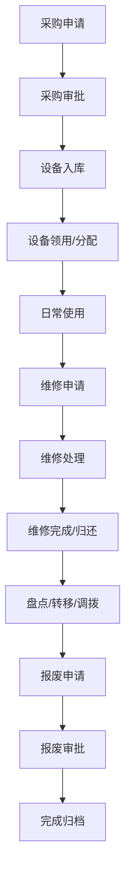

# 资产设备管理

<cite>
**本文引用的文件**
- [deviceManage.js](file://src/api/systemSet/deviceManage.js)
- [repairManage.js](file://src/api/repairManage.js)
- [repair.js](file://src/api/schoolManage/repair.js)
- [purchasing.js](file://src/api/purchasing.js)
- [equipmentLibrary.js](file://src/api/equipmentLibrary.js)
- [deviceList.vue](file://src/views/sysSet/deviceManage/deviceList.vue)
- [deviceMemberManage.vue](file://src/views/sysSet/deviceManage/deviceMemberManage.vue)
- [purchasingList.vue](file://src/views/purchasing/purchasingList.vue)
- [purchasingDetail.vue](file://src/views/purchasing/purchasingDetail.vue)
- [repairIndex.vue](file://src/views/repairManage/repairIndex.vue)
</cite>

## 目录
1. [引言](#引言)
2. [项目结构](#项目结构)
3. [核心组件](#核心组件)
4. [架构总览](#架构总览)
5. [详细组件分析](#详细组件分析)
6. [依赖关系分析](#依赖关系分析)
7. [性能考虑](#性能考虑)
8. [故障排查指南](#故障排查指南)
9. [结论](#结论)
10. [附录](#附录)

## 引言
本业务文档围绕校园资产设备管理功能，系统性梳理从“采购—入库—领用—维修—报废”的全生命周期流程，明确资产分类体系、设备编码规则、库存管理机制、维修申请与工单管理、维修统计分析、与财务系统的对接与成本核算思路，并提供盘点、转移调拨、报废处理的操作指南，以及权限控制与数据安全建议。文档以代码实现为依据，结合前端视图与API接口，帮助技术与非技术读者快速理解与落地。

## 项目结构
资产设备管理在前端主要由以下模块构成：
- 系统设置-设备管理：设备新增、编辑、删除、设备人员管理、设备初始化与同步等
- 采购管理：按时间范围查询采购列表、查看详情与流程轨迹
- 维修管理：报修列表、处理、类型与地点配置、统计导出
- 设备库：设备类型字典、按状态查询设备列表

**图表来源**
- [deviceList.vue](file://src/views/sysSet/deviceManage/deviceList.vue)
- [deviceMemberManage.vue](file://src/views/sysSet/deviceManage/deviceMemberManage.vue)
- [purchasingList.vue](file://src/views/purchasing/purchasingList.vue)
- [purchasingDetail.vue](file://src/views/purchasing/purchasingDetail.vue)
- [repairIndex.vue](file://src/views/repairManage/repairIndex.vue)
- [deviceManage.js](file://src/api/systemSet/deviceManage.js)
- [purchasing.js](file://src/api/purchasing.js)
- [repairManage.js](file://src/api/repairManage.js)
- [repair.js](file://src/api/schoolManage/repair.js)
- [equipmentLibrary.js](file://src/api/equipmentLibrary.js)

**章节来源**
- [deviceList.vue:1-712](file://src/views/sysSet/deviceManage/deviceList.vue#L1-L712)
- [deviceMemberManage.vue:1-381](file://src/views/sysSet/deviceManage/deviceMemberManage.vue#L1-L381)
- [purchasingList.vue:1-206](file://src/views/purchasing/purchasingList.vue#L1-L206)
- [purchasingDetail.vue:1-456](file://src/views/purchasing/purchasingDetail.vue#L1-L456)
- [repairIndex.vue:1-307](file://src/views/repairManage/repairIndex.vue#L1-L307)
- [deviceManage.js:1-189](file://src/api/systemSet/deviceManage.js#L1-L189)
- [purchasing.js:1-31](file://src/api/purchasing.js#L1-L31)
- [repairManage.js:1-464](file://src/api/repairManage.js#L1-L464)
- [repair.js:1-19](file://src/api/schoolManage/repair.js#L1-L19)
- [equipmentLibrary.js:1-25](file://src/api/equipmentLibrary.js#L1-L25)

## 核心组件
- 设备管理API：提供设备全量查询、新增、编辑、批量删除、设备用户查询、新增用户、按部门批量新增用户、删除设备用户、同步设备用户、提醒未上传照片用户、设备库查询、设备初始化等能力
- 采购管理API：按时间范围查询采购列表、按ID查询采购详情
- 维修管理API：报修列表、管理员检索、用户检索、删除报修、详情、处理结果与反馈、报修类型与地点配置、导出等
- 设备库API：设备类型字典查询、按状态查询设备列表

**章节来源**
- [deviceManage.js:1-189](file://src/api/systemSet/deviceManage.js#L1-L189)
- [purchasing.js:1-31](file://src/api/purchasing.js#L1-L31)
- [repairManage.js:1-464](file://src/api/repairManage.js#L1-L464)
- [equipmentLibrary.js:1-25](file://src/api/equipmentLibrary.js#L1-L25)

## 架构总览
系统采用前后端分离架构，前端通过统一的fetch封装调用后端接口，完成设备、采购、维修等业务操作；设备类型与字典通过系统字典接口获取，确保一致性与可配置性。

[本图为概念流程示意，无需图表来源]

## 详细组件分析

### 设备管理（采购—入库—领用）
- 设备全量查询与筛选：支持按设备类型筛选与名称模糊匹配
- 设备新增与编辑：校验设备ID存在性与状态，支持选择使用场景
- 设备删除：支持单个设备批量删除
- 设备初始化与同步：针对特定使用场景的设备支持初始化与同步至设备
- 设备人员管理：支持按教师/学生/家长维度添加或导入，支持删除、同步至设备、提醒未上传人脸照片

**图表来源**
- [deviceList.vue:280-606](file://src/views/sysSet/deviceManage/deviceList.vue#L280-L606)
- [deviceManage.js:8-134](file://src/api/systemSet/deviceManage.js#L8-L134)

**章节来源**
- [deviceList.vue:1-712](file://src/views/sysSet/deviceManage/deviceList.vue#L1-L712)
- [deviceManage.js:1-189](file://src/api/systemSet/deviceManage.js#L1-L189)

### 设备人员管理（领用）
- 支持通过地址簿组件选择用户，按用户类型批量新增
- 支持按姓名搜索、用户类型筛选、分页
- 支持删除设备下的用户、同步至设备、提醒未上传人脸照片

**图表来源**
- [deviceMemberManage.vue:89-312](file://src/views/sysSet/deviceManage/deviceMemberManage.vue#L89-L312)
- [deviceManage.js:64-119](file://src/api/systemSet/deviceManage.js#L64-L119)

**章节来源**
- [deviceMemberManage.vue:1-381](file://src/views/sysSet/deviceManage/deviceMemberManage.vue#L1-L381)
- [deviceManage.js:1-189](file://src/api/systemSet/deviceManage.js#L1-L189)

### 采购管理（采购—入库）
- 采购列表：按时间范围、类型、申请人姓名筛选，支持导出
- 采购详情：展示采购清单、附件图片、流程步骤与时间线

**图表来源**
- [purchasingList.vue:75-188](file://src/views/purchasing/purchasingList.vue#L75-L188)
- [purchasingDetail.vue:128-179](file://src/views/purchasing/purchasingDetail.vue#L128-L179)
- [purchasing.js:4-30](file://src/api/purchasing.js#L4-L30)

**章节来源**
- [purchasingList.vue:1-206](file://src/views/purchasing/purchasingList.vue#L1-L206)
- [purchasingDetail.vue:1-456](file://src/views/purchasing/purchasingDetail.vue#L1-L456)
- [purchasing.js:1-31](file://src/api/purchasing.js#L1-L31)

### 维修管理（维修—统计分析）
- 维修列表：支持按时间段、报修人姓名、状态、类型筛选，支持导出
- 维修处理：支持查看详情、处理结果与反馈、删除报修
- 维修类型与地点：支持类型与地点的增删改查、树形结构查询
- 学校维修入口：提供管理员检索接口

**图表来源**
- [repairIndex.vue:89-288](file://src/views/repairManage/repairIndex.vue#L89-L288)
- [repairManage.js:19-152](file://src/api/repairManage.js#L19-L152)
- [repair.js:4-16](file://src/api/schoolManage/repair.js#L4-L16)

**章节来源**
- [repairIndex.vue:1-307](file://src/views/repairManage/repairIndex.vue#L1-L307)
- [repairManage.js:1-464](file://src/api/repairManage.js#L1-L464)
- [repair.js:1-19](file://src/api/schoolManage/repair.js#L1-L19)

### 设备库与字典（分类与编码）
- 设备类型字典：通过系统字典接口获取设备类型列表，用于设备新增时的类型选择
- 设备库查询：支持按设备类型、设备ID、模块、学校名称、状态、使用类型等条件查询
- 按状态查询设备：支持按状态分页查询设备列表

**图表来源**
- [deviceList.vue:375-384](file://src/views/sysSet/deviceManage/deviceList.vue#L375-L384)
- [deviceList.vue:296-313](file://src/views/sysSet/deviceManage/deviceList.vue#L296-L313)
- [deviceManage.js:19-29](file://src/api/systemSet/deviceManage.js#L19-L29)
- [equipmentLibrary.js:3-11](file://src/api/equipmentLibrary.js#L3-L11)

**章节来源**
- [deviceList.vue:1-712](file://src/views/sysSet/deviceManage/deviceList.vue#L1-L712)
- [deviceManage.js:1-189](file://src/api/systemSet/deviceManage.js#L1-L189)
- [equipmentLibrary.js:1-25](file://src/api/equipmentLibrary.js#L1-L25)

## 依赖关系分析
- 视图层依赖API层：设备列表、设备人员管理、采购列表/详情、维修列表均通过各自API封装发起HTTP请求
- 字典与类型：设备类型通过系统字典接口获取，保证前端与后端一致
- 权限与鉴权：各API请求包含token，由全局变量与Vuex状态注入，确保接口访问安全

**图表来源**
- [deviceList.vue:280-282](file://src/views/sysSet/deviceManage/deviceList.vue#L280-L282)
- [deviceMemberManage.vue:89](file://src/views/sysSet/deviceManage/deviceMemberManage.vue#L89)
- [purchasingList.vue:76-77](file://src/views/purchasing/purchasingList.vue#L76-L77)
- [purchasingDetail.vue:132-137](file://src/views/purchasing/purchasingDetail.vue#L132-L137)
- [repairIndex.vue:91](file://src/views/repairManage/repairIndex.vue#L91)
- [repair.js:4-16](file://src/api/schoolManage/repair.js#L4-L16)
- [equipmentLibrary.js:3-11](file://src/api/equipmentLibrary.js#L3-L11)

**章节来源**
- [deviceList.vue:1-712](file://src/views/sysSet/deviceManage/deviceList.vue#L1-L712)
- [deviceMemberManage.vue:1-381](file://src/views/sysSet/deviceManage/deviceMemberManage.vue#L1-L381)
- [purchasingList.vue:1-206](file://src/views/purchasing/purchasingList.vue#L1-L206)
- [purchasingDetail.vue:1-456](file://src/views/purchasing/purchasingDetail.vue#L1-L456)
- [repairIndex.vue:1-307](file://src/views/repairManage/repairIndex.vue#L1-L307)
- [deviceManage.js:1-189](file://src/api/systemSet/deviceManage.js#L1-L189)
- [purchasing.js:1-31](file://src/api/purchasing.js#L1-L31)
- [repairManage.js:1-464](file://src/api/repairManage.js#L1-L464)
- [repair.js:1-19](file://src/api/schoolManage/repair.js#L1-L19)
- [equipmentLibrary.js:1-25](file://src/api/equipmentLibrary.js#L1-L25)

## 性能考虑
- 列表分页与筛选：通过分页参数与URLSearchParams减少一次性传输数据量
- 防抖优化：维修列表对日期变更采用防抖策略，降低频繁请求
- 图片与流程图预览：采用懒加载与缩略图展示，避免阻塞主流程
- 导出与打印：导出为服务端生成文件流，打印采用独立容器，避免重复渲染

[本节为通用性能建议，无需章节来源]

## 故障排查指南
- 设备ID校验失败：当设备ID不存在或已被绑定时，新增/编辑会提示错误，请先在设备库确认设备状态
- 同步失败：设备同步至设备或提醒未上传照片时，若返回失败提示，请检查网络与设备状态
- 列表为空：检查筛选条件（类型、时间范围、姓名），确认分页参数与服务端分页逻辑
- 导出异常：确认导出URL中的token与时间范围参数正确，浏览器下载拦截设置

**章节来源**
- [deviceList.vue:296-313](file://src/views/sysSet/deviceManage/deviceList.vue#L296-L313)
- [deviceList.vue:424-448](file://src/views/sysSet/deviceManage/deviceList.vue#L424-L448)
- [repairIndex.vue:227-243](file://src/views/repairManage/repairIndex.vue#L227-L243)

## 结论
本系统围绕资产设备全生命周期提供了完善的前端能力：设备的新增/编辑/删除、设备人员管理、设备初始化与同步、采购列表与详情、维修列表与处理、维修类型与地点配置、设备库与字典查询。通过统一的API封装与字典驱动，保障了业务的一致性与可扩展性。建议在后续迭代中完善财务对接与成本核算、盘点与转移调拨、报废流程的前端交互与后端接口支撑。

[本节为总结性内容，无需章节来源]

## 附录

### 业务流程图（概念）

[本图为概念流程示意，无需图表来源]

### 关键字段与含义（示例）
- 设备ID：唯一标识设备的编码，新增前需校验存在性与未绑定状态
- 使用场景：设备类型对应的使用场景枚举，用于区分不同业务场景
- 状态：设备状态（如启用/停用/维修中等），影响设备可用性
- 报修类型/地点：维修分类与发生地点，支持树形结构与多级配置
- 采购类型：采购分类，支持级联选择

[本节为通用说明，无需章节来源]