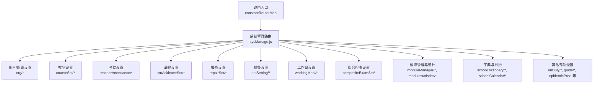
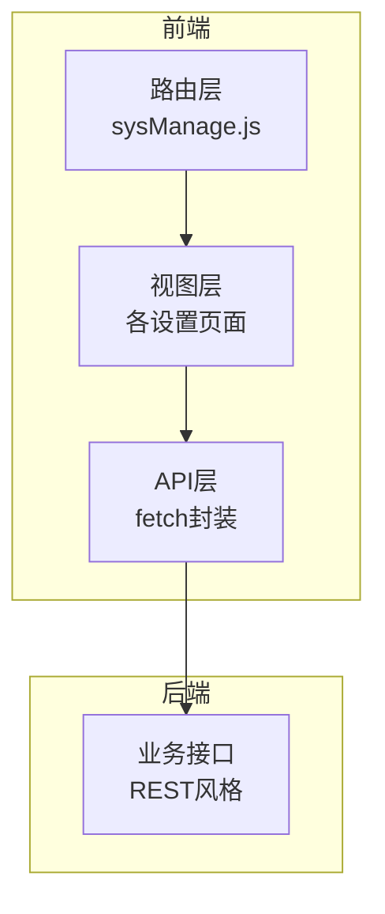
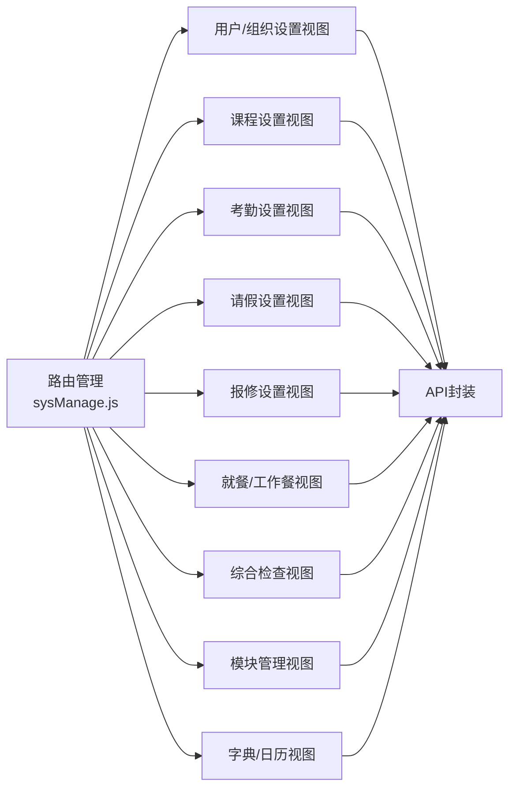

# 业务功能设置

<cite>
**本文引用的文件**
- [路由索引](file://src/router/index.js)
- [系统管理路由](file://src/router/normal/sysManage.js)
- [模块列表](file://src/router/moduleList.js)
- [教学研究设置API](file://src/api/systemSet/teachingGroupSet.js)
- [五育设置API](file://src/api/fiveEducationSetup.js)
</cite>

## 目录
1. [简介](#简介)
2. [项目结构](#项目结构)
3. [核心组件](#核心组件)
4. [架构总览](#架构总览)
5. [详细组件分析](#详细组件分析)
6. [依赖分析](#依赖分析)
7. [性能考虑](#性能考虑)
8. [故障排查指南](#故障排查指南)
9. [结论](#结论)
10. [附录](#附录)

## 简介
本技术文档聚焦“业务功能设置”模块，系统梳理教学管理、学生管理、教师管理、校园管理等核心业务模块的配置能力与实现方式。内容涵盖：
- 配置参数与业务规则
- 数据模型与流程
- 功能间关联、数据流转与依赖
- 验证规则、默认值与扩展机制
- API接口规范、批量配置与模板管理
- 启用/禁用控制、权限限制与使用统计
- 版本管理、兼容性与迁移策略

## 项目结构
系统通过路由组织“业务功能设置”相关页面，统一挂载在系统管理入口下，便于集中配置与权限控制。

图表来源
- [路由索引:136-159](file://src/router/index.js#L136-L159)
- [系统管理路由:1-928](file://src/router/normal/sysManage.js#L1-L928)

章节来源
- [路由索引:136-159](file://src/router/index.js#L136-L159)
- [系统管理路由:1-928](file://src/router/normal/sysManage.js#L1-L928)

## 核心组件
- 路由层：统一承载各业务设置页面，按模块划分路径与权限点。
- 视图层：各设置页面负责参数收集、校验与提交。
- API层：封装后端接口调用，统一请求格式与参数拼装。
- 权限层：通过路由meta与后端权限点控制访问范围。

章节来源
- [系统管理路由:1-928](file://src/router/normal/sysManage.js#L1-L928)

## 架构总览
业务功能设置采用“路由+视图+API”的三层架构，围绕系统管理入口统一调度，确保配置入口一致、权限可控、扩展便捷。

图表来源
- [系统管理路由:1-928](file://src/router/normal/sysManage.js#L1-L928)
- [路由索引:136-159](file://src/router/index.js#L136-L159)

## 详细组件分析

### 教学管理设置
- 课程设置
  - 页面路径：courseSet/getCourseListIndex、getCourseAddEdit
  - 关键参数：课程名称、科目、学段、是否启用等
  - 业务规则：同一学段内课程唯一；启用状态影响排课与统计
  - 数据模型：课程实体含基础信息、属性字段、关联对象
- 教学研究小组设置
  - 页面路径：teachingGroup/teachingGroupSet、teachingGroupAddEdit
  - 关键参数：小组名称、学科、成员、负责人、年级范围
  - API接口：新增/修改教学研究小组
    - 新增：[教学研究新增:48-58](file://src/api/systemSet/teachingGroupSet.js#L48-L58)
    - 修改：[教学研究更新:61-81](file://src/api/systemSet/teachingGroupSet.js#L61-L81)
  - 业务规则：成员与负责人需存在于组织架构；小组覆盖年级需合理
- 智能排课设置
  - 页面路径：Intelligencecourse/IntelligencecourseSetup
  - 关键参数：排课算法开关、节次配置、冲突处理策略
  - 业务规则：与作息时间、教室资源联动

章节来源
- [系统管理路由:258-284](file://src/router/normal/sysManage.js#L258-L284)
- [教学研究设置API:48-81](file://src/api/systemSet/teachingGroupSet.js#L48-L81)

### 学生管理设置
- 请假设置（多版本）
  - 页面路径：stuAskleaveSet/index、leave3Index、askleaveGroup*
  - 关键参数：请假类型、时长限制、审批流、分组规则
  - 业务规则：不同年级/类型的请假规则可差异化配置
- 不就餐设置
  - 页面路径：studentNotEatSetting、teacherNotEatSetting
  - 关键参数：名单维护、生效日期、备注
  - 业务规则：与就餐地点设置联动，避免重复配置
- 值班与放学护导
  - 页面路径：sysSet/studentOnDuty/studentOnDutySetting、sysSet/leaveTheSchool/index
  - 关键参数：岗位、时段、人员、路线
  - 业务规则：与作息时间、门禁策略协同

章节来源
- [系统管理路由:154-176](file://src/router/normal/sysManage.js#L154-L176)
- [系统管理路由:818-820](file://src/router/normal/sysManage.js#L818-L820)
- [系统管理路由:729-732](file://src/router/normal/sysManage.js#L729-L732)

### 教师管理设置
- 老师请假设置（多版本）
  - 页面路径：TeacherLeave3Set/*、teacherLeave4Setting/*
  - 关键参数：请假类型、额度、周期、审批人
  - 业务规则：额度与周期需与财务/考勤系统对齐
- 考勤设置
  - 页面路径：teacherAttendance/teacherAttendanceSetIndex、规则/地点/提醒
  - 关键参数：考勤地点、规则模板、提醒阈值
  - 业务规则：与对接考勤机/门禁设备联动
- 荣誉设置
  - 页面路径：teacherHonorSetting/*
  - 关键参数：证书级别、授予条件、机构管理
  - 业务规则：级别与机构需在字典中维护

章节来源
- [系统管理路由:170-176](file://src/router/normal/sysManage.js#L170-L176)
- [系统管理路由:717-727](file://src/router/normal/sysManage.js#L717-L727)
- [系统管理路由:519-541](file://src/router/normal/sysManage.js#L519-L541)
- [系统管理路由:761-775](file://src/router/normal/sysManage.js#L761-L775)

### 校园管理设置
- 报修设置
  - 页面路径：repairSet/repairTypeListIndex、repairAddressSetIndex
  - 关键参数：报修类型、处理时限、地点、责任人
  - 业务规则：类型与地点需匹配组织架构
- 就餐与工作餐
  - 页面路径：eatSettingIndex、eatAddressSetting、workingMeal/*
  - 关键参数：就餐地点、工作餐配送点、价格、时段
  - 业务规则：与财务/膳食系统对接
- 五育设置
  - 页面路径：fiveEducationSetup/*
  - 关键参数：指标、量表、交换设置
  - API接口：指标新增/更新/查询、量表查询
    - 新增指标：[新增指标:3-12](file://src/api/fiveEducationSetup.js#L3-L12)
    - 更新指标：[更新指标:14-23](file://src/api/fiveEducationSetup.js#L14-L23)
    - 查询指标列表：[查询列表:26-35](file://src/api/fiveEducationSetup.js#L26-L35)
    - 查询指标详情：[查询详情:37-45](file://src/api/fiveEducationSetup.js#L37-L45)
    - 查询量表列表：[查询量表:47-51](file://src/api/fiveEducationSetup.js#L47-L51)
  - 业务规则：指标与量表需配套维护

章节来源
- [系统管理路由:178-200](file://src/router/normal/sysManage.js#L178-L200)
- [系统管理路由:230-252](file://src/router/normal/sysManage.js#L230-L252)
- [系统管理路由:826-840](file://src/router/normal/sysManage.js#L826-L840)
- [五育设置API:1-51](file://src/api/fiveEducationSetup.js#L1-L51)

### 综合检查与值班
- 综合检查值班表设置
  - 页面路径：compositeExamSet/dutySet、checkDutyList、inspectionItems
  - 关键参数：值班周期、检查项、评分标准
  - 业务规则：检查项与评分标准需一致
- 值班设置
  - 页面路径：onDuty/index、weekSet、weekdaySet
  - 关键参数：值班时段、岗位、人员
  - 业务规则：与门禁/护导策略协同

章节来源
- [系统管理路由:286-324](file://src/router/normal/sysManage.js#L286-L324)
- [系统管理路由:697-707](file://src/router/normal/sysManage.js#L697-L707)

### 模块管理与统计
- 应用管理
  - 页面路径：moduleManager/index、moduleManager/roleDetail
  - 功能：模块启用/禁用、权限分配、角色绑定
- 使用统计
  - 页面路径：modulestatistics/index、moduleDetail
  - 功能：模块使用趋势、活跃度、异常告警

章节来源
- [系统管理路由:487-505](file://src/router/normal/sysManage.js#L487-L505)

### 字典与日历
- 学校字典
  - 页面路径：schoolDictionary/list、add、import
  - 功能：字典项维护、批量导入
- 校历
  - 页面路径：schoolCalendar/schoolCalendarIndex、add、edit、set
  - 功能：学期、节假日、教学日历维护

章节来源
- [系统管理路由:636-654](file://src/router/normal/sysManage.js#L636-L654)

### API接口规范与批量配置
- 接口规范
  - 统一通过fetch封装进行HTTP请求
  - 参数传递方式：URLSearchParams用于POST表单，JSON用于需要结构化数据的场景
- 批量配置
  - 建议通过字典导入、模板复制等方式实现批量配置
  - 导入流程应包含预校验、错误记录与回滚机制
- 配置模板管理
  - 提供模板保存、复用与版本对比能力
  - 模板应支持按业务域（教学/学生/教师/校园）分类

章节来源
- [五育设置API:1-51](file://src/api/fiveEducationSetup.js#L1-L51)
- [教学研究设置API:48-81](file://src/api/systemSet/teachingGroupSet.js#L48-L81)

### 启用/禁用控制、权限限制与使用统计
- 启用/禁用控制
  - 在模块管理中提供开关控制，配合后端策略生效
- 权限限制
  - 路由meta中定义permissionPath，结合后端权限点进行访问控制
- 使用统计
  - 通过模块使用分析页面展示访问频次、活跃用户、异常情况

章节来源
- [模块列表:483-2356](file://src/router/moduleList.js#L483-L2356)
- [系统管理路由:499-505](file://src/router/normal/sysManage.js#L499-L505)

### 版本管理、兼容性与迁移
- 版本管理
  - 设置项变更需记录版本号与变更说明
  - 旧版本配置在新版本中保留默认值，避免强制迁移导致业务中断
- 兼容性
  - 新增字段建议提供默认值；删除字段需提供迁移脚本
- 迁移方案
  - 提供一键迁移工具：校验→备份→转换→回滚
  - 迁移前提示风险与回滚步骤

## 依赖分析
业务功能设置模块的耦合关系主要体现在：
- 路由到视图：通过路由统一入口，按模块加载对应设置页面
- 视图到API：各设置页面通过API层调用后端接口
- 权限到路由：通过permissionPath控制访问范围
- 数据到字典：大量配置依赖学校字典与组织架构

图表来源
- [系统管理路由:1-928](file://src/router/normal/sysManage.js#L1-L928)

## 性能考虑
- 路由懒加载：使用动态import实现按需加载，降低首屏压力
- 缓存策略：对高频配置页面启用keep-alive缓存，减少重复渲染
- 请求合并：批量导入/导出时合并请求，提升吞吐
- 分页与分段：列表类配置采用分页加载，避免一次性渲染过多数据

## 故障排查指南
- 访问无权限
  - 检查路由meta中的permissionPath是否正确配置
  - 确认用户角色是否具备相应权限
- 配置不生效
  - 核对开关状态与生效时间
  - 检查与其他模块（如作息时间、门禁）的联动配置
- 导入失败
  - 查看导入模板格式与必填字段
  - 核对字典项是否存在且正确
- 接口异常
  - 检查请求头Content-Type与参数拼装
  - 关注返回码与错误信息，定位具体字段

## 结论
业务功能设置模块以路由为中心，串联教学、学生、教师、校园等核心业务域的配置能力。通过清晰的参数定义、严格的权限控制与完善的API封装，实现了配置的标准化与可扩展性。建议持续完善模板与迁移机制，保障配置演进过程中的稳定性与一致性。

## 附录
- 关键页面路径参考
  - 用户/组织：org/index、org/teacherAddEdit、org/studentAddEdit
  - 课程设置：courseSet/getCourseListIndex、getCourseAddEdit
  - 考勤设置：teacherAttendance/teacherAttendanceSetIndex、规则/地点/提醒
  - 请假设置：stuAskleaveSet/index、leave3Index、askleaveGroup*
  - 报修设置：repairSet/repairTypeListIndex、repairAddressSetIndex
  - 就餐设置：eatSettingIndex、eatAddressSetting
  - 工作餐设置：workingMeal/*
  - 五育设置：fiveEducationSetup/*
  - 综合检查：compositeExamSet/*
  - 模块管理：moduleManager/index、modulestatistics/index
  - 字典与日历：schoolDictionary/*、schoolCalendar/*

章节来源
- [系统管理路由:1-928](file://src/router/normal/sysManage.js#L1-L928)