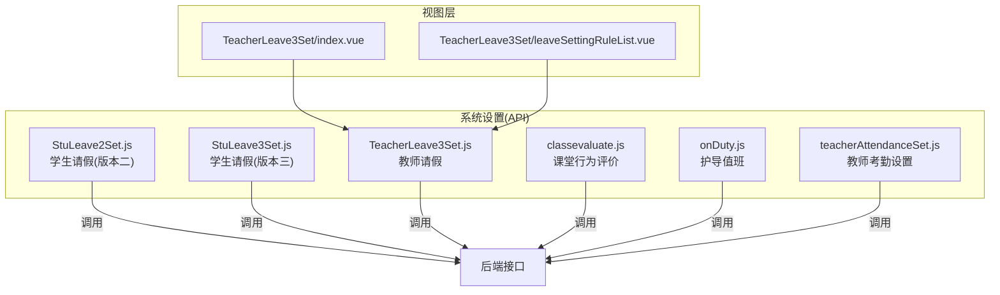
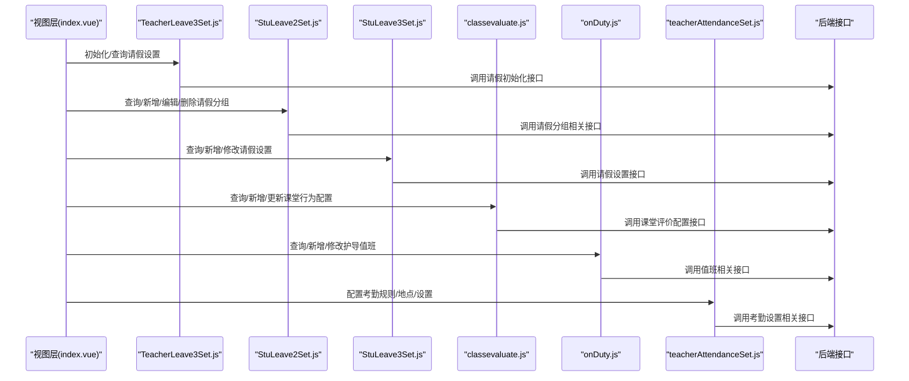
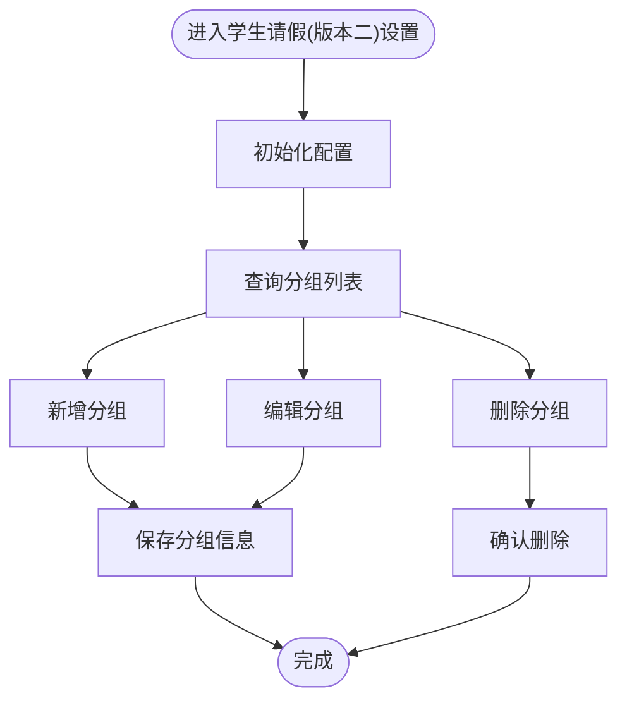
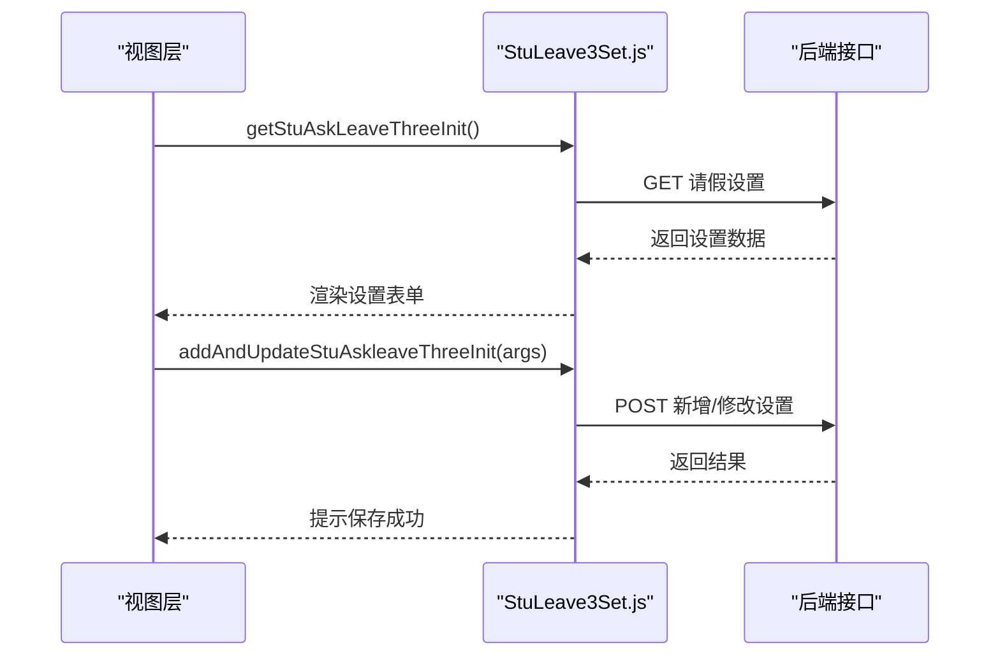
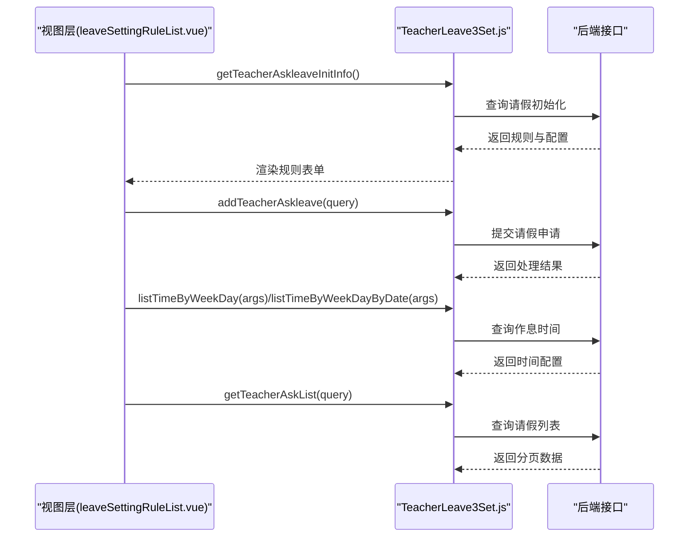
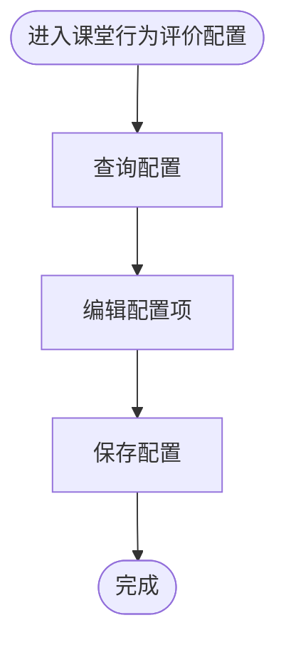
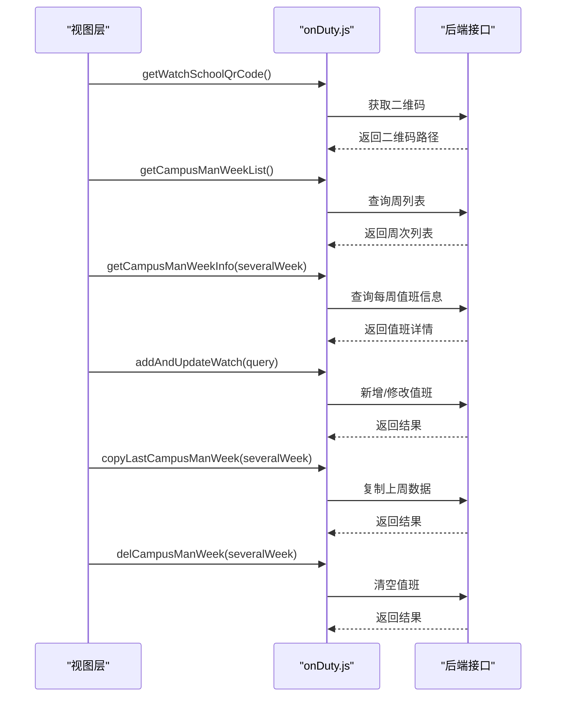
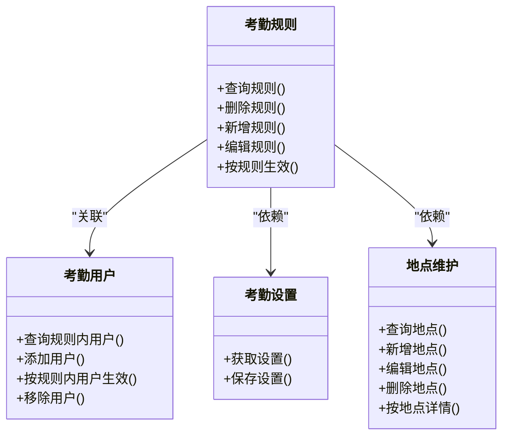
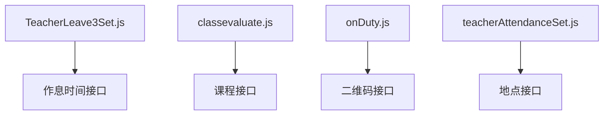

# 学生教师设置

<cite>
**本文引用的文件**
- [StuLeave2Set.js](file://src/api/systemSet/StuLeave2Set.js)
- [StuLeave3Set.js](file://src/api/systemSet/StuLeave3Set.js)
- [TeacherLeave3Set.js](file://src/api/systemSet/TeacherLeave3Set.js)
- [classevaluate.js](file://src/api/systemSet/classevaluate.js)
- [onDuty.js](file://src/api/systemSet/onDuty.js)
- [teacherAttendanceSet.js](file://src/api/systemSet/teacherAttendanceSet.js)
- [index.vue](file://src/views/sysSet/TeacherLeave3Set/index.vue)
- [leaveSettingRuleList.vue](file://src/views/sysSet/TeacherLeave3Set/leaveSettingRuleList.vue)
</cite>

## 目录
1. [简介](#简介)
2. [项目结构](#项目结构)
3. [核心组件](#核心组件)
4. [架构总览](#架构总览)
5. [详细组件分析](#详细组件分析)
6. [依赖分析](#依赖分析)
7. [性能考虑](#性能考虑)
8. [故障排查指南](#故障排查指南)
9. [结论](#结论)
10. [附录](#附录)

## 简介
本技术文档围绕“学生教师设置”功能，系统梳理并说明以下能力：
- 学生日常管理：请假制度（含版本二与版本三）、晨检管理、通风打卡、放学管理、护导管理等配置与流程。
- 教师日常管理：教师考勤规则与地点设置、教师请假规则与类型限制、课堂行为评价配置、护导值班排班等。
- 德育评价系统：评价指标、评价流程与统计方法的实现思路与数据模型。
- API 接口规范：批量配置、数据同步与状态变更的关键接口。
- 统计分析、预警机制与报告生成：基于现有接口能力的扩展建议。

本文件以仓库中已存在的系统设置相关 API 与视图组件为依据，结合其命名与调用关系进行架构与流程解读，并在必要处提供可视化图表帮助理解。

## 项目结构
与“学生教师设置”直接相关的前端模块主要分布在以下位置：
- API 层：src/api/systemSet 下的各功能模块文件，封装了与后端交互的接口方法。
- 视图层：src/views/sysSet 下的系统设置页面，承载具体配置界面与交互逻辑。
- 其他辅助模块：如晨检、通风、护导等模块虽不在 systemSet 目录下，但与学生日常管理密切相关，可作为扩展参考。

**图表来源**
- [StuLeave2Set.js:1-100](file://src/api/systemSet/StuLeave2Set.js#L1-L100)
- [StuLeave3Set.js:1-27](file://src/api/systemSet/StuLeave3Set.js#L1-L27)
- [TeacherLeave3Set.js:1-161](file://src/api/systemSet/TeacherLeave3Set.js#L1-L161)
- [classevaluate.js:1-39](file://src/api/systemSet/classevaluate.js#L1-L39)
- [onDuty.js:1-83](file://src/api/systemSet/onDuty.js#L1-L83)
- [teacherAttendanceSet.js:1-288](file://src/api/systemSet/teacherAttendanceSet.js#L1-L288)
- [index.vue](file://src/views/sysSet/TeacherLeave3Set/index.vue)
- [leaveSettingRuleList.vue](file://src/views/sysSet/TeacherLeave3Set/leaveSettingRuleList.vue)

**章节来源**
- [StuLeave2Set.js:1-100](file://src/api/systemSet/StuLeave2Set.js#L1-L100)
- [StuLeave3Set.js:1-27](file://src/api/systemSet/StuLeave3Set.js#L1-L27)
- [TeacherLeave3Set.js:1-161](file://src/api/systemSet/TeacherLeave3Set.js#L1-L161)
- [classevaluate.js:1-39](file://src/api/systemSet/classevaluate.js#L1-L39)
- [onDuty.js:1-83](file://src/api/systemSet/onDuty.js#L1-L83)
- [teacherAttendanceSet.js:1-288](file://src/api/systemSet/teacherAttendanceSet.js#L1-L288)
- [index.vue](file://src/views/sysSet/TeacherLeave3Set/index.vue)
- [leaveSettingRuleList.vue](file://src/views/sysSet/TeacherLeave3Set/leaveSettingRuleList.vue)

## 核心组件
本节聚焦“学生教师设置”的关键功能模块及其职责：
- 学生请假设置（版本二）：支持初始化配置、按条件查询班级分组、新增/编辑/删除分组、按分组查看班级信息。
- 学生请假设置（版本三）：支持按学校 ID 查询请假设置、新增/修改请假设置。
- 教师请假设置：支持初始化查询、新增教师请假记录、按周查询作息时间、查询教师请假列表、查询可用扣课时列表、新增/修改请假初始化、请假类型限制管理等。
- 课堂行为评价：支持查询课堂评价配置、新增/更新课堂行为配置。
- 护导值班：支持获取二维码、查询周列表、查询每周值班信息、新增/修改值班、复制上周数据、按周清空值班。
- 教师考勤设置：支持查询考勤规则、删除规则、新增/编辑规则、按规则生效、查询规则内用户、添加/移除规则用户、立即生效、获取/保存考勤设置、查询/新增/编辑/删除地点、按地点查询详情。

上述模块均通过统一的请求封装工具发起 HTTP 请求，遵循统一的参数传递与响应处理模式。

**章节来源**
- [StuLeave2Set.js:1-100](file://src/api/systemSet/StuLeave2Set.js#L1-L100)
- [StuLeave3Set.js:1-27](file://src/api/systemSet/StuLeave3Set.js#L1-L27)
- [TeacherLeave3Set.js:1-161](file://src/api/systemSet/TeacherLeave3Set.js#L1-L161)
- [classevaluate.js:1-39](file://src/api/systemSet/classevaluate.js#L1-L39)
- [onDuty.js:1-83](file://src/api/systemSet/onDuty.js#L1-L83)
- [teacherAttendanceSet.js:1-288](file://src/api/systemSet/teacherAttendanceSet.js#L1-L288)

## 架构总览
下图展示了“学生教师设置”相关模块的调用关系与数据流向。视图层通过 API 层访问后端服务，部分接口涉及跨模块联动（如教师请假与作息时间、课堂评价与课程配置、护导值班与二维码等）。

**图表来源**
- [index.vue](file://src/views/sysSet/TeacherLeave3Set/index.vue)
- [TeacherLeave3Set.js:1-161](file://src/api/systemSet/TeacherLeave3Set.js#L1-L161)
- [StuLeave2Set.js:1-100](file://src/api/systemSet/StuLeave2Set.js#L1-L100)
- [StuLeave3Set.js:1-27](file://src/api/systemSet/StuLeave3Set.js#L1-L27)
- [classevaluate.js:1-39](file://src/api/systemSet/classevaluate.js#L1-L39)
- [onDuty.js:1-83](file://src/api/systemSet/onDuty.js#L1-L83)
- [teacherAttendanceSet.js:1-288](file://src/api/systemSet/teacherAttendanceSet.js#L1-L288)

## 详细组件分析

### 学生请假设置（版本二）
- 功能要点
  - 初始化设置：新增/修改初始化配置。
  - 分组管理：按条件查询请假班级分组列表；新增/编辑/删除分组；按分组 ID 查看分组信息。
- 数据模型与流程
  - 初始化配置：包含规则 JSON、请假类型 JSON、批量用户 JSON 等字段，用于控制请假审批流与展示范围。
  - 分组信息：标题、经办人 JSON、班级 JSON，用于按分组维度进行权限与统计划分。
- 关键接口
  - 新增/修改初始化设置
  - 获取初始化信息
  - 查询分组列表
  - 新增/编辑/删除分组
  - 按分组 ID 查询分组信息

**图表来源**
- [StuLeave2Set.js:1-100](file://src/api/systemSet/StuLeave2Set.js#L1-L100)

**章节来源**
- [StuLeave2Set.js:1-100](file://src/api/systemSet/StuLeave2Set.js#L1-L100)

### 学生请假设置（版本三）
- 功能要点
  - 按学校 ID 查询当前请假设置。
  - 新增/修改请假设置，支持 JSON 参数提交。
- 数据模型与流程
  - 设置项通常包含是否启用、默认类型、扣课时策略、提醒配置等，便于快速部署与调整。
- 关键接口
  - 查询请假设置
  - 新增/修改请假设置

**图表来源**
- [StuLeave3Set.js:1-27](file://src/api/systemSet/StuLeave3Set.js#L1-L27)

**章节来源**
- [StuLeave3Set.js:1-27](file://src/api/systemSet/StuLeave3Set.js#L1-L27)

### 教师请假设置
- 功能要点
  - 初始化查询：获取教师请假规则与配置。
  - 新增教师请假：支持多字段提交，如内容、类型、起止时间、是否上午/下午、是否扣课时、照片 JSON、状态、部门信息、可调休/扣款标记等。
  - 周期查询：按周查询作息时间、按日期查询作息时间。
  - 列表查询：分页查询教师请假列表。
  - 可用扣课时查询：根据请假类型、作息时间 ID、日期查询可用扣课时列表。
  - 初始化配置：新增/修改请假初始化，包含午间/上午小时数、是否扣款、规则 JSON、请假类型 JSON、批量用户 JSON、病假类型分组、日期/课时/时长开关、提醒用户 JSON、显示可调休/扣款、上下学时段限制等。
  - 类型限制：新增/查询/删除请假类型限制。
- 数据模型与流程
  - 请假记录：包含教师信息、请假类型、起止时间、是否上午/下午、是否扣课时、照片、状态、部门、可调休/扣款备注等。
  - 请假规则：包含时间段配置、扣款/扣课时策略、提醒配置、批量用户等。
- 关键接口
  - 初始化查询
  - 新增教师请假
  - 按周/按日期查询作息时间
  - 查询请假列表
  - 查询可用扣课时列表
  - 新增/修改请假初始化
  - 请假类型限制管理

**图表来源**
- [leaveSettingRuleList.vue](file://src/views/sysSet/TeacherLeave3Set/leaveSettingRuleList.vue)
- [TeacherLeave3Set.js:1-161](file://src/api/systemSet/TeacherLeave3Set.js#L1-L161)

**章节来源**
- [TeacherLeave3Set.js:1-161](file://src/api/systemSet/TeacherLeave3Set.js#L1-L161)
- [leaveSettingRuleList.vue](file://src/views/sysSet/TeacherLeave3Set/leaveSettingRuleList.vue)

### 课堂行为评价配置
- 功能要点
  - 查询课堂评价配置。
  - 新增课堂行为配置。
  - 更新课堂行为配置。
- 数据模型与流程
  - 配置项通常包含课程列表、行为指标、评分标准、权重等，用于支撑课堂评价与统计。
- 关键接口
  - 查询课堂评价配置
  - 新增课堂行为配置
  - 更新课堂行为配置

**图表来源**
- [classevaluate.js:1-39](file://src/api/systemSet/classevaluate.js#L1-L39)

**章节来源**
- [classevaluate.js:1-39](file://src/api/systemSet/classevaluate.js#L1-L39)

### 护导值班设置
- 功能要点
  - 获取二维码路径。
  - 查询周列表。
  - 查询每周值班信息。
  - 新增/修改值班数据。
  - 复制上周数据。
  - 按周清空值班数据。
- 数据模型与流程
  - 值班信息包含周次、人员安排、岗位职责、时间范围等，支持复制与清空操作以提升批量配置效率。
- 关键接口
  - 获取二维码
  - 查询周列表
  - 查询每周值班信息
  - 新增/修改值班
  - 复制上周数据
  - 按周清空值班

**图表来源**
- [onDuty.js:1-83](file://src/api/systemSet/onDuty.js#L1-L83)

**章节来源**
- [onDuty.js:1-83](file://src/api/systemSet/onDuty.js#L1-L83)

### 教师考勤设置
- 功能要点
  - 考勤规则：查询规则、删除规则、新增/编辑规则、按规则立即生效。
  - 考勤用户：查询规则内用户、添加用户、按规则内用户立即生效、移除用户。
  - 考勤设置：获取设置、保存设置（推送消息、分析消息、考勤机对接）。
  - 地点维护：查询地点、新增地点、编辑地点、删除地点、按地点查询详情。
- 数据模型与流程
  - 规则：包含签到/签退时间、提醒时间、重置日期、规则日期列表、地址集合、是否打卡、批量用户等。
  - 地点：包含地址、经纬度、范围等。
- 关键接口
  - 考勤规则相关接口
  - 考勤用户相关接口
  - 考勤设置相关接口
  - 地点维护相关接口

**图表来源**
- [teacherAttendanceSet.js:1-288](file://src/api/systemSet/teacherAttendanceSet.js#L1-L288)

**章节来源**
- [teacherAttendanceSet.js:1-288](file://src/api/systemSet/teacherAttendanceSet.js#L1-L288)

## 依赖分析
- 模块耦合
  - 教师请假与作息时间存在耦合：查询请假列表时会使用按周/按日期的作息时间接口，确保请假时段与学校作息一致。
  - 课堂评价与课程配置存在耦合：查询课堂评价配置时可能需要课程列表，以便对课程维度进行评分。
  - 护导值班与二维码存在耦合：值班二维码用于扫码签到或签退，需保证二维码路径有效。
- 外部依赖
  - 统一请求封装工具负责发送 HTTP 请求，所有 API 方法均通过该工具进行调用，便于统一处理错误与拦截器。
- 潜在循环依赖
  - 当前 API 文件之间无直接相互导入，不存在循环依赖风险。

**图表来源**
- [TeacherLeave3Set.js:1-161](file://src/api/systemSet/TeacherLeave3Set.js#L1-L161)
- [classevaluate.js:1-39](file://src/api/systemSet/classevaluate.js#L1-L39)
- [onDuty.js:1-83](file://src/api/systemSet/onDuty.js#L1-L83)
- [teacherAttendanceSet.js:1-288](file://src/api/systemSet/teacherAttendanceSet.js#L1-L288)

**章节来源**
- [TeacherLeave3Set.js:1-161](file://src/api/systemSet/TeacherLeave3Set.js#L1-L161)
- [classevaluate.js:1-39](file://src/api/systemSet/classevaluate.js#L1-L39)
- [onDuty.js:1-83](file://src/api/systemSet/onDuty.js#L1-L83)
- [teacherAttendanceSet.js:1-288](file://src/api/systemSet/teacherAttendanceSet.js#L1-L288)

## 性能考虑
- 批量配置优化
  - 在教师请假与课堂评价配置中，建议采用批量提交方式减少请求次数，提高配置效率。
- 数据缓存
  - 对于不频繁变动的配置（如请假类型、课程列表、作息时间），可在前端进行本地缓存，降低重复请求开销。
- 分页与懒加载
  - 在请假列表与值班列表等大数据场景下，优先使用分页查询，避免一次性加载过多数据。
- 接口幂等
  - 对于新增/修改类接口，建议后端实现幂等性，前端重试时避免重复提交。

## 故障排查指南
- 常见问题
  - 请假设置未生效：检查是否已按规则 ID 或规则内用户立即生效。
  - 请假时段异常：核对按周/按日期查询的作息时间是否正确。
  - 值班数据缺失：确认是否已复制上周数据或按周清空后未重新填写。
  - 考勤地点无效：检查地点经纬度、范围设置是否合理。
- 定位步骤
  - 使用浏览器开发者工具查看网络请求与响应，确认接口返回码与数据结构。
  - 核对必填字段与格式，确保参数传递正确。
  - 若为批量配置失败，逐条回滚并重试，定位具体失败项。

## 结论
“学生教师设置”功能通过完善的 API 封装与清晰的视图层交互，实现了从请假、课堂评价、护导值班到教师考勤的全链路配置能力。现有接口覆盖了初始化、查询、新增/编辑/删除、批量复制与清空等常用场景，满足日常管理需求。建议在后续迭代中进一步完善统计分析、预警机制与报告生成功能，以提升管理效率与数据洞察力。

## 附录
- API 接口清单（按模块）
  - 学生请假(版本二)
    - 新增/修改初始化设置
    - 获取初始化信息
    - 查询分组列表
    - 新增分组
    - 编辑分组
    - 删除分组
    - 按分组 ID 查询分组信息
  - 学生请假(版本三)
    - 查询请假设置
    - 新增/修改请假设置
  - 教师请假
    - 初始化查询
    - 新增教师请假
    - 按周查询作息时间
    - 按日期查询作息时间
    - 查询请假列表
    - 查询可用扣课时列表
    - 新增/修改请假初始化
    - 请假类型限制管理
  - 课堂行为评价
    - 查询课堂评价配置
    - 新增课堂行为配置
    - 更新课堂行为配置
  - 护导值班
    - 获取二维码
    - 查询周列表
    - 查询每周值班信息
    - 新增/修改值班
    - 复制上周数据
    - 按周清空值班
  - 教师考勤
    - 查询考勤规则
    - 删除规则
    - 新增/编辑规则
    - 按规则立即生效
    - 查询规则内用户
    - 添加用户
    - 按规则内用户立即生效
    - 移除用户
    - 获取考勤设置
    - 保存考勤设置
    - 查询地点
    - 新增地点
    - 编辑地点
    - 删除地点
    - 按地点查询详情