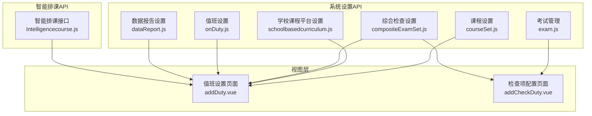
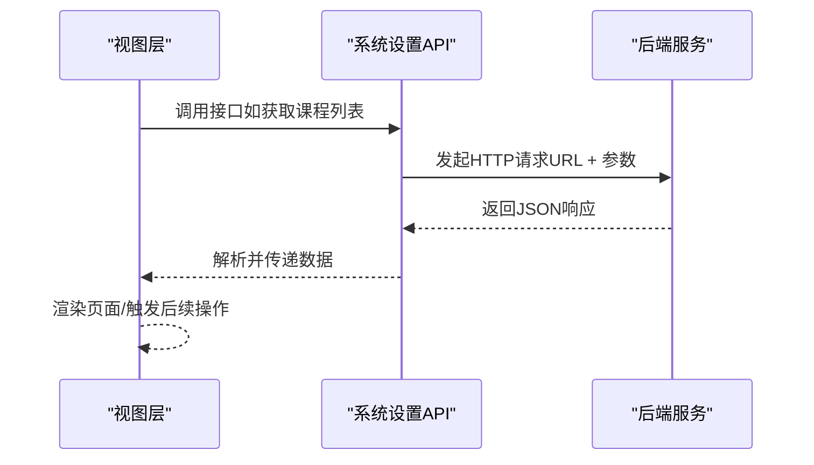
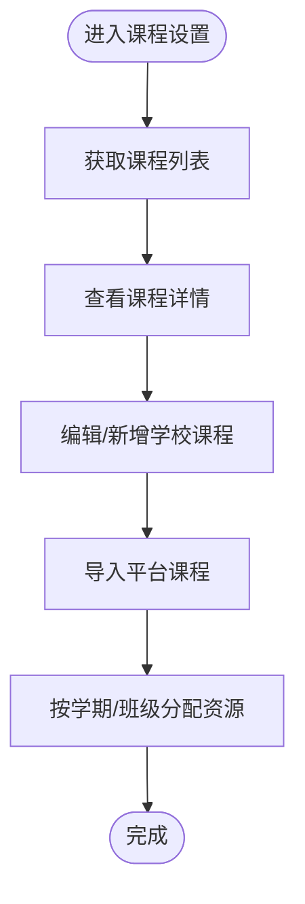
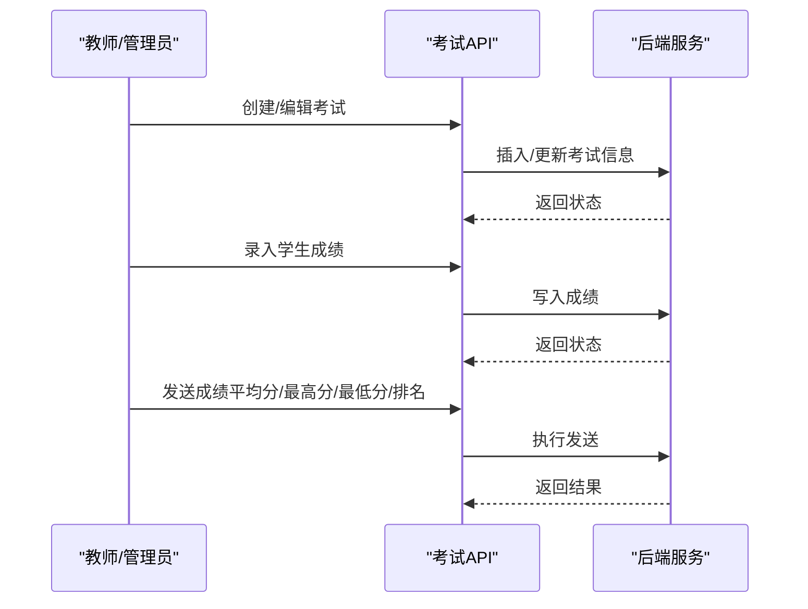
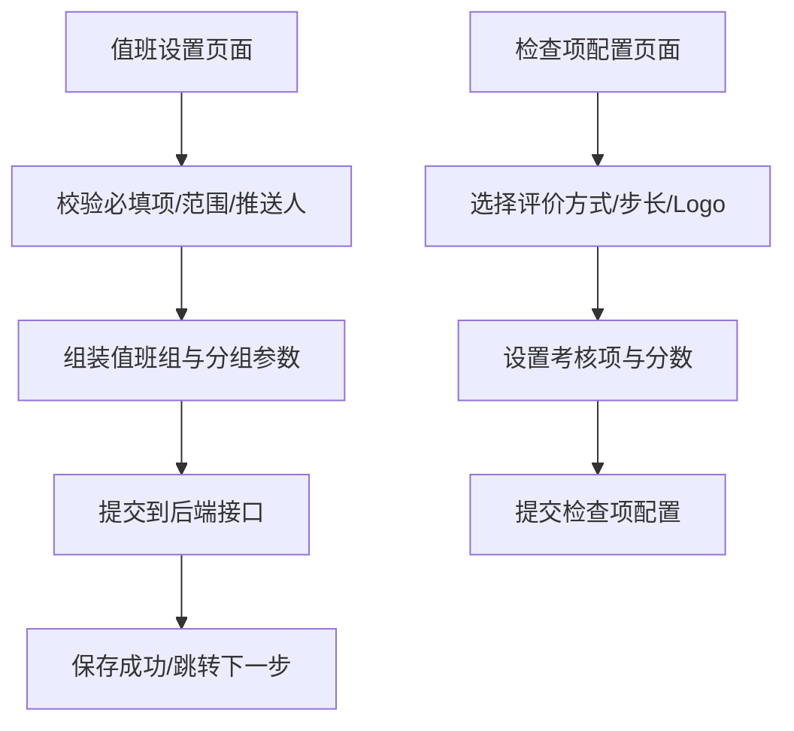
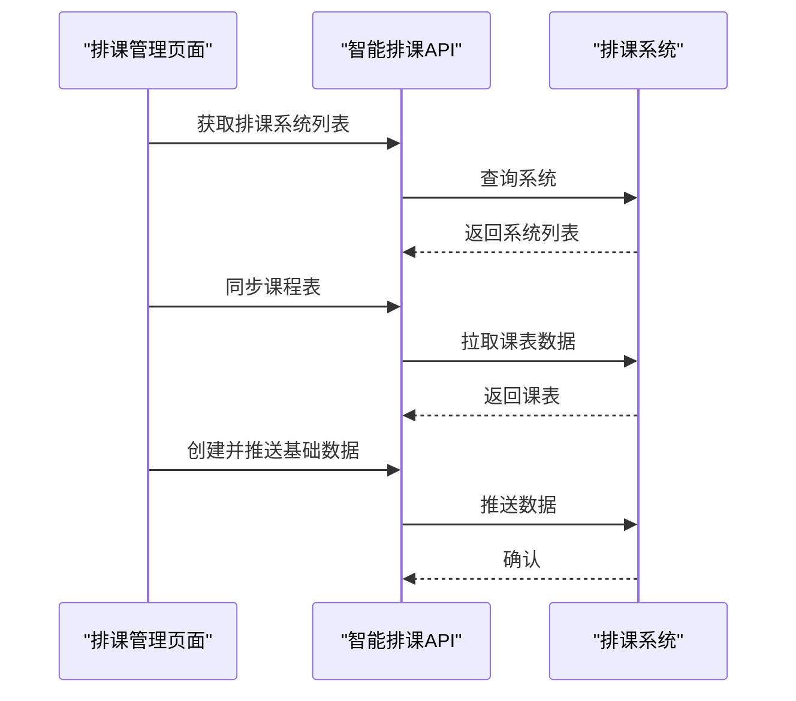
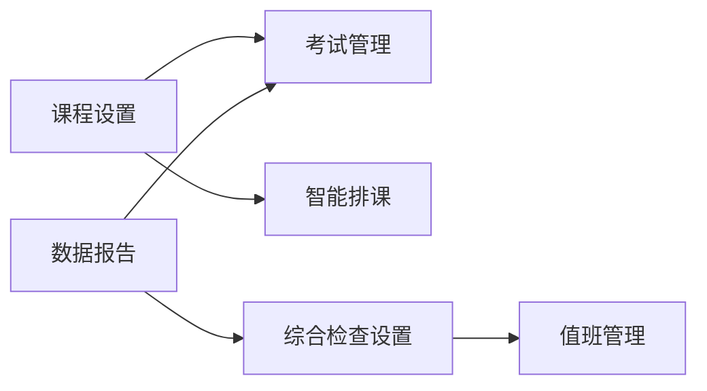

# 教学功能设置

<cite>
**本文引用的文件**
- [courseSet.js](file://src/api/systemSet/courseSet.js)
- [schoolbasedcurriculum.js](file://src/api/systemSet/schoolbasedcurriculum.js)
- [exam.js](file://src/api/systemSet/exam.js)
- [Intelligencecourse.js](file://src/api/Intelligencecourse.js)
- [compositeExamSet.js](file://src/api/compositeExamSet.js)
- [onDuty.js](file://src/api/systemSet/onDuty.js)
- [dataReport.js](file://src/api/systemSet/dataReport.js)
- [addDuty.vue](file://src/views/sysSet/compositeExamSet/addDuty.vue)
- [addCheckDuty.vue](file://src/views/sysSet/compositeExamSet/addCheckDuty.vue)
</cite>

## 目录
1. [引言](#引言)
2. [项目结构](#项目结构)
3. [核心组件](#核心组件)
4. [架构总览](#架构总览)
5. [详细组件分析](#详细组件分析)
6. [依赖分析](#依赖分析)
7. [性能考虑](#性能考虑)
8. [故障排查指南](#故障排查指南)
9. [结论](#结论)
10. [附录](#附录)

## 引言
本技术文档围绕教学功能设置展开，系统性阐述课程设置、考试管理、综合检查设置与值班安排、智能排课系统等模块的实现原理与使用方法。文档同时覆盖API接口规范、批量导入导出能力、配置模板管理、统计分析与报表生成、质量评估机制等，帮助开发者与运维人员快速理解与扩展教学功能。

## 项目结构
教学功能设置相关代码主要分布在以下位置：
- 系统设置API层：课程设置、考试管理、综合检查、值班、数据报告等
- 智能排课API层：与排课系统对接的接口
- 视图层（Vue页面）：综合检查值班与检查项配置的可视化界面

图表来源
- [courseSet.js:1-217](file://src/api/systemSet/courseSet.js#L1-L217)
- [schoolbasedcurriculum.js:1-23](file://src/api/systemSet/schoolbasedcurriculum.js#L1-L23)
- [exam.js:1-455](file://src/api/systemSet/exam.js#L1-L455)
- [compositeExamSet.js:1-195](file://src/api/compositeExamSet.js#L1-L195)
- [onDuty.js:1-83](file://src/api/systemSet/onDuty.js#L1-L83)
- [dataReport.js:1-26](file://src/api/systemSet/dataReport.js#L1-L26)
- [Intelligencecourse.js:1-70](file://src/api/Intelligencecourse.js#L1-L70)
- [addDuty.vue:1-788](file://src/views/sysSet/compositeExamSet/addDuty.vue#L1-L788)
- [addCheckDuty.vue:1-830](file://src/views/sysSet/compositeExamSet/addCheckDuty.vue#L1-L830)

章节来源
- [courseSet.js:1-217](file://src/api/systemSet/courseSet.js#L1-L217)
- [schoolbasedcurriculum.js:1-23](file://src/api/systemSet/schoolbasedcurriculum.js#L1-L23)
- [exam.js:1-455](file://src/api/systemSet/exam.js#L1-L455)
- [compositeExamSet.js:1-195](file://src/api/compositeExamSet.js#L1-L195)
- [onDuty.js:1-83](file://src/api/systemSet/onDuty.js#L1-L83)
- [dataReport.js:1-26](file://src/api/systemSet/dataReport.js#L1-L26)
- [Intelligencecourse.js:1-70](file://src/api/Intelligencecourse.js#L1-L70)
- [addDuty.vue:1-788](file://src/views/sysSet/compositeExamSet/addDuty.vue#L1-L788)
- [addCheckDuty.vue:1-830](file://src/views/sysSet/compositeExamSet/addCheckDuty.vue#L1-L830)

## 核心组件
- 课程设置与资源管理
  - 提供课程列表、详情、新增、编辑、删除、导入平台课程、学校课程新增与更新等接口
  - 支持按学期/班级维度的课程资源分配与展示
- 考试管理
  - 成绩设置、考试列表、新增/编辑/删除考试、成绩录入与分析、评语模板与发送
  - 支持按班级/走班模式、按学期/科目维度的成绩统计与报表
- 综合检查设置
  - 值班组配置、检查项配置、检查范围、推送与提醒策略、自动初始化分数、结果推送时间等
  - 支持打星/评分两种评价方式，支持快捷评价字典
- 智能排课系统
  - 排课系统列表、同步课程表、创建并推送基础数据、系统设置、删除课表
  - 面向第三方排课系统的长时请求适配
- 值班管理
  - 获取二维码、周列表、周信息、复制上周、清空本周、新增/修改值班
- 数据报告
  - 初始化设置查询与保存，支持JSON结构配置

章节来源
- [courseSet.js:119-217](file://src/api/systemSet/courseSet.js#L119-L217)
- [exam.js:6-122](file://src/api/systemSet/exam.js#L6-L122)
- [compositeExamSet.js:1-195](file://src/api/compositeExamSet.js#L1-L195)
- [Intelligencecourse.js:8-70](file://src/api/Intelligencecourse.js#L8-L70)
- [onDuty.js:6-83](file://src/api/systemSet/onDuty.js#L6-L83)
- [dataReport.js:6-26](file://src/api/systemSet/dataReport.js#L6-L26)

## 架构总览
教学功能设置采用前后端分离架构，前端通过统一的fetch封装调用后端REST接口，视图层负责业务交互与参数组装，API层负责与服务端通信。

图表来源
- [courseSet.js:13-25](file://src/api/systemSet/courseSet.js#L13-L25)
- [exam.js:6-11](file://src/api/systemSet/exam.js#L6-L11)
- [compositeExamSet.js:4-11](file://src/api/compositeExamSet.js#L4-L11)
- [onDuty.js:6-11](file://src/api/systemSet/onDuty.js#L6-L11)
- [dataReport.js:6-11](file://src/api/systemSet/dataReport.js#L6-L11)
- [Intelligencecourse.js:8-16](file://src/api/Intelligencecourse.js#L8-L16)

## 详细组件分析

### 课程设置与资源分配
- 功能要点
  - 列表分页与搜索、选择性课程列表、课程详情查询
  - 学校课程新增/编辑，包含考试类型、主课标识、级别、名称、Logo、其他名称、顺序、课时因子等字段
  - 平台课程导入、平台国标课程列表查询
- 关键接口
  - 课程列表与详情：[getCourseList:13-25](file://src/api/systemSet/courseSet.js#L13-L25)、[getCourseDetailById:108-116](file://src/api/systemSet/courseSet.js#L108-L116)
  - 学校课程管理：[curriculumSettingList:119-130](file://src/api/systemSet/courseSet.js#L119-L130)、[curriculumSettingDetail:133-142](file://src/api/systemSet/courseSet.js#L133-L142)、[curriculumSettingAdd:181-196](file://src/api/systemSet/courseSet.js#L181-L196)、[curriculumSettingUpdate:199-216](file://src/api/systemSet/courseSet.js#L199-L216)
  - 平台课程：[listPlatformCurriclumList:172-178](file://src/api/systemSet/courseSet.js#L172-L178)、[curriculumSettingImport:157-169](file://src/api/systemSet/courseSet.js#L157-L169)
- 资源分配
  - 通过课程与班级/走班的关系在考试与排课场景中进行资源绑定
  - 课程平台设置可控制接收用户、提醒策略与推送天数等

图表来源
- [courseSet.js:119-217](file://src/api/systemSet/courseSet.js#L119-L217)
- [schoolbasedcurriculum.js:2-22](file://src/api/systemSet/schoolbasedcurriculum.js#L2-L22)

章节来源
- [courseSet.js:1-217](file://src/api/systemSet/courseSet.js#L1-L217)
- [schoolbasedcurriculum.js:1-23](file://src/api/systemSet/schoolbasedcurriculum.js#L1-L23)

### 考试管理配置与成绩处理
- 功能要点
  - 成绩设置：等级A-E阈值、显示排名/平均分策略、科目JSON配置
  - 考试管理：按学期/班级/走班模式创建与维护考试，支持删除与详情
  - 成绩维护：录入单科成绩、按学期/班级/科目查询学生成绩、发送平均分/最高分/最低分/排名
  - 统计分析：按班级/学生/科目维度的分析图与数据
  - 评语：教师评语模板与保存
- 关键接口
  - 成绩设置：[examSetList:6-11](file://src/api/systemSet/exam.js#L6-L11)、[insertExamSet:57-79](file://src/api/systemSet/exam.js#L57-L79)、[editExamSet:99-122](file://src/api/systemSet/exam.js#L99-L122)
  - 考试管理：[examList:127-137](file://src/api/systemSet/exam.js#L127-L137)、[insertExam:143-161](file://src/api/systemSet/exam.js#L143-L161)、[editExam:166-186](file://src/api/systemSet/exam.js#L166-L186)、[deleteExam:191-199](file://src/api/systemSet/exam.js#L191-L199)
  - 成绩处理：[writeScore:232-250](file://src/api/systemSet/exam.js#L232-L250)、[sendScore:306-319](file://src/api/systemSet/exam.js#L306-L319)
  - 分析与评语：[examScoreAnalysis:256-265](file://src/api/systemSet/exam.js#L256-L265)、[classStuScoreAnalysisBySchoolTimeId:324-336](file://src/api/systemSet/exam.js#L324-L336)、[saveStuComment:355-365](file://src/api/systemSet/exam.js#L355-L365)

图表来源
- [exam.js:143-186](file://src/api/systemSet/exam.js#L143-L186)
- [exam.js:232-250](file://src/api/systemSet/exam.js#L232-L250)
- [exam.js:306-319](file://src/api/systemSet/exam.js#L306-L319)

章节来源
- [exam.js:1-455](file://src/api/systemSet/exam.js#L1-L455)

### 综合检查设置与值班安排
- 功能要点
  - 值班组：名称、是否总值班、默认分数、表扬/批评提醒阈值、检查范围（年级/班级）、提醒策略、推送与反馈配置、结果推送时间、自动初始化分数、提醒班主任/副班主任/年级长/任课教师、抄送其他人员
  - 检查项：名称、描述、排序、打星/打分、加减分步长、Logo、关联课程表节次、快捷评价字典、考核项与分数组合
- 关键接口
  - 值班：[getDutySetList:4-11](file://src/api/compositeExamSet.js#L4-L11)、[addDuty:25-31](file://src/api/compositeExamSet.js#L25-L31)、[editDuty:45-51](file://src/api/compositeExamSet.js#L45-L51)、[getDutyById:34-42](file://src/api/compositeExamSet.js#L34-L42)
  - 分组：[addGroup:54-78](file://src/api/compositeExamSet.js#L54-L78)、[delGroup:80-88](file://src/api/compositeExamSet.js#L80-L88)
  - 检查项：[getCheckItemList:91-101](file://src/api/compositeExamSet.js#L91-L101)、[addItem:134-140](file://src/api/compositeExamSet.js#L134-L140)、[delItem:143-151](file://src/api/compositeExamSet.js#L143-L151)
  - 设置：[getCompositeCheckInit:165-172](file://src/api/compositeExamSet.js#L165-L172)、[addAndUpdateCompositeCheckInit:175-184](file://src/api/compositeExamSet.js#L175-L184)
- 视图层逻辑
  - 值班设置页面：参数校验、地址簿选择、值班人员组装、提交到后端
  - 检查项配置页面：打星/打分切换、加减分步长、Logo选择、关联课程表节次、快捷评价字典、考核项与分数组合计算

图表来源
- [compositeExamSet.js:4-195](file://src/api/compositeExamSet.js#L4-L195)
- [addDuty.vue:342-637](file://src/views/sysSet/compositeExamSet/addDuty.vue#L342-L637)
- [addCheckDuty.vue:507-597](file://src/views/sysSet/compositeExamSet/addCheckDuty.vue#L507-L597)

章节来源
- [compositeExamSet.js:1-195](file://src/api/compositeExamSet.js#L1-L195)
- [addDuty.vue:1-788](file://src/views/sysSet/compositeExamSet/addDuty.vue#L1-L788)
- [addCheckDuty.vue:1-830](file://src/views/sysSet/compositeExamSet/addCheckDuty.vue#L1-L830)

### 智能排课系统
- 功能要点
  - 获取排课系统列表、同步课程表、创建并推送基础数据、获取/保存系统设置、删除课表
  - 面向第三方排课系统的长时请求适配（超时时间延长）
- 关键接口
  - [systemScheduleList:8-16](file://src/api/Intelligencecourse.js#L8-L16)、[syncSchedule:18-26](file://src/api/Intelligencecourse.js#L18-L26)、[systemSourceDataPost:28-37](file://src/api/Intelligencecourse.js#L28-L37)
  - [getSystemSetBySchoolId:39-47](file://src/api/Intelligencecourse.js#L39-L47)、[saveSystemSet:49-59](file://src/api/Intelligencecourse.js#L49-L59)、[deleteSchedule:61-69](file://src/api/Intelligencecourse.js#L61-L69)

图表来源
- [Intelligencecourse.js:8-70](file://src/api/Intelligencecourse.js#L8-L70)

章节来源
- [Intelligencecourse.js:1-70](file://src/api/Intelligencecourse.js#L1-L70)

### 值班管理
- 功能要点
  - 获取二维码、周列表、周信息、复制上周、清空本周、新增/修改值班
- 关键接口
  - [getWatchSchoolQrCode:6-11](file://src/api/systemSet/onDuty.js#L6-L11)、[getCampusManWeekList:16-21](file://src/api/systemSet/onDuty.js#L16-L21)
  - [getCampusManWeekInfo:27-36](file://src/api/systemSet/onDuty.js#L27-L36)、[copyLastCampusManWeek:58-67](file://src/api/systemSet/onDuty.js#L58-L67)、[delCampusManWeek:73-82](file://src/api/systemSet/onDuty.js#L73-L82)
  - [addAndUpdateWatch:42-52](file://src/api/systemSet/onDuty.js#L42-L52)

章节来源
- [onDuty.js:1-83](file://src/api/systemSet/onDuty.js#L1-L83)

### 数据报告设置
- 功能要点
  - 初始化设置查询与保存，支持JSON结构配置
- 关键接口
  - [getDataReportInit:6-11](file://src/api/systemSet/dataReport.js#L6-L11)、[addAndUpdateDataReportInit:16-25](file://src/api/systemSet/dataReport.js#L16-L25)

章节来源
- [dataReport.js:1-26](file://src/api/systemSet/dataReport.js#L1-L26)

## 依赖分析
- 组件耦合关系
  - 课程设置与考试管理存在强关联：课程作为考试与排课的基础资源
  - 综合检查设置与值班管理共同支撑日常巡检与质量监控
  - 智能排课系统为课程安排提供外部依赖
- 外部依赖
  - 第三方排课系统（通过长时请求适配）
  - 地址簿组件用于用户/组织选择（值班与推送场景）

图表来源
- [courseSet.js:1-217](file://src/api/systemSet/courseSet.js#L1-L217)
- [exam.js:1-455](file://src/api/systemSet/exam.js#L1-L455)
- [compositeExamSet.js:1-195](file://src/api/compositeExamSet.js#L1-L195)
- [onDuty.js:1-83](file://src/api/systemSet/onDuty.js#L1-L83)
- [dataReport.js:1-26](file://src/api/systemSet/dataReport.js#L1-L26)
- [Intelligencecourse.js:1-70](file://src/api/Intelligencecourse.js#L1-L70)

## 性能考虑
- 请求超时与长时任务
  - 智能排课系统采用长时请求适配，避免因网络波动导致失败
- 批量导入与导出
  - 平台课程导入采用JSON传输，建议对大批量数据进行分批处理与进度反馈
- 接口幂等与重试
  - 对关键写操作（新增/编辑/删除）建议在前端增加防抖与重试机制，确保一致性
- 前端渲染优化
  - 大列表分页加载、地址簿懒加载、图片资源按需加载

## 故障排查指南
- 常见问题
  - 值班设置必填项缺失：检查组名称、检查范围、推送人、分组名称重复等
  - 检查项配置异常：打分模式下未设置考核项与分数、Logo未选择、关联课程表节次未选择
  - 考试成绩发送失败：确认发送选项与权限、检查网络与后端日志
- 排查步骤
  - 查看接口返回码与错误信息
  - 核对参数完整性与格式（如JSON字符串、URLSearchParams）
  - 检查地址簿组件选择结果（用户/组织ID拼接）
  - 确认第三方排课系统连通性与超时设置

章节来源
- [addDuty.vue:342-637](file://src/views/sysSet/compositeExamSet/addDuty.vue#L342-L637)
- [addCheckDuty.vue:507-597](file://src/views/sysSet/compositeExamSet/addCheckDuty.vue#L507-L597)
- [Intelligencecourse.js:3-5](file://src/api/Intelligencecourse.js#L3-L5)

## 结论
教学功能设置通过清晰的模块划分与标准化的API设计，实现了从课程设置、考试管理、综合检查到智能排课与值班管理的全链路闭环。配合数据报告与质量评估机制，能够有效支撑教学过程的数据化与智能化管理。建议在实际部署中关注接口超时、参数校验与第三方系统集成的稳定性，并持续完善模板化配置与批量导入导出能力。

## 附录
- API接口清单（示例）
  - 课程设置
    - 获取课程列表：[getCourseList:13-25](file://src/api/systemSet/courseSet.js#L13-L25)
    - 学校课程新增：[curriculumSettingAdd:181-196](file://src/api/systemSet/courseSet.js#L181-L196)
  - 考试管理
    - 成绩设置新增：[insertExamSet:57-79](file://src/api/systemSet/exam.js#L57-L79)
    - 录入成绩：[writeScore:232-250](file://src/api/systemSet/exam.js#L232-L250)
  - 综合检查
    - 值班组新增：[addDuty:25-31](file://src/api/compositeExamSet.js#L25-L31)
    - 检查项新增：[addItem:134-140](file://src/api/compositeExamSet.js#L134-L140)
  - 智能排课
    - 同步课程表：[syncSchedule:18-26](file://src/api/Intelligencecourse.js#L18-L26)
  - 值班
    - 新增/修改值班：[addAndUpdateWatch:42-52](file://src/api/systemSet/onDuty.js#L42-L52)
  - 数据报告
    - 初始化设置保存：[addAndUpdateDataReportInit:16-25](file://src/api/systemSet/dataReport.js#L16-L25)