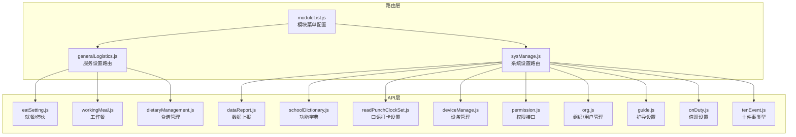
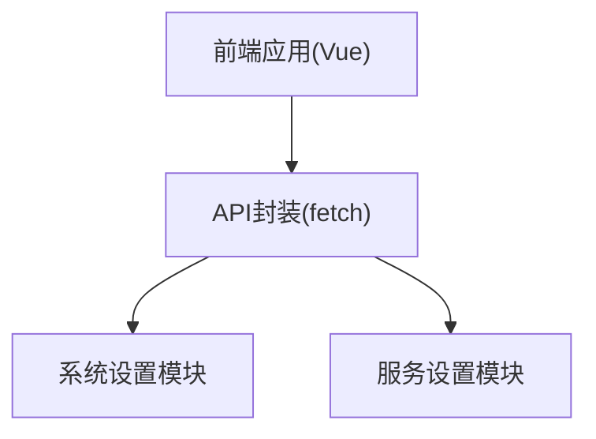
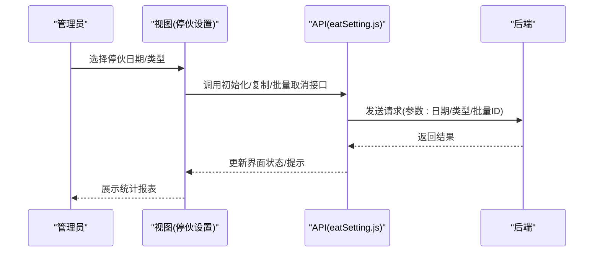
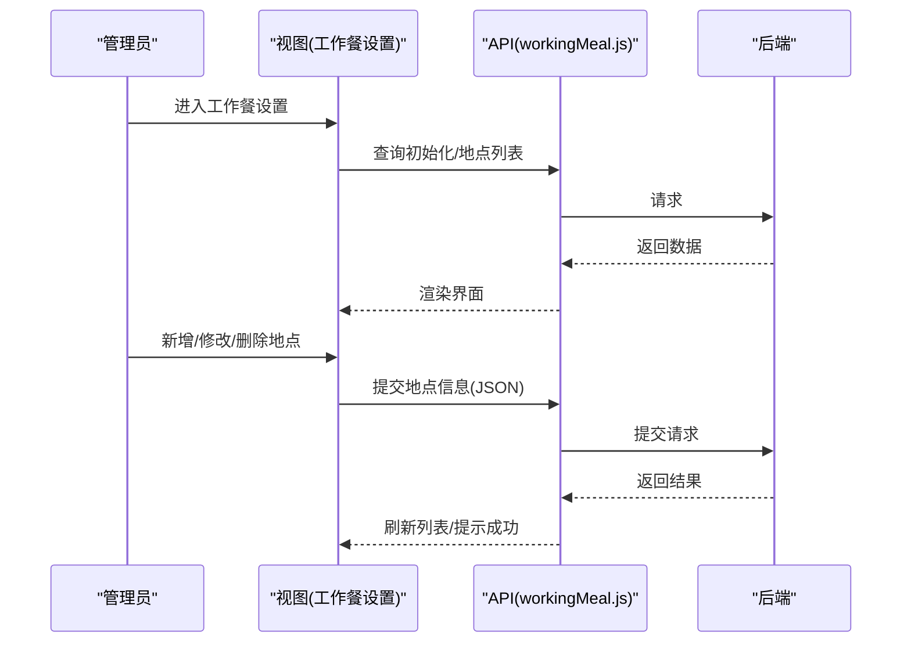
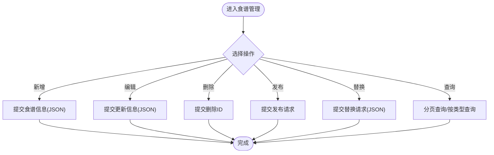
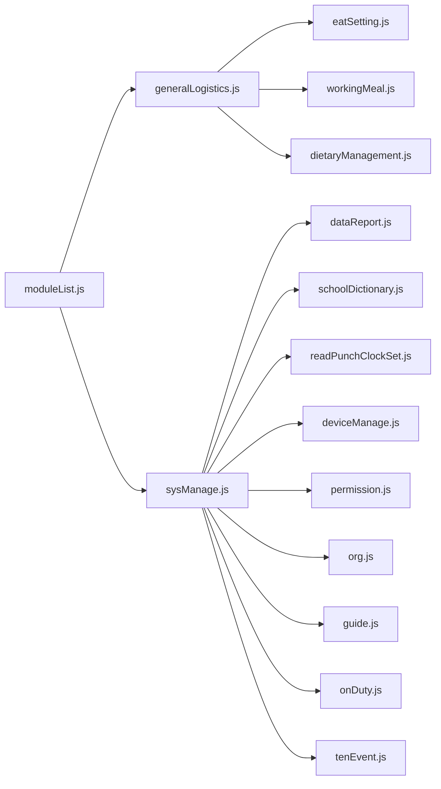

# 校园服务设置

<cite>
**本文引用的文件**
- [eatSetting.js](file://src/api/eatSetting.js)
- [workingMeal.js](file://src/api/workingMeal.js)
- [dietaryManagement.js](file://src/api/dietaryManagement.js)
- [dataReport.js](file://src/api/systemSet/dataReport.js)
- [schoolDictionary.js](file://src/api/systemSet/schoolDictionary.js)
- [readPunchClockSet.js](file://src/api/systemSet/readPunchClockSet.js)
- [deviceManage.js](file://src/api/systemSet/deviceManage.js)
- [permission.js](file://src/api/systemSet/permission.js)
- [org.js](file://src/api/systemSet/org.js)
- [guide.js](file://src/api/systemSet/guide.js)
- [onDuty.js](file://src/api/systemSet/onDuty.js)
- [tenEvent.js](file://src/api/systemSet/tenEvent.js)
- [moduleList.js](file://src/router/moduleList.js)
- [generalLogistics.js](file://src/router/generalLogistics.js)
- [sysManage.js](file://src/router/sysManage.js)
- [readPunchClock.js](file://src/api/readPunchClock.js)
- [schoolCalendar.js](file://src/api/schoolCalendar.js)
- [schoolbasedcurriculum.js](file://src/api/systemSet/schoolbasedcurriculum.js)
- [Intelligencecourse.js](file://src/api/Intelligencecourse.js)
</cite>

## 目录
1. [引言](#引言)
2. [项目结构](#项目结构)
3. [核心组件](#核心组件)
4. [架构总览](#架构总览)
5. [详细组件分析](#详细组件分析)
6. [依赖关系分析](#依赖关系分析)
7. [性能考虑](#性能考虑)
8. [故障排查指南](#故障排查指南)
9. [结论](#结论)
10. [附录](#附录)

## 引言
本技术文档聚焦“校园服务设置”功能，覆盖以下两大维度：
- 服务功能：就餐管理、停伙管理、工作餐管理、数据上报、口语打卡等日常服务配置与运行。
- 系统管理：模块管理、使用统计、用户分析、功能字典等系统运维能力。

文档从数据结构、业务流程、配置参数、接口规范、批量配置与导入导出机制、监控告警与性能优化等方面进行系统化梳理，并给出可视化图示与实践建议，帮助开发者与运维人员快速理解与落地。

## 项目结构
前端采用 Vue + Element UI 架构，服务设置相关代码主要分布在如下位置：
- API 层：统一通过 fetch 封装调用后端接口，按功能域拆分在 src/api 下。
- 路由层：在 src/router 中定义模块路由与页面跳转，涵盖服务设置与系统管理。
- 视图层：对应路由的页面组件位于 src/views 下，承载具体配置界面与交互逻辑。

图表来源
- [moduleList.js:926-2356](file://src/router/moduleList.js#L926-L2356)
- [generalLogistics.js:550-722](file://src/router/generalLogistics.js#L550-L722)
- [sysManage.js:449-486](file://src/router/sysManage.js#L449-L486)
- [eatSetting.js:1-275](file://src/api/eatSetting.js#L1-L275)
- [workingMeal.js:1-91](file://src/api/workingMeal.js#L1-L91)
- [dietaryManagement.js:1-295](file://src/api/dietaryManagement.js#L1-L295)
- [dataReport.js:1-26](file://src/api/systemSet/dataReport.js#L1-L26)
- [schoolDictionary.js:1-188](file://src/api/systemSet/schoolDictionary.js#L1-L188)
- [readPunchClockSet.js:1-51](file://src/api/systemSet/readPunchClockSet.js#L1-L51)
- [deviceManage.js:1-189](file://src/api/systemSet/deviceManage.js#L1-L189)
- [permission.js:1-40](file://src/api/systemSet/permission.js#L1-L40)
- [org.js:1-800](file://src/api/systemSet/org.js#L1-L800)
- [guide.js:1-316](file://src/api/systemSet/guide.js#L1-L316)
- [onDuty.js:1-83](file://src/api/systemSet/onDuty.js#L1-L83)
- [tenEvent.js:1-71](file://src/api/systemSet/tenEvent.js#L1-L71)

章节来源
- [moduleList.js:926-2356](file://src/router/moduleList.js#L926-L2356)
- [generalLogistics.js:550-722](file://src/router/generalLogistics.js#L550-L722)
- [sysManage.js:449-486](file://src/router/sysManage.js#L449-L486)

## 核心组件
本节对关键服务与系统设置组件进行概览性说明，后续章节将深入其数据结构、流程与接口。

- 就餐管理与停伙管理
  - 支持不就餐人员维护、就餐地点管理、批量停伙设置、停伙日期初始化、复制上学期停伙设置、批量取消停伙等。
  - 提供停伙统计、缺餐/加餐统计、个人停伙次数统计等报表入口。
- 工作餐管理
  - 初始化设置、地点列表查询/新增/修改/删除、按日期查询订单、部门列表等。
- 食谱管理
  - 学校食谱与系统菜品的增删改查、审核设置、专家食谱、周次与学期查询、食物替换、元素含量查询、按类型获取周食谱等。
- 数据上报
  - 初始化设置查询与新增/修改。
- 功能字典
  - 字典类型、字典项、字典值的增删改查与分页列表。
- 口语打卡设置
  - 年级列表查询、打卡设置读取与保存。
- 设备管理
  - 扫码设备全量查询、新增/编辑、批量删除；设备用户查询、新增、同步、提醒未上传照片等；设备库查询。
- 权限与组织
  - 用户权限查询、子权限获取；部门树、用户列表、年级列表；教师/学生新增/修改/删除、移动、同步、启用/禁用、详情查询等。
- 护导与值班
  - 护导组/岗管理、提醒设置、负责人安排、周列表、时间设置、导出与复制。
- 十件事类型
  - 年级列表、事件类型增删改、按年级查询事件详情。

章节来源
- [eatSetting.js:1-275](file://src/api/eatSetting.js#L1-L275)
- [workingMeal.js:1-91](file://src/api/workingMeal.js#L1-L91)
- [dietaryManagement.js:1-295](file://src/api/dietaryManagement.js#L1-L295)
- [dataReport.js:1-26](file://src/api/systemSet/dataReport.js#L1-L26)
- [schoolDictionary.js:1-188](file://src/api/systemSet/schoolDictionary.js#L1-L188)
- [readPunchClockSet.js:1-51](file://src/api/systemSet/readPunchClockSet.js#L1-L51)
- [deviceManage.js:1-189](file://src/api/systemSet/deviceManage.js#L1-L189)
- [permission.js:1-40](file://src/api/systemSet/permission.js#L1-L40)
- [org.js:1-800](file://src/api/systemSet/org.js#L1-L800)
- [guide.js:1-316](file://src/api/systemSet/guide.js#L1-L316)
- [onDuty.js:1-83](file://src/api/systemSet/onDuty.js#L1-L83)
- [tenEvent.js:1-71](file://src/api/systemSet/tenEvent.js#L1-L71)

## 架构总览
前端通过 API 层封装请求，路由层组织模块与页面，视图层承载业务界面。系统设置与服务设置均以模块化方式接入路由，便于权限控制与菜单管理。

图表来源
- [moduleList.js:926-2356](file://src/router/moduleList.js#L926-L2356)
- [sysManage.js:449-486](file://src/router/sysManage.js#L449-L486)
- [generalLogistics.js:550-722](file://src/router/generalLogistics.js#L550-L722)

## 详细组件分析

### 就餐管理与停伙管理
- 数据结构要点
  - 不就餐人员：包含用户标识、生效范围、停伙日期等。
  - 就餐地点：包含名称、容量、区域、二维码等。
  - 停伙设置：按学期/年级/班级维度配置停伙日期、停伙类型、管理日期等。
- 业务流程
  - 初始化停伙日期与复制上学期设置，支持批量取消停伙。
  - 按餐厅/班级/年级维度查询就餐人员与变更就餐时间。
  - 统计停伙、缺餐、加餐、个人停伙次数等。
- 接口规范
  - 增删改查与批量操作接口集中在 eatSetting.js，统一使用 URLSearchParams 或 JSON 提交。
- 批量配置与导入导出
  - 支持批量取消停伙（JSON 提交）。
  - 停伙统计、缺餐/加餐统计、个人停伙次数统计等报表页面路由在 generalLogistics.js 中定义。

图表来源
- [eatSetting.js:111-133](file://src/api/eatSetting.js#L111-L133)
- [eatSetting.js:266-275](file://src/api/eatSetting.js#L266-L275)
- [generalLogistics.js:554-722](file://src/router/generalLogistics.js#L554-L722)

章节来源
- [eatSetting.js:1-275](file://src/api/eatSetting.js#L1-L275)
- [generalLogistics.js:550-722](file://src/router/generalLogistics.js#L550-L722)

### 工作餐管理
- 数据结构要点
  - 地点：名称、地址、负责人、联系方式等。
  - 订单：按日期区间查询，包含部门、起止时间等。
- 业务流程
  - 初始化工作餐设置，维护地点列表，按日期查询订单，支持新增/修改/删除地点。
- 接口规范
  - 初始化设置(JSON)、地点列表分页查询、新增/修改/删除地点、按日期查询订单、部门列表查询。

图表来源
- [workingMeal.js:1-91](file://src/api/workingMeal.js#L1-L91)

章节来源
- [workingMeal.js:1-91](file://src/api/workingMeal.js#L1-L91)

### 食谱管理
- 数据结构要点
  - 食谱：包含周一至周日菜品、周次、名称、是否展示等。
  - 菜品：名称、图片、类型、备注、材料JSON等。
  - 审核设置：是否需要审核、推送教师、审核用户集合等。
- 业务流程
  - 新增/编辑/删除食谱；发布食谱；替换菜品；按元素查询高含量食物；按类型获取周食谱。
  - 系统菜品与学校食谱的增删改查与分页查询。
- 接口规范
  - 食谱与菜品的增删改查、分页查询、发布、替换、元素查询、类型查询等。

图表来源
- [dietaryManagement.js:1-295](file://src/api/dietaryManagement.js#L1-L295)

章节来源
- [dietaryManagement.js:1-295](file://src/api/dietaryManagement.js#L1-L295)

### 数据上报
- 数据结构要点
  - 初始化设置：包含上报周期、接收人、开关等。
- 业务流程
  - 查询初始化设置，支持新增/修改。
- 接口规范
  - JSON 提交初始化设置。

章节来源
- [dataReport.js:1-26](file://src/api/systemSet/dataReport.js#L1-L26)

### 功能字典
- 数据结构要点
  - 字典类型：编码、名称、备注、排序等。
  - 字典项：类型编码、名称、备注、排序等。
  - 字典值：键值、排序、备注等。
- 业务流程
  - 类型/项/值的增删改查与分页列表查询。
- 接口规范
  - 统一使用 URLSearchParams 提交参数。

章节来源
- [schoolDictionary.js:1-188](file://src/api/systemSet/schoolDictionary.js#L1-L188)

### 口语打卡设置
- 数据结构要点
  - 年级列表：按学校类型查询。
  - 打卡设置：是否全校、年级列表JSON、预警开关等。
- 业务流程
  - 查询年级列表，读取/保存打卡设置。
- 接口规范
  - 读取/保存使用 URLSearchParams 提交。

章节来源
- [readPunchClockSet.js:1-51](file://src/api/systemSet/readPunchClockSet.js#L1-L51)
- [readPunchClock.js:112-160](file://src/api/readPunchClock.js#L112-L160)

### 设备管理
- 数据结构要点
  - 设备：设备ID、类型、模块、状态、用途等。
  - 设备用户：扫描ID、用户名、用户类型等。
- 业务流程
  - 全量查询设备、新增/编辑/批量删除；查询设备用户、新增用户、按部门批量新增、同步用户、提醒未上传照片；设备库查询。
- 接口规范
  - 新增/编辑/同步/提醒等使用 JSON 提交。

章节来源
- [deviceManage.js:1-189](file://src/api/systemSet/deviceManage.js#L1-L189)

### 权限与组织
- 数据结构要点
  - 权限：用户权限、子权限。
  - 组织：部门树、用户列表、年级列表、角色列表。
  - 用户：教师/学生基础信息、移动、同步、启用/禁用、详情等。
- 业务流程
  - 查询用户权限与子权限；部门与用户管理；教师/学生新增/修改/删除与移动；同步部门与用户；启用/禁用用户；详情查询。
- 接口规范
  - 多数使用 URLSearchParams，部分新增/修改使用 JSON 提交。

章节来源
- [permission.js:1-40](file://src/api/systemSet/permission.js#L1-L40)
- [org.js:1-800](file://src/api/systemSet/org.js#L1-L800)

### 护导与值班
- 数据结构要点
  - 护导组：名称、检查员JSON、汇报用户JSON、节假日配置等。
  - 护导岗：所属组、地点、备注等。
  - 值班：周列表、每周信息、二维码等。
  - 十件事类型：按年级分组的事件类型列表。
- 业务流程
  - 护导组/岗的增删改查、提醒设置、负责人安排、周列表与时间设置、导出与复制。
  - 值班设置的查询、新增/修改、复制上周、清空当周。
  - 十件事类型的增删改与按年级查询。
- 接口规范
  - 多数使用 URLSearchParams 提交，部分 JSON 提交。

章节来源
- [guide.js:1-316](file://src/api/systemSet/guide.js#L1-L316)
- [onDuty.js:1-83](file://src/api/systemSet/onDuty.js#L1-L83)
- [tenEvent.js:1-71](file://src/api/systemSet/tenEvent.js#L1-L71)

## 依赖关系分析
- 模块耦合
  - 服务设置模块与系统设置模块通过路由独立管理，避免强耦合。
  - API 层统一使用 fetch 封装，降低重复代码与提升一致性。
- 外部依赖
  - 组织与权限接口依赖 ucenter-web 服务，需关注跨域与超时配置。
- 路由与页面
  - 服务设置路由集中于 generalLogistics.js，系统设置路由集中于 sysManage.js，模块菜单在 moduleList.js 中统一配置。

图表来源
- [moduleList.js:926-2356](file://src/router/moduleList.js#L926-L2356)
- [generalLogistics.js:550-722](file://src/router/generalLogistics.js#L550-L722)
- [sysManage.js:449-486](file://src/router/sysManage.js#L449-L486)

章节来源
- [moduleList.js:926-2356](file://src/router/moduleList.js#L926-L2356)
- [generalLogistics.js:550-722](file://src/router/generalLogistics.js#L550-L722)
- [sysManage.js:449-486](file://src/router/sysManage.js#L449-L486)

## 性能考虑
- 请求合并与去重
  - 对频繁触发的查询（如设备用户列表、学期/周列表）建议增加本地缓存与防抖。
- 分页与懒加载
  - 大列表（食谱、菜品、字典值）应使用分页与虚拟滚动，减少首屏渲染压力。
- 超时与重试
  - 对外部服务（如 ucenter-web）设置合理超时与重试策略，避免阻塞主线程。
- 图片与资源
  - 食谱与菜品图片建议压缩与懒加载，结合 CDN 提升加载速度。
- 批量操作
  - 批量取消停伙、批量删除设备等操作建议提供进度反馈与错误回滚。

## 故障排查指南
- 常见问题定位
  - 接口失败：检查请求头 Content-Type 是否正确（JSON/URLSearchParams），确认后端接口路径与参数名一致。
  - 权限不足：确认 getUserPerm 与 getNewUserSonPerm 的返回是否包含所需权限。
  - 外部服务异常：关注 org.js 中 ucenter-web 的超时与跨域配置。
- 日志与监控
  - 在 fetch 封装中增加请求日志与错误捕获，记录响应状态与错误信息。
  - 对高频接口（如设备用户同步、口语打卡统计）增加埋点与告警阈值。
- 用户体验
  - 对长耗时操作（如同步用户、生成报表）提供 Loading 与取消按钮。
  - 对批量操作提供预览与二次确认，避免误操作。

章节来源
- [permission.js:15-40](file://src/api/systemSet/permission.js#L15-L40)
- [org.js:13-16](file://src/api/systemSet/org.js#L13-L16)

## 结论
本文档系统梳理了校园服务设置的功能边界、数据结构、业务流程与接口规范，并给出了路由与模块化的实现路径。通过统一的 API 封装与清晰的模块划分，能够有效支撑服务功能与系统运维的持续演进。建议在后续迭代中完善监控告警、性能优化与用户体验细节，确保系统的稳定性与可维护性。

## 附录
- API 接口清单（示例）
  - 就餐管理：初始化停伙、复制上学期设置、批量取消停伙、查询不就餐人员、编辑就餐时间等。
  - 工作餐：初始化设置、地点列表、新增/修改/删除地点、按日期查询订单、部门列表。
  - 食谱管理：食谱增删改查、发布、替换菜品、元素查询、类型查询、系统菜品管理。
  - 数据上报：初始化设置查询与新增/修改。
  - 功能字典：类型/项/值的增删改查与分页列表。
  - 口语打卡：年级列表查询、打卡设置读取与保存。
  - 设备管理：设备全量查询、新增/编辑/批量删除、设备用户查询/新增/同步/提醒、设备库查询。
  - 权限与组织：用户权限查询、子权限获取、部门/用户/年级/角色管理、新增/修改/删除/移动/同步/启用/禁用/详情。
  - 护导与值班：护导组/岗管理、提醒设置、负责人安排、周列表与时间设置、导出与复制；值班设置查询、新增/修改、复制上周、清空当周。
  - 十件事类型：事件类型增删改与按年级查询。

章节来源
- [eatSetting.js:1-275](file://src/api/eatSetting.js#L1-L275)
- [workingMeal.js:1-91](file://src/api/workingMeal.js#L1-L91)
- [dietaryManagement.js:1-295](file://src/api/dietaryManagement.js#L1-L295)
- [dataReport.js:1-26](file://src/api/systemSet/dataReport.js#L1-L26)
- [schoolDictionary.js:1-188](file://src/api/systemSet/schoolDictionary.js#L1-L188)
- [readPunchClockSet.js:1-51](file://src/api/systemSet/readPunchClockSet.js#L1-L51)
- [deviceManage.js:1-189](file://src/api/systemSet/deviceManage.js#L1-L189)
- [permission.js:1-40](file://src/api/systemSet/permission.js#L1-L40)
- [org.js:1-800](file://src/api/systemSet/org.js#L1-L800)
- [guide.js:1-316](file://src/api/systemSet/guide.js#L1-L316)
- [onDuty.js:1-83](file://src/api/systemSet/onDuty.js#L1-L83)
- [tenEvent.js:1-71](file://src/api/systemSet/tenEvent.js#L1-L71)