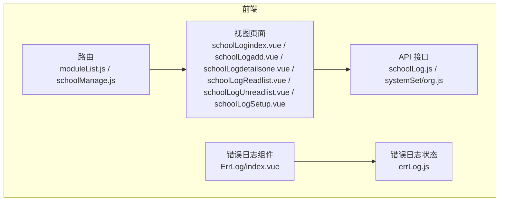
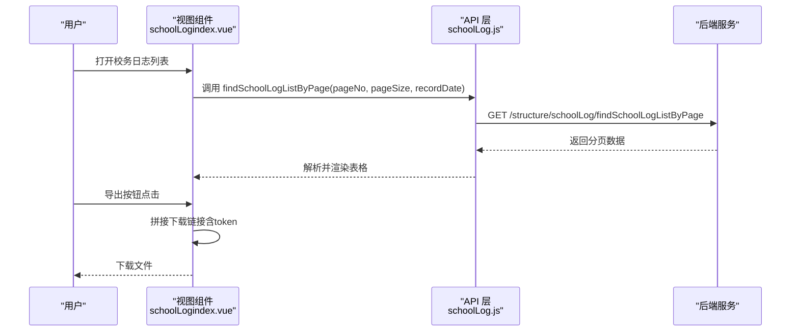
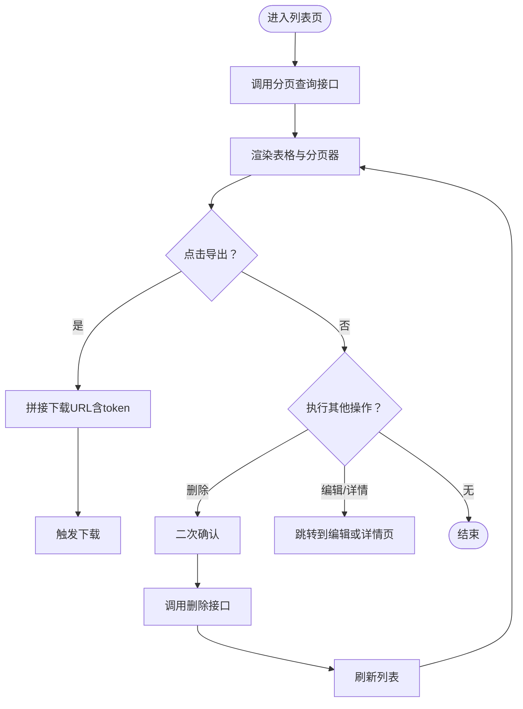
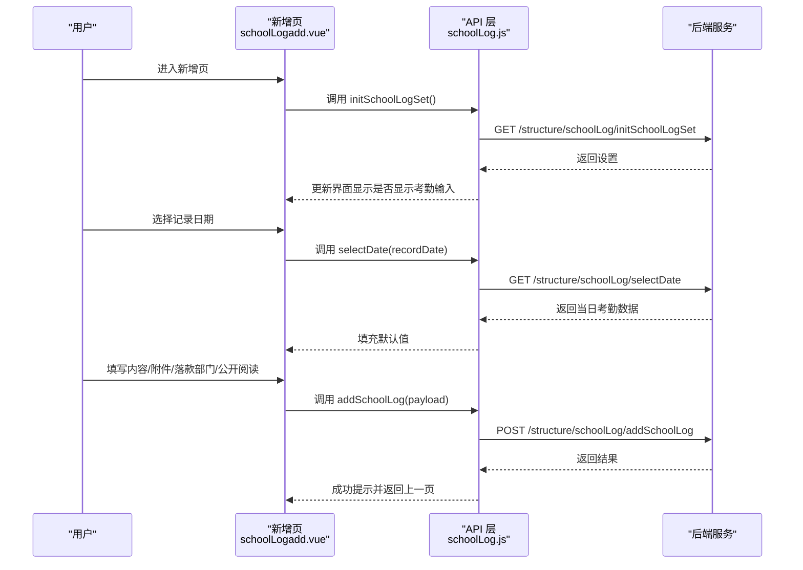
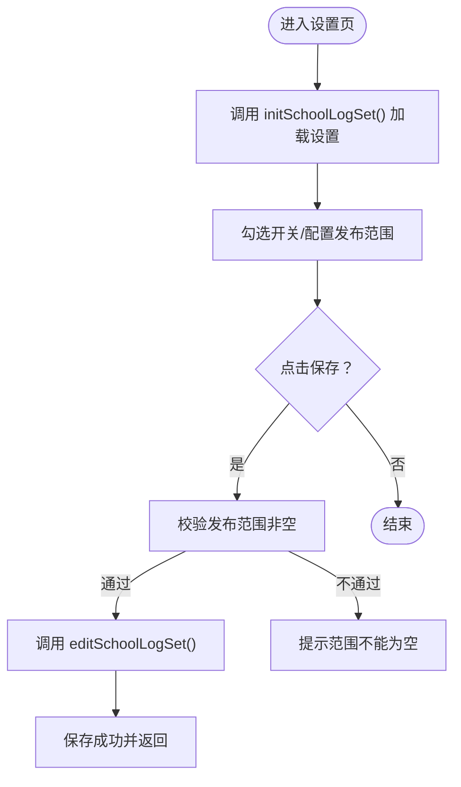
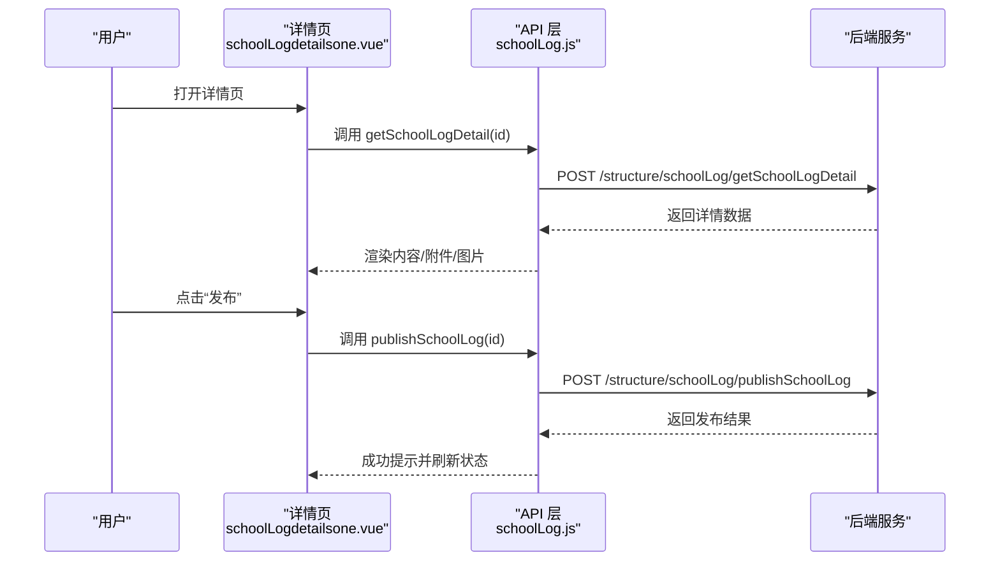
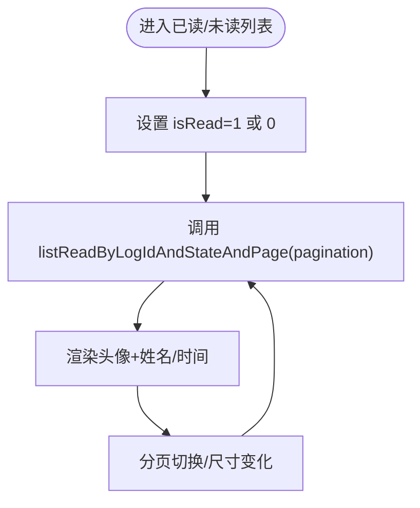
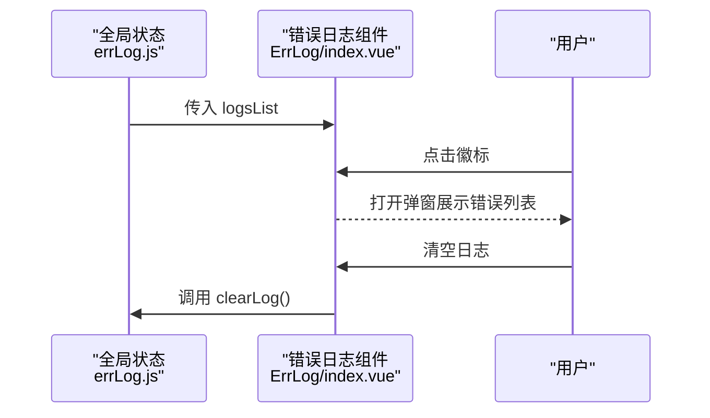
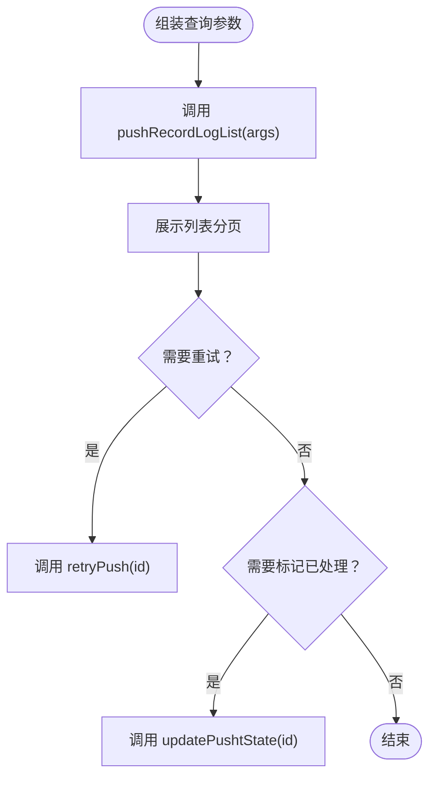
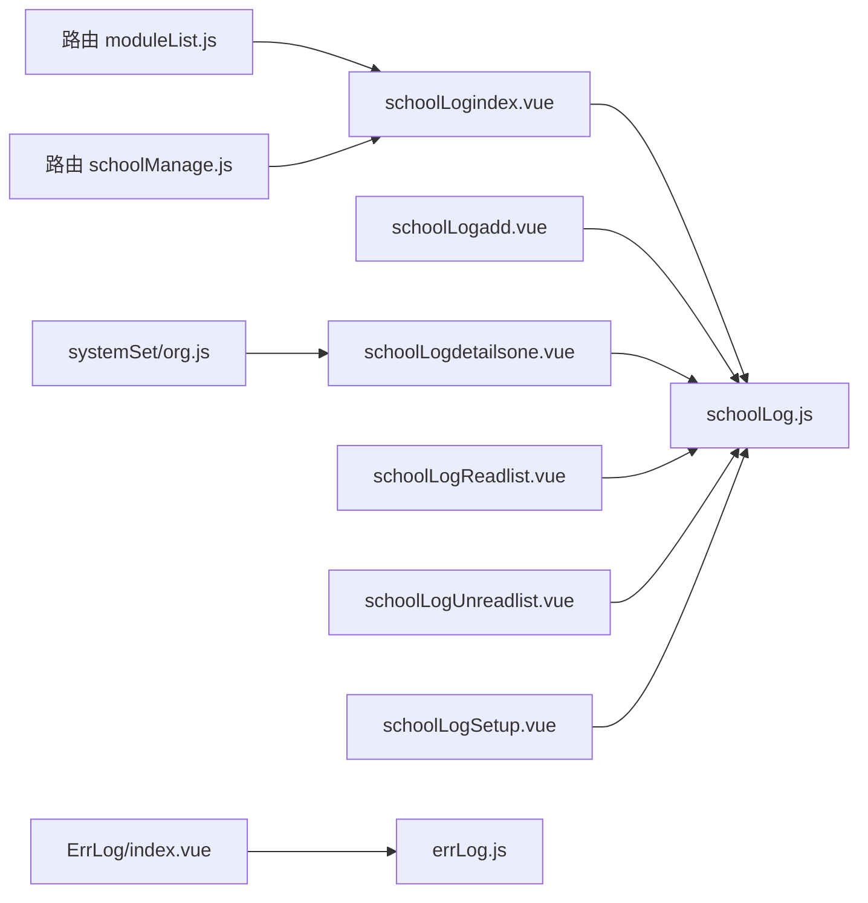

# 日志审计管理

<cite>
**本文引用的文件**
- [src/api/schoolLog.js](file://src/api/schoolLog.js)
- [src/views/schoolLog/schoolLogindex.vue](file://src/views/schoolLog/schoolLogindex.vue)
- [src/views/schoolLog/schoolLogadd.vue](file://src/views/schoolLog/schoolLogadd.vue)
- [src/views/schoolLog/schoolLogSetup.vue](file://src/views/schoolLog/schoolLogSetup.vue)
- [src/views/schoolLog/schoolLogdetailsone.vue](file://src/views/schoolLog/schoolLogdetailsone.vue)
- [src/views/schoolLog/schoolLogReadlist.vue](file://src/views/schoolLog/schoolLogReadlist.vue)
- [src/views/schoolLog/schoolLogUnreadlist.vue](file://src/views/schoolLog/schoolLogUnreadlist.vue)
- [src/components/ErrLog/index.vue](file://src/components/ErrLog/index.vue)
- [src/store/errLog.js](file://src/store/errLog.js)
- [src/router/moduleList.js](file://src/router/moduleList.js)
- [src/router/system/schoolManage.js](file://src/router/system/schoolManage.js)
- [src/api/systemSet/org.js](file://src/api/systemSet/org.js)
</cite>

## 目录
1. [简介](#简介)
2. [项目结构](#项目结构)
3. [核心组件](#核心组件)
4. [架构总览](#架构总览)
5. [详细组件分析](#详细组件分析)
6. [依赖关系分析](#依赖关系分析)
7. [性能考虑](#性能考虑)
8. [故障排查指南](#故障排查指南)
9. [结论](#结论)
10. [附录](#附录)

## 简介
本技术文档围绕“日志审计管理”功能进行系统化梳理，覆盖以下方面：
- 系统日志采集机制：操作日志、访问日志、错误日志的记录格式与存储策略
- 日志查询能力：过滤、搜索条件、排序规则与分页实现
- 审计数据结构：字段定义、索引设计与性能优化建议
- 日志分析：用户行为分析、系统使用统计与异常检测思路
- 日志管理API：接口规范、导出与归档策略
- 安全与隐私：访问控制、数据脱敏与最小可见原则
- 错误日志：收集、分类、处理流程与监控告警配置

本项目在前端侧提供了“校务日志”的完整增删改查与发布流程，并配套了错误日志展示组件；同时在系统设置模块中提供了通用的“推送记录日志”查询接口，可用于对接后端审计与监控体系。

## 项目结构
与日志审计相关的核心文件分布如下：
- API层：封装与后端交互的接口函数（校务日志、推送记录日志）
- 视图层：校务日志的列表、新增、设置、详情、已读/未读人员列表等页面
- 组件层：错误日志弹窗组件与全局错误日志状态管理
- 路由层：系统管理与日志管理入口路由配置
- 系统设置API：提供推送记录日志的查询、重试、标记处理等能力

图表来源
- [src/router/moduleList.js:2303-2308](file://src/router/moduleList.js#L2303-L2308)
- [src/router/system/schoolManage.js:605-640](file://src/router/system/schoolManage.js#L605-L640)
- [src/api/schoolLog.js:1-130](file://src/api/schoolLog.js#L1-L130)
- [src/api/systemSet/org.js:1252-1292](file://src/api/systemSet/org.js#L1252-L1292)
- [src/views/schoolLog/schoolLogindex.vue:1-156](file://src/views/schoolLog/schoolLogindex.vue#L1-L156)
- [src/views/schoolLog/schoolLogadd.vue:1-299](file://src/views/schoolLog/schoolLogadd.vue#L1-L299)
- [src/views/schoolLog/schoolLogdetailsone.vue:1-345](file://src/views/schoolLog/schoolLogdetailsone.vue#L1-L345)
- [src/views/schoolLog/schoolLogReadlist.vue:1-98](file://src/views/schoolLog/schoolLogReadlist.vue#L1-L98)
- [src/views/schoolLog/schoolLogUnreadlist.vue:1-92](file://src/views/schoolLog/schoolLogUnreadlist.vue#L1-L92)
- [src/views/schoolLog/schoolLogSetup.vue:1-180](file://src/views/schoolLog/schoolLogSetup.vue#L1-L180)
- [src/components/ErrLog/index.vue:1-52](file://src/components/ErrLog/index.vue#L1-L52)
- [src/store/errLog.js:1-14](file://src/store/errLog.js#L1-L14)

章节来源
- [src/router/moduleList.js:2303-2308](file://src/router/moduleList.js#L2303-L2308)
- [src/router/system/schoolManage.js:605-640](file://src/router/system/schoolManage.js#L605-L640)
- [src/api/schoolLog.js:1-130](file://src/api/schoolLog.js#L1-L130)
- [src/api/systemSet/org.js:1252-1292](file://src/api/systemSet/org.js#L1252-L1292)
- [src/views/schoolLog/schoolLogindex.vue:1-156](file://src/views/schoolLog/schoolLogindex.vue#L1-L156)
- [src/views/schoolLog/schoolLogadd.vue:1-299](file://src/views/schoolLog/schoolLogadd.vue#L1-L299)
- [src/views/schoolLog/schoolLogdetailsone.vue:1-345](file://src/views/schoolLog/schoolLogdetailsone.vue#L1-L345)
- [src/views/schoolLog/schoolLogReadlist.vue:1-98](file://src/views/schoolLog/schoolLogReadlist.vue#L1-L98)
- [src/views/schoolLog/schoolLogUnreadlist.vue:1-92](file://src/views/schoolLog/schoolLogUnreadlist.vue#L1-L92)
- [src/views/schoolLog/schoolLogSetup.vue:1-180](file://src/views/schoolLog/schoolLogSetup.vue#L1-L180)
- [src/components/ErrLog/index.vue:1-52](file://src/components/ErrLog/index.vue#L1-L52)
- [src/store/errLog.js:1-14](file://src/store/errLog.js#L1-L14)

## 核心组件
- 校务日志管理：提供列表、新增、设置、详情、发布、导出、已读/未读人员统计与分页查询
- 错误日志展示：以弹窗形式展示前端捕获到的错误信息，支持查看堆栈
- 系统设置日志：提供推送记录日志的查询、重试与状态更新接口

章节来源
- [src/views/schoolLog/schoolLogindex.vue:61-136](file://src/views/schoolLog/schoolLogindex.vue#L61-L136)
- [src/views/schoolLog/schoolLogadd.vue:81-236](file://src/views/schoolLog/schoolLogadd.vue#L81-L236)
- [src/views/schoolLog/schoolLogSetup.vue:34-147](file://src/views/schoolLog/schoolLogSetup.vue#L34-L147)
- [src/views/schoolLog/schoolLogdetailsone.vue:77-237](file://src/views/schoolLog/schoolLogdetailsone.vue#L77-L237)
- [src/views/schoolLog/schoolLogReadlist.vue:23-64](file://src/views/schoolLog/schoolLogReadlist.vue#L23-L64)
- [src/views/schoolLog/schoolLogUnreadlist.vue:22-58](file://src/views/schoolLog/schoolLogUnreadlist.vue#L22-L58)
- [src/components/ErrLog/index.vue:28-41](file://src/components/ErrLog/index.vue#L28-L41)
- [src/api/systemSet/org.js:1252-1292](file://src/api/systemSet/org.js#L1252-L1292)

## 架构总览
前端通过API层调用后端接口，完成日志的增删改查、发布与导出；错误日志通过组件与状态管理进行展示与清空；系统设置模块提供通用的推送记录日志查询能力。

图表来源
- [src/views/schoolLog/schoolLogindex.vue:95-103](file://src/views/schoolLog/schoolLogindex.vue#L95-L103)
- [src/api/schoolLog.js:3-12](file://src/api/schoolLog.js#L3-L12)

章节来源
- [src/views/schoolLog/schoolLogindex.vue:95-103](file://src/views/schoolLog/schoolLogindex.vue#L95-L103)
- [src/api/schoolLog.js:3-12](file://src/api/schoolLog.js#L3-L12)

## 详细组件分析

### 校务日志列表页（查询与导出）
- 功能要点
  - 支持按日期筛选与分页查询
  - 提供导出功能，下载链接拼接当前token
  - 支持删除、编辑、查看详情
- 关键流程
  - 列表加载：调用分页查询接口，更新表格与分页器
  - 删除：二次确认后调用删除接口
  - 导出：动态生成带token的下载地址

图表来源
- [src/views/schoolLog/schoolLogindex.vue:95-118](file://src/views/schoolLog/schoolLogindex.vue#L95-L118)
- [src/api/schoolLog.js:3-12](file://src/api/schoolLog.js#L3-L12)

章节来源
- [src/views/schoolLog/schoolLogindex.vue:61-136](file://src/views/schoolLog/schoolLogindex.vue#L61-L136)
- [src/api/schoolLog.js:3-12](file://src/api/schoolLog.js#L3-L12)

### 校务日志新增页（设置联动与保存）
- 功能要点
  - 初始化设置：根据“是否添加考勤数据”决定是否显示考勤输入项
  - 日期联动：选择日期后拉取当日考勤数据填充默认值
  - 保存：组装内容、附件、落款部门、是否公开阅读等字段提交
- 关键流程
  - 初始化设置 -> 日期变更 -> 拉取考勤数据 -> 用户填写 -> 保存

图表来源
- [src/views/schoolLog/schoolLogadd.vue:136-159](file://src/views/schoolLog/schoolLogadd.vue#L136-L159)
- [src/views/schoolLog/schoolLogadd.vue:222-234](file://src/views/schoolLog/schoolLogadd.vue#L222-L234)
- [src/api/schoolLog.js:36-41](file://src/api/schoolLog.js#L36-L41)
- [src/api/schoolLog.js:63-71](file://src/api/schoolLog.js#L63-L71)
- [src/api/schoolLog.js:73-82](file://src/api/schoolLog.js#L73-L82)

章节来源
- [src/views/schoolLog/schoolLogadd.vue:81-236](file://src/views/schoolLog/schoolLogadd.vue#L81-L236)
- [src/api/schoolLog.js:36-41](file://src/api/schoolLog.js#L36-L41)
- [src/api/schoolLog.js:63-71](file://src/api/schoolLog.js#L63-L71)
- [src/api/schoolLog.js:73-82](file://src/api/schoolLog.js#L73-L82)

### 校务日志设置页（发布范围与开关）
- 功能要点
  - 开关：是否添加考勤/检查/日程数据；是否需要发布
  - 发布范围：通过地址簿组件选择部门/组/用户
  - 保存：校验发布范围非空后提交设置
- 关键流程
  - 加载设置 -> 修改开关/范围 -> 保存并提示

图表来源
- [src/views/schoolLog/schoolLogSetup.vue:63-91](file://src/views/schoolLog/schoolLogSetup.vue#L63-L91)
- [src/views/schoolLog/schoolLogSetup.vue:94-146](file://src/views/schoolLog/schoolLogSetup.vue#L94-L146)
- [src/api/schoolLog.js:25-34](file://src/api/schoolLog.js#L25-L34)

章节来源
- [src/views/schoolLog/schoolLogSetup.vue:34-147](file://src/views/schoolLog/schoolLogSetup.vue#L34-L147)
- [src/api/schoolLog.js:25-34](file://src/api/schoolLog.js#L25-L34)

### 校务日志详情页（发布、阅读统计、附件/图片）
- 功能要点
  - 发布：草稿态可发布
  - 阅读统计：已读/未读人数与跳转
  - 内容渲染：富文本、附件列表、图片预览
- 关键流程
  - 加载详情 -> 渲染内容 -> 可发布时显示发布按钮 -> 查看阅读统计

图表来源
- [src/views/schoolLog/schoolLogdetailsone.vue:135-176](file://src/views/schoolLog/schoolLogdetailsone.vue#L135-L176)
- [src/views/schoolLog/schoolLogdetailsone.vue:178-198](file://src/views/schoolLog/schoolLogdetailsone.vue#L178-L198)
- [src/api/schoolLog.js:43-51](file://src/api/schoolLog.js#L43-L51)
- [src/api/schoolLog.js:53-61](file://src/api/schoolLog.js#L53-L61)

章节来源
- [src/views/schoolLog/schoolLogdetailsone.vue:77-237](file://src/views/schoolLog/schoolLogdetailsone.vue#L77-L237)
- [src/api/schoolLog.js:43-51](file://src/api/schoolLog.js#L43-L51)
- [src/api/schoolLog.js:53-61](file://src/api/schoolLog.js#L53-L61)

### 已读/未读人员列表（分页与筛选）
- 功能要点
  - 仅区分已读/未读两种状态
  - 分页查询，展示头像、姓名、阅读时间（已读）
- 关键流程
  - 设置 isRead 参数 -> 分页查询 -> 渲染列表

图表来源
- [src/views/schoolLog/schoolLogReadlist.vue:57-62](file://src/views/schoolLog/schoolLogReadlist.vue#L57-L62)
- [src/views/schoolLog/schoolLogUnreadlist.vue:51-56](file://src/views/schoolLog/schoolLogUnreadlist.vue#L51-L56)
- [src/api/schoolLog.js:119-130](file://src/api/schoolLog.js#L119-L130)

章节来源
- [src/views/schoolLog/schoolLogReadlist.vue:23-64](file://src/views/schoolLog/schoolLogReadlist.vue#L23-L64)
- [src/views/schoolLog/schoolLogUnreadlist.vue:22-58](file://src/views/schoolLog/schoolLogUnreadlist.vue#L22-L58)
- [src/api/schoolLog.js:119-130](file://src/api/schoolLog.js#L119-L130)

### 错误日志组件与状态管理
- 功能要点
  - 弹窗展示错误列表（message、url、stack）
  - 支持清空日志
  - 作为全局兜底展示错误信息
- 关键流程
  - 组件接收日志数组 -> 点击徽标打开弹窗 -> 查看/清空

图表来源
- [src/store/errLog.js:1-14](file://src/store/errLog.js#L1-L14)
- [src/components/ErrLog/index.vue:28-41](file://src/components/ErrLog/index.vue#L28-L41)

章节来源
- [src/store/errLog.js:1-14](file://src/store/errLog.js#L1-L14)
- [src/components/ErrLog/index.vue:1-52](file://src/components/ErrLog/index.vue#L1-L52)

### 系统设置日志（推送记录日志）
- 功能要点
  - 查询：按应用名、HTTP状态码、消息ID、事件类型、时间段、检索内容等条件查询
  - 处理：重试推送、更新处理状态
- 关键流程
  - 组装查询参数 -> 调用 list 接口 -> 展示列表 -> 重试/标记处理

图表来源
- [src/api/systemSet/org.js:1252-1292](file://src/api/systemSet/org.js#L1252-L1292)

章节来源
- [src/api/systemSet/org.js:1252-1292](file://src/api/systemSet/org.js#L1252-L1292)

## 依赖关系分析
- 路由层提供“日志管理”入口，指向系统管理下的操作日志与档案日志页面
- 视图组件依赖API层接口，API层封装请求参数与URL
- 错误日志组件依赖全局状态管理，用于集中展示与清空

图表来源
- [src/router/moduleList.js:2303-2308](file://src/router/moduleList.js#L2303-L2308)
- [src/router/system/schoolManage.js:605-640](file://src/router/system/schoolManage.js#L605-L640)
- [src/views/schoolLog/schoolLogindex.vue:61](file://src/views/schoolLog/schoolLogindex.vue#L61)
- [src/views/schoolLog/schoolLogadd.vue:81](file://src/views/schoolLog/schoolLogadd.vue#L81)
- [src/views/schoolLog/schoolLogdetailsone.vue:77](file://src/views/schoolLog/schoolLogdetailsone.vue#L77)
- [src/views/schoolLog/schoolLogReadlist.vue:23](file://src/views/schoolLog/schoolLogReadlist.vue#L23)
- [src/views/schoolLog/schoolLogUnreadlist.vue:22](file://src/views/schoolLog/schoolLogUnreadlist.vue#L22)
- [src/views/schoolLog/schoolLogSetup.vue:34](file://src/views/schoolLog/schoolLogSetup.vue#L34)
- [src/components/ErrLog/index.vue:28](file://src/components/ErrLog/index.vue#L28)
- [src/store/errLog.js:1](file://src/store/errLog.js#L1)
- [src/api/systemSet/org.js:1252](file://src/api/systemSet/org.js#L1252)

章节来源
- [src/router/moduleList.js:2303-2308](file://src/router/moduleList.js#L2303-L2308)
- [src/router/system/schoolManage.js:605-640](file://src/router/system/schoolManage.js#L605-L640)
- [src/views/schoolLog/schoolLogindex.vue:61](file://src/views/schoolLog/schoolLogindex.vue#L61)
- [src/views/schoolLog/schoolLogadd.vue:81](file://src/views/schoolLog/schoolLogadd.vue#L81)
- [src/views/schoolLog/schoolLogdetailsone.vue:77](file://src/views/schoolLog/schoolLogdetailsone.vue#L77)
- [src/views/schoolLog/schoolLogReadlist.vue:23](file://src/views/schoolLog/schoolLogReadlist.vue#L23)
- [src/views/schoolLog/schoolLogUnreadlist.vue:22](file://src/views/schoolLog/schoolLogUnreadlist.vue#L22)
- [src/views/schoolLog/schoolLogSetup.vue:34](file://src/views/schoolLog/schoolLogSetup.vue#L34)
- [src/components/ErrLog/index.vue:28](file://src/components/ErrLog/index.vue#L28)
- [src/store/errLog.js:1](file://src/store/errLog.js#L1)
- [src/api/systemSet/org.js:1252](file://src/api/systemSet/org.js#L1252)

## 性能考虑
- 列表分页与懒加载
  - 使用分页参数避免一次性加载大量数据
  - 对富文本与图片采用按需渲染与缩略图策略
- 请求合并与去抖
  - 搜索/筛选时可增加防抖，减少频繁请求
- 缓存策略
  - 对只读配置（如“是否添加考勤数据”）可在内存缓存，减少重复请求
- 图片与附件
  - 采用缩略图与分页展示，避免一次性渲染过多资源

## 故障排查指南
- 列表无法加载/导出失败
  - 检查分页参数与token是否正确拼接到下载链接
  - 确认后端接口路径与跨域配置
- 新增保存失败
  - 校验必填字段（如落款部门ID、发布范围非空）
  - 检查富文本内容与附件序列化格式
- 发布按钮不可用
  - 确认日志状态为草稿态
- 已读/未读列表为空
  - 检查 isRead 参数与日志ID是否正确传递
- 错误日志弹窗无数据
  - 确认全局状态中是否存在错误日志
  - 检查组件 props 是否传入 logsList

章节来源
- [src/views/schoolLog/schoolLogindex.vue:96](file://src/views/schoolLog/schoolLogindex.vue#L96)
- [src/views/schoolLog/schoolLogadd.vue:181-193](file://src/views/schoolLog/schoolLogadd.vue#L181-L193)
- [src/views/schoolLog/schoolLogdetailsone.vue:178-198](file://src/views/schoolLog/schoolLogdetailsone.vue#L178-L198)
- [src/views/schoolLog/schoolLogReadlist.vue:57-62](file://src/views/schoolLog/schoolLogReadlist.vue#L57-L62)
- [src/store/errLog.js:1-14](file://src/store/errLog.js#L1-L14)

## 结论
本项目在前端实现了完整的“校务日志”管理闭环：从设置、新增、发布到导出与阅读统计；并通过错误日志组件与全局状态管理提供基础的前端错误展示能力。系统设置模块提供的“推送记录日志”接口为后续对接后端审计与监控体系提供了扩展点。建议后续补充后端审计日志的统一采集与查询能力，并完善日志分析与告警机制。

## 附录

### API 接口规范（节选）
- 校务日志
  - 列表分页：GET /structure/schoolLog/findSchoolLogListByPage
  - 删除：POST /structure/schoolLog/delSchoolLog
  - 新增：POST /structure/schoolLog/addSchoolLog
  - 设置初始化：GET /structure/schoolLog/initSchoolLogSet
  - 设置修改：POST /structure/schoolLog/editSchoolLogSet
  - 详情：POST /structure/schoolLog/getSchoolLogDetail
  - 发布：POST /structure/schoolLog/publishSchoolLog
  - 按日期切换出勤数和请假人数：GET /structure/schoolLog/selectDate
  - 已读/未读人数：GET /structure/schoolLog/getReadAndNotReadByLogId
  - 已读/未读分页列表：GET /structure/schoolLog/listReadByLogIdAndStateAndPage
- 推送记录日志（系统设置）
  - 列表：POST /pushRecordLog/list
  - 重试：GET /pushRecordLog/retryPush
  - 更新处理状态：GET /pushRecordLog/updatePushtState

章节来源
- [src/api/schoolLog.js:3-130](file://src/api/schoolLog.js#L3-L130)
- [src/api/systemSet/org.js:1252-1292](file://src/api/systemSet/org.js#L1252-L1292)