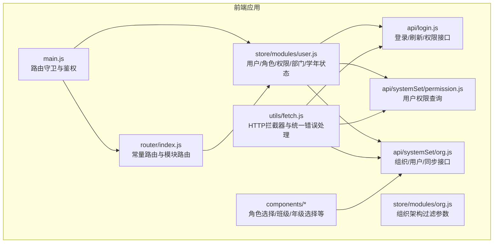
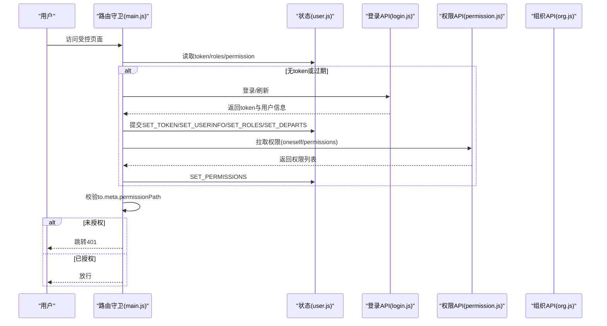
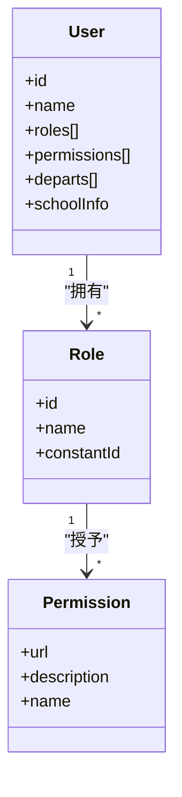
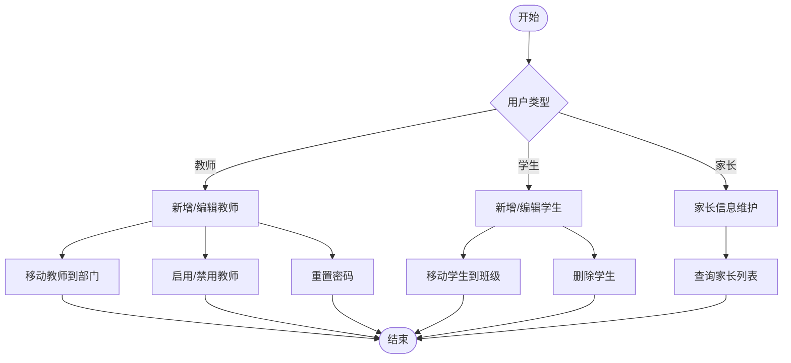
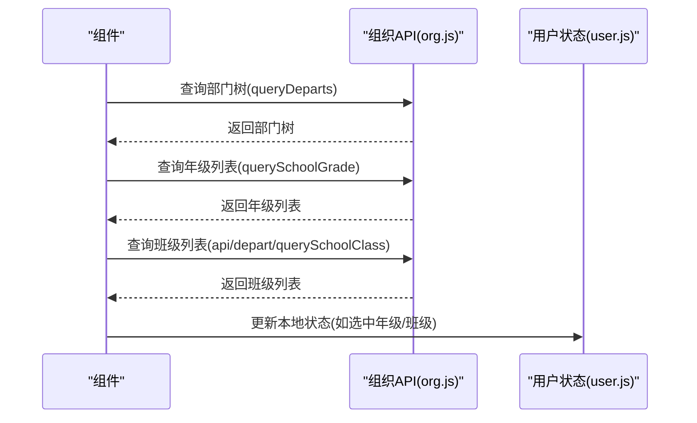
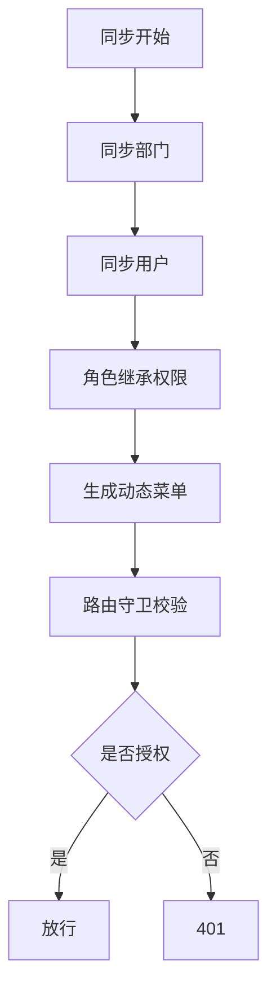
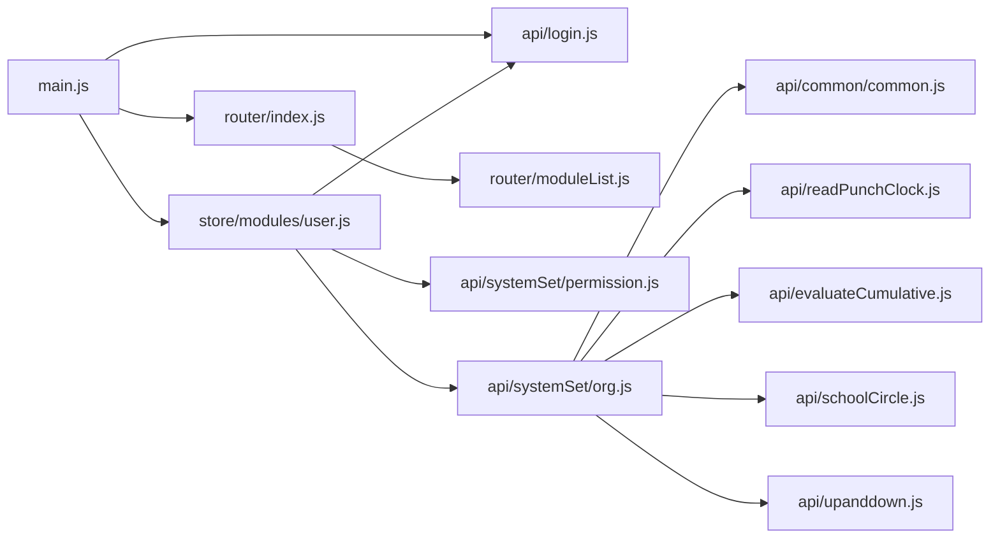

# 用户权限管理

<cite>
**本文引用的文件**
- [src/store/modules/user.js](file://src/store/modules/user.js)
- [src/store/modules/org.js](file://src/store/modules/org.js)
- [src/router/index.js](file://src/router/index.js)
- [src/router/moduleList.js](file://src/router/moduleList.js)
- [src/api/login.js](file://src/api/login.js)
- [src/api/systemSet/permission.js](file://src/api/systemSet/permission.js)
- [src/api/systemSet/org.js](file://src/api/systemSet/org.js)
- [src/utils/fetch.js](file://src/utils/fetch.js)
- [src/main.js](file://src/main.js)
- [src/components/ChoseRole/index.vue](file://src/components/ChoseRole/index.vue)
- [src/components/ClassSelector/ClassSelector.vue](file://src/components/ClassSelector/ClassSelector.vue)
- [src/components/GradeClassSelector/index.vue](file://src/components/GradeClassSelector/index.vue)
- [src/api/common/common.js](file://src/api/common/common.js)
- [src/api/readPunchClock.js](file://src/api/readPunchClock.js)
- [src/api/evaluateCumulative.js](file://src/api/evaluateCumulative.js)
- [src/api/schoolCircle.js](file://src/api/schoolCircle.js)
- [src/api/upanddown.js](file://src/api/upanddown.js)
</cite>

## 目录
1. [简介](#简介)
2. [项目结构](#项目结构)
3. [核心组件](#核心组件)
4. [架构总览](#架构总览)
5. [详细组件分析](#详细组件分析)
6. [依赖分析](#依赖分析)
7. [性能考虑](#性能考虑)
8. [故障排查指南](#故障排查指南)
9. [结论](#结论)
10. [附录](#附录)

## 简介
本技术文档围绕用户权限管理功能展开，系统性阐述基于角色的访问控制（RBAC）模型在前端的实现方式与集成路径，覆盖用户、角色、权限三者关系及继承机制；用户账户管理流程（教师、学生、家长等角色的创建、编辑、删除与状态管理）；部门组织架构管理（部门层级、班级与年级管理）；用户同步机制、权限继承规则与动态菜单生成；API 接口规范、权限验证流程与安全控制；以及权限变更的日志记录、审计追踪与异常处理策略。

## 项目结构
本项目采用 Vue + Vuex + Vue Router 架构，权限与组织管理相关的关键模块与文件如下：
- 状态管理：用户信息、角色、权限、部门、学年等状态集中于 Vuex 模块
- 路由与鉴权：路由守卫结合权限路径进行访问控制
- API 层：登录、权限、组织架构、用户详情、同步等接口封装
- 组件层：角色选择、班级/年级选择、地址簿等交互组件

图表来源
- [src/main.js:77-183](file://src/main.js#L77-L183)
- [src/router/index.js:1-207](file://src/router/index.js#L1-L207)
- [src/store/modules/user.js:1-447](file://src/store/modules/user.js#L1-L447)
- [src/store/modules/org.js:1-34](file://src/store/modules/org.js#L1-L34)
- [src/utils/fetch.js:1-240](file://src/utils/fetch.js#L1-L240)
- [src/api/login.js:1-259](file://src/api/login.js#L1-L259)
- [src/api/systemSet/permission.js:1-40](file://src/api/systemSet/permission.js#L1-L40)
- [src/api/systemSet/org.js:1-1345](file://src/api/systemSet/org.js#L1-L1345)

章节来源
- [src/store/modules/user.js:1-447](file://src/store/modules/user.js#L1-L447)
- [src/store/modules/org.js:1-34](file://src/store/modules/org.js#L1-L34)
- [src/router/index.js:1-207](file://src/router/index.js#L1-L207)
- [src/utils/fetch.js:1-240](file://src/utils/fetch.js#L1-L240)
- [src/api/login.js:1-259](file://src/api/login.js#L1-L259)
- [src/api/systemSet/permission.js:1-40](file://src/api/systemSet/permission.js#L1-L40)
- [src/api/systemSet/org.js:1-1345](file://src/api/systemSet/org.js#L1-L1345)

## 核心组件
- 用户状态模块（Vuex）
  - 维护用户信息、角色列表、权限列表、部门列表、学校信息、学年信息等
  - 提供登录、刷新、权限拉取、学年切换等动作
- 组织架构模块（Vuex）
  - 维护组织架构过滤参数与结构缓存
- 路由与鉴权（main.js）
  - 基于路由元信息中的权限路径进行访问控制
- API 层
  - 登录/刷新/权限：登录、刷新令牌、查询自身权限
  - 组织/用户：部门、用户、角色、同步、移动、启用/禁用等
  - 权限：用户权限查询、子权限查询
- 组件层
  - 角色选择：按用户查询角色与模块
  - 班级/年级选择：根据用户权限与管理范围动态展示

章节来源
- [src/store/modules/user.js:1-447](file://src/store/modules/user.js#L1-L447)
- [src/store/modules/org.js:1-34](file://src/store/modules/org.js#L1-L34)
- [src/main.js:77-183](file://src/main.js#L77-L183)
- [src/api/login.js:1-259](file://src/api/login.js#L1-L259)
- [src/api/systemSet/permission.js:1-40](file://src/api/systemSet/permission.js#L1-L40)
- [src/api/systemSet/org.js:1-1345](file://src/api/systemSet/org.js#L1-L1345)
- [src/components/ChoseRole/index.vue:65-110](file://src/components/ChoseRole/index.vue#L65-L110)
- [src/components/ClassSelector/ClassSelector.vue:38-77](file://src/components/ClassSelector/ClassSelector.vue#L38-L77)
- [src/components/GradeClassSelector/index.vue:97-124](file://src/components/GradeClassSelector/index.vue#L97-L124)

## 架构总览
前端权限体系以“路由守卫 + Vuex 状态 + API 接口”为核心，形成闭环：
- 登录与刷新：获取用户信息、角色、部门、权限与学校信息
- 菜单生成：根据权限映射构建动态菜单
- 访问控制：路由守卫读取权限路径，匹配用户权限决定放行或跳转至 401
- 安全校验：HTTP 拦截器统一注入 token、签名、错误处理与登出逻辑

图表来源
- [src/main.js:77-183](file://src/main.js#L77-L183)
- [src/store/modules/user.js:120-324](file://src/store/modules/user.js#L120-L324)
- [src/api/login.js:1-259](file://src/api/login.js#L1-L259)
- [src/api/systemSet/permission.js:1-40](file://src/api/systemSet/permission.js#L1-L40)

## 详细组件分析

### RBAC 权限模型与继承机制
- 数据模型
  - 用户：拥有唯一标识、角色列表、部门列表、学校信息
  - 角色：与用户多对多关联，来源于系统角色列表
  - 权限：以 URL 路径为键的集合，支持名称映射与描述映射
- 继承与组合
  - 用户通过角色间接获得权限集合
  - 权限集合用于动态菜单生成与路由守卫校验
- 实现要点
  - 权限列表在状态中以数组与映射形式保存，便于快速查找
  - 路由元信息中携带 permissionPath，作为访问控制的依据

图表来源
- [src/store/modules/user.js:20-44](file://src/store/modules/user.js#L20-L44)
- [src/store/modules/user.js:87-96](file://src/store/modules/user.js#L87-L96)
- [src/api/login.js:189-200](file://src/api/login.js#L189-L200)

章节来源
- [src/store/modules/user.js:20-44](file://src/store/modules/user.js#L20-L44)
- [src/store/modules/user.js:87-96](file://src/store/modules/user.js#L87-L96)
- [src/api/login.js:189-200](file://src/api/login.js#L189-L200)

### 用户账户管理流程（教师/学生/家长）
- 教师
  - 新增/编辑：支持 JSON 参数提交，包含基本信息、部门、角色、发布范围等
  - 启用/禁用：支持批量启用/禁用教师与校外用户
  - 移动：将教师从一个部门移动到多个部门
  - 密码重置：管理员重置用户密码
- 学生
  - 新增/编辑：包含姓名、学号、性别、出生日期、所属班级等
  - 移动：将学生移动到其他班级，家长随迁
  - 删除：支持批量删除学生
- 家长
  - 家长与学生关联，移动学生时家长信息同步更新
  - 支持查询家长列表与详情

图表来源
- [src/api/systemSet/org.js:481-512](file://src/api/systemSet/org.js#L481-L512)
- [src/api/systemSet/org.js:554-584](file://src/api/systemSet/org.js#L554-L584)
- [src/api/systemSet/org.js:642-673](file://src/api/systemSet/org.js#L642-L673)
- [src/api/systemSet/org.js:679-724](file://src/api/systemSet/org.js#L679-L724)
- [src/api/systemSet/org.js:730-751](file://src/api/systemSet/org.js#L730-L751)
- [src/api/systemSet/org.js:173-190](file://src/api/systemSet/org.js#L173-L190)
- [src/api/systemSet/org.js:318-336](file://src/api/systemSet/org.js#L318-L336)
- [src/api/systemSet/org.js:626-635](file://src/api/systemSet/org.js#L626-L635)

章节来源
- [src/api/systemSet/org.js:481-512](file://src/api/systemSet/org.js#L481-L512)
- [src/api/systemSet/org.js:554-584](file://src/api/systemSet/org.js#L554-L584)
- [src/api/systemSet/org.js:642-673](file://src/api/systemSet/org.js#L642-L673)
- [src/api/systemSet/org.js:679-724](file://src/api/systemSet/org.js#L679-L724)
- [src/api/systemSet/org.js:730-751](file://src/api/systemSet/org.js#L730-L751)
- [src/api/systemSet/org.js:173-190](file://src/api/systemSet/org.js#L173-L190)
- [src/api/systemSet/org.js:318-336](file://src/api/systemSet/org.js#L318-L336)
- [src/api/systemSet/org.js:626-635](file://src/api/systemSet/org.js#L626-L635)

### 部门组织架构与班级/年级管理
- 部门管理
  - 查询部门树、新增/修改/删除部门、查询部门详情与负责人
  - 同步部门与用户、同步部门、同步用户
- 年级/班级管理
  - 查询年级列表、移动班级到其他年级
  - 班级/年级选择组件根据用户权限与管理范围动态渲染
- 上下级关系
  - 支持上下级树形关系、添加/删除/清空上下级关系、修改本级信息

图表来源
- [src/api/systemSet/org.js:21-26](file://src/api/systemSet/org.js#L21-L26)
- [src/api/systemSet/org.js:52-60](file://src/api/systemSet/org.js#L52-L60)
- [src/api/systemSet/org.js:783-792](file://src/api/systemSet/org.js#L783-L792)
- [src/api/readPunchClock.js:88-93](file://src/api/readPunchClock.js#L88-L93)
- [src/components/GradeClassSelector/index.vue:97-124](file://src/components/GradeClassSelector/index.vue#L97-L124)

章节来源
- [src/api/systemSet/org.js:21-26](file://src/api/systemSet/org.js#L21-L26)
- [src/api/systemSet/org.js:52-60](file://src/api/systemSet/org.js#L52-L60)
- [src/api/systemSet/org.js:783-792](file://src/api/systemSet/org.js#L783-L792)
- [src/api/readPunchClock.js:88-93](file://src/api/readPunchClock.js#L88-L93)
- [src/components/GradeClassSelector/index.vue:97-124](file://src/components/GradeClassSelector/index.vue#L97-L124)

### 用户同步机制与权限继承
- 同步接口
  - 同步部门与用户、同步部门、同步用户
- 权限继承
  - 用户通过角色继承权限，权限集合用于菜单与路由校验
- 动态菜单生成
  - 基于权限列表与路由配置，结合模块清单生成菜单

图表来源
- [src/api/systemSet/org.js:271-280](file://src/api/systemSet/org.js#L271-L280)
- [src/api/systemSet/org.js:286-295](file://src/api/systemSet/org.js#L286-L295)
- [src/api/systemSet/org.js:302-311](file://src/api/systemSet/org.js#L302-L311)
- [src/store/modules/user.js:287-304](file://src/store/modules/user.js#L287-L304)
- [src/router/moduleList.js:2311-2325](file://src/router/moduleList.js#L2311-L2325)

章节来源
- [src/api/systemSet/org.js:271-280](file://src/api/systemSet/org.js#L271-L280)
- [src/api/systemSet/org.js:286-295](file://src/api/systemSet/org.js#L286-L295)
- [src/api/systemSet/org.js:302-311](file://src/api/systemSet/org.js#L302-L311)
- [src/store/modules/user.js:287-304](file://src/store/modules/user.js#L287-L304)
- [src/router/moduleList.js:2311-2325](file://src/router/moduleList.js#L2311-L2325)

### API 接口规范与安全控制
- 登录与权限
  - 登录、刷新、修改密码、第三方登录、权限查询等
- 组织与用户
  - 部门、用户、角色、同步、移动、启用/禁用、详情查询等
- 安全控制
  - HTTP 拦截器统一注入 token、签名参数
  - 统一错误处理与登出逻辑
  - 白名单与免签接口配置

章节来源
- [src/api/login.js:1-259](file://src/api/login.js#L1-L259)
- [src/api/systemSet/org.js:1-1345](file://src/api/systemSet/org.js#L1-L1345)
- [src/utils/fetch.js:13-171](file://src/utils/fetch.js#L13-L171)

### 权限验证流程与动态菜单
- 路由守卫
  - 读取路由元信息中的 permissionPath，与用户权限集合比对
  - 未授权跳转 401，否则放行
- 动态菜单
  - 结合模块清单与权限集合生成菜单项
  - 支持系统管理模块的用户管理入口

章节来源
- [src/main.js:77-183](file://src/main.js#L77-L183)
- [src/router/index.js:1-207](file://src/router/index.js#L1-L207)
- [src/router/moduleList.js:2311-2325](file://src/router/moduleList.js#L2311-L2325)

### 日志记录、审计追踪与异常处理
- 异常处理
  - HTTP 响应拦截器统一处理错误码，触发消息提示与登出
- 审计与日志
  - 系统管理模块包含“日志管理”“档案日志”等入口，用于审计追踪
- 建议
  - 对关键权限变更（角色分配、权限授予、用户状态变更）记录操作日志与审计轨迹

章节来源
- [src/utils/fetch.js:104-169](file://src/utils/fetch.js#L104-L169)
- [src/router/moduleList.js:2385-2402](file://src/router/moduleList.js#L2385-L2402)

## 依赖分析
- 模块耦合
  - main.js 依赖 user.js 的权限状态与 login.js 的权限接口
  - router/index.js 与 moduleList.js 共同定义菜单与权限路径
  - 组件层依赖 org.js 与 common.js 的查询接口
- 外部依赖
  - axios 拦截器、Cookies、Element UI Message 统一错误提示

图表来源
- [src/main.js:77-183](file://src/main.js#L77-L183)
- [src/store/modules/user.js:1-447](file://src/store/modules/user.js#L1-L447)
- [src/router/index.js:1-207](file://src/router/index.js#L1-L207)
- [src/router/moduleList.js:2311-2325](file://src/router/moduleList.js#L2311-L2325)
- [src/api/login.js:1-259](file://src/api/login.js#L1-L259)
- [src/api/systemSet/permission.js:1-40](file://src/api/systemSet/permission.js#L1-L40)
- [src/api/systemSet/org.js:1-1345](file://src/api/systemSet/org.js#L1-L1345)
- [src/api/common/common.js:438-458](file://src/api/common/common.js#L438-L458)
- [src/api/readPunchClock.js:88-93](file://src/api/readPunchClock.js#L88-L93)
- [src/api/evaluateCumulative.js:276-315](file://src/api/evaluateCumulative.js#L276-L315)
- [src/api/schoolCircle.js:193-214](file://src/api/schoolCircle.js#L193-L214)
- [src/api/upanddown.js:1-109](file://src/api/upanddown.js#L1-L109)

章节来源
- [src/main.js:77-183](file://src/main.js#L77-L183)
- [src/store/modules/user.js:1-447](file://src/store/modules/user.js#L1-L447)
- [src/router/index.js:1-207](file://src/router/index.js#L1-L207)
- [src/router/moduleList.js:2311-2325](file://src/router/moduleList.js#L2311-L2325)
- [src/api/systemSet/org.js:1-1345](file://src/api/systemSet/org.js#L1-L1345)

## 性能考虑
- 权限拉取与并发
  - 登录后并行拉取权限与学年列表，减少首屏等待
- 菜单生成
  - 基于权限映射构建菜单，避免重复计算
- 组件懒加载
  - 路由按需加载视图组件，降低初始包体

## 故障排查指南
- 登录失败/令牌无效
  - 检查登录接口返回与 Cookie 设置
  - 查看响应拦截器中的错误码与提示
- 权限不足/401
  - 确认路由元信息中的 permissionPath 是否存在于用户权限集合
  - 检查权限接口返回与状态更新
- 同步异常
  - 检查同步接口入参与服务端返回
  - 关注错误提示与登出逻辑

章节来源
- [src/api/login.js:1-259](file://src/api/login.js#L1-L259)
- [src/utils/fetch.js:104-169](file://src/utils/fetch.js#L104-L169)
- [src/main.js:77-183](file://src/main.js#L77-L183)

## 结论
本项目通过 Vuex 状态管理、路由守卫与 API 接口的协同，实现了 RBAC 权限模型在前端的落地：用户、角色、权限三者清晰分离，权限继承与动态菜单生成自然流畅，组织架构与用户管理接口完善，安全控制与异常处理健全。建议在后续迭代中进一步完善权限变更的日志与审计能力，持续优化菜单生成与权限拉取的性能。

## 附录
- 角色选择组件
  - 通过 queryRoleAndModuleByUserId 获取用户角色与模块，支持勾选与提交
- 班级/年级选择组件
  - 根据用户角色与管理范围动态展示，支持学校管理者与年级管理者差异
- 常用接口参考
  - 登录/刷新/权限：login.js
  - 组织/用户/同步：systemSet/org.js
  - 权限查询：systemSet/permission.js

章节来源
- [src/components/ChoseRole/index.vue:65-110](file://src/components/ChoseRole/index.vue#L65-L110)
- [src/components/ClassSelector/ClassSelector.vue:38-77](file://src/components/ClassSelector/ClassSelector.vue#L38-L77)
- [src/components/GradeClassSelector/index.vue:97-124](file://src/components/GradeClassSelector/index.vue#L97-L124)
- [src/api/login.js:1-259](file://src/api/login.js#L1-L259)
- [src/api/systemSet/org.js:1-1345](file://src/api/systemSet/org.js#L1-L1345)
- [src/api/systemSet/permission.js:1-40](file://src/api/systemSet/permission.js#L1-L40)