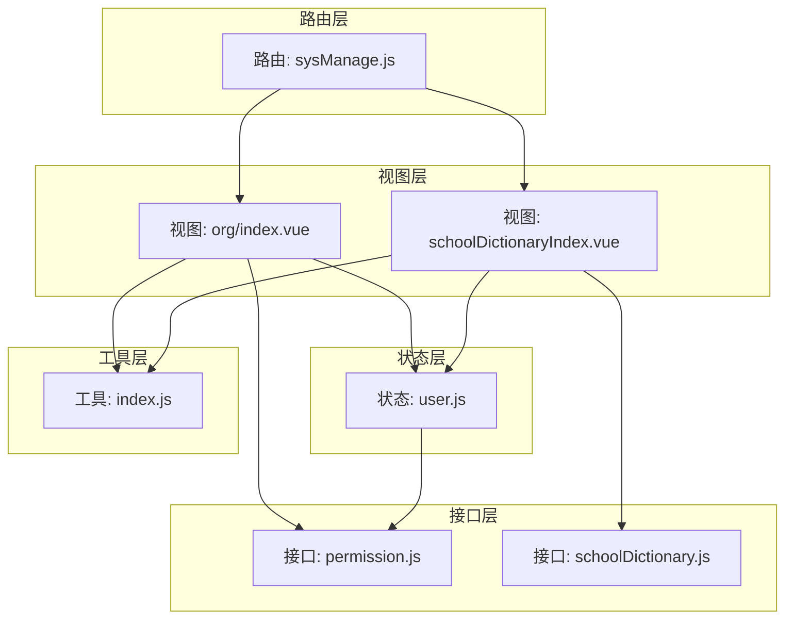
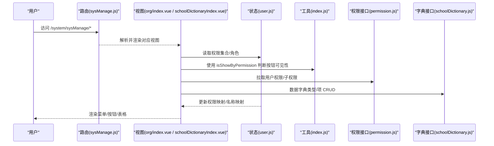
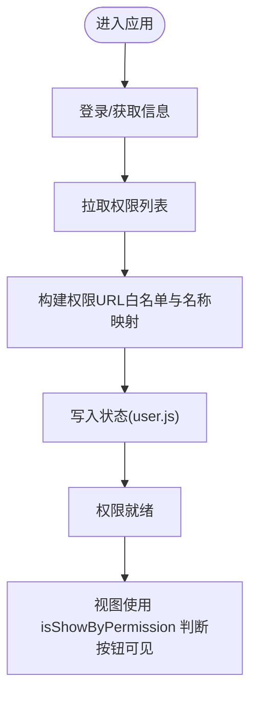
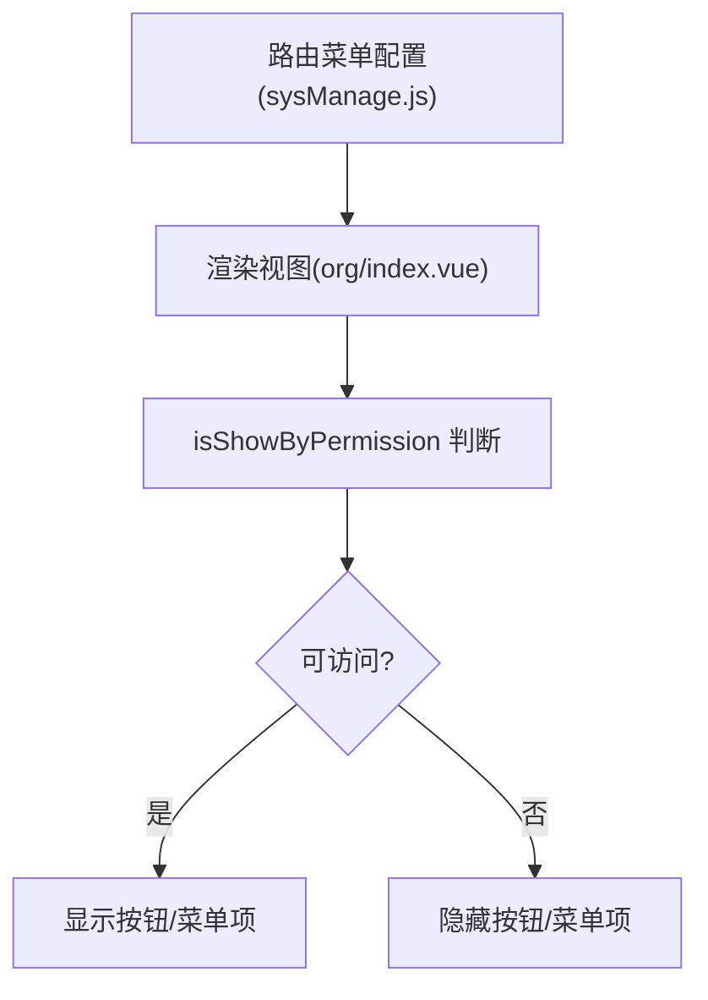
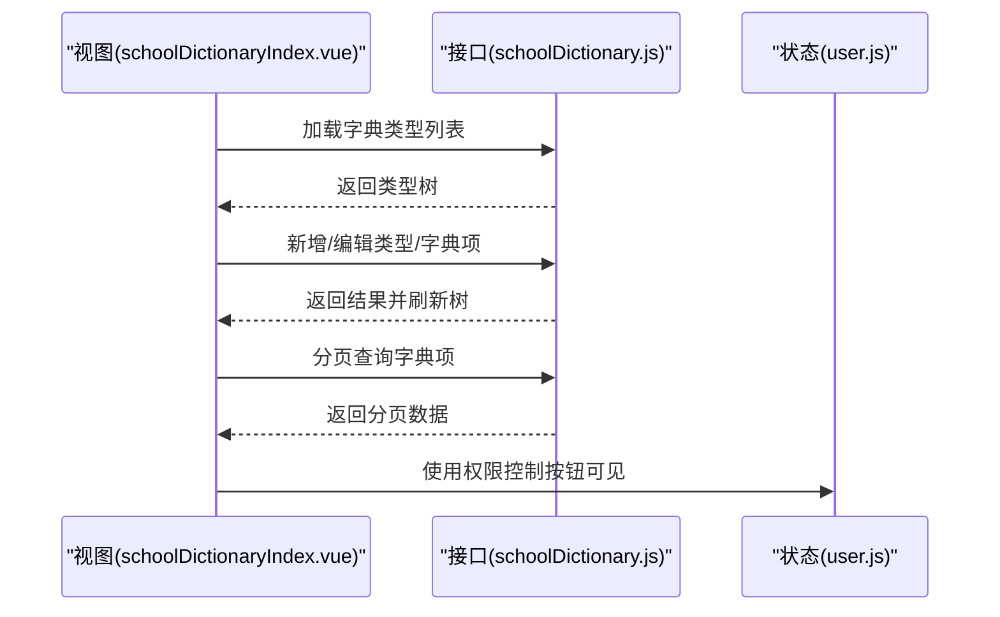
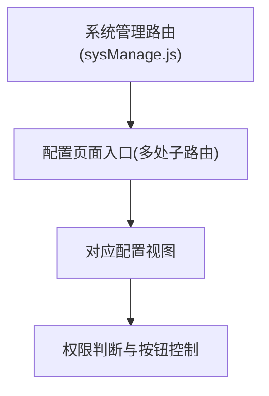
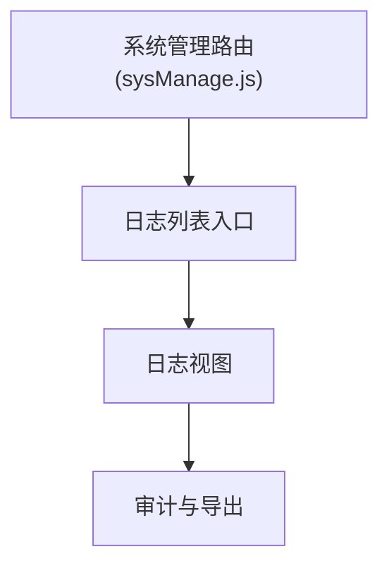
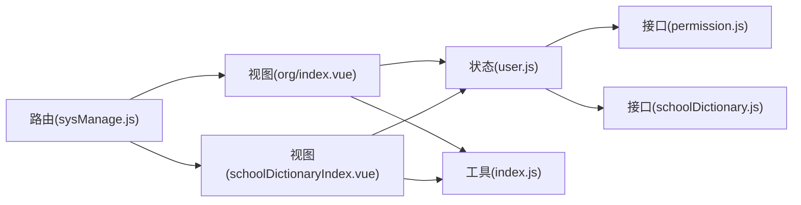

# 系统管理

<cite>
**本文引用的文件**
- [路由定义 sysManage.js](file://src/router/system/sysManage.js)
- [用户状态管理 user.js](file://src/store/modules/user.js)
- [工具函数 index.js](file://src/utils/index.js)
- [权限接口 permission.js](file://src/api/systemSet/permission.js)
- [数据字典接口 schoolDictionary.js](file://src/api/systemSet/schoolDictionary.js)
- [组织与用户管理 index.vue](file://src/views/sysSet/org/index.vue)
- [数据字典首页 schoolDictionaryIndex.vue](file://src/views/sysSet/schoolDictionary/schoolDictionaryIndex.vue)
</cite>

## 目录
1. [简介](#简介)
2. [项目结构](#项目结构)
3. [核心组件](#核心组件)
4. [架构总览](#架构总览)
5. [详细组件分析](#详细组件分析)
6. [依赖关系分析](#依赖关系分析)
7. [性能考量](#性能考量)
8. [故障排查指南](#故障排查指南)
9. [结论](#结论)
10. [附录](#附录)

## 简介
本技术文档聚焦“系统管理”模块，覆盖用户权限管理、系统配置管理、日志审计与数据字典维护等能力。文档从架构设计、组件职责、数据流与处理逻辑入手，结合 RBAC 权限模型、动态菜单生成与按钮级权限控制策略，给出 API 接口、安全策略与性能优化建议，并提供系统监控与运维最佳实践。

## 项目结构
系统管理模块在前端采用“路由 + 视图 + 状态 + 工具”的分层组织方式：
- 路由层：集中定义系统管理入口与子页面路径，支持动态跳转与权限控制。
- 视图层：组织与用户管理、数据字典维护等具体页面。
- 状态层：用户登录态、角色、权限集合、学校年度等全局状态。
- 工具层：权限判断、角色判断、通用工具方法。

图表来源
- [路由定义 sysManage.js:1-407](file://src/router/system/sysManage.js#L1-L407)
- [用户状态管理 user.js:1-447](file://src/store/modules/user.js#L1-L447)
- [工具函数 index.js:1-385](file://src/utils/index.js#L1-L385)
- [权限接口 permission.js:1-40](file://src/api/systemSet/permission.js#L1-L40)
- [数据字典接口 schoolDictionary.js:1-188](file://src/api/systemSet/schoolDictionary.js#L1-L188)

章节来源
- [路由定义 sysManage.js:1-407](file://src/router/system/sysManage.js#L1-L407)
- [用户状态管理 user.js:1-447](file://src/store/modules/user.js#L1-L447)

## 核心组件
- 路由与菜单
  - 系统管理统一入口路径为“/system/sysManage”，内部按功能拆分子路由，涵盖组织与用户管理、数据字典、系统配置等。
  - 子路由支持懒加载与分包，提升首屏性能。
- 权限与角色
  - 登录后拉取用户角色与权限列表，构建权限白名单；提供按钮级权限判断工具方法。
- 数据字典
  - 支持类型与字典项两级结构，提供增删改查与导入导出能力。
- 日志与审计
  - 提供日志列表与操作日志页面入口，便于审计追踪。

章节来源
- [路由定义 sysManage.js:1-407](file://src/router/system/sysManage.js#L1-L407)
- [用户状态管理 user.js:1-447](file://src/store/modules/user.js#L1-L447)
- [工具函数 index.js:217-246](file://src/utils/index.js#L217-L246)

## 架构总览
系统管理模块围绕“RBAC 权限模型 + 动态菜单 + 按钮级控制”展开，整体流程如下：

图表来源
- [路由定义 sysManage.js:1-407](file://src/router/system/sysManage.js#L1-L407)
- [组织与用户管理 index.vue:1-800](file://src/views/sysSet/org/index.vue#L1-L800)
- [数据字典首页 schoolDictionaryIndex.vue:1-489](file://src/views/sysSet/schoolDictionary/schoolDictionaryIndex.vue#L1-L489)
- [用户状态管理 user.js:1-447](file://src/store/modules/user.js#L1-L447)
- [工具函数 index.js:217-246](file://src/utils/index.js#L217-L246)
- [权限接口 permission.js:1-40](file://src/api/systemSet/permission.js#L1-L40)
- [数据字典接口 schoolDictionary.js:1-188](file://src/api/systemSet/schoolDictionary.js#L1-L188)

## 详细组件分析

### 组件A：用户权限与角色管理
- 职责
  - 登录态管理、角色与权限集合持久化、权限映射与名称映射构建。
  - 提供权限刷新与重置能力，支持二次菜单扩展。
- 关键点
  - 权限集合来自后端，存储为 URL 白名单与描述映射，供按钮级控制使用。
  - 角色集合用于页面元素的可见性判断。
- 处理流程

图表来源
- [用户状态管理 user.js:287-304](file://src/store/modules/user.js#L287-L304)
- [工具函数 index.js:217-246](file://src/utils/index.js#L217-L246)

章节来源
- [用户状态管理 user.js:1-447](file://src/store/modules/user.js#L1-L447)
- [工具函数 index.js:217-246](file://src/utils/index.js#L217-L246)

### 组件B：动态菜单生成与按钮级权限控制
- 职责
  - 路由层定义菜单结构；视图层根据权限动态决定菜单项与按钮可见性。
- 关键点
  - 路由配置中包含大量子页面，覆盖组织管理、数据字典、系统配置等。
  - 视图内广泛使用工具方法进行按钮级权限判断，避免硬编码。
- 流程示意

图表来源
- [路由定义 sysManage.js:1-407](file://src/router/system/sysManage.js#L1-L407)
- [组织与用户管理 index.vue:1-800](file://src/views/sysSet/org/index.vue#L1-L800)
- [工具函数 index.js:241-246](file://src/utils/index.js#L241-L246)

章节来源
- [路由定义 sysManage.js:1-407](file://src/router/system/sysManage.js#L1-L407)
- [组织与用户管理 index.vue:1-800](file://src/views/sysSet/org/index.vue#L1-L800)
- [工具函数 index.js:241-246](file://src/utils/index.js#L241-L246)

### 组件C：数据字典维护
- 职责
  - 支持字典类型与字典项两级结构，提供增删改查、分页查询与导入导出能力。
- 关键点
  - 树形结构展示类型与字典项，右键菜单支持编辑与删除。
  - 通过接口封装 CRUD 操作，统一参数与返回格式。
- 流程示意

图表来源
- [数据字典首页 schoolDictionaryIndex.vue:1-489](file://src/views/sysSet/schoolDictionary/schoolDictionaryIndex.vue#L1-L489)
- [数据字典接口 schoolDictionary.js:1-188](file://src/api/systemSet/schoolDictionary.js#L1-L188)
- [用户状态管理 user.js:1-447](file://src/store/modules/user.js#L1-L447)

章节来源
- [数据字典首页 schoolDictionaryIndex.vue:1-489](file://src/views/sysSet/schoolDictionary/schoolDictionaryIndex.vue#L1-L489)
- [数据字典接口 schoolDictionary.js:1-188](file://src/api/systemSet/schoolDictionary.js#L1-L188)

### 组件D：系统配置管理（示例：请假设置、课程设置）
- 职责
  - 提供各类系统配置页面入口，如请假设置、课程设置、值班表设置等。
- 关键点
  - 页面入口集中在系统管理路由下，便于统一权限控制与导航。
- 流程示意

图表来源
- [路由定义 sysManage.js:120-220](file://src/router/system/sysManage.js#L120-L220)

章节来源
- [路由定义 sysManage.js:120-220](file://src/router/system/sysManage.js#L120-L220)

### 组件E：日志审计
- 职责
  - 提供日志列表与操作日志页面入口，支撑审计与问题追溯。
- 关键点
  - 页面入口位于系统管理路由下，便于统一权限控制。
- 流程示意

图表来源
- [路由定义 sysManage.js:92-96](file://src/router/system/sysManage.js#L92-L96)

章节来源
- [路由定义 sysManage.js:92-96](file://src/router/system/sysManage.js#L92-L96)

## 依赖关系分析
- 组件耦合
  - 视图依赖状态与工具，状态依赖接口，接口依赖后端服务。
  - 路由作为入口，解耦视图与后端交互细节。
- 权限依赖
  - 权限判断依赖状态中的权限白名单；按钮可见性与菜单项显示均受其影响。
- 外部依赖
  - Cookie/Session 用于登录态与地图密钥初始化。
  - Element UI 组件库用于界面交互与表格渲染。

图表来源
- [路由定义 sysManage.js:1-407](file://src/router/system/sysManage.js#L1-L407)
- [用户状态管理 user.js:1-447](file://src/store/modules/user.js#L1-L447)
- [工具函数 index.js:1-385](file://src/utils/index.js#L1-L385)
- [权限接口 permission.js:1-40](file://src/api/systemSet/permission.js#L1-L40)
- [数据字典接口 schoolDictionary.js:1-188](file://src/api/systemSet/schoolDictionary.js#L1-L188)

章节来源
- [路由定义 sysManage.js:1-407](file://src/router/system/sysManage.js#L1-L407)
- [用户状态管理 user.js:1-447](file://src/store/modules/user.js#L1-L447)
- [工具函数 index.js:1-385](file://src/utils/index.js#L1-L385)

## 性能考量
- 路由懒加载
  - 使用异步组件与分包，减少首屏体积，提升加载速度。
- 权限缓存
  - 将权限 URL 白名单与名称映射缓存于状态，避免重复请求与重复计算。
- 表格与分页
  - 对用户列表与字典项列表采用分页加载，降低 DOM 与网络压力。
- 图标与静态资源
  - 合理使用图标字体与静态资源，避免重复下载。

[本节为通用指导，无需特定文件引用]

## 故障排查指南
- 登录后权限无效
  - 检查登录流程是否成功写入权限集合与角色；确认权限白名单构建是否完成。
  - 参考：[用户状态管理 user.js:120-304](file://src/store/modules/user.js#L120-L304)
- 按钮/菜单不显示
  - 检查权限 URL 是否在白名单中；确认 isShowByPermission 的参数与当前路由匹配。
  - 参考：[工具函数 index.js:241-246](file://src/utils/index.js#L241-L246)
- 数据字典无法编辑/删除
  - 检查接口返回状态与错误提示；确认树节点选中状态与编码传递。
  - 参考：[数据字典首页 schoolDictionaryIndex.vue:191-418](file://src/views/sysSet/schoolDictionary/schoolDictionaryIndex.vue#L191-L418)，[数据字典接口 schoolDictionary.js:1-188](file://src/api/systemSet/schoolDictionary.js#L1-L188)
- 地图密钥初始化失败
  - 检查后端返回的密钥与安全配置是否正确设置。
  - 参考：[用户状态管理 user.js:136-161](file://src/store/modules/user.js#L136-L161)

章节来源
- [用户状态管理 user.js:120-304](file://src/store/modules/user.js#L120-L304)
- [工具函数 index.js:241-246](file://src/utils/index.js#L241-L246)
- [数据字典首页 schoolDictionaryIndex.vue:191-418](file://src/views/sysSet/schoolDictionary/schoolDictionaryIndex.vue#L191-L418)
- [数据字典接口 schoolDictionary.js:1-188](file://src/api/systemSet/schoolDictionary.js#L1-L188)

## 结论
系统管理模块通过清晰的分层设计与 RBAC 权限模型，实现了灵活的菜单与按钮级权限控制。配合动态路由与状态管理，既保证了用户体验，又提升了可维护性。数据字典与系统配置页面提供了完善的后台治理能力，日志审计入口满足合规与运维需求。建议在后续迭代中持续优化权限缓存与接口响应，完善监控埋点与告警策略。

[本节为总结性内容，无需特定文件引用]

## 附录

### API 接口清单与说明
- 权限接口
  - 查询用户所有权限：用于构建权限白名单与名称映射。
    - 方法：POST
    - 参数：schoolId, userId
    - 返回：权限列表（包含 URL 与描述）
    - 参考：[权限接口 permission.js:15-25](file://src/api/systemSet/permission.js#L15-L25)
  - 根据上级权限 ID 获取子权限：支持权限树展开与动态加载。
    - 方法：POST
    - 参数：permId
    - 返回：子权限列表
    - 参考：[权限接口 permission.js:31-39](file://src/api/systemSet/permission.js#L31-L39)
- 数据字典接口
  - 加载字典类型列表：构建树形结构。
    - 方法：POST
    - 参数：clickName
    - 返回：类型列表
    - 参考：[数据字典接口 schoolDictionary.js:9-18](file://src/api/systemSet/schoolDictionary.js#L9-L18)
  - 保存/删除字典类型：新增/修改/删除类型。
    - 方法：POST
    - 参数：code, name, remark, id(可选)
    - 返回：操作结果
    - 参考：[数据字典接口 schoolDictionary.js:23-37](file://src/api/systemSet/schoolDictionary.js#L23-L37)
  - 保存/删除字典项：新增/修改/删除字典项。
    - 方法：POST
    - 参数：code, name, remark, typeCode, id(可选)
    - 返回：操作结果
    - 参考：[数据字典接口 schoolDictionary.js:72-87](file://src/api/systemSet/schoolDictionary.js#L72-L87)
  - 保存/删除字典值：字典项下的具体值。
    - 方法：POST
    - 参数：code, dictionaryCode, remark, sort, value, id(可选)
    - 返回：操作结果
    - 参考：[数据字典接口 schoolDictionary.js:122-138](file://src/api/systemSet/schoolDictionary.js#L122-L138)
  - 分页查询字典值：列表页分页加载。
    - 方法：POST
    - 参数：dictionaryCode, pageNo, pageSize, value(可选)
    - 返回：分页数据
    - 参考：[数据字典接口 schoolDictionary.js:175-187](file://src/api/systemSet/schoolDictionary.js#L175-L187)

章节来源
- [权限接口 permission.js:1-40](file://src/api/systemSet/permission.js#L1-L40)
- [数据字典接口 schoolDictionary.js:1-188](file://src/api/systemSet/schoolDictionary.js#L1-L188)

### 安全策略
- 登录态与令牌
  - 使用 Cookie 存储 Admin-Token，前后端协同校验。
  - 参考：[用户状态管理 user.js:120-173](file://src/store/modules/user.js#L120-L173)
- 权限控制
  - 前端基于权限白名单进行按钮与菜单可见性控制，避免越权访问。
  - 参考：[工具函数 index.js:241-246](file://src/utils/index.js#L241-L246)
- 地图密钥
  - 初始化高德地图安全配置，确保前端资源加载安全。
  - 参考：[用户状态管理 user.js:136-161](file://src/store/modules/user.js#L136-L161)

章节来源
- [用户状态管理 user.js:120-173](file://src/store/modules/user.js#L120-L173)
- [工具函数 index.js:241-246](file://src/utils/index.js#L241-L246)

### 运维与监控建议
- 前端监控
  - 在关键接口调用处埋点，记录成功率与耗时。
- 日志审计
  - 对关键操作（新增/编辑/删除）记录操作人、时间、对象与变更摘要。
- 回滚机制
  - 对配置类变更提供“最近一次有效配置”备份与一键恢复能力。
- 性能优化
  - 路由懒加载与组件分包；权限白名单缓存；表格分页与虚拟滚动。

[本节为通用指导，无需特定文件引用]