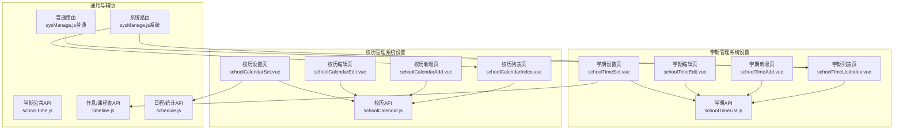
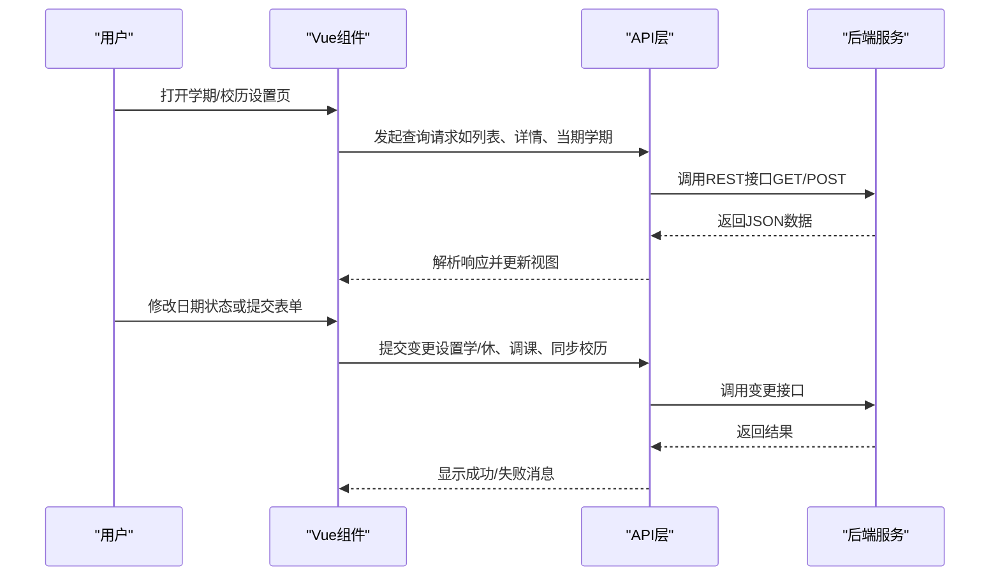
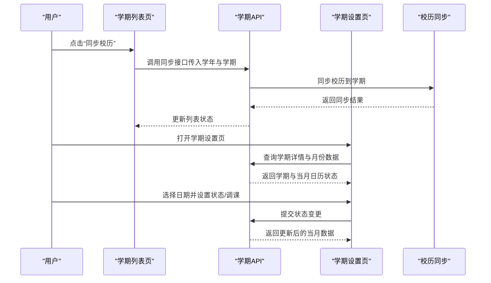
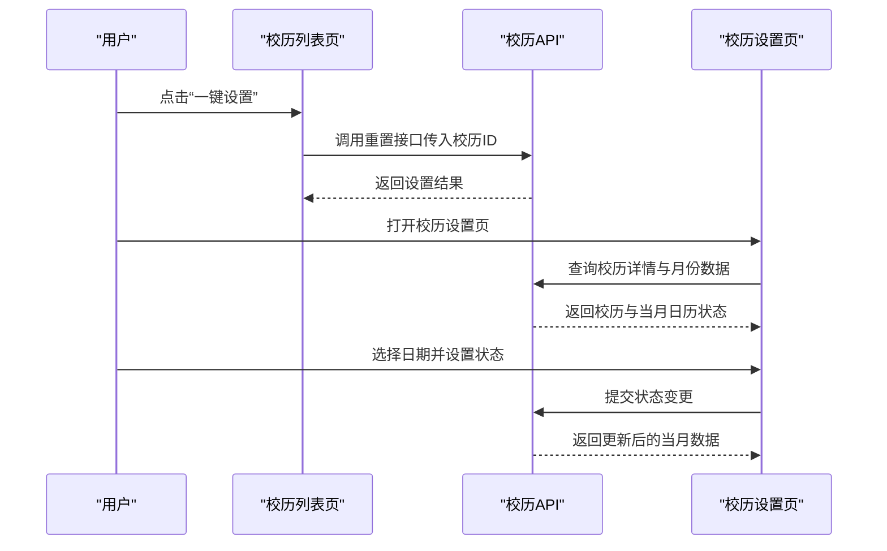
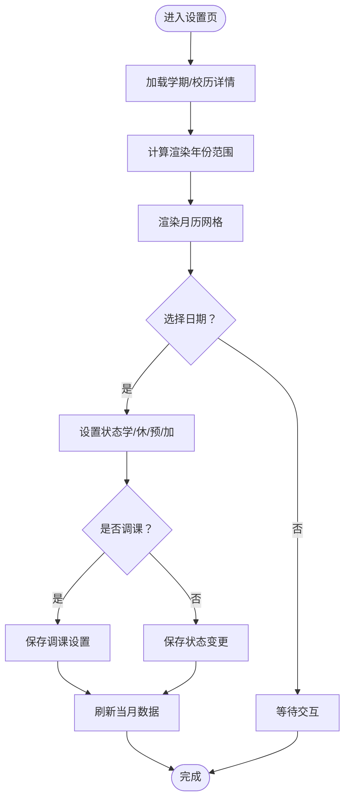
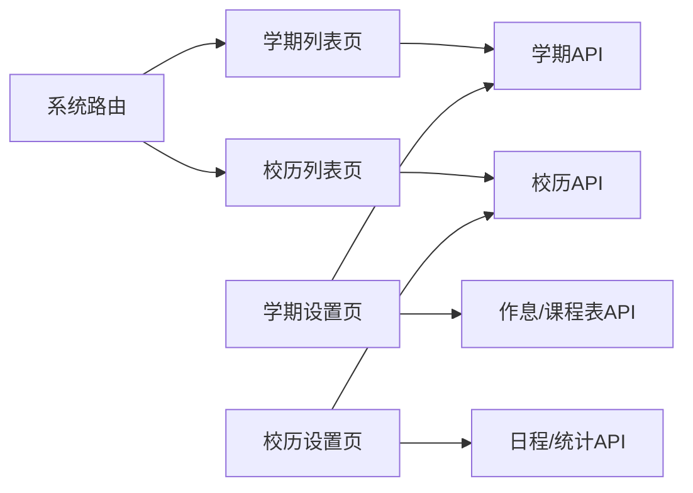

# 学期校历管理

<cite>
**本文引用的文件**
- [schoolCalendar.js](file://src/api/schoolCalendar.js)
- [schoolCalendarIndex.vue](file://src/views/schoolCalendar/schoolCalendarIndex.vue)
- [schoolCalendarAdd.vue](file://src/views/schoolCalendar/schoolCalendarAdd.vue)
- [schoolCalendarEdit.vue](file://src/views/schoolCalendar/schoolCalendarEdit.vue)
- [schoolCalendarSet.vue](file://src/views/schoolCalendar/schoolCalendarSet.vue)
- [schoolTimeList.js](file://src/api/schoolTimeList.js)
- [schoolTimeListIndex.vue](file://src/views/sysSet/schoolTimeList/schoolTimeListIndex.vue)
- [schoolTimeAdd.vue](file://src/views/sysSet/schoolTimeList/schoolTimeAdd.vue)
- [schoolTimeEdit.vue](file://src/views/sysSet/schoolTimeList/schoolTimeEdit.vue)
- [schoolTimeSet.vue](file://src/views/sysSet/schoolTimeList/schoolTimeSet.vue)
- [schoolTime.js](file://src/api/common/schoolTime.js)
- [timeline.js](file://src/api/timeline.js)
- [schedule.js](file://src/api/schedule.js)
- [sysManage.js（系统路由）](file://src/router/system/sysManage.js)
- [sysManage.js（普通路由）](file://src/router/normal/sysManage.js)
</cite>

## 目录
1. [简介](#简介)
2. [项目结构](#项目结构)
3. [核心组件](#核心组件)
4. [架构总览](#架构总览)
5. [详细组件分析](#详细组件分析)
6. [依赖关系分析](#依赖关系分析)
7. [性能考量](#性能考量)
8. [故障排查指南](#故障排查指南)
9. [结论](#结论)
10. [附录](#附录)

## 简介
本技术文档围绕“学期校历管理”功能展开，覆盖学期时间管理与校历设置两大子系统。内容包括：
- 学期创建、编辑、设置与查询的完整流程
- 校历设置的功能特性：节假日标注、特殊日期处理、调课机制
- 数据结构、时间计算逻辑与跨学期数据处理方案
- 学期切换时的数据迁移、假期统计与课程安排影响
- API 接口规范、批量操作与数据导入导出机制
- 变更日志、冲突检测与异常处理策略

## 项目结构
该功能由前端 Vue 组件与 API 层协同完成，主要模块如下：
- 学期管理（系统设置）
  - 列表页：展示学期列表、分页与操作按钮
  - 新增/编辑页：维护学期起止时间、学前/假期周等
  - 设置页：按月历视图设置“学/休”状态及调课
- 校历管理（系统设置）
  - 列表页：展示学年校历，支持一键设置与删除
  - 新增/编辑页：设置两学期的起止日期
  - 设置页：按月历视图标注“学/休”，并支持节假日标注与特殊状态

图表来源
- [schoolTimeListIndex.vue:1-219](file://src/views/sysSet/schoolTimeList/schoolTimeListIndex.vue#L1-L219)
- [schoolTimeAdd.vue:1-224](file://src/views/sysSet/schoolTimeList/schoolTimeAdd.vue#L1-L224)
- [schoolTimeEdit.vue:1-238](file://src/views/sysSet/schoolTimeList/schoolTimeEdit.vue#L1-L238)
- [schoolTimeSet.vue:1-700](file://src/views/sysSet/schoolTimeList/schoolTimeSet.vue#L1-L700)
- [schoolCalendarIndex.vue:1-192](file://src/views/schoolCalendar/schoolCalendarIndex.vue#L1-L192)
- [schoolCalendarAdd.vue:1-247](file://src/views/schoolCalendar/schoolCalendarAdd.vue#L1-L247)
- [schoolCalendarEdit.vue:1-264](file://src/views/schoolCalendar/schoolCalendarEdit.vue#L1-L264)
- [schoolCalendarSet.vue:1-541](file://src/views/schoolCalendar/schoolCalendarSet.vue#L1-L541)
- [schoolTimeList.js:1-158](file://src/api/schoolTimeList.js#L1-L158)
- [schoolCalendar.js:1-110](file://src/api/schoolCalendar.js#L1-L110)
- [schoolTime.js:1-19](file://src/api/common/schoolTime.js#L1-L19)
- [timeline.js:1-57](file://src/api/timeline.js#L1-L57)
- [schedule.js:39-56](file://src/api/schedule.js#L39-L56)
- [sysManage.js（系统路由）:260-407](file://src/router/system/sysManage.js#L260-L407)
- [sysManage.js（普通路由）:392-423](file://src/router/normal/sysManage.js#L392-L423)

章节来源
- [schoolTimeListIndex.vue:1-219](file://src/views/sysSet/schoolTimeList/schoolTimeListIndex.vue#L1-L219)
- [schoolCalendarIndex.vue:1-192](file://src/views/schoolCalendar/schoolCalendarIndex.vue#L1-L192)
- [sysManage.js（系统路由）:260-407](file://src/router/system/sysManage.js#L260-L407)

## 核心组件
- 学期管理组件族
  - 列表页：分页查询、设为当前学期、同步校历、编辑与删除
  - 新增/编辑页：学年、学期、开学/结束时间、学前/假期周约束校验
  - 设置页：Swiper 月历、选择日期、设置“学/休”、调课标记与节假日标注
- 校历管理组件族
  - 列表页：展示学年两学期区间、一键设置、编辑与删除
  - 新增/编辑页：学年、两学期起止时间、学期间连续性校验
  - 设置页：Swiper 月历、选择日期、设置“学/休”、节假日标注与状态标识

章节来源
- [schoolTimeListIndex.vue:1-219](file://src/views/sysSet/schoolTimeList/schoolTimeListIndex.vue#L1-L219)
- [schoolTimeAdd.vue:1-224](file://src/views/sysSet/schoolTimeList/schoolTimeAdd.vue#L1-L224)
- [schoolTimeEdit.vue:1-238](file://src/views/sysSet/schoolTimeList/schoolTimeEdit.vue#L1-L238)
- [schoolTimeSet.vue:1-700](file://src/views/sysSet/schoolTimeList/schoolTimeSet.vue#L1-L700)
- [schoolCalendarIndex.vue:1-192](file://src/views/schoolCalendar/schoolCalendarIndex.vue#L1-L192)
- [schoolCalendarAdd.vue:1-247](file://src/views/schoolCalendar/schoolCalendarAdd.vue#L1-L247)
- [schoolCalendarEdit.vue:1-264](file://src/views/schoolCalendar/schoolCalendarEdit.vue#L1-L264)
- [schoolCalendarSet.vue:1-541](file://src/views/schoolCalendar/schoolCalendarSet.vue#L1-L541)

## 架构总览
前端通过 API 层调用后端接口，完成数据的增删改查与状态变更；路由层统一挂载页面入口；组件内部通过混入与过滤器提升复用性与可读性。

图表来源
- [schoolTimeList.js:1-158](file://src/api/schoolTimeList.js#L1-L158)
- [schoolCalendar.js:1-110](file://src/api/schoolCalendar.js#L1-L110)
- [schoolTime.js:1-19](file://src/api/common/schoolTime.js#L1-L19)
- [timeline.js:1-57](file://src/api/timeline.js#L1-L57)
- [schedule.js:39-56](file://src/api/schedule.js#L39-L56)

## 详细组件分析

### 学期管理（系统设置）
- 列表页
  - 功能：分页查询学期列表；对当前学期进行“设为当前”；点击“同步校历”触发从校历同步到学期
  - 关键交互：分页控件、确认对话框、消息提示
  - 数据来源：学期列表 API、当前学期 API
- 新增页
  - 功能：选择学年与学期，填写开学/结束时间，可选学前/假期周；提交后格式化日期并调用新增接口
  - 校验规则：开学/结束时间先后顺序、与学前/假期周的边界关系
- 编辑页
  - 功能：加载详情并允许修改；提交时同样进行日期合法性校验
- 设置页
  - 功能：Swiper 月历展示；点击日期弹出状态选择；支持调课标记与节假日标注；根据学期范围高亮今日
  - 特殊状态：学、休、预（预排）、加（加班/补课）

图表来源
- [schoolTimeListIndex.vue:114-186](file://src/views/sysSet/schoolTimeList/schoolTimeListIndex.vue#L114-L186)
- [schoolTimeList.js:122-133](file://src/api/schoolTimeList.js#L122-L133)
- [schoolTimeSet.vue:157-251](file://src/views/sysSet/schoolTimeList/schoolTimeSet.vue#L157-L251)
- [schoolTimeList.js:1-158](file://src/api/schoolTimeList.js#L1-L158)

章节来源
- [schoolTimeListIndex.vue:1-219](file://src/views/sysSet/schoolTimeList/schoolTimeListIndex.vue#L1-L219)
- [schoolTimeAdd.vue:1-224](file://src/views/sysSet/schoolTimeList/schoolTimeAdd.vue#L1-L224)
- [schoolTimeEdit.vue:1-238](file://src/views/sysSet/schoolTimeList/schoolTimeEdit.vue#L1-L238)
- [schoolTimeSet.vue:1-700](file://src/views/sysSet/schoolTimeList/schoolTimeSet.vue#L1-L700)
- [schoolTimeList.js:1-158](file://src/api/schoolTimeList.js#L1-L158)

### 校历管理（系统设置）
- 列表页
  - 功能：展示学年两学期区间、一键设置（将校历映射到学期）、编辑与删除
  - 一键设置：调用重置接口，将校历日期映射到学期日历
- 新增/编辑页
  - 功能：选择学年，设置两学期起止时间；提交前校验两学期连续性与日期合法性
- 设置页
  - 功能：Swiper 月历展示；点击日期设置“学/休”；节假日标注与状态标识；支持调课日期选择与联动

图表来源
- [schoolCalendarIndex.vue:113-163](file://src/views/schoolCalendar/schoolCalendarIndex.vue#L113-L163)
- [schoolCalendar.js:1-110](file://src/api/schoolCalendar.js#L1-L110)
- [schoolCalendarSet.vue:134-183](file://src/views/schoolCalendar/schoolCalendarSet.vue#L134-L183)

章节来源
- [schoolCalendarIndex.vue:1-192](file://src/views/schoolCalendar/schoolCalendarIndex.vue#L1-L192)
- [schoolCalendarAdd.vue:1-247](file://src/views/schoolCalendar/schoolCalendarAdd.vue#L1-L247)
- [schoolCalendarEdit.vue:1-264](file://src/views/schoolCalendar/schoolCalendarEdit.vue#L1-L264)
- [schoolCalendarSet.vue:1-541](file://src/views/schoolCalendar/schoolCalendarSet.vue#L1-L541)
- [schoolCalendar.js:1-110](file://src/api/schoolCalendar.js#L1-L110)

### 时间计算与跨学期处理
- 月历渲染
  - 计算某年某月的第一天是星期几，以及当月总天数，生成日期网格
  - 使用 Swiper 控制年/月滑动，避免一次性渲染过多 DOM
- 跨学期数据
  - 学期设置页会根据学期起止时间动态计算渲染年份范围
  - 校历设置页根据校历两学期区间计算渲染范围
- 调课与节假日
  - 支持“调课设置”：将周末的课程调整到工作日，并在界面以标志显示
  - “学/休/预/加”多状态区分，满足不同教学安排场景

图表来源
- [schoolTimeSet.vue:301-448](file://src/views/sysSet/schoolTimeList/schoolTimeSet.vue#L301-L448)
- [schoolCalendarSet.vue:239-326](file://src/views/schoolCalendar/schoolCalendarSet.vue#L239-L326)

章节来源
- [schoolTimeSet.vue:1-700](file://src/views/sysSet/schoolTimeList/schoolTimeSet.vue#L1-L700)
- [schoolCalendarSet.vue:1-541](file://src/views/schoolCalendar/schoolCalendarSet.vue#L1-L541)

## 依赖关系分析
- 组件与 API 的耦合
  - 列表页依赖分页查询与状态变更 API
  - 设置页依赖月度数据查询与状态更新 API
  - 新增/编辑页依赖参数校验与提交 API
- 路由与页面
  - 系统路由集中挂载学期与校历相关页面
  - 普通路由中也包含学期管理入口，便于不同权限下的访问
- 外部依赖
  - Swiper 用于月历滑动
  - Lodash throttle 用于滑动节流
  - Element UI 表单与表格组件

图表来源
- [sysManage.js（系统路由）:260-407](file://src/router/system/sysManage.js#L260-L407)
- [sysManage.js（普通路由）:392-423](file://src/router/normal/sysManage.js#L392-L423)
- [schoolTimeList.js:1-158](file://src/api/schoolTimeList.js#L1-L158)
- [schoolCalendar.js:1-110](file://src/api/schoolCalendar.js#L1-L110)
- [timeline.js:1-57](file://src/api/timeline.js#L1-L57)
- [schedule.js:39-56](file://src/api/schedule.js#L39-L56)

章节来源
- [sysManage.js（系统路由）:260-407](file://src/router/system/sysManage.js#L260-L407)
- [sysManage.js（普通路由）:392-423](file://src/router/normal/sysManage.js#L392-L423)

## 性能考量
- 渲染优化
  - 使用 Swiper 控制年/月滑动，减少 DOM 重建
  - 月历网格按需渲染，避免一次性渲染整年数据
- 请求优化
  - 月度数据按需请求，切换月份时再拉取
  - 使用防抖/节流控制滑动事件频率
- 数据缓存
  - 在组件内缓存已获取的当月数据，避免重复请求

## 故障排查指南
- 常见问题
  - 日期校验失败：检查开学/结束时间先后顺序、学期间连续性、与学前/假期周的关系
  - 设置失败：确认网络状态与后端返回码；查看消息提示
  - 同步失败：确认当前学期状态与校历数据一致性
- 排查步骤
  - 打开浏览器开发者工具，查看网络面板的请求与响应
  - 在设置页打开控制台，观察错误日志
  - 确认路由是否正确挂载至系统路由

章节来源
- [schoolTimeAdd.vue:125-177](file://src/views/sysSet/schoolTimeList/schoolTimeAdd.vue#L125-L177)
- [schoolCalendarAdd.vue:172-215](file://src/views/schoolCalendar/schoolCalendarAdd.vue#L172-L215)
- [schoolTimeListIndex.vue:131-150](file://src/views/sysSet/schoolTimeList/schoolTimeListIndex.vue#L131-L150)

## 结论
本功能通过清晰的组件分工与 API 规范，实现了学期与校历的全生命周期管理。月历视图直观易用，支持“学/休/预/加”多状态与调课标记，满足复杂教学安排需求。建议后续完善批量操作与数据导入导出能力，并加强冲突检测与日志记录，以进一步提升可用性与可追溯性。

## 附录

### API 接口规范（摘要）
- 学期管理
  - 查询学期列表：POST structure/schoolTime/querySchoolTimeListBySchoolId
  - 新增学期：POST structure/schoolTime/insertSchoolTime
  - 更新学期：POST structure/schoolTime/updateSchoolTime
  - 设为当前学期：POST structure/schoolTime/setIsCurrent
  - 学期详情：POST structure/schoolTime/schoolTimeDetails
  - 同步校历到学期：POST structure/schoolTime/syncSchoolCalendar
  - 设置学期日期状态：POST structure/schoolTime/setSchoolTimeDate
  - 获取学期月份数据（含节假日）：POST structure/schoolTime/getMonthDayContainHoliday
  - 设置调课日期：POST structure/schoolTime/setAdjustDate
- 校历管理
  - 校历列表：POST structure/schoolCalendar/schoolCalendarList
  - 新增校历：POST structure/schoolCalendar/insertSchoolCalendar
  - 编辑校历：POST structure/schoolCalendar/editSchoolCalendar
  - 删除校历：POST structure/schoolCalendar/deleteSchoolCalendar
  - 重置校历日期映射：POST structure/schoolCalendar/resetSchoolDate
  - 校历详情：POST structure/schoolCalendar/getSchoolCalendarDetails
  - 设置校历日期状态：POST structure/schoolCalendar/setCalendarDate
  - 获取校历月份数据：POST structure/schoolCalendar/getMonthDate
- 公共与辅助
  - 获取当前学期：GET structure/schoolTime/getCurrentSchoolTimeBySchoolId
  - 获取学年列表：GET structure/schoolTime/getSchoolYear
  - 作息时间设置查询：GET structure/nodeLevel2/findNodeLevelList2
  - 课程表设置：GET structure/classSchedule/classScheduleSet
  - 日程统计：GET structure/calendar/calendarCount

章节来源
- [schoolTimeList.js:1-158](file://src/api/schoolTimeList.js#L1-L158)
- [schoolCalendar.js:1-110](file://src/api/schoolCalendar.js#L1-L110)
- [schoolTime.js:1-19](file://src/api/common/schoolTime.js#L1-L19)
- [timeline.js:1-57](file://src/api/timeline.js#L1-L57)
- [schedule.js:39-56](file://src/api/schedule.js#L39-L56)