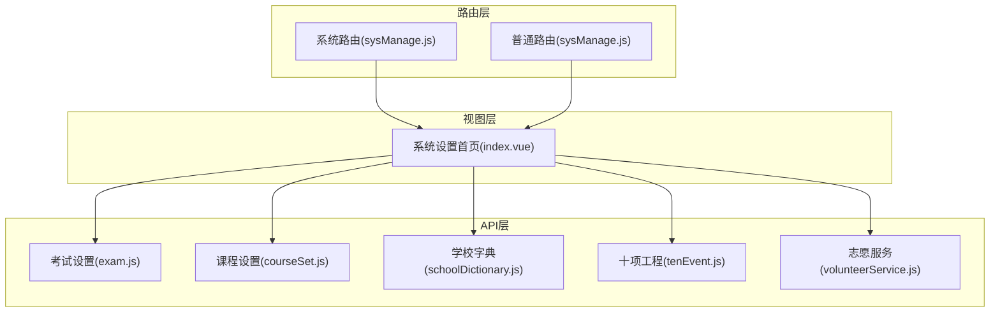
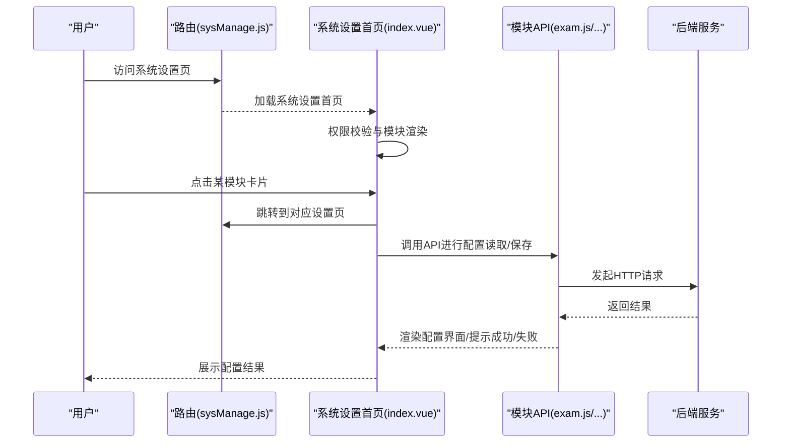
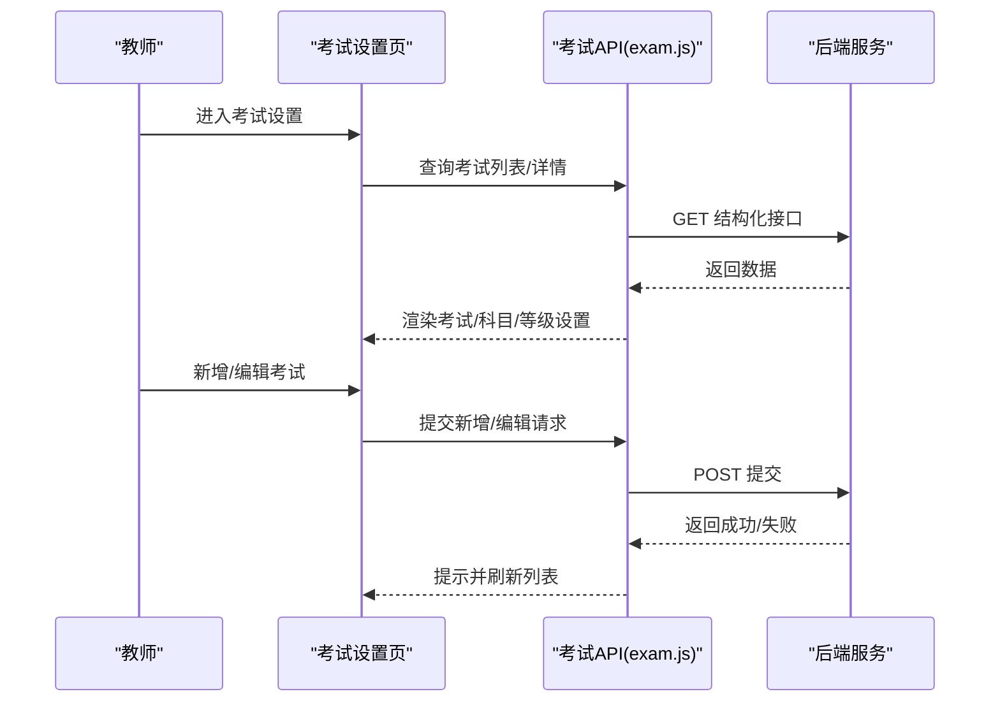
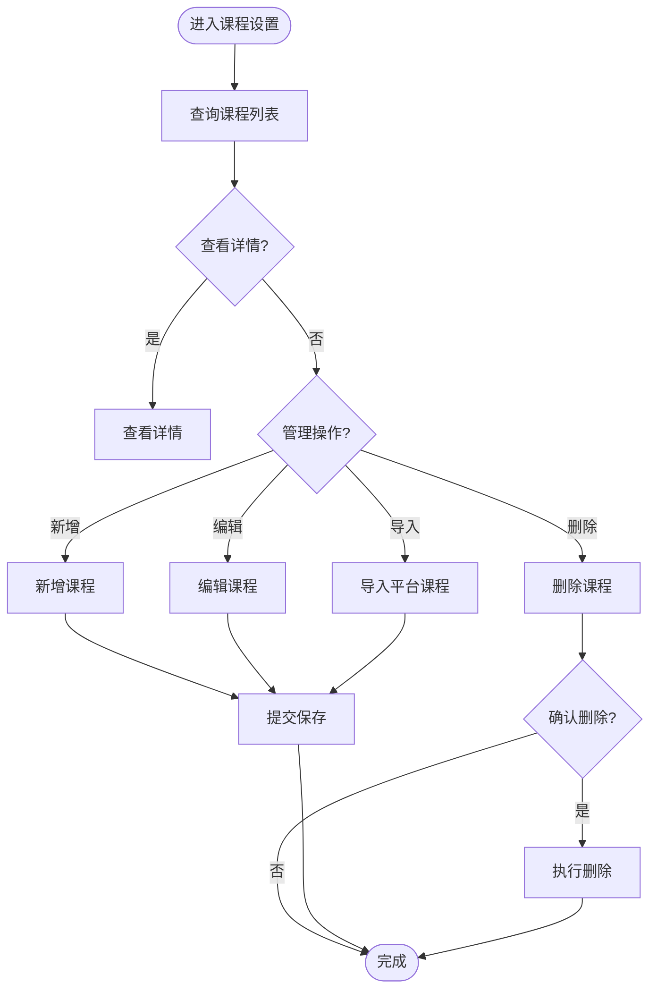
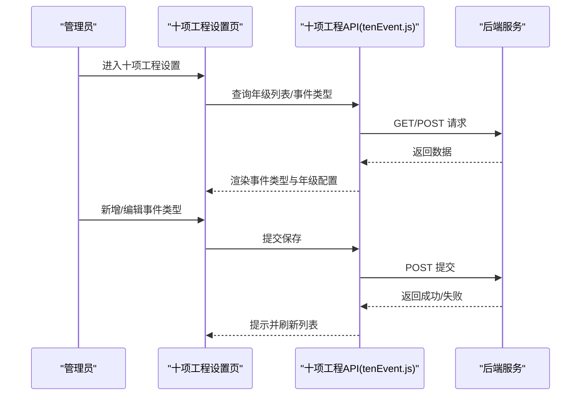
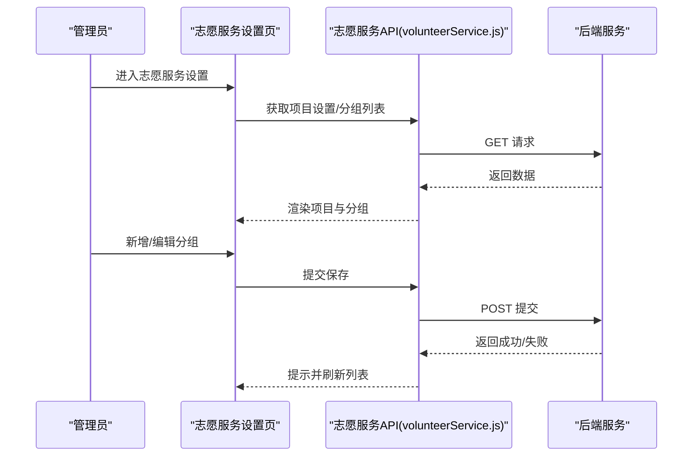
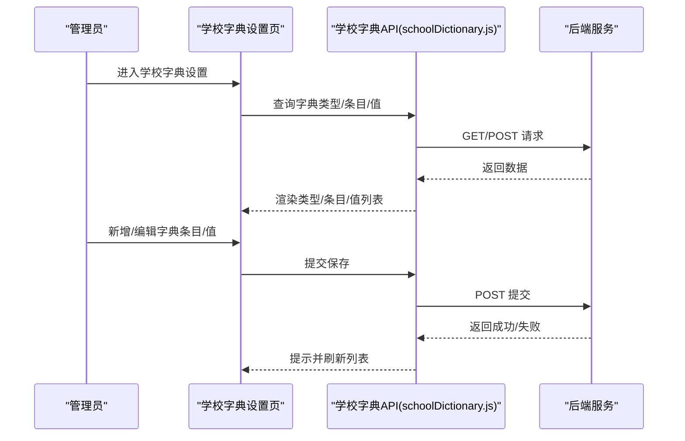
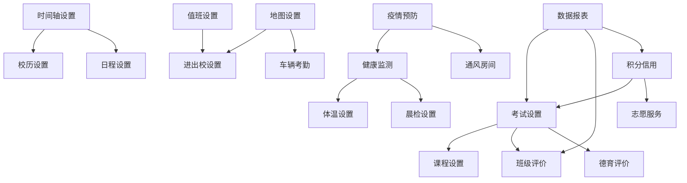

# 系统功能设置

<cite>
**本文引用的文件**
- [路由配置（系统）](file://src/router/system/sysManage.js)
- [路由配置（普通）](file://src/router/normal/sysManage.js)
- [系统设置首页](file://src/views/sysSet/index.vue)
- [考试设置 API](file://src/api/systemSet/exam.js)
- [课程设置 API](file://src/api/systemSet/courseSet.js)
- [学校字典 API](file://src/api/systemSet/schoolDictionary.js)
- [十项工程 API](file://src/api/systemSet/tenEvent.js)
- [志愿服务 API](file://src/api/systemSet/volunteerService.js)
</cite>

## 目录
1. [简介](#简介)
2. [项目结构](#项目结构)
3. [核心组件](#核心组件)
4. [架构总览](#架构总览)
5. [详细组件分析](#详细组件分析)
6. [依赖关系分析](#依赖关系分析)
7. [性能考虑](#性能考虑)
8. [故障排查指南](#故障排查指南)
9. [结论](#结论)
10. [附录](#附录)

## 简介
本技术文档围绕“系统功能设置”主题，系统梳理并解释系统中各类功能模块的配置方法、业务逻辑与技术实现。覆盖范围包括：用餐设置、考试设置、课程设置、班级评价、作业检查、口语算数、时间轴设置、体温设置、晨检设置、累计评价、数据报表、邀请设置、地图设置、学校统计、操作设置、十项工程、志愿服务、访客预约、积分信用、请假取消票据、车辆考勤、消防设置、疫情预防、阅读打卡、学校字典、学生值日、通风房间、导师设置、值班设置、课堂设置、五育设置、建议设置、加班设置、纪念品设置、模块管理、模块统计、办公室管理、校历设置等。

文档从三层视角展开：前端路由与页面入口、后端接口与数据模型、业务流程与权限控制。同时提供功能开关控制、参数配置、权限设置与数据验证规则说明，并给出功能启用/禁用流程、配置变更影响分析与异常处理机制。

## 项目结构
系统功能设置主要通过以下层次组织：
- 路由层：在系统与普通两类路由中定义各功能模块的访问路径与懒加载页面。
- 视图层：系统设置首页聚合所有可配置模块入口，按权限动态展示。
- API 层：封装各模块的增删改查、状态变更、统计分析等接口。
- 权限层：基于权限标识控制模块可见性与操作能力。

图表来源
- [路由配置（系统）](file://src/router/system/sysManage.js)
- [路由配置（普通）](file://src/router/normal/sysManage.js)
- [系统设置首页](file://src/views/sysSet/index.vue)
- [考试设置 API](file://src/api/systemSet/exam.js)
- [课程设置 API](file://src/api/systemSet/courseSet.js)
- [学校字典 API](file://src/api/systemSet/schoolDictionary.js)
- [十项工程 API](file://src/api/systemSet/tenEvent.js)
- [志愿服务 API](file://src/api/systemSet/volunteerService.js)

章节来源
- [路由配置（系统）](file://src/router/system/sysManage.js)
- [路由配置（普通）](file://src/router/normal/sysManage.js)
- [系统设置首页](file://src/views/sysSet/index.vue)

## 核心组件
- 系统设置首页：统一入口，按权限展示模块卡片，点击跳转对应设置页。
- 各模块设置页：承载具体配置项、参数与交互逻辑。
- API 封装：统一请求方法、参数序列化与响应处理。
- 权限控制：通过权限标识过滤模块入口与操作按钮。

章节来源
- [系统设置首页](file://src/views/sysSet/index.vue)
- [路由配置（系统）](file://src/router/system/sysManage.js)
- [路由配置（普通）](file://src/router/normal/sysManage.js)

## 架构总览
系统功能设置采用“路由驱动页面 + API 驱动数据”的前后端分离架构。前端通过路由注册模块页面，页面内调用对应 API 完成配置的增删改查与状态变更；后端提供 REST 风格接口，返回标准结构的数据或状态码。

图表来源
- [路由配置（系统）](file://src/router/system/sysManage.js)
- [系统设置首页](file://src/views/sysSet/index.vue)
- [考试设置 API](file://src/api/systemSet/exam.js)
- [课程设置 API](file://src/api/systemSet/courseSet.js)
- [学校字典 API](file://src/api/systemSet/schoolDictionary.js)
- [十项工程 API](file://src/api/systemSet/tenEvent.js)
- [志愿服务 API](file://src/api/systemSet/volunteerService.js)

## 详细组件分析

### 1) 用餐设置
- 功能概述：支持学生/教师就餐停伙设置、供餐设置、就餐地点管理、维护就餐人员等。
- 配置项
  - 停伙时间设置：按角色（教师/学生）与学期维度配置停伙时段。
  - 供餐设置：配置不同角色的供餐策略与规则。
  - 就餐地点：新增/编辑/维护就餐地点。
  - 就餐人员：维护餐厅就餐人员名单。
- 业务逻辑
  - 停伙与供餐互斥或联动，需结合学期时间与角色进行校验。
  - 地点与人员绑定，确保人员仅在有效地点就餐。
- 技术实现
  - 路由入口：系统路由与普通路由均提供“就餐设置”相关页面。
  - 数据流：前端调用相应 API 获取/更新设置，后端返回标准化结果。
- 权限与验证
  - 依据权限标识控制模块可见性与操作权限。
  - 参数校验：学期ID、角色类型、时间区间合法性校验。
- 异常处理
  - 时间冲突、重复设置、越权访问等场景返回明确错误码与提示。

章节来源
- [路由配置（系统）](file://src/router/system/sysManage.js)
- [路由配置（普通）](file://src/router/normal/sysManage.js)
- [系统设置首页](file://src/views/sysSet/index.vue)

### 2) 考试设置
- 功能概述：支持年级/班级考试设置、考试类型管理、科目配置、成绩录入与分析。
- 配置项
  - 成绩等级设置：A/B/C/D/E 等级阈值与显示规则。
  - 考试管理：创建/编辑/删除考试，设置考试日期、类型、班级范围。
  - 科目管理：按班级/学期配置考试科目。
  - 成绩维护：批量/单个录入成绩，支持发送平均分、最高分、最低分、排名。
  - 评语模板：教师评语模板维护与选择。
- 业务逻辑
  - 成绩等级与科目关联，发布前可预览与调整。
  - 成绩分析支持按班级、按科目、按学生多维统计。
- 技术实现
  - API 提供列表查询、详情获取、新增/编辑、删除、成绩写入、分析数据等接口。
- 权限与验证
  - 仅具备相应角色（如班主任/学科教师/教务）可操作。
  - 参数校验：考试名称唯一性、日期有效性、分数范围等。
- 异常处理
  - 成绩重复录入、越权发布、数据格式错误等场景返回错误码与提示。

图表来源
- [考试设置 API](file://src/api/systemSet/exam.js)
- [系统设置首页](file://src/views/sysSet/index.vue)

章节来源
- [考试设置 API](file://src/api/systemSet/exam.js)
- [系统设置首页](file://src/views/sysSet/index.vue)

### 3) 课程设置
- 功能概述：支持课程列表管理、课程详情、新增/编辑/删除、平台课程导入与学校课程维护。
- 配置项
  - 课程列表：分页查询、搜索、查看详情。
  - 平台课程：导入国标课程至学校课程库。
  - 学校课程：新增/编辑/删除，设置是否主科、考试类型、排序、课时因子等。
- 业务逻辑
  - 平台课程作为模板，导入后可二次编辑适配学校实际。
  - 主科/非主科区分用于教学与评价体系。
- 技术实现
  - API 提供课程列表、详情、新增、更新、删除、导入、平台课程列表等接口。
- 权限与验证
  - 仅具备课程管理权限可操作。
  - 参数校验：名称唯一性、排序数值、课时因子等。
- 异常处理
  - 重复导入、非法参数、删除关联数据等情况返回错误码与提示。

图表来源
- [课程设置 API](file://src/api/systemSet/courseSet.js)
- [系统设置首页](file://src/views/sysSet/index.vue)

章节来源
- [课程设置 API](file://src/api/systemSet/courseSet.js)
- [系统设置首页](file://src/views/sysSet/index.vue)

### 4) 班级评价
- 功能概述：支持班级评价规则与指标设置，用于日常评价与统计。
- 配置项
  - 评价规则：设置评价周期、权重、指标项。
  - 指标管理：新增/编辑/删除评价指标。
- 业务逻辑
  - 指标与规则联动，形成完整的评价体系。
- 技术实现
  - 通过系统设置首页入口进入班级评价设置页。
- 权限与验证
  - 仅具备相应角色可配置。
  - 参数校验：指标名称唯一性、权重分配合理性。
- 异常处理
  - 指标缺失、权重超界等返回错误码与提示。

章节来源
- [路由配置（普通）](file://src/router/normal/sysManage.js)
- [系统设置首页](file://src/views/sysSet/index.vue)

### 5) 作业检查
- 功能概述：支持教师布置作业后的检查设置，规范作业批改与反馈。
- 配置项
  - 检查规则：设置检查频率、检查项清单、评分标准。
  - 检查项管理：新增/编辑/删除检查项。
- 业务逻辑
  - 检查项与学科/年级匹配，便于教师执行。
- 技术实现
  - 通过系统设置首页入口进入作业检查设置页。
- 权限与验证
  - 仅具备相应角色可配置。
  - 参数校验：检查项名称唯一性、标准完整性。
- 异常处理
  - 检查项缺失、重复配置等返回错误码与提示。

章节来源
- [路由配置（普通）](file://src/router/normal/sysManage.js)
- [系统设置首页](file://src/views/sysSet/index.vue)

### 6) 口语算数
- 功能概述：支持口语与算数类打卡设置，提升语言与计算能力训练。
- 配置项
  - 打卡规则：设置每日/每周目标、奖励机制。
  - 统计维度：按班级/个人统计完成情况。
- 业务逻辑
  - 与阅读打卡类似，强调持续性与激励性。
- 技术实现
  - 通过系统设置首页入口进入口语算数设置页。
- 权限与验证
  - 仅具备相应角色可配置。
  - 参数校验：目标值合理性、统计口径一致性。
- 异常处理
  - 规则冲突、统计异常等返回错误码与提示。

章节来源
- [路由配置（普通）](file://src/router/normal/sysManage.js)
- [系统设置首页](file://src/views/sysSet/index.vue)

### 7) 时间轴设置
- 功能概述：支持作息时间、校历、日程等时间类配置。
- 配置项
  - 作息时间：设置上课/下课时间轴。
  - 校历：设置学期日历、节假日安排。
  - 日程：设置学校日程模板与提醒。
- 业务逻辑
  - 时间轴与校历联动，确保教学活动有序开展。
- 技术实现
  - 通过系统设置首页入口进入时间轴相关设置页。
- 权限与验证
  - 仅具备相应角色可配置。
  - 参数校验：时间先后顺序、节假日重复等。
- 异常处理
  - 时间重叠、跨年校历等返回错误码与提示。

章节来源
- [路由配置（普通）](file://src/router/normal/sysManage.js)
- [系统设置首页](file://src/views/sysSet/index.vue)

### 8) 体温设置
- 功能概述：支持体温检查设置，保障校园健康监测。
- 配置项
  - 体温检查规则：设置检查频次、阈值、记录方式。
  - 统计与预警：按班级/年级统计异常情况。
- 业务逻辑
  - 与晨检/午检联动，形成完整健康监测体系。
- 技术实现
  - 通过系统设置首页入口进入体温检查设置页。
- 权限与验证
  - 仅具备相应角色可配置。
  - 参数校验：温度阈值、统计口径。
- 异常处理
  - 阈值异常、数据缺失等返回错误码与提示。

章节来源
- [路由配置（普通）](file://src/router/normal/sysManage.js)
- [系统设置首页](file://src/views/sysSet/index.vue)

### 9) 晨检设置
- 功能概述：支持学生晨检/午检规则与流程配置。
- 配置项
  - 检查流程：设置检查项目、检查人、检查时间。
  - 统计与报告：按班级/年级统计异常人数与趋势。
- 业务逻辑
  - 与体温检查协同，形成健康监测闭环。
- 技术实现
  - 通过系统设置首页入口进入晨检设置页。
- 权限与验证
  - 仅具备相应角色可配置。
  - 参数校验：检查项目完整性、时间安排合理性。
- 异常处理
  - 流程缺失、统计异常等返回错误码与提示。

章节来源
- [路由配置（普通）](file://src/router/normal/sysManage.js)
- [系统设置首页](file://src/views/sysSet/index.vue)

### 10) 累计评价
- 功能概述：支持累积式自我评价设置，促进学生长期发展。
- 配置项
  - 评价维度：设置评价项、权重、周期。
  - 档案管理：查看与导出累积评价结果。
- 业务逻辑
  - 评价结果用于成长档案与综合评价。
- 技术实现
  - 通过系统设置首页入口进入累计评价设置页。
- 权限与验证
  - 仅具备相应角色可配置。
  - 参数校验：维度唯一性、周期连续性。
- 异常处理
  - 维度冲突、周期重叠等返回错误码与提示。

章节来源
- [路由配置（普通）](file://src/router/normal/sysManage.js)
- [系统设置首页](file://src/views/sysSet/index.vue)

### 11) 数据报表
- 功能概述：支持各类数据报告的推送设置，满足管理与分析需求。
- 配置项
  - 报告模板：设置报告内容、格式、推送对象。
  - 推送规则：设置推送时间、频率、条件。
- 业务逻辑
  - 报告自动汇总并按规则推送给相关人员。
- 技术实现
  - 通过系统设置首页入口进入数据报表设置页。
- 权限与验证
  - 仅具备相应角色可配置。
  - 参数校验：模板完整性、推送条件合法性。
- 异常处理
  - 模板缺失、推送失败等返回错误码与提示。

章节来源
- [路由配置（普通）](file://src/router/normal/sysManage.js)
- [系统设置首页](file://src/views/sysSet/index.vue)

### 12) 邀请设置
- 功能概述：支持邀请函模板与发送规则配置。
- 配置项
  - 邀请模板：设置模板内容、样式、适用场景。
  - 发送规则：设置发送对象、触发条件、频率限制。
- 业务逻辑
  - 邀请函按规则自动发送，提升沟通效率。
- 技术实现
  - 通过系统设置首页入口进入邀请设置页。
- 权限与验证
  - 仅具备相应角色可配置。
  - 参数校验：模板可用性、发送对象有效性。
- 异常处理
  - 模板错误、发送失败等返回错误码与提示。

章节来源
- [路由配置（普通）](file://src/router/normal/sysManage.js)
- [系统设置首页](file://src/views/sysSet/index.vue)

### 13) 地图设置
- 功能概述：支持校园地图配置，便于导航与活动组织。
- 配置项
  - 地图标注：设置教学楼、功能区、出入口等。
  - 导航规则：设置路径规划、避障策略。
- 业务逻辑
  - 地图与活动、巡检、访客预约等模块联动。
- 技术实现
  - 通过系统设置首页入口进入地图设置页。
- 权限与验证
  - 仅具备相应角色可配置。
  - 参数校验：标注位置合理性、路径可达性。
- 异常处理
  - 标注冲突、路径不可达等返回错误码与提示。

章节来源
- [路由配置（普通）](file://src/router/normal/sysManage.js)
- [系统设置首页](file://src/views/sysSet/index.vue)

### 14) 学校统计
- 功能概述：支持学校层面的各类统计数据与可视化配置。
- 配置项
  - 统计维度：设置统计口径、时间范围、展示方式。
  - 可视化：设置图表类型、颜色方案、导出格式。
- 业务逻辑
  - 统计结果用于决策支持与汇报展示。
- 技术实现
  - 通过系统设置首页入口进入学校统计设置页。
- 权限与验证
  - 仅具备相应角色可配置。
  - 参数校验：维度一致性、图表配置合法性。
- 异常处理
  - 维度过宽、图表渲染失败等返回错误码与提示。

章节来源
- [路由配置（普通）](file://src/router/normal/sysManage.js)
- [系统设置首页](file://src/views/sysSet/index.vue)

### 15) 操作设置
- 功能概述：支持系统日志与操作审计的配置。
- 配置项
  - 日志策略：设置日志级别、保留天数、敏感字段脱敏。
  - 审计规则：设置关键操作审计、告警阈值。
- 业务逻辑
  - 保障系统安全与合规运营。
- 技术实现
  - 通过系统设置首页入口进入操作设置页。
- 权限与验证
  - 仅具备相应角色可配置。
  - 参数校验：日志级别、保留期限、脱敏规则。
- 异常处理
  - 配置冲突、存储异常等返回错误码与提示。

章节来源
- [路由配置（普通）](file://src/router/normal/sysManage.js)
- [系统设置首页](file://src/views/sysSet/index.vue)

### 16) 十项工程
- 功能概述：支持“六十事”工程的事件类型与规则配置。
- 配置项
  - 事件类型：设置事件类别、分值、周期。
  - 年级配置：按上下学期分别设置事件数量与类型。
- 业务逻辑
  - 事件与学生行为评价、积分体系联动。
- 技术实现
  - 通过系统设置首页入口进入十项工程设置页。
- 权限与验证
  - 仅具备相应角色可配置。
  - 参数校验：事件类型唯一性、分值合理性。
- 异常处理
  - 类型冲突、分值异常等返回错误码与提示。

图表来源
- [十项工程 API](file://src/api/systemSet/tenEvent.js)
- [系统设置首页](file://src/views/sysSet/index.vue)

章节来源
- [十项工程 API](file://src/api/systemSet/tenEvent.js)
- [系统设置首页](file://src/views/sysSet/index.vue)

### 17) 志愿服务
- 功能概述：支持志愿服务项目的设置与分组管理。
- 配置项
  - 项目设置：设置项目名称、描述、时长要求、奖励机制。
  - 分组管理：按年级/班级分组，设置负责人与任务分配。
- 业务逻辑
  - 项目与积分信用、评价体系联动。
- 技术实现
  - 通过系统设置首页入口进入志愿服务设置页。
- 权限与验证
  - 仅具备相应角色可配置。
  - 参数校验：项目唯一性、分组完整性。
- 异常处理
  - 项目冲突、分组缺失等返回错误码与提示。

图表来源
- [志愿服务 API](file://src/api/systemSet/volunteerService.js)
- [系统设置首页](file://src/views/sysSet/index.vue)

章节来源
- [志愿服务 API](file://src/api/systemSet/volunteerService.js)
- [系统设置首页](file://src/views/sysSet/index.vue)

### 18) 访客预约
- 功能概述：支持访客预约流程与规则配置。
- 配置项
  - 预约规则：设置预约时间、审批流程、访客登记项。
  - 地点管理：设置可预约区域与容量。
- 业务逻辑
  - 预约与门禁、地图联动，确保安全可控。
- 技术实现
  - 通过系统设置首页入口进入访客预约设置页。
- 权限与验证
  - 仅具备相应角色可配置。
  - 参数校验：时间窗口、容量上限。
- 异常处理
  - 时间冲突、容量超限等返回错误码与提示。

章节来源
- [路由配置（普通）](file://src/router/normal/sysManage.js)
- [系统设置首页](file://src/views/sysSet/index.vue)

### 19) 积分信用
- 功能概述：支持积分成长计划与信用体系建设。
- 配置项
  - 积分规则：设置积分获取与抵扣规则、有效期。
  - 信用等级：设置信用等级划分与权益。
  - 自动申请：设置自动申领与发放规则。
- 业务逻辑
  - 积分与信用联动，激励学生良好行为。
- 技术实现
  - 通过系统设置首页入口进入积分信用设置页。
- 权限与验证
  - 仅具备相应角色可配置。
  - 参数校验：积分阈值、有效期、等级划分。
- 异常处理
  - 规则冲突、等级缺失等返回错误码与提示。

章节来源
- [路由配置（普通）](file://src/router/normal/sysManage.js)
- [系统设置首页](file://src/views/sysSet/index.vue)

### 20) 请假取消票据
- 功能概述：支持请假抵扣票据的设置与管理。
- 配置项
  - 抵扣规则：设置抵扣类型、抵扣比例、生效时间。
  - 票据管理：设置票据模板、打印规则。
- 业务逻辑
  - 票据与请假、考勤联动，规范流程。
- 技术实现
  - 通过系统设置首页入口进入请假取消票据设置页。
- 权限与验证
  - 仅具备相应角色可配置。
  - 参数校验：抵扣比例、票据模板完整性。
- 异常处理
  - 规则冲突、票据无效等返回错误码与提示。

章节来源
- [路由配置（普通）](file://src/router/normal/sysManage.js)
- [系统设置首页](file://src/views/sysSet/index.vue)

### 21) 车辆考勤
- 功能概述：支持校园车辆考勤规则与地点管理。
- 配置项
  - 考勤规则：设置进出时间、区域限制、异常处理。
  - 地点管理：设置停车区域与通道。
- 业务逻辑
  - 考勤与门禁、地图联动，保障校园交通秩序。
- 技术实现
  - 通过系统设置首页入口进入车辆考勤设置页。
- 权限与验证
  - 仅具备相应角色可配置。
  - 参数校验：时间窗口、区域边界。
- 异常处理
  - 区域冲突、时间异常等返回错误码与提示。

章节来源
- [路由配置（普通）](file://src/router/normal/sysManage.js)
- [系统设置首页](file://src/views/sysSet/index.vue)

### 22) 消防设置
- 功能概述：支持消防设施与应急流程的配置。
- 配置项
  - 设施管理：设置消防设备位置、责任人、巡检频次。
  - 应急预案：设置疏散路线、集合点、演练计划。
- 业务逻辑
  - 与安全巡检、地图联动，确保应急响应及时。
- 技术实现
  - 通过系统设置首页入口进入消防设置页。
- 权限与验证
  - 仅具备相应角色可配置。
  - 参数校验：设施位置、路线可达性。
- 异常处理
  - 设施缺失、路线不可达等返回错误码与提示。

章节来源
- [路由配置（普通）](file://src/router/normal/sysManage.js)
- [系统设置首页](file://src/views/sysSet/index.vue)

### 23) 疫情预防
- 功能概述：支持智慧防疫设置，涵盖健康监测、轨迹追踪、预警机制。
- 配置项
  - 防疫规则：设置健康上报、隔离观察、消毒消杀等流程。
  - 预警机制：设置异常阈值、通知渠道、处置流程。
- 业务逻辑
  - 与体温、晨检、消毒等模块联动，形成闭环管理。
- 技术实现
  - 通过系统设置首页入口进入疫情预防设置页。
- 权限与验证
  - 仅具备相应角色可配置。
  - 参数校验：阈值设置、通知模板。
- 异常处理
  - 阈值异常、通知失败等返回错误码与提示。

章节来源
- [路由配置（普通）](file://src/router/normal/sysManage.js)
- [系统设置首页](file://src/views/sysSet/index.vue)

### 24) 阅读打卡
- 功能概述：支持阅读平台打卡规则与统计配置。
- 配置项
  - 打卡规则：设置每日/每周目标、奖励机制。
  - 统计维度：按班级/个人统计完成情况。
- 业务逻辑
  - 与阅读平台联动，提升阅读参与度。
- 技术实现
  - 通过系统设置首页入口进入阅读打卡设置页。
- 权限与验证
  - 仅具备相应角色可配置。
  - 参数校验：目标值合理性、统计口径一致性。
- 异常处理
  - 规则冲突、统计异常等返回错误码与提示。

章节来源
- [路由配置（普通）](file://src/router/normal/sysManage.js)
- [系统设置首页](file://src/views/sysSet/index.vue)

### 25) 学校字典
- 功能概述：支持学校各类字典的分类与条目管理。
- 配置项
  - 字典类型：设置类型编码、名称、备注。
  - 字典条目：设置条目名称、排序、备注。
  - 字典值：设置键值对、排序、备注。
- 业务逻辑
  - 字典贯穿多个模块，保证数据一致性与可扩展性。
- 技术实现
  - 通过系统设置首页入口进入学校字典设置页。
- 权限与验证
  - 仅具备相应角色可配置。
  - 参数校验：编码唯一性、排序连续性。
- 异常处理
  - 编码冲突、排序异常等返回错误码与提示。

图表来源
- [学校字典 API](file://src/api/systemSet/schoolDictionary.js)
- [系统设置首页](file://src/views/sysSet/index.vue)

章节来源
- [学校字典 API](file://src/api/systemSet/schoolDictionary.js)
- [系统设置首页](file://src/views/sysSet/index.vue)

### 26) 学生值日
- 功能概述：支持学生值日提醒与轮值管理。
- 配置项
  - 值日规则：设置值日岗位、轮值周期、提醒方式。
  - 统计与评价：按班级/个人统计值日完成情况。
- 业务逻辑
  - 值日与班级评价、德育评价联动。
- 技术实现
  - 通过系统设置首页入口进入学生值日设置页。
- 权限与验证
  - 仅具备相应角色可配置。
  - 参数校验：岗位唯一性、周期连续性。
- 异常处理
  - 岗位冲突、周期重叠等返回错误码与提示。

章节来源
- [路由配置（普通）](file://src/router/normal/sysManage.js)
- [系统设置首页](file://src/views/sysSet/index.vue)

### 27) 通风房间
- 功能概述：支持消毒打卡与通风房间管理。
- 配置项
  - 房间管理：设置房间编号、用途、责任人。
  - 打卡规则：设置消毒频次、检查项目、记录方式。
- 业务逻辑
  - 与消毒打卡、健康监测联动，保障环境卫生。
- 技术实现
  - 通过系统设置首页入口进入通风房间设置页。
- 权限与验证
  - 仅具备相应角色可配置。
  - 参数校验：房间唯一性、消毒频次合理性。
- 异常处理
  - 房间冲突、频次异常等返回错误码与提示。

章节来源
- [路由配置（普通）](file://src/router/normal/sysManage.js)
- [系统设置首页](file://src/views/sysSet/index.vue)

### 28) 导师设置
- 功能概述：支持导师制度的导师分配与职责配置。
- 配置项
  - 导师分配：设置导师与学生匹配规则、周期。
  - 职责管理：设置导师职责、评价指标。
- 业务逻辑
  - 导师与德育评价、课堂评价联动。
- 技术实现
  - 通过系统设置首页入口进入导师设置页。
- 权限与验证
  - 仅具备相应角色可配置。
  - 参数校验：匹配规则合理性、职责完整性。
- 异常处理
  - 匹配冲突、职责缺失等返回错误码与提示。

章节来源
- [路由配置（普通）](file://src/router/normal/sysManage.js)
- [系统设置首页](file://src/views/sysSet/index.vue)

### 29) 值班设置
- 功能概述：支持值班与进出校设置，保障校园安全。
- 配置项
  - 值班规则：设置值班时间、岗位、交接流程。
  - 出入校规则：设置进出校时间、审批流程、记录方式。
- 业务逻辑
  - 值班与门禁、地图联动，确保安全可控。
- 技术实现
  - 通过系统设置首页入口进入值班设置页。
- 权限与验证
  - 仅具备相应角色可配置。
  - 参数校验：时间窗口、岗位覆盖。
- 异常处理
  - 时间冲突、岗位空缺等返回错误码与提示。

章节来源
- [路由配置（普通）](file://src/router/normal/sysManage.js)
- [系统设置首页](file://src/views/sysSet/index.vue)

### 30) 课堂设置
- 功能概述：支持课堂评价与推送设置，提升教学质量。
- 配置项
  - 评价规则：设置评价维度、权重、周期。
  - 推送设置：设置评价结果推送对象与格式。
- 业务逻辑
  - 评价结果用于教师绩效与教学改进。
- 技术实现
  - 通过系统设置首页入口进入课堂设置页。
- 权限与验证
  - 仅具备相应角色可配置。
  - 参数校验：维度唯一性、权重分配合理性。
- 异常处理
  - 维度冲突、权重超界等返回错误码与提示。

章节来源
- [路由配置（普通）](file://src/router/normal/sysManage.js)
- [系统设置首页](file://src/views/sysSet/index.vue)

### 31) 五育设置
- 功能概述：支持五育并举的评价指标与交换设置。
- 配置项
  - 指标设置：设置德智体美劳五育指标与权重。
  - 交换规则：设置指标互换、兑换机制。
- 业务逻辑
  - 指标与评价、积分信用联动，促进全面发展。
- 技术实现
  - 通过系统设置首页入口进入五育设置页。
- 权限与验证
  - 仅具备相应角色可配置。
  - 参数校验：指标唯一性、权重分配合理性。
- 异常处理
  - 指标冲突、权重异常等返回错误码与提示。

章节来源
- [路由配置（普通）](file://src/router/normal/sysManage.js)
- [系统设置首页](file://src/views/sysSet/index.vue)

### 32) 建议设置
- 功能概述：支持建议箱/园长信箱类型的分类与处理流程配置。
- 配置项
  - 类型管理：设置建议类型、处理时限、反馈模板。
  - 处理流程：设置接收、分派、处理、回复流程。
- 业务逻辑
  - 建议与数据报表、满意度分析联动。
- 技术实现
  - 通过系统设置首页入口进入建议设置页。
- 权限与验证
  - 仅具备相应角色可配置。
  - 参数校验：类型唯一性、时限合理性。
- 异常处理
  - 类型冲突、时限异常等返回错误码与提示。

章节来源
- [路由配置（普通）](file://src/router/normal/sysManage.js)
- [系统设置首页](file://src/views/sysSet/index.vue)

### 33) 加班设置
- 功能概述：支持加班规则与统计配置，规范加班管理。
- 配置项
  - 加班规则：设置加班类型、时长计算、补偿方式。
  - 统计与结算：按月/季度统计加班时长与费用。
- 业务逻辑
  - 加班与考勤、工资管理联动。
- 技术实现
  - 通过系统设置首页入口进入加班设置页。
- 权限与验证
  - 仅具备相应角色可配置。
  - 参数校验：时长计算规则、补偿标准。
- 异常处理
  - 规则冲突、统计异常等返回错误码与提示。

章节来源
- [路由配置（普通）](file://src/router/normal/sysManage.js)
- [系统设置首页](file://src/views/sysSet/index.vue)

### 34) 纪念品设置
- 功能概述：支持纪念品管理与发放规则配置。
- 配置项
  - 纪念品管理：设置物品名称、数量、价值、发放条件。
  - 发放规则：设置发放对象、发放时间、领取方式。
- 业务逻辑
  - 纪念品与积分信用、评价体系联动。
- 技术实现
  - 通过系统设置首页入口进入纪念品设置页。
- 权限与验证
  - 仅具备相应角色可配置。
  - 参数校验：物品唯一性、数量充足性。
- 异常处理
  - 物品缺失、数量不足等返回错误码与提示。

章节来源
- [路由配置（普通）](file://src/router/normal/sysManage.js)
- [系统设置首页](file://src/views/sysSet/index.vue)

### 35) 模块管理
- 功能概述：支持应用模块的启用/禁用与权限控制。
- 配置项
  - 模块启用：设置模块可见性、默认入口。
  - 权限控制：设置模块访问角色、操作权限。
- 业务逻辑
  - 模块与权限系统联动，确保最小授权。
- 技术实现
  - 通过系统设置首页入口进入模块管理页。
- 权限与验证
  - 仅具备相应角色可配置。
  - 参数校验：模块唯一性、权限组合合法性。
- 异常处理
  - 权限冲突、模块缺失等返回错误码与提示。

章节来源
- [路由配置（普通）](file://src/router/normal/sysManage.js)
- [系统设置首页](file://src/views/sysSet/index.vue)

### 36) 模块统计
- 功能概述：支持模块使用情况的统计与分析。
- 配置项
  - 统计维度：设置统计口径、时间范围、展示方式。
  - 报表导出：设置导出格式、字段选择。
- 业务逻辑
  - 统计结果用于模块优化与资源配置。
- 技术实现
  - 通过系统设置首页入口进入模块统计页。
- 权限与验证
  - 仅具备相应角色可配置。
  - 参数校验：维度一致性、报表配置合法性。
- 异常处理
  - 维度过宽、报表渲染失败等返回错误码与提示。

章节来源
- [路由配置（普通）](file://src/router/normal/sysManage.js)
- [系统设置首页](file://src/views/sysSet/index.vue)

### 37) 办公室管理
- 功能概述：支持办公室设置与人员管理。
- 配置项
  - 办公室设置：设置办公室编号、负责人、职能。
  - 人员管理：设置办公室成员、职责分工。
- 业务逻辑
  - 办公室与值班、地图联动，提升办公效率。
- 技术实现
  - 通过系统设置首页入口进入办公室管理页。
- 权限与验证
  - 仅具备相应角色可配置。
  - 参数校验：办公室唯一性、人员归属。
- 异常处理
  - 办公室冲突、人员缺失等返回错误码与提示。

章节来源
- [路由配置（普通）](file://src/router/normal/sysManage.js)
- [系统设置首页](file://src/views/sysSet/index.vue)

### 38) 校历设置
- 功能概述：支持校历的制定与发布，确保教学活动有序开展。
- 配置项
  - 校历模板：设置学期开始/结束、假期安排、节日标注。
  - 发布规则：设置发布对象、生效时间、变更通知。
- 业务逻辑
  - 校历与作息时间、日程联动，形成完整时间体系。
- 技术实现
  - 通过系统设置首页入口进入校历设置页。
- 权限与验证
  - 仅具备相应角色可配置。
  - 参数校验：日期连续性、假期合理性。
- 异常处理
  - 日期冲突、假期异常等返回错误码与提示。

章节来源
- [路由配置（普通）](file://src/router/normal/sysManage.js)
- [系统设置首页](file://src/views/sysSet/index.vue)

## 依赖关系分析
系统功能设置模块之间存在强弱耦合关系：
- 强耦合：考试设置与课程设置、班级评价、德育评价、课堂评价等联动。
- 中等耦合：时间轴设置与校历、日程、值班设置联动。
- 弱耦合：数据报表与各模块统计结果联动。
- 独立模块：地图、门禁、车辆考勤、消防、疫情预防等独立运行但可联动。

图表来源
- [路由配置（系统）](file://src/router/system/sysManage.js)
- [路由配置（普通）](file://src/router/normal/sysManage.js)
- [系统设置首页](file://src/views/sysSet/index.vue)

章节来源
- [路由配置（系统）](file://src/router/system/sysManage.js)
- [路由配置（普通）](file://src/router/normal/sysManage.js)
- [系统设置首页](file://src/views/sysSet/index.vue)

## 性能考虑
- 前端性能
  - 路由懒加载：减少首屏加载体积，提升响应速度。
  - 权限过滤：在首页按权限渲染模块，避免无用页面加载。
  - 分页与缓存：列表查询采用分页与本地缓存，降低请求压力。
- 后端性能
  - 接口幂等：配置类接口应保证重复提交的安全性与一致性。
  - 批量操作：支持批量导入/导出，减少多次往返。
  - 缓存策略：热点配置（如字典、时间轴）可引入缓存层。
- 网络与安全
  - 参数校验前置：在前端与后端双重校验，减少无效请求。
  - 权限校验：所有配置接口均需鉴权与角色校验。
  - 错误码规范：统一错误码与提示，便于前端快速定位问题。

## 故障排查指南
- 常见问题
  - 模块不可见：检查权限标识是否正确配置，确认 isShowByPermission/isShowByPermissionList 的返回值。
  - 配置保存失败：检查参数是否符合后端校验规则，查看返回的错误码与提示信息。
  - 数据不一致：检查缓存与本地状态同步，必要时强制刷新页面。
  - 接口超时：检查网络连通性与后端服务状态，关注接口耗时与并发。
- 排查步骤
  - 确认路由是否正确注册，页面是否按需懒加载。
  - 在浏览器开发者工具中查看网络请求与响应，定位具体接口与参数。
  - 根据错误码与提示信息，逐项核对配置项与业务规则。
  - 如涉及权限问题，检查用户角色与模块权限映射关系。
- 异常处理机制
  - 前端捕获接口异常，统一弹窗提示并记录日志。
  - 对于关键配置（如时间轴、校历），提供回滚与恢复机制。
  - 对于批量导入，提供断点续传与错误行定位。

章节来源
- [系统设置首页](file://src/views/sysSet/index.vue)
- [路由配置（系统）](file://src/router/system/sysManage.js)
- [路由配置（普通）](file://src/router/normal/sysManage.js)

## 结论
系统功能设置模块覆盖学校管理的多个关键领域，通过清晰的路由组织、完善的 API 封装与严格的权限控制，实现了配置的可视化与可追溯。建议在后续迭代中进一步完善：
- 统一错误码与提示文案，提升用户体验。
- 增加配置变更审计日志，便于问题溯源。
- 优化批量导入/导出流程，提升管理效率。
- 强化跨模块联动的自动化与智能化，降低人工干预成本。

## 附录
- 功能启用/禁用流程
  - 通过模块管理页面设置模块可见性与默认入口。
  - 配置完成后，刷新首页，确认模块出现在模块列表中。
  - 若模块不可见，检查权限标识与角色映射。
- 配置变更影响分析
  - 关键配置（时间轴、校历、值班）变更需评估对教学与安全的影响，建议提前发布变更通知。
  - 影响较大的配置（如考试规则、评价体系）应进行灰度发布与回滚准备。
- 数据验证规则
  - 所有必填字段必须校验，时间类字段需校验先后顺序与合法性。
  - 数值类字段需校验范围与精度，字符串类字段需校验长度与字符集。
  - 唯一性字段需在保存前进行去重检查。