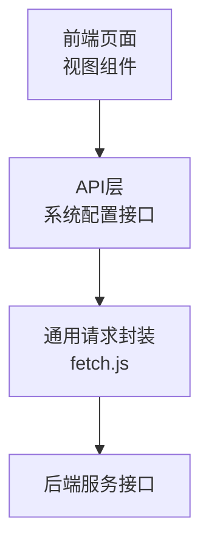
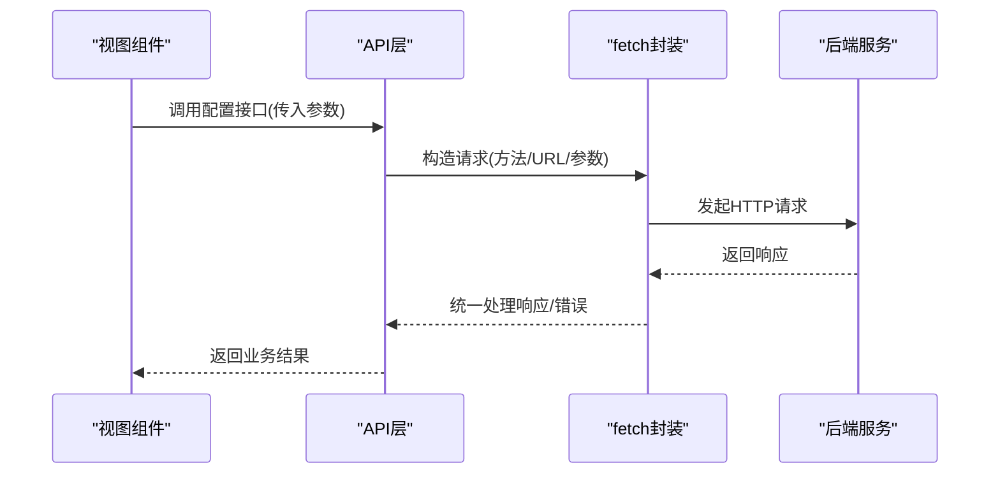
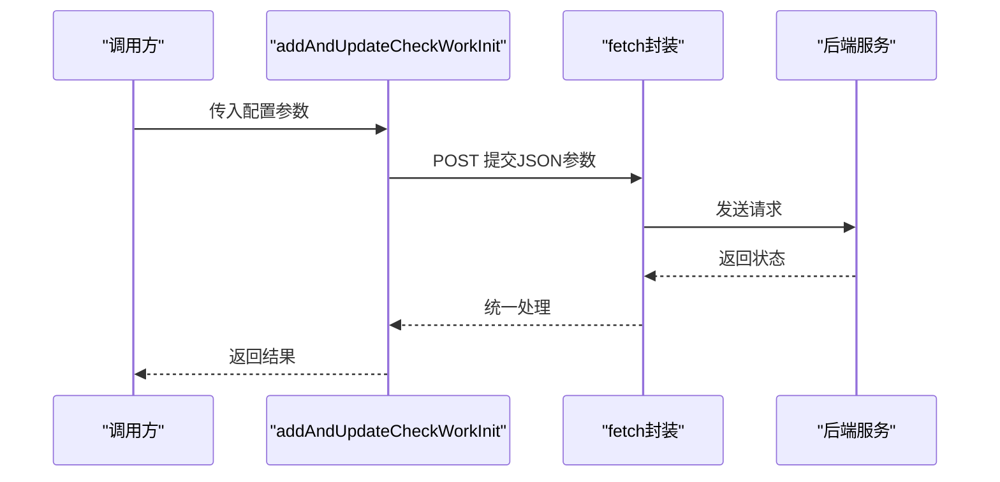
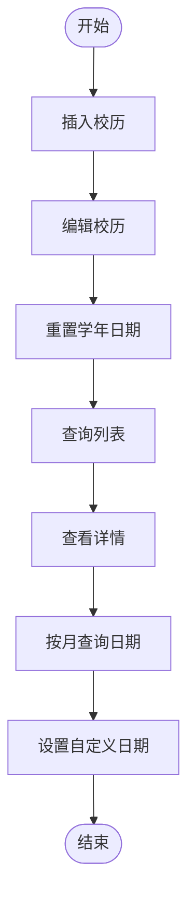
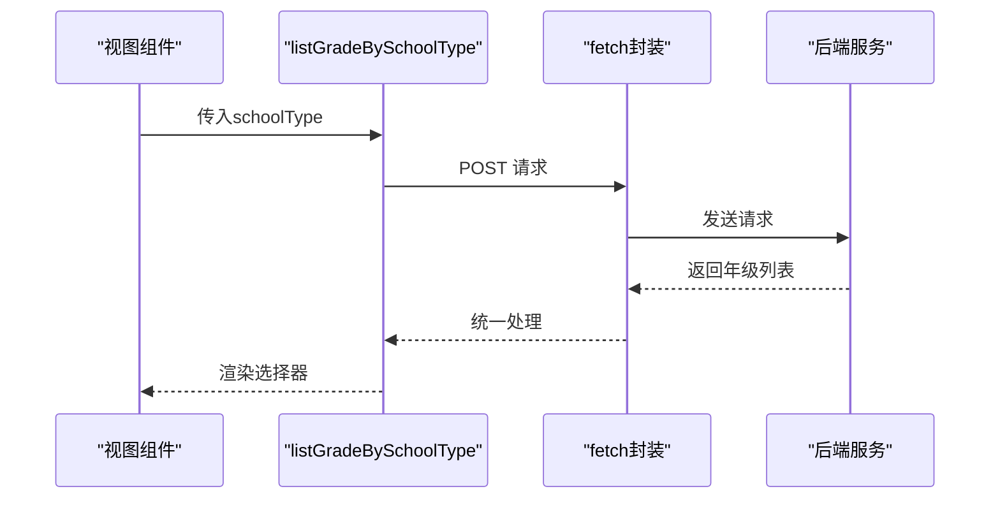
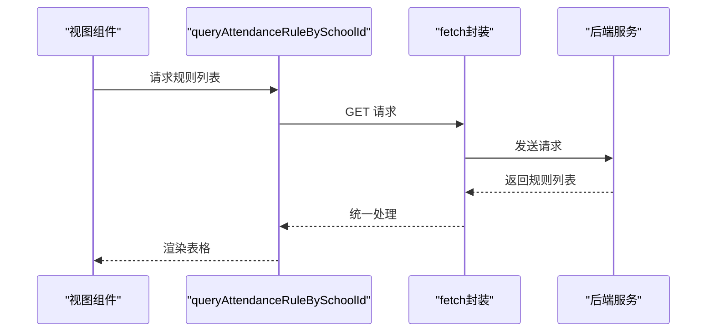
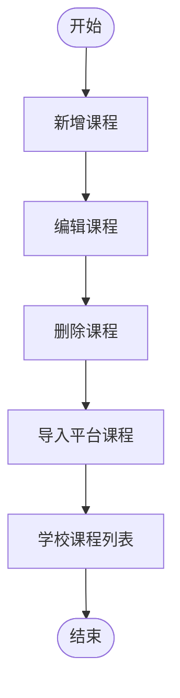
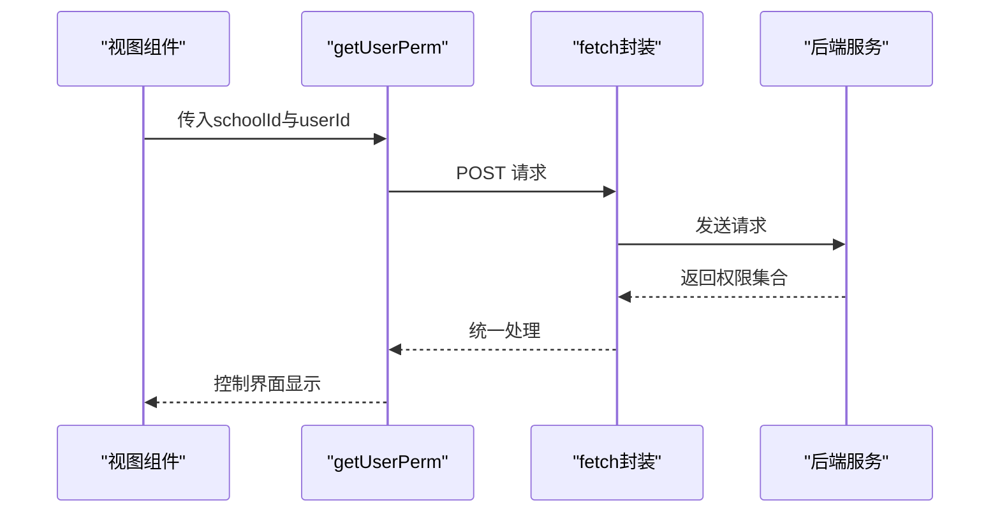
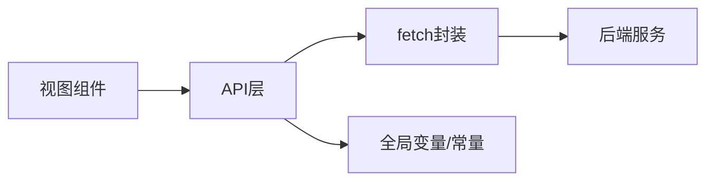

# 系统配置管理

<cite>
**本文引用的文件**
- [src/api/systemSet/dockingAttendanceMachine.js](file://src/api/systemSet/dockingAttendanceMachine.js)
- [src/api/schoolCalendar.js](file://src/api/schoolCalendar.js)
- [src/api/systemSet/readPunchClockSet.js](file://src/api/systemSet/readPunchClockSet.js)
- [src/api/systemSet/teacherAttendanceSet.js](file://src/api/systemSet/teacherAttendanceSet.js)
- [src/api/systemSet/courseSet.js](file://src/api/systemSet/courseSet.js)
- [src/api/systemSet/org.js](file://src/api/systemSet/org.js)
- [src/api/systemSet/permission.js](file://src/api/systemSet/permission.js)
- [src/utils/fetch.js](file://src/utils/fetch.js)
</cite>

## 目录
1. [引言](#引言)
2. [项目结构](#项目结构)
3. [核心组件](#核心组件)
4. [架构总览](#架构总览)
5. [详细组件分析](#详细组件分析)
6. [依赖分析](#依赖分析)
7. [性能考虑](#性能考虑)
8. [故障排查指南](#故障排查指南)
9. [结论](#结论)
10. [附录](#附录)

## 引言
本技术文档围绕系统配置管理功能展开，聚焦于学期管理、校历设置、作息时间配置、考勤设置等核心模块。文档从接口定义、数据流、生效机制、数据验证与影响范围等方面进行系统化梳理，并结合前端API层与通用请求封装，给出可操作的实现建议与最佳实践。

## 项目结构
系统配置管理相关代码主要分布在以下位置：
- API层：位于 src/api/systemSet 下，按功能域拆分（如考勤、课程、组织等）
- 通用请求封装：位于 src/utils/fetch.js，统一处理HTTP请求、拦截器与错误处理
- 配置相关API示例：
  - 考勤对接：dockingAttendanceMachine.js
  - 校历：schoolCalendar.js
  - 阅读打卡：readPunchClockSet.js
  - 教师考勤规则：teacherAttendanceSet.js
  - 课程设置：courseSet.js
  - 组织与权限：org.js、permission.js

图表来源
- [src/api/systemSet/dockingAttendanceMachine.js:1-43](file://src/api/systemSet/dockingAttendanceMachine.js#L1-L43)
- [src/api/schoolCalendar.js:1-110](file://src/api/schoolCalendar.js#L1-L110)
- [src/api/systemSet/readPunchClockSet.js:1-51](file://src/api/systemSet/readPunchClockSet.js#L1-L51)
- [src/api/systemSet/teacherAttendanceSet.js:1-288](file://src/api/systemSet/teacherAttendanceSet.js#L1-L288)
- [src/api/systemSet/courseSet.js:1-217](file://src/api/systemSet/courseSet.js#L1-L217)
- [src/api/systemSet/org.js:1-800](file://src/api/systemSet/org.js#L1-L800)
- [src/api/systemSet/permission.js:1-40](file://src/api/systemSet/permission.js#L1-L40)
- [src/utils/fetch.js](file://src/utils/fetch.js)

章节来源
- [src/api/systemSet/dockingAttendanceMachine.js:1-43](file://src/api/systemSet/dockingAttendanceMachine.js#L1-L43)
- [src/api/schoolCalendar.js:1-110](file://src/api/schoolCalendar.js#L1-L110)
- [src/api/systemSet/readPunchClockSet.js:1-51](file://src/api/systemSet/readPunchClockSet.js#L1-L51)
- [src/api/systemSet/teacherAttendanceSet.js:1-288](file://src/api/systemSet/teacherAttendanceSet.js#L1-L288)
- [src/api/systemSet/courseSet.js:1-217](file://src/api/systemSet/courseSet.js#L1-L217)
- [src/api/systemSet/org.js:1-800](file://src/api/systemSet/org.js#L1-L800)
- [src/api/systemSet/permission.js:1-40](file://src/api/systemSet/permission.js#L1-L40)
- [src/utils/fetch.js](file://src/utils/fetch.js)

## 核心组件
- 考勤对接模块：提供考勤机初始化、查询与删除接口，支持按学校维度管理考勤设置。
- 校历模块：提供学年、校历日期的增删改查、月份日期查询与自定义日期设置。
- 阅读打卡模块：提供按学校类型获取年级列表、查询与保存阅读打卡设置。
- 教师考勤规则模块：提供考勤规则的增删改查、用户绑定、立即生效、地点维护与设置保存。
- 课程设置模块：提供课程列表、选择课程、新增/编辑/删除、学校课程的增删改与导入平台课程。
- 组织与权限模块：提供部门、用户、角色、权限查询与同步等能力。

章节来源
- [src/api/systemSet/dockingAttendanceMachine.js:1-43](file://src/api/systemSet/dockingAttendanceMachine.js#L1-L43)
- [src/api/schoolCalendar.js:1-110](file://src/api/schoolCalendar.js#L1-L110)
- [src/api/systemSet/readPunchClockSet.js:1-51](file://src/api/systemSet/readPunchClockSet.js#L1-L51)
- [src/api/systemSet/teacherAttendanceSet.js:1-288](file://src/api/systemSet/teacherAttendanceSet.js#L1-L288)
- [src/api/systemSet/courseSet.js:1-217](file://src/api/systemSet/courseSet.js#L1-L217)
- [src/api/systemSet/org.js:1-800](file://src/api/systemSet/org.js#L1-L800)
- [src/api/systemSet/permission.js:1-40](file://src/api/systemSet/permission.js#L1-L40)

## 架构总览
系统配置管理采用“视图组件 -> API层 -> 通用请求封装 -> 后端服务”的分层架构。API层对后端接口进行薄封装，统一参数构造与错误处理；通用请求封装负责拦截器、超时控制与统一响应处理。

图表来源
- [src/api/systemSet/teacherAttendanceSet.js:1-288](file://src/api/systemSet/teacherAttendanceSet.js#L1-L288)
- [src/utils/fetch.js](file://src/utils/fetch.js)

## 详细组件分析

### 考勤对接模块（dockingAttendanceMachine.js）
- 功能要点
  - 新增/修改考勤设置：通过POST提交配置参数至指定路径
  - 查询考勤设置：按学校ID查询当前配置
  - 删除考勤设置：清理已配置的考勤设置
- 参数与返回
  - 增删改接口使用JSON字符串化参数
  - 查询接口使用URLSearchParams构造参数
- 生效机制
  - 删除接口为清理型调用；新增/修改接口通常在保存后即时生效，具体以后端策略为准
- 数据验证与影响范围
  - 前端建议对必填字段进行非空校验；影响范围覆盖该学校的考勤机对接行为

图表来源
- [src/api/systemSet/dockingAttendanceMachine.js:6-16](file://src/api/systemSet/dockingAttendanceMachine.js#L6-L16)

章节来源
- [src/api/systemSet/dockingAttendanceMachine.js:1-43](file://src/api/systemSet/dockingAttendanceMachine.js#L1-L43)

### 校历模块（schoolCalendar.js）
- 功能要点
  - 重置学年日期、删除校历记录、插入/编辑校历
  - 列表查询、详情查询、按月查询日期、设置自定义日期
  - 获取学年列表
- 参数与返回
  - 多数接口使用URLSearchParams拼装参数
  - 某些接口使用JSON字符串化参数
- 生效机制
  - 插入/编辑接口通常用于保存新的校历周期；重置接口可能触发周期切换
- 数据验证与影响范围
  - 前端需校验起止日期合法性与顺序；影响范围覆盖全校历计算、排课与统计

图表来源
- [src/api/schoolCalendar.js:3-108](file://src/api/schoolCalendar.js#L3-L108)

章节来源
- [src/api/schoolCalendar.js:1-110](file://src/api/schoolCalendar.js#L1-L110)

### 阅读打卡模块（readPunchClockSet.js）
- 功能要点
  - 按学校类型获取年级列表
  - 查询与保存阅读打卡设置（包含是否全校启用、年级列表JSON、预警开关等）
- 参数与返回
  - 查询使用无参POST
  - 保存使用URLSearchParams拼装多项参数
- 生效机制
  - 保存后通常即时生效；具体以后端策略为准
- 数据验证与影响范围
  - 年级列表JSON需符合后端格式；影响范围覆盖阅读打卡相关统计与提醒

图表来源
- [src/api/systemSet/readPunchClockSet.js:7-17](file://src/api/systemSet/readPunchClockSet.js#L7-L17)

章节来源
- [src/api/systemSet/readPunchClockSet.js:1-51](file://src/api/systemSet/readPunchClockSet.js#L1-L51)

### 教师考勤规则模块（teacherAttendanceSet.js）
- 功能要点
  - 考勤规则：列表、新增、编辑、删除、详情、立即生效
  - 考勤用户：按规则查询用户、添加/移除用户、按用户立即生效
  - 考勤设置：获取与保存（推送消息、考勤机对接等）
  - 地点维护：列表、新增、编辑、删除、详情
- 参数与返回
  - 多数接口使用URLSearchParams拼装参数
  - 某些接口使用JSON字符串化参数
- 生效机制
  - 规则与用户均可通过“立即生效”接口快速应用
- 数据验证与影响范围
  - 地点经纬度与范围需合理；规则与用户绑定影响教师考勤统计与提醒

图表来源
- [src/api/systemSet/teacherAttendanceSet.js:7-14](file://src/api/systemSet/teacherAttendanceSet.js#L7-L14)

章节来源
- [src/api/systemSet/teacherAttendanceSet.js:1-288](file://src/api/systemSet/teacherAttendanceSet.js#L1-L288)

### 课程设置模块（courseSet.js）
- 功能要点
  - 课程列表、选择课程列表、编辑课程、新增课程、删除课程、详情查询
  - 学校课程：分页列表、详情、删除、导入平台课程、新增/编辑、平台课程列表
- 参数与返回
  - 多数接口使用URLSearchParams拼装参数
  - 导入平台课程使用JSON字符串化参数
- 生效机制
  - 新增/编辑/删除通常即时生效；导入流程涉及平台课程映射
- 数据验证与影响范围
  - 课程名称与排序需唯一性校验；影响范围覆盖排课与教学计划

图表来源
- [src/api/systemSet/courseSet.js:71-217](file://src/api/systemSet/courseSet.js#L71-L217)

章节来源
- [src/api/systemSet/courseSet.js:1-217](file://src/api/systemSet/courseSet.js#L1-L217)

### 组织与权限模块（org.js、permission.js）
- 功能要点
  - 组织：部门树、用户分页列表、年级列表、部门增删改查、负责人与成员管理、同步与迁移
  - 权限：用户权限查询、子权限查询
- 参数与返回
  - 多数接口使用URLSearchParams拼装参数
  - 部分接口使用JSON字符串化参数
- 生效机制
  - 用户角色与部门变更通常即时生效；同步接口可能异步执行
- 数据验证与影响范围
  - 部门与用户关系需保持一致性；影响范围覆盖权限控制与数据可见性

图表来源
- [src/api/systemSet/permission.js:15-25](file://src/api/systemSet/permission.js#L15-L25)

章节来源
- [src/api/systemSet/org.js:1-800](file://src/api/systemSet/org.js#L1-L800)
- [src/api/systemSet/permission.js:1-40](file://src/api/systemSet/permission.js#L1-L40)

## 依赖分析
- 组件耦合
  - API层各模块相对独立，仅共享通用请求封装
  - 通用请求封装提供统一的HTTP请求能力与错误处理
- 外部依赖
  - 后端服务接口：各模块均依赖后端对应接口路径
  - 全局登录路径：权限模块使用全局变量作为登录路径前缀
- 潜在循环依赖
  - 当前结构为单向依赖（视图 -> API -> fetch -> 服务），无循环依赖风险

图表来源
- [src/api/systemSet/permission.js:20-23](file://src/api/systemSet/permission.js#L20-L23)
- [src/utils/fetch.js](file://src/utils/fetch.js)

章节来源
- [src/api/systemSet/permission.js:1-40](file://src/api/systemSet/permission.js#L1-L40)
- [src/utils/fetch.js](file://src/utils/fetch.js)

## 性能考虑
- 请求合并与批处理
  - 对批量用户或规则的操作，优先使用后端支持的批量接口，减少请求次数
- 参数压缩
  - 对大字段（如JSON字符串）在必要时进行压缩传输，降低带宽占用
- 缓存策略
  - 对只读配置（如学年、课程列表）可采用本地缓存，结合版本号或时间戳做失效控制
- 错误重试
  - 对瞬时网络异常增加指数退避重试，避免雪崩效应
- 分页与懒加载
  - 列表类接口使用分页，配合虚拟滚动提升渲染性能

## 故障排查指南
- 常见问题
  - 接口报错：检查URL路径与方法是否匹配，确认全局登录路径配置正确
  - 参数缺失：核对必填字段是否传入，尤其是ID、学校ID等关键参数
  - 数据不生效：确认是否调用了“立即生效”接口，或等待后端定时任务生效
- 定位步骤
  - 打开浏览器开发者工具，查看Network面板中的请求与响应
  - 在API层函数处设置断点，确认参数构造逻辑
  - 检查通用请求封装中的拦截器与错误处理分支
- 回滚与恢复
  - 若配置变更导致异常，优先调用删除或重置接口恢复默认值
  - 对关键配置建议在变更前进行备份（如导出当前配置）

章节来源
- [src/api/systemSet/dockingAttendanceMachine.js:1-43](file://src/api/systemSet/dockingAttendanceMachine.js#L1-L43)
- [src/api/systemSet/teacherAttendanceSet.js:106-115](file://src/api/systemSet/teacherAttendanceSet.js#L106-L115)
- [src/utils/fetch.js](file://src/utils/fetch.js)

## 结论
系统配置管理通过清晰的模块划分与统一的请求封装，实现了对学期、校历、作息、考勤等关键领域的灵活配置。建议在实际落地中强化参数校验、完善缓存与回滚机制，并结合后端策略明确“立即生效”的使用场景，确保配置变更的安全与稳定。

## 附录

### API接口清单与说明
- 考勤对接
  - 新增/修改：提交配置参数，保存后通常即时生效
  - 查询：按学校ID获取当前配置
  - 删除：清理已配置的考勤设置
- 校历
  - 重置学年日期、插入/编辑校历、删除记录、列表查询、详情查询、按月查询、设置自定义日期
- 阅读打卡
  - 按学校类型获取年级列表、查询与保存阅读打卡设置
- 教师考勤规则
  - 规则：列表、新增、编辑、删除、详情、立即生效
  - 用户：按规则查询、添加/移除、按用户立即生效
  - 设置：获取与保存（推送消息、考勤机对接）
  - 地点：列表、新增、编辑、删除、详情
- 课程设置
  - 课程：列表、选择列表、编辑、新增、删除、详情
  - 学校课程：分页列表、详情、删除、导入平台课程、新增/编辑、平台课程列表
- 组织与权限
  - 组织：部门、用户、年级、负责人、同步与迁移
  - 权限：用户权限查询、子权限查询

章节来源
- [src/api/systemSet/dockingAttendanceMachine.js:1-43](file://src/api/systemSet/dockingAttendanceMachine.js#L1-L43)
- [src/api/schoolCalendar.js:1-110](file://src/api/schoolCalendar.js#L1-L110)
- [src/api/systemSet/readPunchClockSet.js:1-51](file://src/api/systemSet/readPunchClockSet.js#L1-L51)
- [src/api/systemSet/teacherAttendanceSet.js:1-288](file://src/api/systemSet/teacherAttendanceSet.js#L1-L288)
- [src/api/systemSet/courseSet.js:1-217](file://src/api/systemSet/courseSet.js#L1-L217)
- [src/api/systemSet/org.js:1-800](file://src/api/systemSet/org.js#L1-L800)
- [src/api/systemSet/permission.js:1-40](file://src/api/systemSet/permission.js#L1-L40)